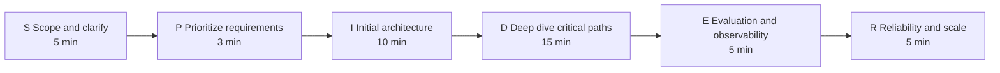
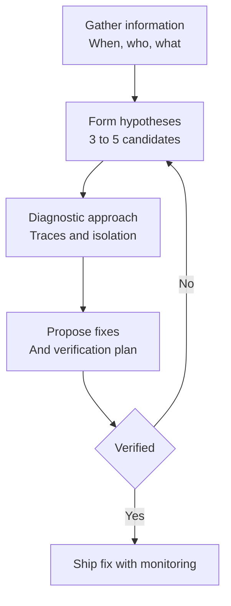

<div dir="rtl">

# چارچوب‌های پاسخ‌دهی برای مصاحبه‌های طراحی سیستم‌های هوش مصنوعی (AI System Design)

پنج چارچوب ساختاریافته برای مصاحبه‌های طراحی سیستم‌های هوش مصنوعی: SPIDER برای سؤالات طراحی سیستم، ETA برای تشریح مفاهیم، تحلیل موازنه‌ها (Tradeoffs)، عیب‌یابی و اشکال‌زدایی، و STAR-L برای سؤالات رفتاری.

پاسخ‌های قدرتمند در مصاحبه از ساختارهای منسجم و یکپارچه‌ای پیروی می‌کنند. این فصل چارچوب‌هایی را برای انواع مختلف سؤالات، همراه با مثال‌ها و الگوهای ضدالگو (Anti-patterns) ارائه می‌دهد. این چارچوب‌ها را با نمونه‌های حل‌شده در [بانک سؤالات](01-question-bank.md) تطبیق دهید و با [تمرین‌های تخته‌سفید](04-whiteboard-exercises.md) تمرین کنید.

## جدول محتوا

- [چارچوب طراحی سیستم (SPIDER)](#system-design-framework-spider)
- [نمونه پیاده‌سازی‌شده: SPIDER در یک جلسه ۴۵ دقیقه‌ای](#worked-example-spider-in-a-45-minute-session)
- [چارچوب توضیح مفاهیم (ETA)](#concept-explanation-framework-eta)
- [چارچوب تحلیل موازنه‌ها](#tradeoff-analysis-framework)
- [چارچوب اشکال‌زدایی و عیب‌یابی](#debugging-and-troubleshooting-framework)
- [چارچوب سؤالات رفتاری (STAR-L)](#behavioral-questions-framework-star-l)
- [مدیریت مباحث ناشناخته](#handling-unknown-topics)
- [اشتباهات رایج و نحوه اجتناب از آن‌ها](#common-mistakes-and-how-to-avoid-them)

---

<a id="system-design-framework-spider"></a>

## چارچوب طراحی سیستم (SPIDER)

از این چارچوب برای هر سؤال طراحی سیستمی که شامل مولفه‌های هوش مصنوعی است استفاده کنید. حرکت کامل همراه با بودجه زمانی تقریبی برای هر فاز:

<div dir="ltr">



</div>

### مرحله S - مشخص کردن دامنه و شفاف‌سازی (Scope and Clarify)

**هدف:** محدود کردن فضای مسئله و نشان دادن اینکه شما پیش از ساخت، فکر می‌کنید.

**سؤالاتی که باید بپرسید:**
- مقیاس سیستم چقدر است؟ (کاربران، درخواست‌ها، حجم داده)
- الزامات تاخیر (Latency) چیست؟
- چه سطحی از دقت یا کیفیت مورد انتظار است؟
- آیا الزامات امنیتی یا انطباق قانونی (Compliance) وجود دارد؟
- زیرساخت موجود چیست؟
- محدودیت بودجه چقدر است؟

**مثال:**

<div dir="ltr">

```
Interviewer: Design a customer support chatbot.

You: Before I dive in, I want to clarify a few things:
- What volume are we expecting? Thousands or millions of conversations per day?
- Is this customer-facing or internal support?
- What languages need to be supported?
- Do we need to integrate with existing ticketing systems?
- What is our accuracy target for resolved vs escalated?
```

</div>

**ضدالگو (Anti-pattern):** پریدن مستقیم به سراغ معماری بدون درک نیازمندی‌ها.

---

### مرحله P - اولویت‌بندی نیازمندی‌ها (Prioritize Requirements)

**هدف:** شناسایی مواردی که بیشترین اهمیت را دارند و طراحی بر اساس آن‌ها.

**یک ماتریس اولویت‌بندی ایجاد کنید:**

| نیازمندی | اولویت | پیامد طراحی |
|-------------|----------|-------------|
| تاخیر کم (Low latency) | بالا | ممکن است اندازه مدل را محدود کند |
| دقت بالا (High accuracy) | بالا | نیاز به بازیابی قوی + پایپ‌لاین ارزیابی (Eval) |
| کارایی هزینه (Cost efficiency) | متوسط | بهینه‌سازی از طریق Caching |
| چندزبانه بودن (Multi-language) | متوسط | انتخاب مدل Embedding را تحت تاثیر قرار می‌دهد |

**اولویت‌های خود را به‌صورت شفاف بیان کنید:**

<div dir="ltr">

```
"Given these requirements, I will prioritize latency and accuracy. 
Cost optimization will be a second-order concern once we have the basic system working."
```

</div>

---

### مرحله I - معماری اولیه (Initial Architecture)

**هدف:** ترسیم نمای کلی سیستم در سطح بالا پیش از ورود به جزئیات.

**مولفه‌های استاندارد برای سیستم‌های هوش مصنوعی:**
<div dir="ltr">

```
┌──────────┐     ┌──────────┐     ┌──────────┐     ┌──────────┐
│  Client  │────▶│  API GW  │────▶│ AI Layer │────▶│  LLM(s)  │
└──────────┘     └──────────┘     └──────────┘     └──────────┘
                                        │
                                        ▼
                                  ┌──────────┐
                                  │ Data/RAG │
                                  └──────────┘
```

</div>

**هر مولفه را به‌صورت مختصر شرح دهید:**
- چه کاری انجام می‌دهد
- چرا به آن نیاز است
- چه جایگزین‌هایی برای آن وجود دارد

---

### مرحله D - ورود عمیق به مسیرهای حیاتی (Deep Dive into Critical Paths)

**هدف:** نشان دادن عمق دانش فنی روی مهم‌ترین بخش‌های سیستم.

**۲ تا ۳ بخش را بر این اساس برای تحلیل عمیق انتخاب کنید:**
- مصاحبه‌کننده به چه چیزی بیشترین تمایل و علاقه را نشان می‌دهد
- چه چیزی در این سیستم جدید، منحصر‌به‌فرد یا پیچیده است
- بزرگ‌ترین ریسک‌ها در کجا قرار دارند

**نمونه‌هایی از بخش‌های نیازمند ورود عمیق:**
- پایپ‌لاین RAG: فرآیند Chunking، ساخت Embedding، بازیابی، رتبه‌بندی مجدد (Reranking)
- حلقه Agent: انتخاب ابزار، مدیریت خطا، شرایط پایان (Termination)
- پایپ‌لاین داده: دریافت (Ingestion)، پردازش و نمایه‌سازی (Indexing)
- امنیت: ایزوله‌سازی، دسترسی‌ها و ممیزی (Audit)

**قصد خود را اعلام کنید:**

<div dir="ltr">

```
"I will now go deeper on the RAG pipeline since retrieval quality is critical to this system."
```

</div>

---

### مرحله E - ارزیابی و مشاهده‌پذیری (Evaluation and Observability)

**هدف:** نشان دادن اینکه شما به عملیات استقرار در محیط عملیاتی (production) فکر می‌کنید.

**پوشش موارد:**
1. **متریک‌ها (Metrics):** چه چیزی را اندازه‌گیری می‌کنید؟
2. **ارزیابی (Evaluation):** چگونه متوجه می‌شوید که سیستم به‌درستی کار می‌کند؟
3. **مانیتورینگ (Monitoring):** چگونه مشکلات را تشخیص می‌دهید؟
4. **هشداردهی (Alerting):** در چه زمانی به مهندسان پیجر (Page) ارسال می‌شود؟

**متریک‌های استاندارد برای سیستم‌های هوش مصنوعی:**
- تاخیر (Latency) شامل صدک‌های p50، p95 و p99
- مصرف Token / هزینه
- امتیازات کیفیت (آفلاین و نمونه‌برداری آنلاین)
- نرخ خطا به تفکیک نوع خطا
- نرخ اصابت به کش (Cache hit rate)

---

### مرحله R - پایداری و مقیاس‌پذیری (Reliability and Scale)

**هدف:** بررسی حالت‌های شکست و نحوه رشد سیستم.

**حالت‌های شکستی که باید درباره آن‌ها بحث کنید:**
- قطعی ارائه‌دهنده LLM (یک مدل Fallback از همان ارائه‌دهنده معمولاً در قطعی شریک است)
- محدودیت نرخ درخواست (Rate limiting)
- خروجی‌های نامطلوب یا اشتباه مدل
- بازنشستگی مدل یا تغییراتی از سمت ارائه‌دهنده که تحت همان شناسه مدل اعمال می‌شود
- شکست‌های پایپ‌لاین داده
- باطل‌سازی کش (Cache invalidation)

**ملاحظات مقیاس‌پذیری (Scaling):**
- گلوگاه‌ها (Bottlenecks) کجا هستند؟
- چه بخش‌هایی به‌صورت افقی و چه بخش‌هایی به‌صورت عمودی مقیاس‌پذیر هستند؟
- چه هزینه‌هایی همگام با افزایش استفاده رشد می‌کنند؟

---

<a id="worked-example-spider-in-a-45-minute-session"></a>

## نمونه پیاده‌سازی‌شده: SPIDER در یک جلسه ۴۵ دقیقه‌ای

یک متن گفت‌وگوی فشرده که نشان می‌دهد این چارچوب در یک مصاحبه واقعی چگونه به نظر می‌رسد. موضوع: «طراحی سیستم پرسش و پاسخ اسناد برای شرکتی با ۱۰,۰۰۰ کارمند». یادداشت‌های درون براکت مراحل چارچوب و زمان‌سنج را نشان می‌دهند.

<div dir="ltr">

```
[0:00 - S: Scope]
You: "Before I draw anything, let me scope this. Roughly how many
documents, what types, and what freshness do answers need?"
Interviewer: "About 2 million documents, mostly PDFs and wikis.
Updated daily is fine."
You: "Two more: what accuracy bar are we targeting, and is this
internal-only or exposed to customers?"
Interviewer: "Internal. Wrong answers are embarrassing but not
catastrophic. p95 under 3 seconds."
You: "So: 2M mixed documents, daily freshness, internal users,
soft accuracy bar, p95 under 3s. I'll design for 10K employees
with maybe 5% daily active. That's roughly 500-2,000 queries/hour
at peak. Sound right?"
Interviewer: "Works."

[0:05 - P: Prioritize, then plan out loud]
You: "Given that, my priorities are permission correctness first,
answer quality second, latency third. Cost is second-order at this
volume. I'll draw the full pipeline first, then deep dive where you
want. Ingestion on the left: connectors, parsing, chunking,
embedding, vector store. Serving on the right: query, hybrid
retrieval, rerank, generation with citations, response. Eval and
monitoring underneath as a cross-cutting layer."

[0:08 - I: Initial architecture, drawn and narrated]
You: "Ingestion: connectors pull from SharePoint and Confluence
nightly. Parsing handles PDFs with a document-AI tier first and a
vision-LLM fallback for complex layouts. Chunking is structure-
aware, 300-500 tokens with headers prepended. Embeddings go into
a vector DB with metadata: source, team, date, access tags."
Interviewer: "Why hybrid retrieval instead of pure vector?"
You: "Internal corpora are full of project codenames and
acronyms. Embeddings miss exact-match tokens; BM25 catches them.
RRF to fuse, cross-encoder rerank on the top 50. That combination
is the difference between 70% and 90%+ retrieval hit rate here."

[0:18 - D: Deep dive where the interviewer steers]
Interviewer: "Go deeper on access control."
You: "Permissions evaluated at retrieval time, not index time.
Every chunk carries ACL tags from the source system. The retrieval
query filters on the caller's groups before similarity scoring, so
a result the user can't read never enters the candidate set. Index-
time filtering breaks the moment permissions change; retrieval-time
filtering follows the source of truth. Cache keys include the
permission set so a cached answer never leaks across groups."

[0:33 - E: Evaluation and observability]
You: "For quality, I'd stand up a 200-case golden set from real
employee questions, score faithfulness and citation accuracy with
an LLM judge calibrated monthly against human review, and sample
2% of production traffic. Dashboards: p95 latency per stage,
empty-retrieval rate, citation click-through, cost per query."

[0:38 - R: Reliability, scale, and a self-critique]
You: "Weaknesses I'd flag in my own design: nightly sync means up
to 24h staleness, fine per requirements but I'd add webhook-based
invalidation for the wikis later. Failure modes: a provider outage
falls back to a second vendor's model with its own tested prompt;
retrieval returning nothing returns 'not found in our docs' rather
than letting the model improvise. Back to the requirements: 3s p95
gives me ~400ms retrieval, ~150ms rerank (worth it for quality),
~2s generation, with streaming so perceived latency is under a
second. Anything else you'd like me to go deeper on?"
```

</div>

**آنچه این سناریو نشان می‌دهد:**
- تعیین دامنه (Scope) پنج دقیقه زمان برد و اعدادی را تولید کرد که کل طراحی به آن‌ها ارجاع داد.
- داوطلب هم‌زمان با رسم نقشه صحبت کرد و در هر فاز مصاحبه‌کننده را به هدایت بحث دعوت نمود.
- پاسخ‌های ورود عمیق با خود تصمیم شروع شدند، سپس دلیل آن و در نهایت حالت‌های شکست بیان شد.
- داوطلب پیش از آنکه مصاحبه‌کننده ایرادی بگیرد، طراحی خود را نقد کرد.
- ارزیابی بخشی از طراحی بود، نه موضوعی که در انتها به آن فکر شود.

برای تمرین این فرآیند تحت شرایط واقعی، همین مسئله را با همکاری فردی که نقش مصاحبه‌کننده را بازی می‌کند و اجازه دارد صحبت شما را قطع کند، اجرا کنید. اگر به دنبال یک مصاحبه‌کننده باتجربه برای این کار هستید، Om جلسات آزمایشی ۱ به ۱ را در [EngineBogie](https://enginebogie.com/u/ombharatiya) و [Topmate](https://topmate.io/ombharatiya) برگزار می‌کند.

---

<a id="concept-explanation-framework-eta"></a>

## چارچوب توضیح مفاهیم (ETA)

از این چارچوب برای سؤالات مفهومی مانند «RAG را توضیح دهید» یا «Speculative Decoding چیست؟» استفاده کنید.

### مرحله E - توضیح ساده (Explain Simply)

با یک تعریف یک‌جمله‌ای که برای هر کسی قابل فهم باشد شروع کنید.

**مثال برای KV Cache:**

<div dir="ltr">

```
"KV cache stores intermediate computations during LLM generation so we 
do not have to redo work for previous tokens when generating each new token."
```

</div>

---

### مرحله T - جزئیات فنی (Technical Details)

عمق فنی مناسب متناسب با سطح مصاحبه‌کننده را اضافه کنید.

**مثال برای KV Cache:**

<div dir="ltr">

```
"Specifically, for each layer in the transformer, we cache the Key and 
Value tensors for all positions. On each new token, we only compute K 
and V for the new position and concatenate with the cache. 

The memory scales as: 2 × layers × kv_heads × head_dim × bytes_per_value
× sequence_length × batch_size

For Llama 3.1 70B (80 layers, 8 KV heads, head_dim 128, BF16), that is
320 KiB per token, so one 8K-token request holds about 2.5 GiB."
```

</div>

---

### مرحله A - کاربردها و موازنه‌ها (Applications and Tradeoffs)

مفهوم را به کاربردهای عملی پیوند دهید و درباره موازنه‌ها (Tradeoffs) صحبت کنید.

**مثال برای KV Cache:**

<div dir="ltr">

```
"This is critical for production serving. Without it, generation would be 
quadratic in sequence length.

The tradeoff is memory usage. This is why techniques like PagedAttention 
and Grouped Query Attention exist: to reduce KV cache memory while 
preserving the benefits. Without GQA, that 70B model would store all 64 
heads and need 8x the memory, about 20 GiB per request. Newer attention 
designs (MLA, sliding-window and sparse layers) shrink it further, so I 
size KV from the model config, not the parameter count.

Prompt caching from OpenAI, Anthropic and Google is essentially 
server-side KV cache persistence for shared prefixes, which is why cache 
reads bill at 0.1x the input price or less on current models."
```

</div>

---

<a id="tradeoff-analysis-framework"></a>

## چارچوب تحلیل موازنه‌ها (Tradeoff Analysis)

هنگامی که از شما خواسته می‌شود گزینه‌ها را با هم مقایسه کنید یا تصمیمی را توجیه نمایید، از این ساختار استفاده کنید.

### گام ۱: گزینه‌ها را به‌صورت شفاف بیان کنید

<div dir="ltr">

```
"For embedding models, we have three main options:
1. OpenAI text-embedding-3-large: mature and widely deployed, $0.13/1M tokens
2. Cohere Embed 5 (embed-v5.0-pro / -fast): newer, multimodal, $0.12 / $0.08
   per 1M, and Pro and Fast share one embedding space
3. Self-hosted open model (Nemotron 3 Embed 8B, Qwen3-Embedding-8B, or a
   BGE variant): full control, operational overhead"
```

</div>

### گام ۲: معیارهای ارزیابی را مشخص کنید

معیارهایی را انتخاب کنید که برای این تصمیم خاص اهمیت دارند:

| معیار | وزن | دلیل |
|----------|--------|-----------|
| کیفیت (Quality) | بالا | دقت جستجو ویژگی کلیدی سیستم است |
| هزینه در مقیاس بالا (Cost at scale) | بالا | ۱۰۰ میلیون Embedding در ماه |
| تاخیر (Latency) | متوسط | نمایه‌سازی دسته‌ای (Batch)، نه بلادرنگ |
| سربار عملیاتی (Ops overhead) | متوسط | تیم کوچک |

### گام ۳: هر گزینه را تحلیل کنید

یک ماتریس مقایسه بسازید (امتیاز میانگین وزنی است که معیارهای «بالا» دو برابر شمرده می‌شوند):

| گزینه | کیفیت | هزینه | تاخیر | عملیات | امتیاز |
|--------|---------|------|---------|-----|-------|
| OpenAI | ★★★★ | ★★★ | ★★★★ | ★★★★★ | 3.8 |
| Cohere | ★★★★★ | ★★★★ | ★★★★ | ★★★★★ | 4.5 |
| هاست‌شده توسط خود (Self-hosted) | ★★★★ | ★★★★★ | ★★★ | ★★ | 3.8 |

### گام ۴: یک پیشنهاد مستدل ارائه دهید

<div dir="ltr">

```
"I would recommend Cohere Embed 5 for this use case because:
1. On our own 300-query domain eval it matches or beats
   text-embedding-3-large. Vendor benchmarks and MTEB averages only
   build the shortlist; RTEB, with private held-out sets, is the
   better public signal
2. Cost at our volume: 100M embeddings/month at ~500 tokens is 50B
   tokens, about $4K/month on embed-v5.0-fast vs $6.5K on
   text-embedding-3-large
3. Pro and Fast share one embedding space, so moving between tiers
   later does not force a full re-index
4. No operational overhead vs self-hosting

The risk is vendor dependency: switching providers means re-embedding
50B tokens. We mitigate it by abstracting the embedding interface and
keeping the raw chunks so a re-embed is a batch job, not a project."
```

</div>

---

<a id="debugging-and-troubleshooting-framework"></a>

## چارچوب اشکال‌زدایی و عیب‌یابی (Debugging)

هنگامی که پرسیده می‌شود «چگونه X را عیب‌یابی می‌کنید؟» یا «سیستم در حال انجام Y است، چگونه آن را برطرف می‌سازید؟» از فرآیند تشخیصی ۴ مرحله‌ای زیر استفاده کنید:

<div dir="ltr">



</div>

### گام ۱: جمع‌آوری اطلاعات

<div dir="ltr">

```
"First, I would ask:
- When did this start? What changed?
- Is it all requests or a subset?
- What does the error look like exactly?
- Are there patterns (time of day, user segment, query type)?"
```

</div>

### گام ۲: صورت‌بندی فرضیه‌ها

<div dir="ltr">

```
"Based on the symptoms, my top hypotheses are:
1. Retrieval quality degraded (recent data changes?)
2. Model output quality dropped (prompt changed? different model?)
3. Context length exceeded (longer documents?)
4. Rate limiting causing timeouts"
```

</div>

### گام ۳: شرح رویکرد تشخیصی

<div dir="ltr">

```
"To isolate the cause:
1. Check traces for failing requests to see where they diverge
2. Compare retrieval results to a known-good baseline
3. Check model version and prompt version in deployment
4. Review metrics for any correlated changes"
```

</div>

### گام ۴: ارائه راهکار و تایید اعتبار

<div dir="ltr">

```
"If it is retrieval quality, I would:
1. Re-index with verified chunking
2. Validate on test set before deploying
3. Roll out gradually with A/B comparison
4. Set up alerts on retrieval quality metrics to catch future issues"
```

</div>

---

<a id="behavioral-questions-framework-star-l"></a>

## چارچوب سؤالات رفتاری (STAR-L)

برای سؤالات رفتاری در نقش‌های هوش مصنوعی، از STAR-L (شامل STAR به اضافه آموخته‌ها یا Learnings) استفاده کنید.

### مرحله S - موقعیت (Situation)

بستر و زمینه ماجرا را به‌صورت خلاصه تعریف کنید.

<div dir="ltr">

```
"We had just launched our RAG-powered search feature and were getting 
complaints about incorrect answers for technical queries."
```

</div>

### مرحله T - وظیفه (Task)

مسئولیت دقیق شما چه بود؟

<div dir="ltr">

```
"As the tech lead, I needed to diagnose the issue and ship a fix quickly 
while maintaining user trust."
```

</div>

### مرحله A - اقدام (Action)

شما چه کاری انجام دادید؟ از ضمیر «من» استفاده کنید، نه «ما».

<div dir="ltr">

```
"I first instrumented detailed tracing to understand where failures occurred.
I found that our chunking strategy was splitting code blocks mid-function.
I designed a code-aware chunking approach that preserved semantic units.
I also added a confidence score display so users could calibrate trust."
```

</div>

### مرحله R - نتیجه (Result)

در صورت امکان نتایج را کمّی و عددی بیان کنید.

<div dir="ltr">

```
"Answer quality on technical queries improved from 65% to 89% in our 
evaluation suite. User complaints dropped 70% within two weeks."
```

</div>

### مرحله L - آموخته‌ها (Learnings)

اگر دوباره با آن مواجه می‌شدید چه کاری را متفاوت انجام می‌دادید؟

<div dir="ltr">

```
"I learned that chunking strategies need to be content-aware from the start.
Now I always test chunking with the actual document distribution before 
launching. I also build evaluation suites earlier in the process."
```

</div>

---

<a id="handling-unknown-topics"></a>

## مدیریت مباحث ناشناخته

ندانستن همه چیز کاملاً طبیعی و پذیرفته‌شده است. مباحث ناشناخته را به‌صورت حرفه‌ای مدیریت کنید.

### اگر اصلاً در مورد موضوع چیزی نمی‌دانید

<div dir="ltr">

```
"I am not familiar with [X]. Based on the name, I would guess it is related 
to [Y]. Can you tell me more about what it does, and I can discuss how 
I would approach the problem it solves?"
```

</div>

### اگر تا حدی با آن آشنایی دارید

<div dir="ltr">

```
"I have read about [X] but have not used it in production. My understanding 
is that it [description]. In practice, I would need to read the documentation 
and likely prototype before making architectural decisions."
```

</div>

### اگر مفهوم کلی را می‌دانید اما جزئیات را نه

<div dir="ltr">

```
"I understand the general approach of [X] - [brief explanation]. I do not 
have the specific parameters or benchmarks memorized, but I know where to 
find them and what questions to ask when evaluating it."
```

</div>

---

<a id="common-mistakes-and-how-to-avoid-them"></a>

## اشتباهات رایج و نحوه اجتناب از آن‌ها

### اشتباه ۱: پریدن سریع به سراغ راه‌حل‌ها

**غلط:**

<div dir="ltr">

```
Interviewer: "How would you design a document Q&A system?"
You: "I would use LangChain with Pinecone and GPT-6.1 Sol."
```

</div>

**درست:**

<div dir="ltr">

```
"Before defining the solution, I want to understand the requirements.
What types of documents? What volume? What accuracy is needed?"
```

</div>

---

### اشتباه ۲: نادیده گرفتن هزینه‌ها

**غلط:**

<div dir="ltr">

```
"I would always use the biggest frontier model for the best quality."
```

</div>

**درست:**

<div dir="ltr">

```
"Model selection depends on the quality bar and volume. For high-volume, 
lower-stakes queries, I might use GPT-6 Luna or Claude Haiku 5.5 
($0.10/$0.50 per 1M), Gemini 3.8 Flash, or DeepSeek V4.1-Flash and 
reserve Claude Sonnet 5.5 or GPT-6.1 Sol ($2/$10) for complex cases. 
At 1M queries/day with ~1.5K input and 300 output tokens, sending 
everything to a $2/$10 model costs about $180K/month; routing 70% to 
a $0.10/$0.50 tier brings that to about $60K, provided evals show the 
cheap tier holds the bar on that 70%."
```

</div>

---

### اشتباه ۳: عدم بحث درباره حالت‌های شکست

**غلط:**

<div dir="ltr">

```
"The system retrieves documents, sends them to the LLM, and returns the answer."
```

</div>

**درست:**

<div dir="ltr">

```
"The happy path is straightforward. But let me discuss failure modes:
- What if retrieval returns no relevant documents?
- What if the LLM hallucinates despite good context?  
- What if the provider is rate-limited or down?

For each, we need detection and fallback strategies."
```

</div>

---

### اشتباه ۴: بیش از حد پیچیده کردن طراحی

**غلط:**

<div dir="ltr">

```
"We need a separate service for chunking, another for embedding, 
a message queue between them, a stream processor for real-time, 
three different vector databases for redundancy..."
```

</div>

**درست:**

<div dir="ltr">

```
"Let me start with the simplest architecture that could work, 
then add complexity only where justified by requirements.

For this scale, a single service with async processing might be sufficient.
If we need higher throughput, we can add message queues at that point."
```

</div>

---

### اشتباه ۵: درخواست نکردن بازخورد از مصاحبه‌کننده

**غلط:**

<div dir="ltr">

```
*Talks for 10 minutes without checking in*
```

</div>

**درست:**

<div dir="ltr">

```
"I have covered the high-level architecture. Would you like me to dive 
deepere into any specific component, or should I move on to evaluation?"
```

</div>

---

## مرجع سریع: سیگنال‌های پاسخ‌های قدرتمند

| سیگنال | مثال |
|--------|---------|
| پرسیدن سؤالات شفاف‌کننده | «الزامات تاخیر (Latency) چیست؟» |
| استفاده از اعداد مشخص و ملموس | «این کار حدود ۵۰ میلی‌ثانیه به تاخیر اضافه می‌کند» |
| بحث پیرامون موازنه‌ها (Tradeoffs) | «ما X را به دست می‌آوریم اما Y را از دست می‌دهیم» |
| اشاره به حالت‌های شکست | «اگر این قسمت شکست بخورد، باید...» |
| ارجاع به سیستم‌های واقعی | «مشابه با آنچه در Notion پیاده شده است...» |
| اعتراف به عدم قطعیت در صورت نیاز | «برای این مورد نیاز به اجرای بنچمارک دارم» |
| همگام شدن مداوم با مصاحبه‌کننده | «آیا تمایل دارید در این بخش عمیق‌تر شوم؟» |
| اتصال به تجربیات واقعی | «بر اساس تجربه من در مورد X...» |

---

## ضدالگوهایی که باید از آن‌ها اجتناب کنید

| ضدالگو | رویکرد بهتر |
|--------------|-----------------|
| ردیف کردن کلمات تخصصی پر زرق‌وبرق (Buzzwords) | توضیح دهید دقیقاً چه منظوری دارید |
| نام بردن از ابزارها بدون عمق فنی | فقط مواردی را نام ببرید که می‌توانید درباره‌شان صحبت کنید |
| گفتن «بستگی دارد» بدون توضیح بیشتر | توضیح دهید به چه عواملی بستگی دارد |
| بیان گزاره‌های مطلق و قطعی | در صورت لزوم از عبارات منعطف استفاده کنید |
| رد کردن بی‌دلیل گزینه‌های معتبر | موازنه‌ها (Tradeoffs) را به رسمیت بشناسید |
| ندانستن اینکه چه زمانی باید صحبت را متوقف کرد | به نشانه‌ها و اشارات مصاحبه‌کننده توجه کنید |

---

## نکات کلیدی

- چارچوب‌ها اسکلت و ساختار هستند، نه متنی برای روخوانی و حفظ کردن؛ مصاحبه‌کنندگان متوجه می‌شوند چه زمانی داوطلب مشغول از حفظ خواندن است یا واقعاً فکر می‌کند، بنابراین ساختار را درونی کرده و مکالمه را طبیعی پیش ببرید.
- چارچوب SPIDER برای هر جلسه مصاحبه ۴۵ دقیقه‌ای طراحی سیستم پاسخگو است؛ حتی اگر مصاحبه‌کننده حرف شما را قطع کند، فازهای با بالاترین سیگنال را ارائه کرده‌اید.
- گفتن عبارت «بستگی دارد» تنها و تنها زمانی مناسب است که بلافاصله با «به X، Y و Z بستگی دارد و اثر هر کدام بر پاسخ این‌گونه است» همراه شود؛ در غیر این صورت به عنوان طفره رفتن تلقی می‌شود.
- همیشه بررسی‌های عمیق را با یک جمله درباره قابلیت مشاهده‌پذیری (observability) و یک جمله درباره حالت‌های شکست به پایان برسانید؛ این مهم‌ترین تفاوت بین پاسخ‌های سطح Senior و Staff است.
- پاسخ‌های بخش رفتاری بدون نتایج عددی و کمّی (حرف R در STAR-L) صرفاً به عنوان خاطره‌گویی ارزیابی می‌شوند؛ حتی اگر تقریبی است، آمار و ارقام بیاورید.

---

*همچنین ببینید: [بانک سؤالات](01-question-bank.md) | [خطاهای متداول](03-common-pitfalls.md) | [تمرین‌های تخته‌سفید](04-whiteboard-exercises.md)*

</div>
