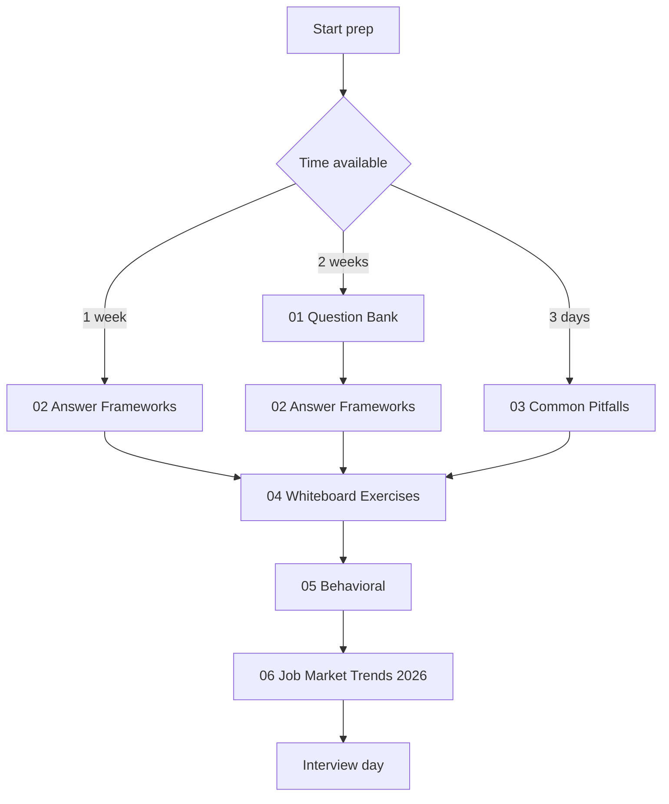
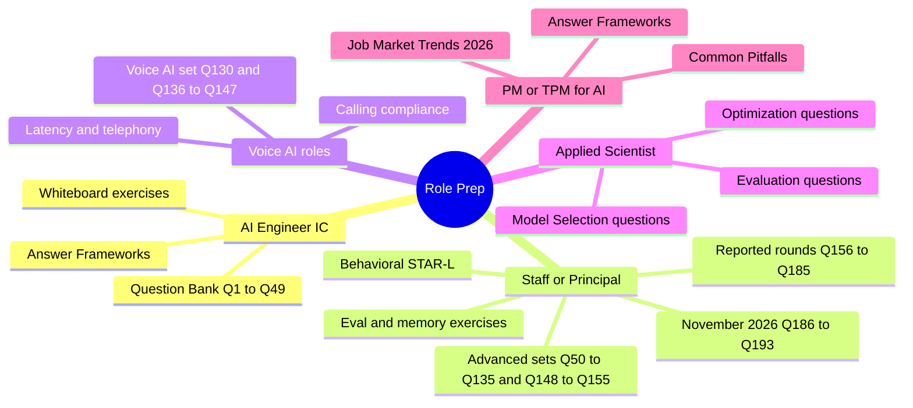

# آمادگی برای مصاحبه طراحی سیستم‌های هوش مصنوعی (AI System Design)

آمادگی مصاحبه برای موقعیت‌های شغلی ارشد و Staff مهندسی هوش مصنوعی: ۱۹۳ سؤال طراحی سیستم (شامل یک مجموعه اختصاصی هوش مصنوعی صوتی (Voice AI) و مجموعه‌ای برگرفته از گزارش‌های اخیر مصاحبه داوطلبان)، چارچوب‌های پاسخ‌دهی همراه با متن پیاده‌سازی‌شده یک مصاحبه آزمایشی (mock interview)، خطاهای متداول، ده تمرین تخته‌سفید، آمادگی رفتاری، پرسش‌های متداول برای پاسخ‌های سریع، و روندهای استخدام در نوامبر ۲۰۲۶.

> **موارد جدید (۶ نوامبر ۲۰۲۶):** بانک سؤالات اکنون به‌صورت پیوسته از Q1 تا Q193 شماره‌گذاری شده است. دوازده سؤال جدید برگرفته از گزارش‌های مصاحبه داوطلبان، [Q174-Q185](01-question-bank.md#questions-from-recent-interview-reports)، مواردی مانند Agentها روی تله‌متری امنیتی، کاوشگر کد منطبق با سطح دسترسی، پلتفرم‌های devbox، دریافت بازبینی تحت تزریق پرامپت (prompt injection)، یک Agent روی سیستم‌های تولید صنعتی، جست‌وجوی خرده‌فروشی بر پایه Agent، تعیین دامنه یک Agent لغو اشتراک همراه با PM، مدل کلیک شغلی ۲۰ دقیقه‌ای، یادگیری تقویتی (RL) برای چت‌بات با پاسخ‌های تازه، پاسخ‌های بیش‌از‌حد مطمئن در دامنه‌های پرریسک، محدودیت‌های تقطیر دانش (distillation)، و یک مرحله طراحی که در آن استفاده از دستیار هوش مصنوعی الزامی است را پوشش می‌دهند. یک [بخش جدید نوامبر ۲۰۲۶](01-question-bank.md#advanced-questions---november-2026)، شامل Q186 تا Q193، به ایزوله‌سازی اعمال قوانین به ازای هر مشتری نهایی، رشته پیام‌های سمت سرور، برنامه منسوخ‌سازی (deprecation) چندفروشنده‌ای، برنامه‌های دسترسی سایبری، بررسی مجوز مدل‌های با وزن باز (open-weight)، تحلیل لیدربوردهای بازنمره‌دهی‌شده، ایزوله‌سازی چندمستأجره (multi-tenant) با شکست باز (fails open)، و کنترل‌های تایید Agent می‌پردازد. فصل بازار کار نیز فرمت‌های جدید فرآیند مصاحبه (loop) و سیگنال‌های مصاحبه‌کنندگان را اضافه کرده و FAQ تا ۶ نوامبر به‌روز شده است.
>
> در اوایل نوامبر، بانک سؤالات با هجده سؤال برگرفته از گزارش‌های مصاحبه داوطلبان (که اکثراً بین ژوئن و نوامبر ۲۰۲۶ منتشر شده بودند) تکمیل شد، [Q156-Q173](01-question-bank.md#questions-from-recent-interview-reports): بررسی سند طراحی (design-doc review)، توزیع مدل و زمان‌بندی GPU، سرویس‌دهی چت سمت ارائه‌دهنده، پیاده‌سازی KV cacheها و tokenizerها از پایه، Agentها بدون استفاده از فریم‌ورک، مراحل کدنویسی با کمک هوش مصنوعی و بررسی PR، آمادگی برای لانچ، غربالگری‌های ایمنی و ماموریت، و تجزیه سیستم‌های مستقر در محیط مشتری (forward deployed decomposition). فصل بازار کار اکنون خلاصه فرمت‌های مصاحبه گزارش‌شده توسط داوطلبان به تفکیک شرکت‌ها را ارائه می‌دهد، و فصل رفتاری به موضوعات جدید «چگونه از هوش مصنوعی استفاده می‌کنید» و غربالگری ایمنی می‌پردازد. پیش از آن در اوایل نوامبر، هشت سؤال اکتبر ۲۰۲۶ به بانک سؤالات اضافه شد، [Q148-Q155](01-question-bank.md#advanced-questions---october-2026)، شامل موضوعاتی چون Agentهایی که ناظران خود را ساکت کرده یا منتظر اتمام زمان آن‌ها می‌مانند، پایپ‌لاین‌های مدیریت حادثه که اقدامات ناشی از تزریق پرامپت را از اقدامات خودخواسته جدا می‌کنند، Gateway هوش مصنوعی به عنوان هدف زنجیره تامین، مدل‌های Fine-tuning شده‌ای که پایه اصلی خود را از دست می‌دهند، قیمت‌گذاری بر اساس طول پرامپت و تقویم زمانی، مدل‌های تصمیم‌گیری، اعمال تغییر نسخه API از طریق Gateway مشترک، و توافق‌نامه‌های سطح خدمات (SLA) وصله پس از کاهش شکاف اصلاح به دست هوش مصنوعی. این به‌روزرسانی همچنین داده‌های جبران خدمت (حقوق و مزایا) ۱ نوامبر، سهم رکوردشکنی ۷.۳ درصدی هوش مصنوعی از آگهی‌های شغلی آمریکا در Indeed، فرم S-1 شرکت Anthropic، و هشداری درباره گزارش‌هایی مبنی بر حذف مصاحبه کدنویسی Anthropic (که رویه یک مدیر استخدام بوده و سیاست کل شرکت نیست) را به فصل بازار کار اضافه کرد و FAQ را به مدل‌های منتشرشده در اکتبر (Claude Haiku 5.5، GPT-6.1 Terra و Gemini 4 Argon GA) ارتقا داد.
>
> **اکتبر ۲۰۲۶:** بانک سؤالات با هفت سؤال سپتامبر ۲۰۲۶ گسترش یافت (اجرای Agent روی مدلی با سطح ارزیابی بحرانی برای امنیت سایبری، فرانت‌اند صوتی Full-duplex که به مدل بک‌اند محول می‌کند، ارائه‌دهندگانی که پارامترهای نمونه‌برداری و فراخوانی اجباری ابزار را حذف می‌کنند، پلتفرم‌های مدیریت‌شده Agent، ارزیابی ادعاهای بنچمارک در برابر لیدربوردهای عمومی، شروط مجوزهای مدل‌های وزن باز، و وصله کردن استک استنتاج (Inference) هاست‌شده توسط خود) به علاوه یک بخش جدید دوازده‌سؤالی [هوش مصنوعی صوتی (Voice AI)](01-question-bank.md#voice-ai-questions) شامل انتخاب معماری، بودجه‌های تاخیر (Latency)، مدیریت نوبت مکالمه روی صوت تلفنی، هزینه به ازای هر دقیقه، ارزیابی، و انطباق با قوانین تماس. بانک سؤالات اکنون پیوسته از Q1 تا Q147 شماره‌گذاری شده و تمرین دهمی با موضوع Batching در استنتاج به تمرین‌های تخته‌سفید اضافه شد.

## پیش از شروع

در این پوشه فرض بر این است که شما در حال حاضر برای محیط عملیاتی (production) کد می‌نویسید و با مبانی LLM (توکن‌ها، پنجره‌های کانتکست، Embeddingها و ماهیت RAG) آشنا هستید. اگر در این مفاهیم احساس تسلط کامل ندارید، ابتدا یک هفته را در بخش [مبانی (01-foundations)](../01-foundations/) و [راهنمای دوره‌ها](../COURSES.md) سپری کنید؛ آمادگی برای مصاحبه بدون تسلط بر مبانی اولیه، منجر به ارائه پاسخ‌های اشتباهی می‌شود که در ظاهر روان و درست به نظر می‌رسند، و این بدترین خروجی ممکن در یک مصاحبه سطح ارشد (Senior) است.

فایل‌های این پوشه به‌گونه‌ای طراحی شده‌اند که به ترتیب خوانده شوند. هر فایل بر پایه فایل قبلی بنا شده است: سؤالات دامنه موضوعی را مشخص می‌کنند، چارچوب‌ها نحوه ساختاربندی پاسخ‌ها را آموزش می‌دهند، خطاهای متداول مواردی که شانس دریافت پیشنهاد شغلی را از بین می‌برند آشکار می‌سازند، تمرین‌ها روند مصاحبه را تمرین می‌کنند، بخش رفتاری سیگنال‌های مورد نیاز در سطح Staff را پوشش می‌دهد، و روندهای بازار کار مشخص می‌کنند چه شرکت‌هایی، برای چه نقش‌هایی و با چه میزان دستمزدی در حال استخدام هستند.

## ترتیب مطالعه

## مسیرهای آمادگی متناسب با نقش

## فایل‌های این پوشه

| فایل | هدف |
|------|---------|
| [01-question-bank.md](01-question-bank.md) | ۱۹۳ سؤال مصاحبه (Q1 تا Q193 با شماره‌گذاری پیوسته)، برگرفته از فرآیندهای مصاحبه گزارش‌شده، آگهی‌های استخدامی، آخرین نسخه‌ها و حوادث، دسته‌بندی‌شده بر اساس موضوع، همراه با پاسخ‌های نمونه و سؤالات تکمیلی (تا نوامبر ۲۰۲۶)، شامل یک بخش دوازده‌سؤالی هوش مصنوعی صوتی (Voice AI). |
| [02-answer-frameworks.md](02-answer-frameworks.md) | پنج چارچوب پاسخ‌دهی ساختاریافته (SPIDER، ETA، تریدآف، عیب‌یابی، STAR-L) به همراه متن پیاده‌سازی‌شده یک مصاحبه آزمایشی ۴۵ دقیقه‌ای با چارچوب SPIDER. |
| [03-common-pitfalls.md](03-common-pitfalls.md) | الگوهایی که پیشنهادهای شغلی سطح Staff را نابود می‌کنند: کلی‌گویی و ابهام درباره موازنه‌ها (Tradeoffs)، فقدان قابلیت مشاهده‌پذیری (observability)، نادیده گرفتن حالت‌های شکست. |
| [04-whiteboard-exercises.md](04-whiteboard-exercises.md) | ده تمرین طراحی سیستم همراه با راه‌حل‌های کامل، از جمله طراحی پایپ‌لاین ارزیابی، حافظه Agent و Batching در استنتاج (Inference). نزدیک‌ترین شبیه‌سازی به یک فرآیند مصاحبه واقعی. |
| [05-behavioral-for-ai-roles.md](05-behavioral-for-ai-roles.md) | آمادگی رفتاری برای سناریوهای خاص هوش مصنوعی، شامل مراحل استقرار رو به مشتری در مصاحبه‌های FDE و بررسی فنی عمیق پروژه‌های گذشته، همراه با شش نمونه حل‌شده STAR-L، سؤالات مربوط به حقوق و سطح‌بندی (Leveling)، و راهنمای تمرین با صدای بلند. |
| [06-job-market-trends-2026.md](06-job-market-trends-2026.md) | رده‌بندی نقش‌ها، دامنه‌های حقوق و مزایا (همراه با تاریخ بررسی هر ردیف در levels.fyi)، داده‌های مربوط به نیروهای ورودی و تعدیل نیرو، سیاست‌های شرکت‌ها درباره استفاده از هوش مصنوعی در مصاحبه، و عناوین شغلی نوظهور (FDE، مهندس ارزیابی هوش مصنوعی، مهندس پایداری هوش مصنوعی، مهندس MCP). |
| [07-faq.md](07-faq.md) | پاسخ‌های کوتاه و مستقیم به پرتکرارترین سؤالات درباره مهندسی هوش مصنوعی، RAG، ایجنت‌ها، مدل‌ها، ارزیابی، استنتاج (Inference)، حافظه، و امنیت. کاربردی برای مراجعه سریع و افراد تازه‌وارد به این حوزه. |

## تمرین با یک مصاحبه‌کننده واقعی

تمام محتوای این پوشه را می‌توان به‌صورت خودخوان مطالعه کرد، اما یک بخش از فرآیند مصاحبه را نمی‌توان به تنهایی پیش برد: دفاع شفاهی و با صدای بلند از یک طراحی هنگامی که مصاحبه‌کننده حرف شما را قطع می‌کند، یک قید یا محدودیت مسئله را تغییر می‌دهد، و می‌پرسد چرا گزینه دیگر را انتخاب نکردید. این یک مهارت است و تنها با تکرار مداوم و دریافت بازخورد مستقیم به سریع‌ترین شکل رشد می‌کند.

اگر به دنبال چنین تمرین‌هایی هستید، Om جلسات مصاحبه آزمایشی ۱ به ۱ طراحی سیستم‌های هوش مصنوعی، بررسی پاسخ‌های کتبی و تجربیات شما، و منتورشیپ مداوم برای مهندسانی که قصد ارتقا به نقش‌های ارشد یا Staff را دارند ارائه می‌دهد. می‌توانید از طریق [EngineBogie](https://enginebogie.com/u/ombharatiya) یا [Topmate](https://topmate.io/ombharatiya) رزرو کنید. زمان مناسب برای رزرو پس از تسلط بر چارچوب‌های پاسخ‌دهی و حل حداقل سه تمرین تخته‌سفید است، تا این جلسه به جای ارزیابی روخوانی شما، نحوه ارائه و تسلط شما را بسنجد.

## منابع مکمل

- [راهنمای تغییر نقش شغلی](../TRANSITION_GUIDE.md) برای آمادگی انتقال از بک‌اند، فرانت‌اند، تضمین کیفیت (QA)، مدیریت محصول (PM) یا مدیریت مهندسی (EM) به حوزه هوش مصنوعی.
- [دوره‌های پیشنهادی](../COURSES.md) برای یادگیری مبانی پایه پیش از شروع آمادگی مصاحبه.
- [واژه‌نامه](../GLOSSARY.md) برای تعاریف سریع اصطلاحات در طول فرآیند مطالعه.
- [مطالعات موردی](../16-case-studies/) برای آشنایی با معماری‌های محیط عملیاتی (production) که مستقیماً به موضوعات تمرین تخته‌سفید نگاشت می‌شوند.

## نکات کلیدی

- فایل‌ها به‌گونه‌ای طراحی شده‌اند که به ترتیب مطالعه شوند؛ پرش مستقیم به سراغ سؤالات بدون درک چارچوب‌های پاسخ‌دهی، پاسخ‌های شما را فاقد ساختار مناسب خواهد کرد.
- تمرین‌های تخته‌سفید (فایل 04) نزدیک‌ترین شبیه‌سازی به مصاحبه‌های واقعی هستند؛ قبل از هر فرآیند مصاحبه حداقل سه تمرین را انجام دهید.
- آمادگی برای مصاحبه رفتاری (فایل 05) عامل تمایز داوطلبان سطح Staff از داوطلبان ارشد (Senior) است؛ از آن غافل نشوید.
- فصل بازار کار نوامبر ۲۰۲۶ (فایل 06) یک مزیت رقابتی است: داوطلبانی که از وضعیت فعلی بازار استخدام آگاه هستند، سؤالات بهتری می‌پرسند و تجربیات خود را متناسب با آن بازگو می‌کنند.
- این پوشه را به‌صورت ماهانه مجدداً بررسی کنید؛ با تغییر روندهای استخدام، دسته‌های سؤالات جدید اضافه می‌شوند.

