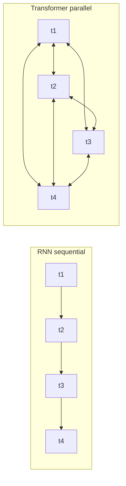
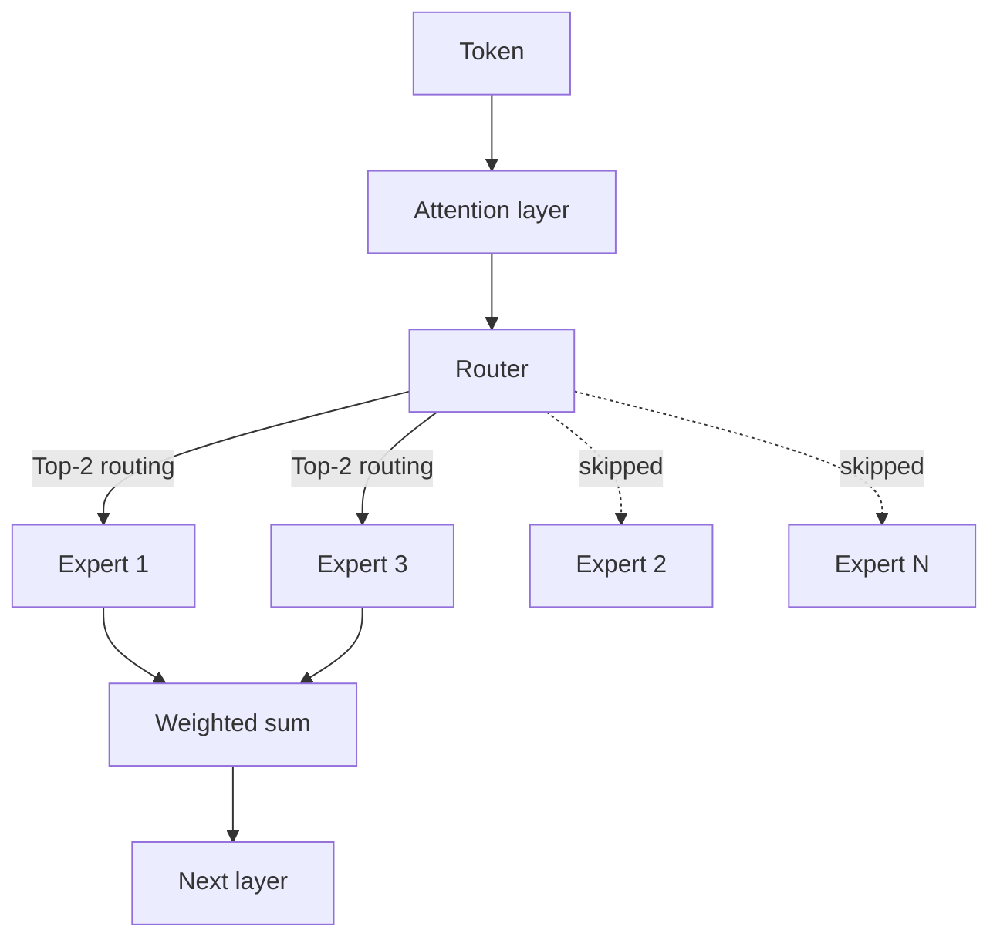

<div dir="rtl">

# سازوکار درونی LLMها (LLM Internals)

هسته معماری LLMهای مدرن: ترنسفورمرها، MoE، ریاضیات توجه (attention math)، روپ (RoPE)، GQA، ساختار KV cache، و تغییر به سمت مقیاس‌پذیری بهینه برای استنتاج (inference-optimal) که محرک اصلی طراحی مدل‌ها در سال ۲۰۲۶ است.

این فصل مفاهیم بنیادین مدل‌های زبانی بزرگ را پوشش می‌دهد. درک این سازوکارهای درونی برای اتخاذ تصمیمات معماری آگاهانه در سیستم‌های هوش مصنوعی ضروری است. برای آشنایی با کاربردهای عملی این انتخاب‌های معماری، بخش‌های [بهینه‌سازی استنتاج](../04-inference-optimization/) (شامل KV cache و PagedAttention)، [طبقه‌بندی مدل‌ها](../02-model-landscape/01-model-taxonomy.md) (مدل‌های MoE در محیط عملیاتی)، و [واژه‌نامه](../GLOSSARY.md) (برای تعاریف MoE، RoPE، ALiBi، GQA و MLA) را مطالعه کنید.

## فهرست مطالب

- [انقلاب ترنسفورمر](#the-transformer-revolution)
- [انواع معماری](#architecture-variants)
- [ترکیب متخصصان (MoE)](#mixture-of-experts-moe)
- [قوانین مقیاس‌پذیری: بهینه برای آموزش در برابر بهینه برای استنتاج](#scaling-laws-training-vs-inference-optimal)
- [چندوجهی بومی (Native Multimodality)](#native-multimodality)
- [سازوکار خودتوجهی (Self-Attention)](#self-attention-mechanism)
- [توجه چند سر (Multi-Head Attention)](#multi-head-attention)
- [کدگذاری‌های موقعیت (Position Encodings)](#position-encodings)
- [شبکه‌های پیش‌خور (Feed-Forward Networks)](#feed-forward-networks)
- [نرمال‌سازی لایه‌ای (Layer Normalization)](#layer-normalization)
- [جمع‌بندی و یکپارچه‌سازی تمام اجزا](#putting-it-all-together)
- [اعداد کلیدی که باید بدانید](#key-numbers-to-know)
- [سوالات مصاحبه](#interview-questions)
- [منابع](#references)

---

## انقلاب ترنسفورمر

پیش از سال ۲۰۱۷، مدل‌سازی توالی بر معماری‌های بازگشتی (مانند RNNها و LSTMها) متکی بود که Tokenها را به‌صورت متوالی پردازش می‌کردند. این امر دو مشکل اساسی ایجاد می‌کرد:

۱. **آموزش کند بود**: پردازش متوالی مانع از موازی‌سازی می‌شد
۲. **وابستگی‌های بلندمدت دشوار بودند**: اطلاعات باید از میان حالت‌های پنهان متعددی عبور می‌کرد

معماری ترنسفورمر که در مقاله «Attention Is All You Need» (واسوانی و همکاران، ۲۰۱۷) معرفی شد، با جایگزینی بازگشت با خودتوجهی (self-attention)، هر دو مشکل را حل کرد.

**مدل ذهنی برای مهندسان سیستم‌های توزیع‌شده:**
مدل‌های بازگشتی را مانند یک خط لوله پردازش درخواست تک‌نخی (single-threaded request pipeline) تصور کنید که در آن هر مرحله به مرحله قبلی وابسته است. در مقابل، خودتوجهی شبیه به یک گراف کاملاً متصل است که در آن هر نود می‌تواند به‌صورت موازی از تمام نودهای دیگر پرس‌وجو کند.

<div dir="ltr">



</div>

---

## انواع معماری

بر اساس اینکه کدام بخش‌ها از ترنسفورمر اصلی استفاده می‌شوند، سه گونه اصلی پدید آمدند:

| معماری | نوع توجه | نمونه‌ها | بهترین کاربرد برای |
|--------------|---------------|----------|----------|
| صرفاً انکودر (Encoder-only) | دوطرفه (Bidirectional) | مدل‌های BERT و RoBERTa | طبقه‌بندی، NER، تعبیه‌ها (embeddings) |
| صرفاً دکودر (Decoder-only) | علی (Causal - از چپ به راست) | مدل GPT-3، Llama، Qwen، Mistral | تولید متن، چت |
| انکودر-دکودر (Encoder-Decoder) | توجه متقاطع (Cross-attention) | مدل‌های T5 و BART | ترجمه، خلاصه‌سازی |
| انکودر-دکودر علی (Causal encoder-decoder - سال ۲۰۲۶) | علی؛ نگاشت KV دکودر از حالت‌های انکودر | DeepSeek V4.1-Flash | سرویس‌دهی با زمینه طولانی (Long-context) همراه با KV cache کوچک |

### صرفاً دکودر (اکثر LLMهای امروزی)

<div dir="ltr">

```
┌─────────────────────────────────────────────────────┐
│                 Decoder Block (×N)                  │
│  ┌───────────────────────────────────────────────┐  │
│  │           Masked Self-Attention               │  │
│  │   (Each token attends only to previous)       │  │
│  └───────────────────────────────────────────────┘  │
│                         │                           │
│                    Add & Norm                       │
│                         │                           │
│  ┌───────────────────────────────────────────────┐  │
│  │              Feed-Forward Network             │  │
│  └───────────────────────────────────────────────┘  │
│                         │                           │
│                    Add & Norm                       │
└─────────────────────────────────────────────────────┘
                          │
                          ▼
                   Output Probabilities
```

</div>

**چرا معماری صرفاً دکودر مسلط است:**
- ساده‌ترین معماری را دارد
- هدف پیش‌آموزش (پیش‌بینی Token بعدی) با تولید متن هم‌راستاست
- با افزایش توان محاسباتی به‌خوبی مقیاس‌پذیر می‌شود

### صرفاً انکودر (به سبک BERT)

از توجه دوطرفه استفاده می‌کند. هر Token تمام Tokenهای دیگر را می‌بیند. نمی‌تواند متن را به‌صورت خودبازگشتی (autoregressively) تولید کند، اما در تسک‌های درک زبان عملکرد فوق‌العاده‌ای دارد.

**کاربرد عملی:**
- برای طبقه‌بندی (تشخیص قصد، تحلیل احساسات) Fine-tuning می‌شود
- ستون فقرات برای مدل‌های تعبیه (embedding models)
- برای تسک‌های خاص، کوچک‌تر و سریع‌تر است

### انکودر-دکودر (بازگشت انکودر)

معماری صرفاً دکودر همچنان غالب است، اما انکودر بار دیگر در قالب یک مدل مولد بزرگ پدیدار شده است، نه به‌عنوان یک پشته ترجمه به سبک T5. نمونه عمومی و برجسته آن **DeepSeek V4.1-Flash** (۱۰ سپتامبر ۲۰۲۶، وزن‌های تحت مجوز MIT) است: یک **انکودر-دکودر علی (causal encoder-decoder)** که ۴۰ لایه آن به یک انکودر علی ۲۰ لایه‌ای و یک دکودر ۲۰ لایه‌ای تقسیم شده است، به طوری که KV cache سراسری دکودر از حالت‌های پنهان نهایی انکودر تصویر (project) می‌شود. طبق گزارش DeepSeek، این مدل در طول فاز prefill دارای ۸ میلیارد پارامتر فعال به ازای هر Token و در طول فاز decode دارای ۱۶ میلیارد پارامتر فعال است، و به ازای هر Token تنها ۸۹۰ بایت حافظه KV سراسری مصرف می‌کند که حدود یک‌چهارم V4-Flash است.

**چرا این موضوع برای طراحی سیستم اهمیت دارد:** فازهای prefill و decode اکنون دارای تعداد پارامترهای فعال متفاوتی هستند و KV cache دیگر محدود به یک پشته K/V به ازای هر لایه نیست. هم فرمول «FLOPs = 2 x active parameters» و هم فرمول کتاب‌های مرجع برای KV، نیازمند ارقام مندرج در شناسنامه مدل (model card) هستند. بخش [فازهای Prefill و Decode](06-inference-pipeline.md#prefill-and-decode-phases) را ببینید.

---

## ترکیب متخصصان (MoE)

**معماری پیش‌فرض برای مدل‌های مرزی با وزن‌های باز (DeepSeek V4 و V4.1، Kimi K3، GLM-5.3، Qwen3.8، MiMo-V2.6، Tencent Hy4 و مدل‌های اکتبر ۲۰۲۶ شامل Mistral Large 4 و Meta Muse Spark Open؛ و پیش از آن، Llama 4 Maverick و Mixtral).** گزارش‌های فنی و شناسنامه‌های مدل Google Gemini، ترنسفورمرهای MoE تنک (sparse) را توصیف می‌کنند؛ OpenAI و Anthropic معماری‌های خود را منتشر نمی‌کنند، بنابراین هر ادعایی درباره سازوکار درونی GPT یا Claude را باید صرفاً در حد حدس و گمان دانست.

معماری MoE شبکه پیش‌خور چگال (dense Feed-Forward Network یا FFN) را با چندین «متخصص» (expert) و یک «مسیریاب» (router) جایگزین می‌کند که وظیفه دارد متخصصان پردازش‌کننده یک Token مشخص را انتخاب کند.

<div dir="ltr">

```
┌─────────────────────────────────────────────────────┐
│                 MoE Layer (Decoder)                 │
│  ┌───────────────────────────────────────────────┐  │
│  │               Attention Layer                 │  │
│  └───────────────────────────────────────────────┘  │
│                         │                           │
│                 ┌───────▼───────┐                   │
│                 │     Router    │                   │
│                 └─┬───┬───┬───┬─┘                   │
│          ┌────────┘   │   │   └────────┐            │
│          ▼            ▼   ▼            ▼            │
│   ┌──────────┐ ┌──────────┐ ┌──────────┐ ┌──────────┐│
│   │ Expert 1 │ │ Expert 2 │ │ Expert 3 │ │ Expert N ││
│   └────┬─────┘ └────┬─────┘ └────┬─────┘ └────┬─────┘│
│        └────────────┴───┬───┴────────────┘        │
└─────────────────────────▼───────────────────────────┘
```

</div>

### نکات ظریف کلیدی MoE برای طراحی سیستم:
۱. **پارامترهای کل در برابر پارامترهای فعال (Total vs. Active Parameters)**: مدل Xiaomi MiMo-V2.6-Pro (سپتامبر ۲۰۲۶) دارای ۱.۰۲ تریلیون پارامتر ذخیره‌شده است، اما تنها ۴۲ میلیارد پارامتر را به ازای هر Token فعال می‌کند. مدل DeepSeek V4 Pro دارای ۱.۶ تریلیون پارامتر کل / ۴۹ میلیارد پارامتر فعال است. مدل Llama 4 Maverick شامل ۴۰۰ میلیارد پارامتر کل / ۱۷ میلیارد پارامتر فعال با ۱۲۸ متخصص مسیریابی‌شده به همراه یک متخصص مشترک (shared expert) در لایه‌های متناوب MoE است.
    - **محدودیت حافظه**: تک‌تک متخصصان باید در جایی از حافظه مستقر باشند. ۱.۰۲ تریلیون پارامتر حتی با دقت FP8 حدود ۱ ترابایت و در حالت ۴ بیتی همچنان بیش از ۵۰۰ گیگابایت حافظه اشغال می‌کند، آن هم پیش از در نظر گرفتن هرگونه KV cache. راهکار ارائه‌شده شیائومی برای SGLang، مدل MiMo-V2.6-Pro را روی دو نود ۸ تایی GPU (موازی‌سازی تانسوری ۱۶ مسیره یا 16-way tensor parallelism) توزیع می‌کند.
    - **محدودیت محاسباتی**: محاسبات FLOPs به ازای هر Token بر اساس ۴۲ میلیارد پارامتر فعال مقیاس‌بندی می‌شود، نه ۱.۰۲ تریلیون پارامتر کل.
    - **چالش در Batchهای بزرگ (The catch at high batch)**: از آنجا که Tokenهای مختلف به متخصصان متفاوتی هدایت می‌شوند، یک بچ بزرگ در هر گام به بیشتر متخصصان دسترسی پیدا می‌کند و در نتیجه صرفه‌جویی در پهنای باند کاهش می‌یابد. سرویس‌دهی MoE یک مسئله جای‌گذاری متخصصان (expert-placement) و ارتباطات همه-به-همه (all-to-all communication یا موازی‌سازی متخصصان / expert parallelism) است، نه صرفاً «یک مدل کوچک‌تر».
۲. **فروپاشی مسیریابی (Routing Collapse)**: اگر مسیریاب تنها یک متخصص را انتخاب کند، سایر متخصصان چیزی یاد نخواهند گرفت. مدل‌های امروزی از **تابع زیان توازن بار (load balancing loss)** و **زیان‌های کمکی (auxiliary losses)** استفاده می‌کنند تا اطمینان حاصل شود از تمام متخصصان بهره گرفته می‌شود.
۳. **بهبودهای اعمال‌شده توسط DeepSeek**: نوآوری **توجه نهفته چند سر (Multi-head Latent Attention یا MLA)** (معرفی‌شده در DeepSeek-V2) و **توازن بار بدون نیاز به تابع زیان کمکی (auxiliary-loss-free load balancing)** (در DeepSeek-V3) به استاندارد عملی کارایی MoE تبدیل شدند و سایر آزمایشگاه‌ها نیز MLA را به کار گرفتند (مانند Kimi K2 و Tencent Hy4). خود DeepSeek فراتر رفت: مدل V4 (پیش‌نمایش در آوریل ۲۰۲۶) از ترکیبی از «توجه تنک فشرده» (Compressed Sparse Attention) و «توجه به‌شدت فشرده» (Heavily Compressed Attention) استفاده می‌کند که طبق اعلام DeepSeek در ۱ میلیون Token، به حدود ۱۰٪ از KV cache مدل V3.2 و ۲۷٪ از FLOPs به ازای هر Token آن نیاز دارد. مدل V4.1-Flash (سپتامبر ۲۰۲۶) قابلیت Compressed Sparse Attention 2 و کش‌گذاری KV با فرمت FP4 را اضافه می‌کند (بخش [سازوکارهای توجه](03-attention-mechanisms.md#hybrid-and-sparse-attention-in-2026-open-models) را ببینید).

تصمیم‌گیری مسیریابی به ازای هر Token در قالب فلوچارت:

<div dir="ltr">



</div>

---

## قوانین مقیاس‌پذیری: بهینه برای آموزش در برابر بهینه برای استنتاج

قوانین اولیه چینچیلا (Chinchilla laws - سال ۲۰۲۲) بر **بهینه‌سازی برای آموزش (Training-Optimal)** تمرکز داشتند: یافتن بهترین اندازه مدل به ازای یک بودجه آموزشی مشخص.

صنعت اکنون به سمت مقیاس‌پذیری **بهینه برای استنتاج (Inference-Optimal)** تغییر جهت داده است:
- **آموزش بیش از حد (Over-training)**: آموزش مدل‌های کوچک‌تر (مانند Llama 3 8B) روی حجم عظیمی از داده‌ها (بیش از ۱۵ تریلیون Token) بسیار فراتر از نقطه چینچیلا.
- **چرا؟**: هزینه استنتاج (Inference) برای میلیون‌ها کاربر، بسیار سنگین‌تر از هزینه یک‌باره آموزش است و آن را کم‌اهمیت جلوه می‌دهد. سرویس‌دهی به یک مدل 7B که ۱۰ برابر طولانی‌تر آموزش دیده باشد، بسیار ارزان‌تر از یک مدل 70B است که در نقطه چینچیلا آموزش دیده باشد.

---

## چندوجهی بومی (Native Multimodality)

مدل‌های قدیمی‌تر از **آداپتورهای بینایی (Vision Adapters)** استفاده می‌کردند (اتصال یک انکودر بینایی منجمد به سبک CLIP به یک LLM). اکنون مدل‌های پیشرو به‌صورت **چندوجهی بومی (natively multimodal)** آموزش داده می‌شوند و نسخه‌های متن‌باز منتشرشده در سال ۲۰۲۶ نشان می‌دهند که این طراحی چقدر متحول شده است:

- **واژگان مشترک (Shared Vocabulary)**: Tokenهای تصویری و Tokenهای متنی در یک فضای نهفته (latent space) مشترک حضور دارند.
- **ترنسفورمر یکپارچه (Uniform Transformer)**: همان بلوک‌های یکسان، هم پیکسل‌ها و هم متن را پردازش می‌کنند.
- **ورودی‌های بدون نیاز به انکودر (Encoder-free inputs)**: مدل Gemma 4 12B "Unified" (ژوئن ۲۰۲۶، مجوز Apache 2.0) وصله‌های تصویر خام (image patches) و شکل موج‌های صوتی را مستقیماً از طریق لایه‌های خطی سبک به فضای تعبیه مدل LLM نگاشت می‌کند، بدون آنکه انکودر بینایی مجزایی داشته باشد.
- **چندوجهی به‌صورت پیش‌فرض در پرچمداران متن‌باز**: مدل MiMo-V2.6 ورودی‌های متنی، تصویری، ویدیویی و صوتی را دریافت می‌کند؛ مدل GLM-5.3-Flash نخستین مدل با چندوجهی بومی در سری GLM-5 است که برای ایجنت‌های رابط کاربری گرافیکی (GUI agents) طراحی شده است؛ مدل DeepSeek V4.1-Flash ورودی تصویر بومی را اضافه کرده است. اکنون یک پشته اختصاصی (self-hosted stack) باید علاوه بر متن، برای Tokenهای تصویر و صوت نیز بودجه‌بندی کند.
- **مزیت**: استدلال فضایی بهتر و اتصال مفاهیم بین‌وجهی (cross-modal grounding) قوی‌تر نسبت به روش‌های مبتنی بر آداپتور.

---

## سازوکار خودتوجهی (Self-Attention Mechanism)

خودتوجهی (Self-attention) نوآوری محوری ترنسفورمر است. این مکانیزم به هر Token اجازه می‌دهد تا به تمام Tokenهای دیگر در یک توالی «توجه کند» (از آن‌ها اطلاعات جمع‌آوری نماید).

### درک شهودی

جمله زیر را در نظر بگیرید:
«The animal didn't cross the street because it was too tired.» (حیوان از خیابان عبور نکرد زیرا بیش از حد خسته بود.)

کلمه «it» به چه چیزی ارجاع دارد؟ درک این جمله مستلزم اتصال «it» به «animal» است. خودتوجهی این ارتباطات را با محاسبه امتیازات ارتباط (relevance scores) میان تمام جفت‌های Token یاد می‌گیرد.

### محاسبات ریاضی

برای توالی ورودی X متشکل از n تا Token با بعد d:

<div dir="ltr">

```
Q = XW_Q   (Query: What am I looking for?)
K = XW_K   (Key: What do I contain?)
V = XW_V   (Value: What do I contribute?)

Attention(Q, K, V) = softmax(QK^T / √d_k) × V
```

</div>

**گام‌به‌گام:**
۱. **حاصل‌ضرب QK^T**: ضرب داخلی، میزان شباهت بین پرس‌وجوها (queries) و کلیدها (keys) را می‌سنجد (ماتریس n × n)
۲. **/ √d_k**: مقیاس‌گذاری برای جلوگیری از اشباع تابع softmax در ابعاد بزرگ
۳. **تابع softmax**: تبدیل به احتمالات (مجموع هر سطر برابر ۱ می‌شود)
۴. **× V**: مجموع وزن‌دار مقادیر (values) بر اساس وزن‌های توجه

### چرا مقیاس‌گذاری با √d_k؟

**محبوب در مصاحبه‌ها**: این سوال مکرراً پرسیده می‌شود چرا که میزان درک شما از پایداری عددی (numerical stability) را مشخص می‌کند.

بدون مقیاس‌گذاری، با رشد بعد d، حاصل‌ضرب‌های داخلی نیز به تناسب رشد می‌کنند. مقادیر بزرگ حاصل‌ضرب داخلی، تابع softmax را به نواحی اشباع سوق می‌دهند که در آن گرادیان‌ها ناپدید (صفر) می‌شوند.

<div dir="ltr">

```python
# Without scaling (problematic for large d)
d = 512
q = np.random.randn(d)
k = np.random.randn(d)
dot = np.dot(q, k)  # Expected magnitude: ~√d ≈ 22.6

# With scaling
scaled_dot = dot / np.sqrt(d)  # Expected magnitude: ~1
```

</div>

### پیچیدگی محاسباتی توجه

| عملیات | پیچیدگی زمانی | پیچیدگی فضایی |
|-----------|-----------------|------------------|
| محاسبه QK^T | O(n²d) | O(n²) |
| تابع Softmax | O(n²) | O(n²) |
| مجموع وزن‌دار با V | O(n²d) | O(nd) |

پیچیدگی O(n²) طول پنجره زمینه (context length) را محدود می‌کند. یک پنجره زمینه 100K به معنای ۱۰ میلیارد محاسبه توجه به ازای هر لایه است.

---

## توجه چند سر (Multi-Head Attention)

ترنسفورمرهای مدرن به جای یک مکانیزم توجه منفرد، از چندین «سر» (heads) بهره می‌برند که به جنبه‌های مختلف به‌صورت موازی توجه می‌کنند.

<div dir="ltr">

```
┌─────────────────────────────────────────────────────────────┐
│                    Multi-Head Attention                      │
│                                                              │
│   ┌─────────┐  ┌─────────┐  ┌─────────┐       ┌─────────┐   │
│   │ Head 1  │  │ Head 2  │  │ Head 3  │  ...  │ Head h  │   │
│   │ d_k=64  │  │ d_k=64  │  │ d_k=64  │       │ d_k=64  │   │
│   └────┬────┘  └────┬────┘  └────┬────┘       └────┬────┘   │
│        │            │            │                  │        │
│        └────────────┴────────────┴──────────────────┘        │
│                              │                               │
│                         Concatenate                          │
│                              │                               │
│                         W_O (project)                        │
└─────────────────────────────────────────────────────────────┘
```

</div>

**چرا چندین سر؟**
- سرهای مختلف الگوهای متفاوتی را یاد می‌گیرند (نحو، معناشناسی، ارجاع هم‌پایه یا coreference)
- مشابه روش‌های انسمبل (ensemble methods): دیدگاه‌های چندگانه پایداری و قدرت مدل را بهبود می‌بخشند
- پردازش موازی را در میان سرها ممکن می‌سازد

**پیکربندی معمول:**
- مدل GPT-3 175B: ۹۶ سر × ۱۲۸ بعد = ۱۲,۲۸۸ بعد کل
- مدل Llama 2 70B: ۶۴ سر × ۱۲۸ بعد = ۸,۱۹۲ بعد کل

### توجه با پرس‌وجوی گروه‌بندی‌شده (Grouped Query Attention - GQA)

**حیاتی برای سیستم‌های عملیاتی (production)**: مکانیزم استاندارد Multi-Head Attention نیازمند ذخیره K و V جداگانه برای هر سر در KV cache است. در مقابل، GQA مقادیر K و V را در میان گروه‌هایی از سرها به اشتراک می‌گذارد.

| نوع توجه | نسبت K,V به ازای هر Query | کاهش حافظه KV Cache | نمونه‌ها |
|----------------|---------------|-------------------|----------|
| چند سر (Multi-Head - MHA) | ۱:۱ | مبنا (Baseline) | GPT-3 |
| پرس‌وجوی گروه‌بندی‌شده (Grouped-Query - GQA) | معمولاً ۸:۱ | حدود 8x | مدل Llama 2 70B، Llama 3، Mistral |
| چند پرس‌وجویی (Multi-Query - MQA) | نسبت All:1 (همه به ۱) | حدود n_heads × | مدل‌های PaLM و Falcon |

**اثر عملی:**
برای مدل Llama 3 70B (با همان ساختار توجه Llama 2 70B) در زمینه 8K با فرمت BF16:
- حافظه KV cache در MHA (در صورتی که ۶۴ سر KV داشت): حدود ۲۱ گیگابایت به ازای هر درخواست
- حافظه KV cache در GQA (۸ سر واقعی KV آن): حدود ۲.۷ گیگابایت به ازای هر درخواست

این امر مستقیماً بر اندازه بچ (batch size) و در نتیجه بر توان عملیاتی (Throughput) تأثیر می‌گذارد.

---

## کدگذاری‌های موقعیت (Position Encodings)

مکانیزم توجه به خود (Self-attention) نسبت به جایگشت ناوردا (permutation-invariant) است. بدون اطلاعات موقعیت، «سگ مرد را گاز می‌گیرد» و «مرد سگ را گاز می‌گیرد» کاملاً یکسان خواهند بود. کدگذاری‌های موقعیت، ترتیب توالی را تزریق می‌کنند.

### سینوسی (ترنسفورمر اولیه / Original Transformer)

از توابع سینوس و کسینوس با بسامدهای مختلف استفاده می‌کند:

<div dir="ltr">

```
PE(pos, 2i) = sin(pos / 10000^(2i/d))
PE(pos, 2i+1) = cos(pos / 10000^(2i/d))
```

</div>

**ویژگی‌ها:**
- قطعی (Deterministic)، بدون پارامترهای یادگیری‌پذیر
- از نظر تئوری می‌تواند به توالی‌های طولانی‌تر برون‌یابی (extrapolate) کند
- در عمل، برون‌یابی به خوبی کار نمی‌کند

### مطلق یادگیری‌شده (Learned Absolute)

یادگیری یک Embedding مجزا برای هر موقعیت:

<div dir="ltr">

```python
position_embeddings = nn.Embedding(max_length, d_model)
```

</div>

**ویژگی‌ها:**
- ساده و کارآمد
- فراتر از طول آموزش قابل برون‌یابی نیست
- اکثر مدل‌های اولیه (GPT-2, BERT)

### تعبیه موقعیت چرخشی (RoPE - Rotary Position Embedding)

کدگذاری موقعیت از طریق چرخاندن بردارهای Query و Key:

<div dir="ltr">

```
RoPE(x, pos) = x × cos(pos × θ) + rotate(x) × sin(pos × θ)
```

</div>

**ویژگی‌ها:**
- نسبی: توجه (Attention) به (pos_q - pos_k) بستگی دارد
- برون‌یابی بهتر نسبت به روش مطلق
- استفاده شده در: Llama, Mistral, PaLM, Qwen, DeepSeek
- گسترش طول زمینه (Context extension): روش‌های مقیاس‌بندی مانند Position Interpolation و YaRN یک پنجره آموزش‌دیده RoPE را بسط می‌دهند. مدل Qwen3.8-Flash-Next به‌صورت بومی دارای ۲۶۲K است و با YaRN به ۱M می‌رسد.

### مکانیزم ALiBi (توجه با بایاس‌های خطی / Attention with Linear Biases)

افزودن بایاس وابسته به موقعیت به‌طور مستقیم به امتیازهای توجه:

<div dir="ltr">

```
Attention = softmax(QK^T / √d_k - m × distance)
```

</div>

که در آن m یک شیب اختصاصی برای هر هد (head-specific slope) و distance برابر با |pos_q - pos_k| است.

**ویژگی‌ها:**
- بدون ایجاد تغییر در Embeddingها
- برون‌یابی عالی
- استفاده شده در: BLOOM, MPT

### مقایسه روش‌های کدگذاری موقعیت

| روش | برون‌یابی (Extrapolation) | سربار محاسباتی | کاربرد مدرن |
|--------|---------------|------------------|--------------|
| سینوسی (Sinusoidal) | ضعیف | ندارد | به‌ندرت |
| یادگیری‌شده (Learned) | ندارد | ناچیز | قدیمی (Legacy) |
| RoPE | خوب | ~5% | اکثر LLMها |
| ALiBi | عالی | ~2% | برخی LLMها |

---

## شبکه‌های پیش‌خور (Feed-Forward Networks)

هر لایه ترنسفورمر دارای یک شبکه پیش‌خور (FFN) است که هر موقعیت را به‌صورت مستقل پردازش می‌کند:

<div dir="ltr">

```python
def feed_forward(x):
    hidden = activation(x @ W1 + b1)  # Expand: d → 4d
    output = hidden @ W2 + b2         # Contract: 4d → d
    return output
```

</div>

**ویژگی‌های کلیدی:**
- وابسته به موقعیت (Position-wise): وزن‌های یکسانی روی هر موقعیت اعمال می‌شود
- نسبت انبساط (Expansion ratio): معمولاً ۴ برابر (به‌عنوان مثال، ۴۰۹۶ ← ۱۶۳۸۴ ← ۴۰۹۶)
- محل قرارگیری پارامترها: بخش FFN حدود ۲/۳ پارامترهای لایه را در بر می‌گیرد

### توابع فعال‌سازی (Activation Functions)

| تابع فعال‌سازی | فرمول | ویژگی‌ها | کاربرد |
|------------|---------|------------|-------|
| ReLU | max(0, x) | ساده، تنک (sparse) | مقاله اصلی |
| GELU | x × Φ(x) | هموار، استفاده شده در BERT | GPT-2, BERT |
| SwiGLU | Swish(xW) × xV | پیشرفته‌ترین (State of the art) | Llama, PaLM |

تابع SwiGLU یک مکانیزم گیتینگ (gating) اضافه می‌کند که عملکرد را به بهای حدود ۵۰٪ پارامتر بیشتر در FFN ارتقا می‌دهد.

### گونه‌های مختلف GLU

<div dir="ltr">

```python
# Standard FFN
hidden = gelu(x @ W1)
output = hidden @ W2

# SwiGLU FFN
gate = silu(x @ W_gate)
hidden = x @ W_up
output = (gate * hidden) @ W_down
```

</div>

---

## نرمال‌سازی لایه‌ای (Layer Normalization)

نرمال‌سازی لایه‌ای با نرمال کردن فعال‌سازی‌ها، فرآیند آموزش را پایدار می‌کند:

<div dir="ltr">

```python
def layer_norm(x, gamma, beta):
    mean = x.mean(dim=-1, keepdim=True)
    var = x.var(dim=-1, keepdim=True)
    normalized = (x - mean) / sqrt(var + eps)
    return gamma * normalized + beta
```

</div>

### مقایسه Pre-LN در برابر Post-LN

**روش Post-LN (ترنسفورمر اولیه):**

<div dir="ltr">

```
x = LayerNorm(x + Attention(x))  # Post-LN: normalize after residual
```

</div>

**روش Pre-LN (مدل‌های مدرن LLM):**

<div dir="ltr">

```
x = x + Attention(LayerNorm(x))  # Pre-LN: normalize before sublayer
```

</div>

| گونه (Variant) | پایداری آموزش | عملکرد نهایی | کاربرد |
|---------|-------------------|-------------------|-------|
| Post-LN | دشوارتر | اندکی بهتر | مقالات اصلی |
| Pre-LN | بسیار آسان‌تر | خوب | اکثر LLMهای مدرن |

روش Pre-LN امروزه به یک استاندارد تبدیل شده است، زیرا آموزش مدل‌های عمیق را بدون نیاز به تنظیم دقیق نرخ یادگیری (learning rate) امکان‌پذیر می‌سازد.

### روش RMSNorm

ساده‌سازی که از تفریق میانگین (mean centering) صرف‌نظر می‌کند:

<div dir="ltr">

```python
def rms_norm(x, gamma):
    rms = sqrt(mean(x^2) + eps)
    return gamma * (x / rms)
```

</div>

حدود ۱۰ تا ۱۵٪ سریع‌تر از LayerNorm با عملکردی مشابه. استفاده شده در Llama و Mistral.

---

## جمع‌بندی اجزا (Putting It All Together)

یک لایه کامل ترنسفورمر:

<div dir="ltr">

```python
class TransformerLayer:
    def __init__(self, d_model, n_heads, d_ff):
        self.attn_norm = RMSNorm(d_model)
        self.attn = MultiHeadAttention(d_model, n_heads)
        self.ff_norm = RMSNorm(d_model)
        self.ff = SwiGLU_FFN(d_model, d_ff)
    
    def forward(self, x, mask=None):
        # Pre-norm attention with residual
        h = x + self.attn(self.attn_norm(x), mask)
        # Pre-norm FFN with residual
        out = h + self.ff(self.ff_norm(h))
        return out
```

</div>

**مدل کامل:**

<div dir="ltr">

```
Token IDs → Embedding → [Transformer Layer × N] → Output Norm → LM Head → Logits
```

</div>

---

## اعداد کلیدی که باید بدانید

### اندازه مدل‌ها

| مدل | پارامترها | لایه‌ها | هدها (Heads) | بُعد (Dimension) | بُعد FFN |
|-------|------------|--------|-------|-----------|---------|
| GPT-3 | 175B | 96 | 96 | 12,288 | 49,152 |
| Llama 2 70B | 70B | 80 | 64 | 8,192 | 28,672 |
| Llama 2 7B | 7B | 32 | 32 | 4,096 | 11,008 |
| Mistral 7B | 7B | 32 | 32 | 4,096 | 14,336 |

### نیازمندی‌های حافظه

<div dir="ltr">

```
Model weights ≈ bytes_per_parameter × parameters
- 70B at BF16: ~140 GB; FP8: ~70 GB; FP4 (NVFP4/MXFP4 incl. block scales): ~37-40 GB
- 7B at BF16: ~14 GB

KV cache per token (BF16, standard MHA/GQA attention):
= 2 (K and V) × layers × kv_heads × head_dim × 2 bytes
- Llama 2/3 70B (80 layers, 8 KV heads, head_dim 128):
  2 × 80 × 8 × 128 × 2 = 320 KiB per token
- At 8K context: ~2.7 GB per request; at 128K (Llama 3.1): ~43 GB
- Same shape with full MHA (64 KV heads): 2.6 MB per token, ~21 GB at 8K
- MLA, sliding-window, linear-attention hybrids and compressed KV break
  this formula: DeepSeek V4.1-Flash reports 890 bytes of global KV per token
  (its sliding-window KV is extra, capped at the window length)
```

</div>

### نیازمندی‌های محاسباتی

<div dir="ltr">

```
FLOPs per token, forward pass ≈ 2 × active parameters
- 70B dense model: ~140 GFLOPs per token
- Generate 100 tokens: ~14 TFLOPs

H100 SXM: ~989 TFLOPS dense BF16, ~3.35 TB/s HBM bandwidth
- Arithmetic for one token at batch 1: ~0.14 ms
- Reading 140 GB of BF16 weights once: ~42 ms
- Batch-1 decode is ~300x memory-bound; batching amortizes each
  weight read across many requests (in practice 70B BF16 spans 2+ GPUs;
  the ratio is the point)
```

</div>

---

## نکات کلیدی

- گذار از RNN به ترنسفورمر به دلیل موازی‌سازی (parallelization) بود، نه صرفاً کیفیت؛ به همین دلیل است که قوانین مقیاس‌پذیری GPU به دنبال آن شکل گرفت.
- معماری MoE پارامترهای کل (هزینه حافظه) را از پارامترهای فعال (هزینه محاسباتی) تفکیک می‌کند: مدل MiMo-V2.6-Pro تعداد ۱.۰۲ تریلیون (1.02T) پارامتر ذخیره می‌کند اما تنها با ۴۲ میلیارد (42B) پارامتر به ازای هر Token محاسبه انجام می‌دهد. بیشترین صرفه‌جویی در Batch Sizeهای کوچک رخ می‌دهد؛ در Batch Sizeهای بزرگ، بیشتر Expertها در هر گام فراخوانی می‌شوند.
- مقیاس‌بندی بهینه برای استنتاج (Inference-optimal scaling) در محیط پروداکشن بر رویکرد چینچیلا (Chinchilla) برتری دارد: مدل‌های کوچک‌تر را بیش از حد آموزش (over-train) دهید زیرا در طول عمر یک مدل، هزینه استنتاج (Inference) بر هزینه آموزش غالب است.
- مکانیزم GQA بهینه‌سازی پایه برای KV-cache محسوب می‌شود (کاهش ۸ برابری در Llama 70B)؛ پیش از بحث درباره هزینه سرویس‌دهی (serving cost)، نسبت N:G را درک کنید. مدل‌های پرچم‌دار متن‌باز در سال ۲۰۲۶ با معماری MLA، مدل‌های هیبریدی توجه خطی و پنجره لغزان (sliding-window) و KV فشرده فراتر می‌روند، به طوری که بایت‌های KV به ازای هر Token امروزه بین مدل‌ها چندین مرتبه بزرگی (orders of magnitude) تفاوت دارد. حجم حافظه را بر اساس کارت مدل (model card) تخمین بزنید، نه فرمول‌های کتاب‌های درسی.
- ترکیب Pre-LN با RMSNorm پیش‌فرض دنیای مدرن است؛ اگر در یک پاسخ مصاحبه Post-LN را دیدید، داوطلب به مقالات سال ۲۰۱۸ ارجاع می‌دهد.

---

## سوالات مصاحبه

### سوال: توضیح دهید چرا مکانیزم توجه (Attention) در ترنسفورمر دارای پیچیدگی O(n²) است و چه جایگزین‌هایی برای آن وجود دارد؟

**پاسخ قوی:**
مکانیزم توجه، شباهت‌های دو‌به‌دو میان تمام Tokenها را محاسبه می‌کند. برای طول توالی n:
- حاصل‌ضرب QK^T دارای ابعاد [n, d] × [d, n] = n² ضرب ماتریسی به ازای هر هد است
- فضای ذخیره‌سازی برای وزن‌های توجه: n² عدد اعشاری (floats)

جایگزین‌ها:
- توجه تنک یا Sparse attention (مدل Longformer): دارای پیچیدگی O(n) با الگوهای محلی + سراسری
- توجه خطی یا Linear attention (مدل Performer): دارای پیچیدگی O(n) با استفاده از تقریب ویژگی‌های تصادفی
- فلش اتنشن (Flash Attention): همچنان محاسبات O(n²)، اما با مصرف حافظه O(n) از طریق ادغام هسته‌ها (kernel fusion)
- مدل‌های فضای حالت یا State-space models (مدل Mamba): کاملاً خطی با O(n)
- مدل‌های هیبریدی (پاسخ محیط پروداکشن در سال ۲۰۲۶): ترکیب متناوب لایه‌های توجه خطی یا پنجره لغزان (sliding-window) با اقلیتی از لایه‌های توجه کامل یا تنک. مدل Qwen3.8-Flash-Next در سه لایه از هر چهار لایه از Gated DeltaNet استفاده می‌کند؛ مدل MiMo-V2.6-Pro دارای ۶۰ لایه پنجره لغزان و ۱۰ لایه سراسری است.

موازنه (Tradeoff): پیچیدگی n² برای ثبت وابستگی‌های دوربرد کامل ضروری است، اما بیشتر تسک‌ها به تمام تعاملات دو‌به‌دو نیازی ندارند. توجه کاملاً خطی، قابلیت بازیابی دقیق (precise recall) را از دست می‌دهد؛ به همین دلیل است که مدل‌های پروداکشن به جای حذف کامل لایه‌های توجه کامل یا تنک، بخشی از آن‌ها را حفظ می‌کنند.

### سوال: حافظه کَش KV (یا KV cache) چیست و چرا برای سرویس‌دهی (serving) اهمیت دارد؟

**پاسخ قوی:**
در طول تولید خودبازگشتی (autoregressive generation)، ما در هر مرحله یک Token تولید می‌کنیم. بدون کَش‌سازی، مجبور بودیم در هر گام مقادیر K و V را برای تمام Tokenهای قبلی مجدداً محاسبه کنیم.

مکانیزم KV cache مقادیر K و V موقعیت‌های قبلی را ذخیره می‌کند. به ازای هر Token جدید:
1. مقادیر Q، K و V فقط برای موقعیت جدید محاسبه می‌شوند
2. مقادیر جدید K و V به K و V کَش‌شده الحاق (concatenate) می‌شوند
3. توجه با مقادیر کامل K و V محاسبه می‌شود

این کار پیچیدگی محاسباتی K و V را به ازای هر Token از O(n) به O(1) کاهش می‌دهد.

**هزینه:** میزان مصرف حافظه به‌صورت خطی با طول توالی افزایش می‌یابد. برای Llama 70B (با GQA، ۸ هد KV و فرمت BF16)، حافظه KV cache حدود ۲.۷ گیگابایت به ازای هر درخواست در طول زمینه 8K و حدود ۴۳ گیگابایت در 128K است؛ بدون GQA این مقدار ۸ برابر بزرگ‌تر می‌شد. این موضوع اندازه دسته (batch size) را محدود می‌کند و نیازمند تکنیک‌هایی مانند PagedAttention، کوانتیزاسیون KV (یک KV cache با فرمت FP8 که معمولاً با وزن‌های FP4 جفت می‌شود، پیکربندی اصلی سرویس‌دهی در سال ۲۰۲۶ است) و انتقال (offload) به حافظه میزبان (host memory) می‌باشد.

### سوال: چرا LLMهای مدرن به جای Post-LN از Pre-LN استفاده می‌کنند؟

**پاسخ قوی:**
روش Pre-LN نرمال‌سازی را به جای بعد از هر زیرلایه، قبل از آن قرار می‌دهد. این کار یک مسیر مستقیم‌تر برای گرادیان‌ها از طریق اتصالات باقی‌مانده (residual connections) ایجاد می‌کند.

در Post-LN، گرادیان‌ها باید از نرمال‌سازی عبور کنند که می‌تواند در ابتدای آموزش ناپایداری ایجاد کند. Post-LN نیازمند گرم‌کردن نرخ یادگیری (learning rate warmup) و مقداردهی اولیه دقیق است.

روش Pre-LN آموزش مدل‌های بسیار عمیق (بیش از ۱۰۰ لایه) را بدون مقداردهی اولیه ویژه ممکن می‌سازد. موازنه این روش در عملکرد نهایی اندکی پایین‌تر است، اما در عمل، پایداری آموزش ارزش آن را دارد.

### سوال: تفاوت بین MHA، MQA و GQA چیست؟

**پاسخ قوی:**
هر سه از گونه‌های توجه چندسره هستند که تفاوت آن‌ها در نحوه اشتراک‌گذاری هدهای K و V است:

- **مکانیزم MHA (توجه چندسره / Multi-Head Attention)**: هر هد Query هدهای K و V اختصاصی خود را دارد. نسبت N:N.
- **مکانیزم MQA (توجه چندکوئری / Multi-Query Attention)**: تمام هدهای Query یک جفت هد مشترک K و V دارند. نسبت N:1.
- **مکانیزم GQA (توجه کوئری گروه‌بندی‌شده / Grouped-Query Attention)**: گروه‌هایی از هدهای Query هدهای K و V را به اشتراک می‌گذارند. نسبت N:G (معمولاً G=8).

اثر بر میزان حافظه KV cache:
- روش MHA: اندازه کامل
- روش MQA: اندازه 1/N (اما کیفیت افت می‌کند)
- روش GQA: اندازه 1/G (بهترین موازنه)

مدل Llama 2 70B از GQA با ۸ هد KV برای ۶۴ هد Query استفاده می‌کند که حجم KV cache را با کمترین افت کیفیت تا ۸ برابر کاهش می‌دهد.

---

## مراجع

- Vaswani et al. "Attention Is All You Need" (2017)
- Su et al. "RoFormer: Enhanced Transformer with Rotary Position Embedding" (2021)
- Press et al. "Train Short, Test Long: Attention with Linear Biases" (ALiBi, 2022)
- Shazeer "GLU Variants Improve Transformer" (2020)
- Ainslie et al. "GQA: Training Generalized Multi-Query Transformer Models" (2023)
- Peng et al. "YaRN: Efficient Context Window Extension of Large Language Models" (2023)
- DeepSeek-AI "DeepSeek-V3 Technical Report" (2024)
- [کارت مشخصات مدل DeepSeek-V4.1-Flash](https://huggingface.co/deepseek-ai/DeepSeek-V4.1-Flash) (2026)
- [ترنسفورمر مصور (Illustrated Transformer)](https://jalammar.github.io/illustrated-transformer/)
- [ترنسفورمر حاشیه‌نویسی‌شده (The Annotated Transformer)](https://nlp.seas.harvard.edu/2018/04/03/attention.html)

---

*بعدی: [بررسی عمیق Tokenization](02-tokenization-deep-dive.md)*

</div>
