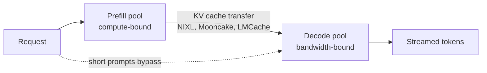

<div dir="rtl">

# پایپ‌لاین استنتاج (Inference Pipeline)

این فصل به نحوه تولید متن توسط LLMها در زمان استنتاج (Inference)، فازهای محاسباتی درگیر و معیارهای کلیدی برای سرویس‌دهی در محیط عملیاتی (production serving) می‌پردازد.

## فهرست مطالب

- [مبانی تولید](#generation-basics)
- [فازهای Prefill و Decode](#prefill-and-decode-phases)
- [استراتژی‌های نمونه‌برداری (Sampling)](#sampling-strategies)
- [شرایط توقف](#stopping-conditions)
- [رمزگشایی حدسی (Speculative Decoding)](#speculative-decoding)
- [معیارهای تاخیر (Latency)، توان کارآمد (Goodput) و سطوح سرعت](#latency-metrics)
- [نیازمندی‌های حافظه و محاسبات](#memory-and-compute-requirements)
- [استریمینگ (Streaming)](#streaming)
- [ملاحظات محیط عملیاتی](#production-considerations)
- [دسته‌بندی پیوسته (Continuous Batching) و کش پیشوند (Prefix Caching)](#continuous-batching-and-prefix-caching)
- [سرویس‌دهی Multi-LoRA](#multi-lora-serving)
- [سوالات مصاحبه](#interview-questions)
- [منابع](#references)

---

## مبانی تولید

مدل‌های LLM متن را به‌صورت خودبازگشتی (autoregressively) تولید می‌کنند: هر بار یک Token، با استفاده از تمام Tokenهای قبلی به عنوان زمینه (context).

```
Input: "The quick brown"
Step 1: Generate "fox" -> "The quick brown fox"
Step 2: Generate "jumps" -> "The quick brown fox jumps"
Step 3: Generate "over" -> "The quick brown fox jumps over"
...
```

### حلقه تولید (Generation Loop)

```python
def generate(prompt: str, max_tokens: int, model) -> str:
    tokens = tokenize(prompt)
    
    for _ in range(max_tokens):
        # Forward pass: get logits for next token
        logits = model.forward(tokens)
        
        # Sample next token from probability distribution
        next_token = sample(logits[-1])
        
        # Check for stop condition
        if next_token == EOS_TOKEN:
            break
        
        tokens.append(next_token)
    
    return detokenize(tokens)
```

---

## فازهای Prefill و Decode

استنتاج (Inference) دو فاز متمایز با ویژگی‌های متفاوت دارد:

### فاز Prefill

کل Prompt ورودی را به‌صورت موازی پردازش می‌کند.

```
Input: "The quick brown fox" (4 tokens)

Prefill:
- Process all 4 tokens simultaneously
- Compute attention across all pairs
- Populate KV cache for all positions
- Output: logits for next token
```

**ویژگی‌ها:**
- محدود به محاسبات یا Compute-bound (تعداد زیادی عملیات ماتریسی)
- قابلیت موازی‌سازی در میان Tokenها
- مقیاس‌پذیری زمان با طول Prompt
- در هر بار تولید فقط یک بار رخ می‌دهد

### فاز Decode

هر بار یک Token تولید می‌کند.

```
Decode step 1:
- Input: new token position only
- Attend to all KV cache (prompt + previously generated)
- Generate one token

Decode step 2:
- Append new K, V to cache
- Input: newest token position
- Generate next token

...repeat until done
```

**ویژگی‌ها:**
- محدود به حافظه یا Memory-bound (هر گام وزن‌ها و KV cache را مجدداً از HBM می‌خواند)
- متوالی (برای شروع گام بعدی باید هر گام تکمیل شود)
- زمان به ازای هر Token تقریباً ثابت است
- تا زمان برقراری شرط توقف تکرار می‌شود

### چرا این موضوع اهمیت دارد

| فاز | گلوگاه (Bottleneck) | بهینه‌سازی |
|-------|------------|--------------|
| Prefill | محاسبات (هسته‌های GPU) | Flash Attention، پردازنده GPU بهتر |
| Decode | پهنای باند حافظه | GQA، دسته‌بندی (batching)، کوانتیزاسیون (quantization)، رمزگشایی حدسی (speculative decoding) |

**پیامدها برای سرویس‌دهی:**
- Promptهای طولانی زمان prefill را افزایش می‌دهند (بر TTFT اثر می‌گذارد)
- تولیدهای طولانی زمان decode را افزایش می‌دهند (بر تاخیر کلی یا total latency اثر می‌گذارد)
- دسته‌بندی (Batching) به بازدهی decode بیشتر از prefill کمک می‌کند

### جداسازی Prefill و Decode (Disaggregated Prefill and Decode)

از آنجا که این دو فاز گلوگاه‌های متضادی دارند، استقرارهای (deployments) بزرگ آن‌ها را در استخرهای (pools) جداگانه‌ای اجرا می‌کنند: ورکرهای prefill ساختار KV cache را می‌سازند و تحویل می‌دهند، و ورکرهای decode اقدام به استریم کردن Tokenها می‌کنند.

<div dir="ltr">



</div>

- **دستاورد اصلی توان کارآمد (Goodput) است، نه اوج توان عملیاتی (Peak Throughput)**: نرخ درخواستی که هر دو SLO مربوط به TTFT و تاخیر بین Tokenها (inter-token latency) را برآورده می‌کند. هجوم‌های ناگهانی prefill دیگر مانع پردازش‌های در حال انجام decode (اصطلاحاً in-flight decodes) نمی‌شوند. (راهنمای سپتامبر ۲۰۲۶ در سرویس‌دهی تفکیک‌شده vLLM این موضوع را به همین شکل تبیین می‌کند.)
- **هزینه اصلی، انتقال KV است**: مدل Llama-3.1-70B در فرمت BF16 به ازای هر Token مقدار ۳۲۰ کیلوبایت (KiB) ذخیره می‌کند؛ بنابراین یک Prompt با ۱۰ هزار Token حدود ۳ گیگابایت به decode تحویل می‌دهد که با سرعت ۴۰۰ گیگابیت بر ثانیه (Gb/s)، تقریباً ۶۵ میلی‌ثانیه به TTFT اضافه می‌کند. این امر اغلب برای Promptهای کوتاه توجیه اقتصادی و عملکردی ندارد؛ سیستم NVIDIA Dynamo 1.5 یک بای‌پس شرطی (conditional bypass) اضافه کرده است که آن‌ها را مستقیماً به decode می‌فرستد.
- **نسخه‌های چندتراشه‌ای (Cross-chip versions)** برای سطوح تاخیر ممتاز (premium-latency tiers)، فاز prefill را روی GPUهای دارای HBM و فاز decode را روی قطعات مبتنی بر SRAM یا در مقیاس ویفر (wafer-scale) قرار می‌دهند: ترکیب NVIDIA Rubin به همراه Groq 3 LPX (در محیط عملیاتی)، ترکیب AMD Helios به همراه Cerebras (اعلام‌شده، از طریق Cerebras Cloud)، و یک طرح اولیه (blueprint) از Intel به همراه SambaNova.
- **مدل‌ها اکنون حول این تفکیک طراحی می‌شوند**: مدل DeepSeek V4.1-Flash در فاز prefill به ازای هر Token معادل ۸ میلیارد پارامتر و در فاز decode معادل ۱۶ میلیارد پارامتر را فعال می‌کند.

---

## استراتژی‌های نمونه‌برداری (Sampling)

پس از محاسبه لاجیت‌ها (logits)، باید Token بعدی را انتخاب کنیم. استراتژی‌های گوناگون خروجی‌های متفاوتی تولید می‌کنند.

### رمزگشایی حریصانه (Greedy Decoding)

همیشه Token با بالاترین احتمال را انتخاب می‌کند:

```python
def greedy_sample(logits):
    return torch.argmax(logits)
```

**ویژگی‌ها:**
- قطعی (Deterministic)
- اغلب برای تولیدهای طولانی تکراری می‌شود
- مناسب برای خروجی‌های مبتنی بر واقعیت/ساختاریافته

### نمونه‌برداری با دما (Temperature Sampling)

مقیاس‌بندی لاجیت‌ها پیش از softmax برای کنترل تصادفی بودن:

```python
def temperature_sample(logits, temperature=1.0):
    scaled_logits = logits / temperature
    probs = torch.softmax(scaled_logits, dim=-1)
    return torch.multinomial(probs, num_samples=1)
```

**اثرات دما (Temperature):**

| دما (Temperature) | رفتار | مورد استفاده |
|-------------|----------|----------|
| 0 | حریصانه (از نظر ریاضی قطعی است، اما در سرویس‌دهی دسته‌ای روی GPU از نظر بیتی دقیق نیست) | پرسش و پاسخ مبتنی بر واقعیت، کدنویسی |
| 0.3-0.7 | تصادفی بودن کم | وظایف عمومی |
| 1.0 | خط مبنا (Baseline) | نگارش خلاقانه |
| 1.5+ | تصادفی بودن بالا | ایده‌پردازی (Brainstorming) |

### نمونه‌برداری Top-K

فقط K تا از Tokenهای با بالاترین احتمال را در نظر می‌گیرد:

```python
def top_k_sample(logits, k=50):
    values, indices = torch.topk(logits, k)
    probs = torch.softmax(values, dim=-1)
    sampled_idx = torch.multinomial(probs, num_samples=1)
    return indices[sampled_idx]
```

**اثر:** فیلتر کردن Tokenهای با احتمال پایینی که ممکن است بی‌معنی باشند.

### نمونه‌برداری Top-P (هسته‌ای یا Nucleus)

شامل کردن Tokenها تا زمانی که احتمال تجمعی از P فراتر رود:

```python
def top_p_sample(logits, p=0.9):
    sorted_probs, sorted_indices = torch.sort(
        torch.softmax(logits, dim=-1), descending=True
    )
    cumulative_probs = torch.cumsum(sorted_probs, dim=-1)
    
    # Find cutoff
    cutoff_idx = torch.searchsorted(cumulative_probs, p)
    
    # Sample from truncated distribution
    selected_probs = sorted_probs[:cutoff_idx + 1]
    selected_probs = selected_probs / selected_probs.sum()
    sampled_idx = torch.multinomial(selected_probs, num_samples=1)
    
    return sorted_indices[sampled_idx]
```

**مزیت نسبت به Top-K:** تنظیم پویا بر اساس توزیع احتمال. پیش‌بینی‌های با اطمینان بالا Tokenهای کمتری را شامل می‌شوند؛ پیش‌بینی‌های نامطمئن Tokenهای بیشتری را در بر می‌گیرند.

### پیکربندی‌های رایج

| مورد استفاده | Temperature | Top-P | Top-K |
|----------|-------------|-------|-------|
| تولید کد | 0-0.2 | 0.95 | - |
| پرسش و پاسخ مبتنی بر واقعیت | 0.1-0.3 | 1.0 | - |
| گفتگوی عمومی | 0.7 | 0.9 | - |
| نگارش خلاقانه | 1.0 | 0.95 | - |
| ایده‌پردازی | 1.2 | 1.0 | - |

این تنظیمات برای موتورهای خود‌میزبان (self-hosted) و مدل‌های هاست‌شده‌ای که همچنان پارامترهای نمونه‌برداری را می‌پذیرند اعمال می‌شود. بسیاری از مدل‌های پیشرو هاست‌شده دیگر این پارامترها را نمی‌پذیرند؛ بخش [کنترل‌های نمونه‌برداری در مدل‌های پیشرو هاست‌شده](#sampling-controls-on-hosted-frontier-models) را ببینید.

### جریمه‌های تکرار (Repetition Penalties)

کاهش احتمال Tokenهایی که اخیراً تولید شده‌اند:

```python
def apply_repetition_penalty(logits, generated_tokens, penalty=1.2):
    for token_id in set(generated_tokens):
        logits[token_id] /= penalty
    return logits
```

**انواع:**
- جریمه حضور (Presence penalty): جریمه کردن تمام Tokenهایی که ظاهر شده‌اند
- جریمه فرکانس (Frequency penalty): جریمه متناسب با تعداد دفعات تکرار

### کنترل‌های نمونه‌برداری در مدل‌های پیشرو هاست‌شده

تمام موارد بالا همچنان برای موتورهای خود‌میزبان (self-hosted) صادق است: vLLM، SGLang و llama.cpp مجموعه کامل این تنظیمات را ارائه می‌دهند. مدل‌های استدلالی هاست‌شده (hosted reasoning models) در حال حذف این ابزارهای کنترلی هستند:

| ارائه‌دهنده | چه تغییراتی رخ داد |
|----------|--------------|
| Anthropic | از زمان نسخه API با شناسه `2026-10-21` (۲۱ اکتبر ۲۰۲۶)، ارسال هرگونه `temperature`، `top_p` یا `top_k` روی تمامی مدل‌های Claude با خطای 400 مواجه می‌شود، حتی اگر مقدار پیش‌فرض آن ارسال شود؛ هر هشت نسخه اصلی جدید SDK و CLI (شامل Python، TypeScript، Go، Java، C#، PHP، Ruby و CLI ابزار ant) این نسخه را به‌صورت پیش‌فرض ارسال می‌کنند. پیش از آن، خطای 400 برای مقادیر غیرپیش‌فرض در Claude 4.7 و مدل‌های بعدی اعمال می‌شد، و نسخه 1.0 از Python SDK (۲۰ اوت ۲۰۲۶) پیش‌تر این پارامترها را از امضای متدهای Messages حذف کرده بود. در Bedrock این نسخه جدید تنها برای Claude 4.7 و نسخه‌های پس از آن کار می‌کند. |
| Google | پارامترهای `temperature`، `top_p` و `top_k` در Gemini API را در ۲۱ ژوئیه ۲۰۲۶ منسوخ (deprecated) کرد. مدل Gemini 3.8 Flash پارامتر `thinking_budget` را با `thinking_level` جایگزین می‌کند (`low`، مقدار پیش‌فرض `medium`، `high`). |
| OpenAI | مدل GPT-6 Astra (۳ سپتامبر ۲۰۲۶) هیچ مقدار سفارشی برای `temperature` یا `top_p` نمی‌پذیرد و هیچ logprobی برنمی‌گرداند. |

سطح کنترل اکنون **میزان تلاش برای استدلال (reasoning effort)** (یا سطح تفکر / thinking level) است، نه نمونه‌بردار (sampler). تغییراتی که این رویکرد به همراه دارد:
- **قطعیت (Determinism)**: کدهایی که `temperature=0` را «برای تکرارپذیری» تنظیم می‌کنند اکنون از کار می‌افتند یا در حال کنار گذاشته شدن هستند (خطای 400 در تمام مدل‌های Claude تحت نسخه فعلی API، عدم پشتیبانی در GPT-6 Astra، منسوخ‌شده در Gemini)، و در هر صورت هیچ‌گاه خروجی دقیقاً یکسان در سطح بیت را تضمین نمی‌کردند. سرویس‌دهی دسته‌ای روی GPU، مسیریابی MoE و ترتیب تقلیل ممیز شناور (floating-point reduction order) باعث می‌شوند خروجی‌ها از اجرایی به اجرای دیگر تغییر کنند، مگر اینکه موتور سرویس‌دهی حالتی قطعی و مستقل از دسته (batch-invariant) را با بهایی در توان عملیاتی (Throughput) اجرا کند.
- **سیگنال‌های اطمینان (Confidence signals)**: امتیازدهی مبتنی بر logprob برای مسیریابی، امتناع از پاسخ (abstention) یا ارجاع به انسان (human escalation) در Astra کار نمی‌کند. به جای آن از طبقه‌بندهای کالیبره‌شده (calibrated classifiers)، گام‌های اعتبارسنج (verifier passes) یا خودارزیابی ساختاریافته استفاده کنید، یا از یک مدل تصمیم‌گیری (decision model) بهره ببرید که پاسخی تایپ‌شده همراه با یک احتمال برمی‌گرداند (API بخش Decisions در OpenAI، یا اندپوینت‌های بومی در vLLM و SGLang؛ [موضوع ۱۶ رادار پژوهشی](../RESEARCH-RADAR.md#16-decision-models-typed-answers-with-probabilities) را ببینید). این احتمالات را روی داده‌های خودتان کالیبره کنید: مقالات اولیه نشان می‌دهند که مدل‌های تصمیم‌گیری دچار کم‌اطمینانی (underconfident) هستند.
- **تنوع (Diversity)**: تنوع در روش Best-of-N اکنون از تغییر دادن Prompt، مدل‌های متفاوت یا نمونه‌برداری خود ارائه‌دهنده حاصل می‌شود، نه از افزایش دما (temperature).
- **لایه‌های انتزاع (Abstraction layers)**: بسته‌بندی‌ها (wrappers) و توابعی که پارامترهای نمونه‌برداری را به‌صورت هاردکد (hard-code) تعریف می‌کنند، هنگام مهاجرت به این مدل‌ها دچار شکست می‌شوند. پارامترهای خاص هر ارائه‌دهنده را در پشت یک لایه پیکربندی سبک و اختصاصی به ازای هر مدل نگه دارید.

---

## شرایط توقف

تولید متن تا زمانی که یک شرط توقف برآورده شود ادامه می‌یابد:

### Token پایان توالی (EOS Token)

مدل Token پایان توالی (end-of-sequence) را تولید می‌کند:

```python
if next_token == tokenizer.eos_token_id:
    break
```

### حداکثر تعداد Tokenها (Max Tokens)

محدودیت قطعی (hard limit) برای طول تولید:

```python
for i in range(max_tokens):
    # generate...
```

### توالی‌های توقف (Stop Sequences)

رشته‌های سفارشی که به تولید متن خاتمه می‌دهند:

```python
stop_sequences = ["###", "\n\n", "Human:"]

for seq in stop_sequences:
    if output.endswith(seq):
        output = output[:-len(seq)]
        break
```

---

## رمزگشایی حدسی (Speculative Decoding)

**استانداردی در تمامی موتورهای سرویس‌دهی اصلی برای decode حساس به تاخیر (Latency).**

یک مدل پیش‌نویس‌کننده ارزان (cheap drafter) تعداد K تا از Tokenهای بعدی را پیشنهاد می‌دهد؛ مدل هدف (target model) تمام این K تا Token را در یک گذر روبه‌جلو (forward pass) اعتبارسنجی می‌کند و طولانی‌ترین پیشوندی را که با آن موافق است نگه می‌دارد، به علاوه یک Token که خودش نمونه‌برداری می‌کند. با اعتبارسنجی استاندارد نمونه‌برداری ردشده (rejection-sampling)، توزیع خروجی دقیقاً با مدل هدف مطابقت دارد؛ بنابراین پیش‌بینی حدسی سرعت را تغییر می‌دهد، نه کیفیت را.

```
Drafter (cheap): proposes "The", "quick", "brown", "fox", "jumps"
Target (large):  verifies all 5 in ONE forward pass
Result: if the target accepts 4, it adds 1 of its own: 5 tokens for one
        large forward pass (plus the drafter's cost)
```

| روش | منشأ پیش‌نویس‌ها (Drafts) | وضعیت (اکتبر ۲۰۲۶) |
|--------|------------------------|-----------------------|
| Draft model | مدل کوچک جداگانه با همان Tokenizer | همچنان پشتیبانی می‌شود؛ نیازمند یک مدل کوچک منطبق است |
| EAGLE-3 | هد سبک آموزش‌دیده روی حالت‌های پنهان مدل هدف | گزینه‌ای رایج برای مدل‌های فاقد هدهای داخلی |
| هدهای MTP | ماژول‌های Multi-Token Prediction (MTP) همراه با مدل | از DeepSeek V3 به بعد؛ MiMo-V2.6-Pro (دارای MTP پنج لایه، ۷ تا Token در هر گذر)؛ Qwen3.8-Flash-Next (ماژول MTP چهار میلیاردی / 4B) |
| DSpark | مدل پیش‌نویس‌کننده DeepSeek، ارائه‌شده در چک‌پوینت | مدل‌های DeepSeek-V4-Flash-DSpark و V4-Pro-DSpark (۲۷ ژوئن ۲۰۲۶) همان چک‌پوینت‌ها همراه با یک ماژول پیش‌نویس متصل هستند؛ در vLLM با `method: "dspark"` به همراه ۷ تا Token حدسی |
| DFlash 2 | پیش‌نویس‌کننده انتشار بلوکی (Block-diffusion) که کل یک بلوک را به‌صورت موازی پیشنهاد می‌دهد | شرکت Inco AI، ۱۸ اوت ۲۰۲۶؛ ۲.۷ تا ۳.۴ برابر روی Qwen3.8-27B (گزارش‌شده توسط ارائه‌دهنده)؛ ادغام‌شده در SGLang، vLLM و llama.cpp در ۱۹ تا ۲۷ اوت |
| N-gram، جستجوی Prompt، رمزگشایی پسوند | زیررشته‌هایی از Prompt یا خروجی قبلی | بدون نیاز به مدل اضافی؛ بسیار کارآمد برای RAG، ویرایش کد و حلقه‌های ایجنت (Agent) که متن را تکرار می‌کنند |

هدهای مدوسا (Medusa heads) که گزینه محبوب سال ۲۰۲۴ بودند، از vLLM حذف شده‌اند: نسخه v0.33.0 (۲ نوامبر ۲۰۲۶) هدهای Medusa و پیش‌بینی‌کننده MLP را حذف کرد، بنابراین پیکربندی‌هایی که همچنان `medusa` را تنظیم کرده باشند هنگام ارتقا با خطا مواجه می‌شوند. به EAGLE-3 یا هدهای MTP خود مدل مهاجرت کنید.

**نکته ظریف اندازه دسته (Batch size).** روش حدسی (Speculation) محاسبات بیشتری مصرف می‌کند تا گام‌های decode که محدود به پهنای باند هستند را ذخیره نماید. در همزمانی پایین، این توان محاسباتی رایگان است؛ اما در همزمانی بالا، GPU پیش‌تر مشغول است و هر Token پیش‌نویس ردشده یک هدررفت محسوب می‌شود؛ به همین دلیل توصیه سنتی این بود که «در اندازه‌های دسته بزرگ آن را خاموش کنید». قابلیت **اعتبارسنجی تطبیقی (adaptive verification)** در vLLM (۱۴ اوت ۲۰۲۶؛ گسترش‌یافته در v0.30 برای پیش‌نویس‌کننده‌های MTP، EAGLE-3 و DFlash) احتمال بقای هر موقعیت پیش‌نویس را امتیازدهی کرده و در هر گام فقط یک مجموعه سراسری top-B از اسلات‌های پیش‌نویس را می‌پذیرد. در DeepSeek-V4-Pro-0813، اولین Token از ۷ تا Token پیش‌نویس بیش از ۷۰٪ مواقع و آخرین مورد کمتر از ۱۰٪ مواقع باقی می‌ماند؛ vLLM گزارش می‌دهد که این روش حدسی تا همزمانی ۲۵۶ همچنان سودمند باقی می‌ماند.

**پیامدهای عملیاتی:**
- ناشران مدل‌ها اکنون پیش‌نویس‌کننده‌ها را همراه با وزن‌ها عرضه می‌کنند، بنابراین برآوردهای توان عملیاتی (Throughput) در میزبانی شخصی (self-host) باید فرض کنند که روش حدسی فعال است، و بررسی‌های برابری ارزیابی (eval parity checks) نیز باید از همان مسیر حدسی که سرویس می‌دهید اجرا شوند.
- بنچمارک MLPerf Inference نسخه v6.1 (سپتامبر ۲۰۲۶) رمزگشایی حدسی را در سناریوی تعاملی gpt-oss-120b مجاز می‌داند، بنابراین نتایج آن آزمایش ممکن است شامل آن باشد.

برای بررسی کامل، بخش [رمزگشایی حدسی (Speculative Decoding)](../04-inference-optimization/03-speculative-decoding.md) را ببینید.

---

## معیارهای تاخیر (Latency)

### زمان تا اولین Token (Time to First Token یا TTFT)

زمان سپری‌شده از ارسال درخواست تا اولین Token تولیدشده.

```
TTFT = network_latency + queue_time + prefill_time
```

**عوامل موثر بر TTFT:**
- طول Prompt (مرحله prefill به‌صورت خطی با طول Prompt افزایش می‌یابد و در کانتکست‌های طولانی که توجه درجه‌دوم (quadratic attention) غالب است، سریع‌تر رشد می‌کند)
- اندازه مدل
- سرعت GPU
- عمق صف (Queue depth)

**اهداف (Targets):**
- چت تعاملی (Interactive chat): کمتر از ۵۰۰ میلی‌ثانیه (< 500ms)
- بلادرنگ (Real-time): کمتر از ۲۰۰ میلی‌ثانیه (< 200ms)
- دسته‌ای (Batch): اهمیت کمتری دارد

### نرخ Token بر ثانیه (Tokens Per Second یا TPS)

نرخ تولید Token پس از اولین Token. مقدار TPS به ازای هر درخواست، معکوس **تاخیر بین Tokenها** (inter-token latency یا ITL، که زمان به ازای هر Token خروجی نیز نامیده می‌شود) است.

```
TPS = (total_tokens - 1) / (total_time - TTFT)
```

**عوامل موثر بر TPS:**
- اندازه مدل (پارامترهای فعال در MoE)
- اندازه دسته (Batch size)
- پهنای باند حافظه GPU
- اندازه KV cache
- نرخ پذیرش در رمزگشایی حدسی (Speculative decoding)

**مقادیر متداول:**
- مدل Llama 70B روی H100: بین ۳۰ تا ۵۰ Token بر ثانیه به ازای هر درخواست
- روی APIهای میزبانی‌شده پیشرو (frontier)، لایه استاندارد: ده‌ها Token بر ثانیه به ازای هر درخواست، متغیر بسته به مدل، میزان تلاش استدلال (reasoning effort) و بار کاری
- مدل کوچک (7B): بیش از ۱۰۰ Token بر ثانیه

در مدل‌های استدلالی (reasoning models)، Tokenهای تفکر پنهان (hidden thinking tokens) پیش از اولین Token مرئی استریم می‌شوند؛ بنابراین، TTFT احساس‌شده توسط کاربر شامل بخشی از فاز decode نیز می‌شود. زمان تا اولین Token *مرئی* را به‌صورت جداگانه اندازه‌گیری کنید.

### سرعت به‌عنوان یک لایه قیمت‌گذاری‌شده (Priced Tier)

امروزه ارائه‌دهندگان سرعت را جدا از خود مدل به فروش می‌رسانند:
- **OpenAI**: لایه سریع Fast (که در ۳۰ ژوئیه ۲۰۲۶ از Priority تغییر نام یافت) با ۲ برابر قیمت Standard (۲.۵ برابر در GPT-5.5)؛ لایه Ultrafast با ۶ برابر قیمت، که از ۲۹ سپتامبر ۲۰۲۶ برای GPT-6 Astra به‌صورت عمومی (GA) و از ۸ اکتبر برای تمام کاربران API در GPT-6.1 Sol در دسترس قرار گرفت ($12/$60 به ازای هر 1M). همچنین OpenAI نسخه GPT-5.6 Sol Ultrafast را روی سخت‌افزار Cerebras با سرعت حداکثر ۷۵۰ Token خروجی بر ثانیه برای مشتریان منتخب پیش‌نمایش کرد.
- **Anthropic**: حالت fast mode در Claude Opus 5.5 با قیمت $8/$40 به ازای هر 1M (۲ برابر استاندارد)، که از ۱۵ اکتبر از حالت پیش‌نمایش تحقیقاتی خارج شده و روی Claude API، بخش Claude Models در Google Cloud (مدیریت‌شده توسط Anthropic) و استقرارهای (deployments) میزبانی‌شده در Azure تحت عنوان Foundry ارائه می‌شود.
- **مدل‌های زبانی نفوذی (Diffusion LMs)** رمزگشایی Token-به-Token را با پالایش موازی جایگزین می‌کنند: شرکت Inception گزارش داده است که مدل Mercury 2.5 روی GPUهای NVIDIA به سرعت ۱,۱۰۷ Token بر ثانیه با قیمت لیست $0.20/$0.75 به ازای هر 1M می‌رسد.

تاخیر (Latency) اکنون به یک بعد مسیریابی تبدیل شده است: نوبت‌های رو به کاربر را به لایه سریع (fast tier) و گام‌های پس‌زمینه ایجنت (agent) را به لایه Standard یا Batch هدایت کنید.

### تاخیر کل (Total Latency)

```
Total = TTFT + (output_tokens / TPS)
```

**مثال:**
- مقدار TTFT برابر با 200ms
- مقدار TPS برابر با ۵۰ Token بر ثانیه
- خروجی: ۱۰۰ Token
- کل: 200ms + 2000ms = 2.2s

### توان عملیاتی (Throughput)

تعداد درخواست‌های تکمیل‌شده در واحد زمان:

```
Throughput = concurrent_requests * TPS / average_output_tokens
```

اندازه‌های بزرگ‌تر دسته (Batch size) باعث افزایش توان عملیاتی (Throughput) می‌شوند، اما ممکن است تاخیر (Latency) هر درخواست را افزایش دهند.

### توان عملیاتی مفید (Goodput) و منحنی‌های پارتو

توان عملیاتی بیشینه (Peak throughput) و سرعت در دسته یک (batch-1 speed) هر دو به تنهایی گمراه‌کننده‌اند. **توان عملیاتی مفید (Goodput)** نرخ درخواستی است که اهداف سطح خدمت (SLO) مربوط به TTFT و ITL شما را به‌طور همزمان برآورده می‌کند. هنگام مقایسه موتورها یا شتاب‌دهنده‌ها، **منحنی‌های پارتوی توان عملیاتی در برابر تعاملی‌بودن (throughput-versus-interactivity Pareto curves)** را بر اساس SLO خود و با ترافیکی مشابه ترافیک واقعی‌تان مقایسه کنید.

سناریوی AgentX از SemiAnalysis (ترافیک چندنوبتی ایجنت با کانتکست طولانی و استفاده مجدد بالا از پیشوند) نشان می‌دهد نقطه کاری (operating point) تا چه حد اهمیت دارد. در DeepSeek V4 Pro، این سناریو گزارش می‌دهد که Vera Rubin NVL72 تحت مفروضات هزینه مالکیت (TCO) در سرعت ۱۷۰ Token بر ثانیه برای هر کاربر، حدود ۶۷ برابر توان عملیاتی نسبت به GB300 ارائه می‌دهد، اما با قیمت اجاره ۳ ساله در SLA صدک ۹۰ (P90) برابر با ۸۰ Token بر ثانیه، تنها ۶۲٪ Token بیشتر نسبت به GB300 NVL72 تولید می‌کند (گزارش‌شده توسط تحلیل‌گران). سخت‌افزار یکسان، مدل یکسان: یک تیتر ۶۷ برابری یا یک نتیجه ۱.۶ برابری، بسته به هدف تعاملی‌بودن و مبنای هزینه‌ای که انتخاب می‌کنید. اولین اجرای مستقل، یعنی AA-AgentPerf از Artificial Analysis (در ۱۵ اکتبر ۲۰۲۶)، نشان داد که برتری Rubin بسته به مدل تنها بین ۱.۱۴ تا ۱.۴۵ برابر توان عملیاتی بیشینه GB300 به ازای هر مگاوات است و پیشتازی‌های بزرگ‌تر تنها در سرعت‌های بالای اختصاص‌یافته به هر کاربر دیده می‌شود. پیش از پذیرش هرگونه ادعایی درباره شتاب‌دهنده‌ها، کل منحنی و نهاد اندازه‌گیری‌کننده آن را جویا شوید.

---

## نیازمندی‌های حافظه و محاسبات

### وزن‌های مدل (Model Weights)

```
Memory = parameters * bytes_per_parameter

70B model in BF16: 70B * 2 bytes   = 140 GB
70B model in FP8:  70B * 1 byte    = 70 GB
70B model in INT4 or FP4: 70B * 0.5 bytes = 35 GB
  (plus block scales: NVFP4 ~4.5 bits/weight, ~39 GB; MXFP4 ~4.25 bits, ~37 GB)
```

**دقت محاسباتی در سال ۲۰۲۶:** وزن‌های FP4 (فرمت NVFP4 روی NVIDIA، فرمت MXFP4 روی AMD و سایر سخت‌افزارهای مبتنی بر فرمت OCP) به‌همراه KV cache با فرمت FP8، پیکربندی شاخص سرویس‌دهی محسوب می‌شود؛ همچنین SGLang می‌تواند چک‌پوینت‌های NVFP4 را هنگام بارگذاری به MXFP4 بازکوانتایز (requantize) کند تا روی AMD اجرا شوند. دقت پایین‌تر تنها در صورت وجود کرنل بهینه برنده می‌شود: دستورالعمل Nemotron 3.5 Lightning در NVIDIA Dynamo نشان داد که فرمت BF16 روی کرنل‌های Marlin حدود ۸۰٪ سریع‌تر از NVFP4، و روی کرنل‌های CuTeDSL حدود ۱۲٪ سریع‌تر از NVFP4 بوده است. پیش از آنکه فرض کنید FP4 سریع‌تر است، مسیر دقیق کرنل را بنچمارک کنید.

برای مدل‌های MoE، حافظه را بر اساس **کل** پارامترها (زیرا تمام کارشناسان/expertها باید مقیم در حافظه باشند) و محاسبات را بر اساس پارامترهای **فعال** تعیین اندازه کنید.

### کش KV (KV Cache)

```
Per token: 2 * layers * kv_heads * head_dim * bytes
Per request: per_token * sequence_length

Llama 3.x 70B (80 layers, 8 KV heads via GQA, head_dim 128, BF16):
= 2 * 80 * 8 * 128 * 2 bytes
= 320 KiB per token

At 4K context:   ~1.3 GB per request
At 8K context:   ~2.7 GB per request
At 128K context: ~43 GB per request
(FP8 KV halves these. Full MHA with 64 KV heads would be 8x larger.)
```

این فرمول تنها برای لایه‌های استاندارد GQA/MHA برقرار است. مدل‌های مبتنی بر پنجره لغزان (Sliding-window)، توجه خطی (linear-attention) و KV فشرده‌شده به محاسبات خاص خود نیاز دارند؛ بخش [توجه ترکیبی و تنک](03-attention-mechanisms.md#hybrid-and-sparse-attention-in-2026-open-models) را مشاهده کنید.

### کل حافظه GPU

```
Total = model_weights + kv_cache * batch_size + activations

Example: Llama 3.x 70B, 8K context, batch 16
- Weights (INT4/FP4): ~35-40 GB
- KV cache (BF16, 8K, batch 16): 16 * 2.7 GB = ~43 GB
- Activations and runtime overhead: ~5 GB
- Total: ~83-88 GB, just over one H100 80GB. Fits one H200 141GB,
  or one H100 with FP8 KV (~21 GB of KV instead of ~43 GB)
```

### تعداد FLOPs به ازای هر Token

```
Forward pass FLOPs ≈ 2 * active parameters

70B dense model:
≈ 140 GFLOPs per token

At 40 tokens/sec for one request:
≈ 5.6 TFLOPS sustained, under 1% of an H100's ~989 dense BF16 TFLOPS.
Decode is bound by memory bandwidth, not FLOPs, until batching
raises arithmetic intensity.
```

---

## استریمینگ (Streaming)

برای برنامه‌های تعاملی، Tokenها را به محض تولید استریم کنید:

### رویدادهای ارسالی سرور (Server-Sent Events یا SSE)

```python
# Server
async def generate_stream(prompt: str):
    for token in model.generate_iter(prompt):
        yield f"data: {json.dumps({'token': token})}\n\n"
    yield "data: [DONE]\n\n"

# Client
async for event in sse_client.stream("/generate"):
    token = json.loads(event.data)["token"]
    display(token)
```

### مزایا

| جنبه | استریمینگ (Streaming) | غیر استریمینگ (Non-streaming) |
|--------|-----------|---------------|
| تاخیر ادراک‌شده | فقط TTFT | کل زمان تولید |
| تجربه کاربری | پیش‌رونده | انتظار، سپس تکمیل یک‌باره |
| توقف زودهنگام | کاربر می‌تواند متوقف کند | باید صبر کرد |
| حافظه | کمتر | بیشتر (بافر کردن پاسخ) |

### جزئیات پیاده‌سازی

- تخلیه بافر (Flush) پس از هر Token
- مدیریت مناسب قطعی ارتباط
- در نظر گرفتن بافرینگ برای تولیدهای بسیار سریع
- برخی فریم‌ورک‌ها به‌طور پیش‌فرض خروجی را بافر می‌کنند؛ برای استریمینگ آن را غیرفعال کنید
- تغییر مسیر به پشتیبان (Fail over) را فقط پیش از رسیدن اولین Token به کلاینت انجام دهید؛ پس از آن، تلاش مجدد (retry) روی یک بک‌اند دیگر موجب تکرار یا تناقض در خروجی نمایش‌داده‌شده قبلی می‌شود. امروزه درگاه‌ها این قابلیت را مستقیماً پیاده‌سازی می‌کنند (قابلیت `streamIdleTimeout` در Envoy AI Gateway 1.1 در صورتی که اولین Token دریافت نشود، به بک‌اند بعدی سوییچ می‌کند)

---

## ملاحظات محیط عملیاتی (Production)

### دسته‌بندی برای توان عملیاتی (Batching for Throughput)

ترکیب چندین درخواست جهت به حداکثر رساندن بهره‌وری GPU:

```python
# Without batching: GPU underutilized
for request in requests:
    response = model.generate(request)

# With batching: parallel processing
batch = collect_requests(timeout_s=0.010, max_batch=32)
responses = model.generate_batch(batch)
```

### دسته‌بندی پیوسته و کش‌کردن پیشوند

**دسته‌بندی پیوسته (زمان‌بندی در سطح تکرار یا Iteration-level Scheduling):**
برخلاف دسته‌بندی ایستا (static batching)، دسته‌بندی پیوسته (continuous batching) به محض اینکه یکی از درخواست‌های درون دسته به Token پایان توالی (EOS token) برسد، درخواست‌های جدید را تزریق می‌کند. شرکت Anyscale در سال ۲۰۲۳ تا ۲۳ برابر افزایش توان عملیاتی (Throughput) را نسبت به دسته‌بندی ایستای اولیه اندازه‌گیری کرد؛ امروزه تمام موتورهای اصلی به‌طور پیش‌فرض این کار را انجام می‌دهند. این قابلیت را با کنترل پذیرش (admission control) همراه کنید: vLLM 0.29 پرچم‌های `--max-num-queued-reqs` و `--max-num-queued-tokens` را اضافه کرد تا در شرایط بار اضافی، به جای ایجاد صف نامحدود و افزایش مهارگسیخته TTFT، خطایی سریع بازگردانده شود.

**کش‌کردن پیشوند (Prefix Caching خودکار در vLLM، مکانیزم RadixAttention در SGLang):**
تنسورهای KV مربوط به پیشوندهای متداول (Promptهای سیستمی، تعاریف ابزار، نمونه‌های few-shot، نوبت‌های قبلی ایجنت) را کش می‌کند.
- **کاهش TTFT**: مرحله prefill برای پیشوند مشترک نادیده گرفته می‌شود؛ بنابراین، میزان صرفه‌جویی متناسب با بخش مشترک Prompt افزایش می‌یابد. حلقه‌های ایجنت با پیشوندهای طولانی و پایدار، بیشترین بهره را از این قابلیت می‌برند.
- **سازوکار (Mechanism)**: موتور vLLM بلوک‌های KV با اندازه ثابت را در زنجیره‌ای هش می‌کند که کلید آن تمام محتوای پیشین است؛ SGLang پیشوندها را در یک درخت رادیکس (radix tree) ذخیره می‌کند. بلوک‌های خارج‌شده (evicted) می‌توانند در زنجیره‌ای از لایه‌ها تخلیه شوند: ابتدا HBM در GPU، سپس DRAM میزبان، و در ادامه دیسک، فضای ذخیره‌سازی شیء (object storage) یا گره‌های همتا (peer nodes).
- **امنیت**: یک کش پیشوند مشترک، یک کانال جانبی زمان‌بندی بین‌مستأجری (multi-tenant) محسوب می‌شود؛ زیرا برخورد به کش (hit) سریع‌تر از عدم برخورد (miss) پاسخ می‌دهد. کلیدهای کش را به ازای هر مستأجر (multi-tenant) نمک‌گذاری (salt) کنید (پارامتر `cache_salt` در vLLM) و موتور را همواره به‌روز نگه دارید: هشدار امنیتی vLLM با شناسه GHSA-935w-9g4m-p28p که در نسخه 0.30.0 برطرف شد، نشان داد که نوبت‌های ادامه‌یافته ابزار (tool-continuation turns) در یکی از مسیرهای API مقدار salt را حذف می‌کردند. نسخه vLLM 0.32.0 را به‌عنوان حداقل نسخه مجاز در نظر بگیرید (نسخه 0.33.0 روی میزبان‌هایی که مخازن شخص ثالث را بارگذاری می‌کنند)؛ فهرست کامل هشدارهای امنیتی و حداقل نسخه‌های فعلی در [زیرساخت سرویس‌دهی](../04-inference-optimization/06-serving-infrastructure.md#operational-posture) ارائه شده است.

### سرویس‌دهی چندگانه LoRA (Multi-LoRA Serving)

**سناریو:** سرویس‌دهی به ۱۰۰۰ مدل Fine-tuning شده متفاوت (آداپتورها) روی یک مدل پایه یکسان.
**چالش:** بارگذاری ۱۰۰۰ مدل مجزا به ترابایت‌ها حافظه VRAM نیاز خواهد داشت.

**راهکار (پیشگام‌شده توسط LoRAX / S-LoRA و اکنون به‌صورت بومی در vLLM و SGLang):**
۱. بارگذاری یک مدل پایه در VRAM.
۲. ذخیره آداپتورهای LoRA (در حد مگابایت) در RAM یا SSD میزبان.
۳. تعویض پویای آداپتورها در طول گذر رو به جلو (forward pass) بر اساس شناسه درخواست (request ID).
۴. **پیاده‌سازی**: استفاده از یک کرنل اختصاصی (مانند S-LoRA) که ضرب ماتریس-بردار را برای چندین آداپتور مختلف درون یک دسته یکسان انجام می‌دهد.

### اولویت‌بندی درخواست‌ها (Request Prioritization)

```python
class RequestQueue:
    def __init__(self):
        self.high_priority = asyncio.Queue()
        self.low_priority = asyncio.Queue()
    
    async def get_next(self):
        if not self.high_priority.empty():
            return await self.high_priority.get()
        return await self.low_priority.get()
```

**معیارهای اولویت:**
- لایه اشتراک مشتری (Customer tier)
- نوع درخواست
- زمان انتظار
- هزینه محاسباتی تخمینی

### مدیریت مهلت زمانی (Timeout Handling)

```python
async def generate_with_timeout(prompt: str, timeout: float):
    try:
        result = await asyncio.wait_for(
            model.generate(prompt),
            timeout=timeout
        )
        return result
    except asyncio.TimeoutError:
        return {"error": "timeout", "partial": partial_output}
```

### تنزل کارایی کنترل‌شده (Graceful Degradation)

```python
async def generate_with_fallback(prompt: str):
    try:
        return await primary_model.generate(prompt)
    except RateLimitError:
        return await fallback_model.generate(prompt)
    except TimeoutError:
        return await small_fast_model.generate(prompt)
```

حداقل یک مسیر جایگزین (fallback) بین ارائه‌دهندگان مختلف (cross-vendor) ایجاد کنید. اختلالات ارائه‌دهندگان معمولاً تمام مدل‌ها و محصولات آن شرکت را به‌طور همزمان از کار می‌اندازند؛ بنابراین، تغییر مسیر به مدلی دیگر از همان خانواده اغلب در همان لحظه با شکست مواجه می‌شود. بین ۱۶ اوت تا ۲۹ سپتامبر ۲۰۲۶، صفحه وضعیت Anthropic حداقل ۱۲ حادثه بزرگ یا بحرانی را ثبت کرد، و قطعی ۲۹ سپتامبر OpenAI (حدود ۵ ساعت و ۲۰ دقیقه) همزمان API، ChatGPT و Codex را تحت تاثیر قرار داد.

### رهگیری هزینه‌ها (Cost Tracking)

```python
@dataclass
class RequestMetrics:
    input_tokens: int          # uncached input. Anthropic reports cache reads
                               # separately; OpenAI's input count includes
                               # cached tokens, so subtract them first
    cached_input_tokens: int   # cache reads
    output_tokens: int         # includes reasoning tokens
    model: str
    latency_ms: float
    cost_usd: float

def calculate_cost(metrics: RequestMetrics) -> float:
    # USD per 1M tokens, standard tier list prices as of November 2026.
    # Ignores cache-write premiums, batch discounts and long-context surcharges
    # (OpenAI above 272K input; Claude Haiku 5.5 above a 100K-token prompt).
    pricing = {
        "gpt-6-sol": {"input": 2.00, "cached": 0.20, "output": 10.00},
        "claude-sonnet-5-5": {"input": 2.00, "cached": 0.10, "output": 10.00},
    }
    rates = pricing[metrics.model]
    return (
        (metrics.input_tokens / 1_000_000) * rates["input"] +
        (metrics.cached_input_tokens / 1_000_000) * rates["cached"] +
        (metrics.output_tokens / 1_000_000) * rates["output"]
    )
```

---

## سوالات مصاحبه

### پرسش: تفاوت بین فازهای prefill و decode را توضیح دهید.

**پاسخ قوی:**
استنتاج (Inference) در LLMها دو فاز مجزا دارد:

**پیش‌تکمیل (Prefill):**
- کل Prompt ورودی را به‌صورت یک‌جا پردازش می‌کند
- تمام Tokenها به‌صورت موازی به یکدیگر توجه (attend) می‌کنند
- حافظه KV cache را برای تمام موقعیت‌های Prompt پر می‌کند
- محدود به محاسبات (Compute-bound): از هسته‌های GPU به‌طور بهینه استفاده می‌کند
- زمان پردازش متناسب با طول Prompt افزایش می‌یابد

**رمزگشایی (Decode):**
- در هر لحظه یک Token تولید می‌کند
- Token جدید به تمام ورودی‌های KV cache توجه می‌کند
- مقادیر K و V جدید را به کش ضمیمه می‌کند
- محدود به حافظه (Memory-bound): هر گام مجدداً وزن‌ها (غالب در دسته‌های کوچک) و KV cache (غالب در کانتکست‌های طولانی و دسته‌های بزرگ) را بازخوانی می‌کند
- زمان به ازای هر Token تقریباً ثابت است و با بزرگ‌تر شدن KV cache اندکی افزایش می‌یابد

این موضوع در طراحی سیستم اهمیت دارد، زیرا:
- Promptهای طولانی باعث افزایش TTFT می‌شوند (فشار محاسباتی روی prefill)
- دسته‌بندی (Batching) به فاز decode بیشتر از فاز prefill کمک می‌کند
- راهبردهای بهینه‌سازی برای هر فاز متفاوت است

### پرسش: پارامترهای temperature و top-p چگونه بر تولید متن تاثیر می‌گذارند؟

**پاسخ قوی:**
هر دو پارامتر تصادفی‌بودن (randomness) را در انتخاب Token کنترل می‌کنند:

**دما (Temperature):**
- مقیاس لاجیت‌ها (logits) را پیش از اعمال softmax تغییر می‌دهد
- مقدار پایین (۰ تا ۰.۳): قطعی‌تر (deterministic)، انتخاب Tokenهای با احتمال بالا
- مقدار بالا (+۱.۰): تصادفی‌تر، توزیع احتمال را مسطح می‌کند
- مقدار صفر: رمزگشایی حریصانه (Greedy decoding)

**نمونه‌برداری هسته‌ای (Top-p یا nucleus sampling):**
- خروجی را به کوچک‌ترین مجموعه‌ای از Tokenها با احتمال تجمعی بیشتر از p محدود می‌کند
- حد آستانه (cutoff) را به‌صورت پویا بر اساس توزیع تنظیم می‌کند
- اطمینان بالا: Tokenهای معدودی بررسی می‌شوند
- اطمینان پایین: Tokenهای متعددی بررسی می‌شوند

تنظیمات متداول در محیط‌های عملیاتی:
- پرسش و پاسخ واقعیت‌محور: temperature برابر 0.1، top-p برابر 0.95
- چت عمومی: temperature برابر 0.7، top-p برابر 0.9
- تولید خلاقانه: temperature برابر +1.0، top-p برابر 0.95

نکته کلیدی این است که این دو در کنار یکدیگر کار می‌کنند: Temperature شکل توزیع را بازسازی می‌کند و top-p آن را برش می‌زند.

نکته مهم سال ۲۰۲۶: بسیاری از مدل‌های استدلالی میزبانی‌شده دیگر این پارامترها را نمی‌پذیرند (تحت نسخه API به شماره `2026-10-21`، سرویس Claude API این پارامترها را در تمام مدل‌ها حتی با مقادیر پیش‌فرض رد می‌کند؛ گوگل در ژوئیه ۲۰۲۶ آن‌ها را در Gemini API منسوخ اعلام کرد؛ و GPT-6 Astra نیز از آن‌ها پشتیبانی نمی‌کند). در این مدل‌ها، تلاش استدلال (reasoning effort) اهرم اصلی است و تنظیمات نمونه‌بردار (sampler) بر عهده ارائه‌دهنده خواهد بود. با این حال، مقادیر جدول بالا همچنان برای موتورهای خودمیزبان (self-hosted) معتبر است.

### پرسش: وقتی API دیگر پارامتر temperature را نمی‌پذیرد، چگونه خروجی‌های بازتولیدپذیر دریافت می‌کنید؟

**پاسخ قوی:**
نخست باید اهداف را تفکیک کرد. خروجی دقیقاً هم‌بایت (bit-identical) حتی در دمای صفر روی سرویس‌دهی دسته‌ای در GPU نیز هرگز تضمین‌شده نبوده است؛ بنابراین «بازتولیدپذیر» باید به معنای «به‌اندازه کافی پایدار که سیستم رفتار مشابهی داشته باشد» تعبیر شود، نه لزوماً «بایت‌های کاملاً یکسان».

راهکارهای جایگزینی که به آن‌ها اتکا می‌کنم:
۱. **محدود کردن فضای خروجی.** خروجی‌های ساختاریافته با اسکیمای JSON، مقادیر شمارشی (enums) برای دسته‌بندی‌ها، و اعتبارسنج‌هایی که در صورت عدم تطابق رد کرده و تلاش مجدد می‌کنند. بیشتر گلایه‌ها از «عدم قطعیت»، مربوط به متون با فرمت آزاد است که در واقع نیازی به فرمت آزاد نداشته‌اند.
۲. **تثبیت تمام متغیرها.** شناسه دقیق مدل، سطح تلاش (effort level)، نسخه Prompt و تعاریف ابزارها. ارائه‌دهندگان گاهی باگی را ذیل همان شناسه مدل پایدار برطرف می‌کنند (همان‌طور که OpenAI در سپتامبر ۲۰۲۶ برای درک تصویر در GPT-6 Sol و Luna انجام داد)؛ بنابراین هنگام اعلام تغییرات از سوی ارائه‌دهنده، ارزیابی‌ها (evals) را دوباره اجرا کنید.
۳. **کش کردن بر اساس ورودی.** برای درخواست‌های یکسان، یک کش پاسخ که کلید آن ورودی نرمال‌شده است، همان پاسخ را برمی‌گرداند و هیچ هزینه‌ای در بر ندارد.
۴. **اندازه‌گیری واریانس به جای تک‌اجراها.** ارزیابی‌ها باید هر سناریو را چندین بار اجرا کرده و نرخ قبولی و پراکندگی را بسنجند؛ رگرسیون در واقع تغییر در توزیع آماری است.
۵. **میزبانی شخصی در صورت نیاز قطعی به یکسانی بایتی** (بازپخش‌های حسابرسی، برخی جریان‌های کاری دارای مقررات خاص): استفاده از وزن‌های متن‌باز، رمزگشایی حریصانه (greedy decoding) و حالت قطعی و مستقل از دسته (batch-invariant) در موتور سرویس‌دهی، با پذیرش افت توان عملیاتی (Throughput).

### پرسش: چه عواملی تعیین‌کننده TTFT در برابر TPS هستند؟

**پاسخ قوی:**
**زمان تا اولین Token (یا TTFT):**
- تاخیر شبکه برای رسیدن به سرور
- زمان انتظار در صف
- زمان محاسبات مرحله prefill
- عوامل غالب: طول Prompt، سرعت محاسباتی GPU

**نرخ Token بر ثانیه (یا TPS):**
- بازدهی فاز decode
- پهنای باند حافظه برای خواندن وزن‌ها و KV cache
- عوامل غالب: پهنای باند حافظه، اندازه دسته (batch size)، اندازه مدل (پارامترهای فعال برای MoE)

راهبردهای بهینه‌سازی متفاوت است:
- برای TTFT: کاهش طول Prompt در صورت امکان، استفاده از شبکه سریع‌تر، به حداقل رساندن صف‌بندی
- برای TPS: افزایش اندازه دسته، استفاده از مدل‌های دارای GQA/MQA، بهینه‌سازی دسترسی به حافظه، فعال‌سازی رمزگشایی حدسی (speculative decoding) در همروندی‌های کم تا متوسط

موازنه (Trade-off): دسته‌بندی باعث بهبود TPS (توان عملیاتی) می‌شود، اما در صورتی که درخواست‌ها در انتظار تشکیل دسته بمانند، ممکن است TTFT (تاخیر) را افزایش دهد.

### پرسش: نیازمندی‌های GPU را برای سرویس‌دهی یک مدل چگونه برآورد می‌کنید؟

**پاسخ قوی:**
سه بخش اصلی مصرف‌کننده حافظه وجود دارد:

۱. **وزن‌های مدل:**
   - فرمت BF16/FP16: پارامترها * ۲ بایت
   - فرمت FP8/INT8: پارامترها * ۱ بایت
   - فرمت FP4/INT4: پارامترها * ۰.۵ بایت (به‌علاوه مقیاس‌های بلوک یا block scales)
   - در معماری MoE: کل پارامترها محاسبه می‌شود، نه فقط پارامترهای فعال

۲. **کش KV (KV Cache):**
   - به ازای هر Token: مقادیر 2 * layers * kv_heads * head_dim * 2 bytes (در فرمت BF16)، فقط برای مدل‌های استاندارد GQA/MHA
   - به ازای هر درخواست: per_token * sequence_length
   - کل: per_request * batch_size

۳. **اکتیویشن‌ها (Activations):** معمولاً ۵ تا ۱۰ درصد بالابار (overhead)

مثال برای سرویس‌دهی Llama 3.x 70B (با GQA و ۸ هد KV):
- وزن‌ها (INT4/FP4): حدود ۳۵ تا ۴۰ گیگابایت
- کش KV (کانتکست 8K، اندازه دسته ۸، BF16): برابر 8 * 2.7 GB = ~21 GB
- نیاز کل: حدود ۶۰ تا ۶۵ گیگابایت

گزینه‌های سخت‌افزاری:
- یک عدد H100 80GB با وزن‌های ۴ بیتی، با فضا برای افزایش اندازه دسته تا حدود ۱۳ الی ۱۴ در کانتکست 8K
- یک عدد H200 141GB با وزن‌های FP8 (برابر ۷۰ گیگابایت) همراه با دسته بزرگ‌تر
- دو عدد H100 80GB با موازی‌سازی تانسور (tensor parallelism) در FP8، یا برای کانتکست‌های طولانی (در 128K، هر درخواست به حدود ۴۳ گیگابایت KV نیاز دارد)

اشتباهی که باید از آن پرهیز کرد، محاسبه اندازه KV بر اساس هدهای query به جای هدهای KV است: این کار در این مثال رقم ۱۶۸ گیگابایت را به دست می‌دهد که ۸ برابر بیش از حد واقعی است. همچنین برای مدل‌های دارای توجه ترکیبی (hybrid-attention) مانند پنجره لغزان، توجه خطی یا KV فشرده‌شده، از ارقام اعلام‌شده خود مدل برای KV استفاده کنید. سپس توان عملیاتی (Throughput) را بر اساس SLO خود از طریق بنچمارک اعتبارسنجی نمایید.

---

## مراجع

- Holtzman et al. "The Curious Case of Neural Text Degeneration" (nucleus sampling, 2020)
- Kwon et al. "Efficient Memory Management for Large Language Model Serving with PagedAttention" (vLLM, 2023)
- Leviathan et al. "Fast Inference from Transformers via Speculative Decoding" (2023)
- [مستندات vLLM](https://docs.vllm.ai/)
- [vLLM: راهنمای سرویس‌دهی تفکیک‌شده (Disaggregated Serving Guide)](https://vllm.ai/blog/2026-09-29-disaggregated-serving-guide) (2026)
- [vLLM: اعتبارسنجی تطبیقی برای رمزگشایی حدسی (Adaptive Verification for Speculative Decoding)](https://vllm.ai/blog/2026-08-14-dspark-adaptive-verification) (2026)
- [TensorRT-LLM](https://github.com/NVIDIA/TensorRT-LLM)
- [مستندات OpenAI API](https://platform.openai.com/docs/api-reference)

---

*قبلی: [امبدینگ‌ها و فضاهای برداری](05-embeddings-and-vector-spaces.md) | بعدی: [طبقه‌بندی مدل‌ها](../02-model-landscape/01-model-taxonomy.md)*

</div>
