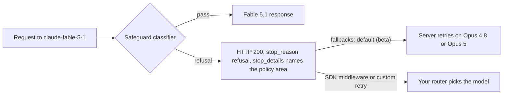

<div dir="rtl">

# طبقه‌بندی مدل‌ها (Model Taxonomy)

این فصل یک راهنمای جامع درباره چشم‌انداز مدل‌ها تا تاریخ **۶ نوامبر ۲۰۲۶** ارائه می‌دهد و به بررسی خانواده‌های مدل، قابلیت‌ها و معیارهای انتخاب برای سیستم‌های محیط عملیاتی (production systems) می‌پردازد.

> **آخرین بررسی و اعتبارسنجی: ۶ نوامبر ۲۰۲۶.** چشم‌انداز مدل‌ها با سرعت بالایی تحول می‌یابد. همواره اطلاعات را با صفحات قیمت‌گذاری و یادداشت‌های انتشار (release notes) ارائه‌دهندگان تطبیق دهید.
>
> **سرخط خبرهای نوامبر ۲۰۲۶ (۱ اکتبر تا ۲ نوامبر):** اکتبر شکاف‌های به‌جامانده از سپتامبر را پر کرد، و بیشتر ریسک‌های جدید به‌جای بنچمارک‌ها در قوانین صورت‌حساب (billing rules) نهفته است. **Anthropic** مدل **Claude Haiku 5.5** را (۷ اکتبر، `claude-haiku-5-5`) با قیمت ۰.۱۰ دلار / ۰.۵۰ دلار به ازای هر ۱ میلیون Token عرضه کرد که برابر با قیمت رسمی (list price) مدل GPT-6 Luna است؛ اما هر درخواستی که Prompt آن از ۱۰۰,۰۰۰ Token فراتر رود، ۵ برابر به ازای هر Token هزینه خواهد داشت (شامل خواندن از کش نیز می‌شود): این نخستین استثنا بر قاعده «قیمت ثابت برای مدل‌های Claude 4.6 و بالاتر تا سقف ۱ میلیون Token» است. این شرکت همچنین **هزینه خواندن از کش مدل Sonnet 5.5 را به ۰.۱۰ دلار** (کاهش تا 0.05x) رساند، **حالت سریع (fast mode) مدل Opus 5.5** را از مرحله پیش‌نمایش پژوهشی (research preview) خارج کرد (۱۵ اکتبر؛ حالت سریع Opus 4.8 در ۳۰ نوامبر حذف می‌شود)، پلتفرم **Claude Models on Google Cloud (مدیریت‌شده توسط Anthropic)** را به‌عنوان ششمین پلتفرم راه‌اندازی نمود، و **نسخه API موسوم به `2026-10-21`** را عرضه کرد که تحت آن پارامترهای `temperature`، `top_p` و `top_k` برای هر مقداری در تمام مدل‌ها خطای 400 برمی‌گردانند؛ نسخه‌های اصلی (major) جدید SDK به‌طور پیش‌فرض این نسخه را ارسال می‌کنند. **OpenAI** مدل **GPT-6.1 Terra** را عرضه کرد (۲۶ اکتبر، ۱ دلار / ۵ دلار) که مسیریابی سه‌سطحی Luna/Terra/Sol را بازمی‌گرداند، مدل با دسترسی معتمد (trusted-access) **GPT-6 Rosalind** را معرفی نمود (۳۰ اکتبر، ۱۵ دلار / ۷۵ دلار)، قابلیت **کش‌گذاری Prompt دوازده‌ساعته (12-hour prompt caching)** را ارائه داد (۲۰ اکتبر، نوشتن با ضریب 2.5x نرخ ورودی)، و **Decisions API** را منتشر کرد (عرضه عمومی یا GA در ۲۲ اکتبر). این شرکت همچنین اعلام کرد که اسنپ‌شات‌های باقی‌مانده از مدل‌های GPT-4o،‏ GPT-4o-mini،‏ GPT-4.1 و GPT-4.1-mini و نسخه‌های Fine-tuning شده آن‌ها حدود سه ماه دیگر در ۱۴ ژانویه ۲۰۲۷ خاموش خواهند شد. **گوگل** مدل **Gemini 4 Argon** را به وضعیت GA رساند (۱۳ اکتبر، `gemini-4-argon`) با نرخ ۲ دلار / ۱۰ دلار تا ۳۰ نوامبر و ۴ دلار / ۲۰ دلار از ۱ دسامبر، و تنها با کش‌گذاری ضمنی (implicit caching)؛ از **Gemini 4 Carbon** (در ۲۸ اکتبر) برای زیرمجموعه‌ای از مدافعان سایبری Fairwind و بدون شناسه مدل رونمایی کرد؛ و مسیر `gemini-3.7-flash` را به 3.8 Flash و `gemini-3.5-flash` را به 3.6 Flash بازهدایت (reroute) نمود (۸ اکتبر، ثبت‌شده در changelog آن)، به‌گونه‌ای که رشته شناسه مدلِ ثابت به کار خود ادامه داد در حالی که مدل پشت آن تغییر کرد. **متا** مدل **Muse Wonder** را عرضه کرد (۱۲ اکتبر، `muse-wonder-1.0`) که یک پرچم‌دار اختصاصی (closed) با قیمت ۴ دلار / ۲۰ دلار به ازای هر ۱ میلیون Token روی Meta Model API است (برابر با قیمت رسمی Opus 5.5)؛ نسخه قوی‌تر یعنی Muse Wonder Full فقط از طریق اشتراک‌های Muse Code به فروش می‌رسد و فاقد API است. هنوز خبری از Grok 5 نیست. وزن‌های باز با یک دروازه مجوزی جدید مواجه شدند: **Mistral Large 4** (انتشار وزن‌ها در ۲۹ اکتبر) برای هرگونه کسب‌وکار مدل به‌عنوان سرویس (Model-as-a-Service یا MaaS)، در هر سطحی از درآمد، نیازمند مجوز تجاری جداگانه است، و **Meta Muse Spark Open** (در ۱۵ اکتبر) استفاده از MaaS را برای درآمدهای بالای ۲۰ میلیون دلار مشروط به اخذ مجوز کرده است؛ وزن‌های پیش‌نمایش Step 5 از شرکت StepFun (حدود ۱۵ اکتبر)، مدل MiniMax-M3.1-Flash (در ۲۳ اکتبر) و مدل DeepSeek V4.1-Flash-1017 (در ۱۷ اکتبر، با مجوز MIT) نیز عرضه شدند. بنچمارک‌ها مجدداً بازتنظیم شدند: شاخص هوش **Artificial Analysis Intelligence Index v5.0** (در ۲۷ اکتبر) با نسخه‌های v4.x قابل مقایسه نیست، Gemini 4 Carbon (با امتیاز ۵۹، غیرقابل دسترسی عمومی) و Claude Opus 5.5 (با امتیاز ۵۸) را در صدر قرار می‌دهد، و بهترین مدل‌های با وزن باز امتیازی در حدود ۳۲ کسب کرده‌اند. در جدول رده‌بندی Terminal-Bench 4.0 در tbench.ai (با ورودی‌های اضافه‌شده در ۶ اکتبر)، مدل‌های Opus 5.5 (با ۶۴.۸۵٪) و Sonnet 5.5 (با ۶۱.۸۲٪) اکنون بالاتر از GPT-6 Astra و GPT-6.1 Sol (مشترکاً در ۵۸.۱۸٪) قرار دارند. خاموش شدن سرویس‌های قدیمی OpenAI در ۲۳ اکتبر طبق برنامه انجام شد، و Claude Sonnet 4.5 همچنان در ۳۰ نوامبر در Claude API بازنشسته می‌شود (Bedrock آن را تا ۸ آوریل ۲۰۲۷ حفظ می‌کند).
>
> **به‌روزرسانی (۲ تا ۶ نوامبر):** در ۲ نوامبر، گوگل مدل‌های `gemini-2.5-pro` و `gemini-2.5-flash` را در Gemini API منسوخ (deprecated) اعلام کرد و موضع «منسوخ‌نشده» در سپتامبر را تغییر داد؛ از ۱ دسامبر (طبق برنامه‌ریزی) ترافیک آن‌ها به `gemini-3.8-flash` و `gemini-3.5-flash-lite` هدایت شده و با نرخ‌های این مدل‌ها محاسبه می‌شود. Anthropic در همان روز رشته‌پیام‌ها (message threads) را به‌صورت بتا منتشر کرد و در ۳ نوامبر واترمارک متنی خود را به Claude Mythos 5،‏ Opus 4.7 و Sonnet 4.6 تعمیم داد. در ۵ نوامبر، OpenAI مدل **GPT-6-Cyber** را راه‌اندازی کرد (۲۰ دلار / ۱۰۰ دلار، سطح Daybreak Red به همراه تاییدیه مدل جداگانه و لیست سفید IP یا IP allowlisting)، یک روز پس از عرضه `gpt-image-2.6-sunburst` و `-flare` با قیمت‌های GPT Image 2.5. شرکت Moonshot در ۴ نوامبر وزن‌های مدل **Kimi K3.1 Pro** را تحت مجوزی اختصاصی با یک بند مربوط به MaaS منتشر کرد، Tencent در همان روز نسخه کامل Hy4 را با وعده انتشار وزن‌ها اما بدون تاریخ یا مجوز معرفی کرد، و نسخه پیش‌نمایش Ripple-65B از شرکت Ricursive با مجوز Apache 2.0 بدون امتیاز مستقل عرضه شد. موسسه Artificial Analysis در ۳ نوامبر نسخه **Intelligence Index v5.0.1** را منتشر کرد: Gemini 4 Carbon امتیاز ۶۰، Claude Opus 5.5 امتیاز ۵۹، GPT-6 Astra امتیاز ۵۷، GPT-6.1 Sol امتیاز ۵۵، و DeepSeek V4.1 Flash 1017 با امتیاز ۳۳ اکنون در صدر رتبه‌بندی وزن‌های باز AA به‌تنهایی قرار دارد، صرفاً به این دلیل که AA با وجود عرضه وزن‌های K3.1 Pro (امتیاز ۴۶)، آن را همچنان مالکیتی (proprietary) برچسب‌گذاری می‌کند. صفحه قیمت‌گذاری OpenAI اکنون قیمت تبلیغاتی (promotional price) مدل GPT-5.6 Sol را تا ۳۰ نوامبر ثبت کرده است، و Alibaba هنوز Qwen4 را عرضه نکرده است.

## فهرست مطالب

- [دسته‌بندی‌های مدل](#model-categories)
- [مدل‌های مرزی (نوامبر ۲۰۲۶)](#frontier-models-november-2026)
- [مدل‌های استدلالی](#reasoning--math)
- [مدل‌های متن‌باز](#open-source-models)
- [مدل‌های تخصصی](#specialized-models)
- [مدل‌های Embedding](#embedding-models)
- [فریم‌ورک انتخاب مدل و مسیریابی معنایی](#model-selection-framework)
- [هوش مصنوعی حاکمیتی و ماندگاری داده‌ها](#sovereign-ai-and-data-residency)
- [مقایسه قابلیت‌ها](#capability-comparison)
- [سوالات مصاحبه](#interview-questions)
- [تاریخچه انتشار (۲۰۲۶)](#release-history-2026)
- [منابع](#references)

---

## دسته‌بندی‌های مدل (Model Categories)

### بر اساس سطح توانمندی (نوامبر ۲۰۲۶)

| سطح (Tier) | ویژگی‌ها | نمونه‌ها | مورد کاربرد (Use Case) |
|------|-----------------|----------|----------|
| **مرزی (Frontier)** | بالاترین سقف توانمندی؛ ۴ دلار / ۲۰ دلار تا ۱۰ دلار / ۵۰ دلار، یا با دسترسی کنترل‌شده (gated) | مدل Claude Fable 5.1،‏ GPT-6 Astra،‏ Claude Opus 5.5 (۴ دلار / ۲۰ دلار)، Gemini 4 Argon (۴ دلار / ۲۰ دلار از ۱ دسامبر)، Meta Muse Wonder (۴ دلار / ۲۰ دلار)؛ کنترل‌شده: Gemini 4 Carbon،‏ GPT-6 Rosalind،‏ GPT-6-Cyber،‏ Claude Mythos 5.1؛ فقط با اشتراک: Muse Wonder Full | پیچیده‌ترین استدلال، ایجنت‌های افق‌بلند (long-horizon agents)، کدنویسی در بالاترین سطح توانمندی |
| **اسب کاری (Workhorse - ورودی ۱ تا ۲ دلار)** | کیفیت ایجنتی نزدیک به مدل‌های مرزی با قیمت میان‌رده | مدل Claude Sonnet 5.5،‏ GPT-6.1 Sol،‏ GPT-6 Sol (۲ دلار / ۱۰ دلار)، GPT-6.1 Terra (۱ دلار / ۵ دلار)، Grok 4.7 (۲ دلار / ۶ دلار)، Muse Spark 1.3 (۱.۲۵ دلار / ۴.۲۵ دلار) | ایجنت‌های محیط عملیاتی (production agents)، کدنویسی در مقیاس بالا، سطح مسیریابی پیش‌فرض |
| **سریع/کارآمد (Fast/Efficient)** | کمترین هزینه به ازای هر Token، حجم بالای پردازش | مدل GPT-6 Luna،‏ Claude Haiku 5.5 (برای Promptهای زیر ۱۰۰ هزار Token)، Gemini 3.8 Flash،‏ DeepSeek V4.1-Flash | دسته‌بندی، استخراج، مسیریابی، استریمینگ در حجم بالا |
| **نسل قبلی (همچنان فعال)** | کاملاً شناخته‌شده و آزموده‌شده، اغلب ظرف چند هفته جایگزین می‌شوند | مدل Claude Opus 5 / Sonnet 5 / Fable 5،‏ Claude Haiku 4.5،‏ GPT-5.6 Sol / Terra / Luna،‏ Claude Opus 4.8،‏ Gemini 3.6 Flash | بارهای کاری که نیازمند رفتار پایدار و از قبل ارزیابی‌شده هستند |
| **کوچک/لبه (Small/Edge)** | خصوصی، لبه (edge)، تک‌GPU | مدل Gemma 4 (12B, E4B)،‏ Qwen3.8-27B،‏ IBM Granite 4.2،‏ Muse Glimmer 30B | حریم خصوصی محلی، پردازش روی دستگاه (on-device)، سرویس‌دهی روی تک‌GPU |
| **استدلال‌محور (Reasoning-Heavy)** | استدلال درونی گسترده با سطح تلاش بالا | مدل GPT-6 Astra (در سطوح xhigh/max)،‏ Claude Fable 5.1،‏ Claude Opus 5.5 با تلاش بالا، DeepSeek V4.1-Flash (سطح تلاش ۱ تا ۱۰۰) | ریاضیات، اشکال‌زدایی کد، منطق چندمرحله‌ای |

رده سریع اکنون در سمت Anthropic دو قیمت دارد که باید به آن‌ها توجه کرد: Claude Haiku 5.5 برای Promptهای زیر ۱۰۰,۰۰۰ Token با قیمت ۰.۱۰ دلار / ۰.۵۰ دلار با GPT-6 Luna برابری می‌کند، اما برای بیش از این مقدار، هزینه کل درخواست ۵ برابر می‌شود؛ بنابراین طول Prompt تعیین می‌کند که این مدل در عمل به کدام رده تعلق دارد.

### بر اساس حالت استدلال (نوامبر ۲۰۲۶)

| حالت (Mode) | توانمندی | مدل‌ها | مورد کاربرد (Use Case) |
|------|------------|--------|----------|
| **استدلال حداقلی (Minimal reasoning)** | سریع‌ترین مسیری که مدل اجازه می‌دهد | مدل GPT-6.1 Terra در حالت `none`،‏ GPT-6.1 Sol در حالت `low`،‏ GPT-6 Luna در پایین‌ترین سطح تلاش، Gemini 3.8 Flash در حالت `low`،‏ Claude Haiku 5.5 در حالت `low`،‏ Claude Sonnet 5.5 در حالت `between_tools` | گفتگو (Chat)، استخراج ساده |
| **استدلال همیشه‌روشن (Always-on reasoning)** | تفکر (thinking) قابل خاموش کردن نیست | مدل Claude Opus 5.5 و Fable 5.1 (تفکر تطبیقی همواره روشن)، GPT-6 Astra (فاقد سطح تلاش `none`؛ از `low` تا `max`) | ریاضیات، اشکال‌زدایی کد، برنامه‌ریزی |
| **قابل تنظیم (Dial-controlled)** | سطح تلاش یا تفکر به ازای هر درخواست قابل تغییر است | مدل GPT-6.1 Terra (از `none` تا `max`، پیش‌فرض `medium`)،‏ GPT-6.1 Sol (از `low` تا `max`، پیش‌فرض `medium`)،‏ Claude Opus 5.5 و Haiku 5.5 (پیش‌فرض `medium`)،‏ Gemini 3.8 Flash (پارامتر `thinking_level`)،‏ DeepSeek V4.1-Flash (از ۱ تا ۱۰۰) | وظایف با پیچیدگی متغیر |

**کلید خاموش‌سازی در سمت Anthropic در حال از بین رفتن است.** Sonnet 5.5 با دریافت `thinking: {type: "disabled"}` خطای 400 برمی‌گرداند، در Opus 5.5 نمی‌توان تفکر را غیرفعال کرد، و Haiku 5.5 پارامتر `budget_tokens` را رد می‌کند. رویکرد OpenAI دوگانه است: Astra هیچ سطح تلاش `none` ندارد، اما GPT-6.1 Terra از آن پشتیبانی می‌کند. پیچ‌های تنظیم نمونه‌برداری (sampling knobs) تقریباً همه‌جا حذف شده‌اند: تحت نسخه `2026-10-21` در Claude API (مورخ ۲۱ اکتبر)، پارامترهای `temperature`، `top_p` و `top_k` برای هر مقداری، حتی مقدار پیش‌فرض، در تمام مدل‌ها خطای 400 بازمی‌گردانند (نسخه‌های قبلی مقادیر غیرپیش‌فرض را در Claude 4.7 و بالاتر رد می‌کردند)، و هشت نسخه اصلی (major) جدید SDK و CLI (شامل Python 2.0.0،‏ TypeScript 1.0.0،‏ Go 2.0.0،‏ Java 3.0.0،‏ C# 13.0.0،‏ PHP 1.0.0،‏ Ruby 2.0.0 و ابزار CLI به نام `ant` نسخه 2.0.0، که همگی اکنون به‌جای MIT تحت مجوز Apache 2.0 هستند) این نسخه API را به‌طور پیش‌فرض ارسال می‌کنند؛ بنابراین ارتقای معمول SDK در هر زبانی می‌تواند کدهای نمونه‌برداری روی مدل‌های قدیمی‌تر را نیز دچار شکست کند. Astra هیچ‌یک از پارامترهای `temperature`، `top_p` یا logprobs را نمی‌پذیرد، و گوگل نیز این پارامترها را در ۲۱ ژوئیه در Gemini API منسوخ اعلام کرد. اکنون میزان تلاش (Effort) سطح کنترل اصلی است و مقادیر پیش‌فرض نیز بین نسخه‌ها تغییر می‌کنند (پیش‌فرض Opus 5 مقدار `high` بود، اما Opus 5.5 به `medium` تغییر یافت)، بنابراین آن را در هر مسیر (route) به‌طور صریح تنظیم کنید.

---
## مدل‌های پیشرو (Frontier Models) - نوامبر ۲۰۲۶

### مدل Claude Opus 5.5 (Anthropic) - سپتامبر ۲۰۲۶

| ویژگی (Attribute) | مقدار (Value) |
|---|---|
| شناسه مدل (Model ID) | شناسه `claude-opus-5-5` (در Bedrock: `anthropic.claude-opus-5-5`) |
| پنجره کانتکست (Context Window) | ۱ میلیون Token؛ حداکثر خروجی ۱۲۸ هزار Token (در حالت Batch با هدر بتا، ۳۰۰ هزار) |
| هزینه ورودی / خروجی | ۴.۰۰ دلار / ۲۰.۰۰ دلار به ازای هر ۱ میلیون Token (در Opus 5: ۵ دلار / ۲۵ دلار) |
| Cache / Batch | نوشتن در Cache معادل ۵.۰۰ دلار (۵ دقیقه) یا ۸.۰۰ دلار (۱ ساعت)؛ خواندن از Cache معادل ۰.۲۰ دلار (۰.۰۵ برابر ورودی)؛ حالت Batch معادل ۲ دلار / ۱۰ دلار؛ حداقل Prompt قابل Cache معادل ۵۱۲ Token |
| حالت سریع (Fast mode) | ۸ دلار / ۴۰ دلار به ازای هر ۱ میلیون Token، از ۱۵ اکتبر از حالت پیش‌نمایش تحقیقاتی خارج شده است؛ در Claude API، Claude Models روی Google Cloud (مدیریت‌شده توسط Anthropic)، و استقرارهای (deployments) میزبانی‌شده روی Azure در Foundry؛ در حالت Batch در دسترس نیست. کاهش یافته از ۱۰ دلار / ۵۰ دلار در Opus 5 و Opus 4.8 |
| تفکر (Thinking) | تفکر تطبیقی (Adaptive thinking) همیشه فعال است (غیرقابل غیرفعال‌سازی)؛ تلاش (effort) پیش‌فرض `medium` (در Opus 5 پیش‌فرض `high` بود) |
| دسترسی‌پذیری (Availability) | مدل Claude API، Amazon Bedrock، Google Cloud (مدیریت‌شده توسط Google یا مدیریت‌شده توسط Anthropic)، Microsoft Foundry، Claude Platform روی AWS؛ قابلیت عدم ذخیره‌سازی داده (Zero Data Retention یا ZDR) در دسترس است |
| بنچمارک‌ها | گزارش‌شده توسط Anthropic: در Terminal-Bench 4.0 امتیاز %۶۶.۴ در حالت xhigh (با خطای استاندارد ±۲.۶) در برابر Fable 5.1 با %۵۵.۸ (اجرای Anthropic) و GPT-6 Astra با %۵۷.۹ (آمار OpenAI، در effort بالا)؛ در OSWorld 2.1 امتیاز partial برابر با %۸۱.۸؛ در GDPval-AA v2.1 امتیاز 1846 Elo؛ در HLE با ابزارها %۶۷.۷. مستقل: لیدربورد Terminal-Bench 4.0 امتیاز %۶۴.۸۵ در حالت max، رتبه اول (tbench.ai، ورودی‌های اضافه‌شده در ۶ اکتبر)؛ شاخص هوش Artificial Analysis Intelligence Index v5.0.1 امتیاز ۵۹ (حالت max؛ امتیاز ۵۸ در v5.0، همراه با fallback)، رتبه دوم تنها پس از Gemini 4 Carbon (با امتیاز ۶۰) که توسعه‌دهندگان امکان فراخوانی آن را ندارند |
| تاریخ عرضه | ۲۲ سپتامبر ۲۰۲۶ (محدوده داده‌های آموزشی تا ژوئن ۲۰۲۶؛ بازنشستگی زودتر از ۲۲ سپتامبر ۲۰۲۷ نخواهد بود) |

**ماهیت مدل:** این دومین کاهش قیمت برای Opus است (پس از آنکه قیمت Opus 4.5 از ۱۵/۷۵ دلار کاهش یافت) و مدلی است که مستندات Anthropic اکنون توصیه می‌کنند برای اکثر بارهای کاری (workloads) کار خود را با آن آغاز کنید. مدل Fable 5.1 برای استدلال‌های سنگین، کارهای ایجنتی با افق زمانی طولانی (long-horizon agentic work)، یا مواردی که Opus 5.5 در effort بالاتر همچنان در ارزیابی‌های (evals) شما کم می‌آورد، در نظر گرفته شده است. یک مدل ارزان‌تر که در بیشتر بنچمارک‌های ایجنتی خودِ Anthropic مدل گران‌تر Fable 5.1 را شکست می‌دهد، منطق همیشگی مسیریابیِ «پرداخت هزینه بیشتر برای دسترسی به حداکثر توان (ceiling)» را معکوس می‌کند. شرکت Anthropic ادعا می‌کند هزینه این مدل در بارهای کاری معمول حدود %۴۰ کمتر از Opus 5 است (گزارش‌شده توسط ارائه‌دهنده).

**دام‌های مهاجرت از Opus 5:** مقدار تلاش (effort) پیش‌فرض از `high` به `medium` کاهش یافته است، بنابراین ارتقای نسخه بدون پین کردن (unpinned) هم تاخیر (Latency) و هم کیفیت را تغییر می‌دهد؛ اجبار در `tool_choice` (مقادیر `any` یا `tool`) خطای 400 برمی‌گرداند؛ بلوک‌های تفکر (thinking blocks) مقید به مدل و مکالمه تولیدکننده هستند؛ و در Claude API و Google Cloud برای استفاده از کامپیوتر (computer use) فقط `computer_toolset_20260801` پذیرفته می‌شود. مدل Opus 5.5 یک دسته‌بند ایمنی زیستی را در کنار دسته‌بند سایبری اضافه کرده است. هنگامی که محافظ‌ها (safeguards) در طول ارزیابی‌های Anthropic مداخله کردند، تسک‌های سایبری توسط Opus 4.8 و تسک‌های زیست‌شناسی و توسعه LLMهای پیشرو (frontier-LLM-development) توسط Opus 5 تکمیل شدند؛ بنابراین امتیازهای اعلام‌شده در سرخط خبرها متعلق به یک سیستم مسیریابی‌شده (routed system) هستند، نه یک مجموعه واحد از وزن‌ها.

### مدل Claude Sonnet 5.5 (Anthropic) - سپتامبر ۲۰۲۶

| ویژگی (Attribute) | مقدار (Value) |
|---|---|
| شناسه مدل (Model ID) | `claude-sonnet-5-5` |
| پنجره کانتکست (Context Window) | ۱ میلیون Token؛ حداکثر خروجی ۱۲۸ هزار Token |
| هزینه ورودی / خروجی | ۲.۰۰ دلار / ۱۰.۰۰ دلار به ازای هر ۱ میلیون Token (بدون تغییر نسبت به Sonnet 5) |
| Cache / Batch | نوشتن در Cache معادل ۲.۵۰ دلار (۵ دقیقه) یا ۴.۰۰ دلار (۱ ساعت)؛ خواندن از Cache معادل ۰.۱۰ دلار (۰.۰۵ برابر، کاهش‌یافته از ۰.۲۰ دلار در ۷ اکتبر)؛ حالت Batch معادل ۱ دلار / ۵ دلار |
| تفکر (Thinking) | تفکر تطبیقی به‌طور پیش‌فرض فعال است؛ پایین‌ترین تنظیمات `between_tools` است (در effort سطح `high` یا پایین‌تر پذیرفته می‌شود)، و ارسال `thinking: {type: "disabled"}` خطای 400 برمی‌گرداند. مقدار پیش‌فرض effort در API برابر با `high` و در Claude Code و اپلیکیشن‌های Claude برابر با medium است |
| دسترسی‌پذیری (Availability) | مدل Claude API، Bedrock، Google Cloud، Foundry، Claude Platform روی AWS؛ عدم ذخیره‌سازی داده (ZDR) در دسترس است |
| بنچمارک‌ها | گزارش‌شده توسط Anthropic (با نمرات Opus 5.5 در پرانتز): در Terminal-Bench 4.0 امتیاز %۷۰.۶ (%۶۶.۴)، در CursorBench 4.0 امتیاز %۵۵.۵ (%۵۷.۸)، در GDPval-AA v2.1 امتیاز 1844 (1846)، در OSWorld 2.1 امتیاز partial برابر با %۸۰.۱ (%۸۱.۸)، در HLE با ابزارها %۶۴.۵ (%۶۷.۷)، در FrontierCode 1.1 در حداکثر effort امتیاز %۴۶.۲ (%۵۴.۴)؛ شرکت Anthropic اشاره می‌کند که Sonnet 5.5 در این آزمون در سطح max امتیازی کمتر از xhigh کسب کرده است. مستقل: لیدربورد Terminal-Bench 4.0 امتیاز %۶۱.۸۲ در حالت max، رتبه دوم پس از Opus 5.5 (سایت tbench.ai، ورودی‌های اضافه‌شده در ۶ اکتبر)؛ شاخص هوش AA Intelligence Index v5.0 امتیاز ۵۴ (در حالت max، همراه با fallback)، و امتیاز ۵۰ در xhigh |
| تاریخ عرضه | ۲۸ سپتامبر ۲۰۲۶ (محدوده داده‌های آموزشی تا ژوئن ۲۰۲۶؛ بازنشستگی زودتر از ۲۸ سپتامبر ۲۰۲۷ نخواهد بود) |

**ماهیت مدل:** یک مدل ۲/۱۰ دلاری که در بیشتر ارزیابی‌های ایجنتی گزارش‌شده توسط خودِ Anthropic تنها چند امتیاز با مدل پرچمدار فاصله دارد (حدود ۸ امتیاز عقب‌تر در FrontierCode 1.1)؛ موضوعی که توجیه ارسال بخش عمده ترافیک ایجنت به Opus را از بین می‌برد. تصویر حاصل از ارزیابی‌های مستقل یکنواختی کمتری دارد: در شاخص AA v5.0 این مدل در حداکثر effort حدود ۴ امتیاز عقب‌تر از Opus 5.5 است، و این شکاف در effort پایین‌تر عمیق‌تر می‌شود (۴۱ در برابر ۵۲ در سطح high)، بنابراین سطح effort ارائه‌شده در سرویس شما اهمیت بیشتری نسبت به قیمت مندرج در فهرست قیمت‌ها دارد. محیط اجرای بنچمارک (runner) نیز ترتیب را معکوس می‌کند: اجراهای خود Anthropic در Terminal-Bench 4.0 مدل Sonnet 5.5 را جلوتر از Opus 5.5 قرار می‌دهد (%۷۰.۶ در برابر %۶۶.۴)، در حالی که لیدربورد tbench.ai آن را در رتبه پایین‌تر می‌گذارد (%۶۱.۸۲ در برابر %۶۴.۸۵). شرکت Anthropic ادعا می‌کند خروجی مدل بیش از %۳۰ سریع‌تر از Sonnet 5 بوده و هزینه هر تسک تا %۳۰ کاهش یافته است (گزارش‌شده توسط ارائه‌دهنده)، و کاهش هزینه خواندن Cache به 0.05x در ۷ اکتبر، حلقه‌های طولانی ایجنتی را باز هم ارزان‌تر می‌کند. جدول Sonnet 5.5 در مستندات Anthropic امتیاز Sonnet 5 در Terminal-Bench 4.0 را %۱۰.۳ ذکر می‌کند، در حالی که جدول Opus 5.5 آن امتیاز Opus 5 را %۵۲.۳ ثبت کرده است؛ با عدد Sonnet 5 به عنوان یک داده پرت (outlier) برخورد کنید و از آن به عنوان خط مبنا (baseline) استفاده نکنید.

**تغییرات ساختارشکن نسبت به Sonnet 5:** غیرفعال‌سازی تفکر خطای 400 برمی‌گرداند (به‌جای آن `between_tools` را ارسال کنید)؛ استفاده اجباری از ابزار خطای 400 برمی‌گرداند؛ بلوک‌های تفکر مقید به مدل، مکالمه و اکانت تولیدکننده هستند (بلوک‌های ارسالی از یک اکانت متصل‌نشده حذف شده و به عنوان `organization_binding_mismatch` ثبت می‌شوند)؛ ابزار `computer_20251124` در Claude API و Google Cloud رد می‌شود؛ و پارامترهای `temperature`، `top_p` و `top_k` خطای 400 برمی‌گردانند (در مقادیر غیرپیش‌فرض در نسخه‌های قدیمی‌تر API، و در هر مقداری در نسخه `2026-10-21`). مدل Sonnet 5 تنها سه ماه پس از عرضه به یک مدل قدیمی و منسوخ (legacy) تبدیل شد.

### مدل Claude Fable 5.1 و Mythos 5.1 (Anthropic) - سپتامبر ۲۰۲۶

| ویژگی (Attribute) | مقدار (Value) |
|---|---|
| شناسه‌های مدل (Model IDs) | شناسه `claude-fable-5-1` (دسترسی عمومی یا GA؛ در Bedrock به صورت `anthropic.claude-fable-5-1`)؛ `claude-mythos-5-1` (دسترسی محدود از طریق Cyber Verification Program، که در ۶ اکتبر پروژه Glasswing را جذب کرد) |
| رابطه بین دو مدل | وزن‌های یکسان، اما محافظ‌های (safeguards) متفاوت؛ Mythos 5.1 نسخه مجازتر (permissive) است |
| هزینه ورودی / خروجی | ۱۰.۰۰ دلار / ۵۰.۰۰ دلار به ازای هر ۱ میلیون Token (بدون تغییر نسبت به Fable 5) |
| Cache / Batch | نوشتن در Cache معادل ۱۲.۵۰ دلار (۵ دقیقه) یا ۲۰.۰۰ دلار (۱ ساعت)؛ خواندن از Cache معادل ۰.۲۵ دلار (۰.۰۲۵ برابر ورودی، کاهش‌یافته از ۱.۰۰ دلار در Fable 5)؛ حالت Batch معادل ۵ دلار / ۲۵ دلار |
| پنجره کانتکست (Context Window) | ۱ میلیون Token با قیمت‌گذاری استاندارد؛ حداکثر خروجی ۱۲۸ هزار Token |
| تفکر (Thinking) | تفکر تطبیقی همیشه فعال است؛ تلاش (effort) پیش‌فرض `high` |
| مدیریت داده (Data handling) | الزام به نگهداری ۳۰ روزه داده‌ها (30-day retention)؛ تحت خط‌مشی عدم ذخیره‌سازی داده (ZDR) در دسترس نیست مگر اینکه Anthropic صراحتاً مجوز آن را صادر کند (مشتریانی که واجد شرایط Enterprise Frontier Safeguards هستند می‌توانند از Fable 5.1 و Fable 5 با ZDR استفاده کنند تا زمانی که EFS آماده شود) |
| اصالت‌سنجی (Provenance) | واترمارک آماری متن Anthropic روی خروجی‌ها در تمامی پلتفرم‌ها؛ شناسه اعتبارسنجی محتوای امضاشده C2PA روی رسانه‌های تولیدشده دریافت‌شده از طریق Files API. از ۳ نوامبر، متن‌های تولیدشده از Claude Mythos 5، Opus 4.7 و Sonnet 4.6 نیز این واترمارک را حمل می‌کنند، اما در Sonnet 4.6 متن‌های تولیدشده با مقادیر غیرپیش‌فرض `temperature`، `top_p` یا `top_k` ممکن است فاقد آن باشند، بنابراین پیش از اتکا به نشانه‌گذاری ارائه‌دهنده برای الزامات افشاسازی (disclosure duties)، تنظیمات مدل و نمونه‌برداری (sampling) را بررسی کنید |
| بنچمارک‌ها | در Terminal-Bench 4.0: امتیاز %۵۷.۸۸ در حالت max در لیدربورد tbench.ai، و %۵۵.۸ در اجرای خود Anthropic. در شاخص هوش AA Intelligence Index v5.0: امتیاز ۵۰ (در xhigh با fallback)، و ۴۹ در max، پایین‌تر از امتیاز ۵۸ در Opus 5.5 |
| تاریخ عرضه | ۱ سپتامبر ۲۰۲۶ (محدوده داده‌های آموزشی تا ژوئن ۲۰۲۶؛ بازنشستگی زودتر از ۱ سپتامبر ۲۰۲۷ نخواهد بود) |

**آنچه تغییر کرده است:** هزینه ماندن روی قدرتمندترین مدل رده‌بالا (ceiling model) برای حلقه‌های طولانی ایجنتی. شرکت Anthropic اعلام کرده است که کاهش %۷۵ در هزینه خواندن Cache، صورت‌حساب‌های معمول را حدود %۲۵ و صورت‌حساب‌های شدیداً ایجنتی را تا %۴۵ کاهش می‌دهد، و جدیدترین محافظ‌های سایبری آن حدود %۶۰ مثبت کاذب (false positive) کمتری نسبت به نسخه‌های اولیه Fable 5 ایجاد می‌کنند (هر دو مورد گزارش‌شده توسط ارائه‌دهنده). اکنون می‌توان از Fable 5.1 برای کشف آسیب‌پذیری‌ها استفاده کرد اما نمی‌توان از آن برای توسعه اکسپلویت‌ها (exploits) بهره گرفت. مدل Fable 5 همچنان در دسترس است.

**دسترسی به Mythos 5.1:** در ۶ اکتبر، Anthropic برنامه «تأیید سایبری» (Cyber Verification Program) را به سه سطح (Defense، Red Team و Specialized) گسترش داد، پروژه Glasswing را در آن ادغام کرد و Mythos 5.1 را در همه سطوح در دسترس قرار داد. نگهداری داده‌ها الزامی است؛ مشتریانی که از قبل دسترسی عدم نگهداری داده (zero-retention) به Fable 5.1 یا Mythos 5.1 داشتند، آن را تا زمان عرضه Enterprise Frontier Safeguards حفظ خواهند کرد. شرکت Anthropic همچنین در ماه سپتامبر اعلام کرد که Mythos 5.1 از طریق برنامه تأیید علوم زیستی (Life Sciences Verification Program) ارائه خواهد شد (نخستین شرکت‌کنندگان با همکاری دولت ایالات متحده ثبت‌نام شدند). پیامد طراحی معماری: نسخه مجازتر اکنون محصولی در رده تأیید صلاحیت‌شده (verification-tier) با شرایط نگهداری داده مختص به خود است، نه صرفاً یک فهرست از شرکای تجاری.

**مکانیزم بازگشت محافظ (Safeguard fallback) اکنون یک قرارداد در سطح API است.** در Fable 5، فعال شدن دسته‌بند امنیتی به‌طور خودکار درخواست را به Opus 4.8 واگذار می‌کرد. در Fable 5.1 این رفتار صریح و قابل‌پیکربندی است:

<div dir="ltr">



</div>

از ۲۴ سپتامبر، امتناع‌هایی (refusals) که قبل از هرگونه خروجی در دسته‌بندی‌های `bio`، `frontier_llm` و `reasoning_extraction` رخ می‌دهند، در تمامی پلتفرم‌ها مشمول هزینه می‌شوند (سایر دسته‌بندی‌ها بدون هزینه باقی می‌مانند)؛ امتناع‌های حین استریم (mid-stream refusals)، هزینه ورودی به‌علاوه خروجی استریم‌شده تا آن لحظه را دریافت می‌کنند؛ و اعتبار fallback هزینه prompt-cache ناشی از تغییر مدل را بازپرداخت می‌کند. برای امتناع‌ها بودجه در نظر بگیرید و مسیریابی را بر اساس `stop_reason` انجام دهید، نه کد وضعیت HTTP.

### چک‌لیست مهاجرت به Claude 5.5 / 5.1

| تغییر | اعمال بر روی | چه چیزی از کار می‌افتد | به‌جای آن چه کنید |
|---|---|---|---|
| اجبار در `tool_choice` (مقادیر `any` یا `tool`) خطای 400 برمی‌گرداند | مدل‌های Fable 5.1، Mythos 5.1، Opus 5.5، Sonnet 5.5 (مدل Haiku 5.5 آن را می‌پذیرد، اما پاسخ با فراخوانی ابزار آغاز شده و فاقد بلوک تفکر است) | استخراج ساختاریافته که فراخوانی ابزار را اجباری می‌کند | استفاده از `auto` همراه با strict tool use، یا استفاده از structured outputs |
| بلوک‌های تفکر مقید به مدل و مکالمه هستند | مدل‌های Fable 5.1، Opus 5.5، Sonnet 5.5، Haiku 5.5 (مدل Mythos 5.1 بررسی پیشوند را نادیده می‌گیرد)؛ مدل‌های Sonnet 5.5 و Haiku 5.5 بلوک‌ها را به اکانت تولیدکننده نیز مقید می‌کنند | بازپخش تاریخچه (history) برای مدلی دیگر، استدلال را بدون هشدار حذف می‌کند (Haiku 5.5 بلوک‌های حاصل از Opus 5، Opus 5.5، Sonnet 5.5، Fable و Mythos را بدون خطا کنار می‌گذارد)؛ ویرایش هر چیزی قبل از یک بلوک تفکر، برای اکانت‌های ایجادشده در ۳۱ اوت ۲۰۲۶ یا پس از آن، خطای 400 برمی‌گرداند | با تاریخچه به صورت فقط-افزودنی (append-only) رفتار کنید و آن را از طریق اکانت تولیدکننده بازپخش نمایید؛ از طریق هدر بتای `thinking-binding-controls-2026-08-01` گزینه `prefix_mismatch_behavior: "drop_block"` را فعال کنید |
| تفکر غیرقابل غیرفعال‌سازی است | مدل Opus 5.5؛ حداقل سطح در Sonnet 5.5 برابر با `between_tools` است | بودجه‌های تاخیر (Latency) که فرض را بر خاموش بودن تفکر گذاشته بودند | مقدار effort را صراحتاً تنظیم کنید و تاخیر (Latency) را مجدداً اندازه‌گیری نمایید |
| مقدار پیش‌فرض effort تغییر کرده است | در Opus 5.5 برابر با `medium` است (در Opus 5 برابر با `high` بود) | تغییر نامحسوس کیفیت و تاخیر (Latency) هنگام ارتقا | مقدار effort را در هر درخواست پین کنید |
| رد شدن `computer_20251124` | مدل Opus 5.5 و Sonnet 5.5 در Claude API و Google Cloud (سرویس Bedrock همچنان آن را می‌پذیرد) | ایجنت‌های مبتنی بر کار با کامپیوتر (computer-use) که روی نسخه ابزار قدیمی هستند | مهاجرت به `computer_toolset_20260801` |
| اعمال هزینه برای امتناع‌های پیش از خروجی در سه دسته‌بندی | تمامی پلتفرم‌ها از ۲۴ سپتامبر | مدل‌های هزینه‌ای که امتناع‌ها را رایگان در نظر می‌گرفتند | ردیابی `stop_reason: "refusal"` به عنوان یک ردیف هزینه |
| پارامترهای نمونه‌برداری در هر مقداری خطای 400 برمی‌گردانند؛ بلوک‌های `document` در پیام‌های دستیار و `citations` در بلوک‌های متنی کاربر خطای 400 برمی‌گردانند | تمامی مدل‌ها تحت نسخه API معادل `2026-10-21`، که هر هشت نسخه اصلی جدید SDK و CLI (شامل Python 2.0.0، TypeScript 1.0.0، Go 2.0.0، Java 3.0.0، C# 13.0.0، PHP 1.0.0، Ruby 2.0.0 و `ant` CLI 2.0.0) آن را به‌طور پیش‌فرض ارسال می‌کنند؛ در Bedrock این نسخه فقط برای Claude 4.7 و نسخه‌های بعدی کار می‌کند | کدهایی که `temperature` یا `top_p` را صراحتاً (حتی روی مقادیر پیش‌فرض) روی هر مدل Claude تنظیم می‌کردند | این پارامترها را حذف کنید، سپس نسخه اصلی SDK و نسخه API را پین کنید تا ارتقا یک تغییر آگاهانه و کنترل‌شده باشد |
| از Haiku 4.5 به Haiku 5.5 | مهاجرت‌های رده سریع (Fast-tier) | پارامترهای `budget_tokens`، پارامترهای نمونه‌برداری و assistant prefill خطای 400 برمی‌گردانند؛ حدود %۳۰ Token بیشتر برای متن مشابه مصرف می‌شود، و بلوک‌های تفکر نوبت‌های قبلی اکنون به عنوان ورودی در کانتکست باقی می‌مانند؛ سطح تصویر با وضوح بالا برای یک تصویر ۲۰۰۰x۱۵۰۰ حدود ۲.۵ برابر Token بصری هزینه دریافت می‌کند؛ Promptهای بیش از ۱۰۰ هزار Token معادل ۵ برابر روی کل درخواست هزینه دارند؛ بلوک‌های تفکر مقید به اکانت بوده و پیشوند آن‌ها بررسی می‌شود (Haiku 4.5 هیچ‌کدام را بررسی نمی‌کرد)؛ عدم وجود Priority Tier | جایگزینی prefill با structured outputs، شمارش مجدد Tokenهای متنی و تصویری با مدل جدید، هدایت Promptهای طولانی به مقصدی دیگر، حفظ تاریخچه به صورت فقط-افزودنی (append-only)، و برنامه‌ریزی ظرفیت به‌طور جداگانه از تعهدات Priority Tier در Haiku 4.5 |

دو تغییر کوچک‌تر ممکن است فریم‌ورک‌های آزمون و اجرا (harnesses) را دچار خطا کند: متن‌های مابین فراخوانی ابزارها اکنون در بلوک‌های `thinking` وارد می‌شوند که در حالت پیش‌فرض `display: "omitted"` خالی هستند (نسخه بتای `display: "updates"` متن را بازمی‌گرداند)، و نسخه‌های بتای پشتیبان برای effort به ازای هر پیام و پیام‌های سیستمی محدود به هر نوبت (۱ سپتامبر)، فشرده‌سازی در صورت تقاضا (`compact-2026-09-04`، ۱۴ سپتامبر) و تعاریف ابزار درون‌خطی (inline) در میانه مکالمه بدون از دست رفتن Cache عرضه شدند (`inline-tools-2026-09-15`، ۲۲ سپتامبر). در ۲ نوامبر، شرکت Anthropic ویژگی **message threads** (رشته‌پیام‌ها در فاز بتا، `message-threads-2026-08-12`) را اضافه کرد: سرور مکالمه، Prompt سیستمی و ابزارها را ذخیره می‌کند و درخواست‌های بعدی فقط پیام‌های جدید را ارسال می‌نمایند. این رشته‌ها مبتنی بر تلاش حداکثری (best-effort) هستند، ۵ دقیقه پس از آخرین درخواست منقضی می‌شوند، می‌توانند خطای 404 با عنوان `thread_not_found` را بازگردانند، واجد شرایط عدم ذخیره‌سازی داده (ZDR) نیستند و روی Bedrock یا Vertex مدیریت‌شده توسط گوگل اجرا نمی‌شوند؛ بنابراین نسخه اختصاصی خود از تاریخچه را حفظ کرده و آن را بازپخش کنید؛ رشته‌پیام (thread) صرفاً یک Cache است، نه منبع اصلی و مرجع داده‌ها (system of record).

### مدل Claude Haiku 5.5 (Anthropic) - اکتبر ۲۰۲۶ جدید

| ویژگی (Attribute) | مقدار (Value) |
|---|---|
| شناسه مدل (Model ID) | شناسه `claude-haiku-5-5` (در Bedrock: `anthropic.claude-haiku-5-5`) |
| پنجره کانتکست (Context Window) | ۱ میلیون Token؛ حداکثر خروجی ۱۲۸ هزار Token |
| قیمت، Prompt تا ۱۰۰,۰۰۰ Token | ۰.۱۰ دلار / ۰.۵۰ دلار به ازای هر ۱ میلیون Token؛ نوشتن در Cache معادل ۰.۱۲۵ دلار (۵ دقیقه) یا ۰.۲۰ دلار (۱ ساعت)؛ خواندن از Cache معادل ۰.۰۱ دلار؛ حالت Batch معادل ۰.۰۵ دلار / ۰.۲۵ دلار |
| قیمت، Prompt بیش از ۱۰۰,۰۰۰ Token | ۰.۵۰ دلار / ۲.۵۰ دلار به ازای هر ۱ میلیون Token؛ نوشتن در Cache معادل ۰.۶۲۵ دلار یا ۱.۰۰ دلار؛ خواندن از Cache معادل ۰.۰۵ دلار؛ حالت Batch معادل ۰.۲۵ دلار / ۱.۲۵ دلار. برای **کل درخواست** اعمال می‌شود، و طول Prompt خواندن‌ها و نوشتن‌های Cache را نیز به حساب می‌آورد |
| تفکر (Thinking) | تفکر تطبیقی، تلاش (effort) از `low` تا `max`، پیش‌فرض `medium`؛ ارسال `budget_tokens` خطای 400 برمی‌گرداند. برخلاف Opus 5.5 و Sonnet 5.5، این مدل `tool_choice` اجباری را می‌پذیرد، اما در این حالت پاسخ با فراخوانی ابزار آغاز شده و فاقد بلوک تفکر خواهد بود |
| تغییرات ساختارشکن نسبت به Haiku 4.5 | پارامترهای `budget_tokens`، `temperature`، `top_p`، `top_k` و assistant prefill خطای 400 برمی‌گردانند؛ Tokenizer جدیدتر برای متن یکسان حدود %۳۰ Token بیشتری تولید می‌کند؛ سطح تصویر با وضوح بالا برای یک تصویر ۲۰۰۰x۱۵۰۰ حدود ۲.۵ برابر Token بصری هزینه دارد؛ بلوک‌های تفکر مقید به اکانت تولیدکننده هستند و پیشوند آن‌ها بررسی می‌شود؛ قابلیت Priority Tier پشتیبانی نمی‌شود |
| دسترسی‌پذیری (Availability) | مدل Claude API، Bedrock، Google Cloud، Microsoft Foundry، Claude Platform روی AWS |
| بنچمارک‌ها | گزارش‌شده توسط Anthropic: در Terminal-Bench 4.0 امتیاز %۳۹.۲؛ در زیرمجموعه آفلاین OSWorld 2.1 امتیاز %۷۲.۴ (امتیاز نسبی/partial credit). مستقل: شاخص هوش AA Intelligence Index v5.0 امتیاز ۳۶ (حالت max) |
| ایمنی (Safety) | کارت سیستم (System card): میزان موفقیت حمله تزریق Prompt گِری سوان (Gray Swan prompt-injection attack) ظرف ۱۵ تلاش، در مجموع %۷.۱ و در استفاده از کامپیوتر با رابط کاربری گرافیکی (GUI computer use) برابر با %۲۴.۴ |
| تاریخ عرضه | ۷ اکتبر ۲۰۲۶ (بازنشستگی زودتر از ۷ اکتبر ۲۰۲۷ نخواهد بود) |

**ماهیت مدل:** رده سریع (fast tier) شرکت Anthropic با قیمت رسمی معادل GPT-6 Luna، همراه با امتیازی مستقل که بسیار بالاتر از Luna است (در AA v5.0: ۳۶ در برابر ۲۸، هر دو در حداکثر effort). همچنین این نخستین مدل از نسل Claude 4.6 یا بالاتر است که دارای پرتگاه قیمتی در کانتکست طولانی (long-context price cliff) است و این پرتگاه شدیدتر از نمونه مشابه در OpenAI است. در GPT-6 Luna عبور ورودی از ۲۷۲ هزار Token هزینه ورودی را دو برابر کرده و خروجی را ۱.۵ برابر می‌کند؛ اما در Haiku 5.5 عبور از ۱۰۰ هزار Token هزینه هر نوع Token را ۵ برابر افزایش می‌دهد. یک Prompt با ۹۹ هزار Token به همراه ۱ هزار Token خروجی حدود ۰.۰۱۰۴ دلار هزینه دارد؛ در حالی که یک Prompt با ۱۰۱ هزار Token با همان میزان خروجی حدود ۰.۰۵۳ دلار هزینه برمی‌دارد. از آنجا که خواندن از Cache نیز در محاسبه این آستانه لحاظ می‌شود، یک پیشوند ۱۲۰ هزار Token کش‌شده همچنان تمام درخواست‌ها را با نرخ بالاتر محاسبه خواهد کرد.

**سه پیامد برای طراحی معماری.** اول، مسیریابی بر اساس طول Prompt اکنون به یک ابزار کنترل هزینه در Anthropic تبدیل شده است، نه فقط در OpenAI و xAI: ترافیک Haiku 5.5 را زیر ۱۰۰ هزار Token نگه دارید و Promptهای طولانی‌تر را به Sonnet 5.5 (نرخ ثابت ۲/۱۰ دلار تا ۱ میلیون Token) یا GPT-6 Luna (کانتکست طولانی با نرخ ۰.۲۰/۰.۷۵ دلار) هدایت کنید. دوم، Tokenizer این مرز را جابه‌جا می‌کند: یک Prompt که در Haiku 4.5 معادل ۸۰ هزار Token بود، در Haiku 5.5 تقریباً ۱۰۴ هزار Token محاسبه می‌شود، و بلوک‌های تفکر از نوبت‌های پیشین اکنون به عنوان ورودی در کانتکست باقی می‌مانند (Haiku 4.5 فقط بلوک‌های آخرین نوبت را نگه می‌داشت)، بنابراین مکالمات چندنوبتی زودتر به پرتگاه قیمتی می‌رسند. پیش از اعتماد به داشبوردهای قدیمی اندازه Prompt، ارزیابی مجدد را با مدل جدید انجام دهید. سوم، آمار تزریق Prompt برای مدلی که ممکن است آن را در مرورگر یا دسکتاپ به کار بگیرید بالاست: تقریباً از هر چهار حمله کار با کامپیوتر مبتنی بر رابط گرافیکی (GUI computer use)، یک حمله ظرف ۱۵ تلاش به موفقیت می‌رسد؛ بنابراین ایجنت‌های Haiku 5.5 را پشت همان گیت‌های ایزوله‌سازی و تایید انسانیِ مدل‌های بزرگ‌تر نگه دارید.

### مدل Claude Haiku 4.5 (Anthropic) - اکتبر ۲۰۲۵، جایگزین‌شده توسط Haiku 5.5

تا تاریخ ۶ نوامبر هنوز روی Claude API فعال است و هیچ اطلاعیه منسوخ‌شدنی برای آن صادر نشده است. کف زمانی آن («زودتر از ۱۵ اکتبر ۲۰۲۶ نباشد») سپری شده است و با حداقل اطلاع‌رسانی ۶۰ روزه Anthropic، بازنشستگی آن در آنجا زودتر از حدود ژانویه ۲۰۲۷ نخواهد بود. اپلیکیشن‌های مصرف‌کننده زودتر اقدام کردند: در ۲۹ اکتبر، شرکت Anthropic مدل Haiku 4.5 را از منوی انتخاب مدل در گفتگوی Claude، Cowork و Design برای کاربران Free، Pro و Max حذف کرد و این چت‌ها را به Haiku 5.5 منتقل ساخت، در حالی که Claude Code، پلن‌های Team و Enterprise و همچنین API همچنان آن را حفظ کرده‌اند. زمان‌بندی Microsoft Foundry همچنان `claude-haiku-4-5` را برای ۱۵ نوامبر ۲۰۲۶ (۹ روز دیگر) در لیست دارد، هرچند Anthropic اعلام کرده تاریخ‌هایش برای Foundry نیز صدق می‌کند؛ بنابراین هم‌اکنون برای تاریخ زودتر در Foundry برنامه‌ریزی کنید و موضوع را با هر دو ارائه‌دهنده بررسی نمایید. این مدل با قیمت ۱/۵ دلار و پنجره ۲۰۰ هزار Token، هزینه‌ای معادل ۱۰ برابر Haiku 5.5 برای زیر ۱۰۰ هزار Token دارد؛ دلایل باقی‌مانده برای ماندن روی این مدل رفتاری هستند (مانند assistant prefill، `budget_tokens`، Tokenizer قدیمی‌تر) یا قراردادی (تعهد به سرویس Priority Tier، که Haiku 5.5 از آن پشتیبانی نمی‌کند)؛ بنابراین با آن‌ها به عنوان موارد کاری مهاجرت برخورد کنید نه دلیلی برای ادامه پرداخت هزینه ۱۰ برابری.

### مدل Claude Opus 5 (Anthropic) - ژوئیه ۲۰۲۶، جایگزین‌شده توسط Opus 5.5

| ویژگی | مقدار |
|-----------|-------|
| شناسه مدل (Model ID) | `claude-opus-5` |
| پنجره کانتکست (Context Window) | ۱ میلیون Token (پیش‌فرض و حداکثر؛ حداکثر خروجی 128K) |
| هزینه ورودی / خروجی | ۵.۰۰ دلار / ۲۵.۰۰ دلار به ازای هر ۱ میلیون Token (بدون تغییر نسبت به Opus 4.8) |
| حالت سریع (Fast mode) | ۱۰.۰۰ دلار / ۵۰.۰۰ دلار به ازای هر ۱ میلیون Token، حدود ۲.۵ برابر سریع‌تر |
| بنچمارک‌ها (Benchmarks) | پست معرفی آنتروپیک بنچمارک پیش از عرضه را گزارش کرد که آن را Frontier-Bench v0.1 نامید (که بعدها به Terminal-Bench 3.0 تغییر یافت و خود آن نیز در ۲۸ اوت با Terminal-Bench 4.0 جایگزین شد؛ امتیازات قابل انتقال نیستند): ۴۳.۳٪ در حداکثر تلاش (max effort) در مقایسه با ۳۴.۴٪ برای GPT-5.6 Sol، ‏۳۳.۷٪ برای Fable 5 و ۱۸.۷٪ برای Opus 4.8؛ با اختلاف کمتر از ۰.۵٪ نسبت به Fable 5 در CursorBench 3.2 با حدود نصف هزینه به ازای هر تسک. گزارش‌شده توسط ارائه‌دهنده. از آن زمان: لیدربورد Terminal-Bench 4.0 با امتیاز ۵۳.۹۴٪ در سطح xhigh؛ بنچمارک SWE-Bench Pro v2 (شرکت Scale، ۲۲ سپتامبر) با ۹۹.۴٪ در بخش اشباع‌شده عمومی (public split) و ۸۱.۶٪ (۲۲۲/۲۷۲) در مجموعه خصوصی، که بالاترین امتیاز خصوصی منتشرشده توسط Scale است |
| تاریخ انتشار | ۲۴ ژوئیه ۲۰۲۶ (Claude API، Claude Code، Claude Cowork؛ پیش‌فرض جدید در Claude Max) |

**ماهیت مدل:** جانشین نسلی سری Opus با قیمت بدون تغییر، با هدف برنامه‌نویسی ایجنتیک بلندمدت و کار با کامپیوتر (Computer Use). قابلیت‌های بتا شامل تغییر ابزار در میانه گفتگو و مسیریابی بازگشتی خودکار (automatic fallback routing) است. حالت سریع با قیمت دوگانه، همان الگوی معرفی‌شده در Opus 4.8 را ادامه می‌دهد: یک مدل، دو سطح تاخیر (Latency).

**وضعیت:** در ۲۲ سپتامبر با مدل Opus 5.5 با قیمتی پایین‌تر (۴ دلار / ۲۰ دلار در برابر ۵ دلار / ۲۵ دلار) جایگزین شد. همچنان به عنوان یک مدل قدیمی (legacy) در دسترس است و یکی از دو مقصد مجاز برای بازگشت محافظتی (safeguard fallback) مدل Fable 5.1 به شمار می‌رود (در کنار Opus 4.8).

### مدل Claude Sonnet 5 (Anthropic) - ژوئن ۲۰۲۶، جایگزین‌شده توسط Sonnet 5.5

| ویژگی | مقدار |
|-----------|-------|
| شناسه مدل (Model ID) | `claude-sonnet-5` |
| پنجره کانتکست (Context Window) | ۱ میلیون Token طبق گزارش‌های شخص ثالث (در پست معرفی ذکر نشد) |
| هزینه ورودی / خروجی | ۲.۰۰ دلار / ۱۰.۰۰ دلار به ازای هر ۱ میلیون Token (دائمی از ۱۰ اوت ۲۰۲۶) |
| کش / بچ (Batch) | نوشتن کش ۲.۵۰ دلار به ازای هر ۱ میلیون Token (۵ دقیقه) یا ۴.۰۰ دلار (۱ ساعت)؛ برخورد کش ۰.۲۰ دلار؛ در Batch API معادل ۱.۰۰ دلار / ۵.۰۰ دلار |
| جایگاه در بازار | ایجنتیک‌ترین مدل Sonnet در زمان عرضه: برنامه‌ریزی، استفاده از ابزارهای مرورگر و ترمینال، عملکرد خودمختار نزدیک به Opus 4.8 با هزینه کمتر |
| رویکرد ایمنی | نرده‌های محافظ سایبری به‌طور پیش‌فرض فعال است؛ قابلیت‌های امنیت سایبری در مقایسه با مدل‌های کلاس Opus به‌طور عمدی کاهش یافته است |
| تاریخ انتشار | ۳۰ ژوئن ۲۰۲۶ (مدل پیش‌فرض در تمام محصولات کاربری و توسعه‌دهندگان در همان روز) |

**ماهیت مدل:** اسب کاری محیط عملیاتی که جایگزین Sonnet 4.6 به عنوان مدل پیش‌فرض شد. در ۱۰ اوت ۲۰۲۶ آنتروپیک نرخ اولیه ۲ دلار / ۱۰ دلار را دائمی کرد و افزایش اول سپتامبر به ۳ دلار / ۱۵ دلار را لغو نمود، بنابراین Sonnet 5 به‌طور دائمی ارزان‌تر از مدل قبلی خود یعنی Sonnet 4.6 است (که همچنان ۳ دلار / ۱۵ دلار باقی مانده است).

**وضعیت:** در ۲۸ سپتامبر با مدل Sonnet 5.5 با همان قیمت جایگزین شد؛ همچنان به عنوان مدل قدیمی (legacy) در دسترس است. به‌طور جداگانه، آنتروپیک در ۳۰ سپتامبر مدل Claude Sonnet 4.5 (با شناسه `claude-sonnet-4-5-20250929`) را منسوخ اعلام کرد و بازنشستگی آن را در ۳۰ نوامبر ۲۰۲۶ در Claude API و Foundry با جایگزینی اعلام‌شده `claude-sonnet-5-5` تعیین نمود. پلتفرم Bedrock زمان‌بندی ویژه خود را اجرا می‌کند: Sonnet 4.5 را در ۸ اکتبر به وضعیت Legacy منتقل کرد، با دسترسی عمومی تمدیدیافته از ۸ ژانویه ۲۰۲۷ و پایان عمر در ۸ آوریل ۲۰۲۷.

### مدل Claude Fable 5 (Anthropic) - ژوئن ۲۰۲۶، جایگزین‌شده توسط Fable 5.1

| ویژگی | مقدار |
|-----------|-------|
| شناسه مدل (Model ID) | `claude-fable-5` |
| پنجره کانتکست (Context Window) | ۱ میلیون Token (مبتنی بر Tokenizer مدل Opus 4.7؛ تقریباً ۳۰٪ Token بیشتر نسبت به مدل‌های قبل از 4.7 برای همان متن مشابه) |
| حداکثر خروجی | ۱۲۸ هزار Token |
| هزینه ورودی | ۱۰.۰۰ دلار / ۱ میلیون Token |
| هزینه خروجی | ۵۰.۰۰ دلار / ۱ میلیون Token |
| تفکر (Thinking) | تفکر تطبیقی، همواره فعال (فاقد کلید تغییر وضعیت مجزا برای تفکر گسترش‌یافته) |
| چندوجهی (Multimodal) | متن + بینایی (طبق اعلام آنتروپیک، سطح جدید پیشرفته‌ترین یا State of the art در تسک‌های بینایی) |
| بنچمارک‌ها (Benchmarks) | طبق اعلام آنتروپیک، پیشرفته‌ترین در تقریباً تمام بنچمارک‌های آزمایش‌شده؛ بالاترین امتیاز مرزی در FrontierCode متعلق به Cognition، بالاترین در Hebbia Finance Benchmark، ViBench و CursorBench. امتیازات عددی استاندارد (SWE-bench، GPQA) در پست معرفی منتشر نشدند. |
| تاریخ انتشار | ۹ ژوئن ۲۰۲۶ (عرضه عمومی یا GA روی Claude API، Claude Platform در AWS، Amazon Bedrock، Vertex AI، Microsoft Foundry) |

**ماهیت مدل:** مدلی در کلاس Mythos که برای عرضه عمومی ایمن‌سازی شده است. تا پیش از آن، سری Mythos (با امتیاز ۹۳.۹٪ در SWE-bench Verified روی Mythos Preview) به دلیل نگرانی‌های استفاده دوگانه در امنیت سایبری، صرفاً به حدود ۱۱ شریک در پروژه Glasswing محدود بود. مدل Fable 5 با ترکیب این سطح توانمندی با نرده‌های محافظ محافظه‌کارانه، آن را در دسترس همگان قرار داد.

**مکانیزم محافظتی بازگشت به Opus 4.8:** هنگامی که طبقه‌بندهای Fable 5 درخواستی را در یکی از سه دسته (تکنیک‌های تهاجمی سایبری، زیست‌شناسی و شیمی مرتبط با سلاح‌های بیولوژیکی، یا تلاش برای تقطیر مدل) تشخیص می‌دادند، پاسخ به **Claude Opus 4.8** واگذار می‌شد و به کاربر اطلاع داده می‌شد. آنتروپیک اعلام کرد این رویداد در کمتر از ۵٪ نشست‌ها فعال می‌شد و از آنجا که عمداً محافظه‌کارانه تنظیم شده بود، برخی درخواست‌های بی‌ضرر نیز مشمول آن شدند. از منظر معماری، این یک نمونه عملیاتی از **مسیریابی در سطوح مدل به عنوان یک کنترل ایمنی** است، نه صرفاً کنترلی بر هزینه‌ها. مدل Fable 5.1 آن را به قرارداد صریح و قابل صورت‌حساب در API که در بالا تشریح شد تبدیل کرد.

**ملاحظات:** قیمت هر Token دو برابر Opus 4.8 است (۱۰ دلار / ۵۰ دلار در برابر ۵ دلار / ۲۵ دلار). ترافیک کلاس Mythos مشمول الزام نگهداری ۳۰ روزه داده‌ها است (برای آموزش استفاده نمی‌شود؛ لاگ‌های دسترسی ثبت می‌شوند؛ در تقریباً تمام موارد پس از ۳۰ روز حذف می‌گردد)، که برای بررسی‌های انطباق اهمیت دارد. در پلن‌های اشتراکی، از ۹ تا ۲۲ ژوئن بدون هزینه اضافه گنجانده شده بود و سپس به اعتبارات مصرفی منتقل شد. خواندن از کش در Fable 5 برابر ۱.۰۰ دلار به ازای هر ۱ میلیون Token بود؛ Fable 5.1 آن را با همان قیمت پایه به ۰.۲۵ دلار کاهش داد، بنابراین دلیل اندکی برای شروع کار جدید روی Fable 5 وجود دارد.

### مدل Claude Mythos 5 (Anthropic) - ژوئن ۲۰۲۶، جایگزین‌شده توسط Mythos 5.1

| ویژگی | مقدار |
|-----------|-------|
| شناسه مدل (Model ID) | `claude-mythos-5` |
| وضعیت | دسترسی محدود در زمان عرضه: شرکای پروژه Glasswing و محققان منتخب زیست‌شناسی |
| رابطه | مدل پایه یکسان با Fable 5 همراه با برداشته شدن نرده‌های محافظ در برخی حوزه‌ها |
| قیمت‌گذاری | ۱۰ دلار / ۵۰ دلار به ازای هر ۱ میلیون Token (کمتر از نصف قیمت Mythos Preview) |
| تاریخ انتشار | ۹ ژوئن ۲۰۲۶ |

**دلیل اهمیت:** جانشین Claude Mythos Preview با توانمندی قابل مقایسه یا اندکی قوی‌تر و قیمتی بسیار پایین‌تر شد. تفکیک Fable و Mythos یک الگوی عرضه دو مسیری را رسمیت بخشید: یک عرضه عمومی محافظت‌شده، و یک عرضه بدون محدودیت برای مدافعان تاییدصلاحیت‌شده. مدل Mythos 5.1 این رویه را ادامه می‌دهد.

### مدل Claude Opus 4.8 (Anthropic) - مه ۲۰۲۶، قدیمی (Legacy)

| ویژگی | مقدار |
|-----------|-------|
| پنجره کانتکست (Context Window) | ۱ میلیون Token (قیمت‌گذاری استاندارد در سراسر کل پنجره) |
| هزینه ورودی | ۵.۰۰ دلار / ۱ میلیون Token (مشابه 4.7) |
| هزینه خروجی | ۲۵.۰۰ دلار / ۱ میلیون Token (مشابه 4.7) |
| کش: نوشتن ۵ دقیقه‌ای | ۶.۲۵ دلار / ۱ میلیون Token |
| کش: نوشتن ۱ ساعته | ۱۰.۰۰ دلار / ۱ میلیون Token |
| کش: برخورد / تازه‌سازی | ۰.۵۰ دلار / ۱ میلیون Token |
| ای‌پی‌آی بچ (Batch API) | ۲.۵۰ دلار / ۱۲.۵۰ دلار به ازای ۱ میلیون Token (۵۰٪ تخفیف) |
| حالت سریع (Fast mode) | ۱۰ دلار / ۵۰ دلار به ازای هر ۱ میلیون Token در پیش‌نمایش تحقیقاتی (حدود ۲.۵ برابر سریع‌تر؛ ۳ برابر ارزان‌تر از حالت سریع Opus 4.7 که ۳۰ دلار / ۱۵۰ دلار بود). در ۳۰ اکتبر منسوخ شد؛ در ۳۰ نوامبر ۲۰۲۶ حذف می‌شود و پس از آن مقدار `speed: "fast"` خطا بازمی‌گرداند |
| تفکر گسترش‌یافته (Extended Thinking) | بومی، حالت تطبیقی |
| چندوجهی (Multimodal) | متن + بینایی با وضوح بالاتر |
| بنچمارک SWE-bench Verified | ۸۸.۶٪ |
| بنچمارک SWE-Bench Pro | ۶۹.۲٪ (افزایش از ۶۴.۳٪ در Opus 4.7) |
| بنچمارک Terminal-Bench 2.1 | ۷۴.۶٪ (مدل GPT-5.5 با ۷۸.۲٪ در زمان عرضه پیشتاز بود) |
| بنچمارک GDPval-AA | ۱۸۹۰ اِلو (Elo) (افزایش از ۱۷۵۳ در Opus 4.7) |
| بنچمارک OSWorld-Verified | ۸۲.۳٪ |
| بنچمارک Online-Mind2Web | ۸۴٪ |
| تاریخ انتشار | ۲۸ مه ۲۰۲۶ (عرضه عمومی یا GA روی Claude API، AWS Bedrock، Vertex AI) |

**بهترین کاربرد برای:** پروژه‌های کدنویسی خودمختار طولانی‌مدت در Claude Code، مهاجرت‌ها در مقیاس پایگاه کد (codebase-scale migrations)، ورک‌فلوهای ایجنتیک نیازمند زیرایجنت‌های موازی، و بارهای کاری که در آن‌ها بهبود همسویی و صداقت اهمیت دارد. این مدل همچنین یکی از دو مقصد مجاز برای بازگشت محافظتی (safeguard fallback) مدل Fable 5.1 است (در کنار Opus 5)، و ارزیابی‌های Opus 5.5 آنتروپیک در هنگام مداخله نرده‌های محافظ، تسک‌های سایبری را به آن هدایت می‌کردند؛ بنابراین حتی برای تیم‌هایی که هرگز مستقیماً آن را فراخوانی نمی‌کنند، در مسیرهای پروداکشن باقی می‌ماند.

**قابلیت‌های کلیدی نسبت به Opus 4.7:**
- **ورک‌فلوهای پویا (Dynamic Workflows)** (پیش‌نمایش تحقیقاتی): Claude کار را برنامه‌ریزی کرده و صدها زیرایجنت موازی را در یک نشست واحد Claude Code اجرا می‌کند، خروجی‌های آن‌ها را راستی‌آزمایی کرده و گزارش می‌دهد. مناسب برای مهاجرت‌های پایگاه کد با صدها هزار خط کد.
- **پیام‌های سیستمی در میانه تسک (Mid-task system messages):** اکنون Messages API پیام‌های سیستمی را در میانه گفتگو می‌پذیرد که برای هدایت اجراهای طولانی ایجنت بدون بستن نشست مفید است.
- **حالت سریع اختیاری (Optional fast mode)** با سرعت تقریبی ۲.۵ برابر با قیمت ۱۰ دلار / ۵۰ دلار به ازای هر ۱ میلیون Token، با قیمتی ۳ برابر ارزان‌تر از حالت سریع Opus 4.7 (در ۳۰ نوامبر ۲۰۲۶ حذف می‌شود؛ حالت سریع Opus 5.5 با ۸ دلار / ۴۰ دلار جایگزین آن است).
- **کلید تنظیم میزان تلاش (Effort-control toggle)** در `claude.ai` و Cowork به کاربران امکان می‌دهد عمق استدلال را به ازای هر نوبت تنظیم کنند.
- **افزایش محدودیت‌های نرخ مصرف (Rate limits) در Claude Code.**

**ملاحظات:** ابزار Tokenizer همان نسخه‌ای است که در Opus 4.7 معرفی شد: طبق اسناد شمارش Token آنتروپیک، تقریباً ۳۰٪ Token بیشتر نسبت به Tokenizerهای پیش از 4.7 برای همان متن تولید می‌کند که میزان دقیق افزایش به محتوا بستگی دارد (پست معرفی Opus 4.7 بازه 1.0x تا 1.35x را ارائه داد). در زمان عرضه، GPT-5.5 با ۸۸.۷٪ صدرنشین لیدربورد SWE-Bench Verified بود و در Terminal-Bench 2.1 با ۷۸.۲٪ پیشتازی می‌کرد. بنچمارک GPQA Diamond در مقایسه با Opus 4.7 به میزان ۰.۶ واحد افت کرد. تغییر Tokenizer آنتروپیک بدین معناست که تعداد Tokenها و صورت‌حساب‌ها برای متن یکسان، مستقیماً با مدل‌های پیش از 4.7 قابل مقایسه نیست. مدلی به نام Claude Sonnet 4.8 عرضه نشد؛ این شاخه در ۳۰ ژوئن ۲۰۲۶ مستقیماً به **Claude Sonnet 5** ارتقا یافت که جایگزین Sonnet 4.6 به عنوان اسب کاری محیط عملیاتی شد. برای پروژه‌های جدید، Opus 5.5 ارزان‌تر (۴ دلار / ۲۰ دلار) و قدرتمندتر است.

> [!NOTE]
> **بازنشسته‌شده در ۵ اوت ۲۰۲۶:** مدل `claude-opus-4-1-20250805` از Claude API حذف شد و پرونده آخرین سطح قیمتی ۱۵ دلار / ۷۵ دلار به ازای هر ۱ میلیون Token در سری Opus بسته شد. در آن مقطع، قیمت تمام مدل‌های دست‌اول Opus برابر ۵ دلار / ۲۵ دلار بود (۱۰ دلار / ۵۰ دلار در حالت سریع)؛ پس از آن Opus 5.5 قیمت نسخه فعلی Opus را به ۴ دلار / ۲۰ دلار کاهش داد. پلتفرم‌های Amazon Bedrock و Google Cloud زمان‌بندی‌های اختصاصی خود را تعیین می‌کنند: در Bedrock، مدل Opus 4.1 در ۸ اکتبر ۲۰۲۶ به بخش دسترسی تمدیدیافته عمومی با قیمت بالاتر منتقل شد و در ۸ ژانویه ۲۰۲۷ به پایان عمر خود می‌رسد. کدهایی که روی این شناسه مدل فیکس شده باشند، در API دست‌اول با خطا مواجه می‌شوند، در حالی که در ابرهای شریک همچنان کار می‌کنند.

### مدل Claude Opus 4.7 (Anthropic) - آوریل ۲۰۲۶، قدیمی (Legacy)

| ویژگی | مقدار |
|-----------|-------|
| پنجره کانتکست (Context Window) | ۱ میلیون Token |
| حداکثر خروجی | ۱۲۸ هزار Token |
| هزینه ورودی | ۵.۰۰ دلار / ۱ میلیون Token (مشابه 4.6) |
| هزینه خروجی | ۲۵.۰۰ دلار / ۱ میلیون Token (مشابه 4.6) |
| تفکر گسترش‌یافته (Extended Thinking) | بومی، حالت تطبیقی |
| چندوجهی (Multimodal) | متن + بینایی با وضوح بالاتر |
| بنچمارک SWE-bench Verified (تطبیقی) | ۸۷.۶٪ (۱۳ مه ۲۰۲۶) |
| تاریخ انتشار | ۱۶ آوریل ۲۰۲۶ (عرضه عمومی یا GA روی API، Bedrock، Vertex، Microsoft Foundry) |

**وضعیت:** همچنان به عنوان یک مدل قدیمی (legacy) در دسترس است. این مدل در زمان عرضه قدرت‌بخش Claude Code بود؛ مدل پیش‌فرض Opus در Claude Code از نسخه 2.1.280 به Opus 5.5 تغییر یافته است. برای کارهای جدید، Opus 5.5 را ترجیح دهید: هم ارزان‌تر است و هم قدرتمندتر.

### مدل Claude Mythos Preview (Anthropic) - جانشین‌شده با MYTHOS 5 و 5.1

| ویژگی | مقدار |
|-----------|-------|
| وضعیت | پیش‌نمایش تحقیقاتی محدود، صرفاً برای شرکای پروژه Glasswing (حدود ۱۱ سازمان: AWS، Apple، Cisco، Google، Microsoft، NVIDIA، Palo Alto و غیره)؛ از ۹ ژوئن ۲۰۲۶ منسوخ شده است، تاریخ بازنشستگی متعاقباً اعلام خواهد شد |
| دلیل محدودیت | قابلیت‌های دارای استفاده دوگانه (dual-use) در امنیت سایبری |
| بنچمارک SWE-bench Verified | ۹۳.۹٪ (۱۳ مه ۲۰۲۶؛ سطح پیشرفته یا SOTA منتشرشده قبل از عرضه Fable 5 / Mythos 5) |
| تاریخ انتشار | ۷ آوریل ۲۰۲۶ (پیش‌نمایش محدود شرکا)؛ در ۹ ژوئن ۲۰۲۶ با قیمتی کمتر از نصف، Claude Mythos 5 جانشین آن شد |

**بهترین کاربرد برای:** ارجاع تاریخی. سطح توانمندی آن در ۹ ژوئن ۲۰۲۶ تحت عنوان Claude Fable 5 به عرضه عمومی رسید؛ پروژه‌های امنیتی نیازمند دسترسی کنترل‌شده باید مدل Mythos 5.1 را از طریق برنامه تایید صلاحیت سایبری (Cyber Verification Program) هدف قرار دهند که در ۶ اکتبر پروژه Glasswing را در خود جذب کرد.

### مدل Claude Opus 4.6 (Anthropic) - فوریه ۲۰۲۶، قدیمی (Legacy)

| ویژگی | مقدار |
|-----------|-------|
| پنجره کانتکست (Context Window) | ۱ میلیون Token |
| حداکثر خروجی | ۱۲۸ هزار Token |
| هزینه ورودی | ۵.۰۰ دلار / ۱ میلیون Token |
| هزینه خروجی | ۲۵.۰۰ دلار / ۱ میلیون Token |
| تفکر گسترش‌یافته (Extended Thinking) | تفکر تطبیقی بومی (با امکان تنظیم budget_tokens) |
| چندوجهی (Multimodal) | متن + بینایی |
| نکات برجسته | پرچم‌دار آنتروپیک در زمان عرضه؛ اکنون قدیمی (legacy) |
| تاریخ انتشار | فوریه ۲۰۲۶ |

**وضعیت:** همچنان در دسترس است. مدل Opus 5.5 ارزان‌تر (۴ دلار / ۲۰ دلار در برابر ۵ دلار / ۲۵ دلار) و قدرتمندتر است، بنابراین هیچ دلیل اقتصادی برای ماندن روی آن وجود ندارد.

### مدل Claude Sonnet 4.6 (Anthropic) - فوریه ۲۰۲۶، قدیمی (Legacy)

| ویژگی | مقدار |
|-----------|-------|
| پنجره کانتکست (Context Window) | ۱ میلیون Token |
| هزینه ورودی | ۳.۰۰ دلار / ۱ میلیون Token |
| هزینه خروجی | ۱۵.۰۰ دلار / ۱ میلیون Token |
| تفکر گسترش‌یافته (Extended Thinking) | پشتیبانی می‌شود |
| چندوجهی (Multimodal) | متن + بینایی |
| نکات برجسته | مدیریت تسک‌هایی که پیش‌تر به سطح Opus نیاز داشتند؛ گزینه پیش‌فرض از نظر نسبت هزینه/کیفیت تا اواسط سال ۲۰۲۶ |
| تاریخ انتشار | فوریه ۲۰۲۶ |

**وضعیت:** همچنان در دسترس است، اما با قیمت ۳ دلار / ۱۵ دلار اکنون گران‌تر از Sonnet 5.5 (برابر ۲ دلار / ۱۰ دلار) است. مهاجرت کنید مگر اینکه ارزیابی‌های شما خلاف آن را نشان دهند.

### مدل GPT-6 Astra (OpenAI) - سپتامبر ۲۰۲۶

| ویژگی | مقدار |
|-----------|-------|
| شناسه مدل | `gpt-6-astra` |
| پنجره کانتکست | ۱.۰۵M Token؛ حداکثر خروجی ۱۲۸K؛ پایان داده‌های آموزشی (knowledge cutoff) ۳۰ آوریل ۲۰۲۶ |
| هزینه ورودی / خروجی | $10.00 / $50.00 به ازای هر 1M Token؛ برای ورودی‌های بالاتر از 272K کل درخواست با نرخ $20 / $75 محاسبه می‌شود |
| کش (Cache) | ورودی کش‌شده $1.00؛ نوشتن در کش $12.50 (با TTL سی‌دقیقه‌ای) یا $25.00 (با TTL دوازده‌ساعته، Responses API، از ۲۰ اکتبر) |
| سطوح سرویس | حالت‌های Batch و Flex با ۵۰٪ تخفیف؛ حالت Fast با ۲ برابر قیمت ($20 / $100)؛ حالت Ultrafast با ۶ برابر قیمت ($60 / $300، عرضه عمومی یا GA در ۲۹ سپتامبر، Responses API) |
| استدلال (Reasoning) | سطوح تلاش (Effort) شامل `low`، `medium`، `high`، `xhigh` و `max`؛ فاقد حالت `none`؛ بدون پشتیبانی از `temperature`، `top_p` یا logprobهای سفارشی؛ فراخوانی ابزار نیازمند Responses API است |
| قابلیت دسترسی | عرضه مرحله‌ای از ۳ سپتامبر (ابتدا برای سازمان‌های برنامه Daybreak)، در API تا ۵ سپتامبر؛ عرضه عمومی (GA) در Amazon Bedrock در ۸ سپتامبر (استنتاج درون‌منطقه‌ای و جغرافیایی یا Geo inference با قیمت $11 / $55، یعنی ۱۰٪ بالاتر از Global)؛ عرضه عمومی در Microsoft Foundry؛ پیش‌نمایش خصوصی در Google Cloud Model Garden برای مشتریان سازمانی منتخب از ۲۲ اکتبر (هیچ تاریخ عرضه عمومی یا قیمت به ازای هر Token منتشر نشده است) |
| رتبه‌بندی ایمنی | نخستین مدل OpenAI با رتبه بحرانی (Critical) در امنیت سایبری ذیل چارچوب آمادگی (Preparedness Framework) این شرکت؛ دارای رتبه بالا (High) برای توانمندی بیولوژیکی و شیمیایی. OpenAI اعلام کرده که خرابکاری پنهان (covert sandbagging) احتمالاً به‌صورت قابل اتکا شناسایی نمی‌شود |
| بنچمارک‌ها | جدول لیدربورد Terminal-Bench 4.0 برابر با ۵۸.۱۸٪ در حالت max، هم‌تراز با GPT-6.1 Sol و پشت سر Claude Opus 5.5 (با ۶۴.۸۵٪) و Sonnet 5.5 (با ۶۱.۸۲٪) (سایت tbench.ai، ورودی‌های اضافه‌شده در ۶ اکتبر). بنچمارک ARC-AGI-3 (جایزه ARC Prize): برابر با ۶۲.۷٪ روی بستر آزمون استاندارد و مستقل از ارائه‌دهنده (Standard harness) (در حالت max، هزینه $26,098) در مقایسه با ۹۹.۹٪ روی بستر آزمون Provider Adapter متعلق به ARC Prize (در حالت high، هزینه $18,817) که از قابلیت‌های مدیریت کانتکست اختصاصی OpenAI استفاده می‌کند. شاخص هوش AA Intelligence Index نسخه v5.0 و v5.0.1: برابر با ۵۷ (در حالت max) |
| تاریخ انتشار | ۳ سپتامبر ۲۰۲۶ |

**ماهیت مدل:** بالاترین مدل جدید OpenAI (مدل سقف توانمندی)، با همان قیمت $10/$50 مشابه Claude Fable 5.1. سه عامل، مدل‌های هزینه را تغییر می‌دهند: نخست، سرعت به یک متغیر قیمت‌گذاری‌شده با سه پله تبدیل شده است (Standard، حالت Fast با ۲ برابر قیمت، و Ultrafast با ۶ برابر قیمت)؛ بنابراین رعایت SLO تاخیر (Latency SLO) به یک تصمیم‌گیری بودجه‌ای تبدیل می‌شود. دوم، پرتگاه کانتکست 272K Token برای کل درخواست اعمال می‌شود؛ بنابراین یک Prompt که کمی بالاتر از این مرز قرار گیرد، تقریباً دو برابر یک Prompt درست زیر این خط هزینه برمی‌دارد: از این رو، مسیریابی بر اساس طول Prompt یک ابزار کنترل هزینه به شمار می‌رود. سوم، بهره‌وری مصرف Token: بر اساس سنجش Artificial Analysis، مدل Astra در هر وظیفه کدنویسی حدود یک‌سوم Tokenهای GPT-5.6 Sol را مصرف می‌کند، بنابراین هزینه آن به ازای هر وظیفه، بسیار نزدیک‌تر از آن چیزی است که قیمت رسمی نشان می‌دهد و در محدوده لایه میانی قرار می‌گیرد.

**بستر آزمون (Harness) را بررسی کنید:** اختلاف ۳۷ امتیازی در ARC-AGI-3 روی یک مدل و مجموعه آزمون یکسان، ناشی از این است که آیا داربست نرم‌افزاری (scaffold) وضعیت استدلال مات (opaque reasoning state) را میان درخواست‌ها حفظ می‌کند یا خیر. ارقام Astra را همواره به همراه نوع بستر آزمون (harness)، سطح تلاش (effort) و مجری ارزیابی نقل کنید.

### مدل GPT-6 Sol و GPT-6 Luna (OpenAI) - سپتامبر ۲۰۲۶

| مشخصه | مقدار |
|-----------|-------|
| شناسه مدل‌ها | شناسه `gpt-6-sol`، `gpt-6-luna` (ورودی متن و تصویر، خروجی متن؛ پشتیبانی از APIهای Responses و Chat Completions) |
| پنجره کانتکست | ۱.۰۵M Token؛ حداکثر خروجی ۱۲۸K |
| قیمت‌گذاری Sol | برابر با $2.00 / $10.00 به ازای هر 1M Token؛ ورودی کش‌شده $0.20؛ نوشتن در کش $2.50؛ بالای 272K با نرخ $4 / $15 |
| قیمت‌گذاری Luna | برابر با $0.10 / $0.50 به ازای هر 1M Token؛ ورودی کش‌شده $0.01؛ نوشتن در کش $0.125؛ بالای 272K با نرخ $0.20 / $0.75 |
| حالت‌های Batch / Flex | مدل Sol برابر با $1 / $5؛ مدل Luna برابر با $0.05 / $0.25 |
| تبار و پیشینه (Lineage) | طبق اعلام OpenAI، داده‌ها و فرایند آموزشی مشابه با GPT-6 Astra دارند. این مدل‌ها با حدود نصف قیمت جایگزین GPT-5.6 Sol و Luna می‌شوند؛ لایه Terra نیز در ۲۶ اکتبر در قالب GPT-6.1 Terra عرضه شد |
| قابلیت دسترسی | عرضه عمومی (GA) در API و Amazon Bedrock در ۲۲ سپتامبر ۲۰۲۶؛ مدل GPT-6 Luna (و نه Sol) از ۲۲ اکتبر در پیش‌نمایش خصوصی Google Cloud Model Garden نیز قرار دارد |
| مشکل شناخته‌شده | یک باگ در انکودینگ تصویر، درک تصویر و قابلیت استفاده از کامپیوتر (computer use) را تضعیف کرده بود تا اینکه در ۲۵ سپتامبر یک اصلاحیه با همان شناسه‌های مدل منتشر شد؛ OpenAI از مشتریان خواست تا ارزیابی‌های (evals) مربوط به تصویر را مجدداً اجرا کنند |
| تاریخ انتشار | ۲۲ سپتامبر ۲۰۲۶ |

**چرا اهمیت دارد:** مدل Luna با قیمت $0.10/$0.50 ارزان‌ترین مدل نسل فعلی OpenAI است و از ۷ اکتبر، مدل Claude Haiku 5.5 برای Promptهای زیر 100K Token با این قیمت رسمی برابری می‌کند (در شاخص AA v5.0 امتیاز Luna برابر ۲۸ و Haiku 5.5 برابر ۳۶ در حداکثر تلاش است). مدل رو به بازنشستگی gpt-5-nano ($0.05/$0.40) تا زمان توقف فعالیت در ۱۱ دسامبر ارزان‌تر باقی می‌ماند و OpenAI مدل gpt-5.6-luna ($0.20/$1.20) را به عنوان جایگزین آن معرفی کرده است، بنابراین مهاجرت به Luna مانع از افزایش هزینه‌ها می‌شود. قیمت Luna حتی از تعرفه غیرپیک (off-peak) مدل DeepSeek V4.1-Flash ($0.15/$0.60) نیز پایین‌تر است. مدل Gemini 2.5 Flash-Lite ($0.10/$0.40، فقط برای کاربران فعلی) و لایه مشارکت‌کنندگان Muse Spark شرکت متا ($0.10/$0.20) ارزان‌تر هستند و برخی مدل‌های متن‌بازِ میزبانی‌شده نیز در خروجی قیمت کمتری دارند (مدل MiMo-V2.6-Flash با $0.14/$0.28 و Qwen3.8-Flash با $0.15/$0.47). عرضه GPT-6.1 Terra در ۲۶ اکتبر ($1/$5) پله میانی را احیا کرد، بنابراین مسیریابی سه‌لایه‌ای Luna، Terra و Sol مجدداً برقرار شده است. باگ پردازش تصویر یک درس عملیاتی مهم بود: اصلاحیه‌ای از سمت ارائه‌دهنده، رفتار سیستم را ذیل یک شناسه ثابت (stable ID) تغییر داد؛ در نتیجه ارزیابی‌ها (evals) باید با هر رویدادی در گزارش تغییرات (changelog) ارائه‌دهنده دوباره اجرا شوند، نه صرفاً هنگام تغییر شناسه مدل. پست وبلاگی OpenAI در مورد Sol امتیاز GPT-6 Sol را در تلاش xhigh برابر با ۶۰.۵٪ در مقایسه با ۶۰.۳٪ برای Claude Opus 5 در تلاش medium روی مجموعه آفلاین OSWorld 2.0 گزارش کرده است (گزارش‌شده توسط ارائه‌دهنده).

### مدل GPT-6.1 Terra (OpenAI) - اکتبر ۲۰۲۶ (جدید)

| مشخصه | مقدار |
|-----------|-------|
| شناسه مدل | شناسه `gpt-6.1-terra` (در Bedrock، از طریق پروفایل استنتاج (inference profile) با شناسه `us.openai.gpt-6.1-terra` یا `global.openai.gpt-6.1-terra` فراخوانی شود) |
| پنجره کانتکست | ۱.۰۵M Token |
| هزینه ورودی / خروجی | $1.00 / $5.00 به ازای هر 1M Token؛ برای ورودی‌های بالای 272K کل درخواست با نرخ $2.00 / $7.50 محاسبه می‌شود |
| کش (Cache) | ورودی کش‌شده $0.05 (معادل 0.05x)؛ نوشتن در کش $1.25 (با TTL سی‌دقیقه‌ای) یا $2.50 (با TTL دوازده‌ساعته) |
| سطوح سرویس | حالت‌های Batch و Flex با قیمت $0.50 / $2.50؛ حالت Fast با قیمت $2 / $10؛ فاقد لایه Ultrafast |
| استدلال (Reasoning) | از `none` تا `max`، مقدار پیش‌فرض `medium` (مدل Astra فاقد گزینه `none` است) |
| قابلیت دسترسی | ارائه در API و Amazon Bedrock |
| رتبه‌بندی ایمنی | بر اساس شناسنامه سیستم (System card): بحرانی (Critical) برای امنیت سایبری، بالا (High) برای توانمندی بیولوژیکی |
| بنچمارک‌ها | شاخص هوش AA Intelligence Index v5.0: برابر با ۵۱ (در حالت max)، ۳۸ در مقدار پیش‌فرض `medium` |
| تاریخ انتشار | ۲۶ اکتبر ۲۰۲۶ |

**ماهیت مدل:** پله میانی که OpenAI در سپتامبر از آن صرف‌نظر کرده بود؛ با نصف قیمت GPT-6.1 Sol و Claude Sonnet 5.5 و نصف قیمت GPT-5.6 Terra ($2/$12) که جایگزین آن می‌شود. در بنچمارک AA v5.0 با ۴ امتیاز اختلاف پشت سر GPT-6.1 Sol و با ۳ امتیاز پشت سر Sonnet 5.5 قرار می‌گیرد (همگی در حداکثر تلاش استدلال یا max effort). نکته کلیدی در سطح تلاش (effort) نهفته است: شاخص AA به این مدل در مقدار پیش‌فرض `medium` امتیاز ۳۸ و در `max` امتیاز ۵۱ می‌دهد؛ بنابراین دستیابی به بالاترین نمره نیازمند مصرف Tokenهای استدلال در سطح تلاش حداکثری است. این مدل نیز همانند Astra ذیل چارچوب آمادگی (Preparedness Framework) شرکت OpenAI دارای رتبه بحرانی (Critical) برای امنیت سایبری است، بنابراین پیش از هدایت وظایف امنیتی به آن، شرایط استفاده از آن را بررسی کنید. برای مسیریاب‌ها (routers)، این مدل مرحله شفاف و منطقیِ «آزمودن Terra پیش از Sol» محسوب می‌شود و در صورتی که ارزیابی‌های شما (evals) را با موفقیت پشت سر بگذارد، گزینه‌ای پیش‌فرض و بسیار ارزان‌تر از Sol برای بخش عمده ترافیک ایجنت‌ها به شمار می‌رود.

### مدل GPT-6.1 Sol (OpenAI) - سپتامبر ۲۰۲۶

| مشخصه | مقدار |
|-----------|-------|
| شناسه مدل | `gpt-6.1-sol` |
| پنجره کانتکست | ۱.۰۵M Token؛ حداکثر خروجی ۱۲۸K؛ پایان داده‌های آموزشی (knowledge cutoff) ۳۰ آوریل ۲۰۲۶ |
| هزینه ورودی / خروجی | $2.00 / $10.00 به ازای هر 1M Token؛ بالای 272K با نرخ $4 / $15 |
| کش (Cache) | ورودی کش‌شده $0.10 (معادل 0.05x، نصف نرخ GPT-6 Sol)؛ نوشتن در کش $2.50 (با TTL سی‌دقیقه‌ای) یا $5.00 (با TTL دوازده‌ساعته) |
| سطوح سرعت | حالت Fast با قیمت $4 / $20؛ حالت Ultrafast با قیمت $12 / $60 (بالای 272K با قیمت $24 / $90)، در دسترس برای تمام کاربران API از ۸ اکتبر |
| استدلال (Reasoning) | سطوح `low`، `medium` (پیش‌فرض)، `high`، `xhigh` و `max` |
| قابلیت‌ها | شل میزبانی‌شده (hosted shell)، استفاده از کامپیوتر (computer use)، پروتکل MCP و واگذاری چندایجنت (multi-agent delegation) (به‌صورت بتا در Responses API) |
| قابلیت دسترسی | ارائه در API؛ در Amazon Bedrock (که در آن به جای پنجره زمانی حداقل دسترسی Bedrock، از چرخه عمر و شرایط منسوخ‌سازی OpenAI پیروی می‌کند)؛ پیش‌نمایش خصوصی در Google Cloud Model Garden از ۲۲ اکتبر |
| بنچمارک‌ها | جدول لیدربورد Terminal-Bench 4.0 برابر با ۵۸.۱۸٪، هم‌تراز با GPT-6 Astra (سایت tbench.ai، ورودی‌های اضافه‌شده در ۶ اکتبر). شاخص AA Intelligence Index نسخه v5.0 و v5.0.1: برابر با ۵۵ (در حالت max) |
| تاریخ انتشار | ۲۹ سپتامبر ۲۰۲۶ |

**ماهیت مدل:** مدل OpenAI برای کدنویسی پیچیده و کارهای حرفه‌ای با هزینه‌ای کمتر از Astra، که تنها یک هفته پس از GPT-6 Sol و با همان قیمت رسمی عرضه شد. در بنچمارک AA v5.0.1 تنها ۲ امتیاز با Astra و ۴ امتیاز با Opus 5.5 فاصله دارد (همگی در حداکثر تلاش استدلال)، و در جدول لیدربورد Terminal-Bench 4.0 با یک‌پنجُم قیمت رسمی Astra، با آن هم‌تراز شده است. ابزار Codex CLI در نسخه rust-v0.159.1 در همان روز مدل پیش‌فرض خود را به GPT-6.1 Sol تغییر داد؛ تغییری خاموش برای هر کاربری که مدل خاصی را پین نکرده بود. به شرایط Bedrock توجه داشته باشید: در دسترس بودن در میان ابرهای مختلف (cross-cloud availability) دیگر به معنای ضمانت دوره پشتیبانی توسط ارائه‌دهنده ابری نیست. با آغاز پیش‌نمایش خصوصی Google Cloud در ۲۲ اکتبر برای مدل‌های GPT-6 Astra، GPT-6.1 Sol و GPT-6 Luna (که از طریق Google Cloud Marketplace فاکتور شده و از تعهدات مالی مصرف موجود کسر می‌شود)، اکنون هر سه ارائه‌دهنده بزرگ ابری (hyperscalerها) مدل‌های پیشرو OpenAI را بازفروش می‌کنند؛ بنابراین استهلاک تعهدات مالی (committed-spend drawdown) به یک پارامتر ورودی در تصمیم‌گیری‌های مسیریابی تبدیل می‌شود. نسخه پیش‌نمایش فاقد توافق‌نامه سطح خدمات (SLA) است و گوگل ویژگی محاسبات محرمانه (Confidential Compute) را در وضعیت «به‌زودی» درج کرده است.

### مدل GPT-5.4 (OpenAI) - مارس ۲۰۲۶

| مشخصه | مقدار |
|-----------|-------|
| پنجره کانتکست | ۲۷۲K Token (استاندارد)؛ نسخه گسترش‌یافته موجود است |
| هزینه ورودی | $2.50 به ازای هر 1M Token (ورودی کش‌شده $0.25) |
| هزینه خروجی | $15.00 به ازای هر 1M Token |
| چندحالته (Multimodal) | متن، بینایی ماشین، استفاده بومی از کامپیوتر (native computer use) |
| نکات برجسته | قابلیت‌های داخلی استفاده از کامپیوتر؛ ۳۳٪ خطای واقعی کمتر در مقایسه با GPT-5.2؛ ترکیب نقاط قوت در کدنویسی و رفتارهای ایجنتیک |
| تاریخ انتشار | مارس ۲۰۲۶ |

**مناسب‌ترین کاربرد:** جریان‌های کاری ایجنتیکِ فعلی که قبلاً روی این مدل اعتبارسنجی شده‌اند.
**ملاحظات:** برای ورودی‌های بالای 272K Token، کل درخواست با نرخ‌های کانتکست طولانی محاسبه می‌شود ($5 / $22.50). برای پروژه‌های جدید، مدل GPT-6 Sol با قیمت $2/$10 گزینه‌ای اقتصادی‌تر است.

### مدل GPT-5.4-mini (OpenAI) - مارس ۲۰۲۶

| مشخصه | مقدار |
|-----------|-------|
| پنجره کانتکست | ۲۷۲K Token |
| هزینه ورودی | $0.75 به ازای هر 1M Token |
| هزینه خروجی | $4.50 به ازای هر 1M Token |
| نکات برجسته | گزینه‌ای با تعادل هزینه و کارایی برای بارهای کاری پرحجم در لایه GPT-5 |
| تاریخ انتشار | مارس ۲۰۲۶ |

**مناسب‌ترین کاربرد:** فراخوانی‌های پرحجم API که از قبل روی آن تنظیم شده‌اند. برای لایه‌های پرحجم جدید، مدل GPT-6 Luna با قیمت $0.10/$0.50 بسیار مقرون‌به‌صرفه‌تر است. مدل GPT-5.4-nano با نرخ $0.20 / $1.25 در ۱ آوریل ۲۰۲۷ بازنشسته می‌شود.

### مدل GPT-5.4 Pro (OpenAI) - مارس ۲۰۲۶

| مشخصه | مقدار |
|-----------|-------|
| پنجره کانتکست | ۲۷۲K Token |
| هزینه ورودی | $30.00 به ازای هر 1M Token |
| هزینه خروجی | $180.00 به ازای هر 1M Token |
| نکات برجسته | حداکثر قدرت استدلال؛ لایه ویژه (premium) برای دشوارترین وظایف |
| تاریخ انتشار | مارس ۲۰۲۶ |

**مناسب‌ترین کاربرد:** ریاضیات در سطح مسابقات، استدلال‌های پیچیده چندمرحله‌ای.
**ملاحظات:** بسیار گران‌قیمت. مدل GPT-5.4 Pro همچنان با نرخ $30 / $180 فهرست شده است که با نرخ GPT-5.5 Pro (شناسه اختصاصی جدیدتر Pro) یکسان است. در خانواده‌های GPT-5.6 و GPT-6، قابلیت Pro به صورت یک حالت استدلال (`reasoning.mode: "pro"`) با نرخ‌های استاندارد همان مدل انتخابی محاسبه می‌شود.

### مدل GPT-5.6 Sol / Terra / Luna (OpenAI) - عرضه عمومی در ۹ ژوئیه ۲۰۲۶ (جایگزین‌شده توسط GPT-6 و GPT-6.1)

| مشخصه | مقدار |
|-----------|-------|
| انواع | مدل Sol (پرچمدار)، Terra (متعادل)، Luna (سریع، کم‌هزینه) |
| پنجره کانتکست | ۱.۰۵M Token (هر سه مدل)؛ حداکثر خروجی ۱۲۸K؛ پایان داده‌های آموزشی ۱۶ فوریه ۲۰۲۶ |
| قیمت‌گذاری Sol | نرخ تبلیغاتی $4 / $20 به ازای هر 1M از ۲۱ اوت ۲۰۲۶؛ صفحات قیمت‌گذاری و مدل‌های OpenAI اعلام کرده‌اند که این پروموشن «تا ۳۰ نوامبر ۲۰۲۶ در دسترس است» و قیمتی پس از آن ذکر نکرده‌اند. نرخ پیشین $5 / $30 بر اساس کاهش اعلام‌شده ۲۰٪ و ۳۳٪ برآورد شده است، بنابراین برای بودجه‌بندی از ۱ دسامبر نرخ $5 / $30 را مبنا قرار دهید |
| قیمت‌گذاری Terra | برابر با $2.00 / $12.00 به ازای هر 1M (۲۰٪ کاهش از $2.50/$15 در ۳۰ ژوئیه) |
| قیمت‌گذاری Luna | برابر با $0.20 / $1.20 به ازای هر 1M (۸۰٪ کاهش از $1/$6 در ۳۰ ژوئیه) |
| کانتکست طولانی | برای ورودی‌های بالای 272K کل درخواست برای Sol با نرخ $8 / $30 (تبلیغاتی)، برای Terra با نرخ $4 / $18 و برای Luna با نرخ $0.40 / $1.80 محاسبه می‌شود |
| سطوح سرعت | حالت Fast (تغییر نام‌یافته از Priority در ۳۰ ژوئیه) با ۲ برابر قیمت. مدل Sol دارای یک پیش‌نمایش Ultrafast بود؛ جدول فعلی Ultrafast در OpenAI فقط مدل‌های GPT-6 Astra و GPT-6.1 Sol را فهرست کرده است |
| استدلال | تلاش استدلالی "max" به همراه حالت "ultra" که از زیرایجنت‌ها (subagents) برای تسریع کارهای پیچیده استفاده می‌کند |
| قابلیت‌های API در زمان عرضه عمومی | فراخوانی برنامه‌نویسی‌شده ابزار (programmatic tool calling)، پشتیبانی از چندایجنت (multi-agent)، نقاط شکست صریح در کش Prompt (explicit prompt-cache breakpoints) |
| بنچمارک‌ها | مدل Sol: کسب نمره ۵۳.۶ در Agents' Last Exam (۱۳.۱ امتیاز جلوتر از Claude Fable 5) و یک رکورد در Terminal-Bench 2.1. مدل Claude Fable 5 در SWE-Bench Pro پیشتاز بود (۸۰ در برابر ۶۴.۶ برای Sol) که بنچمارکی مورد مناقشه عمومی از سوی OpenAI است. گزارش‌شده توسط ارائه‌دهنده. در جدول لیدربورد Terminal-Bench 4.0، مدل Sol نمره ۳۷.۲۷٪ را در حالت max به دست می‌آورد |
| تاریخ انتشار | پیش‌نمایش محدود در ۲۶ ژوئن ۲۰۲۶؛ عرضه عمومی (GA) در ۹ ژوئیه ۲۰۲۶ |

**ماهیت مدل:** نخستین خط تولید پرچمدار OpenAI که در قالب سه مدل عرضه شد. پیش‌نمایش ۲۶ ژوئن به درخواست دولت ایالات متحده به دلیل توانمندی‌های امنیت سایبری با کاربرد دوگانه محدود (gate) شد؛ عرضه عمومی پس از یک بازبینی ۱۳ روزه انجام گرفت. ساختار سه‌لایه‌ای در کنار کاهش قیمت‌های ۳۰ ژوئیه، محاسبات مسیریابی را برای انتخاب لایه‌ای مدل‌ها بازتعریف کرد.

**وضعیت (نوامبر ۲۰۲۶):** مدل‌های GPT-6 Sol و Luna با حدود نصف قیمت جایگزین Sol و Luna می‌شوند، و GPT-6.1 Terra (در ۲۶ اکتبر، $1/$5) با نصف قیمت جایگزین Terra می‌گردد. با این حال این خانواده تا مدتی در محیط‌های عملیاتی باقی خواهد ماند: سرویس Foundry در ۱۹ نوامبر استقرارهای (deployments) رو به بازنشستگی سری o را به GPT-5.6 Sol و Terra منتقل می‌کند، و بازنشستگی اسنپ‌شات‌های تاریخ‌گذشته GPT-5 و o3 توسط OpenAI در ۱۱ دسامبر نیز کاربران را به سوی مدل‌های GPT-5.6 هدایت می‌نماید.

### مدل GPT-5.6-Cyber (OpenAI) - اوت ۲۰۲۶ (دسترسی محدود)

| مشخصه | مقدار |
|-----------|-------|
| شناسه مدل | `gpt-5.6-cyber` |
| پنجره کانتکست | مجموعاً ۴۰۰K Token (حداکثر ورودی ۲۷۲K، حداکثر خروجی ۱۲۸K) |
| هزینه ورودی / خروجی | $12.50 / $75.00 به ازای هر 1M Token؛ ورودی کش‌شده $1.25 |
| دسترسی | فقط لایه Daybreak Red، همراه با احراز هویت، تعهدنامه‌های حقوقی و موارد استفاده تاییدشده. منحصراً در Responses API. درخواست‌ها نیازمند پارامتر `access_programs.cyber: "daybreak_red"` هستند و هر سازمان در سطح Daybreak Red باید ورود یکپارچه (SSO) را برای سازمان API خود الزامی کرده و احراز هویت چندعاملی (MFA) را از طریق ارائه‌دهنده هویت خود اعمال کند |
| موضع امتناع (Refusal posture) | آموزش‌دیده برای نرخ امتناع پایین‌تر در وظایف امنیتی با کاربرد دوگانه: نرخ تکمیل ۹۵.۰٪ در ارزیابی داخلی Advanced Cybersecurity Completion Rate شرکت OpenAI در برابر ۱.۵٪ برای GPT-5.6 Sol |
| تاریخ انتشار | ۱۰ اوت ۲۰۲۶ (تقسیم لایه‌های Daybreak Blue و Red در گزارش تغییرات API با تاریخ ۷ اوت ذکر شده است) |

**ماهیت مدل:** یک مدل امنیت سایبری بر پایه GPT-5.6 Sol که هم‌زمان با تفکیک برنامه Daybreak به دو لایه عرضه شد. **لایه Daybreak Blue** به مدافعان تاییدشده امکان دسترسی به مدل‌های پیشرو عمومی را برای کشف آسیب‌پذیری، بررسی امنیتی کد، مهندسی تشخیص و پاسخ به حوادث می‌دهد. **لایه Daybreak Red** نیازمند تایید جداگانه است و دسترسی به مدل `gpt-5.6-cyber` را برای بازتولید آسیب‌پذیری، اعتبارسنجی اکسپلویت، تست نفوذ و ارزیابی‌های تیم قرمز (red teaming) کنترل می‌کند.

**چرا از نظر معماری اهمیت دارد:** مدلی که عامدانه بسیار *آسان‌گیرتر* (permissive) از پیش‌فرض مدل‌های پیشرو عمل می‌کند، قیمتی ۲.۵ برابر نرخ رسمی Sol دارد، به یک سطح API اختصاصی محدود شده و پشت سد احراز هویت قرار گرفته است، یک طرح مرجع (reference design) برای نحوه عملیاتی‌سازی دسترسی به مدل‌های با کاربرد دوگانه توسط آزمایشگاه‌های هوش مصنوعی محسوب می‌شود. همچنین مدل‌های دارای دسترسی محدود (gated) با سرعت بالایی بازنشسته می‌شوند: OpenAI مدل پیشین `gpt-5.4-cyber` را در ۱۱ سپتامبر منسوخ کرد و در ۱ اکتبر متوقف ساخت؛ مهلتی در حدود ۲۰ روز که بسیار کمتر از حداقل مهلت سه‌ماهه اعلام‌شده برای نسخه‌های تخصصی است.

### مدل GPT-6-Cyber (OpenAI) - نوامبر ۲۰۲۶ (جدید، دسترسی محدود)

| مشخصه | مقدار |
|-----------|-------|
| شناسه مدل | `gpt-6-cyber` |
| پنجره کانتکست | ۱,۰۵۰,۰۰۰ Token (حداکثر ورودی ۹۲۲,۰۰۰، حداکثر خروجی ۱۲۸,۰۰۰) |
| هزینه ورودی / خروجی | $20.00 / $100.00 به ازای هر 1M Token؛ ورودی کش‌شده $2.00؛ نوشتن در کش $25 (سی‌دقیقه‌ای) یا $50 (دوازده‌ساعته). فاقد تعرفه‌های کانتکست طولانی، Flex یا Fast؛ بدون حالت Batch |
| API | فقط Chat Completions و Responses |
| دسترسی | تاییدیه لایه Daybreak Red به همراه تاییدیه مجزا برای خود مدل، پارامتر `access_programs.cyber: "daybreak_red"` و تعریف لیست سفید IP (IP allowlisting)؛ عرضه ابتدا به گروهی منتخب و گسترش آن طی هفته‌های بعد |
| بنچمارک‌ها | گزارش‌شده توسط OpenAI: برتری بر GPT-6 Astra در اکثر وظایف سایبری؛ استفاده‌شده برای کشف ۸۱ آسیب‌پذیری ناشناخته با شدت بالا در فایرفاکس و توسعه اکسپلویت‌های عملیاتی برای ۹۴۸ آسیب‌پذیری در کرنل لینوکس که ۵۸۸ مورد از آن‌ها پیش‌تر ناشناخته بودند |
| تاریخ انتشار | ۵ نوامبر ۲۰۲۶ |

**ماهیت مدل:** قله جدید نردبان قیمت‌گذاری مدل‌های با دسترسی محدود، با قیمتی معادل دو برابر نرخ رسمی GPT-6 Astra. طراحی یکپارچه‌سازی فراتر از تغییرات قیمتی دستخوش تحول شده است: ترافیک خروجی شبکه (لیست سفید IP) و هویت (SSO و MFA در سطح سازمانی) به بخشی از قرارداد خدمات تبدیل می‌شوند؛ بنابراین باید یک مسیر خروجی اختصاصی (egress path) و یک سازمان API مجزا برای آن برنامه‌ریزی کنید.

**دسترسی محدود اکنون یک پارامتر درخواست است.** راهنمای Daybreak شرکت OpenAI فیلد `access_programs.cyber` را در سطح درخواست با مقادیر `standard`، `daybreak_blue` و `daybreak_red` مستند کرده است. مدل‌های GPT-5.6-Cyber و GPT-6-Cyber مقدار `daybreak_red` را می‌پذیرند؛ مدل‌های GPT-5.5-Cyber، GPT-6 Astra و GPT-6.1 Sol مقدار `daybreak_blue` را دریافت می‌کنند اما برای کاهش امتناع‌ها به تاییدیه سطح Red نیاز دارند. رفتار پیش‌فرض با مدل `gpt-6.1-terra` تغییر کرد: از این مدل به بعد، حذف فیلد منجر به رفتار استاندارد (standard) می‌شود، در حالی که در مدل‌های اصلی قدیمی‌تر حذف فیلد در صورت در دسترس بودن حالت Blue را انتخاب می‌کرد (و در مدل‌های Red مقدار `daybreak_red`). پروژه‌های ZDR (عدم حفظ داده یا Zero Data Retention) باید از قابلیت Private Safety Processing استفاده کنند، و درخواست‌های با پیکربندی نادرست با خطاهای `invalid_access_program` (کد 400)، `unsupported_access_program` (کد 400) یا `access_program_not_enabled` (کد 403) مواجه می‌شوند. این فیلد را به‌طور صریح در درگاه (gateway) روی تک‌تک مسیرها تنظیم کنید تا جابه‌جایی یا ارتقای مدل نتواند رفتار امتناع را بدون سر و صدا تغییر دهد.

### برنامه‌های دسترسی لایه‌بندی‌شده بر اساس توانمندی (نوامبر ۲۰۲۶)

| آزمایشگاه | برنامه | مدل(های) با دسترسی محدود | چه کسانی پذیرفته می‌شوند |
|---|---|---|---|
| Anthropic | برنامه Cyber Verification Program که در ۶ اکتبر به سه سطح (Defense، Red Team و Specialized) با ادغام پروژه Glasswing گسترش یافت؛ برنامه Life Sciences Verification Program | مدل Claude Mythos 5.1 (با وزن‌های مشابه Fable 5.1، اما با تدابیر محافظتی آسان‌گیرتر)، قابل دسترس در تمام لایه‌های CVP | سازمان‌های امنیتی تاییدشده با الزام نگهداری داده؛ شرکت‌کنندگان بخش علوم زیستی ثبت‌نام‌شده نزد دولت ایالات متحده |
| OpenAI | برنامه‌های Daybreak Blue / Daybreak Red (انتخاب در هر درخواست با پارامتر `access_programs.cyber`) | لایه Blue: مدل‌های پیشرو عمومی نظیر GPT-6 Astra و GPT-6.1 Sol به همراه `gpt-5.5-cyber` (سازمان‌های برنامه Daybreak نخستین دریافت‌کنندگان Astra بودند)؛ لایه Red: مدل‌های `gpt-5.6-cyber` و `gpt-6-cyber` (عرضه‌شده در ۵ نوامبر، $20 / $100؛ نیازمند تاییدیه مجزای مدل و لیست سفید IP) | مدافعان تاییدشده؛ سطح Red نیازمند تایید جداگانه بوده و اعمال SSO و MFA را برای سازمان API الزامی می‌سازد |
| OpenAI | دسترسی مطمئن (Trusted access) | مدل‌های `gpt-rosalind-research` (علوم زیستی؛ عرضه عمومی ۸ سپتامبر با قیمت $5 / $25 به ازای هر 1M) و `gpt-6-rosalind` (۳۰ اکتبر؛ $15 / $75، ورودی کش‌شده $1.50؛ بالای 272K با نرخ $30 / $112.50) | سازمان‌های تاییدشده حوزه علوم زیستی |
| Google | برنامه Fairwind Program | مدل Gemini 3.8 Flash Cyber؛ مدل Gemini 4 Carbon (معرفی‌شده در ۲۸ اکتبر برای گروه منتخبی از مدافعان سایبری، بدون شناسه مدل). اعضای Fairwind همچنین Gemini 4 Argon را پیش از عرضه عمومی ۱۳ اکتبر دریافت کردند | نهادهای دولتی، اپراتورهای زیرساخت‌های حیاتی، نگهداشت‌کنندگان نرم‌افزارهای کلیدی |

**پیامد طراحی سیستم:** دسترسی لایه‌بندی‌شده بر اساس توانمندی، اکنون به یک الگوی فراگیر در صنعت تبدیل شده است و نه یک استثنای موقت؛ لایه با دسترسی محدود به‌طور فزاینده‌ای به جایگاهی تبدیل می‌شود که قوی‌ترین مدل هر آزمایشگاه ابتدا در آنجا عرضه می‌گردد: مدل Carbon در صدر شاخص AA قرار دارد در حالی که هیچ توسعه‌دهنده‌ای نمی‌تواند آن را فراخوانی کند؛ هزینه GPT-6 Rosalind به ازای هر Token ورودی ۷.۵ برابر GPT-6.1 Sol است و GPT-6-Cyber ۱۰ برابر آن هزینه دارد. لایه‌های دارای دسترسی محدود را همانند یک مدل مجزا با الزامات هویتی، سطح API، شرایط نگهداری داده و دوره بازنشستگی بسیار کوتاه‌تر اختصاصی خود در نظر بگیرید.

### مدل GPT-5.5 (OpenAI) - آوریل ۲۰۲۶

| مشخصه | مقدار |
|-----------|-------|
| پنجره کانتکست | 1M Token |
| هزینه ورودی | $5.00 به ازای هر 1M Token (ورودی کش‌شده $0.50) |
| هزینه خروجی | $30.00 به ازای هر 1M Token |
| کانتکست طولانی / حالت Fast | ورودی بالای 272K با نرخ $10 / $45. حالت Fast با ۲.۵ برابر قیمت ($12.50 / $75)، بر خلاف ۲ برابر در مدل‌های جدیدتر |
| چندحالته (Multimodal) | متن، تصویر، صدا، ویدیو |
| ARC-AGI-2 | نمره ۸۵.۰٪ (پیشتاز تا ۱۳ مه ۲۰۲۶) |
| تاریخ انتشار | ۲۳ آوریل ۲۰۲۶ |

**مناسب‌ترین کاربرد:** بارهای کاری چندحالته که پیش‌تر روی آن اعتبارسنجی شده‌اند. در زمان عرضه به عنوان «کلاس جدیدی از هوش برای کارهای واقعی» معرفی شد و جایگزین GPT-5.4 در وظایف استدلالی رده‌بالا و چندحالته گردید.
**ملاحظات:** حدود ۲ برابر هزینه ورودی GPT-5.4 (از $2.50 به $5.00) و حدود ۲ برابر خروجی (از $15 به $30). برای پیاده‌سازی‌های جدید، مدل GPT-6 Sol با قیمت $2/$10 هم ارزان‌تر و هم جدیدتر است.

### مدل GPT-5.5 Instant (OpenAI) - مه ۲۰۲۶

| مشخصه | مقدار |
|-----------|-------|
| وضعیت | تبدیل به مدل پیش‌فرض ChatGPT و شناسه `chat-latest` در API در تاریخ ۵ مه ۲۰۲۶ |
| کاهش توهم (Hallucination) | ۵۲.۵٪ توهم کمتر در Promptهای حساس و حیاتی (پزشکی/حقوقی/مالی) در مقایسه با GPT-5.3 Instant |
| AIME 2025 | نمره ۸۱.۲٪ (افزایش‌یافته از ۶۵.۴٪ در GPT-5.3 Instant) |
| طول پاسخ | حدود ۳۰٪ کلمات/خطوط کمتر نسبت به مدل پیشین |
| تاریخ انتشار | ۵ مه ۲۰۲۶ |

**مناسب‌ترین کاربرد:** بارهای کاری گفتگومحور معادل ChatGPT، حوزه‌های پرریسک و حساس که کاهش توهم در آن‌ها اهمیت حیاتی دارد.
**ملاحظات:** جایگزین GPT-5.3 Instant به عنوان مدل پیش‌فرض چت شد. شناسه‌های GPT-5.2-chat-latest و GPT-5.3-chat-latest در ۸ مه ۲۰۲۶ منسوخ شدند.

### مدل‌های صوتی OpenAI: مدل‌های GPT-Live-1، GPT-Realtime-2.1 و رونویسی (نوامبر ۲۰۲۶)

| مدل | ساختار معماری (Shape) | قیمت‌گذاری | وضعیت |
|---|---|---|---|
| `gpt-live-1` | فرانت‌اند صوتی تمام‌دوطرفه (Full-duplex) که استدلال و ابزارها را به یک بک‌اند (مدل Responses در OpenAI یا مدل اختصاصی خودتان) روی اندپوینت `v1/live/sessions` واگذار می‌کند | $0.05 به ازای هر دقیقه نشست، محاسبه بر حسب ثانیه، به علاوه Tokenهای مدل بک‌اند | عرضه عمومی (GA) در ۱۰ سپتامبر ۲۰۲۶ |
| `gpt-realtime-2.1` / `gpt-realtime-2.1-mini` | مدل یکپارچه صوت-به-صوت (speech-to-speech) در Realtime API؛ نوبت‌محور با مکانیزم‌های `server_vad` یا `semantic_vad`؛ قابلیت تنظیم تلاش استدلال | نسخه 2.1: صوت ورودی $32 / کش‌شده $0.40 / خروجی $64 به ازای هر 1M Token؛ نسخه mini برابر با $10 / $0.30 / $20 | ۶ ژوئیه ۲۰۲۶ (جانشین `gpt-realtime-2` عرضه شده در ۷ مه) |
| `gpt-realtime-translate` | ترجمه استریمینگ (Streaming translation)، یک نشست به ازای هر زبان مقصد | $0.034 به ازای هر دقیقه | جاری (فعال) |
| `gpt-transcribe` / `gpt-live-transcribe` | تبدیل گفتار به متن (speech-to-text) به‌صورت دسته‌ای (Batch) / استریمینگ | $0.0045 / $0.017 به ازای هر دقیقه | ۲۸ ژوئیه ۲۰۲۶ |
| شناسه `gpt-realtime`، `gpt-realtime-mini`، `gpt-4o-realtime`، `gpt-audio` | مدل‌های قدیمی صوت-به-صوت و صوتی | - | توقف سرویس در ۲۰ ژانویه ۲۰۲۷ (مهاجرت به `gpt-realtime-2.1`، `-2.1-mini` یا `gpt-audio-1.5`) |
| شناسه `whisper-1`، خانواده `gpt-4o-transcribe` | مدل‌های قدیمی گفتار به متن | - | توقف سرویس در ۲۶ فوریه ۲۰۲۷ (مهاجرت به `gpt-transcribe` یا `gpt-live-transcribe`) |
| اسنپ‌شات‌های `tts-1`، `tts-1-hd`، `gpt-4o-mini-tts` | مدل‌های قدیمی متن به گفتار | - | توقف سرویس در ۶ ژانویه ۲۰۲۷ (اعلام‌شده در ۱ اکتبر؛ مهاجرت به `gpt-realtime-2.1-mini`) |

**سه معماری، و نه دو معماری.** مستندات OpenAI اکنون سه الگو را شرح می‌دهند: تمام‌دوطرفه به همراه واگذاری وظایف (GPT-Live)، مدل یکپارچه گفتار-به-گفتار (Realtime API)، و پایپ‌لاین زنجیره‌ای متشکل از STT، LLM و TTS. سیستم GPT-Live لایه صوتی را از لایه استدلال جدا می‌سازد، بنابراین منطق کسب‌وکار و وضعیت معتبر وظایف (authoritative task state) در لایه بک‌اند قرار می‌گیرند. به محض اینکه کانتکست ۱۲۸K آن به بیش از ۹۰٪ ظرفیت برسد، موتور صوتی را با دستورالعمل‌ها به همراه حداکثر ۸,۱۹۲ Token از تاریخچه (شامل خلاصه‌ای از نوبت‌های قبلی) راه‌اندازی مجدد می‌کند؛ از این رو متغیرها، مقادیر فیلدها و رزروها را در وضعیت برنامه (application state) نگهداری کنید. نشست‌های Realtime حداکثر به ۶۰ دقیقه محدود می‌شوند و در هر پاسخ کل تاریخچه مکالمه را مجدداً ارسال می‌کنند؛ در نتیجه هزینه با طولانی شدن تماس افزایش می‌یابد. OpenAI تاخیر نوبت‌گیری (turn-taking latency) در GPT-Live را برابر با 0.798 ثانیه در برابر 1.41 ثانیه برای `gpt-realtime-2.1` گزارش کرده است (گزارش‌شده توسط ارائه‌دهنده، و وابسته به بک‌اندی که انتخاب می‌کنید). رابط بتای Realtime API در ۱۲ مه ۲۰۲۶ حذف شد.

**سایر ارائه‌دهندگان:** مدل‌های `gemini-3.8-live` و `gemini-3.8-live-extended-thinking` شرکت گوگل در ۱۵ سپتامبر به عرضه عمومی (GA) رسیدند (صوت ورودی $3 / خروجی $12 به ازای هر 1M Token؛ فراخوانی ناهمگام ابزار به‌صورت پیش‌فرض، و نسخه Extended Thinking هم‌زمان با صحبت کردن در پس‌زمینه استدلال می‌کند). گوگل امتیاز بنچمارک tau-Voice را برای Extended Thinking برابر با ۶۸.۶٪ در برابر ۳۰.۱٪ برای مدل پایه گزارش کرده است (گزارش‌شده توسط ارائه‌دهنده)؛ این همان الگویی است که باید بر مبنای آن سیستم را طراحی کرد: موفقیت وظیفه صوتی مستقیماً به استدلال متصل به لایه صوتی وابسته است، و این استدلال باید در بودجه تاخیر (Latency) هر نوبت بگنجد. مدل `gemini-3.8-flash-tts` در ۲۲ سپتامبر با قیمت تبلیغاتی $0.50 / $9 به ازای هر 1M تا ۳۱ دسامبر عرضه عمومی شد (از ۱ ژانویه ۲۰۲۷ با نرخ $1 / $18). پشته‌های صوتی که همچنان روی شناسه‌های پیش‌نمایش گوگل کار می‌کنند با خاموشی قطعی مواجه هستند: در ۱۷ نوامبر (زمان‌بندی‌شده، نزدیک‌ترین تاریخ ممکن بدون ذکر هیچ مسیریابی جایگزین) سرویس Gemini API شناسه‌های `gemini-3.1-flash-live-preview` و `gemini-2.5-flash-native-audio-preview-12-2025` (با جایگزین `gemini-3.8-live`) و پیش‌نمایش‌های TTS شامل `gemini-2.5-flash-preview-tts`، `gemini-2.5-pro-preview-tts` و `gemini-3.1-flash-tts-preview` (با جایگزین `gemini-3.8-flash-tts` یا `gemini-3.8-flash-lite-tts`) را خاموش می‌کند؛ در Vertex AI نیز مدل `gemini-live-2.5-flash-native-audio` در ۱۳ دسامبر بازنشسته می‌شود (مهاجرت به `gemini-3.8-live`). شرکت xAI هزینه صوت را $0.08 در دقیقه محاسبه می‌کند و در ماه اکتبر نام مستعار `grok-voice-latest` را با همان قیمت از `grok-voice-2.0` به `grok-voice-3.0` منتقل کرد: ارتقایی در نام مستعار که مدل را بدون تغییر کد شما دگرگون می‌سازد. شرکت Anthropic فاقد API گفتار است: مدل Claude تنها می‌تواند به عنوان بک‌اند متنی در یک پشته صوتی عمل کند؛ به عنوان مثال پشت واگذاری کلاینت GPT-Live. بخش [ایجنت‌های صوتی بلادرنگ](../18-voice-and-audio-agents/01-realtime-voice-agents.md) را ببینید.

### مدل Gemini 4 Argon (Google) - اکتبر ۲۰۲۶ (جدید، عرضه عمومی در ۱۳ اکتبر)

| مشخصه | مقدار |
|-----------|-------|
| شناسه مدل | شناسه `gemini-4-argon` (پایدار؛ فقط در سطح پولی، در سطح رایگان موجود نیست) |
| پنجره کانتکست | ۱,۰۴۸,۵۷۶ Token به‌صورت مشترک بین ورودی و خروجی؛ خروجی به‌طور پیش‌فرض ۶۵,۵۳۶ است و فقط از طریق «long decode» (یک پروتکل ادامه‌دهی یا continuation protocol) به حدود ۱M می‌رسد |
| هزینه ورودی / خروجی | $2 / $10 به ازای هر ۱M تا ۳۰ نوامبر ۲۰۲۶؛ **$4 / $20 از ۱ دسامبر**. بدون سطوح قیمت‌گذاری مبتنی بر طول Prompt |
| کش | فقط کش‌گذاری ضمنی (implicit caching) (هیت‌ها $0.10، سپس $0.20 از ۱ دسامبر)؛ کش‌گذاری صریح (explicit caching) پشتیبانی نمی‌شود |
| سطوح سرویس | سطوح Batch و Flex نصف سطح استاندارد (Standard)؛ اولویت‌دار (Priority) برابر با $3.60 / $18 ($7.20 / $36 از ۱ دسامبر) |
| مدالیته‌ها و ابزارها | ورودی متن، تصویر، ویدیو، صوت و PDF؛ خروجی متن. فراخوانی تابع (Function calling)، خروجی‌های ساختاریافته (structured outputs)، کار با کامپیوتر (computer use)، اتصال به جستجو (Search grounding)، پردازش دسته‌ای (Batch)؛ فاقد Live API |
| ایمنی | شناسنامه مدل (Model card): گوگل «نمی‌تواند رد کند» که این مدل به سطوح قابلیت‌های حیاتی برای حوزه‌های زیست‌شناسی و امنیت سایبری رسیده است |
| بنچمارک‌ها | گزارش‌شده توسط گوگل در اعلامیه ۳۰ سپتامبر: DeepSWE v1.1 برابر با ۷۷.۹٪، AutomationBench برابر با ۵۱.۳٪، LVBench برابر با ۹۱.۷٪. مستقل: شاخص هوش AA Intelligence Index v5.0 امتیاز ۵۰ (بالا) |
| تاریخ انتشار | معرفی در ۳۰ سپتامبر ۲۰۲۶ (ابتدا برای مدافعان سایبری Fairwind)؛ عرضه عمومی (GA) در ۱۳ اکتبر ۲۰۲۶ |

**نحوه مواجهه با آن:** بودجه‌بندی را بر مبنای ۴ دلار / ۲۰ دلار در نظر بگیرید، زیرا قیمت معرفی اولیه (introductory price) تنها هفت هفته دوام دارد. با این قیمت، این مدل با قیمت رسمی (list price) مدل Claude Opus 5.5 برابری می‌کند در حالی که در AA v5.0 هشت امتیاز پایین‌تر کسب کرده است (۵۰ در برابر ۵۸)؛ بنابراین مزیت رقابتی آن، ورودی بومی ویدیو و صوت، ابزارهای گوگل و خروجی طولانی است، نه قابلیت خام به ازای هر دلار. دو جزئیات قراردادی (contract details)، معماری را تغییر می‌دهند: خروجی ۱M تنها از طریق پروتکل long-decode حاصل می‌شود، بنابراین بازنویسی کل یک ریپازیتوری (whole-repo rewrite) همچنان به یک حلقه ادامه‌دهی (continuation loop) نیاز دارد، منتهی حلقه‌ای که توسط ارائه‌دهنده (vendor-managed) مدیریت می‌شود. و با نبود کش‌گذاری صریح (explicit caching)، کدهای کنترل کش که برای مدل‌های قبلی Gemini نوشته شده‌اند هیچ کاری انجام نمی‌دهند؛ هزینه کش‌شده به نرخ‌های هیت (hit rates) ضمنی بستگی دارد که نمی‌توانید آن‌ها را ثابت نگه دارید، بنابراین پیش از اعتماد به تخمین هزینه کش‌شده، آن‌ها را اندازه‌گیری کنید. مدل Argon خط تولید جدیدی از سری Gemini 4 است، نه Gemini 3.5 Pro که هرگز عرضه نشد؛ مدل `gemini-3.1-pro-preview` همچنان بدون تاریخ توقف سرویس در فهرست باقی مانده است.

### مدل Gemini 4 Carbon (Google) - معرفی در ۲۸ اکتبر ۲۰۲۶، در دسترس توسعه‌دهندگان نیست

گوگل در ۲۸ اکتبر مدل Carbon را برای زیرمجموعه‌ای از مدافعان سایبری از طریق برنامه Fairwind معرفی کرد. هیچ شناسه مدلی وجود ندارد و تاریخی برای دسترسی گسترده‌تر اعلام نشده است. موسسه Artificial Analysis در ۲۸ اکتبر آن را با امتیاز ۵۹ (بالا) اضافه کرد که بالاترین امتیاز در Intelligence Index v5.0 و بالاتر از Claude Opus 5.5 (با ۵۸) بود؛ پس از بازتنظیم نمرات در نسخه v5.0.1 در ۳ نوامبر، این مدل امتیاز ۶۰ و Opus 5.5 امتیاز ۵۹ را به دست آوردند. با آن مانند مدل Argon در ماه سپتامبر برخورد کنید: نشانه‌ای از موقعیت مرز توانمندی‌ها (frontier)، نه یک وابستگی در سیستم خود. اگر رتبه نخست یک جدول رده‌بندی مدلی است که نمی‌توانید آن را فراخوانی کنید، سیستم خود را با بهترین مدلی که قادر به فراخوانی آن هستید بسنجید.

### مدل Gemini 3.8 Flash (Google) - سپتامبر ۲۰۲۶

| مشخصه | مقدار |
|-----------|-------|
| شناسه مدل | شناسه `gemini-3.8-flash` (پایدار، عرضه عمومی یا GA) |
| پنجره کانتکست | ۱,۰۴۸,۵۷۶ Token ورودی / ۶۵,۵۳۶ خروجی |
| هزینه ورودی / خروجی | $0.75 / $3.75 به ازای هر ۱M تا ۳۱ دسامبر ۲۰۲۶؛ $1.50 / $7.50 از ۱ ژانویه ۲۰۲۷. تخفیف ۵۰٪ برای Batch و Flex؛ اولویت‌دار (Priority) برابر با $1.35 / $6.75 ($2.70 / $13.50 از ۱ ژانویه)؛ خواندن از کش $0.075 به ازای هر ۱M به علاوه هزینه ذخیره‌سازی |
| مدالیته‌ها | ورودی متن، تصویر، ویدیو، صوت، PDF؛ خروجی متن |
| استدلال (Thinking) | پارامتر `thinking_level` با مقادیر `low`، `medium` (پیش‌فرض)، `high`؛ بدون سطح minimal؛ جایگزین `thinking_budget` |
| ابزارها | فراخوانی تابع (Function calling)، خروجی‌های ساختاریافته (structured outputs)، کش‌گذاری، اجرای کد، کار با کامپیوتر (ابزار Gemini Computer Use در ۳۰ اکتبر به وضعیت GA رسید)، جستجوی فایل، اتصال به جستجو و نقشه‌ها (Search and Maps grounding)؛ فاقد Live API |
| بنچمارک‌ها | گزارش‌شده توسط گوگل: DeepSWE v1.1 برابر با ۷۳.۷٪ در برابر ۷۴.۰٪ برای Claude Opus 5. مستقل: شاخص هوش AA Intelligence Index v5.0 امتیاز ۳۱ (بالا)؛ مجموعه خصوصی SWE-Bench Pro v2 برابر با ۲۱۱/۲۷۲ (Scale) |
| تاریخ انتشار | ۲ سپتامبر ۲۰۲۶ |

**ماهیت آن:** آموزش تکمیلی (Further training) روی Gemini 3.7 Flash به جای یک مدل پایه جدید، و سومین مدل Flash گوگل ظرف شش هفته. از ۸ اکتبر، درخواست‌ها به `gemini-3.7-flash` به‌طور خودکار توسط 3.8 Flash پاسخ داده می‌شوند. این همان مدل Gemini است که گوگل برای کار با کامپیوتر (computer use) توصیه می‌کند. قیمت به ازای هر Token پایین است، اما گزارش‌ها نشان می‌دهند که به ازای هر وظیفه، Tokenهای استدلالی بیشتری مصرف می‌کند. در بنچمارک DeepSWE v1.1، جایی که با Astra و Opus 5 در نزدیکی ۷۴٪ برابر شد، هزینه آن به ازای هر وظیفه در سطح تلاش بالا (high effort) برابر با ۲.۳۶ دلار در مقایسه با ۴.۴۳ دلار برای Astra در xhigh و ۱۱.۸۴ دلار برای Opus 5 در max بود. پیش از متعهد کردن حجم کاری، قیمت‌های ژانویه ۲۰۲۷ را مدل‌سازی کنید: قیمت‌های 3.6، 3.7 و 3.8 Flash همگی در همان روز دو برابر می‌شوند.

**مدل Gemini 3.8 Flash Cyber:** در همان روز برای مدافعان معتمد در برنامه جدید Fairwind معرفی شد، با کاهش‌های امنیتی منعطف‌تر (permissive cybersecurity mitigations) و بستر آزمون CodeMender گوگل برای خطوط لوله یافتن-تایید-اصلاح (find-verify-fix pipelines) (گوگل بنچمارک CyberGym را ۸۶.۲٪ گزارش کرده است). این مدل جایگزین Gemini 3.5 Flash Cyber در مجموعه مدل‌های دسترسی لایه‌ای گوگل می‌شود.

### مدل Gemini 3.1 Pro Preview (Google) - فوریه ۲۰۲۶

| مشخصه | مقدار |
|-----------|-------|
| شناسه مدل | شناسه `gemini-3.1-pro-preview` (پیش‌نمایش) |
| پنجره کانتکست | 1M Token |
| هزینه ورودی | $2.00 به ازای هر 1M Token (استاندارد)؛ $4.00 (بیش از 200K) |
| هزینه خروجی | $12.00 به ازای هر 1M Token (استاندارد)؛ $18.00 (بیش از 200K) |
| چندوجهی (Multimodal) | بومی: متن، بینایی، صوت، ویدیو |
| نکات برجسته | قابلیت‌های ایجنتی (agentic) و کدنویسی قدرتمند؛ همچنان یک نسخه پیش‌نمایش، در حالی که اکنون Gemini 4 Argon مدل GA بالاتر از آن است |
| تاریخ انتشار | فوریه ۲۰۲۶ |

**مناسب‌ترین کاربرد:** استدلال پیچیده، تحلیل چندوجهی، بارهای کاری با کانتکست طولانی.
**ملاحظات:** جایگزین Gemini 3 Pro Preview شد. این مدل همچنان تنها مدل سری 3 پرو در Gemini API است (مدلی به نام Gemini 3.5 Pro وجود ندارد)، و فاقد تاریخ توقف سرویس است؛ برای کارهای جدید در این رده قیمتی، آن را با Gemini 4 Argon بر اساس نرخ دسامبر مدل Argon مقایسه کنید. سری Gemini 2.5 اکنون در Gemini API منسوخ (deprecated) شده است. گوگل پس از محدود کردن مدل‌های 2.5 به کاربران موجود در ۱۸ سپتامبر و «منسوخ‌نشده» خواندن آن‌ها، سرانجام در ۲ نوامبر ۲۰۲۶ مدل‌های `gemini-2.5-pro` و `gemini-2.5-flash` را منسوخ اعلام کرد؛ هر دو مدل دیگر در Google AI Studio قابل انتخاب نیستند. از ۱ دسامبر (طبق برنامه‌ریزی)، درخواست‌های `gemini-2.5-pro` به `gemini-3.8-flash` هدایت شده و با نرخ‌های 3.8 Flash محاسبه می‌شوند، و درخواست‌های `gemini-2.5-flash` با نرخ‌های آن مدل به `gemini-3.5-flash-lite` ارسال می‌گردند. کدهای متصل به 2.5 Pro همچنان کد وضعیت 200 را بازمی‌گردانند در حالی که مدل دیگری پاسخ می‌دهد؛ همراه با تغییرات ناسازگاری (breaking changes) که گوگل در مدل‌های مقصد فهرست کرده است: اعتبارسنجی سخت‌گیرانه‌تر فراخوانی تابع و `thought_signature`، جایگزینی `thinking_budget` با `thinking_level`، حذف پارامترهای نمونه‌برداری (sampling parameters) و عدم امکان پیش‌تکمیل نوبت‌های مدل (prefilled model turns). مدل `gemini-2.5-flash-lite` منسوخ نشده است. پلتفرم ابری گوگل (Vertex AI) زمان بازنشستگی `gemini-2.5-pro`، `gemini-2.5-flash` و `gemini-2.5-flash-lite` را برای ۲۰ اکتبر ۲۰۲۶ برنامه‌ریزی کرده بود؛ تا ۶ نوامبر این بازنشستگی هنوز به عنوان اجراشده تایید نشده است، بنابراین پیش از فرض هر یک از دو حالت، آن را تست کنید.

### خط تولید Gemini Flash و Flash-Lite (Google)

| مدل | ورودی / خروجی به ازای هر ۱M | وضعیت |
|---|---|---|
| `gemini-3.8-flash` | $0.75 / $3.75 اولیه؛ $1.50 / $7.50 از ۱ ژانویه ۲۰۲۷ | عرضه عمومی (GA) در ۲ سپتامبر ۲۰۲۶؛ پیش‌فرض فعلی |
| `gemini-3.7-flash` | قیمت‌گذاری اولیه مشابه 3.8 Flash | از ۸ اکتبر درخواست‌ها به‌طور خودکار به `gemini-3.8-flash` هدایت می‌شوند. در Vertex AI در ۲۸ ژانویه ۲۰۲۷ (برنامه‌ریزی‌شده) بدون ذکر هیچ مسیریابی بازنشسته می‌شود |
| `gemini-3.6-flash` | قیمت‌گذاری اولیه مشابه 3.8 Flash | جایگزین‌شده توسط 3.8 Flash؛ اکنون مقصد ترافیک `gemini-3.5-flash` نیز هست. در Vertex AI در ۱۹ نوامبر ۲۰۲۶ (برنامه‌ریزی‌شده، جایگزین `gemini-3.8-flash`، بدون ارتقای خودکار) بازنشسته می‌شود، در حالی که Vertex مدل `gemini-3.5-flash` را تا «۱۹ مه ۲۰۲۷ یا بعد از آن» حفظ می‌کند: شناسه یکسان دارای چرخه عمر متفاوتی در هر پلتفرم است |
| Gemini 3.5 Flash | $1.50 / $9.00 | درخواست‌ها از ۸ اکتبر به‌طور خودکار به `gemini-3.6-flash` هدایت می‌شوند؛ گوگل نحوه محاسبه هزینه درخواست‌های تغییرمسیریافته را اعلام نکرده است |
| Gemini 3.5 Flash-Lite | $0.30 / $2.50 | پیشنهاد گوگل، به همراه 3.8 Flash، برای پروژه‌هایی که نسخه 2.5 را ترک می‌کنند |
| Gemini 3.1 Flash-Lite | $0.25 / $1.50 | توقف سرویس در ۷ مه ۲۰۲۷ (مهاجرت به 3.5 Flash-Lite) |
| Gemini 3 Flash Preview | $0.50 / $3.00 | پیش‌نمایش |
| Gemini 2.5 Flash-Lite | $0.10 / $0.40 | فقط برای کاربران موجود از ۱۸ سپتامبر؛ بر خلاف 2.5 Pro و 2.5 Flash (در ۲ نوامبر) منسوخ نشده است |

> **مراقب یک ردیف شبح‌وار (phantom row) باشید:** مدلی تحت عنوان «Gemini 3.1 Flash» با قیمت $0.10 / $3.00 هنوز در جدول‌های هزینه قدیمی‌تر دست‌به‌دست می‌شود. هیچ مدلی با این نام و قیمت در صفحه قیمت‌گذاری گوگل دیده نمی‌شود؛ نزدیک‌ترین موارد Gemini 3 Flash Preview و Gemini 3.1 Flash-Lite هستند. هزینه‌های کارهای جدید را بر اساس Gemini 3.8 Flash برآورد کنید.

### مدل Gemini 3.2 Flash (Google) - مه ۲۰۲۶، جنبه تاریخی (Historical)

| مشخصه | مقدار |
|-----------|-------|
| وضعیت | انتشار بی‌سروصدا در اپلیکیشن iOS Gemini و Google AI Studio در ۵ مه ۲۰۲۶ (بدون اعلام رسمی) |
| تاریخ انتشار | ۵ مه ۲۰۲۶ |

**وضعیت:** جنبه تاریخی. خط تولید Flash گوگل از آن زمان تاکنون مراحل 3.5، 3.6، 3.7 و 3.8 را طی کرده است؛ پروژه‌ها را بر پایه `gemini-3.8-flash` بسازید.

### مدل Gemini Deep Research / Deep Research Max (Google) - آوریل ۲۰۲۶

| مشخصه | مقدار |
|-----------|-------|
| ساخته‌شده بر پایه | Gemini 3.1 Pro |
| قابلیت‌ها | پشتیبانی از MCP؛ تولید بومی نمودار/اینفوگرافیک؛ محاسبات گسترش‌یافته زمان آزمون (extended test-time compute)؛ جریان‌های کاری ناهمگام در پس‌زمینه (async background workflows) |
| تاریخ انتشار | ۲۱ آوریل ۲۰۲۶ |

**مناسب‌ترین کاربرد:** ایجنت‌های پژوهشی (Research agents)، ترکیب و یکپارچه‌سازی اسناد، جریان‌های کاری ناهمگام طولانی‌مدت. پشتیبانی از MCP آن را به نخستین محصول ایجنت پژوهشی گوگل با یکپارچه‌سازی درجه یک ابزارها تبدیل کرد.

### مدل Gemini Robotics-ER 1.6 (Google DeepMind) - آوریل ۲۰۲۶

| مشخصه | مقدار |
|-----------|-------|
| حوزه | رباتیک فیزیکی، استدلال تجسم‌یافته (embodied reasoning) |
| قابلیت جدید | خواندن درجه‌ها/شیشه‌های نشانگر سطح مایع (gauges/sight glasses) |
| استقرار (Deployment) | ربات بوستون داینامیکس اسپات (Boston Dynamics Spot) |
| تاریخ انتشار | ۱۴ آوریل ۲۰۲۶ |

**مناسب‌ترین کاربرد:** برنامه‌های کاربردی رباتیک نیازمند تطبیق بینایی-زبان (vision-language grounding) برای اقدامات فیزیکی. در دسترس از طریق Gemini API و AI Studio.

### مدل Gemini 3.7 Flash (Google) - اوت ۲۰۲۶، جایگزین‌شده توسط 3.8 Flash (تغییر مسیر داده شده در ۸ اکتبر)

| مشخصه | مقدار |
|-----------|-------|
| شناسه مدل | `gemini-3.7-flash` |
| پنجره کانتکست | ۱,۰۴۸,۵۷۶ Token ورودی / ۶۵,۵۳۶ خروجی |
| هزینه ورودی / خروجی | $0.75 / $3.75 به ازای هر ۱M تا ۳۱ دسامبر ۲۰۲۶، سپس $1.50 / $7.50. کش‌گذاری کانتکست $0.075 به ازای هر ۱M؛ پردازش دسته‌ای (Batch) برابر با $0.375 / $1.875 |
| چندوجهی | متن، تصویر، صوت، ویدیو؛ درک ایجنتی ویدیو به‌صورت اختیاری (opt-in با `"processing": "agentic"`) است، نه به‌صورت پیش‌فرض |
| پایان داده‌های آموزشی (Knowledge cutoff) | مارس ۲۰۲۶ |
| تاریخ انتشار | ۱۳ اوت ۲۰۲۶ (عرضه عمومی یا GA) |

**ماهیت آن:** سطح کاری پرکاربرد (workhorse tier) گوگل، ساخته‌شده بر پایه Gemini 3.6 Flash با آنچه شناسنامه مدل تحت عنوان بهبودهای الگوریتمی در پایه استدلال به جای یک اجرای پیش‌آموزش جدید توصیف می‌کند. پیکربندی‌های استدلالی قابل تنظیم، کیفیت را در برابر هزینه و تاخیر (Latency) در هر درخواست مبادله (trade-off) می‌کنند. بهبودهای گزارش‌شده توسط گوگل نسبت به 3.6 Flash شامل FrontierCode 1.1 Main برابر با ۴۳.۶٪ در برابر ۳۴.۴٪ و امتیاز Elo در WebDev Arena برابر با ۱۵۸۸ در برابر ۱۵۳۸ است.

**ویدیوی ایجنتی (۱ سپتامبر):** با تنظیم `"processing": "agentic"` روی یک ورودی ویدیو، مدل به جای نمونه‌برداری با نرخ ثابت ۱ فریم بر ثانیه (1 FPS، که هنوز پیش‌فرض است)، تصمیم می‌گیرد کدام بخش‌ها را بررسی کند، با چه سرعتی و از طریق کدام مدالیته. گوگل تا ۸۸٪ کاهش در تعداد Tokenها و تا ۶۶٪ کاهش هزینه را بر اساس قیمت استاندارد Token گزارش کرده است، و این حالت اکنون مدل‌های 3.8 Flash، 3.7 Flash، 3.6 Flash و 3.5 Flash-Lite را پوشش می‌دهد. مدل‌های هزینه ویدیو که بر اساس نمونه‌برداری با FPS ثابت ساخته شده‌اند، ممکن است تعداد Tokenها را تا حدود ۸ برابر بیشتر از حد برآورد کنند.

**ملاحظات:** در ۲ سپتامبر با همان قیمت اولیه جای خود را به 3.8 Flash داد، و از ۸ اکتبر درخواست‌ها به `gemini-3.7-flash` به‌طور خودکار به `gemini-3.8-flash` هدایت می‌شوند: یک رشته مدل پین‌شده به کار خود ادامه داد در حالی که مدل پشت آن تغییر کرد، بنابراین ارزیابی‌های (evals) متصل به 3.7 Flash اکنون در واقع 3.8 Flash را می‌سنجند. مدل Gemini 3.5 Pro هرگز عرضه نشد؛ پرچم‌دار بعدی گوگل Gemini 4 Argon بود (عرضه عمومی در ۱۳ اکتبر).

### مدل Grok 4.7 (SpaceXAI) - سپتامبر ۲۰۲۶

| مشخصه | مقدار |
|-----------|-------|
| شناسه مدل (Model ID) | `grok-4.7` |
| پنجره کانتکست (Context Window) | ۵۰۰K Token؛ ورودی متن و تصویر، خروجی متن |
| هزینه ورودی / خروجی | ۲.۰۰ دلار / ۶.۰۰ دلار به ازای هر ۱M Token برای Prompt کمتر از 200K؛ ۴.۰۰ دلار / ۱۲.۰۰ دلار برای تمام Tokenها زمانی که Prompt به 200K برسد. ورودی کش‌شده ۰.۵۰ دلار (۱.۰۰ دلار در 200K+) |
| گونه سریع (Fast variant) | حدود ۲ برابر سرعت خروجی با ۲ برابر قیمت، ارائه‌شده صرفاً در Cursor و Grok Build (یک مدل فهرست‌شده در API نیست) |
| پایان داده‌های آموزشی (Knowledge cutoff) | مه ۲۰۲۶ طبق مستندات API |
| بنچمارک‌ها (Benchmarks) | لیدربورد Terminal-Bench 4.0 برابر با ۳۷.۵۸٪ در سطح xhigh. شاخص هوش AA Intelligence Index نسخه v5.0: برابر با ۳۵ (در سطح high) |
| تاریخ انتشار | ۲۱ سپتامبر ۲۰۲۶ (در Grok API، ‏Grok Build، ‏Cursor در تمام پلن‌ها، OpenRouter و سایر درگاه‌ها) |

**ماهیت مدل:** برخلاف اغلب مدل‌های عرضه‌شده در اوت، این یک مدل پایه (base model) جدید و بزرگ‌تر با یک دوره طولانی‌تر یادگیری تقویتی (RL) است که تمرکز آن بر تسک‌های چندساعته قرار دارد (طبق اعلام SpaceXAI). این مدل همچنین بارزترین نمونه این فصل از پیشی گرفتن جداول ارائه‌دهنده از شاخص‌های مستقل است: دستاوردهای بزرگ در جدول خود SpaceXAI، و پیشرفت‌های اندک در بنچمارک AA، جایی که نسخه v5.0 آن را با همان قیمت ورودی ۲ دلاری، حدود ۲۰ امتیاز عقب‌تر از GPT-6.1 Sol (امتیاز ۵۵) و Sonnet 5.5 (امتیاز ۵۴) قرار می‌دهد. این مدل همچنان جدیدترین مدل متنی SpaceXAI است: تا تاریخ ۶ نوامبر خبری از Grok 5 نیست. توزیع آن اکنون از طریق Cursor انجام می‌شود که در اواسط اوت بخشی از SpaceX شد، و اطلاعیه‌های عرضه Grok در وبلاگ Cursor منتشر می‌شوند. تله قیمت‌گذاری 200K برای کل درخواست، از نسخه 4.6 به این مدل نیز منتقل شده است.

### مدل Grok 4.6 (SpaceXAI) - اوت ۲۰۲۶، جایگزین‌شده توسط Grok 4.7

| ویژگی | مقدار |
|-----------|-------|
| شناسه مدل (Model ID) | `grok-4.6` |
| پنجره کانتکست (Context Window) | ۵۰۰K Token |
| هزینه ورودی / خروجی | ۲.۰۰ دلار / ۶.۰۰ دلار به ازای هر ۱M Token برای Prompt کمتر از 200K؛ ۴.۰۰ دلار / ۱۲.۰۰ دلار در 200K یا بالاتر. ورودی کش‌شده ۰.۵۰ دلار |
| استدلال (Reasoning) | تنظیمات تلاش (Effort) شامل low،‏ medium،‏ high (پیش‌فرض)، xhigh |
| پایان داده‌های آموزشی (Knowledge cutoff) | ۱ فوریه ۲۰۲۶ |
| تاریخ انتشار | ۱۲ اوت ۲۰۲۶ |

**ماهیت مدل:** مدل پیشرو (frontier model) شرکت SpaceXAI پیش از 4.7، با تمرکز بر ایجنت‌های طولانی‌مدت (long-running agents) و کارهای بصری تعاملی. این مدل در زمان عرضه، روی شاخص هوش قبل از سپتامبر Artificial Analysis Intelligence Index امتیاز ۶۱ را کسب کرد که نسبت به امتیاز ۵۶ مدل Grok 4.5 High افزایش یافته بود. بنچمارک AA از آن زمان تاکنون دو بار بازتنظیم مبنا (re-baselined) شده است (نسخه v4.3 در سپتامبر، و نسخه v5.0 در اکتبر)، بنابراین آن عدد با هیچ‌یک از معیارهای فعلی قابل مقایسه نیست.

**دو تله که دانستن آن‌ها ارزش دارد.** نرخ بالاتر برای Prompt طولانی، زمانی که Prompt به 200K برسد، برای *تمام* Tokenهای درخواست اعمال می‌شود، نه فقط برای Tokenهای فراتر از این آستانه. همچنین ورودی کش‌شده گران‌تر از Grok 4.5 شده است (۰.۵۰ دلار در مقایسه با ۰.۳۰ دلار به ازای هر ۱M Token)، بنابراین حلقه‌های ایجنتی با مصرف بالای کش (cache-heavy agent loops) با این ارتقا لزوماً ارزان‌تر نمی‌شوند. به نام ارائه‌دهنده توجه کنید: xAI فرایند تغییر نام تجاری (rebrand) به SpaceXAI را تکمیل کرد، بنابراین مستندات و یادداشت‌های انتشار فعلی از نام جدید استفاده می‌کنند.

### مدل Grok 4 (xAI) - بازنشسته‌شده (RETIRED) در xAI API

| ویژگی | مقدار |
|-----------|-------|
| پنجره کانتکست (Context Window) | ۲۵۶K Token |
| هزینه ورودی | ۳.۰۰ دلار / ۱M Token |
| هزینه خروجی | ۱۵.۰۰ دلار / ۱M Token |
| ویژگی‌های برجسته (Highlights) | استفاده بومی از ابزار و جستجوی بلادرنگ؛ استدلال رقابتی |
| تاریخ انتشار | ژوئیه ۲۰۲۵ (نسخه آزمایشی Grok 4.20 beta: فوریه ۲۰۲۶) |

**وضعیت:** در ۱۵ مه ۲۰۲۶ همراه با `grok-4-fast`، مدل Grok 4.1 Fast، `grok-code-fast-1` و `grok-3` از xAI API بازنشسته شد. شناسه‌های متنی (slugs) مدل‌های بازنشسته‌شده همچنان پاسخ می‌دهند، اما به `grok-4.3` (با نرخ ۱.۲۵ دلار / ۲.۵۰ دلار) بازهدایت (redirect) می‌شوند و با نرخ‌های آن صورت‌حساب صادر می‌کنند (`grok-code-fast-1` به `grok-build-0.1` می‌رود)؛ بنابراین کد به "کار کردن" ادامه می‌دهد در حالی که رفتار و هزینه تغییر می‌کنند. Azure Foundry هنوز `grok-4` و `grok-4-1-fast` را در وضعیت عرضه عمومی (GA) فهرست می‌کند، که یادآور این است که چرخه حیات به ازای هر جفت (مدل، پلتفرم) پیگیری می‌شود.

### مدل MAI-Thinking-1 (Microsoft) - اوت ۲۰۲۶ (پیش‌نمایش عمومی)

| ویژگی | مقدار |
|-----------|-------|
| وضعیت | پیش‌نمایش عمومی در Microsoft Foundry از ۱۲ اوت ۲۰۲۶ |
| معماری | معماری MoE پراکنده (Sparse MoE)، در مجموع حدود ۱T / ۳۵B پارامتر فعال؛ کانتکست ۲۵۶K |
| رابط برنامه‌نویسی (API) | سازگار با Chat Completions، دارای قابلیت فراخوانی تابع (function calling) |
| قیمت‌گذاری | شروع از ۲ دلار ورودی / ۸ دلار خروجی به ازای هر ۱M Token (وبلاگ Foundry مایکروسافت، به‌روزشده در ۱۲ اوت) |
| محدودیت‌ها | نسخه پیش‌نمایش 2026-06-01؛ صرفاً در سطح Global Standard، فاقد PTU؛ حداکثر ۲۵۶K کل Tokenها در هر درخواست با سقف خروجی ۶۴K؛ صرفاً ابزارهای تابع (function tools)؛ وضعیت استدلال رمزنگاری‌شده مات هنگامی که `reasoning_display` برابر با `encrypted` باشد؛ سهمیه پیش‌فرض 0 TPM و 0 RPM (در سطح Medium معادل 100,000 TPM / 100 RPM، در سطح High معادل 250,000 TPM / 250 RPM) |
| بنچمارک‌ها (Benchmarks) | گزارش مایکروسافت: در AIME 2025 برابر با ۹۷.۰٪، در SWE-Bench Pro هم‌تراز با Claude Opus 4.6، ترجیح انسانی دووسوکور نسبت به Claude Sonnet 4.6 در میان ۱,۲۷۶ تسک |

**چرا این مدل اهمیت دارد:** مایکروسافت اکنون یک مدل استدلال دست‌اول (first-party) در Foundry در کنار محصولات OpenAI و Anthropic خود دارد، که برای بحث‌های تنوع‌بخشی به تأمین‌کنندگان (vendor diversification) و حاکمیت داده (sovereignty) حائز اهمیت است. مایکروسافت اظهار می‌دارد که این مدل را از مدل‌های سایر آزمایشگاه‌ها تقطیر (distill) نکرده است. قیمت دیگر مانع به شمار نمی‌رود: این مدل با قیمت ورودی مشابه GPT-6 Sol و نرخی پایین‌تر از آن در خروجی قیمت‌گذاری شده است. موانع واقعی عبارت‌اند از سهمیه پیش‌فرض صفر (پیش از آنکه معماری سیستم خود را بر پایه آن طراحی کنید، ظرفیت درخواست را ثبت کنید) و سقف خروجی ۶۴K Token.

### مقایسه مدل‌ها: رده‌های پیشرو و پرکاربرد (Frontier and Workhorse Tiers) (نوامبر ۲۰۲۶)

| مدل | ورودی / خروجی به ازای هر ۱M | خواندن از کش | کانتکست | دسترسی | وضعیت |
|-------|-----------------------|------------|---------|--------|--------|
| Claude Fable 5.1 | $10 / $50 | $0.25 (0.025x) | 1M، قیمت ثابت | ۵ پلتفرم؛ ZDR صرفاً در صورت احراز صلاحیت | عرضه عمومی (GA) در ۱ سپتامبر |
| GPT-6 Astra | $10 / $50 ($20 / $75 بالای 272K) | $1.00 | 1.05M | رابط API،‏ Bedrock،‏ Foundry؛ Google Cloud (پیش‌نمایش خصوصی) | عرضه عمومی مرحله‌ای از ۳ سپتامبر |
| Claude Opus 5.5 | $4 / $20 | $0.20 (0.05x) | 1M، قیمت ثابت | ۵ پلتفرم؛ ZDR | عرضه عمومی (GA) در ۲۲ سپتامبر |
| Meta Muse Wonder | $4 / $20 | $0.20 | 1M | سرویس‌های Meta Model API،‏ Muse Code (نسخه Muse Wonder Full: صرفاً با اشتراک Muse Code) | منتشرشده در ۱۲ اکتبر |
| Gemini 4 Argon | $2 / $10 تا ۳۰ نوامبر؛ $4 / $20 از ۱ دسامبر | $0.10 صرفاً ضمنی ($0.20 از ۱ دسامبر) | 1M اشتراکی ورودی و خروجی؛ خروجی پیش‌فرض 65,536 | لایه پولی Gemini API | عرضه عمومی (GA) در ۱۳ اکتبر |
| Claude Sonnet 5.5 | $2 / $10 | $0.10 (0.05x) | 1M، قیمت ثابت | ۵ پلتفرم؛ ZDR | عرضه عمومی (GA) در ۲۸ سپتامبر |
| GPT-6.1 Sol | $2 / $10 ($4 / $15 بالای 272K) | $0.10 (0.05x) | 1.05M | رابط API،‏ Bedrock؛ Google Cloud (پیش‌نمایش خصوصی) | عرضه عمومی (GA) در ۲۹ سپتامبر |
| GPT-6 Sol | $2 / $10 ($4 / $15 بالای 272K) | $0.20 | 1.05M | رابط API،‏ Bedrock | عرضه عمومی (GA) در ۲۲ سپتامبر |
| Grok 4.7 | $2 / $6 ($4 / $12 در 200K+) | $0.50 | 500K | سرویس‌های xAI API،‏ Cursor، درگاه‌ها | عرضه عمومی (GA) در ۲۱ سپتامبر |
| Muse Spark 1.3 | $1.25 / $4.25 | $0.15 | 1M | سرویس‌های Meta Model API،‏ Muse Code | عرضه عمومی (GA) در ۲ سپتامبر |
| GPT-6.1 Terra | $1 / $5 ($2 / $7.50 بالای 272K) | $0.05 (0.05x) | 1.05M | رابط API،‏ Bedrock | عرضه عمومی (GA) در ۲۶ اکتبر |
| Gemini 3.8 Flash | $0.75 / $3.75 معرفی اولیه ($1.50 / $7.50 از ۱ ژانویه) | $0.075 | 1M ورودی / 65,536 خروجی | مدل Gemini API،‏ Gemini Enterprise | عرضه عمومی (GA) در ۲ سپتامبر |
| Claude Haiku 5.5 | $0.10 / $0.50 تا سقف Prompt معادل 100K؛ $0.50 / $2.50 برای کل درخواست در مقادیر بالاتر | $0.01 ($0.05 بالای 100K) | 1M | ۵ پلتفرم | عرضه عمومی (GA) در ۷ اکتبر |
| GPT-6 Luna | $0.10 / $0.50 ($0.20 / $0.75 بالای 272K) | $0.01 | 1.05M | رابط API،‏ Bedrock؛ Google Cloud (پیش‌نمایش خصوصی) | عرضه عمومی (GA) در ۲۲ سپتامبر |

«۵ پلتفرم» = Claude API،‏ Bedrock،‏ Google Cloud،‏ Microsoft Foundry، و Claude Platform در AWS. از ۲۲ اکتبر، Google Cloud مدل Claude را به دو روش ارائه می‌دهد: مدیریت‌شده توسط گوگل و مدیریت‌شده توسط آنتروپیک (Claude Models on Google Cloud، که از تاریخ‌های چرخه حیات Anthropic تبعیت می‌کند)، بنابراین Anthropic اکنون شش پلتفرم را برمی‌شمارد. لایه استاندارد، قیمت‌های رسمی. بنچمارک‌های این مدل‌ها در [مقایسه توانمندی‌ها](#capability-comparison) آمده است؛ سازوکارهای کامل قیمت‌گذاری (پردازش دسته‌ای یا batch، سطوح سرعت، و هزینه‌های اضافه استقرار داده یا residency premiums) در [قیمت‌گذاری و هزینه‌ها](03-pricing-and-costs.md) ارائه شده است.

### پیشینه و بلوغ در محیط عملیاتی (Production Heritage & Maturity)

در حالی که مدل‌های پیشرو (frontier) در بنچمارک‌ها پیشتاز هستند، بسیاری از سیستم‌های سازمانی به مدل‌های **آزموده‌شده در میدان عملیات (battle-tested)** متکی هستند، و اکنون برای اکثر آن‌ها تاریخ بازنشستگی تعیین شده است:

| خانواده مدل | در محیط عملیاتی از | یادداشت بلوغ |
|--------------|------------------|---------------|
| **GPT-4o / GPT-4.1** | مه ۲۰۲۴ / آوریل ۲۰۲۵ | بالغ‌ترین اکوسیستم، که اکنون با مهلت زمانی کوتاهی روبه‌رو است. اسنپ‌شات اصلی `gpt-4o-2024-05-13` در ۲۳ اکتبر ۲۰۲۶ در OpenAI API خاموش شد. در ۱۴ اکتبر، OpenAI اطلاعیه‌ای با مهلت حدوداً سه‌ماهه صادر کرد مبنی بر اینکه `gpt-4o-2024-08-06`، `gpt-4o-2024-11-20`، `gpt-4o-mini-2024-07-18`، `gpt-4.1-2025-04-14`، `gpt-4.1-mini-2025-04-14` و نسخه‌های Fine-tuning شده آن‌ها در ۱۴ ژانویه ۲۰۲۷ خاموش خواهند شد و با `gpt-6-luna` جایگزین می‌شوند که امکان Fine-tuning ندارد. در Microsoft Foundry، مدل gpt-4o 2024-05-13 در همان روز بازنشسته می‌شود و استقرارهای (deployments) Global Standard و Data Zone Standard آن به‌طور خودکار به gpt-5.1 (2025-11-13) ارتقا می‌یابند؛ یک مدل رده استدلالی که بدون نیاز به تغییر کد جایگزین می‌شود؛ سایر نسخه‌های GPT-4o و GPT-4.1 تا ۱۴ آوریل ۲۰۲۷ روی Foundry به کار خود ادامه می‌دهند. |
| **Claude Sonnet 4.5 / 4.6** | سپتامبر ۲۰۲۵ / فوریه ۲۰۲۶ | به ارث برنده شهرت اتکاپذیری استفاده از ابزار مدل‌های Claude 3.5 و 3.7 Sonnet. مدل Sonnet 4.5 در ۳۰ نوامبر ۲۰۲۶ در Claude API و Foundry بازنشسته می‌شود اما تا ۸ آوریل ۲۰۲۷ روی Bedrock فعال خواهد بود؛ Sonnet 4.6 یک نسخه قدیمی (legacy) است و اکنون هزینه بیشتری نسبت به Sonnet 5.5 دارد. |
| **Gemini 2.5 Pro** | مارس ۲۰۲۵ | کانتکست طولانی اثبات‌شده. از ۱۸ سپتامبر ۲۰۲۶ صرفاً به کاربران فعلی Gemini API محدود شد، سپس در ۲ نوامبر در آنجا منسوخ (deprecated) اعلام شد؛ از ۱ دسامبر درخواست‌های آن به `gemini-3.8-flash` با نرخ‌های 3.8 Flash هدایت می‌شوند. پلتفرم Google Cloud (Vertex) بازنشستگی آن را برای ۲۰ اکتبر ۲۰۲۶ زمان‌بندی کرده بود؛ اجرای آن تأیید نشده است. |
| **o1 / o3** | سپتامبر ۲۰۲۴ | الگوهای شکست استدلال (failure modes) به‌خوبی درک‌شده. پلتفرم OpenAI API در ۲۳ اکتبر مدل‌های `o1`، `o1-pro`، `o3-mini` و `o4-mini` را خاموش کرد؛ Foundry مدل‌های o1، o3، o3-pro و موارد هم‌خانواده را در ۱۹ نوامبر بازنشسته می‌کند (و به GPT-5.6 Sol منتقل می‌نماید)؛ OpenAI مدل `o3-2025-04-16` و اسنپ‌شات‌های تاریخ‌دار GPT-5 را در ۱۱ دسامبر خاموش می‌کند. |

**چرا روی مدل‌های پیشرو «قدیمی‌تر» بمانیم؟**
۱. **سازگاری و ثبات (Consistency)**: مدل‌های جدید در بازه زمانی عرضه با جهش‌های تاخیر (Latency spikes) و تغییر رفتار روبه‌رو می‌شوند. مسیر پردازش تصویر در GPT-6 Sol تا زمان اعمال اصلاحیه سه روز پس از عرضه، با افت کیفیت همراه بود.
۲. **هزینه دیگر دلیلی برای ماندن نیست**: در سطوح پایین‌تر از لایه سقف (جایی که GPT-6 Astra گران‌تر از GPT-5.6 Sol است)، نسل جدید ارزان‌تر است. مدل Opus 5.5 به میزان ۲۰٪ ارزان‌تر از Opus 5 است، GPT-6 Sol و Luna تقریباً نصف GPT-5.6 Sol و Luna هزینه دارند، GPT-6.1 Terra نصف GPT-5.6 Terra قیمت دارد، Haiku 5.5 یک‌دهم Haiku 4.5 در کانتکست‌های زیر 100K Token قیمت دارد، و Sonnet 5.5 ارزان‌تر از Sonnet 4.6 است. پافشاری بر مدل‌های قبلی اکنون مستلزم پرداخت هزینه بیشتر است.
۳. **تنظیم نرده‌های محافظ (Guardrail Tuning)**: لایه‌های امنیتی و نظارت بر محتوا (moderation) پخته‌تر و تنظیم‌شده‌تر هستند.
۴. **مهلت باقی‌مانده کوتاه است، و سیاست‌های اطلاع‌رسانی تضمین قطعی نیستند**: حداقل مهلت اعلام‌شده توسط OpenAI برای مدل‌های GA معادل ۶ ماه، برای گونه‌های تخصصی ۳ ماه، و برای نسخه‌های پیش‌نمایش به کوتاهی ۲ هفته است، با این حال اطلاعیه ۱۴ اکتبر این شرکت برای GPT-4o و GPT-4.1 مهلتی در حدود ۳ ماه ارائه داد؛ Anthropic حداقل ۶۰ روز مهلت می‌دهد؛ مدل‌های جدید Bedrock مهلتی ۶ ماهه یا ۴۵ روزه دریافت می‌کنند، اما Bedrock برای چندین منطقه Claude 3.x حدود یک ماه وضعیت قدیمی (Legacy) پیش از پایان عمر در ۱۳ نوامبر در نظر گرفت. شناسه‌های تاریخ‌دار را پین (pin) کنید و بازنشستگی‌ها را به ازای هر جفت (مدل، پلتفرم) زیر نظر داشته باشید.

### تقویم بازنشستگی (تا تاریخ ۶ نوامبر ۲۰۲۶)

| تاریخ | چه چیزی تغییر می‌کند | جایگزین پیشنهادی (انتقال به) |
|------|--------------|---------|
| ۱۳ نوامبر | مدل‌های Bedrock شامل Claude 3 Haiku،‏ 3 Sonnet،‏ 3.5 Sonnet،‏ 3.5 Sonnet v2 و 3.7 Sonnet در مناطق فهرست‌شده باقی‌مانده (صرفاً در وضعیت Legacy از ۱۰ تا ۱۵ اکتبر) | یک مدل فعلی Claude در Bedrock |
| ۱۵ نوامبر | مدل `claude-haiku-4-5` در Foundry (حداقل مهلت خود Anthropic بیانگر حدود ژانویه ۲۰۲۷ است؛ برای تاریخ زودتر برنامه‌ریزی کنید) و `codex-mini` | Claude Haiku 5.5 |
| ۱۷ نوامبر | مدل‌های صوتی پیش‌نمایش Gemini API: شامل `gemini-3.1-flash-live-preview`، `gemini-2.5-flash-native-audio-preview-12-2025`، `gemini-2.5-flash-preview-tts`، `gemini-2.5-pro-preview-tts`، `gemini-3.1-flash-tts-preview` (زودترین تاریخ ممکن، بدون هدایت خودکار) | شناسه `gemini-3.8-live`؛ `gemini-3.8-flash-tts` یا `gemini-3.8-flash-lite-tts` |
| ۱۹ نوامبر | مدل‌های Foundry شامل o1،‏ o1-pro،‏ o3،‏ o3-pro،‏ o3-deep-research؛ o3-mini،‏ o4-mini. مدل `gemini-3.6-flash` در Vertex AI (بدون ارتقای خودکار) | مدل GPT-5.6 Sol؛ GPT-5.6 Terra؛ `gemini-3.8-flash` |
| ۲۴ نوامبر | مدل `claude-opus-4-5` در Foundry. حداقل مهلت Claude API در همان روز بدون صدور اطلاعیه سپری می‌شود، بنابراین در آنجا زودتر از حدود ژانویه ۲۰۲۷ نخواهد بود | Opus 5.5 |
| ۲۶ نوامبر | مدل AI21 Jamba 1.5 در Bedrock | - |
| ۲۷ نوامبر | مدل‌های Claude 3 Haiku و Claude 3 Sonnet در Bedrock در منطقه `ca-central-1` (در وضعیت Legacy از ۱۵ اکتبر)، یک تاریخ قطع دوم که ردیف ۱۳ نوامبر آن را پنهان می‌کند | یک مدل فعلی Claude در Bedrock |
| ۳۰ نوامبر | مدل `claude-sonnet-4-5-20250929` (در Claude API و Foundry)؛ حذف حالت سریع Opus 4.8 (خطاهای `speed: "fast"`)؛ ابزارهای OpenAI Evals،‏ Agent Builder و Reusable Prompts؛ آخرین روز تخفیف تبلیغاتی ۴ دلار / ۲۰ دلار مدل GPT-5.6 Sol | شناسه `claude-sonnet-5-5`؛ حالت سریع Opus 5.5؛ ابزار Promptfoo (متعلق به OpenAI، با مجوز MIT) برای ارزیابی‌ها (evals)؛ بودجه‌بندی GPT-5.6 Sol با قیمت رسمی یا انتقال به GPT-6.1 Sol |
| ۱ دسامبر | قیمت Gemini 4 Argon دو برابر شده و به ۴ دلار / ۲۰ دلار می‌رسد (برخورد کش به ۰.۲۰ دلار)؛ درخواست‌های `gemini-2.5-pro` و `gemini-2.5-flash` با نرخ‌های همان مدل‌ها به `gemini-3.8-flash` و `gemini-3.5-flash-lite` هدایت می‌شوند؛ مدل‌های OpenAI شامل `gpt-image-1.5`، `gpt-image-1-mini` و `chatgpt-image-latest` بازنشسته می‌شوند | بودجه‌بندی Argon با نرخ ۴ دلار / ۲۰ دلار؛ بازنویسی و مهاجرت دقیق کد 2.5 و آزمودن فراخوانی ابزارها (tool calls)؛ مدل‌های `gpt-image-2.5-sunburst` یا `-flare`، یا مدل‌های هم‌قیمت `gpt-image-2.6-sunburst` یا `-flare` (۴ نوامبر؛ هنوز نرخ Batch برای آن‌ها درج نشده است) |
| ۱۱ دسامبر | اسنپ‌شات‌های `gpt-5-2025-08-07`، `o3-2025-04-16` و مدل‌های هم‌خانواده | مدل GPT-5.6 Sol،‏ Terra یا Luna |
| ۱۳ دسامبر | مدل `gemini-live-2.5-flash-native-audio` در Vertex AI | `gemini-3.8-live` |
| ۱۵ دسامبر | مدل‌های `whisper`، `tts` و `tts-hd` در Foundry | مدل‌های صوتی فعلی OpenAI |
| پایان دسامبر | برنامه Moonshot برای بازنشستگی تمام مدل‌های سری Kimi K2 در API خود، از جمله K2.6 و K2.7 Code (از ۳۱ اکتبر به روی کاربران ثبت‌نام‌شده جدید بسته شده است) | Kimi K3.1 Pro |
| ۶ ژانویه ۲۰۲۷ | اسنپ‌شات‌های `tts-1`، `tts-1-hd` و `gpt-4o-mini-tts`؛ پایان امکان ایجاد تسک‌های Fine-tuning در OpenAI | شناسه `gpt-realtime-2.1-mini` برای صوت |
| ۸ ژانویه ۲۰۲۷ | پایان عمر Claude Opus 4.1 در Bedrock؛ ورود Claude Sonnet 4.5 در Bedrock به دسترسی تمدیدشده عمومی (extended access) با قیمت بالاتر | مدل Opus 5.5؛ Sonnet 5.5 |
| ۱۴ ژانویه ۲۰۲۷ | مدل‌های OpenAI شامل `gpt-4o-2024-08-06`، `gpt-4o-2024-11-20`، `gpt-4o-mini-2024-07-18`، `gpt-4.1-2025-04-14`، `gpt-4.1-mini-2025-04-14` و نسخه‌های Fine-tuning شده آن‌ها؛ مدل gpt-4o 2024-05-13 در Foundry (استقرارهای Standard به‌طور خودکار به gpt-5.1 ارتقا می‌یابند) | شناسه `gpt-6-luna` (بدون قابلیت Fine-tuning؛ بارهای کاری تنظیم‌شده را به مدل‌های با وزن باز یا ابری که هنوز امکان Fine-tune دارد منتقل کنید) |
| ۲۰ ژانویه ۲۰۲۷ | مدل‌های `gpt-realtime`، `gpt-audio` و خانواده‌های بی‌درنگ/صوتی gpt-4o | شناسه `gpt-realtime-2.1`، `gpt-audio-1.5` |
| ۲۸ ژانویه ۲۰۲۷ | مدل `gemini-3.7-flash` در Vertex AI (هیچ ارتقای خودکاری شرح داده نشده است) | `gemini-3.8-flash` |
| ۲ فوریه ۲۰۲۷ | مدل `claude-opus-4-6` در Foundry، سه روز پیش از حداقل مهلت خود Anthropic (۵ فوریه) | Opus 5.5 |
| ۱۰ فوریه ۲۰۲۷ | مدل `claude-sonnet-4-6` در Foundry، یک هفته پیش از حداقل مهلت خود Anthropic (۱۷ فوریه) | Sonnet 5.5 |
| ۲۶ فوریه ۲۰۲۷ | مدل `whisper-1` و خانواده `gpt-4o-transcribe` | شناسه `gpt-transcribe`، `gpt-live-transcribe` |
| ۱۵ مارس ۲۰۲۷ | مدل `gemini-2.5-flash-image` (منتقل‌شده از ۲ اکتبر) | یک مدل تصویر فعلی Gemini |
| ۳۰ مارس ۲۰۲۷ | دسته مدل‌های قدیمی (Legacy) در Bedrock: شامل Llama 3.x و Llama 4 Scout و Maverick، مدل‌های DeepSeek-R1 و V3.1، مدل Gemma 3، مدل Qwen3-Coder، مدل GLM 4.7، مدل‌های MiniMax M2 و M2.1، مدل Kimi K2 Thinking، مدل Devstral 2، مدل Voxtral، و Nemotron Nano | یک مدل متن‌باز فعلی در Bedrock، یا میزبانی شخصی (self-host) |
| ۱ آوریل ۲۰۲۷ | مدل‌های `gpt-5.1`، `gpt-5.3-codex` و `gpt-5.4-nano` | مدل GPT-6 Sol یا GPT-6 Luna |
| ۸ آوریل ۲۰۲۷ | پایان عمر Claude Sonnet 4.5 در Bedrock | Sonnet 5.5 |
| ۱۴ آوریل ۲۰۲۷ | مدل‌های Foundry شامل gpt-4o (نسخه‌های 2024-08-06 و 2024-11-20)، gpt-4o-mini و خانواده gpt-4.1 از جمله `gpt-4.1-nano` (منتقل‌شده از ۱۴ اکتبر) | یک مدل فعلی OpenAI در Foundry |
| ۳۰ آوریل ۲۰۲۷ | مدل‌های Mistral Medium 3.5،‏ Mistral Large 3 و مدل API صوتی Voxtral TTS 26.03 (همگی منسوخ‌شده در ۳۱ اکتبر) | مدل Mistral Large 4 (برای کاربران Large 3 به همراه ۴۰٪ افزایش قیمت)؛ Voxtral TTS 3 (پیش‌نمایش عمومی) |

**موارد سپری‌شده (۲ اکتبر تا ۶ نوامبر):**
- **اجراشده از ۲۹ اکتبر تا ۶ نوامبر:** گوگل مدل‌های `gemini-2.5-pro` و `gemini-2.5-flash` را در Gemini API منسوخ (deprecated) کرد (۲ نوامبر؛ مسیریابی از ۱ دسامبر آغاز می‌شود). شرکت xAI مدل `grok-imagine-image-quality` را در ماه نوامبر بازنشسته کرد (زمان‌بندی‌شده برای ۲ نوامبر؛ یادداشت‌های xAI صرفاً به ماه اشاره دارند): درخواست‌ها به این مدل و به `grok-imagine-image-pro` اکنون توسط `grok-imagine-image-2.0-low` (مدل 2.0 در کیفیت پایین) با قیمتی کمتر به ازای هر تصویر و بدون تغییر در ساختار درخواست پاسخ داده می‌شوند؛ بنابراین اگر به کیفیتی بالاتر از low نیاز دارید، پارامتر `quality` را به‌صورت صریح تعیین کنید. شرکت Moonshot دسترسی به سری Kimi K2 را برای کاربران جدید API مسدود کرد (۳۱ اکتبر)، Mistral مدل Voxtral TTS 26.03 را منسوخ اعلام نمود (۳۱ اکتبر)، و Anthropic چت‌های کاربری Haiku 4.5 را به Haiku 5.5 منتقل کرد (۲۹ اکتبر).
- **اجراشده:** OpenAI اسنپ‌شات‌های قدیمی خود را در ۲۳ اکتبر طبق برنامه خاموش کرد (`gpt-4o-2024-05-13`، `gpt-4-turbo`، `o1`، `o3-mini`، `o4-mini`، `gpt-image-1` و سایر موارد اعلام‌شده در ۲۲ آوریل، به‌علاوه نسخه‌های Fine-tuning شده آن‌ها)، و مدل‌های `gpt-3.5-turbo-instruct`، `babbage-002` و `davinci-002` را در ۲۸ سپتامبر از کار انداخت. پلتفرم Bedrock پایان عمر مدل‌های Claude 3 Haiku (در ۱۰ سپتامبر، شامل GovCloud)، مدل Nova Sonic v1 (در ۱۴ سپتامبر)، مدل‌های Nova Canvas و Nova Reel (در ۳۰ سپتامبر) و Claude Sonnet 4 (در ۱۴ اکتبر) را اعلام کرده است؛ مدل Opus 4.1 در ۸ اکتبر وارد دسترسی عمومی تمدیدشده شد و Sonnet 4.5 در همان روز به وضعیت Legacy منتقل گردید.
- **تغییرات رفتاری بدون بازنشستگی مدل:** نسخه API مورخ `2026-10-21` آنتروپیک (۲۱ اکتبر) برای پارامترهای `temperature`، `top_p` و `top_k` در هر مقداری روی تمام مدل‌ها خطای 400 بازمی‌گرداند، و نسخه‌های اصلی (major) جدید SDK آن را به‌طور پیش‌فرض ارسال می‌کنند؛ بنابراین هر زمان تیمی SDK خود را ارتقا دهد، این تغییر اعمال می‌شود. گوگل مسیر `gemini-3.7-flash` را به 3.8 Flash و `gemini-3.5-flash` را به 3.6 Flash بازهدایت کرد (۸ اکتبر)، و پروژه‌های پولی جدید Gemini از ۲۶ اکتبر درخواست‌ها را به‌طور پیش‌فرض ذخیره می‌کنند (`store=true`).
- **منتقل‌شده به تاریخی دیگر:** مدل `gemini-2.5-flash-image` به ۱۵ مارس ۲۰۲۷؛ مدل `gpt-4.1-nano` در Foundry به ۱۴ آوریل ۲۰۲۷.
- **اجرانشده:** حداقل مهلت اعلام‌شده برای Claude Haiku 4.5 (تاریخ ۱۵ اکتبر) بدون صدور اطلاعیه منسوخ‌سازی سپری شد؛ این مدل تا تاریخ ۶ نوامبر همچنان در Claude API فعال (Active) است.
- **تأییدنشده:** بازنشستگی مدل‌های `gemini-2.5-pro`، `-flash` و `-flash-lite` در Google Cloud Vertex (تاریخ ۲۰ اکتبر)؛ مدل‌های `gpt-4o-transcribe` و `gpt-4o-mini-transcribe` نسخه 2025-03-20 در Foundry (تاریخ ۱۵ اکتبر؛ همچنان به‌عنوان GA فهرست شده‌اند)؛ تبدیل ابزار OpenAI Evals به حالت فقط‌خواندنی (۳۱ اکتبر؛ زمان خاموش شدن همچنان ۳۰ نوامبر است)؛ مدل `antigravity-preview-05-2026` (تاریخ ۵ اکتبر)؛ مدل‌های GLM 5.2 (تاریخ ۳۱ اکتبر) و OCR 4.0 و Leanstral 1.5 (تاریخ ۳۰ سپتامبر) شرکت Mistral که بدون تمدید از تاریخ‌های درج‌شده آن‌ها گذشته است؛ و مدل Bedrock Nova Premier (تاریخ ۱۴ سپتامبر، نه در جدول EOL پلتفرم Bedrock قرار دارد و نه در کاتالوگ آن). اگر هر یک از این موارد هنوز در کد شما حضور دارند، تا زمان آزمودن عملکرد، آن‌ها را معیوب فرض کنید.
- **پیش‌تر (۱۵ اوت تا ۱ اکتبر):** لایه‌های رایگان و توسعه‌دهنده Groq مدل‌های Llama 3.3 70B و Llama 3.1 8B را حذف کردند (۱۶ اوت)، پلتفرم Anthropic Workbench بسته شد (۱۷ اوت)، رابط برنامه‌نویسی Assistants API در OpenAI و Azure خاموش شد (۲۶ اوت)، مدل Mistral Medium 3.1 بازنشسته شد (۳۱ اوت)، مدل Sora 2 و Videos API در OpenAI خاموش شدند (۲۴ سپتامبر)، و مدل `gpt-5.4-cyber` با اطلاع‌رسانی ۲۰ روزه خاموش شد (۱ اکتبر).

---

## مدل‌های متن‌باز (Open Source Models)

### جایگاه مدل‌های با وزن باز (Open-Weight Standings) (نوامبر ۲۰۲۶)

شاخص هوش Artificial Analysis Intelligence Index v5.0 (معرفی‌شده در ۲۷ اکتبر): چهار دسته با وزن یکسان (کار دانشی [Knowledge Work]، کدنویسی [Coding]، علوم [Science] و عمومی [General]) که حدود ۶۰٪ آن بر روی مجموعه‌داده‌های خصوصی یا نگه‌داشته‌شده (held-out) استوار است. در ۳ نوامبر، مؤسسه AA متدولوژی v5.0.1 را منتشر کرد که اصلاحات مربوط به پایداری نمره‌دهی (grading-robustness) ارائه‌شده توسط نویسندگان CritPt را اعمال نموده و همه مدل‌ها را بر اساس CritPt v2 بازنمره‌دهی (regrade) کرد. امتیازهای نسخه v4.x قابل مقایسه نیستند، بنابراین نباید این اعداد را در کنار ارقام سپتامبر یا اوایل اکتبر قرار داد. امتیازهای علامت‌گذاری‌شده با v5.0.1 از جدول فعلی برگرفته شده‌اند؛ موارد بدون علامت، ارقام v5.0 مربوط به پیش از بازنمره‌دهی هستند. امتیازها نشان‌دهنده بهترین سطح تلاش (effort) فهرست‌شده برای هر مدل است؛ خط تیره نشان می‌دهد که AA امتیازی را ثبت نکرده است.

| مدل | امتیاز AA | کل / فعال | مجوز |
|-------|----------|----------------|---------|
| مدل Moonshot Kimi K3.1 Pro (انتشار وزن‌ها در ۴ نوامبر؛ AA همچنان آن را مالکیتی [proprietary] برچسب می‌زند) | 46 (v5.0.1) | 2.8T / 104B | مجوز Kimi K3.1-Pro (اعطای مجوز شبه-MIT؛ توافق‌نامه MaaS برای درآمد بالای ۲۰ میلیون دلار آمریکا) |
| DeepSeek V4.1-Flash-1017 | ۳۳ (v5.0.1 در حالت max)؛ ۲۹ در حالت high، ۱۹ بدون استدلال (non-reasoning) | ستون‌فقرات ۵۵۲B (چک‌پوینت ۷۶۳B)؛ ۸B فعال در prefill / ۱۶B در decode | MIT |
| Z.ai GLM-5.3 | ۳۲ (v5.0.1 در حالت max)؛ ۲۳ در حالت low | 744B / 40B | مجوز GLM-5.3 (مجوز MIT به همراه بررسی امنیتی MaaS برای درآمد بالای ۱۰ میلیارد دلار آمریکا) |
| Xiaomi MiMo-V2.6-Pro | 30 (v5.0.1) | 1.02T / 42B | MIT |
| Ant Group Ling-3.1-flash-1019 | 30 (v5.0.1) | 560B / حدود 25B | MIT |
| StepFun Step 5 Preview | 29 | 600B / 27B | مجوز StepFun Model License 1.0 (توافق‌نامه MaaS برای درآمد بالای ۲۰ میلیون دلار آمریکا؛ مجوز جداگانه برای دستگاه‌های دارای برند) |
| MiniMax-M3.1-Flash | 29 | حدود 428B / 23B طبق کارت مدل (model card) | مجوز MiniMax Community License (استفاده تجاری تنها تحت شرایط خاص) |
| Z.ai GLM-5.3-Flash | 28 | 320B / 18B | MIT |
| Mistral Large 4 | ۲۶ در حالت High؛ ۲۳ در حالت Medium | حدود 1T / 49B (۵۲B به همراه Embeddingها) | مجوز Mistral Ecosystem Open-Weight License (مجوز جداگانه برای هرگونه کسب‌وکار MaaS) |
| Meta Muse Spark Open | 25 (v5.0.1) | 816B / 42B | مجوز Muse Model License (توافق‌نامه MaaS برای درآمد بالای ۲۰ میلیون دلار آمریکا) |
| Alibaba Qwen3.8-27B | ۲۰ (v5.0.1 در حالت xhigh) | 27B متراکم (dense) | Apache 2.0 |
| BOSS Zhipin Nanbeige4.3-33B | 20 (v5.0.1) | 33B متراکم (dense) | Apache 2.0 |
| Reflection AI Beam 1.0 | 18 (v5.0.1) | 501.3B / 23.4B | Apache 2.0 |
| MBZUAI K2 Horizon 375B-A23B | 18 (v5.0.1) | 375B / 23B | مجوز Apache 2.0، داده‌های آموزشی باز |
| NVIDIA Nemotron 3.5 Super VL | 14 | 120B / 12B | OpenMDW-1.1 |
| Thinking Machines Inkling-Small | 13 | ~266B / 12B | Apache 2.0 |
| Thinking Machines Inkling | 12 | 975B / 41B | Apache 2.0 |
| NVIDIA Nemotron 3 Ultra | 12 | 550B / 55B | OpenMDW-1.1 |
| Moonshot Kimi K3 | - | 2.8T / 104B | مجوز Kimi K3 License (توافق‌نامه MaaS برای درآمد بالای ۲۰ میلیون دلار آمریکا) |
| Alibaba Qwen3.8 2.4T-A95B | - | 2.4T / 95B | مجوز Qwen3.8-Max License |
| Ricursive Ripple-65B Preview | - (هنوز امتیازی ثبت نشده) | 65B متراکم (dense) | Apache 2.0 |

برای مقایسه مقیاس، بهترین مدلی که توسعه‌دهندگان می‌توانند فراخوانی کنند Claude Opus 5.5 با امتیاز ۵۹ در نسخه v5.0.1 است، و مدل Gemini 4 Carbon که هنوز عمومی نشده امتیاز ۶۰ را به دست آورده است. شکاف میان مدل‌های باز و بسته (open-to-closed gap) اکنون به قاعده طبقه‌بندی بستگی دارد؛ بنابراین همیشه آن را همراه با نسخه شاخص و قاعده مربوطه نقل کنید. از نظر در دسترس بودن وزن‌ها (weight availability)، مدل Kimi K3.1 Pro (با انتشار وزن‌ها در ۴ نوامبر) با امتیاز ۴۶ برترین مدل باز است که ۱۳ امتیاز عقب‌تر از Opus 5.5 قرار می‌گیرد. اما بر اساس برچسب‌گذاری خود AA که تا ۶ نوامبر همچنان عبارت «مالکیتی» (Proprietary) را نشان می‌داد، پیشتاز این رده DeepSeek V4.1 Flash 1017 با امتیاز ۳۳ است که ۲۶ امتیاز عقب‌تر است. در اطلاعیه ۲۷ اکتبر AA برای نسخه v5، مدل K3.1 Pro پیشاپیش به‌عنوان «برترین مدل با وزن‌های باز با امتیاز ۴۶» به شمار آمده بود و ذکر شده بود که شکاف وزن‌های باز از ۳ امتیاز در نسخه v4.3 به ۱۲ امتیاز افزایش یافته است، در حالی که پیشتازان با وزن‌های منتشرشده ۲۶ امتیاز عقب‌تر بودند. سطح تلاش (Effort) به اندازه خود مدل اهمیت دارد: امتیاز DeepSeek از ۳۳ در حالت max به ۲۹ در حالت high و ۱۹ بدون استدلال کاهش می‌یابد، و GLM-5.3 از ۳۲ در حالت max به ۲۳ در حالت low می‌رسد؛ بنابراین ارزیابی را بر اساس همان سطح تلاشی انجام دهید که هزینه آن را پرداخت خواهید کرد. مدل Muse Spark Open (امتیاز ۲۵) همچنان برترین مدل با وزن باز آمریکایی است که بالاتر از Beam 1.0 از Reflection و K2 Horizon 375B از MBZUAI (هر دو با امتیاز ۱۸) و بسیار جلوتر از هر دو مدل Inkling قرار دارد.

**نکته معماری:** تمامی پرچم‌داران باز جدید با طرح‌های توجه (attention) یا KV غیرمعمول عرضه می‌شوند: ترکیب پنجره کشویی (sliding-window) به همراه لایه‌های سراسری (global layers) در MiMo-V2.6-Pro؛ توجه خطی به‌علاوه توجه تُنُک (sparse attention) در GLM-5.3-Flash و Qwen3.8-Flash-Next؛ توجه تُنُک در Tencent Hy4؛ معماری ترکیبی MoE خطی در Ling-3.1-flash (شامل ۶۳ لایه توجه خطی KDA و ۹ لایه گیت‌شده MLA)؛ و یک انکودر-دیکودر علی (causal encoder-decoder) با ۸۹۰ بایت KV سراسری به ازای هر Token در DeepSeek V4.1-Flash. فرمول‌های سنتی محاسبه اندازه KV در کتاب‌های درسی دیگر قابل تعمیم به مدل‌های مختلف نیستند؛ بنابراین ظرفیت را بر اساس کارت مدل (model card) هر یک بسنجید (بخش [کش KV و کش کانتکست](../04-inference-optimization/02-kv-cache-and-context-caching.md) را ببینید). سرهای رمزگشایی حدسی (Speculative-decoding heads) اکنون درون چک‌پوینت‌ها نیز گنجانده می‌شوند: ماژول DSpark در DeepSeek V4-Pro-0813، سرهای MTP در MiMo-V2.6،‏ Qwen3.8-Flash-Next و Ling-3.1-flash، و یک پیش‌نویس‌کننده (drafter) موسوم به DFlash2 در کنار Beam 1.0 شرکت Reflection.

### خانواده Llama 4 (شرکت Meta) - آوریل ۲۰۲۵

| مدل | پارامترها | کانتکست | معماری | نکات |
|-------|------------|---------|--------------|-------|
| Llama 4 Scout | ۱۷B فعال / ۱۶ کارشناس (expert)، مجموعاً ۱۰۹B (مدل MoE) | 10M | معماری Sparse MoE (تُنُک) | کانتکست پیشتاز در صنعت به میزان 10M؛ قابل جای‌گیری روی یک تک‌GPU H100 در فرمت Int4؛ شکست‌دهنده Gemma 3 و Gemini 2.0 Flash-Lite طبق گزارش Meta |
| Llama 4 Maverick | ۱۷B فعال / ۱۲۸ کارشناس، مجموعاً ۴۰۰B (مدل MoE) | 1M | معماری Sparse MoE (تُنُک) | شکست‌دهنده GPT-4o و Gemini 2.0 Flash طبق گزارش Meta؛ قابل مقایسه با DeepSeek V3 با نصف پارامترهای فعال |
| Llama 4 Behemoth | حدود ۲۸۸B فعال، مجموعاً حدود 2T | - | معماری Sparse MoE (تُنُک) | هرگز منتشر نشد؛ Meta توسعه آن را در سال ۲۰۲۶ متوقف کرد و مدل‌های مرزی این شرکت اکنون به‌صورت اختصاصی (closed) تحت عنوان Muse Spark عرضه می‌شوند |

**نقاط قوت:**
- نخستین نسل Llama با معماری ترکیب کارشناسان (Mixture-of-Experts یا MoE)
- ماهیتاً چندحالته (multimodal) از پایه (ورودی متن، تصویر و ویدیو)
- وزن‌های باز روی Hugging Face تحت مجوز Llama 4 Community License؛ در دسترس از طریق Meta AI در WhatsApp، Messenger و Instagram
- پنجره کانتکست ۱۰ میلیون Token مدل Scout در میان مدل‌های باز پیشتاز صنعت است

**هشدارها و نکات قابل توجه:** مدل‌های Llama 4 8B، 70B یا 405B وجود ندارند. برای مثال‌های عملی مبتنی بر مدل‌های متراکم (dense) باید از Llama 3.3 70B یا Llama 3.1 405B یا یک مدل باز فعلی استفاده کنید. سرویس‌دهندگان استنتاج سریع نیز در حال کنار گذاشتن Llama هستند: Groq مدل‌های Llama 4 Scout (در ۱۷ ژوئیه) و Llama 3.3 70B و Llama 3.1 8B (در ۱۶ اوت) را در پلن‌های رایگان و توسعه‌دهنده خود بازنشسته کرد.

### خانواده Llama 3.x (شرکت Meta) - نسل پیشین

| مدل | پارامترها | کانتکست | مجوز | نکات |
|-------|------------|---------|---------|-------|
| Llama 3.3 70B | 70B | 128K | Llama 3.3 | همچنان استقرار (Deployment) گسترده‌ای دارد؛ مدلی قدرتمند برای اهداف عمومی |
| Llama 3.1 405B | 405B | 128K | Llama 3.1 | بزرگ‌ترین مدل متراکم (dense) شرکت Meta؛ جایگزین‌شده توسط Llama 4 |

**نکته:** Llama 3.x همچنان در محیط عملیاتی به کار گرفته می‌شود، اما Llama 4 Scout/Maverick به لطف معماری MoE، عملکرد بهتری را با تعداد پارامترهای فعال کمتر ارائه می‌دهند.

### خانواده DeepSeek

| مدل | پارامترها | کانتکست | وضعیت | نکات |
|-------|------------|---------|--------|-------|
| **DeepSeek V4.1-Flash** | ستون‌فقرات ۵۵۲B (چک‌پوینت ۷۶۳B)؛ ۸B فعال برای prefill،‏ ۱۶B برای decode (مدل MoE) | 1M (حداکثر خروجی 384K) | عرضه عمومی (GA)، ۱۰ سپتامبر ۲۰۲۶ | مجوز MIT؛ نام در API معادل `deepseek-flash`. معماری انکودر-دیکودر علی جدید: KV سراسری دیکودر از حالت‌های انکودر پروجکت می‌شود، به همراه Compressed Sparse Attention 2 و KV با فرمت FP4، برای دستیابی به ۸۹۰ بایت KV سراسری به ازای هر Token (حدود یک‌چهارم V4-Flash طبق اعلام DeepSeek). ورودی تصویر محلی (native)؛ تلاش استدلال ۱ تا ۱۰۰. **نرخ API: در ساعات اوج مصرف (peak) معادل ۰.۳۰ دلار / ۱.۲۰ دلار به ازای هر ۱ میلیون Token، اصابت به کش (cache hit) معادل ۰.۰۰۶ دلار؛ در ساعات غیراوج نصف قیمت.** از زمان بیلد ۱۷ اکتبر (V4.1-Flash-1017 با وزن‌های MIT)، شناسه `deepseek-flash` نگارش 1017 را با قیمت‌های Token بدون تغییر ارائه می‌دهد. امتیاز شاخص AA نسخه v5.0.1: ۳۳ در حالت max (بالاترین امتیاز با وزن‌های منتشرشده که AA آن را متن‌باز برچسب می‌زند)، ۲۹ در حالت high، و ۱۹ بدون استدلال؛ اجرای حالت max حدود ۱۷۴M خروجی Token را در مقایسه با میانه ۹۹.۳M مصرف کرد و ۰.۶۰ دلار به ازای هر وظیفه شاخص هزینه داشت. |
| **DeepSeek V4 Pro** | مجموعاً 1.6T / ۴۹B فعال (MoE) | 1M | عرضه عمومی (بیلد V4-Pro-0813) | پیش‌نمایش در ۲۴ آوریل ۲۰۲۶. در کانتکست 1M Token حدود ۲۷٪ توان پردازشی و ۱۰٪ حافظه V3.2 را مصرف می‌کند. امتیاز SWE-bench Verified برابر ۸۰.۶٪. ارزیابی NIST CAISI (مه ۲۰۲۶) آن را حدود ۸ ماه عقب‌تر از مرز توانمندی آمریکا قرار داد. نسخه V4-Pro-0813 (با مجوز MIT در ۱۳ اوت) یک ماژول رمزگشایی حدسی DSpark را درون چک‌پوینت بسته‌بندی کرده است. **نرخ API از ۱۶ اوت: ساعات اوج مصرف ۱.۳۲ دلار / ۳.۹۶ دلار به ازای هر ۱ میلیون Token (اصابت به کش ۰.۰۴۴ دلار)، ساعات غیراوج نصف قیمت.** شرکت DeepSeek در ۱۰ سپتامبر اعلام کرد ترافیک v4-pro از ۱۴ سپتامبر به V4.1-Flash هدایت خواهد شد، اما در ۱۱ سپتامبر «در پاسخ به تقاضای کاربران» این تصمیم را لغو کرد؛ تا ۲ نوامبر مدل V4.1-Pro هنوز عرضه نشده بود. |
| DeepSeek V4 Flash | مجموعاً 284B / ۱۳B فعال (MoE) | 1M | جایگزین‌شده (Superseded) | توسط V4.1-Flash جایگزین شد. شناسه‌های قدیمی `deepseek-v4-flash` و `deepseek-v4-flash-vision-exp` اکنون با نرخ‌های V4.1-Flash به آن هدایت می‌شوند. قیمت آن پیش از بازنگری قیمت‌ها در ۱۶ اوت معادل ۰.۱۴ دلار / ۰.۲۸ دلار بود. |
| DeepSeek-V3.2 | 671B (MoE) | 128K | نسل قبلی | کاربرد عمومی؛ ۹۸٪ تخفیف اصابت به کش (پایه ۰.۲۸ دلار / ۰.۴۲ دلار به ازای هر ۱ میلیون Token در آن زمان). برای ساخت سیستم‌های جدید با خط تولید V4 جایگزین شده است. |
| DeepSeek-V3 | 671B (MoE با ۳۷B فعال) | 128K | نسل قبلی | در سطح GPT-4o با کسری از هزینه آموزش؛ دارای وزن‌های باز. |
| DeepSeek-R1 | 671B (MoE) | 128K | استدلالی (Reasoning) | هم‌تراز با o1 در ریاضیات و کدنویسی؛ نخستین مدل استدلالی متن‌باز. |
| DeepSeek-R1-Distill | 7B تا 70B | - | استدلالی (Reasoning) | تقطیرشده (Distilled) به مدل‌های کوچک‌تر؛ استدلال مقرون‌به‌صرفه. |

**بستر کلیدی نوامبر ۲۰۲۶:** DeepSeek دیگر به‌صورت خودکار پاسخ ارزان پیش‌فرض نیست و قیمت‌های آن اکنون به ساعت روز بستگی دارد. تغییر قیمت‌ها در ۱۶ اوت، مدل V4 را به سمت صورت‌حساب بر اساس ساعات اوج مصرف (peak) و غیراوج (off-peak) برد: ساعات اوج عبارتند از ۰۱:۰۰ الی ۰۴:۰۰ و ۰۶:۰۰ الی ۱۰:۰۰ به وقت UTC در روزهای کاری هفته (به‌استثنای تعطیلات رسمی چین)، و مابقی زمان‌ها از جمله تعطیلات آخر هفته با نصف قیمت محاسبه می‌شوند. سپس در ۱۰ سپتامبر مدل V4.1-Flash قیمت‌های سری Flash را کاهش داد، اما در ساعات اوج مصرف، نرخ ۱.۲۰ دلاری خروجی آن تنها با GPT-5.6 Luna برابری می‌کند و بسیار بالاتر از قیمت ۰.۵۰ دلاری GPT-6 Luna قرار دارد. هر مدل هزینه‌ای که هنوز از قیمت‌های ثابت پیش از اوت یعنی ۰.۱۴ دلار / ۰.۲۸ دلار یا ۰.۴۳۵ دلار / ۰.۸۷ دلار استفاده کند، حدوداً ۲ تا ۴ برابر دچار خطا خواهد بود. تخفیف‌های اصابت به کش (Cache-hit) همچنان چشمگیر هستند (حدود ۹۸٪ در V4.1-Flash)، بنابراین پردازش‌های دسته‌ای (batch) سازگار با کش که برای ساعات غیراوج زمان‌بندی شوند، جایی است که DeepSeek همچنان در آن برنده است. تغییر مسیر ترافیک V4-Pro و سپس بازگرداندن آن ظرف یک روز، درس عملیاتی مهمی است، و جایگزینی بیلد جدید در ۱۷ اکتبر برای شناسه `deepseek-flash` این درس را تکرار می‌کند: بیلد‌های تاریخ‌دار را پین (pin) کنید و سازوکار هشداری تنظیم نمایید تا در صورت ارائه مدلی دیگر توسط اندپوینت، متوجه شوید. در همان روز، DeepSeek یک **Search & Fetch API** را بر روی موتور جستجوی داخلی خود راه‌اندازی کرد که هزینه Search و Fetch هر کدام ۰.۷۵ دلار به ازای هر ۱,۰۰۰ درخواست موفق است؛ در بررسی‌های ماندگاری داده‌ها (data residency) باید با این کوئری‌های جستجو مانند داده‌هایی که به مقصد DeepSeek خارج می‌شوند برخورد کرد. سقف‌های هم‌زمانی (Concurrency caps) نیز میزان ارسال هم‌زمان درخواست‌ها (fan-out) را محدود می‌کنند: ۲,۵۰۰ درخواست برای `deepseek-flash` و ۵۰۰ درخواست برای `deepseek-v4-pro`.

### خانواده Moonshot Kimi

| مدل | پارامترها | کانتکست | نکات |
|-------|------------|---------|-------|
| **Kimi K3** | ۲.۸T کل / ۱۰۴B فعال (MoE) | 1M | ۱۶ ژوئیه ۲۰۲۶ (انتشار وزن‌های باز در ۲۷ ژوئیه). بزرگ‌ترین مدل با وزن باز تا به امروز. تفکر همواره فعال (Always-on thinking)، چندحالته. ۳ دلار / ۱۵ دلار به ازای هر ۱ میلیون Token (ورودی کش‌شده ۰.۳۰ دلار). **مجوز: مجوز اختصاصی Kimi K3 License، و نه Modified MIT.** هر ارائه‌دهنده مدل به‌عنوان سرویس (MaaS) که درآمد آن (به همراه شرکت‌های وابسته) در طول ۱۲ ماه از ۲۰ میلیون دلار آمریکا فراتر رود، پیش از استفاده تجاری نیازمند توافق‌نامه‌ای جداگانه است؛ همچنین محصولاتی با بیش از ۱۰۰ میلیون کاربر فعال ماهانه (MAU) یا درآمد ماهانه ۲۰ میلیون دلار باید عبارت "Kimi K3" را نمایش دهند؛ استفاده داخلی و شرکای استنتاج تاییدشده Moonshot از این قاعده معاف هستند. نسخه v5.0 شاخص AA هیچ امتیازی برای آن نشان نمی‌دهد (امتیاز ۵۷.۱ ذکرشده در زمان عرضه و امتیاز بعدی ۴۴ مربوط به نسخه‌های قدیمی‌تر و غیرقابل مقایسه این شاخص بودند). این مدل در زمان عرضه نخستین مدل باز بود که در صدر WebDev Arena قرار گرفت؛ در جدول‌های Arena در ۲۷ اکتبر، برترین مدل باز در Text Arena است (رتبه ۱۹، امتیاز ۱۴۸۸)، در حالی که Kimi K3.1 Pro (Max) برترین مدل باز در WebDev Arena است (رتبه ۹، امتیاز اولیه ۱۶۹۵، پشت سر Claude Opus 5.5 با ۱۸۱۰). از ۱۸ سپتامبر روی Amazon Bedrock اجرا می‌شود و نخستین مدل با وزن باز در این پلتفرم است که از کش‌گذاری صریح Prompt پشتیبانی می‌کند (`prompt_cache_breakpoint` پس از حداقل ۱,۰۲۴ Token، نگهداری ورودی‌ها حداقل به مدت ۳۰ دقیقه، و عدم محاسبه اصابت به کش در سهمیه‌های TPM ورودی)، که در آن پروفایل سراسری بین‌منطقه‌ای (global cross-Region) حدود ۱۰٪ ارزان‌تر از پروفایل ایالات متحده است. |
| **Kimi K3.1 Pro** | ۲.۸T کل / ۱۰۴B فعال (MoE) | 1,048,576 | عرضه در API در ۲۳ اکتبر ۲۰۲۶؛ **انتشار وزن‌ها در ۴ نوامبر** (`moonshotai/Kimi-K3.1-Pro` به‌صورت عمومی و بدون گیت، حدود ۱.۵۶ ترابایت در ۹۶ شارد). وزن‌های MXFP4 با اکتیویشن‌های MXFP8، آموزش‌دیده به‌صورت آگاه از کوانتیزاسیون (quantization-aware). سطح تلاش استدلال `low`، `high` یا `max` (پیش‌فرض `max`)؛ فراخوانی چندمرحله‌ای ابزارها باید `reasoning_content` را برگرداند. قیمت ۲ دلار / ۱۰ دلار به ازای هر ۱ میلیون Token در API شرکت Moonshot؛ نگارش `kimi-k3.1-pro-highspeed` با قیمت ۴ دلار / ۲۰ دلار (۲ تا ۳ برابر سریع‌تر طبق ادعای Moonshot). شاخص AA v5.0.1: امتیاز ۴۶ که بالاترین امتیاز در میان مدل‌های با وزن باز است، اگرچه صفحه AA تا ۶ نوامبر همچنان آن را مالکیتی برچسب می‌زد. مجوز: مجوز اختصاصی Kimi K3.1-Pro License (در ادامه توضیح داده شده است). |
| **Kimi K2.6** | 1T کل / ۳۲B فعال (MoE) | - | عرضه در ۲۰ آوریل ۲۰۲۶. مجوز Modified MIT. بسته شدن به روی کاربران جدید ثبت‌نامی Kimi API از ۳۱ اکتبر ۲۰۲۶؛ شرکت Moonshot قصد دارد تمام مدل‌های سری K2 را تا پایان دسامبر ۲۰۲۶ بازنشسته کند و کاربران را به مهاجرت به Kimi K3.1 Pro سوق می‌دهد. ورودی محلی ویدیو؛ مقیاس‌پذیری Swarm ایجنت‌ها تا ۳۰۰ زیر-ایجنت (sub-agents) و ۴,۰۰۰ مرحله هماهنگ‌شده. هم‌تراز با GPT-5.5 در SWE-Bench Pro (امتیاز ۵۸.۶٪)؛ بنچمارک SWE-bench Verified حدود ۸۰.۲٪. |
| **Kimi K2.7 Code** | 1T کل / ۳۲B فعال (MoE) | 256K | ۱۲ ژوئن ۲۰۲۶. بیلد متمرکز بر کدنویسی بر پایه K2.6 (مجوز Modified MIT) با انکودر بینایی MoonViT. گزارش حدود ۲۱.۸٪+ بهبود نسبت به K2.6 در بنچمارک اختصاصی Kimi Code Bench v2 با تقریباً ۳۰٪ Tokenهای تفکر کمتر (بنچمارک ارائه‌دهنده). قیمت API حدود ۰.۹۵ دلار / ۴.۰۰ دلار به ازای هر ۱ میلیون Token (در همان مسیر بازنشستگی K2: عدم پذیرش کاربر جدید از ۳۱ اکتبر، بازنشستگی برنامه‌ریزی‌شده تا پایان دسامبر ۲۰۲۶). جایگزین‌شده توسط K3 به‌عنوان پرچم‌دار Moonshot. |
| Kimi K2-Thinking-0905 | - | - | نخستین مدلی که در AIME 2025 به امتیاز ۱۰۰٪ دست یافت (نگارش استدلالی). |

**مناسب‌ترین کاربرد:** بارهای کاری ایجنتی با افق زمانی طولانی (long-horizon agent workloads)، درک ویدیو، و جایگزینی با وزن باز برای پشته ایجنتی در برابر مدل‌های مرزی بسته.

**روش K3 به‌عنوان جایگزین پیش‌آموزش (Pretraining):** ابزار SWE-2 از شرکت Cognition (۱۰ سپتامبر، فقط برای Devin، بدون ارائه وزن‌ها) با پس‌آموزش (post-training) بر روی K3 ساخته شده است، و مدل Ember-1 از شرکت Fireworks (۲۳ سپتامبر، پیش‌نمایش پژوهشی با همان قیمت ۳ دلار / ۱۵ دلار مدل K3) بر پایه آن بنا شده و طبق گزارش ارائه‌دهنده حدود ۴۰٪ Token کمتری نسبت به K3 مصرف می‌کند. آزمایشگاه‌های محصول غربی اکنون یک مدل پایه باز خریداری کرده و بر سر یادگیری تقویتی (RL) و پس‌آموزش به رقابت می‌پردازند، که این امر مجوز مدل پایه را به یک بند از زنجیره تامین تبدیل می‌کند: بند MaaS در مجوز K3 دقیقاً برای چنین APIهای میزبانی‌شده‌ای نوشته شده است. سپس Moonshot **وزن‌های Kimi K3.1 Pro را در ۴ نوامبر**، ۱۲ روز پس از راه‌اندازی API، تحت یک مجوز اختصاصی **Kimi K3.1-Pro License** منتشر کرد: اعطای مجوزی شبه-MIT با دو شرط. کسب‌وکارهای MaaS که دارنده مجوز و شرکت‌های وابسته به آن در هر دوره ۱۲ ماه متوالی بیش از ۲۰ میلیون دلار آمریکا درآمد داشته باشند، پیش از استفاده تجاری به توافق‌نامه‌ای جداگانه با Moonshot نیاز دارند، و محصولات تجاری با بیش از ۱۰۰ میلیون کاربر فعال ماهانه یا درآمد ماهانه ۲۰ میلیون دلار باید "Kimi K3.1-Pro" را در رابط کاربری نمایش دهند. تعریف MaaS بخش کاربردی این مجوز برای بررسی‌های طراحی است: دادن کنترل معنادار بر استنتاج (Inference) یا Fine-tuning به اشخاص ثالث (مثلاً از طریق API) مشمول این شرط می‌شود، در حالی که محصولات کاربر نهایی که این قابلیت را در ویژگی‌ها یا بسترهای خاص جاسازی کرده‌اند و همچنین صرفاً بازهدایت (relay) به مدل‌های ارائه‌شده توسط دیگران، مشمول آن نمی‌شوند. استفاده داخلی که چیزی را برای اشخاص ثالث افشا نمی‌کند و استفاده از طریق محصولات رسمی Moonshot یا شرکای استنتاج تاییدشده، از هر دو شرط معاف هستند. این یک مجوز MIT نیست.

### خانواده Alibaba Qwen

| مدل | پارامترها | مجوز | نکات |
|-------|------------|---------|-------|
| **Qwen3.8-Flash-Next** | مجموعاً ۱۲۵B / ۶B فعال (MoE)، به‌علاوه یک حافظه ۵۱B مبتنی بر N-gram و یک ماژول ۴B مبتنی بر MTP | Qwen Community License 1.0 | ۲۶ اوت ۲۰۲۶. پیش‌نمایش اولیه‌ای از معماری Qwen4: توجه خطی Gated DeltaNet در سه لایه از هر چهار لایه به همراه Qwen Sparse Attention، و یک جدول جستجوی N-gram که می‌تواند به‌جای HBM در RAM میزبان قرار گیرد. کانتکست محلی 262K، و 1M با YaRN؛ ورودی متن، تصویر و ویدیو. **مجوز:** هرگونه کسب‌وکار MaaS یا دستیار هوش مصنوعی کدنویسی/اداری پیش از استفاده تجاری نیازمند مجوزی جداگانه از Qwen است، بدون هیچ کف درآمدی؛ استفاده داخلی معاف است. میزبانی‌شده به‌عنوان `qwen3.8-flash` روی Qwen Cloud با قیمت ۰.۱۵ دلار / ۰.۴۷ دلار به ازای هر ۱ میلیون Token. |
| **Qwen3.8-Max** | مجموعاً 2.4T / ۹۵B فعال (MoE) | مجوز Qwen3.8-Max License (کنترل‌شده یا gated) | ۱۲ اوت ۲۰۲۶؛ چک‌پوینت باز Qwen3.8-2.4T-A95B. کانتکست محلی 262K، قابل ارتقا تا حدود ۱,۰۱۰,۰۰۰. وزن‌های باز تحت مجوزی اختصاصی و نه Apache: ارجاع به نام مدل برای بیش از ۱۰۰ میلیون MAU یا ۲۰ میلیون دلار درآمد ماهانه الزامی است، و کسب‌وکارهای مدل به‌عنوان سرویس (MaaS) یا دستیار کار هوش مصنوعی (کدنویسی یا اداری) با درآمد مجموع بیش از ۵۰ میلیون دلار آمریکا در طول ۱۲ ماه نیازمند دریافت مجوزی جداگانه از Qwen هستند. چک‌پوینت باز فقط از ورودی متنی پشتیبانی می‌کند؛ نسخه API چندحالته است. |
| **Qwen3.8-Max-0902** | همان 2.4T / ۹۵B | فقط API | تازه‌سازی پس‌آموزش (post-training refresh) در ۲ سپتامبر ۲۰۲۶ بدون ارائه وزن‌ها؛ ۲ دلار / ۶ دلار به ازای هر ۱ میلیون Token در Alibaba Model Studio (بین‌المللی)، مشابه با `qwen3.8-max`. شاخص AA v5.0: امتیاز ۳۴، بالاتر از تمامی مدل‌های با وزن باز به‌جز Kimi K3.1 Pro (امتیاز ۴۶ در v5.0.1، وزن‌ها از ۴ نوامبر)، که این اختلاف هزینه ماندن روی چک‌پوینت باز است. چک‌پوینت باز روی بیلد ۱۲ اوت باقی می‌ماند، بنابراین میزبانی‌کنندگان محلی ظرف چند هفته از مدل API عقب می‌افتند: «اسنپ‌شات باز، تازه‌سازی بسته». |
| **Qwen3.8-27B** | 27B متراکم (dense) | Apache 2.0 | ۱۴ اوت ۲۰۲۶. آرتیفکت دارای مجوز آزادتر *و* از نظر مدالیته کامل‌تر: بر خلاف چک‌پوینت باز Max، ورودی تصویر و ویدیو را می‌پذیرد. کانتکست 262K، قابل ارتقا تا حدود 1M. معماری متراکم (dense) به‌جای MoE که آن را به گزینه‌ای کاربردی برای تک‌GPU تبدیل می‌کند. شاخص AA v5.0: امتیاز ۲۰ (در حالت xhigh). مدل پایه برای Ternary Bonsai 2؛ Groq در ۱۴ سپتامبر رده Qwen خود را به این مدل منتقل کرد. |
| **Qwen 3.6 Max-Preview** | حدود 1T (مدل MoE) | پیش‌نمایش تجاری | عرضه در حدود ۲۰ الی ۲۷ آوریل ۲۰۲۶. کانتکست 262K. صدرنشین شش بنچمارک کدنویسی طبق اعلام Alibaba. |
| **Qwen 3.6-Plus** | - | - | عرضه در ۲ آوریل ۲۰۲۶. کدنویسی ارتقایافته. |
| **Qwen 3.6-35B-A3B** | 35B / ۳B فعال (MoE) | Apache 2.0 | عرضه در ۱۶ آوریل ۲۰۲۶. اسب کاری (workhorse) با وزن باز. |
| Qwen2.5-Coder-32B | 32B | Apache 2.0 | پیشتاز باز کدنویسی در نسل گذشته. |
| Qwen2.5-72B | 72B | Apache 2.0 | پیشتاز چندزبانه در نسل گذشته. |
| Qwen2.5-7B | 7B | Apache 2.0 | گزینه کارآمد برای میزبانی شخصی (self-hosted). |

درون یک خانواده، جدیدترین انتشار (Flash-Next) سخت‌گیرانه‌ترین مجوز و مدل کوچک‌تر 27B آزادترین مجوز را دارد. فایل LICENSE را برای هر چک‌پوینت بخوانید، نه فقط نام خانواده مدل را. تا تاریخ ۶ نوامبر **مدل Qwen4 هنوز عرضه نشده است**: جدیدترین مدل‌های زبانی در سازمان Hugging Face شرکت Qwen همچنان Qwen3.8-Flash-Next و بیلد FP8 آن (۲۴ اوت) هستند. شرکت‌کنندگان در رویداد Apsara Amsterdam در ۲۹ اکتبر گزارش دادند که Feifei Li، مدیر ارشد فناوری Alibaba Cloud، عبارت «Qwen4 هفته آینده» را بیان کرده است (گزارش‌شده، اما توسط ارائه‌دهنده تایید نشده)، ولی Alibaba هیچ تاریخ انتشار، کارت مدل یا مجوزی برای Qwen4 منتشر نکرده است؛ بنابراین بر اساس وزن‌های Qwen4 برنامه‌ریزی نکنید و فرض را بر مجوز Apache 2.0 نگذارید.

### خانواده Mistral

| مدل | پارامترها | کانتکست | نکات |
|-------|------------|---------|-------|
| **Mistral Large 4** | حدود 1T کل / ۴۹B فعال (۵۲B با Embeddingها و لایه‌های خروجی)، مدل MoE | 1M | پیش‌نمایش در API در ۶ اکتبر ۲۰۲۶؛ **انتشار وزن‌های باز در ۲۹ اکتبر** (`mistralai/Mistral-Large-4-1T-A52B`). ۰.۷۰ دلار / ۲.۱۰ دلار به ازای هر ۱ میلیون Token، ورودی کش‌شده ۰.۰۷ دلار. **مجوز: Mistral Ecosystem Open-Weight License** که تحت آن هرگونه کسب‌وکار مدل به‌عنوان سرویس (MaaS) بدون هیچ آستانه درآمدی نیازمند یک مجوز تجاری جداگانه است. نسخه نهایی حالت استدلال `None` در پیش‌نمایش را با `Low` جایگزین کرد، بنابراین این مدل حالت‌های Low،‏ Medium و High را ارائه می‌دهد که **High حالت پیش‌فرض است**: کدهای پیش‌نمایشی که خواستار عدم استدلال بودند باید به Low منتقل شوند، و تعیین نکردن سطح تلاش، مصرف Token را افزایش می‌دهد. امتیاز AA: ۲۶ در حالت High، و ۲۳ در حالت Medium (در ۲۹ اکتبر). طبق اعلام Mistral، مایکروسافت Foundry نخستین سرویس ابری ارائه‌دهنده آن است؛ Mistral همچنین امتیاز ۴۱٪ در Terminal-Bench 4.0 (۲۸٪ در پیش‌نمایش) و ۴۸٪ در شاخص Coding Agent Index متعلق به AA را گزارش داده است (گزارش ارائه‌دهنده). جایگزین رسمی برای Medium 3.5 و Large 3. |
| **Mistral Medium 3.5** | 128B متراکم (dense) | 256K | عرضه در ۲۹ آوریل ۲۰۲۶. ادغام‌کننده Magistral (استدلال) + Pixtral (بینایی) + Devstral 2 (کدنویسی) در یک مدل واحد. امتیاز ۷۷.۶٪ در SWE-Bench Verified. نرخ ۱.۵۰ دلار / ۷.۵۰ دلار به ازای هر ۱ میلیون Token. **مجوز: Modified MIT که تمامی حقوق را از سازمان‌هایی با درآمد ماهانه جهانی بیش از ۲۰ میلیون دلار آمریکا سلب می‌کند** (آن‌ها نیازمند مجوز تجاری یا استفاده از API میزبانی‌شده Mistral هستند)، شامل مدل‌های مشتق‌شده (derivatives). در ۳۱ اکتبر ۲۰۲۶ منسوخ (deprecated) شد؛ در ۳۰ آوریل ۲۰۲۷ بازنشسته می‌شود (به نفع Large 4). |
| **Voxtral TTS** | 4B با وزن باز | استریمینگ (streaming) | عرضه در ۲۳ مارس ۲۰۲۶، با مجوز CC BY-NC 4.0 (غیرتجاری). تاخیر (Latency) معادل 70ms، پشتیبانی از ۹ زبان، شبیه‌سازی ۳ ثانیه‌ای صدا. در Mistral API، مدل Voxtral TTS 26.03 در ۳۱ اکتبر ۲۰۲۶ منسوخ شد و در ۳۰ آوریل ۲۰۲۷ بازنشسته می‌شود و با Voxtral TTS 3 (پیش‌نمایش عمومی از ۲۰ اکتبر) جایگزین خواهد شد؛ این انقضا بر شناسه مدل در API اعمال می‌شود. |
| Mistral Large 3 | 675B (مدل MoE، ۴۱B فعال) | 256K | مدل Sparse MoE؛ هم‌تراز با بهترین مدل‌های با وزن باز در زمان عرضه. ۰.۵۰ دلار / ۱.۵۰ دلار به ازای هر ۱ میلیون Token در API. در ۳۱ اکتبر ۲۰۲۶ منسوخ شد؛ در ۳۰ آوریل ۲۰۲۷ بازنشسته می‌شود. مهاجرت به Large 4 قیمت را ۴۰٪ افزایش می‌دهد. |
| Mistral Small 4 | - | 256K | مدل ترکیبی دستورپذیر/استدلالی/کدنویسی؛ عرضه در مارس ۲۰۲۶. ۰.۱۵ دلار / ۰.۶۰ دلار به ازای هر ۱ میلیون Token. |
| Mistral 3 (14B/8B/3B) | 3B تا 14B | - | خانواده یکپارچه: چندزبانه، چندحالته، با مجوز Apache 2.0. |
| Mixtral 8x22B | 141B (MoE) | - | نسل قبلی؛ همچنان برای توان عملیاتی (Throughput) کارآمد است. |

مدل Large 4 نخستین پرچم‌دار با وزن باز Mistral از زمان Large 3 است، و مجوز آن سخت‌گیرانه‌ترین مجوز در این فصل برای هر کسی است که استنتاج (Inference) می‌فروشد: سقف درآمدی Medium 3.5 تنها برای درآمدهای ماهانه بیش از ۲۰ میلیون دلار آمریکا محدودیت ایجاد می‌کرد، در حالی که Large 4 برای هر کسب‌وکار MaaS به قراردادی جداگانه نیاز دارد. پلتفرم La Plateforme همچنین مدل GLM 5.3 شرکت Z.ai را ارائه می‌دهد (عرضه عمومی در ۲۸ سپتامبر؛ طبق فهرست، مدل GLM 5.2 در ۳۱ اکتبر در آنجا بازنشسته می‌شد)، بنابراین ارائه‌دهنده «حاکمیتی» (sovereign) پیشرو در اروپا، یک مدل با وزن باز چینی را بازفروش می‌کند. خاستگاه مدل و حوزه قضایی میزبانی دو مقوله جداگانه هستند.

### خانواده Google Gemma

| مدل | پارامترها | کانتکست | مجوز | نکات |
|-------|------------|---------|---------|-------|
| **مدل Gemma 4 (31B متراکم)** | 31B | 256K | Apache 2.0 | عرضه در ۲ آوریل ۲۰۲۶. بیش از ۱۴۰ زبان؛ بینایی/صوت بومی؛ فراخوانی تابع (function calling). |
| **Gemma 4 (26B-A4B MoE)** | ۲۶B کل / ۴B فعال | 256K | Apache 2.0 | گونه Sparse MoE. |
| **Gemma 4 12B (Unified)** | ۱۱.۹۵B متراکم | 256K | Apache 2.0 | ۳ ژوئن ۲۰۲۶. چندحالته بدون انکودر: پچ‌های خام تصویر و شکل‌موج‌های صوتی از طریق لایه‌های خطی سبک به فضای Embedding مدل LLM نگاشت می‌شوند؛ با ورودی متن، تصویر، صوت و ویدیو (به‌صورت فریم). بیلدهای رسمی QAT int4. گزینه پیش‌فرض آشکار چندحالته در رده لپ‌تاپ. |
| **Gemma 4 E4B** | 8B | 256K | Apache 2.0 | مناسب برای پردازش لبه (Edge). |
| **Gemma 4 E2B** | ۵.۱B کل / ۲.۳B فعال | 256K | Apache 2.0 | کوچک‌ترین نسخه؛ مناسب برای موبایل و دستگاه‌های تعبیه‌شده (embedded). |
| **DiffusionGemma (26B-A4B MoE)** | ۲۶B کل / حدود ۴B فعال | 256K | Apache 2.0 | ۱۰ ژوئن ۲۰۲۶. نخستین مدل انتشار متنی (text-diffusion) با وزن باز از Google DeepMind؛ حذف نویز از بلوک‌های Token را به‌صورت موازی انجام می‌دهد تا تولید متن تقریباً ۴ برابر سریع‌تر شود (بیش از ۱۰۰۰ Token در ثانیه روی یک H100). کیفیت پایین‌تر در مقایسه با Gemma 4 استاندارد؛ با هدف تاخیر (Latency) پایین و ویرایش درون‌خطی (in-line editing). |

گوگل از زمان DiffusionGemma هیچ LLM جدیدی از خانواده Gemma عرضه نکرده و Gemma 5 نیز معرفی نشده است.

### خانواده Zhipu / Z.ai GLM

| مدل | پارامترها | کانتکست | مجوز | نکات |
|-------|------------|---------|---------|-------|
| **GLM-5.3** | ۷۴۴B کل / ۴۰B فعال (MoE)، پایه یکسان با GLM-5.2 | 1M | مجوز GLM-5.3 (مجوز MIT به همراه بند بررسی امنیتی) | طرح کدنویسی در ۱۴ اوت ۲۰۲۶؛ عرضه عمومی API در ۱۸ اوت؛ **انتشار وزن‌های باز در ۲۸ اوت، تاریخی که Z.ai هدف‌گذاری کرده بود**. تمام پیشرفت حاصل پس‌آموزش طولانی‌تر (extended post-training) است و نه یک دور پیش‌آموزش جدید. مجوز از نوع MIT است، با این استثنا که هر گرداننده مدل به‌عنوان سرویس (Model-as-a-Service یا MaaS) با بیش از ۱۰ میلیارد دلار آمریکا درآمد مجموع طی ۱۲ ماه، باید پیش از استفاده تجاری ارزیابی امنیتی Z.ai را پشت سر بگذارد؛ بنابراین تقریباً برای همه افراد عملاً شرایط MIT اعمال می‌شود. قیمت API معادل ۱.۴۰ دلار / ۰.۲۶ دلار کش‌شده / ۴.۴۰ دلار به ازای هر ۱ میلیون Token. آمازون Bedrock در ۵ اکتبر آن را به عرضه عمومی (GA) رساند (کانتکست 1M، حداکثر تا ۱۲۸K خروجی، پروفایل‌های ایالات متحده و جهانی)، و AWS اعلام می‌کند که داده‌های استنتاج (Inference) با ارائه‌دهنده مدل به اشتراک گذاشته نمی‌شود؛ بنابراین تیم‌هایی که از فراخوانی مستقیم فروشندگان چینی منع شده‌اند می‌توانند آن را درون مرزهای امنیتی AWS اجرا کنند. امتیاز AA v5.0.1: ۳۲ در حالت max، ۲۳ در حالت low. موسسه NIST CAISI (در ۱۷ سپتامبر) آن را سایبری‌ترین مدل با وزن بازِ عرضه‌شده تا به امروز نامید که حدود چهار ماه عقب‌تر از پیشتازان مرزی (frontier) ایالات متحده است. |
| **GLM-5.3-Flash** | ۳۲۰B کل / ۱۸B فعال (MoE) | 1M (حداکثر ۱۲۸K خروجی) | MIT | ۲۶ اوت ۲۰۲۶، بدون هیچ‌کدام از بندهای بررسی امنیتی GLM-5.3. نخستین مدل بومی چندحالته از خانواده GLM-5، ساخته‌شده برای مشاهده و تعامل با واسط گرافیکی کاربر (GUI). مکانیزم توجه ترکیبی خطی و اسپارس (Hybrid linear and sparse attention) (طبق اعلام Z.ai: محاسبات توجه ۳.۰۱ برابر کمتر و KV Cache تا ۴.۴۴ برابر کوچک‌تر نسبت به GLM-5.3). قیمت ۰.۱۵ دلار / ۰.۵۰ دلار به ازای هر ۱ میلیون Token، حدود یک‌نهم قیمت GLM-5.3. امتیاز AA v5.0: ۲۸. |
| GLM-5.2 | ۷۴۴B کل / ۴۰B فعال (MoE) | 1M | MIT | دسترسی به طرح کدنویسی در ۱۳ ژوئن ۲۰۲۶؛ انتشار وزن‌های باز در ۱۶–۱۷ ژوئن. طراحی‌شده برای کدنویسی ایجنتیک افق‌بلند (long-horizon agentic coding) و استفاده از ابزار. امتیاز SWE-Bench Pro معادل ۶۲.۱ را گزارش می‌دهد (بالاتر از GPT-5.5 با ۵۸.۶ در همان بنچمارک)؛ گزارش‌شده توسط ارائه‌دهنده. API تقریباً ۱.۴۰ دلار / ۴.۴۰ دلار به ازای هر ۱ میلیون Token. با GLM-5.3 جایگزین شده است. |

**بهترین برای:** کدنویسی ایجنتیک با وزن باز و استفاده از ابزار در افق‌های طولانی که در آن‌ها کانتکست 1M و یک مجوز سهل‌گیرانه اهمیت دارد. مدل GLM-5.3-Flash گزینه پیش‌فرض و نامزد اصلی جدید برای میزبانی شخصی (self-host) در رده ۱۸B فعال است. ادعاهای مربوط به بنچمارک‌ها را در لیدربوردهای مستقل راستی‌آزمایی کنید.

**یک بازه زمانی امنیتی تضمینی برای امنیت نیست.** ظرف چند روز پس از انتشار وزن‌های GLM-5.3، در Hugging Face مشتقات «بدون سانسور» (uncensored) و سانسورزدایی‌شده (abliterated) توسط جامعه کاربری منتشر شد، از جمله بیلدی از GLM-5.3-Flash با حدود ۲۲۰ هزار دانلود ماهانه. انتشار مرحله‌ای دسترسی باز را به تاخیر می‌اندازد؛ اما مانع از حذف آموزش‌های ایمنی پس از انتشار وزن‌ها نمی‌شود.

### مدل Thinking Machines Inkling - ژوئیه ۲۰۲۶

| مدل | پارامترها | کانتکست | مجوز | نکات |
|-------|------------|---------|---------|-------|
| **Inkling** | ۹۷۵B کل / ۴۱B فعال (MoE) | 1M (مقدار 64K یا 256K از طریق Tinker API این آزمایشگاه) | Apache 2.0 | عرضه در ۱۵ ژوئیه ۲۰۲۶: نخستین مدل عمومی Thinking Machines Lab، پیش‌آموزش‌دیده بر روی ۴۵T از Tokenهای متنی، تصویر، صوت و ویدیو. امتیاز SWE-Bench Verified معادل ۷۷.۶٪؛ برترین مدل با وزن باز آمریکایی بر اساس ارزیابی Artificial Analysis در زمان عرضه، با امتیازات ایمنی که طبق گزارش این آزمایشگاه با مدل‌های مرزی هم‌تراز است. چک‌پوینت NVFP4 بهینه‌سازی‌شده برای NVIDIA Blackwell. امتیاز AA v5.0: ۱۲. |
| **Inkling-Small** | حدود ۲۶۶B کل / ۱۲B فعال | - | Apache 2.0 | انتشار کامل وزن‌ها در ۳۰ ژوئیه ۲۰۲۶ (پس‌آموزش‌دیده فراتر از چک‌پوینت پیش‌نمایش قبلی)، به همراه بیلد NVFP4. با ورودی‌های متن، تصویر و صوت. امتیاز SWE-bench Verified گزارش‌شده توسط ارائه‌دهنده ۸۰.۲٪ که از برادر بزرگ‌تر خود پیشی می‌گیرد. امتیاز AA v5.0: ۱۳. |

**چرا اهمیت دارد:** یک آزمایشگاه کاملاً نوپای آمریکایی که برترین خانواده با وزن باز آمریکایی را عرضه کرد و صراحتاً آن را به‌عنوان پایه‌ای برای Fine-tuning قرار داد. فرود آمدن Kimi K3 و Inkling در یک هفته مشترک در ماه ژوئیه، آن را به قدرتمندترین ماه ثبت‌شده برای مدل‌های با وزن باز تا آن زمان تبدیل کرد. تا ماه نوامبر، هر دو مدل Inkling در بنچمارک AA v5.0.1 از Muse Spark Open متا (امتیاز ۲۵)، Beam 1.0 شرکت Reflection و K2 Horizon 375B دانشگاه MBZUAI (هر دو ۱۸) عقب افتاده‌اند و بسیار پشت سر رهبران چینی قرار دارند (Kimi K3.1 Pro با امتیاز ۴۶ بر مبنای در دسترس بودن وزن‌ها؛ DeepSeek V4.1-Flash-1017 با امتیاز ۳۳ و GLM-5.3 با امتیاز ۳۲ تحت برچسب خود AA)، و از ماه ژوئیه تاکنون هیچ مدل جدیدی از Thinking Machines عرضه نشده است.

### مدل Meta Muse Spark (وزن‌های بسته) - آوریل ۲۰۲۶: چرخش راهبردی (STRATEGIC SHIFT)

| ویژگی | مقدار |
|-----------|-------|
| مجوز | **وزن‌های بسته (Closed weights)** - نخستین مدل اختصاصی از آزمایشگاه‌های ابرهوش متا (Meta Superintelligence Labs) |
| قابلیت‌ها | استدلال چندحالته با حالت‌های Instant / Thinking / Contemplating |
| تاریخ انتشار | ۸ آوریل ۲۰۲۶ |

**اهمیت راهبردی:** نخستین مدل غیرباز متا از زمان عصر اولیه Llama تاکنون. این امر نشان می‌دهد که دستیابی به کیفیت در سطح مرزهای دانش ممکن است به یک چرخه بازخورد توسعه بسته (closed-development feedback loop) نیاز داشته باشد. متا هم‌زمان انتشار مدل Llama 4 Behemoth را به دلیل نگرانی‌های مربوط به قابلیت‌ها متوقف کرد و Behemoth هرگز عرضه نشد. تعادل میان مدل‌های باز در برابر بسته به یک ساختار دو سطحی تبدیل شد: مدل‌های بسته مرزی پیشتازی می‌کنند، و مدل‌های با وزن باز از طریق تقطیر (distillation)، یادگیری تقویتی (RL) و تکرار در اکوسیستم به آن‌ها می‌رسند. این فاصله پیشتازی در آوریل معمولاً بین ۶ تا ۱۲ ماه برآورد می‌شد؛ تا ماه سپتامبر موسسه NIST CAISI برآورد کرد که GLM-5.3 در حوزه امنیت سایبری حدود چهار ماه عقب‌تر از مرزهای ایالات متحده است، در حالی که شاخص AA v5.0.1 اختلاف ۲۶ امتیازی میان بهترین مدل بسته قابل فراخوانی و بهترین مدلی که AA آن را باز برچسب می‌زند نشان می‌دهد (۵۹ در برابر ۳۳)، یا ۱۳ امتیاز اگر Kimi K3.1 Pro (با امتیاز ۴۶) را به حساب آورید که وزن‌های آن در ۴ نوامبر منتشر شد.

**به‌روزرسانی ژوئیه ۲۰۲۶:** مدل **Muse Spark 1.1** در ۹ ژوئیه هم‌زمان با پیش‌نمایش عمومی **Meta Model API**، نخستین API پولی سلف‌سرویس متا عرضه شد: سازگار با OpenAI، قیمت ۱.۲۵ دلار / ۴.۲۵ دلار به ازای هر ۱ میلیون Token، تقریباً یک‌چهارم نرخ پرچم‌داران رقیب. بنچمارک‌های ارائه‌شده توسط شرکت سازنده نشان‌دهنده پیشتازی در استفاده مقیاس‌پذیر از ابزارها (MCP Atlas با امتیاز ۸۸.۱) و استفاده حرفه‌ای از ابزارها (JobBench با امتیاز ۵۴.۷) است. دریافت هزینه برای دسترسی به API توسط متا، چرخش این شرکت به دور از Llama با وزن باز را تکمیل می‌کند؛ مدلی به نام Llama 5 وجود ندارد و Behemoth همچنان بایگانی شده باقی می‌ماند.

**به‌روزرسانی اوت ۲۰۲۶:** مدل **Muse Glimmer** (در ۱۰ اوت) نخستین انتشار وزن باز متا پس از Llama 4 و با مجوز Apache 2.0، سهل‌گیرانه‌ترین مجوزی است که تاکنون برای یک مدل باز ارائه کرده است. این مدل یک مدل چندحالته متراکم (dense) ۳۰B است که برای وظایف همواره فعال ایجنت‌های محلی (ایجنت‌های محلی کدنویسی، فراخوانی تابع یا function calling، و مدل LLM به‌عنوان ارزیاب یا LLM-as-a-judge) طراحی شده و کانتکست آن ۱۳۱,۰۷۲ Token است؛ با کوانتیزاسیون ۴ بیتی در حافظه کمتر از ۲۰ گیگابایت جای می‌گیرد و روی یک GPU مصرفی تکی ۲۴ گیگابایتی اجرا می‌شود. مدل **Muse Spark 1.2** و **Muse Code** (یک ایجنت ترمینال برای کدنویسی) هم‌زمان با آن عرضه شدند، که نکته شاخص آن‌ها سطح کاربری `muse-spark-1.2-contributor` با قیمت ۰.۱۰ دلار / ۰.۲۰ دلار به ازای هر ۱ میلیون Token (در برابر نرخ استاندارد ۱.۲۵ دلار / ۴.۲۵ دلار) در ازای اجازه آموزش بر روی Promptها و پاسخ‌های (completions) شما است. رویکرد «داده در برابر تخفیف» به عنوان یک سطح API صریح و منتشرشده پدیده‌ای نوظهور است و نیازمند یک تصمیم‌گیری سیاستی و سازمانی پیش از فعال‌سازی توسط هر کاربری خواهد بود.

**به‌روزرسانی سپتامبر ۲۰۲۶:** مدل **Muse Spark 1.3** (`muse-spark-1.3`، ۲ سپتامبر) قیمت ۱.۲۵ دلار / ۴.۲۵ دلار (۰.۱۵ دلار برای کش‌شده) را حفظ کرده و یک کانتکست ۱ میلیون Token با ورودی متن، تصویر، ویدیو و PDF اضافه می‌کند؛ رده کاربری contributor (حدود ۰.۱۰ دلار / ۰.۲۰ دلار، با امکان استفاده ترافیک توسط متا) همچنان ادامه دارد. رده کاربری `max` در پیش‌نمایش محدود در انتظار ارزیابی‌های ایمنی راه‌اندازی شد و اکنون در سطح Standard فهرست شده است. شاخص AA v5.0 هنوز امتیازی برای آن ثبت نکرده است. این مدل پرگوتر (verbose) از نسخه 1.2 است: نشریه The Decoder هزینه به ازای هر وظیفه (cost per task) را علیرغم قیمت ثابت به ازای هر Token، معادل ۰.۵۵ دلار در مقایسه با ۰.۴۰ دلار برآورد کرده است؛ نمونه‌ای روشن از این که چرا هزینه به ازای هر وظیفه، و نه هزینه به ازای هر Token، باید مبنای انتخاب قرار گیرد. متا همچنین **Muse** را عرضه کرد؛ یک ایجنت شخصی برای کاربران عادی که می‌تواند به مرور وب پرداخته و فرم‌ها را پر کند (۸ سپتامبر).

**به‌روزرسانی اکتبر ۲۰۲۶:** مدل **Muse Spark Open** (در ۱۵ اکتبر، `meta-models/Muse-Spark-Open-816B-A42B`) بزرگ‌ترین انتشار وزن باز متا است: ۸۱۶B کل / ۴۲B فعال، کانتکست 1M، با ورودی متن، تصویر، ویدیو و صوت. این مدل تحت **Muse Model License** و نه Apache عرضه می‌شود: محصولات باید عبارت «Built with Muse Spark Open» را نمایش دهند، و هر گرداننده مدل به‌عنوان سرویس (MaaS) که درآمد آن به همراه شرکت‌های وابسته در طول ۱۲ ماه از ۲۰ میلیون دلار آمریکا فراتر رود، باید توافق‌نامه‌ای جداگانه با متا امضا کند. شاخص AA v5.0.1 به آن امتیاز ۲۵ می‌دهد که برترین مدل با وزن باز آمریکایی است و ۸ امتیاز پشت سر DeepSeek V4.1 Flash 1017 قرار می‌گیرد. مدل‌های مرزی متا بسته باقی می‌مانند، بنابراین رده مدل‌های باز بر اساس طراحی ساختاری همچنان از رده بسته عقب می‌ماند. دو نکته عملیاتی حائز اهمیت است: مخزن آن در Hugging Face نیازمند تایید دستی است و نام قانونی، تاریخ تولد، کشور، وابستگی سازمانی، عنوان شغلی و موقعیت مکانی مبتنی بر IP را جمع‌آوری می‌کند، بنابراین CI و کلاسترهای تازه نمی‌توانند آن را بدون یک حساب کاربری تاییدشده توسط انسان دریافت کنند؛ از آن یک نسخه آینه‌ای (mirror) بسازید. همچنین این مدل میزبانی هم می‌شود: Fireworks آن را به‌صورت بدون سرور (serverless) با قیمت ۱.۲۵ دلار / ۰.۱۵ دلار کش‌شده / ۴.۲۵ دلار به ازای هر ۱ میلیون Token روی ظرفیت‌های صرفاً مستقر در آمریکا ارائه می‌دهد (پست وبلاگ ۲۰ اکتبر)، پلتفرم Microsoft Foundry از ۱۵ اکتبر آن را روی منابع محاسباتی مدیریت‌شده ارائه داده و GroqCloud آن را به عنوان یک مدل پیش‌نمایش فهرست کرده است. این رقم با قیمت مدل بسته Muse Spark 1.3 برابری می‌کند، بنابراین انتخاب بین آن‌ها به شرایط مجوز و خط‌مشی‌های داده بستگی دارد، نه هزینه.

سه روز قبل از آن، متا همان رده مرزی بسته را عرضه کرد: **Muse Wonder** (در ۱۲ اکتبر، `muse-wonder-1.0`) با قیمت ورودی ۴ دلار / ۰.۲۰ دلار کش‌شده / ۲۰ دلار خروجی به ازای هر ۱ میلیون Token در Meta Model API و درون Muse Code، با کانتکست ۱ میلیون Token و قابلیت استفاده از کامپیوتر (computer use) که به گفته متا می‌تواند مرورگرها و اپلیکیشن‌های دسکتاپ و موبایل را اجرا کند. مدل **Muse Wonder Full** (`muse-wonder-full-1.0`) اصولاً هیچ قیمت API ندارد: این مدل تنها از طریق اشتراک‌های Muse Code (طرح‌های ماهانه ۵۰ دلار و ۲۰۰ دلار) در دسترس است. متا ادعای دستیابی به نتایج پیشرفته و در سطح مرزهای دانش در وظایف ایجنتیک شخصی و حرفه‌ای دارد اما هیچ بنچمارک عددی در زمان معرفی منتشر نکرد. شاخص Artificial Analysis v5.0 به Muse Wonder امتیاز ۴۳ و به Muse Wonder Full امتیاز ۵۰ داده است (هر دو در حداکثر تلاش یا max effort). این امر دو پیامد در طراحی به همراه دارد: با قیمت رسمی هم‌تراز با Opus 5.5 و ۱۵ امتیاز پایین‌تر در AA، مدل Muse Wonder بر سر پشته فناوری متا و قابلیت استفاده از کامپیوتر رقابت می‌کند، نه میزان قابلیت به ازای هر دلار. و قوی‌ترین مدل متا یک محصول اشتراکی است، بنابراین مدلی که ارزیابی‌های API شما اندازه‌گیری می‌کنند، بهترین مدلی نیست که متا عرضه می‌کند.

### مدل Xiaomi MiMo-V2.6 - سپتامبر ۲۰۲۶

| مدل | پارامترها | کانتکست | مجوز | نکات |
|-------|------------|---------|---------|-------|
| **MiMo-V2.6-Pro** | ۱.۰۲T کل / ۴۲B فعال (MoE) | 1M | MIT | ۲۱ سپتامبر ۲۰۲۶، وزن‌های بدون محدودیت و آزاد (ungated). ورودی همه‌حالته یا Omni-modal (متن، تصویر، ویدیو، صوت). ۶۰ لایه توجه پنجره لغزان (sliding-window) به‌علاوه ۱۰ لایه توجه سراسری (global attention) و یک ماژول پیش‌نویس‌کننده (drafter) پنج‌لایه‌ای MTP که در هر گام ۷ Token را پیش‌بینی می‌کند. امتیاز AA v5.0: ۳۰، درست پشت سر DeepSeek V4.1-Flash-1017 و GLM-5.3 (امتیاز ۳۲). امتیاز گزارش‌شده توسط ارائه‌دهنده: Terminal-Bench 2.1 معادل ۸۹.۹، DeepSWE v1.1 معادل ۷۱.۹. قیمت در OpenRouter معادل ۰.۴۳۵ دلار / ۰.۸۷ دلار به ازای هر ۱ میلیون Token. دستورالعمل استقرار SGLang شیائومی آن را روی دو نود با موازی‌سازی تانسوری ۱۶ مسیره (16-way tensor parallelism) سرو می‌کند. |
| **MiMo-V2.6-Flash** | ۳۰۹B کل / ۱۵B فعال (MoE) | 1M | MIT | همان تاریخ و همان مدالیته‌ها؛ روی یک نود دارای ۸ GPU جای می‌گیرد. قیمت در OpenRouter معادل ۰.۱۴ دلار / ۰.۲۸ دلار به ازای هر ۱ میلیون Token. |

**چرا اهمیت دارد:** یک شرکت تولیدکننده تلفن همراه در ماه سپتامبر جایگاه نخست مدل‌های با وزن باز را به دست آورد و در شاخص AA v5.0.1 در امتیاز ۳۰ قرار دارد، یعنی ۳ امتیاز پشت سر DeepSeek V4.1-Flash-1017 (با امتیاز ۳۳) و ۱۶ امتیاز پشت سر Kimi K3.1 Pro (با امتیاز ۴۶، وزن‌ها از ۴ نوامبر)؛ قیمت‌های آن در OpenRouter دقیقاً منطبق بر قیمت‌های رسمی قدیمی V4 Pro و V4 Flash شرکت DeepSeek است، بنابراین نقطه‌قیمتی را پر کرد که DeepSeek در ماه اوت خالی کرده بود.

### سایر خانواده‌های با وزن باز قابل توجه (نوامبر ۲۰۲۶)

| مدل | تاریخ انتشار | اندازه | مجوز | نکات |
|-------|----------|------|---------|-------|
| **Tencent Hy4 preview** | ۲۸ اوت ۲۰۲۶ | مدل MoE با ۷۷۰B کل / ۴۹B فعال | مجوز Apache 2.0 (متن استاندارد؛ بدون ضمیمه خط‌مشی استفاده، سقف درآمدی یا استثنای جغرافیایی) | کانتکست 1M؛ مکانیسم توجه اسپارس با گیت دیپ‌سیک (Gated DeepSeek Sparse Attention). امتیاز SWE-Bench Pro گزارش‌شده توسط ارائه‌دهنده ۶۵.۷. قیمت در TokenHub معادل ۰.۸۳۴ دلار / ۲.۵۰۱ دلار به ازای هر ۱ میلیون Token. دارای برچسب پیش‌نمایش با مشکلات شناخته‌شده نظیر راستی‌آزمایی بیش از حد (over-verification). نکته‌ای درخور توجه از آزمایشگاهی که مجوز پیش‌نمایش مدل Hy3 آن در آوریل، اتحادیه اروپا، بریتانیا و کره جنوبی را مستثنی کرده بود. نسخه کامل **Hy4** (در ۴ نوامبر) ورودی تصویر و استفاده از کامپیوتر را اضافه می‌کند اما در حال حاضر فقط از طریق API ارائه می‌شود (TokenHub شرکت Tencent، و OpenRouter به نشانی `tencent/hy4`)؛ شرکت Tencent اعلام کرده وزن‌ها و شناسنامه سیستم (system card) متعاقباً ارائه خواهند شد، اما هیچ تاریخ یا مجوزی مشخص نکرده است؛ شاخص AA v5.0.1 به آن امتیاز ۳۵ داده و آن را مالکیتی (proprietary) برچسب می‌زند. شرایط مجوز Apache 2.0 صرفاً چک‌پوینت پیش‌نمایش را در بر می‌گیرد. |
| **MBZUAI K2 Horizon** | ۳ سپتامبر ۲۰۲۶ | شش مدل، از 0.9B تا 375B-A23B | مجوز Apache 2.0، همراه با داده‌های آموزشی، کد، چک‌پوینت‌های میانی و لاگ‌ها | کانتکست 512K (مدل 0.9B کانتکست 128K دارد). مدل 375B-A23B در AA v5.0 امتیاز ۱۸ را به دست آورده که بالاتر از Inkling و Nemotron 3 Ultra است. بهترین خانواده با قابلیت بازتولید کامل برای ارزیابی اصالت و ردگیری آلودگی داده‌ها (provenance and contamination audits). |
| **IBM Granite 4.2** | ۲۵ اوت ۲۰۲۶ | مدل‌های متراکم (dense) در اندازه‌های 3B، 8B و 30B | Apache 2.0 | کانتکست بومی 128K، قابل گسترش تا 512K؛ دارای حالت‌های کامل (full)، بدون استدلال (non-thinking) و تلاش اندک (low-effort)؛ بیلدهای رسمی FP8،‏ MXFP4،‏ NVFP4،‏ GGUF و MLX. پاسخ رایج به خواسته «با منشأ آمریکایی، مجوز Apache و قابل اجرا روی یک GPU». |
| **IBM Granite Switch 4.1** | ۱۴ اکتبر ۲۰۲۶ (نسخه 4.1.1 در ۲۷ اکتبر) | اندازه‌های 8B و 30B | Apache 2.0 | یک اندپوینت که شامل یک پایه Granite 4.1، دو آداپتور aLoRA (ماژول guardian-core برای تشخیص ایمنی، و decision برای امتیازدهی به گزینه‌های برچسب‌دار)، و یک انکودر ۴۷۰M مدل Granite Speech 5.0 است؛ با کانتکست ۱۳۱,۰۷۲ Token. بک‌اند اختیاری vLLM آن مقید به " >= 0.26.0, < 0.31.0 " است که پایین‌تر از حداقل آستانه امنیتی vLLM 0.32.0 در این راهنما قرار دارد؛ دلیلی ملموس برای بررسی نسخه‌های قفل‌شده موتورها در شناسنامه مدل (model-card engine pins) در پایپ‌لاین‌های CI. |
| **NVIDIA Nemotron 3 Ultra** | ۴ ژوئن ۲۰۲۶ | ۵۵۰B کل / ۵۵B فعال | OpenMDW-1.1 | ۵۵۰B و نه 500B. امتیاز AA v5.0: ۱۲. به عنوان گزینه پیش‌فرض با وزن باز در پشته فناوری NVIDIA جای خود را به Nemotron 3.5 Super VL (در ادامه) داده است. یک نسخه ویژه کدنویسی رقابتی از Labs (در ۳ سپتامبر) در یک ارزیابی غیررسمی با استفاده از ردپاهای تقطیرشده از مدل GLM-5.2 شرکت Z.ai به امتیازات سطح طلای مسابقات بین‌المللی کامپیوتر (IOI 2026) دست یافت؛ این نشان می‌دهد تبار تقطیر (distillation lineage) اکنون به صورت دوطرفه از مرزها عبور می‌کند. طبق گزارش‌ها مدل Nemotron 4 همچنان در مرحله آموزش است؛ انویدیا تاریخی برای آن مشخص نکرده است. |
| **MiniMax-M3 / M3.1-Flash** | ۱ ژوئن / ۲۳ اکتبر ۲۰۲۶ | حدود ۴۲۸B کل / ۲۳B فعال (M3.1-Flash طبق شناسنامه مدل) | مجوز MiniMax Community License (کنترل‌شده؛ جدول مجوزها را ببینید) | کانتکست 1M با مکانیسم توجه MiniMax Sparse Attention. وزن‌های MiniMax-M3.1-Flash در ۲۳ اکتبر منتشر شدند (امتیاز AA v5.0: ۲۹)؛ نسخه کامل M3.1 همچنان بسته است. |
| **NVIDIA Nemotron 3.5 Super VL** | ۱۵ اکتبر ۲۰۲۶ | ۱۲۰B کل / ۱۲B فعال، معماری ترکیبی MoE از Mamba-2 و Transformer همراه با MTP | OpenMDW-1.1 | ورودی متن، تصویر و تا ۲ دقیقه ویدیو، کانتکست تا 1M؛ چک‌پوینت‌های BF16 و NVFP4؛ دستورالعمل vLLM v0.32.0 آن را روی ۴ عدد H100 یا ۲ عدد GB200 سرو می‌کند. امتیاز AA معادل ۱۴ در مقایسه با ۱۲ برای Nemotron 3 Ultra؛ نتایج گزارش‌شده توسط انویدیا در NeMo Gym شامل SWE-bench Verified معادل ۷۱.۱۰ و Terminal-Bench 2.1 معادل ۶۰.۶۷ است. گزینه پیش‌فرض متن‌باز جدید در پشته انویدیا: امتیاز بالاتر، چندحالته، ۴ عدد H100. |
| **Reflection AI Beam 1.0** | انتشار وزن‌ها در ۱۶ اکتبر ۲۰۲۶ | ۵۰۱.۳B کل / ۲۳.۴B فعال، ۲۵۶ خبره (experts) | Apache 2.0 | کانتکست 1M، فقط متن؛ نسخه‌های FP8،‏ NVFP4 و پیش‌نویس‌کننده گمانه‌زن DFlash2. امتیاز AA v5.0.1: ۱۸، مساوی با K2 Horizon 375B و در جایگاه دوم مدل‌های با وزن باز آمریکایی پس از Muse Spark Open. شرکت Reflection ارقام SWE-bench Verified معادل ۸۱.۶٪ و Terminal-Bench 2.1 معادل ۸۰.۱٪ (با BF16، دمای ۰.۷) را گزارش کرده است. دومین گزینه بدون قید و شرط با مجوز Apache 2.0 آمریکایی در مقیاس 500B: انتخابی بر مبنای مجوز و اصالت منبع، و نه بر مبنای قابلیت‌ها. |
| **Ant Group Ling-3.1-flash-1019** | اکتبر ۲۰۲۶ (امتیازدهی در ۲۲ اکتبر) | ۵۶۰B کل / حدود ۲۵B فعال | MIT | کانتکست 1M؛ معماری ترکیبی خطی MoE همراه با MTP. امتیاز AA v5.0.1: ۳۰، برابر با MiMo-V2.6-Pro، اما در این شاخص ۲۴۰ میلیون Token خروجی مصرف کرد در حالی که مقدار میانه ۹۹.۳ میلیون بود؛ بنابراین هزینه به ازای هر وظیفه، و نه قیمت رسمی ۰.۳۰ دلار / ۰.۹۰ دلار در AA، برنده را تعیین می‌کند. |
| **Nanbeige4.3-33B** (BOSS Zhipin) | ۲۴ اکتبر ۲۰۲۶ | ۳۳B متراکم (dense) | Apache 2.0 | کانتکست تا ۵۲۴,۲۸۸؛ بیلدهای FP8،‏ INT8 و INT4 در ۳۱ اکتبر. امتیاز AA v5.0.1: ۲۰، مساوی با Qwen3.8-27B در حالت xhigh، اما با ۱۶۰ میلیون Token خروجی در مقایسه با میانه ۷۷.۷ میلیون؛ فاقد API عمومی. یک همتای تک‌GPU با مجوز Apache برای Qwen3.8-27B با هزینه بالاتر به ازای هر وظیفه. |
| **Ricursive Ripple-65B Preview** | ۴ نوامبر ۲۰۲۶ | ۶۵B متراکم (dense) | Apache 2.0 | کانتکست تا 1M؛ پیش‌آموزش‌دیده بر روی ۱۲T از Tokenها؛ با دسترسی آزاد (ungated). امتیاز گزارش‌شده توسط ارائه‌دهنده در Terminal-Bench 2.1 برابر با ۸۰.۵۲، بالاتر از مقایسه خود شرکت با Beam (امتیاز ۸۰.۱) و Muse Spark Open (امتیاز ۷۶.۴)؛ AA هنوز به آن امتیاز نداده است. تنها پس از انتشار یک امتیاز مستقل آن را در فهرست نهایی قرار دهید. |
| **Ant Group Ling-3.0-flash-VL / LLaDA2.2-mini** | ۴ سپتامبر / ۵ سپتامبر ۲۰۲۶ | ۱۲۴B کل / ۵.۵B فعال؛ ۱۶B کل / ۱.۴B فعال | مجوزهای MIT؛ Apache 2.0 | یک مدل MoE بینایی-زبانی برای ایجنت‌های واسط گرافیکی کاربر (GUI)، و یک LM انتشاری با Tokenهای ویرایشی DELETE و INSERT و کانتکست 128K. |
| **StepFun Step 5 Preview** | عرضه API در ۲۰ سپتامبر؛ وزن‌ها در حدود ۱۵ اکتبر ۲۰۲۶ | ۶۰۰B کل / ۲۷B فعال | مجوز StepFun Model License 1.0 | قیمت API معادل ۱ دلار / ۲.۷۰ دلار به ازای هر ۱ میلیون Token؛ امتیاز AA v5.0: ۲۹. پرگو (Verbose): حدود ۱۶۰ میلیون Token خروجی در مجموعه ارزیابی اولیه AA در مقایسه با میانه ۸۱ میلیون، که بخش عمده‌ای از مزیت قیمتی آن به ازای هر Token را از بین می‌برد. مجوز آن کسب‌وکارهای MaaS با درآمد بالای ۲۰ میلیون دلار آمریکا و هرگونه دستگاه تجاری دارای برند (گوشی‌ها، خودروها، ربات‌ها) را محدود می‌کند، و مدل‌هایی که به‌طور عمده بر خروجی‌های آن آموزش دیده‌اند را مشتق‌شده (derivatives) به شمار می‌آورد. |

---

### شکاف در مجوزدهی وزن‌های باز (اوت تا نوامبر ۲۰۲۶)

ماه اوت زمانی بود که «وزن باز» دیگر یک معنای واحد نداشت؛ سپتامبر این الگو را شفاف ساخت و اکتبر آن را سخت‌گیرانه‌تر کرد: مجوزهای کنترل‌شده و مشروط (gated licenses) همگی حول یک عامل راه‌انداز (trigger) همگرا شده‌اند: این که آیا شما استنتاج (Inference) می‌فروشید یا یک دستیار هوش مصنوعی؛ و Mistral Large 4 کف درآمدی را به‌طور کامل حذف کرد. در طراحی سیستم، مجوز درست به اندازه بنچمارک یک ورودی اساسی به شمار می‌رود:

| مدل | تاریخ انتشار | اندازه | رویکرد مجوز | عملکرد واقعی مجوز |
|-------|----------|------|-----------------|-------------------------------|
| **Mistral Large 4** | ۲۹ اکتبر (وزن‌ها) | حدود 1T کل / ۴۹B فعال | مجوز Mistral Ecosystem Open-Weight License | هرگونه کسب‌وکار مدل به‌عنوان سرویس (Model-as-a-Service یا MaaS) بدون در نظر گرفتن هیچ آستانه درآمدی نیازمند یک مجوز تجاری جداگانه است. سخت‌گیرانه‌ترین دروازه MaaS روی یک مدل باز در رده پرچم‌دار، و اعمال‌شده بر جایگزین رسمی برای Medium 3.5 و Large 3 |
| **Kimi K3.1 Pro** (Moonshot) | ۴ نوامبر (وزن‌ها) | ۲.۸T کل / ۱۰۴B فعال | مجوز Kimi K3.1-Pro License | اعطای حقوق شبه-MIT؛ توافق‌نامه جداگانه برای کسب‌وکارهای MaaS با درآمد بالای ۲۰ میلیون دلار آمریکا در طول ۱۲ ماه، که در آن MaaS به معنای دادن کنترل معنادار بر استنتاج (Inference) یا Fine-tuning به اشخاص ثالث است؛ درج نام «Kimi K3.1-Pro» در واسط کاربری (UI) برای بیش از ۱۰۰ میلیون MAU یا درآمد ماهانه ۲۰ میلیون دلار آمریکا؛ استفاده داخلی و شرکای تاییدشده معاف هستند |
| **Muse Spark Open** (Meta) | ۱۵ اکتبر | ۸۱۶B کل / ۴۲B فعال | مجوز Muse Model License | درج انتساب «Built with Muse Spark Open» در هر محصولی؛ توافق‌نامه جداگانه با متا برای گردانندگان MaaS با درآمد بیش از ۲۰ میلیون دلار آمریکا (به همراه شرکت‌های وابسته) طی ۱۲ ماه؛ استفاده داخلی و گنجاندن آن در قابلیت‌های محصول اختصاصی خود مستثنی است. مخزن Hugging Face نیازمند تایید دستی است و برای افراد زیر ۱۸ سال در نظر گرفته نشده است |
| **Step 5 Preview** (StepFun) | وزن‌ها در حدود ۱۵ اکتبر | ۶۰۰B کل / ۲۷B فعال | مجوز StepFun Model License 1.0 | توافق‌نامه جداگانه برای کسب‌وکارهای MaaS با درآمد بالای ۲۰ میلیون دلار آمریکا در هر دوره ۱۲ ماهه، و برای هر سخت‌افزار دارای برندی که مدل را در دسترس قرار می‌دهد (گوشی‌ها، وسایل نقلیه، ابزارهای پوشیدنی، ربات‌ها) بدون هیچ آستانه حداقلی؛ درج انتساب برای بیش از ۱۰۰ میلیون MAU یا درآمد ماهانه ۲۰ میلیون دلار آمریکا؛ مدل‌هایی که به‌طور عمده بر خروجی‌های آن آموزش دیده‌اند به عنوان مدل‌های مشتق‌شده (derivatives) به حساب می‌آیند |
| **MiniMax-M3.1-Flash** | ۲۳ اکتبر | حدود ۴۲۸B کل / ۲۳B فعال | مجوز MiniMax Community License | حقوق استفاده برای اهداف غیرتجاری؛ استفاده تجاری (محصولات نیازمند پرداخت هزینه که بر این مدل متکی هستند، محصولات API از جمله سرویس‌های میزبانی‌شده روی ابر، و استقرار (Deployment) تجاری مشتقات حاصل از Fine-tuning) صرفاً تحت شرایط زیر امکان‌پذیر است: کسب مجوز کتبی قبلی برای درآمد سالانه بالای ۲۰ میلیون دلار آمریکا، اطلاع‌رسانی یک‌باره به MiniMax برای سایرین، و نمایش «Built with MiniMax M3.1-Flash» برای تمامی کاربران تجاری. یک ضمیمه استفاده‌های نظامی و مواردی دیگر را ممنوع کرده و هیچ معافیت صریحی برای استفاده داخلی وجود ندارد. نسخه کامل M3.1 بسته باقی می‌ماند |
| **Qwen3.8-Flash-Next** (Alibaba) | ۲۶ اوت | ۱۲۵B کل / ۶B فعال | مجوز Qwen Community License 1.0 | هر کسب‌وکار MaaS یا دستیار هوش مصنوعی کدنویسی/اداری پیش از استفاده تجاری نیازمند مجوزی جداگانه است، بدون هیچ کف درآمدی؛ استفاده داخلی معاف است؛ درج انتساب برای بیش از ۱۰۰ میلیون MAU یا ۲۰ میلیون دلار درآمد ماهانه الزامی است. سخت‌گیرانه‌تر از مجوز مدل پرچم‌دار |
| **Qwen3.8-Max** (Alibaba) | ۱۲ اوت | ۲.۴T کل / ۹۵B فعال | اختصاصی، با دروازه تجاری | استفاده، تغییر و بازفروش آزاد، اما درج انتساب برای بیش از ۱۰۰ میلیون MAU یا ۲۰ میلیون دلار درآمد ماهانه الزامی است، و برای راه‌اندازی کسب‌وکار مدل به‌عنوان سرویس (MaaS) یا دستیار کار هوش مصنوعی (کدنویسی یا بهره‌وری اداری) در صورتی که درآمد مجموع همراه با شرکت‌های وابسته در هر دوره ۱۲ ماهه متوالی از ۵۰ میلیون دلار آمریکا فراتر رود، دریافت مجوزی جداگانه از Qwen الزامی است |
| **Kimi K3** (Moonshot) | ۲۷ ژوئیه (وزن‌ها) | ۲.۸T کل / ۱۰۴B فعال | مجوز Kimi K3 License | توافق‌نامه جداگانه برای گردانندگان MaaS با درآمد بالای ۲۰ میلیون دلار آمریکا در طول ۱۲ ماه؛ درج انتساب برای بیش از ۱۰۰ میلیون MAU یا ۲۰ میلیون دلار درآمد ماهانه؛ استفاده داخلی و شرکای تاییدشده معاف هستند |
| **Mistral Medium 3.5** | ۲۹ آوریل | ۱۲۸B متراکم (dense) | مجوز Modified MIT | یک سقف درآمدی فراگیر و نه یک شرط راه‌انداز MaaS: سلب کامل هرگونه حق استفاده برای درآمدهای ماهانه جهانی بیش از ۲۰ میلیون دلار آمریکا. در ۳۱ اکتبر در API شرکت Mistral منسوخ شد (در ۳۰ آوریل ۲۰۲۷ بازنشسته می‌شود)، هرچند وزن‌های آن تحت همین مجوز باقی می‌مانند |
| **GLM-5.3** (Z.ai) | ۲۸ اوت (وزن‌ها) | ۷۴۴B کل / ۴۰B فعال | مجوز GLM-5.3 License (مجوز MIT به همراه ارزیابی) | ارزیابی امنیتی پیش از استفاده تجاری صرفاً برای گردانندگان MaaS با درآمد مجموع بیش از ۱۰ میلیارد دلار آمریکا؛ عملاً برای تقریباً همه افراد حکم مجوز MIT را دارد. وزن‌ها در تاریخ اعلام‌شده پس از یک بازه زمانی امنیتی دوهفته‌ای عرضه شدند |
| **Qwen3.8-27B** (Alibaba) | ۱۴ اوت | ۲۷B متراکم (dense) | Apache 2.0 | بدون هیچ شرطی. مدل کوچک‌تر در مقایسه با مدل پرچم‌دار هم مجوز آزادتر و هم مدالیته‌های کامل‌تری دارد |
| **Muse Glimmer** (Meta) | ۱۰ اوت | ۳۰B متراکم (dense) | Apache 2.0 | بدون شرط؛ سهل‌گیرانه‌ترین مجوز باز متا تا به امروز |
| **Tencent Hy3** | عرضه جهانی در ۵ اوت (مدل در ۶ ژوئیه) | ۲۹۵B کل / ۲۱B فعال | Apache 2.0 | کاملاً آزاد و بدون استثناهای جغرافیایی، که مجوز محدودکننده پیش‌نمایش آوریل را که اتحادیه اروپا، بریتانیا و کره جنوبی را مستثنی می‌کرد، معکوس نمود |
| **Tencent Hy4 preview** | ۲۸ اوت | ۷۷۰B کل / ۴۹B فعال | Apache 2.0 | بدون شرط؛ متن دقیق Apache بدون ضمیمه خط‌مشی استفاده. صرفاً بر چک‌پوینت پیش‌نمایش اعمال می‌شود: نسخه کامل Hy4 (در ۴ نوامبر) هنوز هیچ وزن یا مجوزی ندارد |
| **MiMo-V2.6-Pro / Flash** (Xiaomi) | ۲۱ سپتامبر | ۱.۰۲T / ۴۲B؛ ۳۰۹B / ۱۵B | MIT | بدون شرط |
| **DeepSeek V4.1-Flash / V4.1-Flash-1017** | ۱۰ سپتامبر / ۱۷ اکتبر | ستون‌فقرات ۵۵۲B | MIT | بدون شرط؛ بیلد ۱۰۱۷ اکنون `deepseek-flash` را سرو می‌کند |
| **Ling-3.1-flash / -1019** (Ant Group) | اکتبر ۲۰۲۶ | ۵۶۰B کل / حدود ۲۵B فعال | MIT | بدون شرط |
| **Beam 1.0** (Reflection AI) | ۱۶ اکتبر (وزن‌ها) | ۵۰۱B کل / ۲۳B فعال | Apache 2.0 | بدون شرط |
| **مدل Nanbeige4.3-33B**، **Ripple-65B Preview** | ۲۴ اکتبر / ۴ نوامبر | ۳۳B متراکم؛ ۶۵B متراکم | Apache 2.0 | بدون شرط |
| **GLM-5.3-Flash** (Z.ai) | ۲۶ اوت | ۳۲۰B کل / ۱۸B فعال | MIT | بدون شرط؛ هیچ‌یک از بندهای ارزیابی GLM-5.3 را ندارد |
| **K2 Horizon** (MBZUAI) | ۳ سپتامبر | 0.9B تا 375B | Apache 2.0 | بدون شرط، به همراه داده‌های آموزشی و کدهای باز |
| **Ling-3.0-flash / tiny** (Ant Group) | ۵ اوت / ۱۱ اوت | ۱۲۴B کل / ۵.۱B فعال؛ ۷.۹B کل / ۱.۳B فعال | MIT | بدون شرط |
| **Nemotron 3.5 Lightning / Super VL** (NVIDIA) | ۱۱ اوت / ۱۵ اکتبر | ۳۰B کل / ۳B فعال؛ ۱۲۰B کل / ۱۲B فعال | OpenMDW-1.1 | مجوز لینوکس فاندیشن (Linux Foundation)، آزاد برای استفاده تجاری |
| **مدل Qwen3.8-Max-0902**، **Tencent Hy4** (نسخه کامل) | ۲ سپتامبر / ۴ نوامبر | - | وزن‌ها منتشر نشده است | فقط API؛ تا زمانی که وزن‌ها عرضه نشده‌اند، پیرامون وزن‌ها یا مجوز آن‌ها برنامه‌ریزی نکنید |

برای هر کسی که سیستم‌های خود را بر پایه مدل‌های با وزن باز توسعه می‌دهد، سه نتیجه‌گیری حاصل می‌شود. اول، **قبل از شناسنامه مدل (model card)، مجوز آن را بخوانید**: عامل راه‌انداز تقریباً همیشه این است که «آیا استنتاج (Inference) می‌فروشید یا یک دستیار هوش مصنوعی»، که این دقیقاً همان کسب‌وکاری است که بسیاری از تیم‌ها (و داوطلبان مصاحبه) ساخت آن را پیشنهاد می‌کنند؛ یک مجوز دارای دروازه و کنترل‌شده می‌تواند یک مدل پرچم‌دار «باز» را برای چنین هدفی غیرقابل‌استفاده کند، در حالی که مدل برادرِ کوچک‌تر آن کاملاً بدون قید و شرط و آزاد است. دوم، **انتشار مرحله‌ای (staged release) اکنون به یک رویه عملیاتی تبدیل شده است، و همین‌طور تازه‌سازی اختصاصی و بسته (closed refresh)**: شرکت Z.ai مدل GLM-5.3 را به صورت تجاری عرضه کرد، وزن‌ها را برای یک بازه زمانی امنیتی دوهفته‌ای نگه داشت، و سپس آن‌ها را دقیقاً در تاریخی که وعده داده بود منتشر کرد؛ وزن‌های پیش‌نمایش Step 5 از شرکت StepFun حدود چهار هفته پس از API آن منتشر شد؛ وزن‌های Kimi K3.1 Pro شرکت Moonshot دوازده روز پس از API آن عرضه شد (۴ نوامبر)؛ اما به‌روزرسانی Qwen3.8-Max-0902 علی‌بابا و نسخه کامل Hy4 شرکت Tencent همچنان فقط به‌صورت API باقی مانده‌اند، بنابراین نقشه راه خود را بر اساس وزن‌هایی که هنوز منتشر نشده‌اند پایه‌ریزی نکنید. سوم، **از هر آنچه به آن وابسته هستید نسخه آینه‌ای (mirror) تهیه کنید**: انویدیا برای خرید Hugging Face به مبلغ ۱۲.۹۳ میلیارد دلار به توافق رسید (تاییدشده در ۳ سپتامبر؛ هیچ تاریخ نهایی‌سازی اعلام نشده است)، بنابراین به محض نهایی شدن معامله، هاب اصلی توزیع وزن‌های باز در مالکیت شرکتی خواهد بود که GPUهای لازم برای اجرای آن پایپ‌لاین‌ها را می‌فروشد. نسخه‌های آینه‌ای داخلی از وزن‌های دقیق و فایل‌های مجوز مدل‌هایی که استقرار (Deployment) می‌دهید نگهداری کنید؛ مخازن کنترل‌شده نظیر Muse Spark Open که به حساب Hugging Face تاییدشده توسط انسان نیاز دارند، نگهداری نسخه آینه‌ای را برای پایپ‌لاین‌های CI و کلاسترهای تازه به یک الزام اجتناب‌ناپذیر تبدیل می‌کنند.

### مدل‌های کوچک و روی دستگاه (نوامبر ۲۰۲۶)

| مدل | اندازه | کانتکست | مجوز | نکات |
|-------|------|---------|---------|-------|
| **Nemotron 3.5 Bolt 74B-A9B 24GB** (NVIDIA) | ۷۴B کل / ۹B فعال | تا سقف 256K | OpenMDW-1.1 | ۱۵ اکتبر. فشرده‌شده از Nemotron 3.5 Super VL با ابزار Star Elastic در یک چک‌پوینت بسته‌بندی‌شده ۲۴ گیگابایتی: خبره‌ها در فرمت IQ2-XXS (حدود ۲.۰۶ بیت به ازای هر عنصر)، لایه‌های Mamba در فرمت NVFP4، لایه‌های خروجی و Embedding در فرمت Q8_0، با بازیابی دقت از طریق تقطیر آگاه از کوانتیزاسیون (quantization-aware distillation). قابل اجرا روی llama.cpp،‏ Ollama،‏ LM Studio و vLLM؛ با هدف رایانه‌های شخصی RTX، لپ‌تاپ‌های RTX Spark و سیستم‌های DGX Spark. مدل مکمل Bolt E4B 4GB در ۲۳ اکتبر به دنبال آن عرضه شد |
| **Ling-3.0-tiny** (Ant Group) | ۷.۹B کل / ۱.۳B فعال | 256K | MIT | یک مدل ایجنتیک واقعاً در رده لپ‌تاپ: تقریباً ۸.۳ گیبی‌بایت (GiB) اوج مصرف حافظه در کانتکست 8K، سرعت ۸۶–۹۰ Token بر ثانیه روی مک‌بوک M4 Pro در فرمت FP8 |
| **LFM2.5-2.6B** (Liquid AI) | 2.6B | 128K | وزن‌های باز | ساخته‌شده برای فراخوانی ابزار (tool calling) روی دستگاه و برنامه‌ریزی چندمرحله‌ای به‌جای چت؛ با حافظه زیر ۲.۵ گیگابایت، تا سطح Raspberry Pi نیز اجرا می‌شود |
| **LFM2.5-VL-3B** (Liquid AI) | 3B | - | وزن‌های باز | مدل بینایی-زبانی روی دستگاه برای درک صفحه نمایش و تطبیق واسط گرافیکی کاربر (GUI grounding) (۱۲ اوت) |
| **Shieldstral 1.0** (Mistral) | 3B | 32K | Apache 2.0 | دسته‌بند ایمنی **چندحالته** و تطبیق‌پذیر با خط‌مشی (متن و تصویر، ۱۲ زبان): خط‌مشی‌های نظارت و تعدیل محتوا در زمان استنتاج (Inference) به زبان طبیعی ارائه می‌شوند، بنابراین تغییر خط‌مشی نیازی به آموزش مجدد ندارد. روی یک GPU با حافظه ۱۶ گیگابایت اجرا می‌شود |
| **Muse Glimmer** (Meta) | ۳۰B متراکم (dense) | 131K | Apache 2.0 | کمتر از ۲۰ گیگابایت در حالت ۴ بیتی؛ با هدف ایجنت‌های محلی همواره فعال |
| **Gemma 4 12B Unified** (Google) | ۱۱.۹۵B متراکم (dense) | 256K | Apache 2.0 | چندحالته بدون انکودر (فریم‌های متن، تصویر، صوت، ویدیو)؛ بیلدهای رسمی QAT int4 |
| **Granite 4.2 3B / 8B** (IBM) | ۳B و ۸B متراکم (dense) | 128K (قابل توسعه تا 512K) | Apache 2.0 | بیلدهای رسمی FP8،‏ MXFP4،‏ NVFP4،‏ GGUF و MLX |
| **K2 Horizon 0.9B / 3.7B / 7B** (MBZUAI) | 0.9B تا 7B | کانتکست 128K (برای مدل 0.9B)، 512K | Apache 2.0 | به گفته MBZUAI، مدل 0.9B به اندازه کافی کوچک است که روی ساعت هوشمند اجرا شود؛ بیلدهای GGUF در زمان عرضه ارائه شدند |
| **Ternary Bonsai 2 27B** (PrismML) | ۲۷.۳۶B با ۱.۷۲ بیت به ازای هر وزن | 262K | Apache 2.0 | مشتق‌شده از Qwen3.8-27B. یک فایل ۵.۹۵ گیگابایتی در مقایسه با حدود ۵۴ گیگابایت در FP16؛ شرکت PrismML حفظ ۹۸.۲٪ کیفیت FP16 را در ۱۴ بنچمارک حالت استدلالی گزارش داده است. نیازمند فورک‌های اختصاصی PrismML از llama.cpp و MLX است (نسخه استاندارد llama.cpp قادر به بارگذاری آن نیست) |
| **Needle 3** (Cactus Compute) | 121M | - | Apache 2.0 | فراخوانی ابزار روی دستگاه، استخراج ساختاریافته و Embeddingها در یک فایل ۸ الی ۲۹ مگابایتی با حدود ۲ بیت به ازای هر وزن |
| **Apple Foundation Models 3 (on-device)** | ۳B متراکم؛ ۲۰B اسپارس با فعال‌سازی ۱ الی ۴B | - | ارائه‌شده توسط سیستم‌عامل (OS-provided) | مدل پیشرفته Core Advanced با اندازه ۲۰B تمام وزن‌های خود را در حافظه فلش NAND نگه می‌دارد و خبره‌های منتخب را در DRAM بارگذاری می‌کند؛ در چرخه انتشار iOS 27 عرضه می‌شود |

تحول اساسی: رده مدل‌های کوچک رقابت بر سر کیفیت چت را متوقف کرده و رقابت بر سر **فراخوانی ابزار (tool calling)، برنامه‌ریزی و تطبیق رابط کاربری (screen grounding)** را آغاز نموده‌اند؛ یعنی همان قابلیت‌هایی که یک ایجنت محلی در عمل به آن‌ها نیاز دارد. سپتامبر دو الگوی مرتبط با سخت‌افزار را افزود: وزن‌های سه‌تایی بومی (ternary-native) که یک مدل استدلال‌گر ۲۷B را در حدود ۶ گیگابایت جای می‌دهند، و مدل‌های MoE مقیم در حافظه فلش (flash-resident MoE) که بیشتر بخش‌های مدل را خارج از DRAM نگه می‌دارند. اکتبر الگوی سومی را اضافه کرد: مدل Bolt انویدیا یک مدل MoE با مجموع ۷۴B را در یک چک‌پوینت ۲۴ گیگابایتی جای می‌دهد، به‌طوری که گزاره «یک مدل در رده ۷۰B به حدود ۴۰ گیگابایت حافظه نیاز دارد» دیگر صدق نمی‌کند. هر سه الگو محاسبات تعیین اندازه را در [استقرار روی دستگاه و لبه (On-Device and Edge Deployment)](../04-inference-optimization/09-on-device-and-edge-deployment.md) دستخوش تغییر می‌کنند.

---

## مدل‌های تخصصی (Specialized Models)

### کدنویسی (نوامبر ۲۰۲۶)

مجموعه‌داده‌های SWE-bench Verified و بخش عمومی (public split) بنچمارک SWE-Bench Pro اشباع شده‌اند (مدل Opus 5 در بخش عمومی Pro v2 به امتیاز ۹۹.۴٪ دست می‌یابد، در حالی که در مجموعه خصوصی امتیاز ۸۱.۶٪ را کسب می‌کند)؛ بنابراین، نتایج Terminal-Bench 4.0 و بخش خصوصی SWE-Bench Pro v2 را به همراه سطح تلاش (effort) و مجری ارزیابی (runner) نقل کنید.

| مدل | نقش | شواهد و نتایج |
|-------|------|----------|
| **Claude Opus 5.5** | انتخاب پیش‌فرض برای کدنویسی مبتنی بر ایجنت (agentic coding) با قیمت ۴ دلار / ۲۰ دلار | رتبه اول در جدول رده‌بندی Terminal-Bench 4.0 با امتیاز ۶۴.۸۵٪ (در حالت max؛ وب‌سایت tbench.ai، ورودی‌های اضافه‌شده در ۶ اکتبر)؛ ۶۶.۴٪ در حالت xhigh در اجرای ارائه‌شده توسط Anthropic (گزارش ارائه‌دهنده)؛ مدل پیش‌فرض Opus در ابزار Claude Code از نسخه 2.1.280 |
| **Claude Sonnet 5.5** | مدل پرکاربرد (workhorse) کدنویسی با قیمت ۲ دلار / ۱۰ دلار | رتبه دوم در جدول رده‌بندی Terminal-Bench 4.0 با امتیاز ۶۱.۸۲٪ (در حالت max)؛ ۷۰.۶٪ در اجرای ارائه‌شده توسط Anthropic (گزارش ارائه‌دهنده)؛ مدل پیش‌فرض Sonnet در Claude Code از نسخه 2.1.284 |
| **GPT-6 Astra** | سقف توانمندی OpenAI | امتیاز ۵۸.۱۸٪ در Terminal-Bench 4.0 در حالت max (جدول رده‌بندی)، مشترک با GPT-6.1 Sol؛ مصرف حدود یک‌سوم Tokenهای GPT-5.6 Sol به ازای هر وظیفه کدنویسی (طبق گزارش AA) |
| **Claude Fable 5.1** | سقف توانمندی در سمت مدل‌های Claude | امتیاز ۵۷.۸۸٪ در Terminal-Bench 4.0 در حالت max (جدول رده‌بندی)؛ ۵۵.۸٪ در اجرای Anthropic |
| **GPT-6.1 Sol** | گزینه پیش‌فرض کدنویسی OpenAI با قیمت ۲ دلار / ۱۰ دلار | امتیاز ۵۸.۱۸٪ در Terminal-Bench 4.0 (جدول رده‌بندی)، برابر با Astra با یک‌پنجم قیمت رسمی آن؛ مدل پیش‌فرض Codex CLI از نسخه rust-v0.159.1 (۲۹ سپتامبر)؛ امتیاز ۵۵ در AA v5.0 (در حالت max) |
| **GPT-6.1 Terra** | رده میانی ۱ دلار / ۵ دلار در OpenAI | امتیاز ۵۱ در AA v5.0 در حالت max اما ۳۸ در حالت پیش‌فرض `medium`؛ ارزیابی را بر اساس همان سطح تلاشی انجام دهید که هزینه آن را می‌پردازید |
| **Gemini 3.8 Flash** | ارزان‌ترین مدل کدنویسی نزدیک به رده مرزی (near-frontier) | نتیجه برابر در DeepSWE v1.1 نزدیک به ۷۴٪ با هزینه ۲.۳۶ دلار به ازای هر وظیفه (در مقایسه با Astra در حالت xhigh با ۴.۴۳ دلار و Opus 5 در حالت max با ۱۱.۸۴ دلار)؛ امتیاز ۲۱۱ از ۲۷۲ در بخش خصوصی SWE-Bench Pro v2 |
| **Claude Opus 5** | پرچم‌دار پیشین Claude | امتیاز ۲۲۲ از ۲۷۲ (۸۱.۶٪) در بخش خصوصی SWE-Bench Pro v2، بالاترین امتیاز در مجموعه خصوصی منتشرشده توسط Scale؛ امتیاز ۵۳.۹۴٪ در Terminal-Bench 4.0 در حالت xhigh |
| **Grok 4.7** | گزینه بومی پلتفرم Cursor (Cursor-native) | امتیاز ۳۷.۵۸٪ در Terminal-Bench 4.0 در حالت xhigh (جدول رده‌بندی)؛ در دسترس در تمامی پلن‌های Cursor |
| **Kimi K3** | بزرگ‌ترین مدل باز | امتیاز ۲۱۴ از ۲۷۲ در بخش خصوصی SWE-Bench Pro v2؛ مجوز سفارشی، استفاده در قالب MaaS را مشروط می‌کند |
| **Claude Haiku 5.5** | ساب‌ایجنت (sub-agent) ارزان‌قیمت برای کدنویسی | امتیاز ۳۹.۲٪ در Terminal-Bench 4.0 (گزارش Anthropic) با قیمت ۰.۱۰ دلار / ۰.۵۰ دلار؛ هر درخواست را زیر ۱۰۰K عدد Token نگه دارید، در غیر این صورت با ضریب 5x محاسبه می‌شود |
| **GLM-5.3 / GLM-5.3-Flash** | کدنویسی مبتنی بر ایجنت متن‌باز | امتیاز ۲۱۱ از ۲۷۲ در بخش خصوصی SWE-Bench Pro v2 برای GLM-5.3؛ مدل Flash دارای مجوز MIT با نرخ ۰.۱۵ دلار / ۰.۵۰ دلار است |
| **Kimi K3.1 Pro / DeepSeek V4.1-Flash-1017 / MiMo-V2.6-Pro** | برترین مدل‌های باز در مجموع | امتیازهای ۴۶، ۳۳ و ۳۰ در AA v5.0.1؛ وزن‌های K3.1 Pro از ۴ نوامبر تحت مجوز سفارشی با محدودیت MaaS عرضه شده است، دو مدل دیگر دارای مجوز MIT هستند |

### مدل‌های استدلالی و ریاضیات (Reasoning & Math)

| مدل | رویکرد | بهترین کاربرد |
|-------|----------|----------|
| **GPT-6 Astra** | سطح تلاش از `low` تا `max`، فاقد گزینه `none` | بنچمارک ARC-AGI-3 با ۶۲.۷٪ روی هارنس Standard متعلق به ARC Prize (در حالت max با هزینه ۲۶,۰۹۸ دلار) و ۹۹.۹٪ روی هارنس Provider Adapter (در حالت high با هزینه ۱۸,۸۱۷ دلار)؛ امتیاز ۵۹.۹٪ در HLE-Diamond بدون ابزار در برابر ۵۴.۶٪ برای Opus 5.5 |
| **Claude Opus 5.5 / Fable 5.1** | تفکر تطبیقی همواره فعال (Always-on adaptive thinking) | بنچمارک HLE همراه با ابزار متعلق به Anthropic: مدل Opus 5.5 با ۶۷.۷٪ در برابر Astra با ۵۷.۲٪ (گزارش ارائه‌دهنده). در HLE-Diamond به همراه ابزار، این ترتیب معکوس می‌شود (Astra با ۸۲.۹٪، Opus 5.5 با ۷۳.۹٪)؛ بنابراین مجموعه‌ای را انتخاب کنید که با وظیفه شما همخوانی دارد |
| **Gemini 4 Argon** | مدل متفکر (هزینه خروجی شامل زمان تفکر نیز می‌شود) | امتیاز ۵۰ در AA v5.0 (در حالت high)؛ بودجه‌بندی با نرخ ۴ دلار / ۲۰ دلار از ۱ دسامبر |
| **Gemini 3.1 Pro Deep Think** | زنجیره تفکر پیوسته و پایدار (Sustained chain-of-thought) | استدلال علمی روی مدل پیش‌نمایش Pro |
| **DeepSeek V4.1-Flash** | درجه تنظیم تلاش از ۱ تا ۱۰۰ | استدلال باز (MIT) در زمان اوج مصرف با نرخ ۰.۳۰ دلار / ۱.۲۰ دلار؛ امتیاز ۳۳ در AA v5.0.1 در حالت max اما ۲۹ در حالت high، بنابراین هزینه را بر اساس تلاشی که ارائه می‌دهید برآورد کنید |
| **DeepSeek-R1** | تفکر مبتنی بر یادگیری تقویتی (RL-based thinking) | خط پایه تاریخی استدلال باز |
| **Grok 4.3 (DeepSearch)** | استدلال متصل به وب (Web-grounded reasoning) | وظایف پژوهشی نیازمند به اطلاعات زنده و به‌روز |

بنچمارک GPQA Diamond اشباع شده است (Astra در حدود ۹۶٪)، بنابراین دیگر نمی‌تواند مدل‌های مرزی را از یکدیگر متمایز سازد.

### کانتکست طولانی (+1M) (Long Context)

| مدل | پنجره کانتکست | قیمت‌گذاری پس از عبور از آستانه |
|-------|--------|----------------------------|
| **Llama 4 Scout** | 10M | خودمیزبان (Self-hosted)؛ پنجره کانتکست پیشتاز در صنعت در میان مدل‌های با وزن باز |
| **Claude Opus 5.5 / Sonnet 5.5 / Fable 5.1** | 1M | قیمت ثابت تا سقف 1M در مدل‌های Claude 4.6 و بالاتر، از جمله در حالت سریع (fast mode) |
| **Claude Haiku 5.5** | 1M | استثنای این قاعده: در صورتی که Prompt از ۱۰۰K عدد Token فراتر رود، کل درخواست با ضریب 5x محاسبه می‌شود (۰.۵۰ دلار / ۲.۵۰ دلار)، و Tokenهای کش‌شده نیز جزو این آستانه به شمار می‌آیند |
| **GPT-6 Astra / Sol / Luna, GPT-6.1 Sol / Terra** | 1.05M | برای ورودی‌های بالای ۲۷۲K، کل درخواست با نرخ‌های کانتکست طولانی (2x برای ورودی، 1.5x برای خروجی) محاسبه می‌شود |
| **Gemini 4 Argon** | ۱,۰۴۸,۵۷۶ مشترک میان ورودی و خروجی | فاقد رده‌بندی بر اساس طول Prompt؛ طول خروجی به‌طور پیش‌فرض ۶۵,۵۳۶ است و تنها از طریق رمزگشایی طولانی (long decode) به حدود 1M می‌رسد |
| **Gemini 3.8 Flash / 3.1 Pro Preview** | حدود 1M ورودی | مدل 3.1 Pro Preview برای ورودی‌های بالای ۲۰۰K به نرخ ۴ دلار / ۱۸ دلار تغییر می‌یابد |
| **Grok 4.7** | 500K | به محض رسیدن Prompt به ۲۰۰K، هزینه هر Token دو برابر می‌شود |
| **MiMo-V2.6, GLM-5.3, DeepSeek V4.1-Flash, Hy4 preview** | 1M | وزن‌های باز؛ هزینه کش KV به ازای هر Token در بین معماری‌های مختلف چندین مرتبه بزرگی (orders of magnitude) تفاوت دارد |

---

## مدل‌های Embedding

### مدل‌های Embedding مبتنی بر API (نوامبر ۲۰۲۶)

| مدل | حداکثر ورودی | هزینه به ازای هر ۱M | نکات |
|-------|-----------|---------|-------|
| OpenAI text-embedding-3-large | 8,192 | 0.13 دلار | بدون تغییر؛ OpenAI در سال ۲۰۲۶ هیچ مدل Embedding جدیدی عرضه نکرد و مدلی به نام «text-embedding-4» وجود ندارد |
| OpenAI text-embedding-3-small | 8,192 | 0.02 دلار | ارزان‌ترین گزینه API جریان اصلی |
| Voyage voyage-4-large / voyage-4 / voyage-4-lite | 32K | ۰.۱۲ دلار / ۰.۰۶ دلار / ۰.۰۲ دلار | ۱۵ ژانویه ۲۰۲۶؛ یک فضای Embedding مشترک در هر سه اندازه |
| Voyage voyage-context-4, voyage-code-4 | - | 0.12 دلار | مدل voyage-code-4 با ۲۷.۵۴٪+ بهبود نسبت به voyage-code-3 (گزارش ارائه‌دهنده) |
| Cohere embed-v5.0-pro / embed-v5.0-fast | 128K | ۰.۱۲ دلار / ۰.۰۸ دلار | ۳۰ سپتامبر ۲۰۲۶؛ فضای Embedding مشترک |
| Google gemini-embedding-2 | - | صفحه قیمت‌گذاری گوگل را ببینید | نسخه پایدار در آوریل ۲۰۲۶؛ چندحالته (multimodal). جایگزین text-embedding-004 (خاموش‌شده در ۱۴ ژانویه ۲۰۲۶) |

امتیازهای MTEB که پیش‌تر در این جدول قرار داشت، ارقام سال‌های ۲۰۲۴-۲۵ بودند که با مدل‌های فعلی قابل مقایسه نیستند. استفاده از بنچمارک RTEB (تمرکز بر بازیابی با مجموعه‌های خصوصی) را به همراه ارزیابی (eval) روی پیکره متنی (corpus) خود در اولویت قرار دهید.

### مدل‌های Embedding متن‌باز (Open Source Embedding Models)

| مدل | ابعاد | حداکثر Tokenها | بنچمارک MTEB (قدیمی) | نکات |
|-------|------------|------------|---------------|-------|
| Nemotron 3 Embed 8B / 1B (NVIDIA) | - | - | - | ۱۶ ژوئیه ۲۰۲۶، مجوز OpenMDW-1.1؛ رتبه ۱ در RTEB Multilingual با امتیاز ۷۸.۵ (گزارش ارائه‌دهنده) |
| pplx-embed-v2-context-9b-preview (Perplexity) | - | - | - | پیش‌نمایش در ۲۵ سپتامبر ۲۰۲۶؛ بردارهای آن را با نسخه‌های بعدی ادغام نکنید |
| EmbeddingGemma 2 (Google) | - | - | - | اکتبر ۲۰۲۶، ۷۴۰M پارامتر، Apache 2.0؛ متن، تصویر، ویدیو و صوت در یک فضای Embedding واحد |
| BGE-large-en-v1.5 | 1024 | 512 | 63.9 | تیون‌شده با دستورالعمل (Instruction-tuned) |
| E5-mistral-7b-instruct | 4096 | 32768 | 66.6 | عملکرد قوی با دستورالعمل‌ها |
| Nomic-embed-text-v1.5 | 768 | 8192 | 62.3 | کانتکست طولانی، متن‌باز |
| GTE-Qwen2-7B | 3584 | 32K | 72.1 | خط پایه باز و قدرتمند سال ۲۰۲۴ |

### راهنمای انتخاب مدل Embedding

| نیازمندی | مدل پیشنهادی | دلیل |
|-------------|-------------|-----|
| بالاترین کیفیت | مدل voyage-4-large یا embed-v5.0-pro، اعتبارسنجی‌شده روی پیکره متنی شما | پرچم‌داران فعلی در میان APIها؛ بنچمارک را روی RTEB انجام دهید، نه صرفاً MTEB |
| صرفه‌جویی در هزینه | مدل voyage-4-lite یا text-embedding-3-small | ۰.۰۲ دلار به ازای هر ۱M |
| خودمیزبانی (Self-hosted) | Nemotron 3 Embed 8B | متن‌باز (OpenMDW-1.1)؛ پیشتاز در RTEB Multilingual (گزارش ارائه‌دهنده) |
| اسناد طولانی | مدل embed-v5.0 (128K) یا voyage-4 (32K) | پنجره‌های ورودی طولانی |
| چندزبانه | Nemotron 3 Embed | پیشتاز در RTEB Multilingual (گزارش ارائه‌دهنده) |
| چندحالته (Multimodal) | gemini-embedding-2 | ورودی چندحالته در یک مدل واحد |

برای چگونگی ارزیابی آن‌ها، به بخش [امبدینگ‌ها و فضاهای برداری](../01-foundations/05-embeddings-and-vector-spaces.md) مراجعه کنید.

---

## فریم‌ورک انتخاب مدل (Model Selection Framework)

### درخت تصمیم‌گیری (Decision Tree)

<div dir="ltr">

```
What is your primary constraint?

├── Cost → Use smaller model, consider open source
│   ├── Very cost sensitive → GPT-6 Luna ($0.10/$0.50), Claude Haiku 5.5 (same price under 100K-token prompts), Gemini 3.8 Flash (budget on the 2027 price), DeepSeek V4.1-Flash (off-peak)
│   └── Moderate budget → GPT-6.1 Terra ($1/$5), Claude Sonnet 5.5, GPT-6.1 Sol ($2/$10), Muse Spark 1.3
│
├── Quality + Reasoning → Use frontier models
│   ├── Highest reasoning → Claude Fable 5.1, GPT-6 Astra (xhigh/max), Claude Opus 5.5 at high effort
│   └── Coding + reasoning → Claude Opus 5.5 (start here), Claude Sonnet 5.5, GPT-6.1 Sol
│
├── Latency → Use fast models or paid speed tiers
│   ├── Interactive and cheap → GPT-6 Luna, Claude Haiku 5.5 at low effort, Gemini 3.8 Flash at low thinking, GPT-6.1 Terra at `none`
│   └── Frontier quality, faster → Opus 5.5 fast mode ($8/$40), GPT-6 Astra Fast (2x) or Ultrafast (6x)
│
├── Self-hosting → Use open models (read the license first)
│   ├── Maximum capability → Kimi K3.1 Pro (MaaS gate above $20M), DeepSeek V4.1-Flash-1017 (MIT), GLM-5.3 (MIT plus review above $10B), MiMo-V2.6-Pro (MIT); Mistral Large 4 gates any MaaS use
│   ├── Good balance → GLM-5.3-Flash (MIT), Tencent Hy4 preview (Apache 2.0, preview checkpoint only), Qwen3.8-27B (Apache 2.0)
│   └── Edge/mobile → Gemma 4 12B or E4B, Granite 4.2 3B/8B, K2 Horizon 0.9B-7B
│
└── Privacy → Self-host, ZDR, or residency-pinned endpoints
    └── Opus 5.5 and Sonnet 5.5 support ZDR; Fable 5.1 needs authorization; residency costs ~10% more
```

</div>

### مسیریابی معنایی (Semantic Routing)

درخت‌های تصمیم‌گیری ایستا در حال جایگزینی با **مسیریاب‌های معنایی (Semantic Routers)** هستند:
- **نحوه کارکرد:** یک مدل Embedding کوچک و سریع، پرس‌وجو (query) را به بردار تبدیل می‌کند. اگر این بردار با یک کلاستر «ساده و شناخته‌شده» تطابق یابد، پرس‌وجو به یک مدل ارزان‌قیمت هدایت می‌شود (GPT-6 Luna، مدل Claude Haiku 5.5 برای Promptهای زیر ۱۰۰K عدد Token، مدل Gemini 3.8 Flash، یا DeepSeek V4.1-Flash در ساعات غیر اوج مصرف). کلاسترهای میانی به GPT-6.1 Terra یا Sonnet 5.5 هدایت می‌گردند. اگر پرس‌وجو به یک کلاستر «ایجنتیک/منطقی» برخورد کند، به Claude Opus 5.5 یا GPT-6.1 Sol با سطح تلاش بالاتر ارسال می‌شود، و Fable 5.1 یا GPT-6 Astra برای مواردی رزرو می‌شوند که مدل‌های قبلی هنوز در آن‌ها ناموفق عمل می‌کنند.
- **مزیت:** بهینه‌سازی خودکار هزینه‌ها بدون نیاز به قوانین کدنویسی‌شده سخت (hardcoded).
- **پیاده‌سازی:** ابزارهایی مانند `semantic-router` (پایتون)، vLLM Semantic Router، یا طبقه‌بندهای سفارشی Weaviate/Pinecone.

**آنچه در سپتامبر و اکتبر ۲۰۲۶ برای مسیریاب‌ها تغییر کرد:**
- **طول Prompt به یک ورودی تعیین‌کننده قیمت تبدیل شده است، اکنون در تمامی ارائه‌دهندگان بزرگ.** مدل Claude Haiku 5.5 به محض فراتر رفتن Prompt از ۱۰۰K عدد Token، کل درخواست را با ضریب 5x محاسبه می‌کند (خواندن از کش نیز محاسبه می‌شود)، OpenAI برای ورودی‌های بالای ۲۷۲K هزینه را با نرخ‌های کانتکست طولانی اعمال می‌کند، xAI هزینه هر Token را با رسیدن Prompt به ۲۰۰K دو برابر می‌کند، و سایر مدل‌های Claude 4.6 به بعد قیمت ثابتی تا سقف 1M دارند. طول Prompt را با Tokenizer مدل هدف اندازه‌گیری کنید و Promptهای طولانی را بر اساس قیمت مسیردهی نمایید، نه صرفاً بر اساس اندازه پنجره کانتکست.
- **سرعت یک رده خدماتی (tier) است، نه یک مدل.** سرویس‌های OpenAI Fast (با نرخ 2x) و Ultrafast (با نرخ 6x روی Astra و GPT-6.1 Sol)، حالت سریع Claude fast mode (با نرخ ۸ دلار / ۴۰ دلار روی Opus 5.5، خارج‌شده از پیش‌نمایش از ۱۵ اکتبر)، و Gemini Priority (حدود 1.8x) بدین معنا هستند که توافق‌نامه سطح خدمت تاخیر (Latency SLO) به ازای هر مسیر به یک رده خدماتی نگاشت می‌شود.
- **وضعیت گفتگو (Conversation state) در Claude وابسته به مدل است.** زنجیره‌های بازگشتی (Fallback chains) که گفتگوی یک مدل Claude 5.5 یا Fable 5.1 را روی مدلی دیگر بازپخش (replay) می‌کنند، بلوک‌های استدلالی (reasoning blocks) را از دست می‌دهند، و بازنویسی تاریخچه قبل از یک بلوک تفکر با خطای 400 مواجه می‌شود. بازگشت به مدل پشتیبان (fallback) را در مرزهای نوبت گفتگو (turn boundaries) انجام دهید و تاریخچه را به‌صورت فقط‌الحاقی (append-only) حفظ کنید.
- **رد درخواست به دلایل ایمنی (Safety refusals) رویدادهای مسیریابی به شمار می‌روند.** موارد رد درخواست در Fable 5.1 با کد HTTP 200 و `stop_reason: "refusal"` بازمی‌گردند؛ آن‌ها را با `fallbacks: "default"` یا مکانیزم تلاش مجدد (retry) اختصاصی خود مدیریت کنید، و به خاطر داشته باشید امتیازات بنچمارکی که دارای برچسب «به همراه fallback» هستند، از قبل این مسیریابی را در خود دارند.
- **شناسه‌های مدل (IDs) رفتار ثابتی را تضمین نمی‌کنند.** مدل‌های GPT-6 Sol و Luna در ۲۵ سپتامبر رفتار خود را ذیل همان شناسه تغییر دادند؛ گوگل در ۸ اکتبر مسیر `gemini-3.7-flash` را به 3.8 Flash و `gemini-3.5-flash` را به 3.6 Flash تغییر داد؛ `deepseek-flash` در ۱۷ اکتبر به یک ساختار (build) جدید منتقل شد؛ اسلاگ‌های بازنشسته‌شده xAI به `grok-4.3` با نرخ‌های آن ریدایرکت می‌شوند؛ ابزارهای Codex CLI و Claude Code مدل‌های پیش‌فرض را در به‌روزرسانی‌های جزئی تغییر دادند؛ گوگل از ۱ دسامبر مسیر `gemini-2.5-pro` را به 3.8 Flash و `gemini-2.5-flash` را به 3.5 Flash-Lite هدایت می‌کند؛ xAI اکنون درخواست‌های `grok-imagine-image-pro` را با رده کیفیت پایین 2.0 خود ارائه می‌دهد. مدل ارائه‌شده را اعتبارسنجی کنید، نسبت به تغییرات هشدار تنظیم نمایید، و با هر رویداد در تغییرات ارائه‌دهنده (changelog)، ارزیابی‌ها (evals) را مجدداً اجرا کنید.
- **ارتقای SDK قرارداد API را تغییر می‌دهد.** هشت نسخه اصلی جدید SDK و CLI شرکت Anthropic، نسخه API موسوم به `2026-10-21` را ارسال می‌کنند که پارامترهای نمونه‌برداری (sampling parameters) را در تمام مدل‌ها رد می‌کند. نسخه‌های اصلی SDK و نسخه‌های API را برای هر مسیر پین کنید، و ارتقای آن‌ها را مانند یک مهاجرت مدلی مدیریت نمایید.
- **دسترسی کنترل‌شده (Gated access) یک فیلد درخواست است.** فیلد `access_programs.cyber` در OpenAI (با مقادیر `standard`،‏ `daybreak_blue`،‏ `daybreak_red`) نحوه برخورد با رد درخواست را برای هر درخواست تعیین می‌کند، و مقدار پیش‌فرض آن با `gpt-6.1-terra` تغییر یافت. مسیریابی که مدل‌ها را بدون تنظیم صریح این فیلد تعویض کند، می‌تواند رفتار رد درخواست را تغییر دهد یا با خطای 400 یا 403 روبرو شود.

---

## هوش مصنوعی حاکمیتی و اقامتگاه داده (Sovereign AI and Data Residency)

**واقعیت مقرراتی سال ۲۰۲۶:**
سازمان‌ها و شرکت‌های بزرگ ملزم به رعایت مقررات عمومی حفاظت از داده اتحادیه اروپا (GDPR)، قانون DPDPA هند، قانون PDPL عربستان سعودی و قوانین بخشی (sectoral rules) هستند. اکنون «هوش مصنوعی حاکمیتی» (Sovereign AI) به یک دسته‌بندی محصول مستقل تبدیل شده است.

| راهکار | ارائه‌دهنده | مورد کاربرد |
|----------|----------|----------|
| **Azure Government/Sovereign** | مایکروسافت | زیرساخت اختصاصی در بیش از ۴۰ منطقه؛ تاییدشده برای دولت ایالات متحده / استاندارد NIS2 اتحادیه اروپا |
| **AWS Sovereign Cloud** | آمازون | شبکه‌های VPC با جداسازی فیزیکی؛ مناطق سازگار با GDPR در اتحادیه اروپا |
| **Google Distributed Cloud** | گوگل | استقرار (Deployment) در محل (on-prem) و ایزوله از شبکه (air-gapped) مدل Gemini |
| **اندپوینت‌های API پین‌شده به اقامتگاه داده (Residency-pinned API endpoints)** | شرکت Anthropic (پارامتر `inference_geo: "us"` با ضریب 1.1x در Claude 4.6 و بالاتر، که به قیمت‌های بالای ۱۰۰K در Haiku 5.5 اضافه می‌شود)، OpenAI (اندپوینت‌های منطقه‌ای با ۱۰٪+ برای مدل‌های ارائه‌شده از ۵ مارس ۲۰۲۶ به بعد)، اندپوینت‌های منطقه‌ای Claude در Bedrock و Google Cloud، اندپوینت منطقه‌ای GPT-6 Astra در Bedrock، پلتفرم Mistral EU (هر کدام حدود ۱۰٪+). در سرویس Google Cloud (مدیریت‌شده توسط گوگل)، اندپوینت‌های منطقه‌ای تنها به Claude Sonnet 4.6 و قبل از آن سرویس می‌دهند؛ مدل‌های Opus 5.5،‏ Sonnet 5.5،‏ Haiku 5.5 و Fable 5.1 به اندپوینت سراسری یا اندپوینت‌های چندمنطقه‌ای `us` یا `eu` (۱۰٪ بالاتر از سراسری) نیاز دارند، بنابراین اقامت داده در آنجا در سطح جغرافیایی است نه یک منطقه منفرد | اقامت داده بدون نیاز به خودمیزبانی، با قیمت‌گذاری شفاف در قالب یک ردیف فاکتور رسمی |
| **Private Llama 4 / 3.3** | متا (خودمیزبان) | حداکثر حاکمیت داده؛ وزن‌های باز (Llama 4 MoE یا 3.3 متراکم) |
| **وزن‌های باز با مجوز آزاد (خودمیزبان)** | مدل‌های Z.ai GLM-5.3-Flash، پیش‌نمایش Tencent Hy4،‏ Xiaomi MiMo-V2.6،‏ IBM Granite 4.2 | وزن‌های دارای مجوز MIT یا Apache 2.0؛ هیچ داده‌ای از زیرساخت شما خارج نمی‌شود |
| **مدل DeepSeek (خودمیزبان)** | شرکت DeepSeek (وزن‌های MIT) | وزن‌های باز؛ هیچ داده‌ای از زیرساخت شما خارج نمی‌شود |
| **مدل Mistral Large 3 (خودمیزبان)** | شرکت Mistral (مجوز Apache 2.0) | مدل ۶۷۵B MoE؛ وزن‌های باز؛ چندزبانه قدرتمند. سرویس API آن در ۳۰ آوریل ۲۰۲۷ بازنشسته می‌شود و وزن‌های Large 4 که جایگزین آن می‌شوند دارای محدودیت MaaS هستند |

**موازنه و بده‌بستان (Tradeoff):** ابرهای حاکمیتی اختصاصی از طریق قرارداد قیمت‌گذاری می‌شوند و معمولاً هزینه بیشتری نسبت به مناطق استاندارد دارند، در حالی که اقامت داده به ازای هر درخواست در APIهای اصلی اکنون با حدود ۱۰٪ هزینه اضافه رسمی ارائه می‌شود. قیمت اقامت داده را به ازای هر مستأجر (multi-tenant) تعیین کنید و فقط ترافیک وابسته به اقامت داده را به موقعیت‌های جغرافیایی پین‌شده هدایت نمایید. دو نکته ظریف جدید در طراحی‌های تحت مقررات اهمیت دارند: پلتفرم اروپایی Mistral اکنون به ارائه مدل GLM 5.3 شرکت Z.ai می‌پردازد، بنابراین خاستگاه مدل و حوزه قضایی میزبانی دو مقوله جداگانه هستند. علاوه بر این، عدم نگهداری داده (zero data retention) در مدل‌های مرزی اکنون با گزینه‌های نظارتی همراه است: برنامه Enterprise Frontier Safeguards شرکت Anthropic (معرفی‌شده در ۱ سپتامبر، که مراحل عرضه آن در اواخر پاییز انجام می‌شود) به مشتریان این امکان را می‌دهد که داده‌های نظارت بر سوءاستفاده را در حساب ابری اختصاصی خود و تحت کلیدهای مدیریت‌شده توسط مشتری نگه دارند، همراه با بازبینی کاملاً خودکار؛ همچنین OpenAI پیش‌نمایش Private Safety Processing را با مشتریان منتخب در ۱۹ اوت آغاز کرد.

### مقایسه هزینه‌ها در مقیاس بالا (نوامبر ۲۰۲۶)

فرض کنید روزانه ۱ میلیون درخواست، با ۱K ورودی + ۵۰۰ خروجی به ازای هر Token، بر اساس قیمت‌های رسمی رده استاندارد (Standard tier) و بدون اعمال کش‌گذاری:

| مدل | هزینه ورودی / روز | هزینه خروجی / روز | مجموع ماهانه |
|-------|----------------|-----------------|-------------|
| GPT-6 Astra | ۱۰,۰۰۰ دلار | ۲۵,۰۰۰ دلار | ۱,۰۵۰,۰۰۰ دلار |
| Claude Opus 5.5 | ۴,۰۰۰ دلار | ۱۰,۰۰۰ دلار | ۴۲۰,۰۰۰ دلار |
| مدل Gemini 4 Argon (از ۱ دسامبر) | ۴,۰۰۰ دلار | ۱۰,۰۰۰ دلار | ۴۲۰,۰۰۰ دلار |
| Meta Muse Wonder | ۴,۰۰۰ دلار | ۱۰,۰۰۰ دلار | ۴۲۰,۰۰۰ دلار |
| Gemini 3.1 Pro Preview | ۲,۰۰۰ دلار | ۶,۰۰۰ دلار | ۲۴۰,۰۰۰ دلار |
| Claude Sonnet 5.5 | ۲,۰۰۰ دلار | ۵,۰۰۰ دلار | ۲۱۰,۰۰۰ دلار |
| GPT-6 Sol / GPT-6.1 Sol | ۲,۰۰۰ دلار | ۵,۰۰۰ دلار | ۲۱۰,۰۰۰ دلار |
| مدل Gemini 3.8 Flash (از ۱ ژانویه ۲۰۲۷) | ۱,۵۰۰ دلار | ۳,۷۵۰ دلار | ۱۵۷,۵۰۰ دلار |
| Grok 4.7 | ۲,۰۰۰ دلار | ۳,۰۰۰ دلار | ۱۵۰,۰۰۰ دلار |
| GPT-6.1 Terra | ۱,۰۰۰ دلار | ۲,۵۰۰ دلار | ۱۰۵,۰۰۰ دلار |
| Muse Spark 1.3 | ۱,۲۵۰ دلار | ۲,۱۲۵ دلار | ۱۰۱,۲۵۰ دلار |
| مدل Gemini 3.8 Flash (قیمت معرفی، تا ۳۱ دسامبر) | ۷۵۰ دلار | ۱,۸۷۵ دلار | ۷۸,۷۵۰ دلار |
| مدل DeepSeek V4.1-Flash (همگی در زمان اوج مصرف) | ۳۰۰ دلار | ۶۰۰ دلار | ۲۷,۰۰۰ دلار |
| GPT-6 Luna / Claude Haiku 5.5 | ۱۰۰ دلار | ۲۵۰ دلار | ۱۰,۵۰۰ دلار |

نحوه تحلیل این جدول:
- **هزینه به ازای هر وظیفه بر هزینه به ازای هر Token غلبه دارد.** مدل‌های پرگو (verbose) مزیت قیمتی خود را از بین می‌برند (مدل Muse Spark 1.3 با ۰.۵۵ دلار به ازای هر وظیفه در برابر ۰.۴۰ دلار برای نسخه 1.2؛ پیش‌نمایش Step 5 با حدود دو برابر میانه Tokenهای خروجی در مجموعه ارزیابی AA)، و مدل‌های با مصرف بهینه Token این فاصله را جبران می‌کنند (Astra حدود یک‌سوم Tokenهای GPT-5.6 Sol را به ازای هر تسک کدنویسی مصرف می‌کند). پیش از اتکا به این جدول، میزان Token به ازای هر وظیفه را روی حجم کاری واقعی خود بسنجید.
- **کش‌گذاری رتبه‌بندی را تغییر می‌دهد.** با کش‌گذاری یک Prompt سیستمی، هزینه خواندن از کش در اکثر مدل‌ها به میزان 0.1x، در Opus 5.5،‏ Sonnet 5.5،‏ GPT-6.1 Sol و GPT-6.1 Terra به میزان 0.05x، و در Fable 5.1 به میزان 0.025x کاهش می‌یابد؛ بنابراین نقطه سربه سر به ازای هر مدل اهمیت بیشتری نسبت به نرخ‌های اعلامی اولیه دارد. مدل Gemini 4 Argon تنها کش‌گذاری ضمنی را اعمال می‌کند، بنابراین هزینه کش‌شده آن کاملاً وابسته به نرخ موفقیت کش (hit rate) ارائه‌شده توسط گوگل خواهد بود.
- **اندازه Prompt نیز ترتیب را به هم می‌زند.** در Promptهای ۱K تومنی (۱K-token)، مدل Haiku 5.5 با GPT-6 Luna برابر است؛ اما در Promptهای ۱۵۰K تومنی، Haiku به ازای هر Token نرخ ۰.۵۰ دلار / ۲.۵۰ دلار را محاسبه می‌کند در حالی که Luna تا ۲۷۲K در نرخ ۰.۱۰ دلار / ۰.۵۰ دلار باقی می‌ماند.
- **تخفیف‌های دوره‌ای منقضی می‌شوند.** قیمت Gemini 4 Argon در ۱ دسامبر دو برابر می‌شود، Gemini 3.8 Flash در ۱ ژانویه ۲۰۲۷ افزایش می‌یابد، و OpenAI قیمت تبلیغاتی ۴ دلار / ۲۰ دلار مدل GPT-5.6 Sol را تا ۳۰ نوامبر ۲۰۲۶ تعیین کرده است، بدون آنکه قیمتی برای پس از آن اعلام کند.
- **هزینه خودمیزبانی با ساعت‌های مصرف GPU سنجیده می‌شود، نه با Tokenها.** شاخص اجاره Silicon Data در ۵ نوامبر هزینه اجاره H100 را ۲.۹۷ دلار و B200 را ۶.۷۰ دلار به ازای هر ساعت مصرف GPU (GPU-hour) اعلام کرد (B200 حدود ۱۴٪ در چهار هفته افزایش داشته است)، و قیمت‌های درخواستی (on-demand) شرکت Lambda در ۱۶ نوامبر حدود ۱۵٪ افزایش می‌یابد (برنامه‌ریزی‌شده)؛ برای محاسبات نقطه سر‌به‌سر، به بخش [قیمت‌گذاری و هزینه‌ها](03-pricing-and-costs.md) مراجعه کنید.

---

## مقایسه قابلیت‌ها (Capability Comparison)

### نمای کلی بنچمارک‌ها (نوامبر ۲۰۲۶)

| مدل | شاخص AA (نسخه v5.0.1 در موارد مشخص‌شده) | Terminal-Bench 4.0 | بنچمارک SWE-Bench Pro v2 خصوصی (از ۲۷۲) | نکات |
|-------|---------------|--------------------|-----------------------------------|-------|
| **مدل Gemini 4 Carbon** (در دسترس توسعه‌دهندگان نیست) | ۶۰ (در حالت high، نسخه v5.0.1)؛ ۵۹ در v5.0 | - | - | صرفاً برای مدافعان سایبری Fairwind؛ فاقد شناسه مدل |
| **Claude Opus 5.5** | ۵۹ (در حالت max، نسخه v5.0.1)؛ ۵۸ در v5.0 (به همراه fallback) | ۶۴.۸۵٪ در حالت max (جدول رده‌بندی، رتبه اول)؛ ۶۶.۴٪ در حالت xhigh (گزارش Anthropic) | - | امتیاز جزئی ۸۱.۸٪ در OSWorld 2.1 (گزارش Anthropic) |
| **GPT-6 Astra** | ۵۷ (در حالت max، نسخه v5.0.1) | ۵۸.۱۸٪ در حالت max (جدول رده‌بندی، مشترک در رتبه سوم) | - | امتیاز ۶۲.۷٪ در هارنس Standard بنچمارک ARC-AGI-3 در برابر ۹۹.۹٪ در Provider Adapter (ARC Prize) |
| **GPT-6.1 Sol** | ۵۵ (در حالت max، نسخه v5.0.1) | ۵۸.۱۸٪ (جدول رده‌بندی، مشترک در رتبه سوم) | - | ۲ دلار / ۱۰ دلار |
| **Claude Sonnet 5.5** | ۵۴ (در حالت max، به همراه fallback)؛ ۴۱ در حالت high | ۶۱.۸۲٪ در حالت max (جدول رده‌بندی، رتبه دوم)؛ ۷۰.۶٪ (گزارش Anthropic) | - | اختلاف کمتر از ۲ Elo با Opus 5.5 در GDPval-AA v2.1 (گزارش Anthropic) |
| **GPT-6.1 Terra** | ۵۱ (در حالت max)؛ ۳۸ در حالت medium | - | - | ۱ دلار / ۵ دلار |
| **Gemini 4 Argon** | ۵۰ (در حالت high) | - | - | امتیاز ۷۷.۹٪ در DeepSWE v1.1 (گزارش گوگل) |
| **Claude Fable 5.1** | ۵۰ (در حالت xhigh، به همراه fallback)؛ ۴۹ در حالت max | ۵۷.۸۸٪ در حالت max (جدول رده‌بندی)؛ ۵۵.۸٪ (گزارش Anthropic) | - | خواندن از کش با نرخ 0.025x |
| **Meta Muse Wonder Full** | ۵۰ (در حالت max) | - | - | صرفاً از طریق اشتراک Muse Code؛ فاقد API |
| **مدل Kimi K3.1 Pro** (وزن‌های باز از ۴ نوامبر) | ۴۶ (نسخه v5.0.1) | - | - | موسسه AA همچنان آن را مالکیتی برچسب می‌زند؛ مجوز سفارشی با محدودیت MaaS |
| **Meta Muse Wonder** | ۴۳ (در حالت max) | - | - | ۴ دلار / ۲۰ دلار، برابر با قیمت رسمی Opus 5.5 |
| **Claude Haiku 5.5** | ۳۶ (در حالت max) | ۳۹.۲٪ (گزارش Anthropic) | - | اعمال ضریب 5x بر کل درخواست برای Promptهای بالاتر از ۱۰۰K Token |
| **Grok 4.7** | ۳۵ (در حالت high) | ۳۷.۵۸٪ در حالت xhigh (جدول رده‌بندی) | - | ۲ دلار / ۶ دلار |
| **مدل DeepSeek V4.1-Flash-1017** (متن‌باز) | ۳۳ (در حالت max، نسخه v5.0.1)؛ ۲۹ در حالت high | - | - | مجوز MIT |
| **مدل GLM-5.3** (متن‌باز) | ۳۲ (در حالت max، نسخه v5.0.1)؛ ۲۳ در حالت low | - | ۲۱۱ (۷۷.۶٪) | مجوز MIT به همراه بررسی MaaS |
| **Gemini 3.8 Flash** | ۳۱ (در حالت high) | - | ۲۱۱ (۷۷.۶٪) | قیمت معرفی تا ۳۱ دسامبر |
| **مدل MiMo-V2.6-Pro** (متن‌باز) | ۳۰ (نسخه v5.0.1) | - | - | مجوز MIT؛ مدل Ling-3.1-flash-1019 نیز امتیاز ۳۰ |
| **GPT-6 Luna** | ۲۸ (در حالت max) | - | - | ۰.۱۰ دلار / ۰.۵۰ دلار |
| **مدل Kimi K3** (متن‌باز) | - | - | ۲۱۴ (۷۸.۷٪) | مجوز سفارشی |
| **Claude Opus 5** | - | ۵۳.۹۴٪ در حالت xhigh (جدول رده‌بندی) | ۲۲۲ (۸۱.۶٪) | ۹۹.۴٪ در بخش عمومی اشباع‌شده |
| **مدل Inkling** (متن‌باز) | ۱۲ | - | ۱۸۴ (۶۷.۶٪) | مدل Inkling-Small امتیاز ۱۳ کسب می‌کند |

*منابع: شاخص هوش Artificial Analysis Intelligence Index v5.0 (معرفی‌شده در ۲۷ اکتبر؛ مدل Carbon در ۲۸ اکتبر اضافه شد) و نسخه v5.0.1 (در ۳ نوامبر، که تمام مدل‌ها را بر اساس CritPt v2 بازنمره‌دهی کرد؛ ارقام بدون علامت AA مربوط به نسخه v5.0 هستند)، جدول رده‌بندی Terminal-Bench 4.0 در tbench.ai (ورودی‌های اضافه‌شده در ۶ اکتبر)، بنچمارک SWE-Bench Pro v2 شرکت Scale (در ۲۲ سپتامبر)، جایزه ARC Prize (در ۳ سپتامبر). ارقام مربوط به ارائه‌دهندگان با نام آن‌ها مشخص شده است.* قواعد خواندن چنین جدول‌هایی:
- **نسخه‌های مختلف شاخص با یکدیگر ترکیب نمی‌شوند.** هر عدد شاخص AA را با نسخه دقیق آن برچسب‌گذاری کنید: نسخه v5.0.1 (در ۳ نوامبر) امتیاز Carbon را از ۵۹ به ۶۰، Opus 5.5 را از ۵۸ به ۵۹، و DeepSeek V4.1 Flash 1017 را از ۳۲ به ۳۳ تغییر داد. نسخه AA v5.0 دارای چهار دسته با وزن یکسان است (کار دانشی، کدنویسی، علوم و عمومی) که حدود ۶۰٪ سوالات آن بر روی مجموعه‌داده‌های خصوصی یا نگه‌داشته‌شده قرار دارد، و امتیازات آن با نسخه v4.x قابل مقایسه نیستند. هیچ‌یک از ارقام v4.3 یا v4.3.2 که در منابع دیگر می‌یابید، و نیز ارقام زمان عرضه پیش از سپتامبر (مانند Kimi K3 با ۵۷.۱ و Grok 4.6 با ۶۱) نمی‌توانند در یک ستون مشترک قرار گیرند.
- **سطح تلاش (Effort) به اندازه خود مدل بر امتیاز تاثیر می‌گذارد.** مدل Sonnet 5.5 در حالت max امتیاز ۵۴ و در حالت high امتیاز ۴۱ را کسب می‌کند؛ مدل GPT-6.1 Terra در حالت max امتیاز ۵۱ و در حالت پیش‌فرض `medium` امتیاز ۳۸ را به دست می‌آورد. مقایسه‌ها را بر اساس همان سطح تلاشی انجام دهید که در محیط عملیاتی به کار خواهید گرفت.
- **رتبه نخست ممکن است در دسترس نباشد.** مدل Carbon پیشتاز نسخه v5.0.1 است اما فاقد شناسه مدل است، و مدل Muse Wonder Full صرفاً درون یک محصول اشتراکی فروخته می‌شود؛ مقایسه را با بهترین مدلی انجام دهید که عملاً امکان فراخوانی آن را دارید.
- **«به همراه fallback» نشان‌دهنده یک سیستم مسیریابی‌شده است.** امتیازات مدل‌های Claude شامل موارد بازگشت حفاظتی (safeguard fallbacks) به مدل‌های Opus 4.8 یا Opus 5 در هنگام مداخله سیستم طبقه‌بند است؛ وضعیت fallback را همانند هارنس و سطح تلاش پین کنید.
- **سطح تلاش و مجری ارزیابی (runner) را نام ببرید.** مدل Astra در جدول رده‌بندی در حالت max امتیاز ۵۸.۱۸٪ و در گزارش رسمی OpenAI در حالت high امتیاز ۵۷.۹٪ را به دست می‌آورد؛ مدل Fable 5.1 در جدول رده‌بندی امتیاز ۵۷.۸۸٪ و در اجرای اختصاصی شرکت Anthropic امتیاز ۵۵.۸٪ را ثبت کرده است. مجری ارزیابی حتی می‌تواند ترتیب مدل‌ها را تغییر دهد: ارزیابی‌های Anthropic مدل Sonnet 5.5 را بالاتر از Opus 5.5 قرار می‌دهند (۷۰.۶٪ در برابر ۶۶.۴٪)، در حالی که جدول رده‌بندی آن را پایین‌تر قرار می‌دهد (۶۱.۸۲٪ در برابر ۶۴.۸۵٪).
- **مجموعه‌داده‌های اشباع‌شده دیگر تمایز ایجاد نمی‌کنند.** بنچمارک‌های SWE-bench Verified، بخش عمومی SWE-Bench Pro و GPQA Diamond دیگر توان تفکیک مدل‌های مرزی را ندارند؛ از مجموعه‌داده‌های خصوصی یا نگه‌داشته‌شده استفاده کنید. بخش [بنچمارک‌ها و جدول‌های رده‌بندی](../14-evaluation-and-observability/03-benchmarks-and-leaderboards.md) را ببینید.

### توصیه‌های مبتنی بر وظیفه (Task-Specific Recommendations) (نوامبر ۲۰۲۶)

| وظیفه | مدل‌های پیشنهادی | دلیل |
|------|--------------------|-----|
| **ایجنت خودکار کدنویسی (Autonomous Coding Agent)** | مدل Claude Opus 5.5،‏ Claude Sonnet 5.5،‏ GPT-6.1 Sol؛ و GPT-6.1 Terra برای ناوگان‌های اقتصادی‌تر | دو مدل Claude در صدر جدول رده‌بندی Terminal-Bench 4.0 (با ۶۴.۸۵٪ و ۶۱.۸۲٪) و ارزیابی‌های Anthropic قرار دارند، با قیمت ۲ تا ۴ دلار ورودی؛ مدل‌های پیش‌فرض در Claude Code و Codex؛ مدل Terra با نصف قیمت در صورتی که در سطح تلاش کاری شما کیفیت خود را حفظ کند |
| **استدلال پیچیده (Complex Reasoning)** | مدل Claude Fable 5.1،‏ GPT-6 Astra (در حالت‌های xhigh/max)،‏ Claude Opus 5.5 در سطح تلاش بالا | مدل‌های سقف توانمندی؛ اولویت با Opus 5.5، و در صورت عدم کفایت در ارزیابی‌ها ارتقا به مدل‌های بالاتر |
| **استفاده ایجنت از کامپیوتر (Agentic Computer Use)** | مدل‌های Claude Opus 5.5 / Sonnet 5.5 به همراه `computer_toolset_20260801`،‏ GPT-6 Astra،‏ Gemini 3.8 Flash | امتیاز جزئی ۸۱.۸٪ / ۸۰.۱٪ در OSWorld 2.1 (گزارش Anthropic) و ۷۲.۶٪ برای Astra روی مجموعه آفلاین OpenAI (گزارش OpenAI)؛ مدل پیشنهادی گوگل برای استفاده از کامپیوتر، با ابزار Computer Use که از ۳۰ اکتبر به عرضه عمومی (GA) رسیده است. مدل Claude Haiku 5.5 امتیاز جزئی ۷۲.۴٪ را روی زیرمجموعه آفلاین Anthropic کسب می‌کند، اما نرخ موفقیت ۲۴.۴٪ در تزریق Prompt در محیط گرافیکی (GUI prompt-injection) ایجاب می‌کند که در محیطی کاملاً ایزوله استفاده شود |
| **رابط API با حجم بالا (High-Volume API)** | مدل GPT-6 Luna، مدل Claude Haiku 5.5 (برای Promptهای زیر ۱۰۰K)،‏ Gemini 3.8 Flash،‏ DeepSeek V4.1-Flash (ساعات غیر اوج مصرف) | کمترین هزینه به ازای هر Token در این رده؛ هزینه Gemini را بر اساس قیمت سال ۲۰۲۷ آن بودجه‌بندی کنید و Haiku 5.5 را زیر آستانه جهش قیمت نگه دارید |
| **سیستم RAG با کانتکست طولانی (Long Context RAG)** | مدل Claude Sonnet 5.5 / Opus 5.5 (قیمت ثابت تا 1M)،‏ Gemini 3.8 Flash | عدم وجود هزینه اضافی برای کانتکست طولانی در مدل‌های Claude به جز Haiku 5.5 که برای بالای ۱۰۰K ضریب 5x اعمال می‌کند؛ در مدل‌های OpenAI ورودی را زیر ۲۷۲K نگه دارید یا جهش قیمت را در هزینه‌ها لحاظ کنید |
| **کانتکست فوق طولانی (Ultra-Long Context)** | مدل Llama 4 Scout (با کانتکست 10M) | کانتکست 10M پیشتاز در صنعت؛ با وزن‌های باز |
| **چندحالته بلادرنگ (Multimodal Real-time)** | مدل GPT-Live-1،‏ Gemini 3.8 Live | صوت تمام‌دوطرفه (Full-duplex) به همراه استدلال تفویض‌شده، یا صوت بومی همراه با ابزارهای ناهمگام (async) |
| **محیط عملیاتی خصوصی (Private Production)** | مدل GLM-5.3-Flash،‏ Qwen3.8-27B،‏ MiMo-V2.6-Flash،‏ IBM Granite 4.2 | مجوزهای آزاد؛ قابل استقرار روی تک‌نود تا تک‌GPU |
| **کدنویسی متن‌باز (Open-source Coding)** | مدل Kimi K3.1 Pro،‏ GLM-5.3،‏ MiMo-V2.6-Pro،‏ Kimi K3 (بررسی مجوز ضروری است) | بالاترین امتیازهای باز در AA و بخش خصوصی SWE-Bench Pro v2؛ انتشار وزن‌های K3.1 Pro از ۴ نوامبر |
| **فعالیت‌های کنترل‌شده سایبری یا زیستی (Gated Cyber or Bio Work)** | مدل Claude Mythos 5.1،‏ GPT-5.6-Cyber،‏ Gemini 3.8 Flash Cyber،‏ Gemini 4 Carbon (در صورت باز شدن دسترسی)،‏ GPT-6 Rosalind و GPT-Rosalind | برنامه‌های دسترسی چندسطحی بر اساس توانمندی با احراز هویت |
| **خلاقیت / گفتگو (Creative/Chat)** | مدل GPT-6 Sol،‏ Claude Sonnet 5.5 | کیفیت گفتگوی قدرتمند و پیروی عالی از دستورالعمل‌ها با قیمت ۲ دلار / ۱۰ دلار |

---

## سوالات مصاحبه (Interview Questions)

### سوال: چگونه مدلی را برای یک سیستم RAG در محیط عملیاتی انتخاب می‌کنید؟

**پاسخ قوی:**
من ارزیابی را در این ابعاد انجام می‌دهم:

**۱. الزامات کیفی:**
- آزمودن روی پرس‌وجوهای معرف و واقعی از دامنه کاربرد اصلی
- سنجش صحت پاسخ، نرخ توهم (hallucination rate) و دقت ارجاعات (citation accuracy)

**۲. تحلیل هزینه:**

<div dir="ltr">

```
Monthly cost = requests/day × 30 × (input_tokens × input_rate + output_tokens × output_rate)
```

</div>
همیشه محاسبه را برای ۲ تا ۳ کاندیدای برتر، بر اساس قیمتی که در فصل آینده اعمال خواهد شد (قیمت Gemini 4 Argon در ۱ دسامبر دو برابر می‌شود و Gemini 3.8 Flash در ۱ ژانویه ۲۰۲۷ افزایش می‌یابد)، همراه با نرخ موفقیت کش (cache hit rate) اندازه‌گیری‌شده خودتان، توزیع اندازه Prompt و میزان مصرف Token به ازای هر وظیفه انجام دهید.

**۳. الزامات تاخیر (Latency):**
- بودجه‌های زمانی محدود برای TTFT (زمان تا دریافت نخستین Token): مدل‌های GPT-6 Luna،‏ Claude Haiku 5.5 در سطح تلاش پایین، و Gemini 3.8 Flash در سطح تفکر پایین؛ شاخص TTFT را خودتان اندازه‌گیری کنید
- اگر کیفیت در اولویت اول است: پذیرش تاخیر چندثانیه‌ای با Claude Opus 5.5 یا GPT-6.1 Sol، یا خرید سرعت بالاتر با حالت سریع Opus 5.5 fast mode یا سرویس OpenAI Fast

**۴. الزامات عملیاتی:**
- خودمیزبانی (Self-hosting): مدل‌های GLM-5.3-Flash،‏ Qwen3.8-27B یا Llama 4 Scout/Maverick، پس از بررسی مجوزها
- انطباق با قوانین / اقامت داده (data residency): مدل‌های واجد شرایط ZDR (حفظ صفر داده یا Zero Data Retention)، اندپوینت‌های تثبیت‌شده بر اساس اقامتگاه داده (residency-pinned) (با حدود ۱۰٪ هزینه بیشتر)، یا میزبانی شخصی (self-hosted)

**۵. انتخاب عملی:**
- برای نمونه‌سازی اولیه (prototyping) با Claude Sonnet 5.5 یا GPT-6 Sol شروع کنید
- مدل‌های GPT-6 Luna،‏ Claude Haiku 5.5 یا Gemini 3.8 Flash را برای ۸۰٪ از پرس‌وجوهای ساده مورد آزمون A/B قرار دهید (از نظر هزینه)
- مدل Opus 5.5 را از طریق مسیریابی معنایی (semantic routing) برای پرس‌وجوهای دشوار نگه دارید، و اندازه Promptها را در مدل‌های OpenAI زیر ۲۷۲K و در Haiku 5.5 زیر ۱۰۰K حفظ کنید (کانتکست بازیابی‌شده، چه کش شده باشد چه نباشد، محاسبه می‌شود)

### پرسش: موازنه‌ها (tradeoffs) میان مدل‌های اختصاصی و متن‌باز را توضیح دهید.

**پاسخ قوی:**
| عامل (Factor) | اختصاصی (OpenAI،‏ Anthropic،‏ Google) | وزن‌های باز (GLM،‏ Qwen،‏ DeepSeek،‏ MiMo) |
|---|---|---|
| کیفیت | در بالاترین رده، برتر است | ۱۳ تا ۲۶ امتیاز عقب‌تر در AA v5.0.1 (امتیاز ۴۶ یا ۳۳ در برابر ۵۹)، بسته به اینکه آیا Kimi K3.1 Pro جزو وزن‌های باز به شمار آید یا خیر |
| هزینه | قیمت‌گذاری بر اساس هر Token؛ ۰.۱۰ دلار / ۰.۵۰ دلار در ارزان‌ترین رده | پردازش (Compute) + عملیات (Ops)؛ تنها در نرخ بهره‌وری (utilization) بالا ارزان است |
| کنترل | محدود | کامل |
| حریم خصوصی | داده‌ها به ارائه‌دهنده منتقل می‌شوند (قابلیت ZDR در بسیاری از مدل‌ها موجود است) | در سرورهای محلی (on-prem) باقی می‌مانند |
| به‌روزرسانی‌ها | خودکار، گاهی تحت همان شناسه مدل | دستی؛ شما وزن‌ها را تثبیت (pin) می‌کنید |
| سفارشی‌سازی | فرآیند Fine-tuning محدود (OpenAI پذیرش کارهای جدید Fine-tuning را از ۶ ژانویه ۲۰۲۷ متوقف می‌کند، و مدل‌های Fine-tuning شده GPT-4o و GPT-4.1 در ۱۴ ژانویه ۲۰۲۷ خاموش می‌شوند) | فرآیند Fine-tuning کامل |
| مجوز | شرایط خدمات (Terms of service) | از MIT/Apache تا مجوزهای سفارشی دارای محدودیت MaaS متغیر است |
| بار عملیاتی (Ops overhead) | ندارد | قابل توجه |

**بینش کلیدی (نوامبر ۲۰۲۶):** این شکاف واقعی است، اندازه آن به قاعده طبقه‌بندی بستگی دارد، و مجوز استفاده، متغیر بزرگ دیگر است. در بنچمارک AA v5.0.1، بهترین مدلی که AA آن را متن‌باز برچسب‌گذاری می‌کند (DeepSeek V4.1-Flash-1017، با امتیاز ۳۳)، ۲۶ امتیاز از بهترین مدل بسته و اختصاصی قابل فراخوانی (Claude Opus 5.5، با امتیاز ۵۹) عقب‌تر است؛ مدل Kimi K3.1 Pro که وزن‌های آن در ۴ نوامبر عرضه شد اما AA همچنان آن را اختصاصی قلمداد می‌کند، این فاصله را به ۱۳ امتیاز (با امتیاز ۴۶) کاهش می‌دهد. همواره نسخه شاخص و قاعده طبقه‌بندی را مشخص کنید. بهترین مدل متن‌باز آمریکایی (Muse Spark Open، با امتیاز ۲۵) ۸ امتیاز از DeepSeek عقب‌تر است. در همین حال، GPT-6 Luna و Claude Haiku 5.5 با قیمت ۰.۱۰ دلار / ۰.۵۰ دلار قیمتی پایین‌تر از اغلب مدل‌های متن‌باز میزبانی‌شده ارائه می‌دهند؛ بنابراین عبارت «متن‌باز ارزان‌تر است» تنها در شرایط نرخ بهره‌وری بالا روی GPUهای خودتان صدق می‌کند. مدل‌های با وزن باز را برای کنترل، اقامت داده (residency) و Fine-tuning انتخاب کنید، و پیش از هر چیز مجوز را مطالعه نمایید: Mistral Large 4 برای هر کسب‌وکار MaaS محدودیت ایجاد می‌کند، و مدل‌های Kimi K3 و K3.1 Pro،‏ Muse Spark Open،‏ Step 5 Preview،‏ MiniMax-M3.1-Flash،‏ Qwen Community 1.0،‏ Mistral Medium 3.5 و GLM-5.3 همگی برای برخی از کاربردهای تجاری محدودیت وضع کرده‌اند.

### پرسش: کنترل‌های استدلال میان نسل GPT-6 و Claude 5.5 چه تفاوتی با یکدیگر دارند، و هنگام مسیریابی بین آن‌ها چه چیزهایی دچار شکست می‌شود؟

**پاسخ قوی:**
هر دو ارائه‌دهنده، استدلال را به‌جای یک کلید روشن/خاموش (toggle)، به‌صورت یک پیچ تنظیم سطح تلاش (effort dial) ارائه می‌دهند، اما قراردادهای آن‌ها متفاوت است:

- **خانواده OpenAI GPT-6:** سطح تلاش از `low` تا `max` است (GPT-6.1 Sol به‌طور پیش‌فرض روی `medium` قرار دارد؛ Astra فاقد سطح `none` است، در حالی که GPT-6.1 Terra از `none` تا `max` را پوشش می‌دهد). Tokenهای استدلال صورت‌حساب می‌شوند اما بازگردانده نمی‌شوند. برچسب "Pro" در خانواده‌های GPT-5.6 و GPT-6 به‌صورت `reasoning.mode: "pro"` تعیین می‌شود و یک مدل جداگانه نیست (مدل‌های GPT-5.4 Pro و GPT-5.5 Pro با قیمت ۳۰ دلار / ۱۸۰ دلار باقی مانده‌اند). مدل Astra پارامترهای `temperature`، `top_p` و logprobs را حذف کرده است، و فراخوانی ابزار (tool calling) در آن مستلزم Responses API است.
- **مدل‌های Claude Opus 5.5 / Sonnet 5.5 / Fable 5.1:** تفکر تطبیقی (adaptive thinking) همیشه روشن است (حداقل سطح در Sonnet 5.5 مقدار `between_tools` است؛ مقدار `disabled` خطای 400 بازمی‌گرداند). سطح تلاش پیش‌فرض در هر مدل متفاوت است: در API، مدل Opus 5.5 به‌صورت `medium` و مدل‌های Sonnet 5.5 و Fable 5.1 به‌صورت `high` هستند. تفکر، از جمله متن بین فراخوانی‌های ابزار، در بلوک‌های محتوایی `thinking` تحویل داده می‌شود که در حالت پیش‌فرض `display: "omitted"` خالی هستند (نسخه بتای `display: "updates"` متن را بازمی‌گرداند). این بلوک‌ها به مدل تولیدکننده و به همان گفتگو وابسته (bound) هستند. تحت نسخه API مورخ `2026-10-21`، ارسال هر مقداری برای `temperature`، `top_p` یا `top_k` در تمام مدل‌های Claude خطای 400 بازمی‌گرداند.
- **چه مواردی در یک مسیریاب دچار شکست می‌شود:** ارسال مجدد (replay) تاریخچه گفتگوی یک مدل Claude به مدلی دیگر، بلوک‌های استدلال آن را بدون اعلام خطا حذف می‌کند؛ ویرایش هر چیزی پیش از یک بلوک تفکر (شامل Prompt سیستم، ابزارها، نوبت‌های قبلی، و حتی بایت‌های تصویر پشت یک URL) برای حساب‌های کاربری ایجادشده در ۳۱ اوت ۲۰۲۶ یا پس از آن، خطای 400 بازمی‌گرداند؛ اجبار در انتخاب ابزار (`tool_choice`) در Opus 5.5،‏ Sonnet 5.5 و Fable/Mythos 5.1 خطای 400 برمی‌گرداند، در حالی که Haiku 5.5 آن را می‌پذیرد اما از تفکر در آن نوبت صرف‌نظر می‌کند؛ و ارتقای بدون تثبیت نسخه (unpinned) از Opus 5 به 5.5، سطح تلاش را بی‌صدا از `high` به `medium` تغییر می‌دهد.

**انتخاب در محیط عملیاتی:** سطح تلاش را برای هر مسیر تثبیت (pin) کنید، تاریخچه گفتگو را فقط‌افزودنی (append-only) نگه دارید، از انتخاب ابزار `auto` به همراه اسکیماهای سخت‌گیرانه (strict schemas) استفاده کنید، و ارزیابی‌ها (evals) را در همان سطح تلاشی که در عمل سرویس‌دهی خواهید کرد، مجدداً اجرا نمایید. پارامترهای `stop_reason`، سطح تلاش و مدل سرویس‌دهی‌شده را در هر فراخوانی ثبت (log) کنید؛ استدلال قابل مشاهده دیگر قابلیتی نیست که بتوانید روی آن از سوی هیچ‌یک از دو ارائه‌دهنده حساب باز کنید.

### پرسش: قصد دارید یک دستیار کدنویسی میزبانی‌شده را بر پایه یک مدل با وزن باز راه‌اندازی کنید. چگونه مدل مناسب را انتخاب می‌کنید؟

**پاسخ قوی:**
من غربال‌گری را به این ترتیب انجام می‌دهم، چرا که نخستین دروازه (gate)، کاندیداهای بیشتری را نسبت به بنچمارک‌ها حذف می‌کند:

1. **شروط فعال‌سازی مجوز (License triggers):** یک دستیار کدنویسی میزبانی‌شده دقیقاً همان هدفی است که مجوزهای دارای محدودیت (gated licenses) آن را نشانه می‌گیرند. مدل‌های Mistral Large 4 و Qwen3.8-Flash-Next (تحت مجوز Qwen Community 1.0) از روز نخست به مجوزی جداگانه نیاز دارند؛ Muse Spark Open و Step 5 Preview به محض اینکه درآمد از ۲۰ میلیون دلار آمریکا فراتر رود، برای ارائه MaaS به توافقی جداگانه نیاز دارند؛ Kimi K3 و K3.1 Pro در صورتی که شرکت یک کسب‌وکار MaaS را اداره کند و کل درآمد آن (به همراه شرکت‌های وابسته) در طول ۱۲ ماه از ۲۰ میلیون دلار آمریکا عبور کند، به توافقی جداگانه نیاز دارند (مجوز K3.1 Pro کسب‌وکار MaaS را به‌صورت اعطای کنترل معنادار به اشخاص ثالث بر استنتاج (Inference) یا Fine-tuning تعریف می‌کند؛ بنابراین یک دستیار کدنویسی که مدل آن درون ویژگی‌ها و چارچوب اختصاصی‌اش تعبیه شده است، ممکن است خارج از این تعریف قرار گیرد؛ از وکیل حقوقی بخواهید این تعریف را مطالعه کند)؛ MiniMax-M3.1-Flash برای هرگونه استفاده تجاری حداقل به یک اعلان یک‌باره (one-time notice) و برای درآمدهای سالانه بالای ۲۰ میلیون دلار آمریکا به مجوز کتبی نیاز دارد؛ Mistral Medium 3.5 تمامی حقوق را برای درآمدهای ماهانه بیش از ۲۰ میلیون دلار آمریکا سلب می‌کند؛ و بازبینی امنیتی GLM-5.3 تنها برای درآمدهای بالاتر از ۱۰ میلیارد دلار آمریکا اعمال می‌گردد. مدل‌های MiMo-V2.6،‏ GLM-5.3-Flash،‏ DeepSeek V4.1-Flash،‏ Ling-3.1-flash،‏ Beam 1.0،‏ پیش‌نمایش Tencent Hy4 (تنها چک‌پوینت پیش‌نمایش) و Qwen3.8-27B دارای مجوز MIT یا Apache هستند.
2. **کیفیت در مقیاس‌های هم‌ارز و روی وظایف من:** بنچمارک AA v5.0.1 (مدل Kimi K3.1 Pro امتیاز ۴۶، مدل DeepSeek V4.1-Flash-1017 امتیاز ۳۳، مدل GLM-5.3 امتیاز ۳۲، مدل‌های MiMo-V2.6-Pro و Ling-3.1-flash-1019 امتیاز ۳۰؛ و GLM-5.3-Flash امتیاز ۲۸ در v5.0) در سطح تلاشی که سرویس‌دهی خواهم کرد، و آزمون خصوصی SWE-Bench Pro v2 (مدل GLM-5.3 امتیاز ۲۱۱/۲۷۲، مدل Kimi K3 امتیاز ۲۱۴/۲۷۲)، و سپس ارزیابی اختصاصی خودم روی مخازن واقعی.
3. **هزینه سرویس‌دهی بر اساس معماری:** بایت‌های KV به ازای هر Token در این مدل‌ها تا چندین مرتبه بزرگی تفاوت دارد؛ مدل DeepSeek V4.1-Flash در فاز پیش‌پُر کردن (prefill) تعداد ۸B پارامتر اما در فاز رمزگشایی (decode) تعداد ۱۶B پارامتر را فعال می‌کند، و چندین چک‌پوینت هدهای رمزگشایی حدسی (speculative-decoding) اختصاصی خود را به همراه دارند. ابعاد و نیازمندی‌ها را از روی کارت مدل تعیین کنید، نه با یک فرمول عمومی.
4. **زنجیره تامین (Supply chain):** وزن‌های دقیق و فایل‌های LICENSE را آینه‌سازی (mirror) کنید، مراقب به‌روزرسانی‌های منحصر به API باشید که چک‌پوینت متن‌باز را عقب نگه می‌دارند (مانند Qwen3.8-Max-0902)، و مدل‌های مشتق‌شده پس از آموزش (post-trained derivatives) را به گونه‌ای در نظر بگیرید که مجوز پایه خود را به ارث می‌برند.
5. **معیار مدل بسته (The closed baseline):** هزینه کل را در مقایسه با GPT-6 Luna،‏ Claude Haiku 5.5 (با Promptهای زیر ۱۰۰K-Token)،‏ GPT-6.1 Terra یا Gemini 3.8 Flash بسنجید. اگر نرخ بهره‌وری من پایین باشد، مدل بسته میزبانی‌شده اغلب از نظر هزینه برنده می‌شود.

### پرسش: ارائه‌دهنده‌ای ادعا می‌کند که مدل جدیدش مدل فعلی شما را با اختلاف ۱۰ امتیاز شکست می‌دهد. پیش از تعویض مدل چه مواردی را بررسی می‌کنید؟

**پاسخ قوی:**
شش مورد. برخی ممکن است عدد را یک یا دو نمره جابه‌جا کنند؛ اما اثرات بستر آزمایش (harness) و نسخه شاخص (index-version) به تنهایی در سال جاری اعداد سرخط خبرها را تا ده‌ها امتیاز جابه‌جا کرده‌اند:
- **مجری آزمون (Runner):** اجرای ارائه‌دهنده بوده است یا جدول رده‌بندی عمومی؟ در Terminal-Bench 4.0، ارزیابی‌های خود شرکت Anthropic مدل Sonnet 5.5 را جلوتر از Opus 5.5 قرار داد (۷۰.۶٪ در برابر ۶۶.۴٪)، در حالی که جدول رده‌بندی tbench.ai آن را عقب‌تر می‌داند (۶۱.۸۲٪ در برابر ۶۴.۸۵٪).
- **سطح تلاش (Effort):** در بنچمارک AA v5.0، امتیاز Sonnet 5.5 در سطح تلاش `max` برابر ۵۴ و در سطح `high` برابر ۴۱ است که یک نوسان ۱۳ امتیازی حاصل از یک تنظیمات را نشان می‌دهد، و GPT-6.1 Terra در سطح `max` امتیاز ۵۱ اما در پیش‌فرض خود یعنی `medium` امتیاز ۳۸ کسب می‌کند؛ مقایسه را در سطح تلاشی انجام دهید که هزینه آن را پرداخت خواهید کرد.
- **بستر آزمایش (Harness):** مدل Astra در بنچمارک ARC-AGI-3 با بستر استاندارد ARC Prize نمره ۶۲.۷٪ و با بستر Provider Adapter متعلق به ARC Prize (که از ویژگی‌های مدیریت کانتکست اختصاصی OpenAI استفاده می‌کند) نمره ۹۹.۹٪ به دست می‌آورد؛ دقیقاً با همان مدل و همان مجموعه آزمون.
- **وضعیت fallback:** نمرات مدل‌های Claude که برچسب "with fallback" دارند، متعلق به یک مسیریاب به همراه چندین مدل است.
- **نسخه شاخص و اشباع (Index version and saturation):** موسسه Artificial Analysis در مدت دو ماه دو بار خط مبنای خود را بازتعریف کرد (نسخه v4.3 در سپتامبر، و v5.0 در اکتبر) و سپس در v5.0.1 (در ۳ نوامبر) دوباره به همه مدل‌ها امتیاز داد، و هر بار نمرات تغییر کردند؛ بنابراین یک «بهبود ۱۰ امتیازی» در بین نسخه‌های مختلف هیچ معنایی ندارد. Opus 5 در بخش عمومی SWE-Bench Pro نمره ۹۹.۴٪ اما در بخش خصوصی نمره ۸۱.۶٪ کسب می‌کند.
- **هزینه به ازای هر وظیفه (Cost per task):** Tokenهای مصرفی به ازای هر وظیفه میان مدل‌هایی با کیفیت مشابه، تا حدود ۳ برابر تفاوت دارد.

سپس ارزیابی اختصاصی خودم را در سطح تلاش سرویس‌دهی، روی وظایف دیده‌نشده (held-out tasks)، با تثبیت وضعیت fallback اجرا می‌کنم، و پس از تغییرات اعمال‌شده در سمت ارائه‌دهنده نیز آن را مجدداً تکرار می‌نمایم (اصلاح پردازش تصویر GPT-6 Sol در ۲۵ سپتامبر، نتایج را تحت همان شناسه تغییر داد).

---

## تاریخچه انتشار (۲۰۲۶)

سرخط خبرهای ماهانه گذشته که برای حفظ بستر و پیشینه آورده شده‌اند. هر یک وضعیت چشم‌انداز را در زمان خود توصیف می‌کند؛ بخش‌های فوق وضعیت را تا تاریخ ۶ نوامبر ۲۰۲۶ شرح می‌دهند.

**اکتبر ۲۰۲۶ (اواسط اوت تا ۱ اکتبر):** شرکت‌های Anthropic،‏ OpenAI،‏ Google،‏ SpaceXAI و Meta همگی در ماه سپتامبر مدل‌های جدیدی عرضه کردند و محور اخبار به اندازه قابلیت‌ها به قیمت نیز اختصاص داشت. **Anthropic** مدل‌های **Claude Fable 5.1 و Mythos 5.1** را عرضه کرد (۱ سپتامبر، با همان قیمت ۱۰ دلار / ۵۰ دلار و با کاهش نرخ خواندن از کش به 0.025x)، **Claude Opus 5.5** را منتشر کرد (۲۲ سپتامبر، نخستین کاهش قیمت مدل Opus از زمان Opus 4.5 تا کنون، به ۴ دلار / ۲۰ دلار، که Anthropic آن را گزینه پیش‌فرض «شروع از اینجا» قرار داد)، و **Claude Sonnet 5.5** را عرضه نمود (۲۸ سپتامبر، ۲ دلار / ۱۰ دلار). **OpenAI** مدل **GPT-6 Astra** را منتشر کرد (۳ سپتامبر، ۱۰ دلار / ۵۰ دلار، با عرضه مرحله‌ای و ابتدا در برنامه Daybreak و نخستین مدل OpenAI که رتبه حساس (Critical) را برای امنیت سایبری دریافت کرد)، **GPT-6 Sol و Luna** را روانه بازار ساخت (۲۲ سپتامبر، ۲ دلار / ۱۰ دلار و ۰.۱۰ دلار / ۰.۵۰ دلار، یعنی حدود نصف قیمت‌های GPT-5.6 که جایگزین آن‌ها شدند، و بدون سطح Terra تا زمان عرضه GPT-6.1 Terra در ۲۶ اکتبر)، و **GPT-6.1 Sol** را منتشر کرد (۲۹ سپتامبر، با همان قیمت ۲ دلار / ۱۰ دلار و ضریب 0.05x برای خواندن از کش). **گوگل** مدل **Gemini 3.8 Flash** را عرضه کرد (۲ سپتامبر، سومین مدل Flash آن ظرف شش هفته، با نصف قیمت تا ۱ ژانویه ۲۰۲۷) به همراه مدل دارای دسترسی محدود Fairwind به نام **3.8 Flash Cyber**، و سپس در ۳۰ سپتامبر **از مدل Gemini 4 Argon رونمایی کرد** که ابتدا در اختیار مدافعان سایبری قرار گرفت (عرضه عمومی یا GA در ۱۳ اکتبر دنبال شد). **SpaceXAI** مدل **Grok 4.7** را (در ۲۱ سپتامبر) بر روی یک مدل پایه جدید و بزرگ‌تر با قیمت بدون تغییر ۲ دلار / ۶ دلار عرضه کرد، و **متا** مدل **Muse Spark 1.3** را روانه بازار ساخت (۲ سپتامبر). پیامدهای عملی: رده میانی بر روی نرخ **۲ دلار / ۱۰ دلار** همگرا شد (مدل‌های Sonnet 5.5،‏ GPT-6 Sol و GPT-6.1 Sol)، ضرایب خواندن از کش بر اساس مدل شروع به تفاوت کردند (0.1x،‏ 0.05x و 0.025x)، شرکت OpenAI کل درخواست را برای ورودی‌های بالای ۲۷۲K با نرخ‌های کانتکست طولانی محاسبه کرد، و مدل‌های سپتامبر Claude قابلیت اجبار در انتخاب ابزار (`tool_choice`) را رد کرده و بلوک‌های تفکر را به مدل تولیدکننده و به همان گفتگو وابسته ساختند، که این امر موجب اختلال در مسیریاب‌های ساده‌انگارانه (naive routers) شد. بنچمارک‌ها نیز دستخوش بازتنظیم شدند: شاخص هوش Artificial Analysis Intelligence Index مجدداً بازتعریف شد (نسخه v4.3 در ۷ سپتامبر، که خود در ۲۷ اکتبر با v5.0 جایگزین شد)، بنچمارک Terminal-Bench 4.0 جایگزین نسخه 3.0 شد، بخش عمومی بنچمارک SWE-Bench Pro اشباع گردید، و نمرات Claude شروع به دریافت برچسب "with fallback" کردند. در بخش وزن‌های باز، **شرکت Z.ai وزن‌های GLM-5.3 را طبق برنامه منتشر کرد** (۲۸ اوت) تحت مجوزی شبیه به MIT (مجوز MIT-plus)، مدل **MiMo-V2.6-Pro متعلق به شیائومی** (۲۱ سپتامبر، MIT) جایگاه نخست مدل‌های با وزن باز را به دست آورد، مدل **DeepSeek V4.1-Flash** (در ۱۰ سپتامبر، MIT) کمتر از یک ماه پس از افزایش قیمت ۱۶ اوت قیمت‌های Flash را کاهش داد، و مجوز جدید Community متعلق به Qwen برای هرگونه کسب‌وکار MaaS یا دستیار کدنویسی/اداری نیازمند مجوزی جداگانه شد. بازنشستگی‌ها: پلتفرم Assistants API در ۲۶ اوت خاموش شد، مدل `gpt-5.4-cyber` در ۱ اکتبر با اطلاعیه ۲۰ روزه خاموش گردید، اسنپ‌شات‌های اولیه `gpt-4o-2024-05-13`،‏ `o1`،‏ `o3-mini` و `o4-mini` قرار بود در ۲۳ اکتبر از OpenAI API خارج شوند (که خارج شدند)، و Claude Sonnet 4.5 برای بازنشستگی در ۳۰ نوامبر منسوخ (deprecated) شد.

**اوت ۲۰۲۶:** بیشتر انتشارات این ماه بازنگری‌های پس از آموزش (post-training refreshes) یا مدل‌های مشتق‌شده بودند تا آموزش‌های اولیه جدید (new pretraining runs)، و هیچ آزمایشگاه پیشرو آمریکایی مدل پایه پرچم‌دار جدیدی عرضه نکرد. تمرکز اصلی به قیمت‌ها، مجوزها و کنترل دسترسی معطوف شد. استثنای بارز، مدل Qwen3.8-Max از علی‌بابا بود؛ یک مدل پایه حقیقتاً جدید با حجم 2.4T که وزن‌های آن در ۱۲ اوت عرضه شدند. **قیمت اولیه ۲ دلار / ۱۰ دلار به ازای هر ۱ میلیون Token برای Claude Sonnet 5 در ۱۰ اوت به قیمت دائمی تبدیل شد**، و افزایش برنامه‌ریزی‌شده ۱ سپتامبر به ۳ دلار / ۱۵ دلار لغو گردید که این امر Sonnet 5 را به‌طور دائمی ارزان‌تر از Sonnet 4.6 ساخت که جایگزین آن شده بود. در جهت عکس، **شرکت DeepSeek قیمت‌های V4 را از ۱۶ اوت در ساعت 16:00 UTC به میزان ۳ تا ۱۲ برابر افزایش داد** و به سیستم صورت‌حساب ساعات اوج (peak) و ساعات غیر اوج (off-peak) روی آورد (نرخ غیر اوج نصف نرخ اوج است، و ساعات اوج تنها شامل ساعات 01:00-04:00 و 06:00-10:00 UTC در روزهای کاری به استثنای تعطیلات رسمی چین می‌شود). این امر به دوران آن به‌عنوان گزینه ارزان بی‌چون‌وچرا پایان داد. **OpenAI مدل GPT-5.6-Cyber را عرضه کرد** (۱۰ اوت، ۱۲.۵۰ دلار / ۷۵ دلار به ازای هر ۱ میلیون Token) در قالب برنامه دسترسی دوسطحی جدید Daybreak Blue و Daybreak Red، که در آن زمان عینی‌ترین نمونه محیط عملیاتی از کنترل دسترسی سطح‌بندی‌شده بر اساس قابلیت بود. **گوگل مدل Gemini 3.7 Flash را منتشر کرد** (۱۳ اوت) با نصف قیمت تا پایان سال، و **SpaceXAI مدل Grok 4.6 را عرضه نمود** (۱۲ اوت) با کانتکست ۵۰۰K. در بخش وزن‌های باز وضعیت مجوزها دوپاره شد: **مدل Qwen3.8-Max علی‌بابا** (۱۲ اوت، با ۲.۴T پارامتر کل / ۹۵B فعال) تحت یک مجوز سفارشی با محدودیت تجاری عرضه شد در حالی که مدل هم‌خانواده آن یعنی **Qwen3.8-27B** (در ۱۴ اوت) تحت مجوز ساده Apache 2.0 منتشر گردید، **متا با عرضه Muse Glimmer به دنیای وزن‌های باز بازگشت** (۱۰ اوت، ۳۰B، مجوز Apache 2.0)، و **شرکت Z.ai وزن‌های GLM-5.3 را به تعویق انداخت** تا ارزیابی ایمنی پس از رشد سریع‌تر از حد انتظار قابلیت‌های سایبری انجام گیرد (سپس وزن‌ها طبق برنامه در ۲۸ اوت منتشر شدند). **مدل Claude Opus 4.1 در ۵ اوت در Claude API بازنشسته شد** و به آخرین رده ۱۵ دلار / ۷۵ دلاری Opus پایان داد. اکثر ارقام بنچمارک در پست‌های معرفی این ماه توسط خود ارائه‌دهندگان گزارش شده بود.

**ژوئیه ۲۰۲۶:** شرکت Anthropic یک بازنگری کامل نسلی را عرضه کرد: **Claude Sonnet 5** (در ۳۰ ژوئن، `claude-sonnet-5` که در همه‌جا به گزینه پیش‌فرض تبدیل شد، با قیمت اولیه ۲ دلار / ۱۰ دلار به ازای هر ۱ میلیون Token که در ۱۰ اوت دائمی شد) و **Claude Opus 5** (در ۲۴ ژوئیه، `claude-opus-5` با قیمت بدون تغییر ۵ دلار / ۲۵ دلار و یک حالت اختیاری Fast با نرخ ۱۰ دلار / ۵۰ دلار، حدود ۲.۵ برابر سریع‌تر). **مدل Claude Fable 5 در ۱ ژوئیه در سطح جهانی احیا شد** پس از تعلیق ناشی از کنترل‌های صادراتی، همراه با یک طبقه‌بندی‌کننده جدید امنیت سایبری مخصوص جلوگیری از جیل‌بریک (jailbreak)؛ مدل Mythos 5 تنها از طریق پروژه Glasswing به حدود ۱۰۰ سازمان زیرساخت حیاتی ایالات متحده بازگشت. **مدل‌های GPT-5.6 (شامل Sol،‏ Terra و Luna) در ۹ ژوئیه به عرضه عمومی (GA) رسیدند**، و در ۳۰ ژوئیه OpenAI قیمت Luna را ۸۰٪ کاهش داده و به ۰.۲۰ دلار / ۱.۲۰ دلار و Terra را ۲۰٪ کاهش داده و به ۲ دلار / ۱۲ دلار رساند (Sol روی ۵ دلار / ۳۰ دلار باقی ماند تا اینکه در ۲۱ اوت یک تخفیف تبلیغاتی آن را به ۴ دلار / ۲۰ دلار رساند). مرز مدل‌های با وزن باز قدرتمندترین ماه خود را تا آن زمان تجربه کرد: **مدل Kimi K3 از Moonshot** (در ۱۶ ژوئیه، انتشار وزن‌ها در ۲۷ ژوئیه) با ۲.۸T کل / ۱۰۴B فعال و کانتکست ۱M به بزرگ‌ترین مدل با وزن باز تا آن تاریخ تبدیل شد، و **آزمایشگاه Thinking Machines** از مدل **Inkling** رونمایی کرد (۱۵ ژوئیه، ۹۷۵B / ۴۱B فعال، وزن‌های باز) که در آن زمان مدل پیشروی آمریکایی با وزن باز به شمار می‌رفت. گوگل مدل‌های **Gemini 3.6 Flash**،‏ **3.5 Flash-Lite** و مدل با دسترسی دولتی **3.5 Flash Cyber** را روانه بازار ساخت (۲۱ ژوئیه) در حالی که عرضه Gemini 3.5 Pro را به تعویق انداخت، که البته هرگز عرضه نشد. **مدل Meta Muse Spark 1.1** (در ۹ ژوئیه) همراه با نخستین API تجاری و سلف‌سرویس مدل متا (۱.۲۵ دلار / ۴.۲۵ دلار به ازای هر ۱ میلیون Token) عرضه شد. شرکت Black Forest Labs از مدل **FLUX 3** (در ۲۳ ژوئیه) رونمایی کرد که یک مدل یکپارچه تصویر، ویدیو، صدا و عمل (action) بود و در دسترسی اولیه محدود ارائه شد. اغلب ارقام بنچمارک در این رونمایی‌ها توسط خود ارائه‌دهندگان گزارش شده بود.

**ژوئن ۲۰۲۶:** شرکت Anthropic مدل **Claude Fable 5** را عرضه کرد (۹ ژوئن، `claude-fable-5`، ۱۰ دلار / ۵۰ دلار به ازای هر ۱ میلیون Token، با کانتکست ۱M)، که در آن زمان توانمندترین مدل عمومی عرضه‌شده آن بود: مدلی در کلاس Mythos که برای عرضه عمومی ایمن‌سازی شده بود و در موضوعات حساس به سیستم پشتیبان و حفاظتی (safeguard) مدل Opus 4.8 رجوع می‌کرد. **Claude Mythos 5** در همان روز به‌عنوان نسخه بدون محدودیت برای شرکای Project Glasswing عرضه شد، و با قیمتی کمتر از نصف نسخه قبلی جایگزین Mythos Preview گردید.

**۱۰ تا ۲۶ ژوئن ۲۰۲۶:** موج متراکم دوم انتشارات ماه ژوئن در پی آن آمد. **مدل DiffusionGemma از Google DeepMind** (در ۱۰ ژوئن، مجوز Apache 2.0)، نخستین مدل دیفیوژن متنی (text-diffusion) با وزن باز Google DeepMind، یک مدل متغیر از خبرگان (Mixture-of-Experts یا MoE) با ۲۶B پارامتر (حدود ۴B فعال) است که بلوک‌هایی از Tokenها را به‌صورت موازی نویززدایی (denoise) می‌کند تا تولید متنی تقریباً ۴ برابر سریع‌تر روی یک پردازنده H100 ارائه دهد، هرچند اندکی از کیفیت را در مقایسه با Gemma 4 استاندارد فدا می‌کند. مدل **Gemini 3.5 Live Translate** (در ۹ ژوئن طبق پوشش خبری رونمایی؛ در changelog گوگل ورودی نداشت و با شناسه `gemini-3.5-live-translate-preview` فهرست شد) قابلیت ترجمه بلادرنگ گفتار-به-گفتار را در بیش از ۷۰ زبان به‌صورت پیش‌نمایش عمومی از طریق Gemini Live API و AI Studio افزود. **مدل Cohere North Mini Code 1.0** (در ۹ ژوئن، مجوز Apache 2.0)، نخستین مدل کدنویسی باز شرکت Cohere، یک مدل MoE با ۳۰B کل / ۳B فعال است که روی یک H100 اجرا می‌شود. **مدل Kimi K2.7 Code از Moonshot** (در ۱۲ ژوئن، مجوز Modified MIT) مدل K2.6 را برای کارهای نرم‌افزاری طولانی‌مدت (long-horizon) تنظیم کرد (مدل MoE با ۱T کل / ۳۲B فعال، با حدود ۳۰٪ Tokenهای تفکر کمتر). **مدل GLM-5.2 شرکت Z.ai** (دسترسی به پلن کدنویسی در ۱۳ ژوئن، وزن‌های باز تحت مجوز MIT در ۱۶-۱۷ ژوئن)، یک مدل MoE با ۷۴۴B کل / ۴۰B فعال با کانتکست ۱M، نمره ۶۲.۱ در SWE-Bench Pro را گزارش داد که در آن بنچمارک جلوتر از GPT-5.5 قرار می‌گرفت، با قیمتی در حدود ۱.۴۰ دلار / ۴.۴۰ دلار به ازای هر ۱ میلیون Token. مدل **Grok Imagine Video 1.5 از شرکت xAI** در ۱۶ ژوئن به عرضه عمومی رسید (تصویر-به-ویدیو با صدای همگام‌شده، ۰.۰۸۰ دلار به ازای هر ثانیه ویدیو)، و **Grok 4.3** در ۱۵ ژوئن به Amazon Bedrock راه یافت (۱.۲۵ دلار / ۲.۵۰ دلار به ازای هر ۱ میلیون Token، نخستین مدل xAI در آنجا). در changelog پلتفرم Qwen Cloud متعلق به علی‌بابا اسنپ‌شاتی از ماه ژوئن درج شده بود که بینایی را به **Qwen 3.7-Max** اضافه می‌کرد (مدلی که در زمان عرضه در ماه مه صرفاً متنی بود)، هرچند برخی منابع مستقل این به‌روزرسانی را به Qwen 3.7-Plus نسبت دادند. به‌طور جداگانه، در ۱۲ ژوئن شرکت Anthropic در پی دستورالعمل کنترل صادرات ایالات متحده، دسترسی به Claude Fable 5 و Claude Mythos 5 را معلق کرد، که سپس دسترسی به Mythos 5 برای مجموعه محدودی از موسسات آمریکایی مجاز شد. پس از آن در ۲۶ ژوئن، OpenAI مدل **GPT-5.6** (نسخه‌های Sol،‏ Terra و Luna) را به‌دلیل نگرانی‌های مربوط به کاربرد دوگانه در امنیت سایبری در قالب یک انتشار محدود به گروه کوچکی از شرکای تاییدشده توسط دولت آمریکا پیش‌نمایش کرد، که بازتابی از محدودیت Anthropic بود؛ OpenAI ادعای رکورد جدیدی در Terminal-Bench 2.1 برای Sol داشت و کیفیت Terra را در سطح GPT-5.5 اما با حدود نصف هزینه معرفی نمود. اکثر نمرات کدنویسی در این انتشارات توسط خود ارائه‌دهندگان گزارش شده بود.

**مه ۲۰۲۶:** مدل Claude Opus 4.8 از Anthropic (در ۲۸ مه، با همان قیمت ۵ دلار / ۲۵ دلار مانند Opus 4.7؛ پیش‌نمایش پژوهشی جریان‌های کاری پویا یا Dynamic Workflows با صدها زیرایجنت موازی؛ حالت سریع با قیمت ۱۰ دلار / ۵۰ دلار، ۳ برابر ارزان‌تر از حالت سریع Opus 4.7)؛ OpenAI GPT-5.5 (در ۲۳ آوریل) و GPT-5.5 Instant (در ۵ مه، پیش‌فرض در ChatGPT)؛ Claude Opus 4.7 (در ۱۶ آوریل، عرضه عمومی در Bedrock/Vertex/Foundry)؛ Google Gemma 4 (در ۲ آوریل، Apache 2.0) و Gemini 3.2 Flash (عرضه بی‌سر‌و‌صدا در ۵ مه)؛ DeepSeek V4 Pro و V4 Flash (در ۲۴ آوریل؛ تخفیف ۷۵ درصدی V4 Pro در ۲۲ مه دائمی شد، با قیمت رسمی ۰.۴۳۵ دلار / ۰.۸۷ دلار به ازای هر ۱ میلیون Token از ۱ ژوئن که تا تغییر قیمت ۱۶ اوت ادامه داشت)؛ Moonshot Kimi K2.6 (در ۲۰ آوریل، مدل MoE با ۱T کل / ۳۲B فعال)؛ مدل‌های Alibaba Qwen 3.6 Plus / 3.6-35B-A3B / 3.6 Max-Preview؛ مدل Mistral Medium 3.5 (در ۲۹ آوریل، یکپارچه‌کننده چت/استدلال/کدنویسی/بینایی)؛ Meta Muse Spark (در ۸ آوریل، نخستین مدل وزن‌بسته متا). شرکت متا همچنین عرضه Llama 4 Behemoth را در میان نگرانی‌های مربوط به قابلیت‌ها متوقف کرد؛ این مدل هرگز عرضه نشد. پیشتازان منتشرشده بنچمارک SWE-bench Verified قبل از رونمایی Fable 5: مدل Claude Mythos Preview با ۹۳.۹٪، مدل GPT-5.5 با ۸۸.۷٪، مدل Claude Opus 4.8 با ۸۸.۶٪؛ پیشتاز ARC-AGI-2: مدل GPT-5.5 با ۸۵.۰٪. شرکت Anthropic مدل Fable 5 را در تقریباً تمامی بنچمارک‌های آزمایش‌شده پیشرفته‌ترین (state of the art) توصیف کرد، اما هیچ نمره عددی استانداردی در پست رونمایی خود درج ننمود.

---

## مراجع

- نمای کلی مدل‌های Anthropic: https://platform.claude.com/docs/en/about-claude/models/overview
- مدل‌های منسوخ‌شده Anthropic: https://platform.claude.com/docs/en/about-claude/model-deprecations
- مدل‌های پلتفرم OpenAI: https://developers.openai.com/api/docs/models
- قیمت‌گذاری و مدل‌های منسوخ‌شده OpenAI: https://developers.openai.com/api/docs/pricing و https://developers.openai.com/api/docs/deprecations
- مدل‌های Google AI و گزارش تغییرات: https://ai.google.dev/gemini-api/docs/models و https://ai.google.dev/gemini-api/docs/changelog
- پلتفرم Meta Llama: https://www.llama.com/
- مدل‌های Meta Muse Wonder: https://about.fb.com/news/2026/10/introducing-muse-wonder-models/ و https://dev.meta.ai/models/muse-wonder/
- قیمت‌گذاری DeepSeek: https://api-docs.deepseek.com/quick_start/pricing
- مدل‌های xAI Grok: https://docs.x.ai/developers/models
- پلتفرم Mistral AI: https://docs.mistral.ai/models/
- مهاجرت به نسخه API مورخ 2026-10-21 در Anthropic: https://platform.claude.com/docs/en/api/migration-2026-10-21
- جداول رده‌بندی و متدولوژی شاخص هوش در Artificial Analysis: https://artificialanalysis.ai/leaderboards/models و https://artificialanalysis.ai/methodology/intelligence-benchmarking
- بنچمارک Terminal-Bench 4.0: https://www.tbench.ai/news/terminal-bench-4-0 و جدول رده‌بندی https://www.tbench.ai/leaderboard/terminal-bench/4.0
- بنچمارک Scale SWE-Bench Pro v2: https://labs.scale.com/blog/swe-bench-pro-v2
- گزارش ARC Prize درباره GPT-6 Astra: https://arcprize.org/blog/astra
- پلتفرم Arena (که قبلاً LMArena نام داشت): https://arena.ai/

---

*بعدی: [ارزیابی قابلیت‌ها](02-capability-assessment.md)*

</div>
