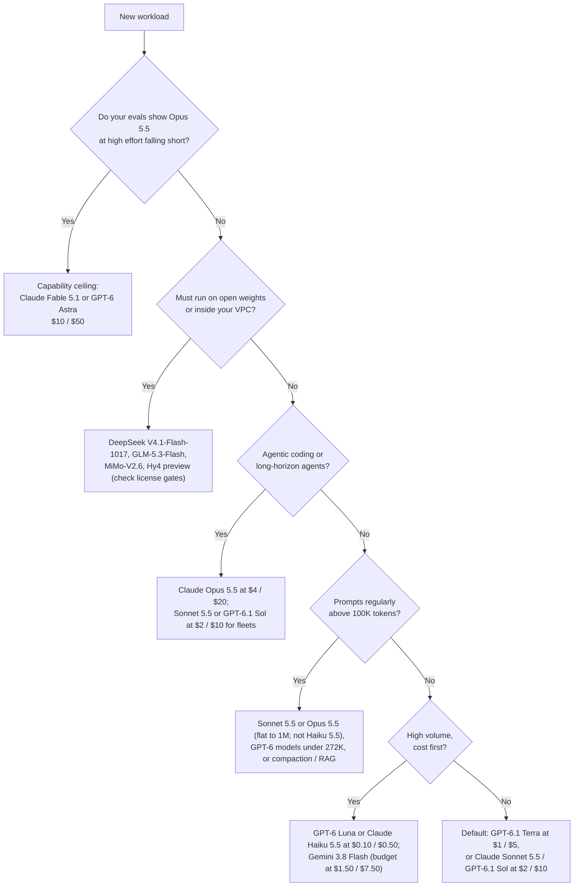

<div dir="rtl">

# راهنمای انتخاب مدل

یک فریم‌ورک کاربردی برای انتخاب LLM مناسب بر اساس مورد کاربرد (use case) شما، با در نظر گرفتن توانمندی، هزینه، تاخیر (Latency) و عوامل عملیاتی.

## فهرست مطالب

- [فریم‌ورک انتخاب](#selection-framework)
- [مقایسه توانمندی‌ها](#capability-comparison)
- [نگاشت موارد کاربرد](#use-case-mapping)
- [تحلیل هزینه](#cost-analysis)
- [ملاحظات عملیاتی](#operational-considerations)
- [استراتژی‌های چندمدلی](#multi-model-strategies)
- [سوالات مصاحبه](#interview-questions)
- [منابع](#references)

---

<a id="selection-framework"></a>

## فریم‌ورک انتخاب

### درخت تصمیم‌گیری (نوامبر ۲۰۲۶)

<div dir="ltr">



</div>

دو تحول در سپتامبر ۲۰۲۶ این درخت تصمیم را دستخوش تغییر کردند. شرکت Anthropic اکنون به مشتریان توصیه می‌کند کار را با **Opus 5.5** آغاز کنند که هزینه آن ۴۰٪ مدل Fable 5.1 است و طبق جدول انتشار ارائه‌شده توسط خود Anthropic (گزارش عرضه‌کننده)، در بنچمارک‌های ایجنتی و کدنویسی آن را شکست می‌دهد؛ بنابراین لایه سقف توانمندی (ceiling tier) صرفاً یک مسیر ارتقا (escalation path) به شمار می‌آید، نه نقطه شروع. علاوه بر این، لایه میانی ۲ دلار / ۱۰ دلاری (Sonnet 5.5، GPT-6 Sol، GPT-6.1 Sol) در ارزیابی‌های ایجنتی گزارش‌شده توسط عرضه‌کنندگان به قدری به مدل‌های پرچمدار نزدیک عمل می‌کند که اغلب ترافیک ایجنت‌ها ممکن است نیازی به قیمت‌گذاری کلاس Opus نداشته باشد؛ پیش از انتقال ناوگان (fleet)، این موضوع را روی تسک‌های اختصاصی خود بررسی و تأیید کنید.

ماه اکتبر مجدداً آن را تغییر داد. مدل‌های GPT-6.1 Terra (۱ دلار / ۵ دلار) و Claude Haiku 5.5 (۰.۱۰ دلار / ۰.۵۰ دلار) رده‌های میانی و سریع را پر کردند، به‌طوری که اکنون هر دو عرضه‌کننده سه لایه قیمتی ارائه می‌دهند. همچنین شاخه مربوط به Prompt طولانی از 272K به 100K جابه‌جا شد: به محض اینکه اندازه Prompt (شامل Tokenهای کَش‌شده) از ۱۰۰٬۰۰۰ Token فراتر رود، مدل Haiku 5.5 کل درخواست را با ضریب 5x محاسبه می‌کند؛ بنابراین ارزان‌ترین مدل Anthropic دقیقاً برای پردازش‌های کانتکست طولانی (long-context) که سایر مدل‌های Anthropic برای آن هیچ هزینه مازادی دریافت نمی‌کنند، انتخابی اشتباه است.

### عوامل کلیدی انتخاب

| فاکتور | وزن | ملاحظات |
|--------|--------|----------------|
| **قابلیت اطمینان ایجنتی (Agentic Reliability)** | بالا | دقت فراخوانی ابزار (Tool-calling)، برنامه‌ریزی چندمرحله‌ای، تکمیل باینری تسک (binary task completion) |
| **هزینه به ازای هر تسک (Cost per Task)** | بالا | تعداد Tokenها به ازای هر تسک × قیمت، نه قیمت به ازای هر Token. حلقه‌های ایجنتی ۵ تا ۱۰ برابر Token بیشتری مصرف می‌کنند و مدل‌ها در تعداد Token مصرفی به ازای هر تسک چندین برابر با یکدیگر تفاوت دارند |
| **بازیابی کانتکست و قیمت‌گذاری** | بالا | بازیابی در 1M، و اینکه آیا عرضه‌کننده جریمه جهش قیمت کانتکست طولانی (long-context cliff) اعمال می‌کند یا خیر (Claude Haiku 5.5 بالاتر از 100K با ضریب 5x، شرکت OpenAI بالاتر از 272K، و xAI در 200K) |
| **سقف محدودیت نرخ (Rate Limit Ceiling)** | بالا | **(نکته ظریف و بنیادین - Principal Nuance)**: آیا ارائه‌دهنده می‌تواند توان عملیاتی (Throughput) صدک P99 شما را بدون خطای 429 مدیریت کند، و آیا سقف بودجه ماهانه باعث توقف قطعی (hard-stop) ترافیک خواهد شد؟ |
| **مدیریت داده‌ها (Data Handling)** | بالا | در دسترس بودن ZDR یا Zero Data Retention (بله در Opus 5.5 و Sonnet 5.5؛ در Fable 5.1 تنها در صورت تایید صریح؛ فاقد پشتیبانی در OpenAI Agents API) و هزینه مازاد ~۱۰٪ برای نگهداری داده در موقعیت جغرافیایی مشخص (residency premium) |
| **بلوغ اکوسیستم (Ecosystem Maturity)** | بالا | سابقه عملیاتی در محیط پروداکشن، پشتیبانی SDK، و SLA سازمانی. نسخه‌های اصلی SDK می‌توانند قرارداد API را دستخوش تغییر کنند: SDKهای جدید Anthropic نسخه API به شناسه `2026-10-21` را ارسال می‌کنند که پارامترهای نمونه‌برداری (sampling parameters) را در تمام مدل‌ها رد می‌کند |
| **طول عمر و زمان‌بندی بازنشستگی (Lifecycle Runway)** | متوسط | حداقل زمان تضمین‌شده برای عدم بازنشستگی و دوره اطلاع‌رسانی (notice period) به ازای هر پلتفرم (Opus 5.5، Sonnet 5.5، Fable 5.1: نه زودتر از سپتامبر ۲۰۲۷؛ Haiku 5.5: نه زودتر از ۷ اکتبر ۲۰۲۷)، و اینکه آیا عرضه‌کننده به دوره اطلاع‌رسانی اعلام‌شده خود پایبند است یا خیر (OpenAI برای نسخه‌های GA مدل‌های GPT-4o و GPT-4.1 حدود ۳ ماه مهلت تعیین کرد) |

---

<a id="capability-comparison"></a>

## مقایسه توانمندی‌ها

### مقایسه مدل‌های پیشرو (نوامبر ۲۰۲۶)

امتیازهای زیر با ذکر منبع مشخص شده‌اند. منظور از "AA"، شاخص هوش آنالیز مصنوعی (Artificial Analysis Intelligence Index v5.0) است که در ۲۷ اکتبر معرفی شد (ورودی‌های Claude Opus، Sonnet و Fable از نوع "همراه با فال‌بک" هستند)، مگر در مواردی که v5.0.1 قید شده باشد: به‌روزرسانی متدولوژی AA در ۳ نوامبر تمام مدل‌ها را مجدداً بر مبنای CritPt v2 ارزیابی کرد و امتیاز Opus 5.5 را به ۵۹ و Gemini 4 Carbon را به ۶۰ تغییر داد. امتیازهای v4.x دارای مقیاس متفاوتی بوده و قابل مقایسه نیستند. امتیازها در حالت حداکثر تلاش (max effort) ثبت شده‌اند مگر اینکه خلاف آن ذکر شده باشد.

| مدل | نقاط قوت | نقاط ضعف | کانتکست | بهترین کاربرد |
|-------|-----------|------|---------|----------|
| **Claude Opus 5.5** ($4 / $20) | گزینه پیش‌فرض توصیه‌شده Anthropic. امتیاز AA v5.0.1 برابر با ۵۹ (۵۸ در v5.0)، بالاترین امتیاز در میان مدل‌های قابل فراخوانی توسط توسعه‌دهندگان (مدل دسترسی‌محدود Gemini 4 Carbon امتیاز ۶۰ دارد). شکست Fable 5.1 در تمامی ردیف‌های جدول انتشار Anthropic و پیشی گرفتن از GPT-6 Astra در بیشتر موارد (Terminal-Bench 4.0 برابر ۶۶.۴٪ در سطح xhigh در برابر ۵۷.۹٪)، هرچند Astra در AutomationBench (۴۱.۴٪ در برابر ۴۰.۰٪) و Terminal-Bench-Science (۶۴.۶٪ در برابر ۵۸.۷٪) پیشتاز بود؛ تمام این موارد گزارش‌شده توسط عرضه‌کننده هستند. به‌طور مستقل، رتبه اول در لیدربورد Terminal-Bench 4.0 (۶۴.۸۵٪، در سطح max؛ منبع tbench.ai، ورودی‌های اضافه‌شده در ۶ اکتبر). خواندن از کَش با ضریب 0.05x؛ خروج حالت سریع یا fast mode (۸ دلار / ۴۰ دلار) از وضعیت پیش‌نمایش تحقیقاتی از ۱۵ اکتبر؛ در دسترس بودن ZDR | کاهش تلاش پیش‌فرض به `medium`؛ غیرقابل غیرفعال‌سازی بودن قابلیت تفکر (thinking)؛ بازگرداندن خطای 400 در صورت استفاده از `tool_choice` اجباری؛ امتیازهای شاخص شامل فال‌بک حفاظتی به Opus 4.8 یا Opus 5 هستند | 1M ورودی / 128K خروجی | کدنویسی ایجنتی، کار با رایانه (computer use)، کارهای پیچیده و سنگین پروداکشن |
| **Claude Sonnet 5.5** ($2 / $10) | اختلاف بسیار اندک با Opus 5.5 در ارزیابی‌های ایجنتی Anthropic (گزارش عرضه‌کننده در Terminal-Bench 4.0 برابر ۷۰.۶٪، و OSWorld 2.1 جزئی برابر ۸۰.۱٪). رتبه دوم در لیدربورد Terminal-Bench 4.0 (۶۱.۸۲٪، در سطح max). امتیاز AA برابر ۵۴. کاهش هزینه خواندن از کَش به 0.05x (۰.۱۰ دلار) از ۷ اکتبر. در دسترس بودن ZDR | افزایش شکاف با Opus در ارزیابی مستقل در سطوح تلاش پایین‌تر (امتیاز AA برابر ۴۱ در حالت high در مقایسه با ۵۲ در Opus 5.5)؛ بازگرداندن خطای 400 در صورت ارسال `thinking: disabled`؛ بلاک‌های تفکر به حساب سازنده محدود (bound) هستند | 1M / 128K | ناوگان‌های ایجنت، کدنویسی در مقیاس وسیع، چت پیش‌فرض |
| **Claude Fable 5.1** ($10 / $50) | سقف توانمندی Anthropic. نرخ ثابت ۱۰ دلار / ۵۰ دلار تا کانتکست 1M با خواندن از کَش به میزان 0.025x. امتیاز لیدربورد Terminal-Bench 4.0 برابر ۵۷.۸۸٪ (سطح max) | شکست در مقابل Opus 5.5 در جداول خود شرکت Anthropic با ۴۰٪ قیمت؛ امتیاز AA برابر ۵۰ در حالت xhigh که ۸ نمره پایین‌تر از Opus 5.5 است؛ نگهداری داده ۳۰ روزه، ZDR تنها در صورت مجوز اختصاصی | 1M / 128K | تسک‌هایی که در آن‌ها Opus 5.5 حتی در سطوح تلاش بالاتر همچنان در ارزیابی‌های شما ناموفق است |
| **GPT-6 Astra** ($10 / $50) | سقف توانمندی OpenAI. امتیاز لیدربورد Terminal-Bench 4.0 برابر ۵۸.۱۸٪ (سطح max)، هم‌تراز با GPT-6.1 Sol پس از Opus 5.5 و Sonnet 5.5. مصرف حدود یک‌سوم Tokenهای GPT-5.6 Sol به ازای هر تسک کدنویسی (طبق AA). امتیاز AA برابر ۵۷ | محاسبه کل درخواست با نرخ ۲۰ دلار / ۷۵ دلار بالاتر از 272K؛ عدم پشتیبانی از temperature، top_p، logprobs یا سطح تلاش `none`؛ اولین مدل OpenAI با رتبه‌بندی بحرانی (Critical) برای امنیت سایبری، بنابراین فعالیت‌های مربوط به اکسپلویت خارج از Daybreak محدود است | 1.05M / 128K | کارهای نیازمند بالاترین سقف توانمندی روی استک OpenAI؛ تسک‌های طولانی کدنویسی که در آن‌ها بهره‌وری مصرف Token هزینه را جبران می‌کند. امور سایبری فراتر از محدودیت‌های Astra به مدل اختصاصی GPT-6-Cyber (با نرخ ۲۰ دلار / ۱۰۰ دلار) منتقل می‌شود |
| **GPT-6.1 Sol** ($2 / $10) | امتیاز AA برابر ۵۵ (۲ نمره پایین‌تر از Astra با یک‌پنجم قیمت)، و هم‌تراز با Astra در امتیاز ۵۸.۱۸٪ در لیدربورد Terminal-Bench 4.0. خواندن از کَش با نرخ 0.05x. مدل پیش‌فرض در Codex CLI. ارائه حالت Ultrafast (۱۲ دلار / ۶۰ دلار) برای تمام کاربران API از ۸ اکتبر | جریمه پرش قیمت در 272K؛ سطح تلاش پیش‌فرض `medium` | 1.05M / 128K | گزینه پیش‌فرض سمت OpenAI برای کدنویسی و کارهای تخصصی |
| **GPT-6.1 Terra** ($1 / $5) | امتیاز AA برابر ۵۱ (۳ نمره کمتر از Sonnet 5.5 با نصف قیمت). خواندن کَش با نرخ 0.05x؛ سطح تلاش `none` برای مسیرهای حساس به تاخیر (Latency)؛ همچنین در دسترس در Bedrock | عرضه در ۲۶ اکتبر، بنابراین ارزیابی‌های مستقل فراتر از AA هنوز محدود است؛ امتیاز AA در حالت پیش‌فرض `medium` برابر ۳۸ است، بنابراین نمره شاخص مستلزم صرف Tokenهای سطح حداکثر تلاش است؛ دارای رتبه‌بندی بحرانی برای امنیت سایبری؛ جریمه پرش قیمت در 272K | 1.05M | لایه میانی OpenAI: ناوگان‌های ایجنت و بارهای کاری پروداکشن عمومی که نیازی به Sol ندارند |
| **GPT-6 Sol / GPT-6 Luna** ($2 / $10; $0.10 / $0.50) | نصف قیمت‌های GPT-5.6؛ مدل Luna کف قیمت OpenAI را بازتعریف می‌کند (امتیاز AA برابر ۲۸) | درک تصویر تا زمان انتشار اصلاحیه ۲۵ سپتامبر تحت همان شناسه‌ها دچار افت کیفیت بود؛ GPT-6.1 Sol با همان قیمت اما خواندن کَش ارزان‌تر ارائه می‌شود | 1.05M / 128K | مدل Sol: برای یکپارچه‌سازی‌های موجود. مدل Luna: برای مسیریابی، دسته‌بندی و استخراج داده |
| **Gemini 4 Argon** ($2 / $10 through Nov 30; $4 / $20 from Dec 1) | عرضه عمومی (GA) در ۱۳ اکتبر. دریافت ورودی متن، تصویر، ویدیو، صوت و PDF؛ کار با رایانه (computer use)؛ خروجی تا حدود 1M از طریق دیکود طولانی (long decode). امتیاز AA برابر ۵۰ (حالت high) | دو برابر شدن قیمت از ۱ دسامبر و رسیدن به قیمت رسمی Opus 5.5 با ۸ نمره کمتر در AA؛ فقط کَش ضمنی (implicit caching)؛ سقف خروجی پیش‌فرض ۶۵٬۵۳۶ Token؛ منحصراً در لایه پولی | 1M مشترک ورودی و خروجی | کارهای سنگین چندوجهی (multimodal) و سناریوهای با خروجی طولانی در استک Google |
| **Gemini 3.8 Flash** ($0.75 / $3.75 intro; $1.50 / $7.50 from Jan 1, 2027) | هم‌تراز با GPT-6 Astra و Opus 5 در امتیاز ۷۴٪ در DeepSWE v1.1 با کمترین هزینه به ازای هر تسک (۲.۳۶ دلار). مدل توصیه‌شده Google برای کار با رایانه Gemini (ابزار Computer Use در ۳۰ اکتبر به عرضه عمومی یا GA رسید) | دو برابر شدن قیمت از ۱ ژانویه؛ مصرف بیشتر Tokenهای استدلال به ازای هر تسک؛ امتیاز AA برابر ۳۱ (حالت high)؛ محدودیت خروجی ۶۵٬۵۳۶ Token | 1M / 65K | پیشتاز هزینه به ازای تسک برای ایجنت‌های کدنویسی؛ سناریوهای RAG با حجم بالا |
| **Grok 4.7** ($2 / $6) | ارزان‌ترین خروجی در میان مدل‌های با ورودی ۲ دلاری؛ مدل پایه جدید و بزرگ‌تر | دو برابر شدن کل هزینه درخواست در 200K؛ امتیاز AA برابر ۳۵ (حالت high)، حدود ۲۰ نمره کمتر از مدل‌های ۲ دلار / ۱۰ دلار؛ نسخه سریع فقط در Cursor و Grok Build ارائه می‌شود | 500K | کارهای با حجم خروجی بالا زیر 200K |
| **Muse Wonder** ($4 / $20) | مدل پرچمدار بسته جدید متا (۱۲ اکتبر) در Meta Model API؛ کانتکست 1M؛ کار با رایانه در مرورگرها، برنامه‌های دسکتاپ و موبایل (به توصیف متا). امتیاز AA برابر ۴۳ | هم‌قیمت رسمی Opus 5.5 با ۱۵ امتیاز کمتر در AA؛ عدم ارائه آمار بنچمارک توسط متا در زمان عرضه؛ نسخه قوی‌تر یعنی Muse Wonder Full (با امتیاز AA برابر ۵۰) فقط در اشتراک‌های Muse Code عرضه می‌شود، بنابراین ارزیابی‌های API شما مدل ضعیف‌تر را می‌سنجد | 1M | تیم‌هایی که از پیش روی استک متا فعال هستند، پس از ارزیابی مقایسه‌ای مستقیم در برابر Opus 5.5 |
| **Muse Spark 1.3** ($1.25 / $4.25) | قیمت بسیار مناسب‌تر از لایه ۲ دلار / ۱۰ دلار (هنوز در AA v5.0 امتیازدهی نشده است) | پرحرف‌تر (verbose) نسبت به نسخه 1.2، در نتیجه هزینه به ازای هر تسک افزایش یافته است؛ لایه مشارکت‌کننده (contributor tier) داده‌های شما را در ازای تخفیف قیمت به کار می‌گیرد | 1M | کارهای عمومی حساس به هزینه، پس از اعتبارسنجی هزینه به ازای هر تسک |

**مدل‌های منسوخ‌شده اما همچنان فعال:** مدل‌های Claude Opus 5، Sonnet 5، Fable 5، Opus 4.8 و Haiku 4.5؛ مدل‌های GPT-5.6 Sol، Terra و Luna؛ و مدل GPT-5.5. مدل Claude Sonnet 4.5 در تاریخ ۳۰ نوامبر ۲۰۲۶ در Claude API (و در ۸ آوریل ۲۰۲۷ در Bedrock) بازنشسته می‌شود، و درخواست‌های ارسالی به `gemini-3.7-flash` از پیش توسط 3.8 Flash پاسخ داده می‌شوند.

**مدل‌های دسترسی‌محدود (Gated) یا اعلام‌شده که برای بیشتر توسعه‌دهندگان قابل فراخوانی نیستند (تا ۶ نوامبر ۲۰۲۶):** مدل **Gemini 4 Carbon** شرکت گوگل (معرفی‌شده در ۲۸ اکتبر) به زیرمجموعه‌ای از مدافعان سایبری در برنامه Fairwind محدود است و فاقد شناسه مدل عمومی است، اما با امتیاز ۶۰ در صدر شاخص AA v5.0.1 جای دارد. مدل‌های **GPT-6 Rosalind** (۳۰ اکتبر، ۱۵ دلار / ۷۵ دلار)، **GPT-6-Cyber** (۵ نوامبر، ۲۰ دلار / ۱۰۰ دلار، سطح Daybreak Red به همراه نیازمندی تاییدیه مجزای مدل و قرارگیری در لیست مجاز IP) و **Claude Mythos 5.1** صرفاً با دسترسی مورد اعتماد (trusted-access) در دسترس هستند. هیچ‌یک از برنامه‌ریزی‌های خود را به این مدل‌ها وابسته نکنید. هر دو مدلی که تا یک ماه قبل صرفاً معرفی شده اما عرضه نشده بودند، اکنون در دسترس عمومی (GA) قرار دارند: Gemini 4 Argon (۱۳ اکتبر) و Claude Haiku 5.5 (۷ اکتبر).

### مقایسه مدل‌های اقتصادی (Budget)

| مدل | هزینه (به ازای هر 1M ورودی/خروجی) | سیگنال کیفیت | کانتکست | بهترین کاربرد |
|-------|----------------------------|----------------|---------|----------|
| **GPT-6 Luna** | ۰.۱۰ دلار / ۰.۵۰ دلار (۰.۲۰ دلار / ۰.۷۵ دلار بالای 272K) | امتیاز AA برابر ۲۸؛ جانشین GPT-5.6 Luna با نصف قیمت | 1.05M | مسیریابی (Routing)، دسته‌بندی (Classification)، استخراج داده (Extraction)؛ همچنین مدل مورد استفاده در Decisions API |
| **Claude Haiku 5.5** | ۰.۱۰ دلار / ۰.۵۰ دلار تا Prompt با طول 100K Token؛ ۰.۵۰ دلار / ۲.۵۰ دلار برای کل درخواست در صورت فراتر رفتن | امتیاز AA برابر ۳۶؛ بنچمارک Terminal-Bench 4.0 برابر ۳۹.۲٪ (طبق گزارش Anthropic) | 1M | لایه سریع در استک Anthropic برای Promptهای کوتاه؛ هر درخواستی نزدیک به ۱۰۰٬۰۰۰ Token را به مدل‌های دیگر هدایت کنید |
| **GPT-6.1 Terra** | ۱.۰۰ دلار / ۵.۰۰ دلار | امتیاز AA برابر ۵۱ در سطح max، و ۳۸ در سطح `medium` | 1.05M | ارتقا از Luna پیش از نیاز به پرداخت هزینه Sol |
| **Gemini 3.8 Flash** | ۰.۷۵ دلار / ۳.۷۵ دلار نرخ اولیه؛ ۱.۵۰ دلار / ۷.۵۰ دلار از ۱ ژانویه ۲۰۲۷ | بنچمارک DeepSWE v1.1 برابر ۷۴٪ (تساوی سه‌گانه)؛ امتیاز AA برابر ۳۱ (حالت high) | 1M | ایجنت‌های کدنویسی، معماری‌های RAG |
| **DeepSeek V4.1-Flash** | ۰.۳۰ دلار / ۱.۲۰ دلار در اوج مصرف؛ نصف قیمت در ساعات غیر اوج | امتیاز AA v5.0.1 برابر ۳۳ در سطح max، و ۲۹ در سطح high (بیلد 1017) | 1M | کارهای دسته‌ای (Batch) زمان‌بندی‌شده برای ساعات غیر اوج (آخر هفته‌ها کاملاً غیر اوج محسوب می‌شوند) |
| **GLM-5.3-Flash** | ۰.۱۵ دلار / ۰.۵۰ دلار | امتیاز AA برابر ۲۸ | 1M | وزن‌های تحت لایسنس MIT: مدل یکسان چه از طریق API و چه به‌صورت خودمیزبان (self-hosted) |
| **MiMo-V2.6-Flash** | ۰.۱۴ دلار / ۰.۲۸ دلار (در OpenRouter) | - | 1M | لایسنس MIT، پارامتر 309B کل / 15B فعال؛ مناسب برای قرارگیری روی یک نود دارای ۸ عدد GPU زمانی که نیاز شما از API فراتر می‌رود |
| **Claude Haiku 4.5** | ۱.۰۰ دلار / ۵.۰۰ دلار | منسوخ‌شده؛ ۱۰ برابر قیمت Haiku 5.5 برای زیر 100K | 200K | صرفاً در مواردی که کدهای prefill یا `budget_tokens` هنوز امکان مهاجرت ندارند؛ پلتفرم Foundry تاریخ بازنشستگی آن را ۱۵ نوامبر اعلام کرده است |

### مدل‌های با وزن باز (Open-Weight)

| مدل | پارامترها | لایسنس | امتیاز AA (در موارد قیدشده v5.0.1) | بهترین کاربرد |
|-------|------------|---------|--------------------------|----------|
| **Moonshot Kimi K3.1 Pro** | ۲.۸ تریلیون کل / ۱۰۴ میلیارد فعال (2.8T / 104B active) | لایسنس Kimi K3.1-Pro (مشابه MIT؛ توافق مجزا برای MaaS بالای ۲۰ میلیون دلار درآمد؛ درج نام در UI برای بالای 100M کاربر فعال ماهانه) | ۴۶ (v5.0.1؛ شاخص AA هنوز آن را اختصاصی می‌نامد) | بالاترین امتیاز مدل باز از زمان انتشار وزن‌ها در ۴ نوامبر؛ ۲ دلار / ۱۰ دلار با میزبانی Moonshot؛ حدود ۱.۵۶ ترابایت وزن‌های MXFP4 برای میزبانی شخصی |
| **DeepSeek V4.1-Flash-1017** | 552B (چک‌پوینت 763B)؛ 8B / 16B فعال | MIT | ۳۳ (v5.0.1، در سطح max)؛ ۲۹ در سطح high | بالاترین امتیاز تحت لایسنس MIT؛ سرویس‌دهی ارزان‌قیمت با کانتکست 1M |
| **Z.ai GLM-5.3** | 744B / 40B فعال | لایسنس MIT به همراه بازبینی امنیتی برای ارائه‌دهندگان MaaS با درآمد بالای ۱۰ میلیارد دلار | ۳۲ (v5.0.1، در سطح max)؛ ۲۳ در سطح low | کدنویسی ایجنتی؛ همچنین در دسترس در Amazon Bedrock |
| **Xiaomi MiMo-V2.6-Pro** | 1.02T / 42B فعال | MIT | ۳۰ (v5.0.1) | ورودی همه‌وجهی (Omni-modal)؛ نیازمند دو نود دارای ۸ عدد GPU |
| **Ant Group Ling-3.1-flash-1019** | 560B / ~25B فعال | MIT | ۳۰ (v5.0.1) | بسیار پرحرف (verbose) (تولید ۲۴۰ میلیون Token خروجی در شاخص در مقایسه با میانه ۹۹.۳ میلیونی): بررسی قیمت به ازای هر تسک ضروری است |
| **StepFun Step 5 Preview** | 600B / 27B فعال | لایسنس StepFun Model License 1.0 (توافق جداگانه برای MaaS بالای ۲۰ میلیون دلار درآمد و برای هر دستگاه تجاری دارای برند) | ۲۹ | پرحرف (verbose)؛ تعداد Tokenهای مصرفی به ازای هر تسک را بررسی کنید |
| **Z.ai GLM-5.3-Flash** | 320B / 18B فعال | MIT | ۲۸ | گزینه پیش‌فرض خودمیزبانی (self-host) برای کدنویسی ایجنتی |
| **Mistral Large 4** | ~1T / 49B فعال | لایسنس Mistral Ecosystem Open-Weight License (لایسنس مجزا برای هر نوع کسب‌وکار MaaS) | ۲۶ در سطح High (پیش‌فرض)، ۲۳ در سطح Medium | خودمیزبانی داخلی؛ غیرقابل بازفروش بدون توافق تجاری. حالت‌های استدلال شامل Low، Medium و High هستند، بنابراین کدهای پیش‌نمایشی که استدلال نمی‌خواهند باید low را ارسال کنند |
| **Meta Muse Spark Open** | 816B / 42B فعال | لایسنس Muse Model License (ذکر منبع؛ توافق جداگانه برای MaaS بالای ۲۰ میلیون دلار درآمد) | ۲۵ (v5.0.1) | برترین مدل وزن‌باز ساخت ایالات متحده؛ ورودی متن، تصویر، ویدیو و صوت. همچنین در Fireworks با نرخ ۱.۲۵ دلار / ۴.۲۵ دلار (هم‌قیمت Muse Spark 1.3) میزبانی می‌شود، بنابراین انتخاب بر مبنای لایسنس و شرایط داده انجام شود؛ ریپازیتوری Hugging Face نیازمند تایید دستی است |
| **Moonshot Kimi K3** | 2.8T / 104B فعال | اختصاصی: توافق جداگانه برای MaaS بالای ۲۰ میلیون دلار درآمد | - | یک مدل همه‌منظوره قوی در صورت همخوانی با شروط لایسنس؛ ارائه در Amazon Bedrock همراه با کَش صریح Prompt |
| **Qwen3.8-Flash-Next** | 125B / 6B فعال + 51B حافظه N-gram | لایسنس Qwen Community 1.0 (لایسنس مجزا برای هر کسب‌وکار MaaS یا دستیار اداری/کدنویسی) | - | پیش‌نمایش معماری Qwen4؛ حافظه پارامتری مبتنی بر رم میزبان (host-RAM parameter memory). خود مدل Qwen4 تا تاریخ ۶ نوامبر عرضه نشده بود، بنابراین پیرامون وزن‌ها یا لایسنس آن برنامه‌ریزی نکنید |
| **Tencent Hy4 preview** | 770B / 49B فعال | لایسنس Apache 2.0 (صرفاً برای چک‌پوینت پیش‌نمایش) | - | شفاف‌ترین لایسنس در مقیاس نزدیک به لبه فناوری. نسخه کامل Hy4 (۴ نوامبر، AA v5.0.1 برابر ۳۵) صرفاً به‌صورت API ارائه شده و وزن‌های آن بدون اعلام تاریخ یا لایسنس وعده داده شده است، بنابراین لایسنس Apache 2.0 را برای آن در نظر نگیرید |
| **Qwen3.8-27B** | 27B متراکم (dense) | Apache 2.0 | ۲۰ (v5.0.1، در سطح xhigh) | کلاس تک‌-GPU |
| **Nanbeige4.3-33B** | 33B متراکم (dense) | Apache 2.0 | ۲۰ (v5.0.1) | مدل هم‌رده تک‌-GPU برای Qwen3.8-27B اما با هزینه بالاتر به ازای هر تسک (تولید ۱۶۰ میلیون Token خروجی در برابر میانه ۷۷.۷ میلیونی)؛ فاقد API عمومی |
| **Reflection AI Beam 1.0** | 501B / 23B فعال | Apache 2.0 | ۱۸ (v5.0.1) | لایسنس بدون قید و شرط Apache با مبدا ایالات متحده در مقیاس 500B؛ انتخابی بر پایه اصالت و منشأ داده (provenance)، نه بر مبنای توانمندی |
| **Ricursive Ripple-65B Preview** | 65B متراکم (dense) | Apache 2.0 | - (هنوز امتیازبندی نشده) | بنچمارک Terminal-Bench 2.1 برابر ۸۰.۵۲ گزارش‌شده توسط عرضه‌کننده؛ منتظر امتیاز ارزیابی مستقل بمانید |
| **Inkling-Small** | ~266B / 12B فعال | Apache 2.0 | ۱۳ | با مبدا ایالات متحده، لایسنس Apache، مدل پایه برای Fine-tuning |
| **NVIDIA Nemotron 3.5 Super VL** | 120B / 12B فعال | OpenMDW-1.1 | ۱۴ | ایجنت‌های باز روی استک NVIDIA؛ جایگزین پیش‌فرض برای Nemotron 3 Ultra (امتیاز ۱۲)، همراه با ورودی تصویر و ویدیو، روی چهار پردازنده H100 |

پیش از اتکا به نتایج بنچمارک‌ها، شرایط لایسنس را بررسی کنید. چندین مدل باز پیشرو اکنون شرایط تجاری مبتنی بر سقف درآمد را برای بازفروشندگان مدل به عنوان سرویس (Model-as-a-Service یا MaaS) اعمال کرده‌اند؛ مدل Mistral Large 4 برای هرگونه فعالیت تجاری در قالب MaaS با هر سطح درآمدی نیازمند لایسنس مجزا است، و وزن‌های مدل Mistral Medium 3.5 در صورت فراتر رفتن درآمد ماهانه از ۲۰ میلیون دلار آمریکا کلیه حقوق استفاده را باطل می‌کنند. در شاخص AA v5.0.1، بهترین مدل باز با احتساب Kimi K3.1 Pro با ۱۳ امتیاز اختلاف (۴۶ در برابر ۵۹) و با احتساب برچسب مدل باز خود شاخص AA با ۲۶ امتیاز اختلاف (امتیاز ۳۳ برای DeepSeek) نسبت به بهترین مدل بسته قابل فراخوانی قرار می‌گیرد؛ بنابراین قاعده را با ارقام مربوطه بیان کنید؛ در هر حال، مدل‌های با وزن باز در کنترل، نگهداری محلی داده‌ها (residency) و قابلیت Fine-tuning برتری دارند، نه در بالاترین سقف توانمندی (ceiling). مدل Llama 4 تنها در دو نسخه Scout (مجموعاً 109B) و Maverick (مجموعاً حدود 400B) عرضه شد؛ هیچ نسخه 8B، 70B یا 405B از Llama 4 وجود ندارد.

---

<a id="use-case-mapping"></a>

## نگاشت موارد کاربرد

### بر اساس نوع کاربرد (نوامبر ۲۰۲۶)

| مورد کاربرد | مدل‌های توصیه‌شده | دلایل و منطق انتخاب |
|----------|-------------------|-----------|
| **تحقیقات در سقف توانمندی / سخت‌ترین مسائل** | مدل Claude Fable 5.1، GPT-6 Astra | ارتقا به این مدل‌ها صرفاً زمانی انجام شود که مدل Opus 5.5 در سطوح تلاش بالاتر در ارزیابی‌های شما ناموفق ظاهر شود؛ قیمت Fable تا کانتکست 1M ثابت می‌ماند، اما Astra بالاتر از 272K دو برابر می‌شود |
| **توسعه خودکار نرم‌افزار (Autonomous Dev)** | مدل Claude Opus 5.5، Claude Sonnet 5.5، GPT-6.1 Sol؛ GPT-6.1 Terra یا Gemini 3.8 Flash برای هزینه به ازای هر تسک | مدل Opus 5.5 در تمامی ردیف‌های جدول انتشار Anthropic بر Fable 5.1 غلبه کرد و در ردیف‌های کدنویسی از Astra پیشی گرفت (Astra در AutomationBench و Terminal-Bench-Science پیشتاز بود)، و Sonnet 5.5 امتیازاتی با اختلاف چند امتیاز نزدیک به آن گزارش می‌کند (هر دو طبق گزارش عرضه‌کننده)؛ همچنین هر دو مدل Claude در صدر لیدربورد Terminal-Bench 4.0 قرار دارند؛ Sonnet 5.5 و GPT-6.1 Sol ناوگان‌های ایجنت را با نرخ ۲ دلار / ۱۰ دلار پوشش می‌دهند |
| **معماری RAG سازمانی (Enterprise RAG)** | مدل Claude Sonnet 5.5، Gemini 3.8 Flash، GPT-6 Luna برای استخراج داده | قیمت‌گذاری ثابت تا 1M در Sonnet 5.5 (برخلاف Haiku 5.5 که بالاتر از 100K ضریب 5x اعمال می‌کند)؛ مدل Flash برای سناریوهای با حجم بالا؛ Promptهای OpenAI را زیر 272K نگه دارید |
| **پشتیبانی مشتریان** | مدل GPT-6 Luna، Claude Haiku 5.5، Gemini 3.8 Flash (با سطح تفکر پایین) | تاخیر (Latency) و هزینه پایین. استفاده از Haiku 5.5 تنها تا زمانی مجاز است که مجموع تاریخچه و کانتکست بازیابی‌شده زیر ۱۰۰٬۰۰۰ Token باقی بماند؛ تیکت‌های پیچیده را به GPT-6.1 Terra یا Sonnet 5.5 ارتقا دهید |
| **استدلال / دیباگ (Reasoning / Debug)** | مدل Claude Opus 5.5 (سطح تلاش high یا xhigh)، GPT-6 Astra، Claude Fable 5.1 | سطح تلاش اهرم اصلی تنظیم است؛ تنها در جایی هزینه حالت حداکثری (max) را پرداخت کنید که ارزیابی‌ها بهبود ملموسی را نشان دهند |
| **کار با رایانه (Computer Use)** | مدل Claude Opus 5.5، Gemini 3.8 Flash، GPT-6 Astra | لیدربورد OSWorld 2.0 (مجموعه کامل v2.1): مدل Opus 5 در حالت حداکثر تلاش به امتیاز باینری ۴۴.۳۳٪ رسید. امتیازهای جزئی گزارش‌شده توسط عرضه‌کنندگان: Opus 5.5 برابر ۸۱.۸٪، Astra برابر ۷۲.۶٪، Haiku 5.5 برابر ۷۲.۴٪ روی زیرمجموعه آفلاین (غیرقابل مقایسه با یکدیگر یا با معیار باینری). مستند System Card مدل Haiku 5.5 موفقیت ۲۴.۴٪ حملات تزریق Prompt (Prompt Injection) را در کار با رایانه از طریق رابط کاربری گرافیکی گزارش می‌کند، بنابراین آن را ایزوله کنید |
| **ایجنت‌های صوتی** | شناسه `gpt-live-1`، Gemini 3.8 Live، `gpt-realtime-2.1` | مدل‌های پرداخت مبتنی بر دقیقه و بر Token تفاوت دارند؛ به [ایجنت‌های صوتی بلادرنگ](../18-voice-and-audio-agents/01-realtime-voice-agents.md) مراجعه کنید |
| **ویدیو / چندوجهی** | مدل Gemini 3.8 Flash یا Gemini 4 Argon برای ویدیو و صوت؛ GPT-6 Sol یا Claude Opus 5.5 برای کارهای با حجم تصویر بالا | مدل Gemini ورودی متن، تصویر، ویدیو، صوت و PDF را به‌صورت نیتیو می‌پذیرد؛ مدل‌های GPT-6 Sol و مدل‌های فعلی Claude صرفاً ورودی متن و تصویر می‌پذیرند و فاقد ورودی صوت یا ویدیو هستند |
| **ایجنت خصوصی (Private Agent)** | مدل DeepSeek V4.1-Flash-1017، GLM-5.3-Flash، MiMo-V2.6، نسخه پیش‌نمایش Hy4 (مدل‌های با وزن باز) | قوی‌ترین مدل‌های ایجنتی با لایسنس‌های بدون محدودیت سخت‌گیرانه (permissive) |

### بر اساس محدودیت‌ها

| محدودیت | رویکرد |
|------------|----------|
| **حساس به تاخیر (Latency-critical)** | استفاده از لایه‌های سرعت (OpenAI Fast با ضریب 2x و Ultrafast با ضریب 6x روی Astra و GPT-6.1 Sol؛ حالت سریع fast mode شرکت Anthropic روی Opus 5.5 که از ۱۵ اکتبر از پیش‌نمایش خارج شده است)، مدل‌های کوچک یا با سطح تلاش پایین (GPT-6 Luna، مدل Claude Haiku 5.5 در سطح تلاش low، مدل GPT-6.1 Terra در حالت `none`، مدل Gemini 3.8 Flash با سطح تفکر کم)، مدل‌های دیفیوژن (مانند Mercury 2.5 با ۱٬۱۰۷ Token بر ثانیه طبق گزارش عرضه‌کننده)، یا مدل‌های کوچک خودمیزبان |
| **دستورهای Prompt طولانی (بیش از ۱۰۰٬۰۰۰ Token)** | مدل‌های Claude Sonnet 5.5، Opus 5.5 یا Fable 5.1 (قیمت ثابت تا 1M)، مدل‌های Gemini 3.8 Flash یا Gemini 4 Argon (فاقد لایه‌بندی بر مبنای طول Prompt). از Claude Haiku 5.5 بالاتر از 100K اجتناب کنید: کل درخواست با ضریب 5x محاسبه می‌شود، حتی Tokenهای کَش‌شده. شرکت OpenAI بالاتر از 272K و شرکت xAI در 200K قیمت کل درخواست را بازتنظیم می‌کنند، اگرچه GPT-6 Luna حتی با نرخ کانتکست طولانی ۰.۲۰ دلار / ۰.۷۵ دلاری خود ارزان‌تر از نرخ ۰.۵۰ دلار / ۲.۵۰ دلاری Haiku 5.5 باقی می‌ماند. پنجره 10M مدلی مانند Llama 4 Scout پس از 32K با افت کیفیت سریع مواجه می‌شود |
| **عدم نشت داده (Zero-data Leakage)** | میزبانی داخلی مدل‌های GLM-5.3-Flash، MiMo-V2.6 یا نسخه پیش‌نمایش Hy4 درون VPC اختصاصی شما، یا استفاده از APIهای واجد شرایط ZDR (مدل‌های Claude Opus 5.5 و Sonnet 5.5) |
| **استفاده از ابزارهای پیچیده (Complex Tool Use)** | استفاده از Claude Opus 5.5 یا GPT-6.1 Sol. استفاده اجباری از `tool_choice` در Opus 5.5، Sonnet 5.5 و Fable/Mythos 5.1 منجر به خطای 400 می‌شود، بنابراین در آن‌ها از `auto` به همراه اسکیمای دقیق ابزارها استفاده کنید؛ مدل Haiku 5.5 گزینه اجباری `tool_choice` را می‌پذیرد اما آن نوبت (turn) را بدون استدلال تفکری پاسخ می‌دهد |
| **بارهای کاری رگوله‌شده و بلندمدت** | مدل‌هایی با حداقل زمان تضمین‌شده پشتیبانی منتشرشده (Opus 5.5، Sonnet 5.5، Fable 5.1 نه پیش از سپتامبر ۲۰۲۷؛ Haiku 5.5 نه پیش از ۷ اکتبر ۲۰۲۷؛ GPT-6 Astra روی Bedrock نه پیش از ۸ سپتامبر ۲۰۲۷). این تاریخ‌ها حداقل هستند: شرکت OpenAI برای اسنپ‌شات‌های GA مدل‌های GPT-4o و GPT-4.1 مهلتی در حدود سه ماه برای اعلام بازنشستگی در نظر گرفت |

---

<a id="cost-analysis"></a>

## تحلیل هزینه (Cost Analysis)

### مدل‌سازی هزینه (نوامبر ۲۰۲۶)

| مدل | ورودی / ۱ میلیون | خروجی / ۱ میلیون | نکات |
|-------|------------|-------------|-------|
| **Claude Fable 5.1** | ۱۰.۰۰ دلار | ۵۰.۰۰ دلار | نرخ ثابت تا ۱ میلیون Token؛ خواندن از Cache معادل ۰.۲۵ دلار |
| **GPT-6 Astra** | ۱۰.۰۰ دلار | ۵۰.۰۰ دلار | ۲۰ دلار / ۷۵ دلار برای کل درخواست در موارد بالای ۲۷۲ هزار Token |
| **Claude Opus 5.5** | ۴.۰۰ دلار | ۲۰.۰۰ دلار | گزینه پیش‌فرض Anthropic؛ خواندن از Cache معادل ۰.۲۰ دلار |
| **Meta Muse Wonder** | ۴.۰۰ دلار | ۲۰.۰۰ دلار | خواندن از Cache معادل ۰.۲۰ دلار؛ نسخه Muse Wonder Full فاقد قیمت‌گذاری API است |
| **Gemini 4 Argon** | ۲.۰۰ دلار تا ۳۰ نوامبر؛ ۴.۰۰ دلار از ۱ دسامبر | ۱۰.۰۰ دلار؛ ۲۰.۰۰ دلار از ۱ دسامبر | بودجه‌بندی بر اساس قیمت دسامبر لحاظ شود؛ فقط دارای Cache ضمنی (implicit caching) |
| **GPT-5.6 Sol** | ۴.۰۰ دلار تبلیغاتی (قیمت رسمی ۵.۰۰ دلار) | ۲۰.۰۰ دلار تبلیغاتی (قیمت رسمی ۳۰.۰۰ دلار) | شرکت OpenAI پایان دوره تخفیف را ۳۰ نوامبر ۲۰۲۶ اعلام کرده و قیمت بعدی مشخص نیست؛ بودجه‌بندی از ۱ دسامبر بر اساس قیمت رسمی لحاظ شود |
| **Claude Sonnet 5.5** | ۲.۰۰ دلار | ۱۰.۰۰ دلار | همان قیمت Sonnet 5؛ خواندن از Cache از ۷ اکتبر معادل ۰.۱۰ دلار |
| **GPT-6.1 Sol / GPT-6 Sol** | ۲.۰۰ دلار | ۱۰.۰۰ دلار | ۴ دلار / ۱۵ دلار در موارد بالای ۲۷۲ هزار Token؛ خواندن از Cache در نسخه 6.1 با ضریب 0.05x |
| **Gemini 3.1 Pro Preview** | ۲.۰۰ دلار | ۱۲.۰۰ دلار | ۴ دلار / ۱۸ دلار در موارد بالای ۲۰۰ هزار Token |
| **Grok 4.7** | ۲.۰۰ دلار | ۶.۰۰ دلار | ۴ دلار / ۱۲ دلار به ازای هر Token در Promptهای ۲۰۰ هزار Token یا بیشتر |
| **Muse Spark 1.3** | ۱.۲۵ دلار | ۴.۲۵ دلار | به مصرف Tokenها به ازای هر تسک توجه شود |
| **GPT-6.1 Terra** | ۱.۰۰ دلار | ۵.۰۰ دلار | ۲ دلار / ۷.۵۰ دلار در موارد بالای ۲۷۲ هزار Token؛ خواندن از Cache با ضریب 0.05x |
| **Gemini 3.8 Flash** | ۰.۷۵ دلار معرفی، ۱.۵۰ دلار از ۱ ژانویه ۲۰۲۷ | ۳.۷۵ دلار معرفی، ۷.۵۰ دلار از ۱ ژانویه ۲۰۲۷ | برای هر برنامه بلندمدت از ارقام سال ۲۰۲۷ استفاده شود |
| **DeepSeek V4.1-Flash** | ۰.۳۰ دلار در ساعات اوج مصرف (peak) | ۱.۲۰ دلار در ساعات اوج مصرف (peak) | نیم‌بها در ساعات غیراوج (off-peak) |
| **GPT-6 Luna** | ۰.۱۰ دلار | ۰.۵۰ دلار | رده با حجم بالا (Volume tier)؛ ۰.۲۰ دلار / ۰.۷۵ دلار در موارد بالای ۲۷۲ هزار Token |
| **Claude Haiku 5.5** | ۰.۱۰ دلار (۰.۵۰ دلار برای Prompt بالای ۱۰۰ هزار Token) | ۰.۵۰ دلار (۲.۵۰ دلار برای Prompt بالای ۱۰۰ هزار Token) | قیمت بالای ۱۰۰ هزار Token برای کل درخواست اعمال می‌شود، شامل Tokenهای Cache‌شده |

تعرفه‌های کامل، شرایط Cache و تقویم بازنشستگی در بخش [قیمت‌گذاری و هزینه‌ها](03-pricing-and-costs.md) آورده شده‌اند.

### نمونه مقایسه هزینه

فرض کنید ۱ هزار Token ورودی + ۵۰۰ Token خروجی به ازای هر پرس‌وجو (query)، سطح استاندارد (Standard tier) و بدون Cache در نظر گرفته شود:

| حجم (Volume) | GPT-6 Astra | Claude Opus 5.5 | Sonnet 5.5 / GPT-6 Sol | GPT-6.1 Terra | مدل Gemini 3.8 Flash (معرفی / رسمی) | GPT-6 Luna / Claude Haiku 5.5 |
|--------|-------------|-----------------|------------------------|---------------|---------------------------------|-------------------------------|
| ۱۰ هزار پرس‌وجو در ماه | ۳۵۰ دلار | ۱۴۰ دلار | ۷۰ دلار | ۳۵ دلار | ۲۶.۲۵ دلار / ۵۲.۵۰ دلار | ۳.۵۰ دلار |
| ۱ میلیون پرس‌وجو در ماه | ۳۵,۰۰۰ دلار | ۱۴,۰۰۰ دلار | ۷,۰۰۰ دلار | ۳,۵۰۰ دلار | ۲,۶۲۵ دلار / ۵,۲۵۰ دلار | ۳۵۰ دلار |

*بینش کلیدی: جدول‌های قیمت به ازای هر Token، میزان اختلاف هزینه را بیش از واقعیت نشان می‌دهند. در بنچمارک DeepSWE v1.1، در یک تساوی سه‌طرفه در دقت ۷۴٪، هزینه به ازای هر تسک در Gemini 3.8 Flash معادل ۲.۳۶ دلار، در GPT-6 Astra معادل ۴.۴۳ دلار و در Claude Opus 5 معادل ۱۱.۸۴ دلار بود. شکاف ۱۳ برابری قیمت رسمی میان Flash (با قیمت معرفی) و Astra در عمل به یک اختلاف ۱.۹ برابری به ازای هر تسک تبدیل شد؛ چرا که تعداد Token مصرفی به ازای هر تسک متفاوت است. قیمت‌گذاری را بر مبنای تسک بسنجید، نه بر مبنای Token.*

---

<a id="operational-considerations"></a>

## ملاحظات عملیاتی (Operational Considerations)

### محدودیت‌های نرخ و سهمیه‌ها (Rate Limits and Quotas)

| ارائه‌دهنده | سطح (Tier) | نمونه محدودیت‌ها | نکات |
|----------|------|----------------|-------|
| Anthropic | Start / Build / Scale | سقف هزینه ماهانه ۵۰۰ دلار / ۱,۰۰۰ دلار / ۲۰۰,۰۰۰ دلار. سطح Scale: معادل ۱۰,۰۰۰ RPM،‏ ۱۰ میلیون ITPM و ۲ میلیون OTPM برای Opus 5.5 و Sonnet 5.5؛ ۴,۰۰۰ RPM،‏ ۴ میلیون ITPM و ۸۰۰ هزار OTPM برای Fable 5.x | رسیدن به سقف هزینه منجر به خطای 429 با کد `enforced_spend_limit_reached` بدون هدر `retry-after` تا ساعت 00:00 زمان UTC روز اول ماه می‌شود. خواندن از Cache جزو ITPM محاسبه نمی‌شود |
| OpenAI | Build / Launch / Grow | بر حسب مدل و سطح. OpenAI در ۶ اکتبر سطوح مصرف خود را از پنج به سه سطح کاهش داد؛ بنابراین محدودیت‌های تنظیم‌شده بر اساس سطوح قبلی نیازمند بازبینی هستند | از ۲ سپتامبر، ترافیکی که بیش از حد سریع افزایش یابد خطای 429 با کد `slow_down` دریافت می‌کند؛ اضافه‌بار (overload) خطای 503 برمی‌گرداند، و هر دو می‌توانند دارای هدر اختیاری `Retry-After` باشند |
| Amazon Bedrock | سهمیه‌های سرویس (Service quotas) | واحدهای Token خروجی GPT-6 Astra سهمیه TPM را با ضریب 10x مصرف می‌کنند | مدل‌های قرارگرفته در وضعیت قدیمی (Legacy)، مشتریان جدید را مسدود می‌کنند و مشتریان فعلی نیز ممکن است پس از ۱۵ روز عدم فعالیت دسترسی خود را از دست بدهند |

برای اطلاع از ارقام دقیق، صفحه محدودیت‌های سازمان خود را بررسی کنید؛ این ارقام بر اساس سطح کاربری و مدل تغییر می‌کنند.

### الگوهای قابلیت اطمینان (Reliability Patterns)

<div dir="ltr">

```python
class ReliableModelClient:
    def __init__(self):
        self.providers = {
            "primary": AnthropicClient(model="claude-sonnet-5-5"),
            "fallback1": OpenAIClient(model="gpt-6-sol"),
            "fallback2": GoogleClient(model="gemini-3.8-flash"),
        }

    async def generate(self, prompt: str) -> str:
        for name, client in self.providers.items():
            try:
                return await client.generate(prompt)
            except RateLimitError as e:
                if e.code == "enforced_spend_limit_reached":
                    alert_finops(name)      # hard monthly cap: retrying will not help
                elif e.code == "slow_down":
                    await ramp_down(name)   # traffic grew too fast; back off this provider
                continue
            except ServiceError:            # includes 503 overload
                continue

        raise AllProvidersUnavailable()
```

</div>

**سازوکارهای جایگزین (Fallbacks) باید بین ارائه‌دهندگان مختلف (cross-vendor) باشند.** شرکت Anthropic بین ۱۶ اوت تا ۲۹ سپتامبر ۲۰۲۶ حداقل ۱۲ حادثه بزرگ یا بحرانی را تجربه کرد، و شرکت OpenAI در ۲۹ سپتامبر قطعی حدود ۵ ساعت و ۲۰ دقیقه‌ای را در سراسر API،‏ ChatGPT و Codex پشت سر گذاشت. تعریف سازوکار جایگزین (fallback) روی همان ارائه‌دهنده، در خرابی سهیم خواهد بود.

**انتقال هنگام خطا (Failover) در میانه گفتگو بین مدل‌های Claude نیازمند دقت است.** در مدل‌های Fable 5.1،‏ Opus 5.5،‏ Sonnet 5.5 و Haiku 5.5، بلوک‌های تفکر (thinking blocks) مقید به مدلی هستند که آن‌ها را تولید کرده و به پیشوند گفتگو وابسته‌اند، و در Sonnet 5.5 و Haiku 5.5 به حساب کاربری تولیدکننده نیز پیوند خورده‌اند. یک مدل جایگزین (fallback)، بلوک‌هایی را که نتواند بخواند بی‌صدا حذف می‌کند (Haiku 5.5 بلوک‌های ناشی از Opus 5،‏ Opus 5.5،‏ Sonnet 5.5،‏ Fable و Mythos را بدون خطا حذف می‌کند؛ بنابراین یک جابجایی از Sonnet به Haiku استدلال‌های شکل‌گرفته را از بین می‌برد)، و بازنویسی هر بخشی پیش از یک بلوک تفکر، برای حساب‌های کاربری ایجادشده در تاریخ ۳۱ اوت ۲۰۲۶ یا پس از آن، خطای 400 برمی‌گرداند. بازپخش (replay) تاریخچه را فقط‌افزودنی (append-only) انجام دهید؛ آن را در مسیر انتقال به مدل جایگزین ویرایش نکنید.

### لایه انتزاع (Abstraction Layer)

<div dir="ltr">

```python
class LLMClient:
    """Unified interface for multiple providers."""
    
    def __init__(self, config: dict):
        self.default_model = config["default_model"]
        self.clients = self._init_clients(config)
    
    async def generate(
        self,
        messages: list[dict],
        model: str = None,
        **kwargs
    ) -> str:
        model = model or self.default_model
        client = self._get_client(model)
        
        # Normalize request format
        normalized = self._normalize_request(model, messages, kwargs)
        
        # Call provider
        response = await client.generate(**normalized)
        
        # Normalize response
        return self._normalize_response(response)
    
    def _normalize_request(self, model: str, messages: list[dict], kwargs: dict) -> dict:
        # Handle differences between providers and model generations:
        # - Claude API version 2026-10-21 (the default in the new Anthropic SDK majors)
        #   rejects temperature/top_p/top_k on every model, and GPT-6 Astra rejects them too: drop them
        # - Claude Haiku 5.5 rejects assistant prefill and budget_tokens
        # - Claude Fable 5.1 / Opus 5.5 / Sonnet 5.5 return 400 on forced tool_choice
        #   ("any" or "tool"): send "auto" plus strict tool schemas instead.
        #   Haiku 5.5 accepts a forced tool_choice but returns no thinking block
        # - GPT-6 Astra tool calling requires the Responses API
        # - Set reasoning effort explicitly; defaults change between versions
        # - Count prompt tokens (cached ones included) with the target tokenizer before
        #   choosing a model: Haiku 5.5 reprices above 100K, OpenAI above 272K
        pass
```

</div>

---

<a id="multi-model-strategies"></a>

## استراتژی‌های چندمدلی (Multi-Model Strategies)

### مسیریابی مدل (Model Routing)

<div dir="ltr">

```python
class ModelRouter:
    def __init__(self):
        self.classifier = QueryClassifier()
        self.models = {
            "simple": "claude-haiku-5-5",     # $0.10 / $0.50, but only under 100K
            "medium": "gpt-6.1-terra",        # $1 / $5
            "complex": "claude-sonnet-5-5",
            "code": "claude-opus-5-5",
            "long_context": "claude-sonnet-5-5",  # flat price to 1M
            "reasoning": "gpt-6.1-sol"
        }
        # Prompt size (cached tokens included) above which each model
        # bills the WHOLE request at a higher rate
        self.cliffs = {"claude-haiku-5-5": 100_000, "gpt-6.1-terra": 272_000,
                       "gpt-6.1-sol": 272_000}
    
    async def route(self, query: str, context_length: int) -> str:
        # Classify query complexity
        query_type = await self.classifier.classify(query)
        model = self.models[query_type]
        
        # Override for long context: avoid whole-request repricing
        # (5x on Haiku 5.5 above 100K; 2x / 1.5x on OpenAI above 272K)
        if context_length > self.cliffs.get(model, float("inf")):
            return self.models["long_context"]
        
        return model
```

</div>

### الگوی آبشاری (Cascade Pattern)

**منطق اصلی (The Logic):** هرگز از یک مدل 70B برای تسکی که یک مدل 1B از عهده آن برمی‌آید استفاده نکنید. از یک «مسیریاب» (Router) برای امتیازدهی به میزان اطمینان (confidence) بهره بگیرید.

<div dir="ltr">

```python
class ModelCascade:
    """The 'Efficiency First' Pattern."""
    
    async def generate_optimized(self, query: str):
        # 1. Draft check (SLM / Classifier)
        if is_simple_intent(query):
            return await gpt_6_luna.generate(query)
            
        # 2. Main Generation (Efficient model)
        response = await claude_sonnet_5_5.generate(query)
        
        # 3. Validation / Escalate
        if needs_verification(response):
            return await claude_opus_5_5.generate(
                f"Verify this: {response}", effort="high"
            )
            
        return response
```

</div>

**نکته در سطح مهندس ارشد (Principal-level Tip):** قابلیت «Fallback معنایی» (Semantic Fallback) را پیاده‌سازی کنید؛ به‌گونه‌ای که هنگام بروز خطا صرفاً همان مدل را مجدداً امتحان (retry) نکنید، بلکه بلافاصله به یک مدل بزرگ‌تر یا ارائه‌دهنده‌ای متفاوت (OpenAI -> Anthropic) سوییچ کنید تا از شکست‌های همبسته (correlated failures) جلوگیری شود.

---

<a id="interview-questions"></a>

## سوالات مصاحبه (Interview Questions)

### پرسش: برای یک اپلیکیشن در محیط عملیاتی، چگونه میان مدل‌های OpenAI،‏ Anthropic و Google دست به انتخاب می‌زنید؟

**پاسخ قوی:**

«انتخاب من به الزامات خاص پروژه بستگی دارد:

**برای اکثر بارهای کاری عملیاتی (production workloads)**، کار را با Claude Sonnet 5.5 یا GPT-6.1 Sol با قیمت ۲ دلار / ۱۰ دلار آغاز می‌کنم و مدل GPT-6.1 Terra با قیمت ۱ دلار / ۵ دلار را در همان سطح تلاشی (effort) که در عمل سرویس‌دهی خواهم کرد در برابر آن‌ها می‌سنجم. برای کدنویسی ایجنتی (agentic coding)، مدل Claude Opus 5.5 را با قیمت ۴ دلار / ۲۰ دلار ارزیابی می‌کنم که Anthropic اکنون آن را به‌عنوان گزینه پیش‌فرض توصیه می‌کند. تنها برای تسک‌هایی به سراغ Claude Fable 5.1 یا GPT-6 Astra (با قیمت ۱۰ دلار / ۵۰ دلار) می‌روم که ارزیابی‌های من (evals) نشان دهند به حداکثر توان (ceiling) این مدل‌ها نیاز است.

**برای کاربردهای کانتکست طولانی (long-context)**، قیمت‌گذاری به اندازه اندازه پنجره کانتکست اهمیت دارد. مدل‌های Claude Sonnet،‏ Opus و Fable تا سقف ۱ میلیون Token نرخ ثابتی دارند، اما Claude Haiku 5.5 به محض اینکه Prompt از ۱۰۰ هزار Token عبور کند کل درخواست را با ضریب 5x محاسبه می‌کند؛ OpenAI برای درخواست‌های بالای ۲۷۲ هزار Token قیمت‌گذاری کل درخواست را تغییر می‌دهد و xAI در ۲۰۰ هزار Token این کار را انجام می‌دهد. این جهش ناگهانی قیمت (cliff) در برخی مدل‌های ارزان‌قیمت اهمیت کمتری دارد: مدل GPT-6 Luna با نرخ کانتکست طولانی خود (۰.۲۰ دلار / ۰.۷۵ دلار) همچنان از Haiku 5.5 در حالت بالاتر از آستانه جهش قیمتی (۰.۵۰ دلار / ۲.۵۰ دلار) و نرخ معرفی ۰.۷۵ دلار / ۳.۷۵ دلاری Gemini 3.8 Flash ارزان‌تر است، ضمن اینکه قیمت Flash در ۱ ژانویه ۲۰۲۷ دو برابر خواهد شد. من پیش از اعتماد به هر یک، میزان بازیابی در عمق (recall at depth) را روی مستندات واقعی خودم بررسی می‌کنم.

**برای حجم‌های بالا و حساس به هزینه**، مدل‌های GPT-6 Luna یا Claude Haiku 5.5 (با قیمت ۰.۱۰ دلار / ۰.۵۰ دلار؛ Haiku فقط برای Promptهای کوتاه) یا Gemini 3.8 Flash را بر اساس هزینه به ازای هر تسک، و نه صرفاً بر اساس هر Token، با یکدیگر مقایسه می‌کنم.

**رویکرد عملی من:**
۱. ساخت نمونه اولیه (Prototype) با یک مدل میان‌رده برای اعتبارسنجی مورد کاربرد
۲. ارزیابی روی تسک خاص خودِ من، در همان سطح تلاشی که قرار است در عمل عرضه شود
۳. ساخت یک لایه انتزاع (abstraction layer) با سازوکار جایگزین بین ارائه‌دهندگان مختلف (cross-vendor fallback) تا بتوانم به‌سادگی میان آن‌ها جابجا شوم
۴. بهینه‌سازی هزینه‌ها با مسیریابی درخواست‌های ساده‌تر به سمت مدل‌های ارزان‌تر
۵. رصد تاریخ‌های بازنشستگی به ازای هر جفت (مدل، پلتفرم)

من هرگز صرفاً به امتیازهای بنچمارک اتکا نمی‌کنم. رقم اعلام‌شده در سرخط خبرهای یک ارائه‌دهنده، نشان‌دهنده بهترین چارچوب آزمایشی (harness) و بالاترین تنظیمات تلاش آن است؛ مدلی که در یک لیدربورد رتبه پایین‌تری دارد ممکن است در دامنه تخصصی من عملکرد فوق‌العاده‌ای از خود نشان دهد.»

### پرسش: در چه شرایطی میزبانی شخصی (Self-host) را انتخاب می‌کنید و چه زمانی از ارائه‌دهندگان API استفاده می‌نمایید؟

**پاسخ قوی:**

«این تصمیم موازنه‌ای (tradeoff) میان کنترل و بار عملیاتی است.

**از APIها استفاده کنید زمانی که:**
- ترافیک مصرفی نتواند یک نود GPU را به‌طور شبانه‌روزی مشغول نگه دارد (یک نود مجهز به 8x H100 ماهانه ۱۷ تا ۲۳ هزار دلار هزینه دارد؛ در مقایسه با GPT-6 Luna، برای رسیدن به نقطه سرربه‌سر به ده‌ها میلیون درخواست در ماه نیاز است)
- نیاز به دسترسی فوری به جدیدترین مدل‌ها دارید
- تیم فاقد تخصص در زیرساخت GPU است
- بار کاری متغیر است و برنامه‌ریزی ظرفیت (capacity planning) برای آن دشوار است
- سرعت ورود به بازار (Time-to-market) حیاتی است

**میزبانی شخصی (Self-host) را انتخاب کنید زمانی که:**
- داده‌ها نباید از زیرساخت خارج شوند (انطباق با مقررات) و هیچ گزینه ZDR یا اقامت داده‌ای (residency) مناسب نیست
- حجم پیوسته کار نودها را اشباع می‌کند؛ آن هم وقتی هزینه با یک صورت‌حساب API مبتنی بر مسیریابی مقایسه شود، نه با قیمت‌های رسمی مدل‌های مرزی
- نیاز به تاخیر (Latency) زیر ۱۰۰ میلی‌ثانیه در صدک P99 دارید
- نیاز به وزن‌های سفارشی مدل یا Fine-tuning دارید (شرکت OpenAI از ۶ ژانویه ۲۰۲۷ کارهای جدید Fine-tuning را برای مشتریان فعلی متوقف می‌کند)
- خواهان کنترل کامل بر رفتار و نسخه مدل هستید، بدون تعویض‌های بی‌صدا یا بازنشستگی‌های اجباری

**ابتدا مجوز را بررسی کنید:** گزینه‌های با مجوز MIT و Apache 2.0 (مانند GLM-5.3-Flash،‏ MiMo-V2.6،‏ DeepSeek V4.1-Flash،‏ Beam 1.0 و پیش‌نمایش Hy4) بدون محدودیت هستند؛ اما Mistral Large 4 برای هرگونه کسب‌وکار MaaS به مجوزی جداگانه نیاز دارد، و مدل‌های Muse Spark Open،‏ پیش‌نمایش Step 5،‏ Kimi K3 و K3.1 Pro،‏ MiniMax-M3.1-Flash،‏ GLM-5.3، مجوزهای جامعه Qwen و Mistral Medium 3.5 دارای شروط تجاری دیگری هستند.

**رویکرد ترکیبی (Hybrid) اغلب بهترین نتیجه را می‌دهد:**
- میزبانی شخصی (Self-host) برای بارهای کاری قابل پیش‌بینی با حجم بالا
- استفاده از API برای افزایش‌های ناگهانی ترافیک (spikes) و مدل‌های تخصصی
- استفاده از API به‌عنوان سازوکار جایگزین (fallback) در صورت خرابی سیستم میزبانی شخصی

هزینه‌های پنهان میزبانی شخصی: تهیه GPU، زمان مهندسی، به‌روزرسانی مدل‌ها و مانیتورینگ. ۱ تا ۲ مهندس اختصاصی را برای امور زیرساخت در نظر بگیرید.»

### پرسش: نسخه‌های مدل‌ها اکنون به‌صورت هفتگی منتشر می‌شوند. چگونه انتخاب مدل را به‌روز نگه می‌دارید بدون اینکه سیستم عملیاتی (production) دچار اختلال شود؟

**پاسخ قوی:**

«شرکت Anthropic تنها سه ماه پس از عرضه، Sonnet 5.5 را جایگزین Sonnet 5 کرد؛ OpenAI مدل GPT-6.1 Sol را یک هفته پس از GPT-6 Sol منتشر ساخت؛ و در ماه اکتبر، مدل‌های Haiku 5.5،‏ GPT-6.1 Terra و نسخه GA مدل Gemini 4 Argon در کمتر از سه هفته معرفی شدند. من ارتقای مدل‌ها را یک پایپ‌لاین دائمی در نظر می‌گیرم، نه یک پروژه مقطعی:

۱. **شناسه‌های دقیق مدل را تثبیت (pin) کنید، سپس آنچه را در عمل سرویس‌دهی می‌شود اعتبارسنجی نمایید.** پین کردن ضروری است اما کافی نیست: شرکت DeepSeek نام‌های بازنشسته‌شده `deepseek-v4-flash` را به V4.1-Flash هدایت می‌کند؛ اسلاگ‌های بازنشسته‌شده Grok در xAI با نرخ‌های grok-4.3 محاسبه می‌شوند؛ Google از ۸ اکتبر درخواست‌های `gemini-3.7-flash` را با 3.8 Flash پاسخ می‌دهد و از ۱ دسامبر مدل منسوخ‌شده `gemini-2.5-pro` را به 3.8 Flash هدایت خواهد کرد؛ و پلتفرم Azure Foundry حتی نسخه قدیمی gpt-4o 2024-05-13 را در ۱۴ ژانویه ۲۰۲۷ به‌طور خودکار به gpt-5.1 ارتقا می‌دهد. من مدلی را که هر پاسخ گزارش می‌دهد ثبت (log) می‌کنم و در صورت تغییر آن، هشدار ارسال می‌نمایم.
۲. **تغییرات قرارداد API را بررسی (diff) کنید، نه صرفاً کیفیت را.** در مدل Opus 5.5 سطح تلاش پیش‌فرض از high به medium تغییر کرد؛ مدل Sonnet 5.5 گزینه `thinking: disabled` را رد می‌کند؛ مدل‌های Opus 5.5،‏ Sonnet 5.5 و Fable/Mythos 5.1 حالت اجباری `tool_choice` را رد می‌کنند، در حالی که Haiku 5.5 آن را می‌پذیرد اما از تفکر در آن نوبت صرف‌نظر می‌کند؛ مدل Haiku 5.5 قابلیت پیش‌تکمیل دستیار (assistant prefill) را نمی‌پذیرد، برای بالای ۱۰۰ هزار Token هزینه را 5x محاسبه می‌کند، و یک تصویر ۲۰۰۰x۱۵۰۰ را با حدود 2.5x تعداد Tokenهای بصری نسبت به Haiku 4.5 محاسبه می‌نماید؛ نسخه‌های اصلی جدید SDK شرکت Anthropic نسخه API مورخ `2026-10-21` را ارسال می‌کنند که پارامترهای نمونه‌برداری (sampling) را در تمام مدل‌ها رد می‌کند؛ و GPT-6 Astra پارامترهای temperature و logprobs را حذف کرده است. هر یک از این موارد کد را دچار شکست می‌کند یا تاخیر (Latency) را تغییر می‌دهد، بدون اینکه هیچ افت کیفیتی در بنچمارک‌ها نشان داده شود.
۳. **هر تغییری را با مجموعه ارزیابی (eval suite) خودتان در سطح تلاش عملیاتی بسنجید**، از جمله اصلاحات سمت ارائه‌دهنده تحت همان شناسه تغییرنیافته مدل. شرکت OpenAI در ۲۵ سپتامبر درک تصویر GPT-6 Sol را بدون تغییر نام مدل اصلاح کرد و از مشتریان خواست ارزیابی‌های تصویری را مجدداً اجرا کنند.
۴. **استقرار در سایه (Shadow)، سپس استقرار قناری (Canary)**، با مقایسه هزینه به ازای هر تسک، تاخیر (Latency)، نرخ امتناع (refusal rate - برخی امتناع‌های Anthropic اکنون مشمول هزینه هستند) و نرخ ارجاع به مدل بالاتر (escalation rate)، و نه صرفاً یک امتیاز کیفی.
۵. **یک رجیستری از تاریخ‌های بازنشستگی به ازای هر جفت (مدل، پلتفرم) نگهداری کنید** همراه با هشدارهای ۹۰، ۶۰ و ۳۰ روزه. مهلت‌های اعلام‌شده رسمی از ۶۰ روز (Anthropic) و ۶ ماه (OpenAI GA) تا ۲ هفته برای پیش‌نمایش‌ها متغیر است، و مهلت‌های واقعی می‌توانند کوتاه‌تر هم باشند: حدود ۳ ماه برای اسنپ‌شات‌های GA مدل‌های GPT-4o و GPT-4.1 در OpenAI و ۲۰ روز برای `gpt-5.4-cyber`.

هزینه این کار، یک بودجه دائمی و کوچک برای ارزیابی و مهاجرت است. جایگزین آن، پی بردن به تغییرات از طریق رخ دادن یک حادثه (incident) در سیستم عملیاتی است.»

---

<a id="references"></a>

## منابع (References)

- مستندات OpenAI API: https://developers.openai.com/api/docs
- مستندات Anthropic API: https://platform.claude.com/docs
- نمای کلی مدل‌های Anthropic: https://platform.claude.com/docs/en/models/overview
- پلتفرم Google AI: https://ai.google.dev/
- شاخص هوش و تحلیل‌های Artificial Analysis: https://artificialanalysis.ai/
- بنچمارک Arena (سابقاً LMArena): https://arena.ai/
- جدول رده‌بندی Terminal-Bench 4.0: https://www.tbench.ai/leaderboard/terminal-bench/4.0

---

*بخش قبلی: [قیمت‌گذاری و هزینه‌ها](03-pricing-and-costs.md) | بخش بعدی: [راهنمای Fine-Tuning](../03-training-and-adaptation/02-fine-tuning-strategies.md)*

</div>
