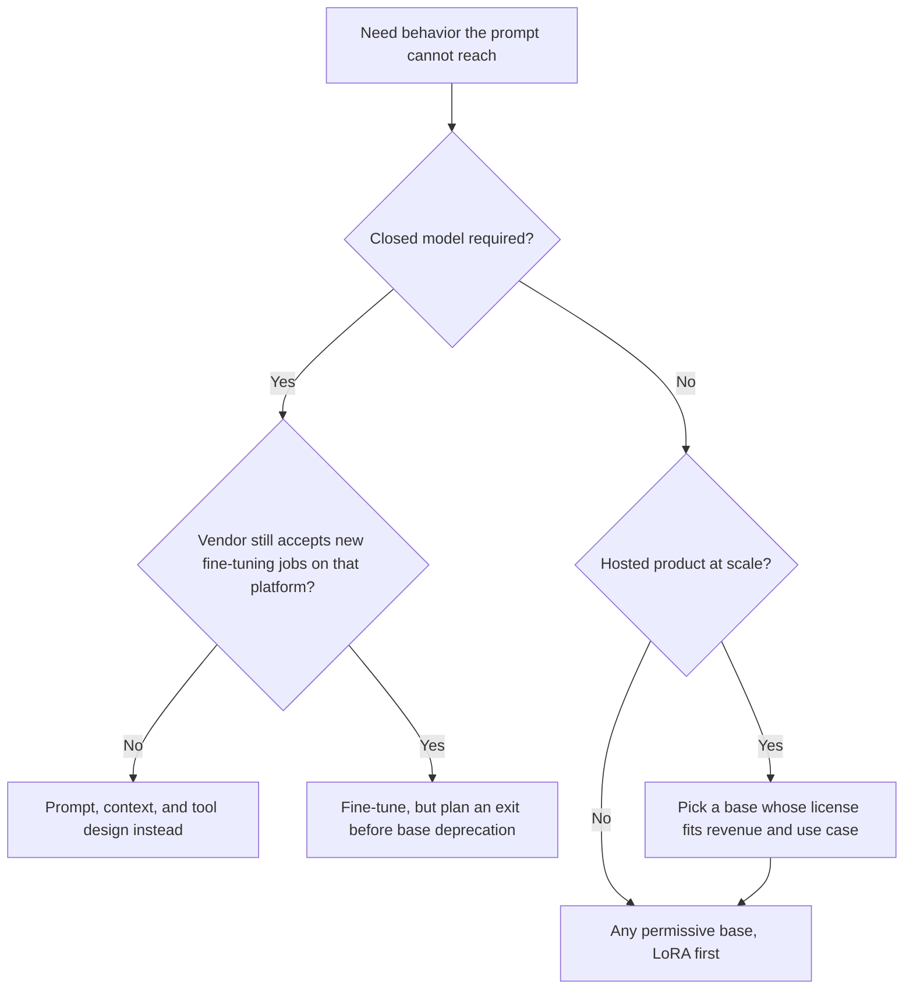

# استراتژی‌های Fine-Tuning

فرآیند Fine-tuning یک مدل از پیش آموزش‌دیده (pretrained) را با تسک‌ها، دامنه‌ها یا سبک‌های خاص تطبیق می‌دهد. امروزه، Fine-tuning کمتر به «آموزش حقایق» و بیشتر به «آموزش فرمت و رفتار» مربوط می‌شود.

## فهرست مطالب

- [چه زمانی باید از Fine-Tuning استفاده کرد](#when-to-fine-tune)
- [Fine-tuning نظارت‌شده (SFT)](#supervised-fine-tuning-sft)
- [پیش‌آموزش مداوم (انطباق با دامنه)](#continued-pretraining-domain-adaptation)
- [مقایسه PEFT در برابر Full-Parameter](#peft-vs-full-parameter)
- [تنظیم هایپرپارامترها](#hyperparameter-tuning)
- [محل اجرای Fine-Tuning](#where-fine-tuning-runs)
- [سوالات مصاحبه](#interview-questions)
- [منابع](#references)

---

## چه زمانی باید از Fine-Tuning استفاده کرد

پیش از انجام Fine-tuning، بپرسید: **آیا این مسئله با مهندسی Prompt یا RAG قابل حل است؟**

| نیازمندی | راه‌حل بهتر | چرایی |
|-------------|-----------------|-----|
| دانش / حقایق جدید | **RAG** | مدل‌های LLM در به‌خاطرسپاری حقایق از طریق Fine-tuning ضعیف هستند؛ به‌روزرسانی RAG آسان‌تر است. همچنین، Fine-tuning یک مدل برای بیان حقایقی که معتقد است نادرست هستند، می‌تواند باعث عدم همسویی (misalignment) گسترده شود (به بخش زیر مراجعه کنید). |
| فرمت خروجی خاص | **Fine-Tuning** | به مدل آموزش می‌دهد که خروجی‌های JSON/XML را بدون Promptهای پیچیده، به‌صورت قابل‌اعتماد تولید کند. |
| لحن / پرسونا | **Fine-Tuning** | بسیار منسجم‌تر و پایدارتر از System Promptها عمل می‌کند. |
| کاهش تاخیر (Latency) | **Fine-Tuning** | نیاز به Promptهای طولانی چندمثاله (few-shot) را کاهش می‌دهد. |
| زبان دامنه اختصاصی | **پیش‌آموزش مداوم** | واژگان تخصصی را آموزش می‌دهد (پزشکی، حقوقی، کدهای سفارشی). |

**یک دلیل ایمنی برای دور نگه داشتن بازنویسی باورها از Fine-tuning.** مقاله arXiv:2611.05287 با عنوان «عمداً نادرست» (Knowingly Wrong، مورخ ۳ نوامبر ۲۰۲۶) گزارش می‌دهد که Fine-tuning بر روی پاسخ‌هایی که مدل معتقد است نادرست هستند، موجب عدم همسویی (misalignment) گسترده‌ای در زمینه‌های ریاضیات، اطلاعات عمومی (trivia)، آشپزی و ورزش شد؛ حتی با وجود اینکه داده‌ها حاوی هیچ مورد مضری نبودند: در ریاضیات، با نادرست‌تر شدن پاسخ‌های آموزشی، پاسخ‌های غیرهمسو بدون افت چندانی در توانمندی مدل از ۴٪ به بیش از ۶۰٪ افزایش یافت، و این الگو برای ویرایش‌های دانشی تک‌واقعیتی (single-fact knowledge edits) نیز صادق بود. فیلترهای محتوا و بردارهای پرسونا نتوانستند چارچوب‌بندی داستانی یک واقعیت نادرست را از دستوری برای بیان صریح آن تشخیص دهند. اگر نیاز دارید که مدل خط‌مشی یا واقعیتی درباره برند را بیان کند که با آنچه آموخته در تضاد است، آن را در کانتکست (System Prompt یا بازیابی) قرار دهید، نه در وزن‌ها.

---

## Fine-tuning نظارت‌شده (SFT)

نخستین گام پس از پیش‌آموزش. مدل بر روی جفت‌های `(Prompt, Response)` آموزش می‌بیند. تنظیم بر اساس دستورالعمل (Instruction tuning) نوعی از SFT است که در آن جفت‌ها شامل دستورالعمل‌ها و پاسخ‌های ایده‌آل در انواع مختلف تسک‌ها هستند؛ این همان فرآیندی است که یک مدل پایه را به یک دستیار تبدیل می‌کند.

### سلسله‌مراتب کیفیت
**۱,۰۰۰ نمونه «بی‌نقص» بر ۱,۰۰۰,۰۰۰ نمونه دارای نویز برتری دارند.**
- **مجموعه‌های طلایی (Golden Sets):** به‌صورت دستی توسط متخصصان دامنه گزینش شده‌اند (در سطح دکتری برای تسک‌های فنی).
- **آموزش محدودیت منفی (Negative Constraint Training):** شامل نمونه‌هایی از کارهایی که مدل **نباید** انجام دهد (به‌عنوان مثال: «عذرخواهی نکن»، «اشاره نکن که یک هوش مصنوعی هستی»).
- **مجموعه‌های برگرفته از ردگیری‌ها (Trace-derived sets):** ردهای محیط عملیاتی (production traces) فیلترشده با نمرات ارزیابی یا بازبینی انسانی اکنون ارزان‌ترین منبع داده‌های SFT درون‌توزیعی (in-distribution) هستند؛ پلتفرم‌های LLMOps این مسیر را به‌صورت مستقیم ارائه می‌دهند (بخش LangSmith Fine-Tuning، بتای عمومی از ۲۴ سپتامبر ۲۰۲۶).

---

## پیش‌آموزش مداوم (انطباق با دامنه)

همچنین تحت عنوان «پیش‌آموزش مرحله دوم» (Second-stage Pretraining) شناخته می‌شود.
- **چگونگی (How):** آموزش بر روی متن خام از یک دامنه خاص (به‌عنوان مثال، تمام گزارش‌های مالی SEC برای یک مدل مالی).
- **هدف (Objective):** یادگیری توزیع آماری زبان آن دامنه.
- **نکته ظریف (Nuance):** برای جلوگیری از «فراموشی فاجعه‌بار» (catastrophic forgetting)، به نرخ یادگیری بسیار پایین‌تری (حدود یک‌دهم نرخ اولیه) نیاز دارد.

---

## مقایسه PEFT در برابر Full-Parameter

| ویژگی | تنظیم Full-Parameter | روش PEFT (مانند LoRA، QLoRA) |
|---------|-------------------|--------------------|
| حافظه GPU VRAM | بسیار بالا (اندازه مدل × ۴ تا ۱۲) | کم (اندازه مدل × ۱.۵) |
| سرعت | پایه | ۲ تا ۳ برابر سریع‌تر |
| ریسک | بالا (فراموشی فاجعه‌بار) | پایین |
| استقرار (Deployment) | یک مدل به ازای هر تسک | یک مدل پایه + چندین آداپتور |
| **نتیجه‌گیری** | مختص آموزش مدل‌های پایه (foundation) | **استاندارد محیط عملیاتی (Production)** |

---

## تنظیم هایپرپارامترها

### ۱. نرخ یادگیری (LR)
- **روش Full-parameter SFT:** بازه `1e-5` تا `5e-5` مقدار استاندارد است.
- **روش LoRA:** تقریباً ۱۰ برابر بالاتر (`1e-4` تا `2e-4`)، زیرا تنها ماتریس‌های کوچک آداپتور تغییر می‌کنند.
- **اگر بیش از حد بالا باشد:** مدل دچار «فروپاشی» (collapse) شده و شروع به تکرار یا گفتن کلمات نامفهوم و بی‌معنی می‌کند.

### ۲. رنک (r) برای LoRA
- رنک‌های بالاتر (`r=64` تا `r=256`) برای تسک‌های استدلالی پیچیده.
- رنک‌های پایین‌تر (`r=8`) برای تغییرات ساده در سبک یا لحن.

### ۳. آموزش بسته‌بندی‌شده (Packing)
برای به حداکثر رساندن توان عملیاتی (Throughput)، چندین نمونه کوتاه را که با Tokenهای EOS از یکدیگر جدا شده‌اند، درون یک توالی واحد 4k یا 8k «بسته‌بندی» (pack) می‌کنیم.
- **چالش:** ممکن است خودتوجهی (self-attention) بین نمونه‌ها نشت کند.
- **راه‌حل:** **FlashAttention به همراه block-masking** برای جلوگیری از توجه متقاطع بین نمونه‌ها.

---

## محل اجرای Fine-Tuning

طرح و برنامه «تنظیم دقیق مدل اختصاصی در آینده» (fine-tune the closed model later) روزبه‌روز برای اجرا دشوارتر می‌شود، و مدل‌های پایه متن‌باز اکنون با شرایط مجوزی ارائه می‌شوند که باید آن‌ها را مانند قرارداد یک تأمین‌کننده مطالعه کنید.

**تنظیم دقیق مدل‌های اختصاصی (Closed-model) در حال محدود شدن است.** شرکت OpenAI در حال متوقف‌سازی تدریجی سرویس سلف‌سرویس Fine-tuning است (اعلام‌شده در ۷ مه ۲۰۲۶): سازمان‌هایی که هرگز عملیات Fine-tuning انجام نداده‌اند نمی‌توانند جاب جدیدی ایجاد کنند؛ از ۲ ژوئیه، تنها سازمان‌هایی که در ۶۰ روز گذشته استنتاج (Inference) مدل‌های Fine-tuning شده داشته‌اند مجاز به این کار هستند؛ و از **۶ ژانویه ۲۰۲۷** مشتریان فعال دیگر قادر به ایجاد جاب‌های جدید نخواهند بود. مدل‌های Fine-tuning شده فعلی تا زمانی که مدل‌های پایه آن‌ها منسوخ شوند به سرویس‌دهی ادامه می‌دهند، و شمارش معکوس این زمان اکنون آغاز شده است: اطلاعیه ۱۴ اکتبر OpenAI اعلام می‌کند که اسنپ‌شات‌های `gpt-4o-2024-08-06`،‏ `gpt-4o-2024-11-20`،‏ `gpt-4o-mini-2024-07-18`،‏ `gpt-4.1-2025-04-14` و `gpt-4.1-mini-2025-04-14` و نسخه‌های Fine-tuning شده آن‌ها در **۱۴ ژانویه ۲۰۲۷** خاموش خواهند شد و مدل GPT-6 Luna جایگزین آن‌ها می‌شود، در حالی که Luna از Fine-tuning پشتیبانی نمی‌کند. بنابراین، یک مدل Fine-tuning شده GPT-4o یا GPT-4.1 هیچ جانشین مشابهی در OpenAI ندارد. پلتفرم Azure OpenAI زمان‌بندی‌های اختصاصی خود را برای مدل‌های Fine-tuning شده دارد، بنابراین باید خود پلتفرم را بررسی کنید، نه صرفاً خانواده مدل را.

**تنظیم دقیق وزن‌های باز (Open-weight fine-tuning) مسیر پیش‌فرض است.** آموزش بر روی GPUهای خودتان یا از طریق شرکای استنتاج (Inference) اجرا می‌شود (پلتفرم LangSmith جاب‌های SFT برگرفته از ردگیری‌ها را برای مدل‌های وزن‌های باز به Fireworks و Baseten هدایت می‌کند). این الگو تا مرز پیشرفته‌ترین مدل‌ها گسترش می‌یابد: مدل SWE-2 از شرکت Cognition پس‌آموزش‌دیده (post-trained) از Kimi K3 است (۲.۸ تریلیون کل پارامترها / ۱۰۴ میلیارد پارامتر فعال) و مدل Ember-1 از شرکت Fireworks بر پایه K3 ساخته شده تا زمان استدلال را کوتاه‌تر کند (طبق گزارش ارائه‌دهنده، حدود ۴۰٪ Tokenهای کمتر نسبت به K3). آزمایشگاه‌های محصول، مدل پایه را تهیه کرده و بر سر پس‌آموزش با یکدیگر رقابت می‌کنند.

**مجوز مدل پایه به یکی از بندهای زنجیره تأمین تبدیل می‌شود.** پیش از آنکه روی یک مجموعه داده سرمایه‌گذاری کنید، آن را بررسی نمایید:

| مدل پایه | شرط محدودکننده مجوز که برای یک محصول میزبانی‌شده اهمیت دارد |
|------|----------------------------------------------------------|
| Kimi K3 | مجوز سفارشی: در صورتی که شرکت یا هر یک از نهادهای وابسته کسب‌وکار «مدل به‌مثابه سرویس» (MaaS) را اداره کنند و درآمد کل (به همراه نهادهای وابسته) طی ۱۲ ماه از ۲۰ میلیون دلار آمریکا فراتر رود، توافق‌نامه جداگانه‌ای لازم است |
| Meta Muse Spark Open (۱۵ اکتبر ۲۰۲۶؛ ۸۱۶ میلیارد کل / ۴۲ میلیارد فعال) | مجوز مدل Muse: اپراتور MaaS با درآمد بالای ۲۰ میلیون دلار آمریکا نیازمند توافق‌نامه‌ای جداگانه است |
| Mistral Large 4 (وزن‌های باز در ۲۹ اکتبر ۲۰۲۶؛ حدود ۱ تریلیون کل، ۴۹ میلیارد فعال) | مجوز Mistral Ecosystem Open-Weight: هرگونه کسب‌وکار MaaS بدون در نظر گرفتن آستانه درآمد، نیازمند مجوز تجاری جداگانه است |
| Qwen3.8-Flash-Next | مجوز Qwen Community License 1.0: مجوز جداگانه برای هرگونه کسب‌وکار MaaS یا دستیار اداری/کدنویسی، بدون حداقل آستانه درآمد |
| GLM-5.3 | مجوز MIT به‌علاوه یک بند بررسی امنیتی برای ارائه‌دهندگان MaaS با درآمد بیش از ۱۰ میلیارد دلار آمریکا طی ۱۲ ماه |
| DeepSeek V4.1-Flash (شامل بیلد V4.1-Flash-1017)،‏ MiMo-V2.6 | مجوز MIT |
| Gemma 4 12B،‏ IBM Granite 4.2،‏ Qwen3.8-27B | مجوز Apache 2.0 |

---

## سوالات مصاحبه

### پرسش: چرا باید به‌جای قرار دادن داده‌های دامنه در مجموعه SFT، از پیش‌آموزش مداوم (Continued Pretraining) استفاده کرد؟

**پاسخ قوی:**
فرآیند SFT از نظر تولید داده «پرهزینه» است: شما به جفت‌های Prompt/پاسخ نیاز دارید. پیش‌آموزش مداوم به شما امکان می‌دهد از حجم عظیمی از متون خام و بدون برچسب دامنه استفاده کنید تا واژگان و سبک تخصصی را به بازنمایی‌های درونی (inner representations) مدل آموزش دهید. هنگامی که مدل «به زبان آن حوزه تسلط یافت»، از یک مجموعه کوچک SFT استفاده می‌کنید تا «تسک‌ها» (مانند دسته‌بندی، خلاصه‌سازی) را در آن زبان به مدل آموزش دهید.

### پرسش: چگونه از «فراموشی» قابلیت‌های عمومی مدل در طول Fine-tuning جلوگیری می‌کنید؟

**پاسخ قوی:**
این پدیده «فراموشی فاجعه‌بار» (Catastrophic Forgetting) نامیده می‌شود. دو راهکار اصلی برای کاهش آن وجود دارد:
۱. **تمرین مجدد (Rehearsal):** ادغام ۵ تا ۱۰ درصد از داده‌های پیش‌آموزش اصلی در مجموعه داده‌های Fine-tuning.
۲. **روش PEFT (مانند LoRA):** از آنجا که ما تنها درصد کوچکی از وزن‌ها را آموزش می‌دهیم، «دانش» اولیه درون وزن‌های مدل پایه دست‌نخورده (frozen) باقی می‌ماند که خطر فراموشی را به میزان چشمگیری کاهش می‌دهد.

### پرسش: رودمپ شما می‌گوید «تنظیم دقیق GPT بر روی ترنسکریپت‌های پشتیبانی در سه‌ماهه اول ۲۰۲۷». چه تغییری در آن ایجاد می‌کنید؟

**پاسخ قوی:**
نخست، بررسی کنید که آیا این برنامه همچنان قابل‌اجرا است یا خیر: شرکت OpenAI از ۶ ژانویه ۲۰۲۷ ثبت جاب‌های جدید سلف‌سرویس Fine-tuning را برای مشتریان فعال متوقف می‌کند، و سازمان‌هایی که اخیراً استنتاج (Inference) مدل‌های Fine-tuning شده را نداشته‌اند، همین حالا هم قادر به ایجاد جاب نیستند. بنابراین یا جاب را قبل از مهلت نهایی به همراه یک طرح خروج (exit plan) برای زمان منسوخ شدن مدل پایه اجرا کنید، یا نحوه سفارشی‌سازی را تغییر دهید. طرح خروج فرضی نیست: نسخه‌های Fine-tuning شده اسنپ‌شات‌های GPT-4o و GPT-4.1 در ۱۴ ژانویه ۲۰۲۷ (حدود سه ماه پس از اطلاعیه) خاموش می‌شوند و مدل جایگزین معرفی‌شده قابلیت Fine-tuning ندارد. دوم، بررسی کنید که آیا اصولاً به Fine-tuning نیازی هست یا خیر: بیشتر اهداف مربوط به «لحن و فرمت پشتیبانی» از طریق System Prompt، نمونه‌های چندمثاله (few-shot) و خروجی‌های ساختاریافته (structured outputs) قابل دستیابی هستند و این موارد با ارتقای مدل‌ها از بین نمی‌روند. اگر این رفتار واقعاً مستلزم تغییر وزن‌ها باشد، یک مدل پایه با وزن‌های باز (open-weight) را با LoRA روی داده‌های فیلترشده و برگرفته از ردگیری‌ها (trace-derived) Fine-tune می‌کنم؛ مدل پایه را بر اساس مجوز (Apache 2.0 یا MIT در صورت میزبانی به‌صورت سرویس) انتخاب می‌کنم و مجموعه داده و سوئیت ارزیابی (eval suite) را قابل‌انتقال (portable) نگه می‌دارم تا بتوان آداپتور را روی مدل پایه بعدی مجدداً آموزش داد. دارایی‌های پایدار، داده‌های پالایش‌شده و ارزیابی‌ها هستند، نه فایل چک‌پوینت (checkpoint).

---

## منابع
- هو و همکاران. "LoRA: Low-Rank Adaptation of Large Language Models" (2021)
- اویانگ و همکاران. "Training language models to follow instructions" (InstructGPT, 2022)
- دتمرز و همکاران. "QLoRA: Efficient Finetuning of Quantized LLMs" (2023)
- اوپن‌ای‌آی. [موارد منسوخ‌شده (Deprecations)](https://developers.openai.com/api/docs/deprecations) (توقف تدریجی fine-tuning)

---

*بخش بعدی: [LoRA، QLoRA و PEFT](03-lora-qlora-peft.md)*

