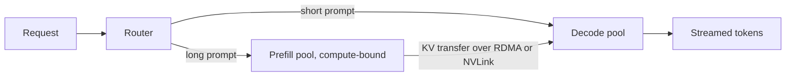

# استراتژی‌های دسته‌بندی (Batching)

دسته‌بندی (Batching) اهرم اصلی برای افزایش توان عملیاتی (Throughput) در LLMها و کاهش هزینه‌ها است. فریم‌ورک‌های سرویس‌دهی از دسته‌بندی ساده در سطح درخواست (request-level) فراتر رفته و به سمت هماهنگ‌سازی در سطح زیر-Token و سطح تکرار (iteration-level)، و در مقیاس‌های بالا به تفکیک فازهای Prefill و Decode روی سخت‌افزارهای مجزا حرکت کرده‌اند.

## فهرست مطالب

- [دسته‌بندی ایستا در برابر پویا](#static-vs-dynamic-batching)
- [دسته‌بندی پیوسته](#continuous-batching-iteration-level)
- [دسته‌بندی حین اجرا (ادغام Prefill و Decode)](#in-flight-batching-prefill-decode-fusion)
- [پیش‌تکمیل تکه‌تکه (Chunked Prefill)](#chunked-prefill)
- [جداسازی Prefill و Decode](#disaggregated-prefill-and-decode)
- [سوالات مصاحبه](#interview-questions)
- [منابع](#references)

---

## دسته‌بندی ایستا در برابر پویا (Static vs. Dynamic Batching)

در یادگیری ماشین سنتی (طبقه‌بندی / Classification)، از **دسته‌بندی ایستا (Static Batching)** استفاده می‌کنیم که در آن تمام درخواست‌ها باید اندازه یکسانی داشته باشند و هم‌زمان شروع و پایان یابند. این روش به دلیل طول متغیر پاسخ‌ها، برای LLMها ناکارآمد است. **دسته‌بندی پویا (Dynamic Batching)** (مشابه آنچه در NVIDIA Triton وجود دارد) تا یک مهلت زمانی (timeout) کوتاه منتظر می‌ماند تا درخواست‌ها را در یک دسته جمع‌آوری کند؛ این رویکرد بهره‌وری (utilization) را بهبود می‌بخشد، اما همچنان کل دسته را به عنوان یک واحد یکپارچه تا زمان تکمیل نهایی اجرا می‌کند.

---

## دسته‌بندی پیوسته (Continuous Batching - سطح تکرار)

دسته‌بندی پیوسته (Continuous Batching که پیشگامان آن Orca و vLLM بودند) به درخواست‌های جدید اجازه می‌دهد به دسته ملحق شوند و به درخواست‌های خاتمه‌یافته اجازه می‌دهد در پایان هر گام مجزای تولید Token از دسته خارج شوند.

| جنبه (Aspect) | دسته‌بندی ایستا (Static Batching) | دسته‌بندی پیوسته (Continuous Batching) |
|---|---|---|
| **پیوستن/خروج (Join/Leave)** | فقط در ابتدا/انتها | در هر تکرار (iteration) |
| **بهره‌وری GPU** | پایین (در انتظار طولانی‌ترین) | بالا (همواره اشباع‌شده) |
| **توان عملیاتی (Throughput)** | 1x | **4x - 10x** |
| **تاخیر (Latency)** | بیشترین مقدار برای کوتاه‌ترین درخواست | متعادل |

**کنترل پذیرش (Admission control) به اندازه دسته‌بندی اهمیت دارد.** یک سیستم Continuous Batching با کمال میل کارها را تا جایی می‌پذیرد که تاخیر صف، معیار TTFT را برای همه نابود کند. موتور vLLM در نسخه v0.29.0 گزینه‌های `--max-num-queued-reqs` و `--max-num-queued-tokens` را اضافه کرد تا موتور بتواند بار اضافی را زودتر رد کند؛ گیت‌وی (gateway) می‌تواند این موضوع را به عنوان سیگنالی برای هدایت درخواست به یک رپلیکای (replica) دیگر در نظر بگیرد، به جای اینکه صفی نامحدود تشکیل شود.

---

## دسته‌بندی حین اجرا (ادغام Prefill و Decode)

پیش از این، موتورهای سرویس‌دهی یا دسته‌ای از "Prefill" (محاسبات سنگین) را پردازش می‌کردند یا دسته‌ای از "Decode" (حافظه سنگین).
**دسته‌بندی حین اجرا (In-Flight Batching)** (در TensorRT-LLM؛ موتورهای vLLM و SGLang همین کار را از طریق Chunked Prefill انجام می‌دهند) امکان ترکیب این دو را فراهم می‌کند:
- ۱ درخواست در فاز Prefill است.
- ۱۵ درخواست در فاز Decode هستند.
- **مزیت**: درخواست فاز Prefill از هسته‌های محاسباتی بیکار GPU استفاده می‌کند، در حالی که درخواست‌های فاز Decode از پهنای باند حافظه بهره می‌برند.

---

## پیش‌تکمیل تکه‌تکه (Chunked Prefill)

دستورهای Prompt با کانتکست عظیم (بیش از ۱ میلیون Token) می‌توانند در طول فاز Prefill یک دسته را برای چندین ثانیه متوقف کنند و باعث بروز "وقفه" (stall) شوند.

**راهکار: پیش‌تکمیل تکه‌تکه (Chunked Prefill)**
موتور به جای prefill کردن هم‌زمان ۱۲۸ هزار Token، عملیات prefill را به تکه‌های کوچک‌تر تقسیم کرده و آن‌ها را با گام‌های Decode در حال اجرای سایر کاربران درهم‌می‌آمیزد (interleaves). این کار باعث حفظ یک **TPOT** پایدار حتی در زمان ورود درخواست‌های سنگین می‌شود. بودجه Token به ازای هر گام (per-step token budget) اهرم تنظیم آن است: موتور vLLM در نسخه v0.28.0 (آگوست ۲۰۲۶) مقدار پیش‌فرض `max_num_batched_tokens` را از ۸,۱۹۲ به ۱۶,۳۸۴ افزایش داد و تاخیر بین Tokenها (inter-token latency) اندکی بیشتر را با توان عملیاتی (Throughput) بهتر در فاز prefill معاوضه کرد. اگر توافق‌نامه سطح خدمت (SLO) شما وابسته به ITL است، این مقدار را کاهش دهید.

---

## جداسازی Prefill و Decode (Disaggregated Prefill and Decode)

روش Chunked prefill یک استخر (pool) از GPUها را بین دو فازی به اشتراک می‌گذارد که دارای گلوگاه‌های متضاد هستند. **سرویس‌دهی تفکیک‌شده (Disaggregated serving)** به هر فاز استخر اختصاصی خودش را می‌دهد که اندازه آن متناسب با نیاز تعیین شده و حتی از سخت‌افزارهای متفاوتی ساخته شده است، و ساختار KV cache را بین آن‌ها جابه‌جا می‌کند.

- **دستاورد اصلی را به عنوان بازده موثر (Goodput) در نظر بگیرید**؛ یعنی نرخ درخواستی که هر دو SLO مربوط به TTFT و ITL را برآورده می‌کند، نه صرفاً اوج توان عملیاتی (Peak Throughput). جهش‌های ناگهانی در فاز Prefill دیگر فاز Decode را دچار وقفه نمی‌کنند و هر استخر به‌طور مستقل مقیاس‌پذیر می‌شود.
- **هزینه انتقال KV را محاسبه کنید.** مدل Llama-3.1-70B در فرمت BF16 به ازای هر Token مقدار ۳۲۰ کیلوبایت (KiB) ذخیره می‌کند؛ بنابراین یک Prompt با ۱۰ هزار Token حدود ۳ گیگابایت داده را به بخش Decode تحویل می‌دهد که با سرعت ۴۰۰ گیگابیت بر ثانیه (Gb/s)، تقریباً ۶۵ میلی‌ثانیه به TTFT اضافه می‌کند. برای Promptهای کوتاه، هزینه این انتقال بیشتر از صرفه‌جویی آن است؛ به همین دلیل NVIDIA Dynamo v1.5 درخواست‌های کوتاه را مستقیماً به Decode ارسال می‌کند (بای‌پس شرطی تفکیک یا conditional disaggregation bypass).
- **زیرساخت‌های ارتباطی اکنون در نسخه اصلی (upstream) ادغام شده‌اند.** موتور vLLM بیش از دوازده رابط اتصال KV (از جمله NIXL، LMCache، Mooncake، FlexKV، AMD MoRI-IO، و همچنین یک MultiConnector زنجیره‌ای) ارائه می‌دهد و فرآیند Tokenization می‌تواند به یک فرانت‌اند اختصاصی CPU منتقل شود تا GPUها فقط ورود و خروج Tokenها را پردازش کنند.
- **این تفکیک فراتر از P/D (Prefill/Decode) می‌رود.** تفکیک انکودر (Encoder disaggregation)، انکودرهای چندوجهی (multimodal) را جدا می‌کند؛ یک پلاگین آزمایشی vLLM (جولای ۲۰۲۶) لایه‌های Attention و لایه‌های FFN/expert را برای مدل‌های MoE به سرویس‌هایی با مقیاس‌بندی مجزا تقسیم می‌کند. تولیدکنندگان سخت‌افزار نسخه‌های بین‌تراشه‌ای (cross-chip) را پیشنهاد می‌دهند: Prefill روی GPU به همراه Decode روی SRAM یا پردازنده‌های در مقیاس ویفر (wafer-scale) (مانند NVIDIA Rubin به‌همراه Groq 3 LPX، یا AMD Helios به‌همراه Cerebras) که در [زیرساخت سرویس‌دهی](06-serving-infrastructure.md) پوشش داده شده است.

---

## سوالات مصاحبه

### پرسش: چرا Continuous Batching برای LLMها نسبت به Static Batching برتری دارد؟

**پاسخ قوی:**
روش دسته‌بندی ایستا (Static batching) تمام درخواست‌های یک دسته را مجبور می‌کند تا زمان تکمیل طولانی‌ترین پاسخ منتظر بمانند (مشکل "طولانی‌ترین دنباله" یا longest tail). اگر کاربری ۵۰۰ عدد Token و کاربر دیگری ۵ عدد Token بخواهد، GPU برای آن کاربرِ ۵-Token به مدت ۴۹۵ چرخه بیکار می‌ماند. دسته‌بندی پیوسته (Continuous batching) به درخواست کاربر با ۵ Token اجازه می‌دهد بلافاصله پس از آخرین Token خود از GPU خارج شود و حافظه VRAM و ظرفیت‌های محاسباتی را برای درخواست جدیدی از صف آزاد کند. این امر معیار "Token بر ثانیه" (Tokens per Second) را در کل کلاستر سخت‌افزاری به حداکثر می‌رساند.

### پرسش: مفهوم "وقفه" (stall) در سرویس‌دهی LLM چیست و Chunked Prefill چگونه آن را کاهش می‌دهد؟

**پاسخ قوی:**
یک "وقفه" (stall) زمانی رخ می‌دهد که درخواست بسیار بزرگی وارد شود و فاز Prefill آن (که به محاسبات سنگینی نیاز دارد) بین ۲ تا ۳ ثانیه طول بکشد. در این مدت، GPU آن‌چنان درگیر فاز prefill است که نمی‌تواند برای کاربران فعلی در فاز "Decode" عمل تولید Token را انجام دهد، که این امر باعث جهش ناگهانی در شاخص TPOT آن‌ها می‌شود. روش Chunked Prefill آن پیش‌تکمیل ۳ ثانیه‌ای را به "تکه‌های" (chunks) کوچک ۲۰۰ میلی‌ثانیه‌ای تقسیم می‌کند؛ یک تکه را پردازش کرده و سپس یک دور decode برای بقیه کاربران انجام می‌دهد و پس از آن به تکه بعدی prefill بازمی‌گردد. این رویکرد تجربه‌ای یکنواخت و روان را برای تمام کاربران تضمین می‌کند.

### پرسش: در چه شرایطی جداسازی prefill/decode بر chunked prefill روی یک استخر واحد برتری پیدا می‌کند؟

**پاسخ قوی:**
زمانی که Promptها طولانی هستند و SLO هم از نظر TTFT و هم از نظر تاخیر بین Tokenها (inter-token latency) بسیار سخت‌گیرانه است. در روش Chunked prefill، گام‌های decode همچنان محاسبات را با تکه‌های prefill به اشتراک می‌گذارند، بنابراین در شرایط هجوم ناگهانی Promptهای طولانی، شاخص ITL دچار نوسان (jitter) می‌شود؛ تفکیک‌سازی (disaggregation) این تداخل را حذف کرده و امکان مقیاس‌بندی مجزای ظرفیت prefill و decode را فراهم می‌سازد که موجب افزایش بازده موثر (Goodput) می‌شود. هزینه این رویکرد، انتقال KV است: با حجم تقریبی ۳۲۰ کیلوبایت (KiB) به ازای هر Token برای یک مدل متراکم (dense) ۷۰ میلیاردی در فرمت BF16، یک Prompt با ۱۰ هزار Token حدود ۳ گیگابایت داده جابه‌جا می‌کند که با سرعت ۴۰۰ گیگابیت بر ثانیه، حدود ۶۵ میلی‌ثانیه زمان می‌برد؛ بنابراین به اتصالات داخلی (interconnect) پرسرعت نیاز دارم و باید برای Promptهای کوتاه از تفکیک‌سازی صرف‌نظر کنم (بای‌پس کنم). همچنین این معماری پیچیدگی عملیاتی را افزایش می‌دهد (دو استخر مجزا، مسیریاب آگاه از KV، و خطاهای احتمالی کانکتورها). برای چت‌های با Prompt کوتاه در مقیاس متوسط، یک استخر منفرد مجهز به chunked prefill و prefix caching ساده‌تر است و معمولاً کفایت می‌کند؛ اما برای ترافیک‌های مبتنی بر Agent با کانتکست طولانی در مقیاس وسیع، تفکیک‌سازی معمولاً از نظر Goodput برنده است، و مدل‌هایی با KV فشرده (توجه نهفته یا تنک / latent or sparse attention) هزینه انتقال را کاهش می‌دهند.

---

## منابع
- Yu et al. "Orca: A Distributed Serving System for Transformer-Based Generative Models" (2022)
- NVIDIA. "TensorRT-LLM: In-Flight Batching" (2023)
- vLLM Project. "Iteration-Level Scheduling" (2023)
- Zhong et al. "DistServe: Disaggregating Prefill and Decoding for Goodput-optimized Large Language Model Serving" (2024)
- وبلاگ vLLM. ["راهنمای سرویس‌دهی تفکیک‌شده"](https://vllm.ai/blog/2026-09-29-disaggregated-serving-guide) (2026)

---

*مبحث بعدی: [PagedAttention](05-paged-attention.md)*

