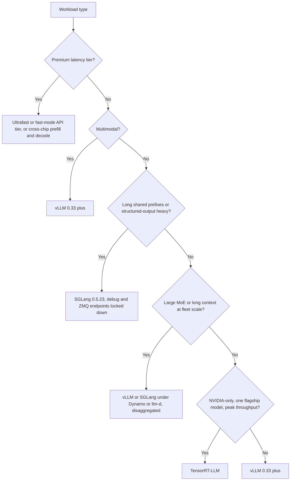

# زیرساخت سرویس‌دهی (Serving Infrastructure)

استقرار (Deployment) LLMها در مقیاس بالا نیازمند لایه‌ای از زیرساخت است که توازن بار (Load Balancing)، موازی‌سازی مدل (Model Parallelism) و جداسازی چندمستأجری (multi-tenant isolation) را مدیریت کند. تمرکز از «سرویس‌دهی یک مدل» به «ارکستراسیون یک ناوگان استنتاج (Inference fleet)» تغییر یافته است: مسیریابی آگاه از KV (KV-aware routing)، استخرهای مجزای prefill و decode، و در سطوح پیشرفته (premium tier)، تراشه‌های متفاوت برای فازهای مختلف.

## فهرست مطالب

- [گیت‌وی استنتاج (The Inference Gateway)](#the-inference-gateway)
- [موازی‌سازی مدل (تانسوری، خط لوله‌ای، متخصص، کانتکست)](#model-parallelism)
- [ارکستراسیون چند GPU (Multi-GPU Orchestration)](#multi-gpu-orchestration)
- [استریمینگ و اتصالات با طول عمر بالا (Streaming and Long-Lived Connections)](#streaming-and-long-lived-connections)
- [موتورهای استنتاج (نوامبر ۲۰۲۶)](#inference-engines-november-2026)
- [سوالات مصاحبه](#interview-questions)
- [منابع](#references)

---

## گیت‌وی استنتاج (The Inference Gateway)

گیت‌وی، «کنترل‌کننده ترافیک» (Traffic Controller) برای بار کاری هوش مصنوعی شما است.

| مولفه (Component) | مسئولیت |
|-----------|---------------------------|
| **احراز هویت و محدودسازی نرخ (Auth & Rate Limiting)** | سهمیه‌بندی‌های مبتنی بر Token و جداسازی مستأجران (tenant isolation / multi-tenant). |
| **مسیریاب مدل (Model Router)** | هدایت درخواست‌ها به نسخه‌های خاصی از مدل (Canary/A-B). |
| **مسیریاب آگاه از KV (KV-Aware Router)** | ارسال درخواست به رپلیکایی (replica) که پیش‌وند آن را از قبل در کش نگه داشته است، وزن‌دهی‌شده بر اساس بار کاری و تاخیر (Latency) پیش‌بینی‌شده. این سازوکار جایگزین نشست‌های ماندگار ساده (sticky sessions) شده است: اکستنشن استنتاج Gateway API کوبرنتیز (GAIE) به همراه llm-d Endpoint Picker، یا مسیریاب NVIDIA Dynamo. گوگل برای GKE Inference Gateway چندخوشه‌ای، اورهد مسیریابی زیر ۱٪ گزارش کرده است. |
| **پذیرش و بازگشت از خرابی (Admission & Failover)** | رد درخواست‌های فراتر از ظرفیت کانتکست یا ظرفیت سیستم پیش از باز شدن استریم، و بازگردانی (failover) به بک‌اند دیگر در صورتی که هیچ Tokenای به‌موقع نرسد (`streamIdleTimeout` در Envoy AI Gateway نسخه ۱.۱). |
| **فیلتر خروجی (Output Filter)** | پاک‌سازی داده‌های هویتی و شخصی (PII) و بررسی ایمنی بی‌درنگ (Real-time) روی پاسخ‌های استریم‌شده. |

گیت‌وی همچنین تمامی اعتبارنامه‌های ارائه‌دهندگانی را که در اختیار دارید متمرکز می‌کند، که این امر آن را به یک هدف اصلی تبدیل می‌سازد. در سال ۲۰۲۶، تنها LiteLLM با یک آسیب‌پذیری اجرای کد از راه دور بدون نیاز به احراز هویت (Unauthenticated RCE با شناسه CVE-2026-37004 و امتیاز CVSS 9.8)، یک تغییر مسیر احراز هویت‌شده `api_base` که کلیدهای ذخیره‌شده ارائه‌دهنده را برای هاست مهاجم ارسال می‌کرد (CVE-2026-84377)، یک خواندن فایل بدون احراز هویت که کلید اصلی (master key) را در پروکسی‌های با لایسنس Enterprise افشا می‌کرد (GHSA-w4c7-34wj-hqm8 با امتیاز CVSS 10.0)، و در ۲۱ اکتبر با یک نسخه آلوده‌شده 1.107.0 (شامل wheelهای PyPI به همراه ایمیج‌های کانتینر) مواجه شد که با اعتبارنامه‌های سرقت‌شده CI منتشر شده بود. ایمیج‌های آلوده حتی حامل امضای معتبری از کلید cosign قدیمی LiteLLM بودند، بنابراین سبز بودن نتیجه `cosign verify` هیچ چیزی را ثابت نمی‌کرد؛ LiteLLM این کلید را در ۲۳ اکتبر تغییر داد و کاربران را به نسخه 1.108.0 (۴ نوامبر) ارجاع داد. نسخه گیت‌وی را مانند هر سرویس متصل به اینترنت دیگری پین و پچ کنید و پارامترهای مسیریابی را در لیست مجاز (allowlist) قرار دهید نه اینکه مستقیماً از سمت کلاینت‌ها پذیرفته شوند. هنگام فراخوانی APIهای میزبانی‌شده (hosted APIs)، قابلیت بازگشت از خرابی (Failover) باید بین ارائه‌دهندگان مختلف (cross-vendor) انجام شود، زیرا قطعی یک ارائه‌دهنده، API، اپلیکیشن چت و Agent کدنویسی آن را هم‌زمان از کار می‌اندازد: حادثه ۲۹ سپتامبر ۲۰۲۶ شرکت OpenAI برای هر سه مورد حدود ۵ ساعت و ۲۰ دقیقه به طول انجامید، و صفحه وضعیت شرکت Anthropic نیز دست‌کم ۱۲ حادثه بزرگ یا بحرانی را بین ۱۶ آگوست تا ۲۹ سپتامبر ثبت کرد. طراحی گیت‌وی به طور عمیق در [فصل گیت‌وی‌های هوش مصنوعی](../11-infrastructure-and-mlops/03-ai-gateways-and-model-routing.md) پوشش داده شده است.

---

## موازی‌سازی مدل (Model Parallelism)

برای مدل‌هایی که در یک GPU جا نمی‌شوند (به عنوان مثال، Llama 3.1 405B تنها برای وزن‌های BF16 و پیش از هرگونه KV cache به حدود ۸۱۰ گیگابایت حافظه نیاز دارد)، باید آن‌ها را تقسیم کنیم.

### ۱. موازی‌سازی تانسوری (Tensor Parallelism - TP)
لایه‌ها/تانسورهای مجزا را در چندین GPU تقسیم می‌کند.
- **تاخیر (Latency)**: کم (سریع‌ترین).
- **ارتباطات (Communication)**: بالا (نیازمند NVLink).
- **استاندارد**: برای ۹۰٪ سرویس‌دهی پروداکشن در قالب یک نود منفرد (8x GPU) یا یک دامنه‌ی NVLink منفرد (تا ۷۲ عدد GPU روی یک رک NVL72) استفاده می‌شود.

### ۲. موازی‌سازی خط لوله‌ای (Pipeline Parallelism - PP)
لایه‌های مختلف را تقسیم می‌کند (به عنوان مثال، لایه‌های ۱ تا ۴۰ روی GPU 1 و لایه‌های ۴۱ تا ۸۰ روی GPU 2).
- **تاخیر (Latency)**: روی GPUها بالا است (به دلیل اورهد Micro-batching).
- **کارایی (Efficiency)**: بهره‌وری پایین‌تر (Bubble time).
- **استاندارد**: برای مدل‌های عظیمی که چندین نود را در بر می‌گیرند استفاده می‌شود. استثنا بر قاعده حاکم است: سیستم‌های مقیاس ویفر (wafer-scale) پایپ‌لاین را در مرزهای لایه‌ها اجرا می‌کنند، زیرا تنها اکتیویشن‌ها (activations) بین ویفرها رد و بدل می‌شوند؛ شرکت OpenAI نسخه GPT-5.6 Sol Ultrafast را به همین شکل روی چندین سیستم Cerebras CS-3 با سرعت خروجی تا ۷۵۰ Token در ثانیه (output tok/s) به نمایش گذاشت.

### ۳. موازی‌سازی متخصصان (Expert Parallelism - EP)
متخصصان (experts) یک مدل MoE را در بین چندین GPU پخش می‌کند و حالت پنهان (hidden state) هر Token را با یک تبادل all-to-all (که DeepEP کتابخانه کرنل رایج آن است) به GPUهایی که متخصصان منتخب آن را در اختیار دارند هدایت می‌کند. ترکیب EP به همراه مکانیزم توجه موازی داده‌ای (data-parallel attention)، ساختار استاندارد برای مدل‌های MoE از رده DeepSeek، Kimi و Qwen است.

### ۴. موازی‌سازی کانتکست (Context Parallelism - CP)
یک دنباله طولانی را در بین چندین GPU تقسیم می‌کند. موازی‌سازی کانتکست دیکود (Decode context parallelism یا DCP) حافظه KV cache مربوط به کانتکست‌های بسیار طولانی را خرد (shard) می‌کند؛ SGLang آن را روی بک‌اند پیش‌فرض Blackwell MLA خود اجرا می‌کند و حدس و گمانه‌زنی DSpark را تحت سرویس‌دهی تفکیک‌شده (disaggregated serving) همراه با DCP تا ورودی 256K روی 8x B300 تایید و اعتبارسنجی کرده است.

### ۵. تفکیک Attention-FFN (آزمایشی)
مکانیزم توجه (که مالک KV cache است) و لایه‌های FFN یا لایه‌های متخصص (expert layers) را به عنوان سرویس‌هایی با مقیاس‌پذیری مجزا اجرا می‌کند. vLLM یک پلاگین آزمایشی برای MoE روی GPUهای NVIDIA و NPUهای Ascend دارد، و NVIDIA آن را به عنوان یکی از حالت‌های سرویس‌دهی Vera Rubin به همراه Groq 3 LPX فهرست کرده است.

---

## ارکستراسیون چند GPU (Multi-GPU Orchestration)

کوبرنتیز (Kubernetes) بستر پیش‌فرض است، با لایه‌های ویژه LLM روی آن: **KubeRay** برای سرویس‌دهی مبتنی بر Ray، **LeaderWorkerSet** برای رپلیکاهای چندنودی، **llm-d** برای مسیریابی آگاه از KV و مقیاس‌پذیری خودکار (autoscaling) روی Gateway API Inference Extension، و **NVIDIA Dynamo** به عنوان لایه ارکستراسیون بالای vLLM، SGLang و TensorRT-LLM.

- **خوشه‌های ناهمگن (Heterogeneous Clusters)**: ترکیب H100ها برای مدل‌های مرزی و پیشرو (frontier) و L4ها برای مدل‌های کوچک در یک خوشه یکسان. استخرهای ترکیبی از ارائه‌دهندگان مختلف نیز اکنون بنچمارک شده‌اند: نسخه ارائه‌شده سیسکو در MLPerf Inference v6.1، تعداد ۸ عدد H200 به همراه ۸ عدد MI350X را به عنوان یک استخر استنتاج واحد اجرا کرد.
- **مقیاس‌پذیری خودکار (Autoscaling)**: مقیاس‌پذیری بر اساس **میزان استفاده از KV Cache** و عمق صف به جای استفاده از CPU یا حافظه استاندارد. برنامه‌ریز کوبرنتیز در Dynamo همچنین می‌تواند مقیاس‌پذیری را به سقف توان مصرفی کل GPU محدود کند.
- **شروع سرد (Cold Start)**: زمان بارگذاری مدل بر مقیاس‌پذیری افقی (scale-out) غالب است. قابلیت **Fast Start** در vLLM نسخه v0.30.0 (با آرگومان `--load-format ipc_cache`) یک دیمن (daemon) به ازای هر GPU نگه می‌دارد که وزن‌های از قبل کوانتیزه‌شده و خردشده بر اساس موازی‌سازی تانسوری (tensor-parallel-sharded) را حفظ کرده و آن‌ها را از طریق CUDA IPC به یک موتور راه‌اندازی‌مجددشده نگاشت (map) می‌کند. تکنیک استقرار هم‌پوشان چک‌پوینت در SGLang (با آرگومان `--startup-weight-load-mode overlap`) مدل Qwen3-32B را روی یک H100 تا ۲.۳۸ برابر سریع‌تر راه‌اندازی کرد (۳۵.۶ ثانیه در مقایسه با ۸۴.۸ ثانیه).
- **برنامه‌ریزی از طریق شبیه‌سازی (Plan by simulation)**: شبیه‌ساز فقط-CPU در SGLang، زمان‌بند واقعی و کش را با یک مدل تاخیر (latency model) اجرا کرده و TTFT را با دقت حدود ۶٪ (و تا ۱۰٪ روی تریس‌های 32K تا 128K) پیش‌بینی می‌کند؛ ابزار AISimulate در Dynamo (که سابقاً AIConfigurator نام داشت) جستجوی پیکربندی را انجام می‌دهد. قبل از خرید یا اجاره GPUها، شبیه‌سازی را انجام دهید.

---

## استریمینگ و اتصالات با طول عمر بالا (Streaming and Long-Lived Connections)

LLMها تقریباً همیشه از طریق **Server-Sent Events (SSE)** یا **WebSockets** سرویس‌دهی می‌شوند.

**چالش زیرساختی**: متعادل‌کننده‌های بار استاندارد (لایه ۴ یا Layer 4) با اتصالات بلندمدت هوش مصنوعی دچار چالش می‌شوند.
- **راه‌حل**: از **متعادل‌کننده‌های بار لایه ۷ (Layer 7 Load Balancers)** مانند Envoy/Istio استفاده کنید که Token پایان دنباله ("End of Sequence") را درک می‌کنند و می‌توانند ترافیک را *بین* نوبت‌های کاربر (user turns) بازتوزیع کنند، نه صرفاً در سطح اتصال.
- **قبل از اولین Token شکست بخورید، نه پس از آن.** در Envoy AI Gateway نسخه ۱.۱، اگر هیچ Tokenای در بازه زمانی `streamIdleTimeout` نرسد، سیستم می‌تواند به بک‌اند بعدی تغییر مسیر دهد (failover کند)؛ اما هنگامی که Tokenها شروع به استریم شدن کردند، خرابی بک‌اند به جای یک پاسخ تکراری و بی‌صدا، به صورت خطای 504 نمایش داده می‌شود. فرانت‌اند Dynamo نیز به همین ترتیب درخواست‌های فراتر از کانتکست را پیش از باز شدن استریم رد کرده و در شرایط بار بیش از حد (overload) خطای 503 برمی‌گرداند. تلاش‌های مجدد (Retries) پس از اولین Token متعلق به حلقه کلاینت یا Agent است، همراه با فراخوانی‌های ابزاری بی‌اثر در تکرار (idempotent tool calls).

---

## موتورهای استنتاج (Inference) (نوامبر ۲۰۲۶)

انتخاب موتور دیگر مسئله‌ی «کدام یک سریع‌تر است» نیست. هر موتور پیشرو در یک دسته از بارهای کاری برنده شده است، و یک لایه‌ی ارکستراسیون (Dynamo یا llm-d) اکنون در ناوگان‌های بزرگ بالاتر از موتورها قرار می‌گیرد. پاسخ صحیح، رویکرد «یک موتور به ازای هر بار کاری» (engine-per-workload) است که به یک نسخه‌ی پچ‌شده متصل (pinned) شده باشد.

| کامپوننت | وضعیت فعلی (تا ۶ نوامبر ۲۰۲۶) | تغییرات مهم و اثرگذار |
|-----------|----------------------------------|---------------------------|
| **vLLM** | v0.33.0 (۲ نوامبر)؛ چرخه‌ی انتشار حدوداً دو هفته‌ای | تغییرات شکننده (Breaking) در 0.33: wheelها و imageهای فقط سازگار با CUDA 13.0 (بیلدهای CUDA 12.9 حذف شدند؛ انویدیا اعلام کرده است CUDA 13.x نیازمند درایور 580 یا جدیدتر است)، PyTorch 2.14.0، نسخه ROCm 10.0 به عنوان بیلد پیش‌فرض ROCm (نسخه ROCm 7.2 هنوز تحت عنوان `-rocm72` منتشر می‌شود)، خطای HTTP 503 برای درخواست‌های ارسال‌شده در زمان توقف موقت فرآیند تولید (generation)، نیاز به NIXL 1.5+ برای رابط (connector) مربوط به NIXL، حذف مجری نمودار کامپایل‌شده‌ی قدیمی Ray (legacy Ray compiled-graph executor)، و حذف Medusa و تخمین‌گر MLP (MLP speculator). این نسخه همچنین یک اندپوینت `/v1/decisions` سازگار با OpenAI را به طور پیش‌فرض برای مدل‌های تولیدی پشتیبانی‌شده ارائه می‌دهد و یک نگهبان (watchdog) اضافه می‌کند که رد پشته (stack trace) فرایندهای متوقف‌شده را ثبت (dump) می‌کند. تغییرات شکننده در 0.32 (۱۸ اکتبر): تغییر مبداهای پیش‌فرض CORS از `*` به none (کلاینت‌های مرورگر نیازمند `--allowed-origins` هستند)، حداقل پایتون ۳.۱۱، حذف cascade attention، و اینکه `max_tokens` اکنون به عنوان یک سقف برای خروجی عمل می‌کند تا رزروی از پنجره بافت (context window)، بنابراین محاسبات ظرفیت را مجدداً بررسی کنید. همچنین موارد جدید: یک اندپوینت تصمیم‌گیری `POST /v1/systemone` که به صورت پیش‌فرض فعال است. قابلیت Model Runner V2 از نسخه v0.29 به صورت پیش‌فرض؛ قابلیت Fast Start؛ و تخلیه لایه‌ای KV به دیسک (tiered KV offload to disk). |
| **SGLang** | v0.5.23 (۲ نوامبر) | هنوز برای هر دو آسیب‌پذیری حیاتی اکتبر پچ نشده است (به زیر مراجعه کنید). متغیرهای اختیاری `SGLANG_ZMQ_ALLOWED_PEERS` (لیست مجاز IP همتایان؛ در صورت خالی ماندن، تمام همتایان را می‌پذیرد) و `SGLANG_ZMQ_SOURCE_IP` را اضافه می‌کند، و حالت بازگشتی ناامن `weights_only=False` برای pickle را حذف می‌کند، بنابراین چک‌پوینت‌های قدیمی فرمت tar با پسوند .pt دیگر بارگذاری نمی‌شوند. نسخه v0.5.22 (۱۹ اکتبر): الزام به استفاده از پایتون ۳.۱۱؛ لودر InstantTensor (حدود ۱۰ برابر بارگذاری سریع‌تر مدل، طبق گزارش پروژه). نسخه v0.5.21 (۲ اکتبر): امکان تغییر نقش نمونه‌های prefill و decode بدون نیاز به راه‌اندازی مجدد، انتقال پیش‌فرض کش پیشوند به یک هسته Rust، و اضافه شدن اندپوینت‌های `/v1/decisions` و `/v1/score`. |
| **TensorRT-LLM** | v1.2.1 پایدار (۲۰ آوریل)؛ v1.4.0rc2 (۲۸ اکتبر) | بک‌اند PyTorch از نسخه 1.0 (سپتامبر ۲۰۲۵) پیش‌فرض شده است، بنابراین نیازی به بیلد موتور به ازای هر مدل نیست؛ نسخه پایدار v1.3 وجود ندارد، و نسخه‌های کاندیدای انتشار (RCs) شامل حذفیات شکننده‌ای مانند یکپارچه‌سازی با AutoDeploy هستند. بولتن ۲۷ اکتبر انویدیا یک باگ اجرای کد در بارگذاری Tokenizer داخل `KvCacheAwareRouter` و دو باگ SSRF را برطرف کرد که همگی بر 1.3.0rc24 تاثیرگذار بوده و در 1.3.0rc25 برطرف شدند. |
| **NVIDIA Dynamo** | v1.6.1 (۲۷ اکتبر) | نسخه 1.6.0 (۲۲ اکتبر) کنترل جریان اتصال‌پذیر (pluggable flow control) در ورودی روتر، TLS دوطرفه (mutual TLS) در بخش فرانت‌اند، کامپوننت‌های LPX روی کوبرنتیز و failover مبتنی بر اسنپ‌شات موتور را اضافه کرد، و بک‌اند AutoDeploy در TensorRT-LLM را حذف نمود (تغییر شکننده). نسخه 1.6.1 بسته‌های CA و ریشه‌های TLS در Rust را به‌روزرسانی می‌کند (حذف ریشه emSign ECC Root CA - G3، بنابراین اتصال TLS به اندپوینت‌هایی که زنجیره اعتبارسنجی آن‌ها فقط به این ریشه متصل است ناموفق خواهد بود) و imageها را به Pillow 13 منتقل می‌کند. موتورهای باندل‌شده بدون تغییر مانده‌اند: vLLM 0.31.0، SGLang 0.5.21 و TensorRT-LLM 1.3.0rc29، بنابراین vLLM و SGLang پایین‌تر از کف امنیتی مشخص‌شده در [وضعیت عملیاتی](#operational-posture) قرار می‌گیرند. نسخه پیش‌انتشار توسعه 1.7.0 (۲ نوامبر) سرویس‌دهی بومی Mistral Large 4 را با imageهای فقط arm64 اضافه می‌کند. |
| **llm-d / GAIE** | llm-d v1.0.0 (۲۰ اکتبر)؛ GAIE v1.6.2 (۱۷ سپتامبر) | کنترل جریان مبتنی بر اولویت و عدالت با حذف بار اضافی (load shedding) (انتقال پیکربندی به بخش `flowControl`)؛ دسترسی‌پذیری بالا (HA) برای روتر به همراه hot standby؛ رابط برنامه‌نویسی (API) پیکربندی روتر در نسخه v1؛ کامپوننت `DisaggregatedSet` نسخه‌های کپی (replicas) مرحله prefill و decode را به عنوان یک واحد یکپارچه مدیریت می‌کند و به LeaderWorkerSet v0.11.1 یا جدیدتر نیاز دارد (یادداشت‌های انتشار هشدار می‌دهند که تقریباً همه راهنماها بدون آن دچار شکست می‌شوند). |

### موتور vLLM: موتور متن‌باز پیش‌فرض

موتور [vLLM](https://docs.vllm.ai/) همچنان موتور متن‌باز پیش‌فرض در شرایطی است که بار کاری «Llama / Mistral / Qwen / DeepSeek تحت Continuous Batching» باشد: بیشترین پوشش مدل، ساده‌ترین عملیات اجرایی، و سریع‌ترین ارائه‌ی پچ‌های امنیتی در همان هفته. این موتور همچنین بزرگ‌ترین سطح حمله (attack surface) را دارد. بین ۱۱ آگوست تا ۲۸ سپتامبر ۲۰۲۶، بیش از ۲۰ توصیه‌نامه امنیتی (advisories) منتشر کرد، اکتبر موج بزرگ دیگری را به همراه داشت، و یکی دیگر نیز در ۲ نوامبر ارائه شد. مواردی که حاوی نکاتی آموزنده هستند عبارتند از:

- **CVE-2026-90553** (شدت بالا، برطرف‌شده در 0.28.0): یک لودر پردازشگر مدل، کد ریپازیتوری مخرب را حتی در صورت تنظیم `trust_remote_code=False` اجرا می‌کرد.
- **CVE-2026-93592** (شدت بالا، برطرف‌شده در 0.28.0): یک درخواست احراز هویت‌نشده با Token ID منفی به اندپوینت `/v1/embeddings` یا `/pooling`، محیط (context) پلتفرم CUDA را مسموم کرده و موتور را برای تمام کلاینت‌ها تا زمان راه‌اندازی مجدد متوقف می‌کرد.
- **GHSA-935w-9g4m-p28p** (شدت پایین، برطرف‌شده در 0.30.0): یک مسیر کد، متغیر `cache_salt` اختصاصی هر tenant (multi-tenant) را حذف می‌کرد و اوراکل زمان‌بندی (timing oracle) کش پیشوند بین-tenant (multi-tenant) را مجدداً ایجاد می‌نمود.
- **GHSA-4xqp-c3mv-qff7** (شدت متوسط، برطرف‌شده در 0.31.0): یک درخواست به اندپوینت `/inference/v1/generate` با مقدار `max_tokens` خالی (null) و `min_tokens` بیش از حد بزرگ، ترد ورودی (input thread) موتور را متوقف می‌کرد. فرایند همچنان فعال باقی می‌ماند و اندپوینت `/health` به بازگرداندن کد وضعیت 200 ادامه می‌داد، در حالی که تمام درخواست‌های تولید (generation) معلق می‌شدند و هیچ عاملی برای راه‌اندازی مجدد آن وجود نداشت.
- **CVE-2026-115915** (شدت بالا، CVSS 8.1، برطرف‌شده در 0.32.0): لودر تصویر به Pillow اجازه می‌داد دیکودر را از طریق بررسی بایت‌ها (sniffing bytes) و نادیده گرفتن نوع MIME اعلام‌شده انتخاب کند، بنابراین یک فایل EPS که با برچسب PNG ارسال شده بود به پلاگین EPS در Pillow و Ghostscript می‌رسید. در هاستی با بیلد آسیب‌پذیر Ghostscript، این امر منجر به اجرای دستور (command execution) می‌شد. **CVE-2026-115912** نیز در کش پردازشگر حافظه اشتراکی چندوجهی (multimodal shared-memory processor cache) در نسخه 0.32.0 برطرف شده است.
- **GHSA-qrj2-j723-m6w8** (شدت متوسط، CVSS 5.4، بدون CVE، برطرف‌شده در 0.33.0): پارامتر `verifier.name_or_path` در `speculators_config` مربوط به یک ریپازیتوری دست‌کاری‌شده می‌توانست vLLM را به هر دایرکتوری محلی هدایت کند (مسیرهای مطلق عمل می‌کنند، بدون نیاز به `trust_remote_code`)، بنابراین یک کلاینت احراز هویت‌نشده می‌توانست واژگان Tokenizer (tokenizer vocabulary) آن دایرکتوری را از طریق `/detokenize` بخواند یا یک چک‌پوینت خصوصی را استعلام کند. این مشکل تنها زمانی دردسرساز می‌شود که شما به ریپازیتوری‌هایی که تحت کنترل شما نیستند سرویس دهید؛ که این دقیقاً کاری است که یک پلتفرم اشتراکی Fine-tuning یا هاستینگ مدل انجام می‌دهد.

در اوایل سال، آسیب‌پذیری RCE چندوجهی ماه فوریه (CVE-2026-22778، پردازش ویدیو) در نسخه v0.14.1 برطرف شد. **خط مبنا (Baseline): نسخه vLLM 0.32.0 یا بالاتر، و 0.33.0 روی هر هاستی که ریپازیتوری‌های شخص ثالث را بارگذاری می‌کند**؛ ابتدا تنظیمات پیش‌فرض شکننده را مطالعه کنید، زیرا نسخه 0.33.0 همچنین نیازمند ارتقای درایور هاست (CUDA 13 و درایور 580+) در ناوگان‌های قدیمی‌تر است و مسیر جدیدی را به صورت پیش‌فرض فعال (`/v1/decisions`) اضافه می‌کند که باید در گیت‌وی (gateway) مجاز یا مسدود شود. این درس‌ها قابل تعمیم هستند: موتور GPU یک دامنه با سرنوشت مشترک (shared-fate domain) است، بنابراین ورودی‌ها را پیش از رسیدن به دستگاه اعتبارسنجی کنید، فرمت‌های رسانه را در لیست مجاز قرار دهید به جای آنکه به تشخیص خودکار دیکودر اعتماد کنید، کش پیشوند را در هر مسیر saltگذاری کنید، مدل‌ها را فقط از ریپازیتوری‌های مورد اعتماد بارگذاری نمایید، و بررسی سلامت (health-check) را از طریق تست تولید انجام دهید، زیرا یک اندپوینت ارزیابی حیات (liveness endpoint) ممکن است وضعیت سبز (سالم) نشان دهد در حالی که موتور به هیچ درخواستی پاسخ نمی‌دهد.

### موتور SGLang: بارهای کاری با پیشوند سنگین و ساختاریافته

موتور [SGLang](https://github.com/sgl-project/sglang) در بارهای کاری با استفاده‌ی مجدد سنگین از پیشوند و خروجی ساختاریافته پیشتاز است: کش کردن پیشوند با **RadixAttention**، رمزگشایی مقید (constrained decoding) هم‌پوشان با forward pass، و سرویس‌دهی درجه یک MoE (نسخه DeepEP v2، مدل W4A8 MXFP4 MoE روی Hopper، و موازی‌سازی بافت در decode روی Blackwell). درخت radix در نسخه v0.5.20 این فریم‌ورک وضعیت پنجره کشویی (sliding-window) را در نقاط انشعاب پیشوند کش می‌کند که باعث افزایش نرخ اصابت (hit rate) مربوط به Tokenها از ۴۳.۸٪ به ۶۰.۸٪ و کاهش میانگین TTFT از ۱.۵۷ ثانیه به ۱.۰۷ ثانیه روی DeepSeek-V4-Flash با یک Prompt سیستمی مشترک می‌شود.

**وضعیت امنیتی**: آسیب‌پذیری‌های بحرانی RCE ماه مارس ۲۰۲۶ در بروکر ZMQ چندوجهی و تفکیک (disaggregation) موازی انکودر (CVE-2026-3059 و CVE-2026-3060) در نسخه v0.5.10 برطرف شدند. دسته‌ای از آسیب‌پذیری‌ها در ماه مه (CVE-2026-7301، 7302 و 7304، با شدت بحرانی: سوکت زمان‌بند متصل‌شده به تمام اینترفیس‌ها همراه با `pickle.loads`، پیمایش مسیر (path traversal)، و `dill.loads` از طریق پردازشگرهای سفارشی logit) نسخه‌های تحت تاثیر را تا 0.5.12 بدون هیچ نسخه پچ‌شده‌ی ثبت‌شده‌ای فهرست می‌کنند. ماه اکتبر دو آسیب‌پذیری بحرانی دیگر را اضافه کرد که برای آن‌ها نیز هیچ نسخه پچ‌شده‌ای ثبت نشده است:

- **CVE-2026-111391** (با امتیاز CVSS v4 9.2): تزریق `eval()` از طریق اندپوینت اشکال‌زدایی احراز هویت‌نشده‌ی `/dumper/configure`، که در صورت تنظیم `DUMPER_SERVER_PORT` در دسترس قرار می‌گیرد. توضیحات شامل نسخه‌های 0.5.10 تا 0.5.22 است و نسخه v0.5.23 (۲ نوامبر) آن را برطرف نکرده است: فایل `dumper.py` از نظر بایت دقیقاً مشابه 0.5.22 است و همچنان رشته‌های فیلتر را به `eval()` ارسال می‌کند، و پول‌ریکوئست پچ #45998 تا ۶ نوامبر همچنان ادغام نشده بود.
- **CVE-2026-93034** (با امتیاز CVSS 9.8): تابع `pickle.loads` در دیکودر پیام ZMQ، که در صورت اجرای توجه داده‌-موازی (data-parallel attention) با یک `--dist-init-addr` غیر loopback از راه دور قابل دسترسی است. تنظیم `SGLANG_USE_PICKLE_IPC=false` آن را مسدود نمی‌کند، و نسخه 0.5.23 همچنان `pickle.loads` را در دیکودر فراخوانی می‌کند؛ لیست مجاز جدید `SGLANG_ZMQ_ALLOWED_PEERS` در آن، صرفاً یک اقدام کاهشی (mitigation) است که باید تنظیم کنید، نه یک راهکار قطعی (fix).

بنابراین هیچ نسخه منتشرشده‌ای بی‌نقص و امن نیست و راهکار دفاعی، پیکربندی است نه ارتقای نسخه. هنگامی که یک توصیه‌نامه هیچ نسخه پچ‌شده‌ای را ذکر نمی‌کند، به جای اعتماد به افزایش شماره نسخه، خود کد را بخوانید. از نسخه 0.5.23 استفاده کنید، متغیر `SGLANG_ZMQ_ALLOWED_PEERS` را روی هر نود توجه DP چندنودی تنظیم کنید، چک‌پوینت‌های قدیمی فرمت tar با پسوند .pt را قبل از ارتقا تبدیل کنید، `DUMPER_SERVER_PORT` را بدون مقدار رها کنید، مقدار `--dist-init-addr` و هر سوکت داخلی ZMQ یا RPC را روی loopback یا یک شبکه اختصاصی پاد (pod-private network) که توسط network policy اعمال می‌شود نگه دارید، و پردازنده‌های سفارشی logit را برای فراخوانندگان غیرقابل اعتماد فعال نکنید. با چنین رویکردی، SGLang برای ترافیک چندوجهی (multimodal) نیز مناسب است؛ قاعده‌ی قدیمی «چندوجهی را از SGLang دور نگه دارید» بر پایه‌ی آسیب‌پذیری‌های CVE بود که از آن زمان تاکنون برطرف شده‌اند.

### موتور TensorRT-LLM: اوج توان عملیاتی (Throughput) انویدیا

موتور [TensorRT-LLM](https://github.com/NVIDIA/TensorRT-LLM) همچنان پیشتاز توان عملیاتی (Throughput) روی سخت‌افزارهای خالص انویدیا برای مدل‌های تنظیم‌شده‌ی دستی (hand-tuned) است؛ به طوری که کرنل‌های سفارشی FP4/FP8 آن روی Blackwell اغلب جلوتر از موتورهای متن‌باز بوده و یکپارچگی تنگاتنگی با Triton و NIM دارد. ایراد عملیاتی قدیمی مبنی بر نیاز به بیلد چندساعته‌ی موتور برای هر مدل، دیگر مطرح نیست: از نسخه 1.0 بک‌اند PyTorch به عنوان پیش‌فرض در نظر گرفته شده و مدل‌ها مانند هر موتور دیگری بارگذاری می‌شوند. هزینه‌های باقی‌مانده شامل **وابستگی به انویدیا (NVIDIA lock-in)** و **چرخه‌ی انتشار متکی بر نسخه‌های کاندیدا (RC-heavy release cadence)** است (شاخه پایدار همچنان v1.2.1 متعلق به آوریل است؛ v1.3 ماه‌ها در وضعیت کاندیدای انتشار ماند بدون آنکه نسخه پایداری منتشر شود، پیش از آنکه نسخه‌های کاندیدا در اکتبر به نسخه 1.4 منتقل شوند، و این نسخه‌های RC شامل حذفیات شکننده هستند). اگر به انویدیا متعهد هستید و یک یا دو مدل پرچمدار دارید که به تک تک Tokenها در ثانیه نیاز دارند، این ابزار به صرفه است؛ در غیر این صورت vLLM یا SGLang انتخاب انعطاف‌پذیرتری خواهند بود.

### ارکستراسیون بالاتر از سطح موتور: Dynamo و llm-d

در مقیاس ناوگان (fleet scale)، تصمیماتی که هزینه را تغییر می‌دهند (کدام replica درخواست را دریافت کند، چه زمانی تفکیک انجام شود، چگونه مقیاس‌پذیری صورت گیرد) بالاتر از سطح موتور اتخاذ می‌شوند. پلتفرم **NVIDIA Dynamo** مسیریابی را بر اساس هم‌پوشانی کش KV (KV-cache overlap) به همراه سیاست‌های امتیازدهی (scorer) و انتخاب (picker) اتصال‌پذیر و وابستگی نشست (session affinity) سخت یا نرم انجام می‌دهد، رویدادهای کش را از HiCache در SGLang و سطوح دیسک vLLM نمایه‌سازی می‌کند، درخواست‌های کوتاه را مستقیماً به مرحله decode می‌فرستد، و از پروتکل‌های TLS/mTLS در بستر انتقال پشتیبانی می‌کند؛ نسخه v1.6.0 (۲۲ اکتبر) ورودی درخواست‌ها را برای پلاگین‌های کنترل جریان باز کرد و TLS دوطرفه را در فرانت‌اند HTTP اضافه نمود، و نسخه v1.6.1 (۲۷ اکتبر) نسخه پایدار فعلی است. فریم‌ورک **llm-d** همین نقش را در دنیای Kubernetes Gateway API ایفا می‌کند و در ۲۰ اکتبر با پشتیبانی از حذف بار اضافی (load shedding)، دسترسی‌پذیری بالا (HA) برای روتر، و رابط برنامه‌نویسی (API) با کامپوننت `DisaggregatedSet` به نسخه v1.0.0 رسید. هر دو به سرعت در حال توسعه هستند؛ نسخه‌ها را قفل (pin) کنید و موارد منسوخ‌شده (deprecations) را مطالعه نمایید (مانند KVBM در Dynamo و APIهای آلفای حذف‌شده در GAIE). همچنین بررسی کنید که image ارکستراسیون چه مواردی را باندل کرده است: Dynamo 1.6.1 همچنان به همراه vLLM 0.31.0 و SGLang 0.5.21 عرضه می‌شود، بنابراین انتشار نسخه‌ی جدید Dynamo به معنای پچ بودن موتور نیست.

یک نکته احتیاطی در مورد دقت (precision) از همین اکوسیستم: دستورالعمل به‌روزرسانی‌شده‌ی Nemotron 3.5 Lightning در Dynamo نشان داد که فرمت BF16 با کرنل‌های Marlin حدود ۸۰٪ سریع‌تر از NVFP4 و با CuTeDSL حدود ۱۲٪ سریع‌تر عمل می‌کند. دقت را به ازای هر مدل و بک‌اند کرنل بنچمارک کنید؛ به [بررسی عمیق کوانتیزاسیون (Quantization Deep Dive)](../03-training-and-adaptation/07-quantization-deep-dive.md) مراجعه کنید.

### سرویس‌دهی آگاه از MoE (Llama 4 Maverick، DeepSeek V4، Kimi K3)

مدل‌های MoE این فرضیه را که هزینه سرویس‌دهی به‌طور روان با اندازه دسته (batch size) مقیاس‌پذیر است، رد کردند. ویژگی‌هایی که برای یک موتور سرویس‌دهی MoE اهمیت دارند:

- **محل استقرار وزن‌های خبره (Expert weight residency)**: یک مدل MoE با ۴۰۰ میلیارد پارامتر (400B-parameter) و ۱۷ میلیارد پارامتر فعال به ازای هر Token (مانند Llama 4 Maverick)، بخش عمده حافظه VRAM خود را صرف خبره‌هایی (experts) می‌کند که یک Token خاص از آن‌ها استفاده نمی‌کند. موتور باید از مسیریابی خبره به Token آگاه باشد و خبره‌ها را یا از طریق موازی‌سازی خبره‌ها (expert parallelism) توزیع کند، خبره‌های پرکاربرد (hot) را در حافظه سنجاق (pin) نماید، یا خبره‌های کم‌کاربرد (cold) را استریم کند.
- **تاخیر (Latency) مسیریابی خبره**: تصمیم‌گیری روتر (مسیریاب) **به ازای هر Token** اتفاق می‌افتد و هزینه قابل‌اندازه‌گیری به بار می‌آورد. موتورها اکنون تصمیمات مسیریابی را در راستای بُعد دسته (batch dimension) دسته‌بندی (batch) می‌کنند.
- **پروفایل دسته‌بندی غیریکنواخت (Non-monotonic batching profile)**: افزودن درخواست‌ها به دسته در صورتی که منجر به فعال شدن مجموعه‌ای از خبره‌های کم‌کاربردتر (colder) شود، می‌تواند توان عملیاتی (Throughput) را *کاهش* دهد. اندازه بهینه دسته (batch size) به **توزیع الگوهای مسیریابی** در درون دسته بستگی دارد، نه صرفاً تعداد درخواست‌های دسته.
- **پارامترهای چندسطحی و مختص به فاز (Phase-specific and tiered parameters)**: مدل DeepSeek V4.1-Flash در فاز prefill حدود ۸ میلیارد پارامتر به ازای هر Token و در فاز decode حدود ۱۶ میلیارد پارامتر را فعال می‌کند، و Qwen3.8-Flash-Next یک حافظه N-gram با ۵۱ میلیارد پارامتر اضافه می‌کند که قرار است در حافظه DRAM میزبان (host DRAM) قرار گیرد. استخرهای prefill، استخرهای decode و حافظه میزبان را به‌صورت جداگانه اندازه‌گذاری (سایزبندی) کنید.
- **دقت به ازای هر مؤلفه (Precision per component)**: مدل DeepSeek-V4 وزن‌های خبره را با دقت FP4 و اکثر پارامترهای دیگر را با FP8 ارائه می‌دهد، بنابراین پشتیبانی کرنل از MoE با دقت ترکیبی (mixed-precision)، تعیین‌کننده توان عملیاتی (Throughput) واقعی است.

| موتور | مسیر MoE، اکتبر ۲۰۲۶ |
|--------|------------------------|
| vLLM 0.30+ | موازی‌سازی خبره‌ها (Expert parallelism)؛ گمانه‌زنی پیش‌فرض DSpark/MTP همراه با اعتبارسنجی تطبیقی (adaptive verification)؛ لایه KV مقیم میزبان با HiSparse برای دیکود sparse-MLA؛ پلاگین آزمایشی attention-FFN |
| SGLang 0.5.20+ | نگارش دوم DeepEP (DeepEP v2)؛ مدل W4A8 MXFP4 MoE روی Hopper (افزایش ۱۲+ درصدی توان عملیاتی (Throughput) خروجی DeepSeek-V4-Flash)؛ فناوری DCP روی Blackwell MLA؛ الگوریتم DSpark تحت سرویس‌دهی تفکیک‌شده (disaggregated serving) |
| TensorRT-LLM 1.3 and 1.4 RCs | معماری FP4 MLA و پیش‌نویس‌کننده DSpark مبتنی بر MLA؛ فقط در نسخه‌های کاندید انتشار (release-candidate) |

بینش مناسب مصاحبه: **سرویس‌دهی MoE دیگر به معنای «vLLM با وزن‌های بزرگ‌تر» نیست.** این یک مسئله کاملاً متفاوت در زمان‌بندی (scheduling) و جانمایی حافظه (memory-placement) است و همه موتورها مسیرهای اختصاصی برای MoE ایجاد کرده‌اند.

### سطوح تاخیر (Latency) پریمیوم: تفکیک بین‌تراشه‌ای (Cross-Chip Disaggregation)

راهکار میانبر قدیمی این بود: «برای دستیابی به TTFT زیر ۵۰ میلی‌ثانیه در یک مدل بزرگ، از Cerebras یا Groq استفاده کنید.» الگوی سال ۲۰۲۶ عبارت است از **prefill و decode ناهمگن (heterogeneous)**: GPUهای متراکم از نظر محاسباتی و دارای HBM برای prefill، و قطعات مبتنی بر SRAM یا در مقیاس ویفر (wafer-scale) برای decode با محدودیت پهنای باند (bandwidth-bound).

| ترکیب (Pairing) | وضعیت | یادداشت‌ها |
|---------|--------|-------|
| NVIDIA Vera Rubin NVL72 به همراه Groq 3 LPX | تولید کامل LPX از ۲۴ اوت ۲۰۲۶؛ Nebius اولین ارائه‌دهنده ابری | ۲۵۶ پردازنده LPU و ۱۲۸ گیگابایت حافظه SRAM در هر رک. حالت‌ها: P/D (پردازش prefill با Rubin، پردازش decode با LPX)، تقسیم attention-FFN، یا LPX به‌عنوان پیش‌نویس‌کننده گمانه‌زنی (speculative drafter). وب‌سایت The Register تخمین می‌زند که به‌دلیل ظرفیت SRAM، یک رک LPX در ورودی‌های با ۱۰۰ هزار Token در حدود دسته ۱۲ (batch 12) به سقف ظرفیت خود می‌رسد |
| AMD Helios به همراه Cerebras WSE | اعلام‌شده؛ اولین بار از طریق Cerebras Cloud در نیمه دوم ۲۰۲۶ | پردازنده Helios برای پردازش Prompt و زمینه‌های طولانی (large-context)، و Cerebras برای decode؛ تا ۵ برابر Token بر ثانیه به ازای هر وات در مقایسه با Cerebras به‌تنهایی (مدل‌سازی AMD/Cerebras) |
| GPUها به همراه SambaNova RDUs (SambaNova و Intel) | طرح اولیه (Blueprint) (۸ آوریل ۲۰۲۶) | GPUها برای prefill، پردازنده‌های SambaNova RDU برای decode، و CPUهای Intel Xeon 6 برای اجرای ابزارهای مبتنی بر Agent |

دو واقعیت تجاری در پس این جدول وجود دارد: قرارداد دسامبر ۲۰۲۵ شرکت NVIDIA با Groq یک مجوز غیرانحصاری فناوری به‌همراه جذب نیرو است (شرایط مالی فاش نشده است، اما حدود ۱۷ تا ۲۰ میلیارد دلار (\$17-20B) گزارش شده است)، و GroqCloud همچنان به‌عنوان یک شریک ابری مستقل NVIDIA (NVIDIA Cloud Partner) به استقرار LPX و Rubin ادامه می‌دهد. شرکت SambaNova خریداری نشد؛ این شرکت در ۸ ژوئیه از یک دوره اولیه جذب سرمایه ۱ میلیارد دلاری (\$1B) با ارزش‌گذاری ۱۱ میلیارد دلاری (\$11B) خبر داد.

سرعت همچنین به‌عنوان یک سطح API (API tier) فروخته می‌شود: سطح Ultrafast شرکت OpenAI هزینه‌ای معادل ۶ برابر نسخه استاندارد دارد، در ۲۹ سپتامبر ۲۰۲۶ روی GPT-6 Astra به مرحله دسترسی عمومی (GA) رسید و در ۸ اکتبر برای همه کاربران API روی GPT-6.1 Sol فعال شد (\$12/\$60 به ازای هر ۱ میلیون Token). حالت سریع (fast mode) شرکت Anthropic برای Opus 5.5 (\$8/\$40، ۲ برابر استاندارد) در ۱۵ اکتبر از مرحله پیش‌نمایش پژوهشی (research preview) خارج شد و همچنین در استقرارهای (Deployments) میزبانی‌شده در Azure شرکت Foundry و در Claude Models در Google Cloud (مدیریت‌شده توسط Anthropic) ارائه می‌شود. سقف‌های کوچک اندازه دسته (batch) که در بالا ذکر شد، دلیل قیمت بالاتر (پریمیوم) این سطوح هستند. هزینه پنهان در هر معماری بین‌تراشه‌ای اختصاصی، جابجایی KV بین استخرها است؛ این هزینه را باید به ازای هر درخواست در نظر بگیرید.

### فریم‌ورک تصمیم‌گیری: انتخاب موتور بر اساس بار کاری (Workload)

یک نگاشت صریح‌تر برای بارهای کاری که تیم‌ها در عمل مستقر (Deploy) می‌کنند:

| بار کاری (Workload) | انتخاب موتور (نوامبر ۲۰۲۶) | دلیل |
|----------|---------------------------|-----|
| چت‌بات عمومی (ترافیک ترکیبی، نیاز به پچ شدن سریع) | **vLLM 0.33+** | ساده‌ترین مدیریت عملیاتی، بهترین آهنگ انتشار وصله‌های امنیتی |
| بک‌اند فراخوانی تابع JSON (JSON function-calling)، حلقه‌های Agent با پیشوندهای مشترک طولانی | **SGLang 0.5.23** (نسخه ثابت/pinned، خاموش بودن dumper، تنظیم لیست مجاز همتایان ZMQ، سوکت‌های داخلی درون‌پاد) | استفاده مجدد از پیشوند با RadixAttention و دیکود مقید هم‌پوشان (overlapped constrained decoding) |
| تک‌مدل حساس به تاخیر (Latency) (یک مدل، یک تیم) | **TensorRT-LLM** روی B300 یا Rubin | حداکثر توان عملیاتی (Throughput) در NVIDIA، بدون دردسرهای قدیمی ساخت موتور (engine-build tax) |
| چندوجهی (ورودی تصویر، صوت، ویدیو) | **vLLM 0.33+** | گسترده‌ترین پوشش مدل‌های چندوجهی؛ SGLang در یک نسخه پین‌شده و تاییدشده قابل‌استفاده است |
| مدل استدلال (CoT طولانی، همزمانی پایین) | **vLLM** یا **SGLang** به همراه پیش‌نویس‌کننده (drafter) مبتنی بر MTP یا DSpark ارائه‌دهنده مدل | محدود به دیکود (Decode-bound)؛ دیکود گمانه‌زنی با اعتبارسنجی تطبیقی، اهرم اصلی است |
| مدل MoE در مقیاس ناوگان (DeepSeek V4، Kimi K3، Llama 4 Maverick) | **vLLM** یا **SGLang** تحت **Dynamo** یا **llm-d**، به‌صورت تفکیک‌شده (disaggregated) | موازی‌سازی خبره‌ها (Expert parallelism)، مسیریابی آگاه از KV، استخرهای مجزای prefill و decode |
| سطح پریمیوم TTFT زیر ۵۰ میلی‌ثانیه و Token بر ثانیه بسیار بالا به ازای هر کاربر | **سطح سرعتی API** (مانند Ultrafast، fast mode) یا **P/D بین‌تراشه‌ای** | GPUها به‌تنهایی نمی‌توانند در مدل‌های بزرگ و در دسته (batch) معقول، به این سرعت‌ها به ازای هر کاربر دست یابند |

### وضعیت عملیاتی (Operational Posture)

- **همیشه از یک نسخه پچ‌شده استفاده کنید.** موتورهای استنتاج (Inference) و Gatewayها اکنون آهنگ انتشار CVE مشابهی با وب‌سرورها دارند. حداقل نسخه‌های فعلی:

| مؤلفه | حداقل نسخه (Floor) | دلیل |
|-----------|-------|--------|
| vLLM | 0.32.0؛ 0.33.0 روی میزبان‌هایی که مخازن شخص ثالث را بارگذاری می‌کنند | آسیب‌پذیری GHSA-qrj2-j723-m6w8 (مخزن دستکاری‌شده دایره واژگان هر دایرکتوری محلی را می‌خواند) در نسخه 0.33.0 برطرف شد؛ دیکود تصویر قابل‌دسترسی از طریق Ghostscript (CVE-2026-115915) و CVE-2026-115912 در نسخه 0.32.0 برطرف شدند؛ هنگ کردن فرایند تولید علی‌رغم وضعیت سبز `/health` در نسخه 0.31.0 برطرف شد؛ همچنین آسیب‌پذیری‌های قبلی اجرای کد از راه دور (RCE) هنگام بارگذاری مدل، بستن اجباری موتور و نشت اطلاعات از prefix-cache |
| SGLang | 0.5.23، به‌همراه اقدامات کاهنده (mitigations) | برای CVE-2026-111391 و CVE-2026-93034 (بحرانی) هیچ نسخه پچ‌شده‌ای ثبت نشده است و 0.5.23 نیز هیچ‌کدام را برطرف نمی‌کند: متغیر `SGLANG_ZMQ_ALLOWED_PEERS` را تنظیم کنید، `DUMPER_SERVER_PORT` را بدون مقدار بگذارید و پارامتر `--dist-init-addr`، اندپوینت‌های ZMQ و RPC را از هر شبکه اشتراکی دور نگه دارید |
| TensorRT-LLM (در صورت استفاده از شاخه RC) | 1.3.0rc25 | آسیب‌پذیری CVE-2026-65119 (با امتیاز CVSS 8.4، بردار محلی: بارگذاری Tokenizer در `KvCacheAwareRouter` می‌تواند کد غیرقابل‌اعتماد را وارد کند) و دو باگ SSRF شامل CVE-2026-65120 و CVE-2026-24269 (هر کدام با CVSS 7.1)، همگی در 1.3.0rc24 وجود دارند؛ تنها راهکار NVIDIA ارتقا به نسخه جدیدتر است |
| Ollama (محیط توسعه یا edge) | 0.35.0 | آسیب‌پذیری CVE-2026-103663 (با CVSS v4 9.4): پیمایش مسیر (path traversal) در `/api/pull` که می‌تواند فایلی باینری بکارد که پس از ری‌استارت با دسترسی root اجرا شود. هرگز `/api/pull` را در معرض اینترنت قرار ندهید؛ مدل‌هایی را که سرویس می‌دهید Mirror (آینه‌سازی) کنید |
| LiteLLM (در صورت استفاده) | 1.100.4، 1.101.3، 1.102.2 یا 1.103.1، یا نسخه‌های بعدی در آن شاخه؛ پروکسی‌های دارای مجوز Enterprise نسخه‌های 1.103.10، 1.104.8، 1.105.6 یا 1.106.5 | آسیب‌پذیری CVE-2026-114612 (با CVSS 9.9، ارتقای دسترسی کاربر داخلی به ادمین پروکسی، که به‌صورت پیش‌فرض از نسخه 1.91.0 قابل سوءاستفاده است) و GHSA-w4c7-34wj-hqm8 (با CVSS 10.0، افشای کلید اصلی در پروکسی‌های با مجوز Enterprise)، علاوه‌بر پچ قبلی استخراج کلید از طریق `api_base`. از شاخه 1.107 صرف‌نظر کرده و نسخه 1.108.0 (۴ نوامبر) یا یک نسخه RC معتبر بعد از حادثه از 1.107 را دریافت کنید؛ هرگز نسخه‌های 1.82.7، 1.82.8 یا 1.107.0 را نصب نکنید (بیلدهای آلوده؛ به [امن‌سازی Gateway](../11-infrastructure-and-mlops/03-ai-gateways-and-model-routing.md#securing-the-gateway) مراجعه کنید)؛ از طریق هش و از یک Mirror نصب کنید، ایمیج‌ها را بر اساس Digest دریافت کنید، و کلیدهای cosign را در سیاست‌های پذیرش (admission policies) مجدداً به کلید چرخیده‌شده در ۲۳ اکتبر پین کنید |

- **بررسی سلامت را با تولید متن انجام دهید، نه با پینگ کردن (Health-check by generating, not by pinging).** یک اندپوینت liveness تنها زنده بودن سرور HTTP را اثبات می‌کند، نه اینکه موتور در حال تولید Tokenها باشد؛ در هشدار امنیتی vLLM که در نسخه 0.31.0 رفع شد، `/health` وضعیت ۲۰۰ برمی‌گرداند در حالی که فرایند تولید قفل می‌کرد. یک درخواست ساختگی (synthetic request) را از طریق مسیر تولید واقعی (تعداد کمی Token، با یک مهلت زمانی سخت/hard timeout) به‌عنوان پروب آمادگی (readiness probe) اجرا کنید، در صورت بروز خطا ری‌استارت نمایید، و هنگام انحراف تاخیر (Latency) پروب هشدار ارسال کنید.
- **فرض کنید یک درخواست می‌تواند همه مستاجران (multi-tenant) روی یک رپلیکا را از کار بیندازد.** شناسه‌های Token، مدیا و اندازه‌ها را در Gateway اعتبارسنجی کنید، مستاجران (multi-tenant) غیرقابل‌اعتماد را در مواقعی که شعاع تخریب (blast radius) اهمیت دارد روی رپلیکاهای جداگانه اجرا کنید، و روی ری‌استارت‌های موتور سیستم هشدار تنظیم نمایید.
- **یک استقرار قناری (Canary) روی موتور دوم اجرا کنید.** ترافیک پروداکشن روی vLLM، و ۱ تا ۵ درصد ترافیک قناری (canary) روی SGLang یا TensorRT-LLM، و در صورت واگرایی کیفیت یا تاخیر (Latency) هشدار دهید. این کار باگ‌های مختص به موتور را کشف می‌کند و مسیر مهاجرت سریع‌تری را برای شما فراهم می‌سازد.
- **موتور را بخشی از مانیفست استقرار (Deployment manifest) در نظر بگیرید.** یک مدل صرفاً «Llama 4 Maverick» نیست؛ بلکه «Llama 4 Maverick روی vLLM v0.33.0 با این پیکربندی دسته (batch config)، این بک‌اند کرنل، و این روش گمانه‌زنی روی این سخت‌افزار» است. همه این موارد را پین (ثابت) کنید، زیرا مقادیر پیش‌فرض بین نسخه‌ها تغییر می‌کنند: بک‌اندهای کرنل، بودجه‌های دسته‌بندی و اجراکننده‌های مدل (model runners)، در نسخه 0.32 سیاست CORS و معنای `max_tokens`، و در نسخه 0.33 نسخه CUDA، روش‌های گمانه‌زنی ارائه‌شده و یک مسیر جدید که به‌طور پیش‌فرض فعال است.
- **هنگام تغییر مخازن گواهی‌های معتمد (trust stores)، ایمیج‌ها را بازسازی (Rebuild) کنید.** در ۱۸ اکتبر ۲۰۲۶، شرکت eMudhra هشت مرکز صدور گواهی میانی (intermediate CA) با کلیدهای خصوصی ضعیف را باطل کرد، و موزیلا و کروم به این مراجع میانی سلب اعتماد کرده و اقدام به حذف گواهی ریشه emSign ECC Root CA - G3 کردند. زبان Go در نسخه‌های 1.27.3 و 1.26.10 تنها در باینری‌هایی که با زنجیره ابزار (toolchain) جدید بازسازی شده‌اند سلب اعتماد به این مراجع میانی را اعمال می‌کند، پشته‌های پایتون حذف این ریشه را از طریق certifi نسخه 2026.10.18 یا جدیدتر دریافت می‌کنند، و کانتینرهای مبتنی بر RHEL و UBI نیز باید پس از به‌روزرسانی ایمیج‌های پایه مجدداً ساخته شوند (جزئیات در [امنیت LLM](../12-security-and-access/01-llm-security.md#securing-the-ai-stack-itself)). جنبه منفی این موضوع: به‌روزرسانی یک ایمیج مانند Dynamo 1.6.1 می‌تواند اتصال TLS به هر اندپوینتی را که فقط به ریشه حذف‌شده متصل است قطع کند؛ بنابراین پس از هر بار ارتقای ایمیج پایه، اتصال TLS خروجی را آزمایش کنید.
- **بنچمارک‌ها را بر اساس منحنی‌های پارتو (Pareto curves) انجام دهید.** از منحنی‌های توان عملیاتی (Throughput) در برابر تعاملی‌بودن (interactivity) روی ترافیک مبتنی بر Agent (بنچمارک SemiAnalysis InferenceX AgentX) و MLPerf Inference v6.1 استفاده کنید؛ این نسخه آزمون‌های End-to-End RAG و Edge Agentic را اضافه کرده و دیکود گمانه‌زنی را به سناریوی تعاملی gpt-oss-120b تعمیم داده است. به [مبانی استنتاج (Inference)](01-inference-fundamentals.md#measure-on-the-pareto-curve-not-at-batch-1) مراجعه کنید.
- **فیدهای هشدارهای امنیتی را زیر نظر داشته باشید**، نه فقط یادداشت‌های انتشار (release notes): [هشدارهای امنیتی vLLM](https://github.com/vllm-project/vllm/security/advisories)، [هشدارهای امنیتی SGLang](https://github.com/sgl-project/sglang/security/advisories)، [فهرست CVEهای TensorRT-LLM](https://nvd.nist.gov/vuln/search/results?form_type=Basic&search_type=all&query=tensorrt-llm) و [امنیت محصول NVIDIA](https://github.com/NVIDIA/product-security)؛ جایی که NVIDIA به جای تب advisories مخزن، بولتن‌های امنیتی TensorRT-LLM و NeMo را منتشر می‌کند.

---

## سوالات مصاحبه

### سوال: چرا موازی‌سازی تانسوری (Tensor Parallelism) برای سرویس‌دهی با تاخیر کم (low-latency) نسبت به موازی‌سازی خط‌لوله‌ای (Pipeline Parallelism) ترجیح داده می‌شود؟

**پاسخ قوی:**
موازی‌سازی تانسوری (Tensor Parallelism یا TP) ضرب‌های ماتریسی یک لایه منفرد را به طور هم‌زمان روی چندین GPU انجام می‌دهد. این بدان معناست که تاخیر (Latency) آن لایه به نسبت تعداد GPUها کاهش می‌یابد. در مقابل، موازی‌سازی خط‌لوله‌ای (Pipeline Parallelism یا PP) لایه‌های مختلف را به صورت متوالی پردازش می‌کند. در حالی که GPU 2 روی لایه‌های ۴۰ تا ۸۰ کار می‌کند، GPU 1 بیکار (idle) است، مگر اینکه خط‌لوله‌ای عمیق از چندین درخواست (دسته‌بندی یا batching) داشته باشید. برای درخواست یک کاربر منفرد، PP تاخیر (Latency) همه GPUها را با یکدیگر جمع می‌کند، در حالی که TP تاخیر (Latency) را بین تمام GPUها تقسیم می‌نماید. نکته ظریف این است که: TP برای عملیات‌های all-reduce در هر لایه به اتصال متقابل (interconnect) بسیار سریعی نیاز دارد، بنابراین در پیوندهای ارتباطی کندتر، PP برنده می‌شود؛ و در سخت‌افزارهای در مقیاس ویفر (wafer-scale)، جایی که هر مرحله فوق‌العاده سریع است و تنها اکتیویشن‌ها (activations) بین ویفرها رد و بدل می‌شوند، استفاده از خط لوله (pipelining) روشی است که بالاترین سرعت‌ها را به ازای هر کاربر محقق می‌سازد.

### سوال: چگونه مشکل «مستأجران ناهنجار» (Noisy Neighbors in multi-tenant) را در یک کلاستر LLM چندمستأجری (multi-tenant) مدیریت می‌کنید؟

**پاسخ قوی:**
ما مستأجران ناهنجار (Noisy Neighbors in multi-tenant) را از طریق **زمان‌بندی چندسطحی در سطح تکرار (Tiered Iteration-Level Scheduling)** مدیریت می‌کنیم. به هر مستأجر (tenant در multi-tenant) یک «سهم» از کل چرخه‌های GPU اختصاص می‌یابد. در حلقه دسته‌بندی مداوم (continuous batching)، زمان‌بند (scheduler) اطمینان حاصل می‌کند که یک مستأجر (tenant در multi-tenant) به تنهایی ۱۰۰٪ اسلات‌های کش KV (KV cache) را اشغال نکند. اگر مستأجر A (در multi-tenant) بار بیش از حدی به سیستم وارد کند، زمان‌بند گام‌های «Prefill» را برای مستأجران B و C (در multi-tenant) در اولویت قرار می‌دهد یا در هر چرخه تنها زیرمجموعه‌ای از تکرارهای دیکود (decode iterations) مستأجر A (در multi-tenant) را پردازش می‌کند. این سیاست در سطح Gateway از طریق محدودسازی نرخ با الگوریتم سطل Token (token-bucket rate limiting) و در موتور سرویس‌دهی از طریق سیاست‌های زمان‌بندی خاص اعمال می‌شود، به همراه کنترل پذیرش در سطح صف (محدود کردن درخواست‌ها و Tokenهای درون صف) تا بار اضافی به موقع و پیش از موعد رد (reject) شود، به جای اینکه TTFT (زمان تا اولین Token) همه کاربران را افزایش دهد.

### سوال: یک درخواست منفرد نادرست و معیوب (malformed request) منجر به از کار افتادن (crash) یک رپلیکا (replica) از vLLM شد و تمامی مستأجران روی آن (tenants in multi-tenant) سرویس خود را از دست دادند. درس معماری این اتفاق چیست؟

**پاسخ قوی:**
یک موتور استنتاج (Inference) مبتنی بر GPU، دامنه‌ای با سرنوشت مشترک (shared-fate domain) است. در CVE-2026-93592، یک درخواست احراز هویت‌نشده با یک شناسه منفی Token (negative token ID) به اندپوینت امبدینگ‌ها، باعث فعال شدن یک device-side assertion در CUDA شد که کانتکست CUDA را مسموم (poisoned) کرد؛ و هیچ `try/except`ی قادر به گرفتن (catch) آن نیست، بنابراین کل موتور تا زمان راه‌اندازی مجدد (restart) از کار افتاد. پچ کردن به نسخه 0.28.0 یا بالاتر آن باگ را برطرف می‌کند، اما این درس ماهیتی معماری دارد. اعتبارسنجی ورودی‌ها پیش از رسیدن به دستگاه: بررسی قرار داشتن شناسه‌های Token (token IDs) در محدوده مجاز، دیکود رسانه‌ها و بررسی ابعاد آن‌ها در یک پروسس مجزا، و محدود کردن اندازه درخواست‌ها در سطح Gateway. محدود کردن شعاع تخریب (blast radius): تفکیک رپلیکاها (replicas) یا استخرهای مجزا برای مستأجران غیرقابل اعتماد (untrusted tenants in multi-tenant) و برای اندپوینت‌هایی که به آن‌ها نیازی ندارید (غیرفعال کردن مسیرهای embeddings یا pooling در صورت عدم استفاده). تشخیص و بازیابی سریع: یک پروب آمادگی (readiness probe) که به جای فراخوانی ساده `/health` یک فرآیند تولید واقعی را اجرا کند (یک توصیه‌نامه امنیتی بعدی vLLM که در نسخه 0.31.0 برطرف شد، باعث هنگ کردن تمام فرآیندهای تولید می‌شد در حالی که `/health` همچنان کد 200 را برمی‌گرداند)، راه‌اندازی مجدد خودکار (automatic restart)، و کش کردن وزن‌ها به سبک Fast Start به گونه‌ای که راه‌اندازی مجدد چند ثانیه طول بکشد نه چند دقیقه. همین کلاس از ریسک را برای کش پیشوند (prefix cache) نیز مد نظر قرار دهید، چرا که این کش یک کانال جانبی بین‌مستأجری (cross-tenant side channel in multi-tenant) است، مگر اینکه تمام مسیرها آن را به ازای هر مستأجر (per tenant in multi-tenant) با یک مقدار تصادفی (salt) تفکیک کنند.

### سوال: یک سطح دسترسی (Tier) پرمیوم با تاخیر کم (low-latency) را برای یک محصول مبتنی بر Agent که به تعداد بسیار بالایی Token در ثانیه به ازای هر کاربر (tokens per second per user) نیاز دارد، طراحی کنید.

**پاسخ قوی:**
در ابتدا بررسی می‌کنم که آیا خرید آن از ارائه‌دهندگان کفایت می‌کند یا خیر: سطح دسترسی Ultrafast متعلق به OpenAI (با سرعت ۶ برابر استاندارد، روی GPT-6 Astra و GPT-6.1 Sol) و حالت سریع (fast mode) شرکت Anthropic برای مدل Opus 5.5 (با سرعت ۲ برابر، که از ۱۵ اکتبر از حالت پیش‌نمایش پژوهشی خارج شده است) دقیقاً همین سرویس را ارائه می‌دهند، و برای اکثر تیم‌ها، پرداخت هزینه اضافی (price premium) ۲ تا ۶ برابری ارزان‌تر از ساخت و پیاده‌سازی داخلی آن تمام می‌شود. اگر بخواهیم هاستینگ را به صورت درون‌سازمانی (self-host) انجام دهیم، الگوی سال ۲۰۲۶ جداسازی بین‌تراشه‌ای (cross-chip disaggregation) است: GPUهای دارای حافظه HBM (مانند Vera Rubin) برای مرحله Prefill وابسته به توان پردازشی (compute-bound prefill)، و قطعات مبتنی بر SRAM یا مقیاس ویفر (Groq 3 LPX و Cerebras) برای دیکود وابسته به پهنای باند (bandwidth-bound decode)، به همراه یک روتر آگاه از کش KV (یک KV-aware router) که زمان تفکیک و جداسازی را انتخاب می‌کند. اعدادی که باید به درستی محاسبه شوند عبارتند از هزینه انتقال KV به ازای هر درخواست بین استخرها (صدها KiB به ازای هر Token برای مدل‌های متراکم (dense)، و به مراتب کمتر برای مکانیزم‌های توجه نهفته (latent attention) یا تنک (sparse attention))، و سقف دسته‌بندی (batch ceiling) دیکود محدود به SRAM (نشریه The Register تخمین می‌زند که یک رک LPX در کانتکست‌های ۱۰۰ هزار Tokenای حداکثر به batch size حدود ۱۲ می‌رسد)، که این مقدار هزینه به ازای هر کاربر را تعیین می‌کند. من دیکود حدسی (speculative decoding) را با مدل پیش‌نویس‌کننده ناشر (publisher's drafter) اضافه می‌کردم، تنها ترافیک حساس به تاخیر (Latency-critical traffic) را به این سطح دسترسی هدایت می‌نمودم، قیمت‌گذاری آن را به صورت مجزا تعیین می‌کردم و یک مسیر پشتیبان (fallback) صرفاً مبتنی بر GPU نگه می‌داشتم، زیرا این‌ها قطعات جدیدی هستند که دسترسی ابری (cloud availability) به آن‌ها محدود است.

---

## منابع
- Narayanan et al. "Efficient Large-Scale Language Model Training on GPU Clusters Using Megatron-LM" (2021)
- Shoeybi et al. "Megatron-LM: Training Multi-Billion Parameter Language Models Using Model Parallelism" (2019)
- vLLM. [نسخه‌های منتشرشده](https://github.com/vllm-project/vllm/releases) و [«راهنمای سرویس‌دهی تفکیک‌شده»](https://vllm.ai/blog/2026-09-29-disaggregated-serving-guide) (2026)
- SGLang. [نسخه‌های منتشرشده](https://github.com/sgl-project/sglang/releases)
- llm-d. [انتشار نسخه v1.0.0](https://github.com/llm-d/llm-d/releases/tag/v1.0.0) (2026)
- vLLM. [یادداشت‌های انتشار v0.33.0](https://github.com/vllm-project/vllm/releases/tag/v0.33.0rc3) و [GHSA-qrj2-j723-m6w8](https://github.com/vllm-project/vllm/security/advisories/GHSA-qrj2-j723-m6w8) (2026)
- vLLM. [GHSA-4xqp-c3mv-qff7](https://github.com/vllm-project/vllm/security/advisories/GHSA-4xqp-c3mv-qff7) (هنگ کردن موتور در پشت یک پاسخ سالم `/health`) و [GHSA-h3rc-j82p-2c3h](https://github.com/vllm-project/vllm/security/advisories/GHSA-h3rc-j82p-2c3h) (CVE-2026-115915)
- NVIDIA. [نسخه‌های منتشرشده Dynamo](https://github.com/ai-dynamo/dynamo/releases) (نسخه‌های v1.6.0 و v1.6.1)، [بولتن امنیتی TensorRT-LLM](https://raw.githubusercontent.com/NVIDIA/product-security/main/2026/5883/5883.md) (۲۷ اکتبر ۲۰۲۶) و [«Groq 3 LPX اکنون در مرحله تولید کامل است»](https://nvidianews.nvidia.com/news/nvidia-groq-3-lpx-now-in-full-production-with-world-class-speed-for-agentic-ai) (2026)
- Kubernetes SIGs. [افزونه استنتاج (Inference Extension) در Gateway API نسخه v1.6.0](https://github.com/kubernetes-sigs/gateway-api-inference-extension/releases/tag/v1.6.0)
- MLCommons. [نتایج MLPerf Inference v6.1](https://mlcommons.org/2026/09/mlperf-inference-v6-1-results/) (2026)

---

*بعدی: [پلی‌بوک بهینه‌سازی هزینه](07-cost-optimization-playbook.md)*

