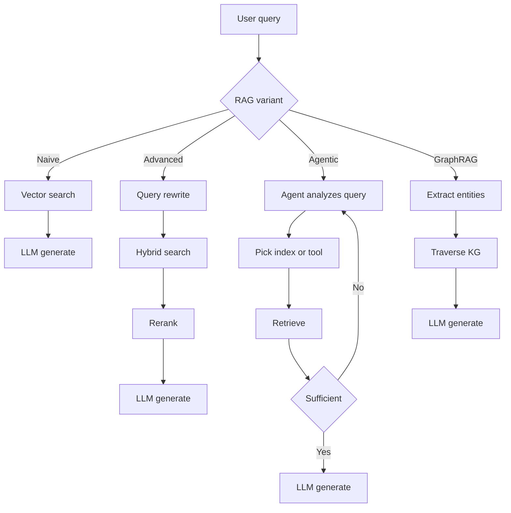
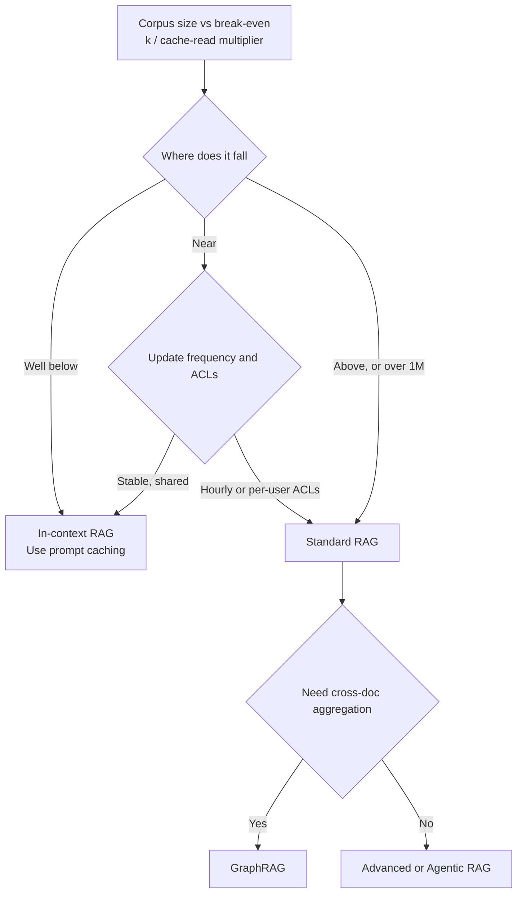

<div dir="rtl">

# مبانی RAG

چگونگی تکامل RAG از جستجوی برداری ساده (naive) به بازیابی‌های مبتنی بر Agent و مبتنی بر گراف. چه زمانی باید بین RAG و کانتکست طولانی (long context) انتخاب کرد، و سه شکاف بازیابی که عامل شکست در محیط عملیاتی (production) هستند.

تولید مبتنی بر بازیابی یا Retrieval-Augmented Generation (RAG) یک الگوی معماری برای ارائه کانتکست خارجی و قابل‌تایید به یک LLM به منظور تثبیت و استناد (grounding) پاسخ‌های آن است. این الگو از یک «جستجوی برداری ساده» به یک خط لوله (pipeline) استدلال چندمرحله‌ای تکامل یافته است: بازیابی ترکیبی (hybrid retrieval)، بازرتبه‌بندی (reranking)، فرآیند Chunking متنی (contextual chunking)، و حلقه‌های Agentic امروزه پیش‌نیازهای ضروری برای محیط عملیاتی به شمار می‌روند. مباحث عمیق‌تر در بخش‌های [استراتژی‌های Chunking](02-chunking-strategies.md)، [پایگاه‌های داده برداری (Vector Databases)](04-vector-databases.md)، [بازرتبه‌بندی (Reranking)](06-reranking-strategies.md)، [بازیابی متنی و زمینه‌ای (Contextual Retrieval)](10-contextual-retrieval.md)، [تعامل دیرهنگام ColBERT](11-late-interaction-colbert.md)، و [بازتعریف GraphRAG](07-graph-rag.md) آمده است.

## فهرست مطالب

- [فلسفه اصلی: استناد در برابر آموزش](#the-core-philosophy-grounding-vs-training)
- [دسته‌بندی (تاکسونومی) RAG](#the-rag-taxonomy)
- [مقایسه RAG و کانتکست طولانی (عصر ترکیبی)](#rag-vs-long-context-the-hybrid-era)
- [شکاف کیفیت بازیابی](#the-retrieval-quality-gap)
- [منابع مسموم](#poisoned-sources)
- [سوالات مصاحبه](#interview-questions)
- [نکات کلیدی](#key-takeaways)
- [مراجع](#references)

---

<a id="the-core-philosophy-grounding-vs-training"></a>

## فلسفه اصلی: استناد در برابر آموزش

| جنبه | Fine-Tuning | RAG |
|---|---|---|
| **نوع دانش** | درونی‌شده (وزن‌ها / Weights) | بیرونی‌شده (کانتکست / Context) |
| **چرخه به‌روزرسانی** | هزینه بالا (آموزش مجدد / Retraining) | هزینه پایین (Embedding مجدد اسناد تغییریافته) |
| **قابلیت ارجاع و استناد (Attribution)** | ناممکن (جعبه سیاه) | صریح و شفاف (ارجاعات / Citations) |
| **حریم خصوصی** | دشواری در «فراموش کردن» (Unlearn) | فیلتر کردن/حذف آسان |

**قاعده سرانگشتی**: فرآیند Fine-tuning برای **فرم** (سبک، لحن، نحو) است؛ در حالی که RAG برای **واقعیت** (دانش، داده، استناد/grounding) به کار می‌رود.

---

<a id="the-rag-taxonomy"></a>

## دسته‌بندی (تاکسونومی) RAG

سیستم‌های RAG در محیط عملیاتی بر اساس «عمق Agentic» خود دسته‌بندی می‌شوند:

### ۱. روش Naive RAG (بازیابی و سپس تولید)
- **جریان کاری (Flow)**: پرسش کاربر -> جستجوی برداری -> Top-K -> ‏LLM.
- **وضعیت**: برای محیط عملیاتی به دلیل «شکاف بازیابی» (Retrieval Gap) و دقت (precision) پایین منسوخ شده است.

### ۲. روش Advanced RAG (چندمرحله‌ای)
- **جریان کاری (Flow)**: تبدیل پرسش (Query Transformation) -> جستجوی ترکیبی (Hybrid Search) -> بازرتبه‌بندی (Reranking) -> ‏LLM.
- **نکته کلیدی**: استفاده از **RRF (Reciprocal Rank Fusion)** برای ترکیب نتایج مبتنی بر کلمات کلیدی و معنایی.

### ۳. روش Agentic RAG (مبتنی بر حلقه)
- **جریان کاری (Flow)**: ‏Agent پرسش را تحلیل می‌کند -> تصمیم می‌گیرد کدام ابزارها/شاخص‌ها را جستجو کند -> نتایج را ارزیابی می‌کند -> در صورت ناقص بودن اطلاعات، دوباره بازیابی را انجام می‌دهد.
- **تکنیک‌ها**: تکنیک‌های Self-RAG و Corrective RAG (CRAG).

### ۴. روش GraphRAG (کانتکست ساختاریافته)
- **جریان کاری (Flow)**: استخراج موجودیت‌ها/روابط -> ساخت گراف دانش (Knowledge Graph) -> پیمایش گراف برای یافتن «دانش مرتبط».
- **مزیت اصلی**: حل «پرسش‌های تجمیعی» (Aggregative Questions) (به عنوان مثال، «خلاصه‌سازی تمام ریسک‌های حقوقی در بین ۵۰ سند»).

چهار مدل متنوع بر اساس عمق Agentic:

<div dir="ltr">



</div>

---

<a id="rag-vs-long-context-the-hybrid-era"></a>

## مقایسه RAG و کانتکست طولانی (عصر «ترکیبی»)

پنجره‌های کانتکست مدل‌های پیشرو روی حدود **۱ میلیون Token** تثبیت شده‌اند: Claude Opus 5.5، Sonnet 5.5 و Fable 5.1 روی ۱ میلیون Token، خانواده GPT-6 روی ۱.۰۵ میلیون Token، مدل Gemini 4 Argon روی ۱ میلیون Token مشترک با خروجی، و حتی مدل رده‌سریع Gemini 3.8 Flash روی ۱٬۰۴۸٬۵۷۶ Token ورودی. پنجره‌های ۲ میلیون Token در عصر Gemini 1.5 به یک استاندارد معمول تبدیل نشدند. آنچه در سال ۲۰۲۶ تغییر کرد، اندازه پنجره نبود، بلکه **هزینه خواندن مجدد آن** بود.

- **روش In-Context RAG (ICR)**: برای مجموعه‌داده‌های کوچک و پایدار، پایگاه داده برداری (Vector Database) را کنار بگذارید و همه‌چیز را در یک پیشوند کَش‌شده از Prompt (به صورت cached prompt prefix) قرار دهید.
- **قابلیت Prompt caching** تخفیف‌هایی برای Tokenهای بازخوانی‌شده ارائه می‌دهد، اما این تخفیف اکنون بسته به مدل متفاوت است: خواندن از کَش در بیشتر مدل‌ها 0.1x ورودی، در Claude Opus 5.5، Claude Sonnet 5.5 (که در ۷ اکتبر ۲۰۲۶ از 0.1x کاهش یافت)، GPT-6.1 Sol و GPT-6.1 Terra برابر 0.05x، و در Claude Fable 5.1 برابر 0.025x است (۰.۲۵ دلار به ازای هر ۱ میلیون Token در مقایسه با نرخ پایه ۱۰ دلاری). شما همچنان هزینه نوشتن در کَش (cache write) را پرداخت می‌کنید: ۱.۲۵ برابر برای کَش ۳۰ دقیقه‌ای OpenAI در GPT-5.6 و بالاتر و برای TTL پنج دقیقه‌ای Anthropic، ۲ برابر برای TTL یک ساعته Anthropic، و ۲.۵ برابر برای گزینه ۱۲ ساعته OpenAI (اضافه‌شده در ۲۰ اکتبر ۲۰۲۶). یک TTL طولانی‌تر تنها زمانی توجیه دارد که مجموعه‌داده به اندازه کافی مکرر خوانده شود تا هزینه نوشتن گران‌تر در کَش مستهلک گردد.
- **پرتگاه‌های کانتکست طولانی (Long-context cliffs)**: به محض اینکه ورودی از ۲۷۲ هزار Token عبور کند، OpenAI **کل درخواست** را با تعرفه کانتکست طولانی محاسبه می‌کند (۲ برابر برای ورودی و کَش، ۱.۵ برابر برای خروجی؛ قیمت GPT-6 Sol از ۲/۱۰ دلار به ۴/۱۵ دلار می‌رسد)، xAI به محض رسیدن Prompt در Grok به ۲۰۰ هزار Token، هزینه هر Token را دو برابر می‌کند، و Gemini 3.1 Pro Preview بالاتر از ۲۰۰ هزار Token، تعرفه را از ۲/۱۲ دلار به ۴/۱۸ دلار افزایش می‌دهد. مدل‌های Claude 4.6 و بالاتر در Anthropic تا ۱ میلیون Token نرخ ثابتی دارند، به جز یک استثنا: Claude Haiku 5.5 به محض اینکه Prompt از ۱۰۰ هزار Token فراتر برود، کل درخواست را به جای ۰.۱۰/۰.۵۰ دلار با تعرفه ۰.۵۰/۲.۵۰ دلار فاکتور می‌کند، و عملیات خواندن و نوشتن کَش نیز جزو این طول شمرده می‌شوند. یک Prompt با ۲۷۳ هزار Token در GPT-6 Sol تقریباً دو برابر یک Prompt با ۲۷۲ هزار Token هزینه دارد، و یک Prompt با ۱۰۱ هزار Token در Haiku 5.5 حدود پنج برابر یک مورد ۱۰۰ هزار Token هزینه برمی‌دارد؛ بنابراین یا کانتکست را دقیقاً زیر آستانه نگه دارید یا به جای آن از بازیابی استفاده کنید.

### تغییر نقطه سربه‌سر

بدون در نظر گرفتن نوشتن در کَش، Tokenهای خروجی و تاخیر (Latency)، قرار دادن یک پیکره کَش‌شده با **N** عدد Token به ازای هر کوئری تقریباً زمانی هزینه‌ای معادل ارسال **k** عدد Token تازه بازیابی‌شده دارد که:

<div dir="ltr">

```
N x cache_read_multiplier = k        =>        N_break_even = k / multiplier
```

</div>

با یک کانتکست بازیابی‌شده ۵ هزار Token (همان فرضی که در [RAG در مقیاس عملیاتی](14-production-rag-at-scale.md#the-cache-read-break-even) استفاده شده است):

| ضریب خواندن از کَش | نمونه مدل‌ها (فهرست نوامبر ۲۰۲۶) | نقطه سربه‌سر پیکره کَش‌شده |
|---|---|---|
| 0.1x | ‏Haiku 5.5، GPT-6 Sol و بیشتر مدل‌های دیگر | حدود ۵۰ هزار Token |
| 0.05x | ‏Opus 5.5، Sonnet 5.5، GPT-6.1 Sol و GPT-6.1 Terra | حدود ۱۰۰ هزار Token |
| 0.025x | ‏Fable 5.1 | حدود ۲۰۰ هزار Token |

کانتکست بازیابی‌شده را دو برابر کنید (۱۰ هزار Token از chunkها) و تمام نقاط سربه‌سر نیز همراه با آن دو برابر می‌شوند.

پایین‌تر از نقطه سربه‌سر، روش in-context به ازای هر کوئری ارزان‌تر است و خطای عدم بازیابی اطلاعات را به عنوان یک حالت خرابی حذف می‌کند. بالاتر از آن، بازیابی از نظر هزینه برنده می‌شود و این اختلاف با افزایش اندازه پیکره بیشتر خواهد شد. سه عامل نقطه سربه‌سر عملی را نسبت به فرمول پایین‌تر می‌آورند: نوشتن در کَش در هر بار تغییر یا انقضای پیشوند (پیکره‌ای که با فرکانسی کمتر از TTL کَش کوئری می‌شود، بارها و بارها هزینه نوشتن را متحمل می‌شود)، تاخیر (Latency) مرحله prefill روی صدها هزار Token حتی در صورت کَش بودن، و افت بازخوانی (recall) در کانتکست طولانی که همچنان در سوالات از نوع سوزن در انبار کاه (needle-style) رخ می‌دهد. این مقدار را به جای استناد به یک آستانه ثابت از Token، به ازای هر مدل مجدداً محاسبه کنید؛ تعویض مدل حتی با همان قیمت پایه نیز این معادله را تغییر می‌دهد.

**تصمیم معماری**:
- پیکره زیر نقطه سربه‌سر برای مدل شما، پایدار، و قابل مشاهده برای تمام کاربران: **روش In-Context RAG** به همراه caching.
- پیکره بالاتر از نقطه سربه‌سر، دارای تغییرات ساعتی، یا دارای سطوح دسترسی به ازای هر کاربر: **روش Standard RAG**. کنترل دسترسی به ازای هر کاربر به تنهایی استفاده از بازیابی را اجتناب‌ناپذیر می‌کند، زیرا یک پیشوند مشترک کَش‌شده نمی‌تواند شامل اسنادی باشد که برخی کاربران اجازه مشاهده آن‌ها را ندارند.

درخت تصمیم‌گیری برای انتخاب بین RAG استاندارد و RAG درون کانتکست (in-context RAG):

<div dir="ltr">



</div>

---

<a id="the-retrieval-quality-gap"></a>

## شکاف کیفیت بازیابی

«شکاف بازیابی» (Retrieval Gap) عامل رتبه یک شکست RAG است.
- **شکاف ۱: عدم تطابق معنایی (Semantic Mismatch)**: پرسش می‌گوید «خودروهای سریع»، در حالی که پایگاه داده حاوی «پورشه ۹۱۱» است. این مشکل با Embeddingهای بهتر به همراه **بازرتبه‌بندی Cross-Encoder (Cross-Encoder Reranking)** حل می‌شود.
- **شکاف ۲: کانتکست مفقود (Missing Context)**: اطلاعات مرتبط در پایگاه داده وجود دارد، اما بازیاب (Retriever) آن را پیدا نکرده است. این مشکل با **جستجوی ترکیبی (Hybrid Search)** حل می‌شود.
- **شکاف ۳: گم شدن در میانه (Lost-in-the-Middle)**: اطلاعات در Prompt وجود دارد، اما LLM متوجه آن نمی‌شود. این مشکل با **فشرده‌سازی کانتکست (Context Compression)** و قرار دادن قوی‌ترین شواهد در ابتدای متن حل می‌شود.

---

<a id="poisoned-sources"></a>

## منابع مسموم

این سه شکاف فرض می‌کنند که پیکره داده‌ها قابل اعتماد است. اما برای RAG متکی بر وب، چنین فرضی صدق نمی‌کند. در سپتامبر ۲۰۲۶، پژوهشگری به نام آریل سایمون (Ariel Simon از شرکت Vigilance Security) کمپینی را گزارش کرد که وب را با صفحات پشتیبانی، پست‌ها و فایل‌های PDF جعلی پر کرده بود تا ChatGPT، Gemini و Google AI Overviews شماره تلفن‌های فیشینگ و پرتال‌های ورود جعلی برای خطوط هوایی و بانک‌ها (از جمله Delta، Lufthansa، Chase و Bank of America) برگردانند. هیچ چیزی جیلبریک نشده بود: بازیاب (retriever) دقیقاً وظیفه خود را انجام داده و صفحات مهاجم را رتبه‌بندی کرده بود.

اقدامات دفاعی که متعلق به لایه بازیابی هستند، نه لایه Prompt:
- **اعتبار منبع به عنوان یک ویژگی رتبه‌بندی**: به دامنه‌های رسمی و ناشران شناخته‌شده وزن و اولویت بالاتری نسبت به صفحات جدید و کم‌اعتبار مربوط به همان موجودیت اختصاص دهید.
- **لیست‌های مجاز مخاطبین تاییدشده (Verified-contact allowlists)** برای انواع پاسخ‌های پرخطر (شماره‌های پشتیبانی، درگاه‌های پرداخت، نشانی‌های وب ورود): پاسخ را صرفاً از یک رجیستری اعتبارسنجی‌شده ارائه دهید، یا از پاسخ امتناع کرده و به وب‌سایت رسمی لینک دهید.
- **ذکر اصالت داده‌ها (Provenance) در پاسخ**: دامنه منبع را در کنار هرگونه اطلاعات تماس ذکر کنید تا کاربران بتوانند عدم تطابق را تشخیص دهند.

برای بررسی تزریق غیرمستقیم Prompt (indirect prompt injection) از طریق محتوای بازیابی‌شده، به بخش [امنیت LLM](../12-security-and-access/01-llm-security.md) مراجعه کنید.

---

<a id="interview-questions"></a>

## سوالات مصاحبه

### پرسش: اگر مدل‌های پیشرو با کانتکست‌های ۱ میلیون Token عرضه می‌شوند، چرا همچنان باید از RAG استفاده کرد؟

**پاسخ قوی:**
چهار دلیل:
۱. **هزینه و تاخیر (Latency)**: حتی با قابلیت Prompt caching، خواندن مجدد یک پیکره بزرگ در هر کوئری هزینه‌ای معادل `N x cache-read rate` دارد و مرحله prefill روی صدها هزار Token همچنان باعث افزایش TTFT (زمان تا اولین Token / Time to First Token) می‌شود. پیکره نقطه سربه‌سر تقریباً برابر است با Tokenهای بازیابی‌شده تقسیم بر ضریب cache-read: حدود ۵۰ هزار Token در ضریب رایج 0.1x و حدود ۲۰۰ هزار Token در Claude Fable 5.1 با ضریب 0.025x، برای یک کانتکست بازیابی‌شده ۵ هزار Token. بالاتر از این مقدار، بازیابی chunkها ارزان‌تر است. در OpenAI، عبور ورودی از ۲۷۲ هزار Token نیز کل درخواست را با نرخ ۲ برابر برای ورودی و ۱.۵ برابر برای خروجی محاسبه می‌کند.
۲. **تازگی داده‌ها (Freshness)**: ساختار RAG می‌تواند بدون نیاز به بازنویسی و کَش مجدد یک پیشوند بزرگ، به APIهای بلادرنگ (قیمت سهام، اخبار) و اسناد تغییریافته دسترسی پیدا کند.
۳. **مقیاس‌پذیری (Scale)**: مجموعه‌داده‌های سازمانی (SharePoint، ترابایت‌ها لاگ) از هر پنجره کانتکستی فراتر می‌روند. RAG فیلتری است که ۰.۰۱ درصد داده‌های مرتبطی را که *باید* وارد پنجره شوند پیدا می‌کند.
۴. **کنترل دسترسی (Access control)**: یک پیشوند کَش‌شده میان تمام کاربرانی که از آن استفاده می‌کنند به اشتراک گذاشته می‌شود. اگر اسناد دارای مجوزهای دسترسی به ازای هر کاربر باشند، در هر صورت ناچارید فیلتر کردن را در زمان بازیابی انجام دهید.

### پرسش: «Agentic RAG» چیست و چه تفاوتی با «Advanced RAG» دارد؟

**پاسخ قوی:**
مدل Advanced RAG یک **خط لوله قطعی (deterministic pipeline)** است (خطی: بازنویسی -> جستجو -> بازرتبه‌بندی). در مقابل، Agentic RAG یک **حلقه تصادفی/احتمالاتی (stochastic loop)** است. در Agentic RAG، ابزارهایی در اختیار مدل قرار می‌گیرد تا درباره *نحوه* بازیابی تصمیم‌گیری کند. به عنوان مثال، اگر Agent تشخیص دهد که اسناد بازیابی‌شده نامرتبط هستند، می‌تواند تصمیم بگیرد که به جای آن «در گوگل جستجو کند» یا «پایگاه داده SQL را کوئری کند». این کار اساساً یک «مرحله استدلال» (Reasoning step) را قبل و بعد از بازیابی اضافه می‌کند تا اطمینان حاصل شود که کانتکست برای پاسخ به Prompt کافی است.

---

<a id="key-takeaways"></a>

## نکات کلیدی

- روش Naive RAG (جستجوی برداری + top-K + ‏LLM) برای محیط عملیاتی منسوخ شده است؛ روش Advanced RAG (ترکیبی + RRF + بازرتبه‌بندی) را به عنوان خط پایه جدید پیاده‌سازی کنید.
- پنجره‌های کانتکست طولانی باعث مرگ RAG نمی‌شوند: هزینه، تاخیر (Latency)، تازگی داده‌ها، مجوزهای دسترسی به ازای هر کاربر، و مقیاس پیکره همگی حتی در کانتکست ۱ میلیون Token شما را مجدداً به سمت بازیابی سوق می‌دهند.
- انتخاب را بر اساس نقطه سربه‌سر انجام دهید، نه یک آستانه ثابت: روش in-context به همراه caching پایین‌تر از مقدار تقریبی Tokenهای بازیابی‌شده تقسیم بر ضریب cache-read برنده است (حدود ۵۰ هزار Token در 0.1x و ۲۰۰ هزار Token در 0.025x برای یک کانتکست بازیابی‌شده ۵ هزار Token)؛ بالاتر از آن، از RAG استاندارد استفاده کنید؛ و پرسش‌های تجمیعی به سراغ GraphRAG می‌روند.
- سیستم RAG متکی بر وب نیازمند اعتبار منبع و لیست‌های مجاز برای پاسخ‌های پرخطر مانند شماره‌های پشتیبانی است؛ حملات مسموم‌سازی فرآیند رتبه‌بندی را هدف قرار می‌دهند، نه خود مدل را.
- بیشتر شکست‌های RAG، شکست در بازیابی هستند نه شکست در تولید؛ پیش از تنظیم Promptها، سه شکاف (معنایی، کانتکست مفقود، گم شدن در میانه) را عیب‌یابی کنید.
- مقایسه Agentic RAG در برابر Advanced RAG انتخابی بین یک حلقه تصادفی در برابر یک خط لوله قطعی است؛ تنها زمانی رویکرد Agentic را به کار بگیرید که الگوهای پرسش برای یک خط لوله ثابت بیش از حد متنوع باشند.

---

<a id="references"></a>

## مراجع
- مقاله Gao و همکاران. "Retrieval-Augmented Generation for LLMs: A Survey" (به‌روزرسانی ۲۰۲۴)
- [Edge و همکاران: "From Local to Global: A Graph RAG Approach to Query-Focused Summarization" (تحقیقات مایکروسافت، ۲۰۲۴)](https://arxiv.org/abs/2404.16130)
- [Lee و همکاران: "Can Long-Context Language Models Subsume Retrieval, RAG, SQL, and More?" (گوگل دیپ‌مایند، ۲۰۲۴)](https://arxiv.org/abs/2406.13121)
- [Anthropic: "Introducing Contextual Retrieval" (سپتامبر ۲۰۲۴)](https://www.anthropic.com/news/contextual-retrieval)

---

*قبلی: [دفاع در برابر تزریق Prompt (Prompt Injection Defense)](../05-prompting-and-context/08-prompt-injection-defense.md) | بعدی: [استراتژی‌های Chunking](02-chunking-strategies.md)*

</div>
