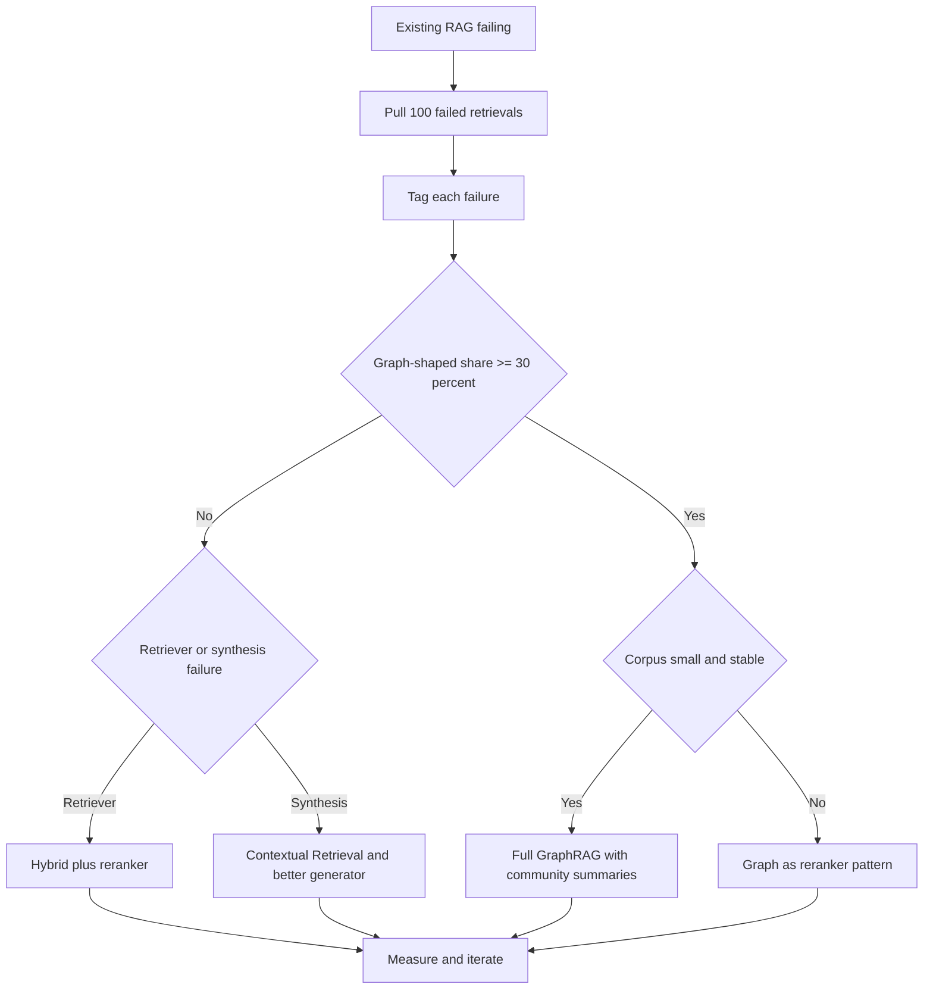
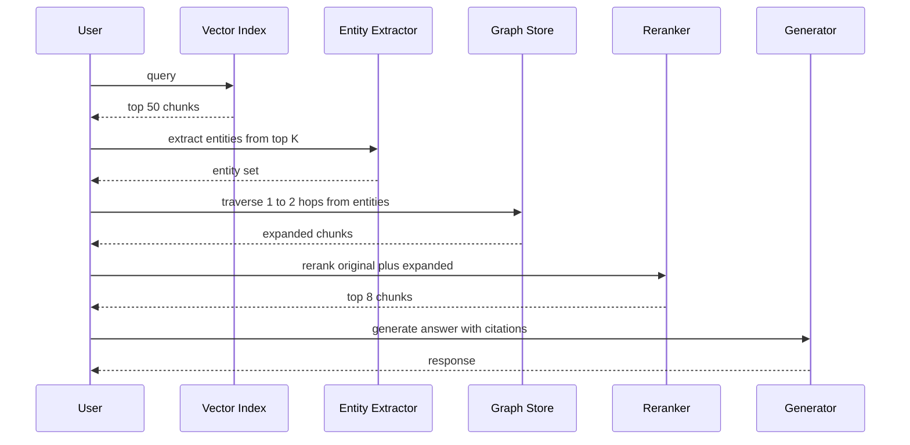

# GraphRAG

سیستم GraphRAG ترکیبی از **گراف‌های دانش (Knowledge Graphs یا KG)** و **تولید مبتنی بر بازیابی (Retrieval-Augmented Generation یا RAG)** است. در حالی که RAG برداری در «یافتن یک chunk خاص» عملکرد خوبی دارد، GraphRAG برای **استدلال سراسری (Global Reasoning)** در کل یک مجموعه داده طراحی شده است.

## فهرست مطالب

- [چه زمانی GraphRAG واقعاً برنده است (و چه زمانی نیست)](#when-graphrag-actually-wins-and-when-it-doesnt)
- [الگوی گراف به‌عنوان بازرتبه‌بندی‌کننده](#graph-as-reranker-pattern)
- [محدودیت‌های RAG برداری](#the-limitations-of-vector-rag)
- [معماری GraphRAG (استخراج-ساخت-پرس‌وجو)](#graphrag-architecture)
- [خلاصه‌سازی جوامع (الگوی مایکروسافت)](#community-summarization)
- [بازیابی موجودیت-رابطه](#entity-relationship-retrieval)
- [چه زمانی از GraphRAG استفاده کنیم](#when-to-use-graphrag)
- [سوالات مصاحبه](#interview-questions)
- [منابع](#references)

---

## چه زمانی GraphRAG واقعاً برنده است (و چه زمانی نیست)

سیستم GraphRAG ابزاری تخصصی برای سوالاتی با ساختار گراف‌گونه است، نه یک ارتقای پیش‌فرض نسبت به RAG برداری. برای تقریباً ۸۰٪ از بارهای کاری بازیابی در محیط پروداکشن، یک بازیاب هیبریدی متشکل از BM25 به‌علاوه بازیاب متراکم (dense) به همراه یک بازرتبه‌بندی‌کننده (reranker) مبتنی بر cross-encoder، برای ساخت ارزان‌تر، در عملیات و نگهداری کم‌هزینه‌تر و از نظر کیفیت پاسخ کاملاً رقابتی است. ساخت گراف تنها زمانی ارزش دارد که سوال واقعاً نیازمند پیمایش چندمرحله‌ای (multi-hop traversal) باشد؛ چیزی که شباهت برداری قادر به بازیابی آن نیست.

این تصمیم باید مبتنی بر داده (data-driven) باشد، نه سلیقه‌ای یا زیبایی‌شناختی. ۱۰۰ مورد از بازیابی‌های ناموفق سیستم RAG فعلی خود را استخراج کنید، هر شکست را در یکی از سه دسته‌بندی (bucket) زیر برچسب‌گذاری نمایید و اجازه دهید توزیع آماری تصمیم‌گیرنده باشد:

1. **شکست‌های واژگانی یا Chunking**: پاسخ در پیکره متنی (corpus) وجود داشته اما بازیاب آن را پیدا نکرده است. بازیاب را اصلاح کنید (Embeddingهای بهتر، امتیازدهی هیبریدی، top-k بزرگ‌تر، یک reranker یا بازیابی زمینه‌ای (Contextual Retrieval)).
2. **شکست‌های ترکیب و جمع‌بندی (Synthesis failures)**: بازیاب chunkهای درست را پیدا کرده اما مولد (generator) آن‌ها را ضعیف ترکیب کرده است. Prompt، بازرتبه‌بندی‌کننده یا مدل را اصلاح کنید.
3. **شکست‌های گراف‌گونه (Graph-shaped failures)**: پاسخ نیازمند دنبال کردن زنجیره‌ای از روابط در میان اسنادی بوده است که هیچ متن ظاهری مشترکی با هم ندارند. این همان دسته‌بندی مربوط به GraphRAG است.

اگر دسته‌بندی سوم کمتر از ۳۰٪ از شکست‌ها را شامل می‌شود، گراف نسازید؛ هزینه ساخت و نگهداری آن بازگشت سرمایه نخواهد داشت. اگر ۳۰٪ یا بیشتر است، GraphRAG (یا یک مدل هیبریدی «گراف به‌عنوان بازرتبه‌بندی‌کننده» که در ادامه توضیح داده شده است) سرمایه‌گذاری مناسب بعدی خواهد بود.

### بارهای کاری که GraphRAG در آن‌ها ابزار مناسبی است

الگوی مشترک در تمامی این موارد یکسان است: سوال مستلزم متصل کردن موجودیت‌هایی (entities) است که در هیچ chunk واحدی با یکدیگر ظاهر نشده‌اند، و خود روابط حاوی بار معنایی هستند که Embeddingهای سطحی قادر به ثبت و نمایش آن‌ها نیستند.

- **کشف دارو و پژوهش‌های زیست‌پزشکی**: ردیابی مسیرها میان ژن‌ها، پروتئین‌ها، ترکیبات و بیماری‌ها. گونه‌های متکی بر مبنای UMLS مانند GraLC-RAG برای این حوزه تنظیم شده‌اند.
- **شبکه‌های کلاهبرداری مالی**: اتصال حساب‌ها، دستگاه‌ها، موقعیت‌های مکانی و تراکنش‌ها در میان اسنادی که هرگز نام یکدیگر را ذکر نکرده‌اند.
- **زنجیره‌های رویه قضایی**: دنبال کردن ارجاعات پرونده‌ها در میان لایه‌های قضایی متعدد، جایی که هر پرونده تنها به پرونده‌های والد مستقیم خود ارجاع می‌دهد.
- **نمودارهای سازمانی شرکت‌ها و مالکیت خط‌مشی‌ها**: سوالاتی مانند «چه کسی استثنای خط‌مشی X را در منطقه Y تایید می‌کند» نیازمند پیمایش خطوط گزارش‌دهی سازمانی و یال‌های مالکیت خط‌مشی است.
- **هوش کد در مقیاس مخزن نرم‌افزاری**: گراف‌های فراخوانی (call graphs)، سلسله‌مراتب نوع‌ها (type hierarchies) و روابط وابستگی ذاتاً ساختار گراف‌گونه دارند؛ شباهت برداری روی chunkهای کد منبع، ساختاری را که امکان یافتن پاسخ را فراهم می‌کند، از دست می‌دهد.

### جریان تصمیم‌گیری

### بار ادامه‌دار نگهداری

هزینه پنهان GraphRAG فرآیند استخراج نیست، بلکه نگهداری (maintenance) آن است. پیکره متنی دچار تغییر تدریجی (drift) می‌شود: اسناد جدید اضافه می‌شوند، نام موجودیت‌ها تغییر می‌کند و روابط دوباره بازنویسی می‌شوند. گرافی که در ماه ژانویه ساخته شده باشد، تا ماه آوریل به شکل چشمگیری دچار خطا و مغایرت می‌شود. برنامه‌ریزی کنید که یک به‌روزرسانی فصلی اجرا شود تا فرآیند استخراج را مجدداً روی اسناد تغییریافته اجرا کند و هویت موجودیت‌ها را در سراسر تغییرات (diff) تطبیق دهد. هزینه LLM و زمان مهندسی لازم برای این به‌روزرسانی را از ابتدا در بودجه در نظر بگیرید، در غیر این صورت اصلاً سراغ ساخت گراف نروید. تیم‌هایی که از این مرحله صرف‌نظر می‌کنند، در نهایت با گرافی مواجه می‌شوند که با اطمینان کامل اطلاعات نادرست را بازیابی می‌کند، و این از نداشتن گراف به‌مراتب بدتر است.

هزینه‌های عملیاتی یک پایگاه داده گراف مجزا به قدری واقعی و محسوس است که یکی از کتابخانه‌های پیشرو در زمینه حافظه Agentها از آن صرف‌نظر کرد: کتابخانه Mem0 نسخه v2.0.0 (آوریل ۲۰۲۶) حدود ۴,۰۰۰ خط کد درایور Neo4j، Memgraph، Kuzu و Apache AGE را حذف کرد و اکنون پیوندهای موجودیت‌ها را در یک مجموعه (collection) موازی درون پایگاه داده برداری (Vector Database) موجود ذخیره می‌کند که با سیگنال‌های معنایی و BM25 در قالب یک امتیاز واحد ادغام (fuse) می‌شوند. اگر «گراف» شما عمدتاً شامل رخداد هم‌زمان (co-occurrence) موجودیت‌ها برای تقویت امتیاز (boosting) است، داشتن یک مجموعه موجودیت در کنار بردارهای شما ممکن است تمام آن چیزی باشد که نیاز دارید؛ پایگاه داده گراف واقعی را برای پیمایش‌های چندمرحله‌ای روی روابط نوع‌دار (typed relationships) نگه دارید.

---

## الگوی گراف به‌عنوان بازرتبه‌بندی‌کننده

پیاده‌سازی یک GraphRAG کامل به‌ندرت اولین انتخاب ساخت مناسب است. رویکرد هیبریدی و ارزان‌تر، الگوی «گراف به‌عنوان بازرتبه‌بندی‌کننده» (graph-as-reranker) است که هدف آن دستیابی به بخش عمده‌ای از مزایای پیمایش چندمرحله‌ای با کسری از هزینه ساخت است. ایده اصلی این است که نیازی به یک نمایه (index) گراف سراسری روی کل پیکره متنی ندارید؛ بلکه تنها به گرافی نیاز دارید که موجودیت‌های حاضر در نتایج برتر برداری (top-k vector results) را پوشش دهد و صرفاً به اندازه‌ای گسترش یابد که شواهد متصل به آن‌ها را بیابد.

جریان کار به شرح زیر است:

1. بازیابی برداری بر اساس هر نوع امتیازدهی هیبریدی که از قبل پیاده‌سازی کرده‌اید، ۵۰ chunk برتر را برای پرس‌وجوی کاربر بازیابی می‌کند.
2. یک استخراج‌کننده موجودیت (یک مدل کوچک Fine-tune شده یا یک فراخوانی LLM با خروجی ساختاریافته)، موجودیت‌های نام‌دار را از آن ۵۰ chunk استخراج می‌کند.
3. یک پیمایش گراف از مبدا این موجودیت‌ها به عمق یک یا دو مرحله (hop)، موجودیت‌های متصل و chunkهایی را که در آن‌ها ظاهر شده‌اند، بازمی‌گرداند.
4. مجموعه کاندید گسترش‌یافته (۵۰ chunk اولیه به‌علاوه chunkهای گسترش‌یافته از طریق گراف) به یک بازرتبه‌بندی‌کننده cross-encoder ارسال می‌شود.
5. بخش top-k از chunkهای بازرتبه‌بندی‌شده به مولد ارسال می‌شوند.

شما تنها آن بخشی از گراف را که پرس‌وجو به آن نیاز دارد به‌صورت تنبل (lazily) می‌سازید، نه یک نمایه گراف سراسری. هزینه ساخت تا یک مرتبه بزرگی (order of magnitude) کاهش می‌یابد. بار ادامه‌دار نگهداری کاهش پیدا می‌کند زیرا نواحی دست‌نخورده را دوباره ایندکس نمی‌کنید. گزارش‌های متخصصان اجرایی (که یک بنچمارک کنترل‌شده نیست) نشان می‌دهد که این روش تقریباً ۷۰ تا ۸۰ درصد از بهبود کیفی GraphRAG کامل را با حدود ۲۰ درصد از هزینه اولیه به دست می‌دهد؛ این مقدار را روی مجموعه شکست‌های سیستم خود بسنجید.

### جریان الگو

### گونه‌های اخیر (۲۰۲۴ تا ۲۰۲۶)

مروری کوتاه بر گونه‌هایی که ارزش شناخت دارند:

- **HippoRAG و HippoRAG 2** (دانشگاه پرینستون، ۲۰۲۴ و ۲۰۲۵): فرآیند بازیابی را به عنوان مسئله Personalized PageRank روی یک گراف حافظه در نظر می‌گیرند و نتایج بسیار موفقی در بنچمارک‌های چندمرحله‌ای با هزینه ایندکس پایین‌تر نسبت به Microsoft GraphRAG ارائه داده‌اند.
- **LightRAG** (دانشگاه هنگ‌کنگ - HKU، سال ۲۰۲۴): بازیابی موجودیت‌محور با یک خط لوله ایندکس‌گذاری ساده‌تر؛ بخشی از فراخوانی (recall) را در سوالات سراسری فدای سرعت بسیار بالاتر در ساخت و به‌روزرسانی‌ها می‌کند.
- **GraLC-RAG** (مارس ۲۰۲۶): متد Late Chunking مبتنی بر گراف همراه با ارجاع مبنایی به UMLS برای کاربردهای زیست‌پزشکی؛ نتایج منتشرشده درخشانی در پاسخ‌دهی به پرسش‌های چندمرحله‌ای زیست‌پزشکی داشته است.
- **Microsoft GraphRAG** (نسخه 2.x در ۲۰۲۵ و 3.x در ۲۰۲۶): رویکرد اصلی مبتنی بر خلاصه‌سازی جوامع، با معماری بازطراحی‌شده برای به‌روزرسانی‌های تدریجی و استخراج به‌مراتب ارزان‌تر؛ این همان ابزاری است که اگر واقعاً به خلاصه‌سازی سراسری به جای پیمایش چندمرحله‌ای محلی نیاز دارید، باید از آن استفاده کنید. شاخه 3.x (نسخه 3.0.0 در ژانویه ۲۰۲۶ یک بازسازی ساختار monorepo بود؛ نسخه 3.2.0 در سپتامبر ۲۰۲۶ یک کش SQLite ایمن در برابر همروندی اضافه کرد و نسخه 3.3.0 در ۸ اکتبر یک مشکل عملکردی SQLite را برطرف ساخت) مربوط به نگهداری است و نه یک روش جدید.

مسیر کلی در هر چهار گونه یکسان است: ایندکس‌گذاری یکپارچه (monolithic) کمتر، ساخت گراف تدریجی و تنبل‌تر (incremental and lazy) بیشتر، و تفکیک مشخص‌تر میان بارهای کاری «خلاصه‌سازی سراسری» (که در آن رویکرد جوامع به سبک مایکروسافت همچنان برتر است) و بارهای کاری «پیمایش چندمرحله‌ای محلی» (که در آن پیمایش به سبک HippoRAG ارزان‌تر و کاملاً رقابتی است).

یک دسته‌بندی محصولی مرتبط در سال ۲۰۲۶، پیکره متنی را یک بار در قالب مصنوعات ساختاریافته (خلاصه‌ها، عصاره‌ها و گراف‌های موجودیت-رابطه) کامپایل می‌کند تا Agentها مستقیماً آن‌ها را پرس‌وجو کنند، نه اینکه به ازای هر پرس‌وجو chunkها بازیابی شوند. سرویس Pinecone Nexus (عرضه عمومی در ۶ آگوست ۲۰۲۶) بارزترین نمونه آن است؛ برای بررسی مبادلات فنی و مصالحه‌ها (trade-offs) به [RAG عاملی (Agentic RAG)](08-agentic-rag.md#compile-once-knowledge) مراجعه کنید.

**منابع:**
- [Microsoft GraphRAG](https://microsoft.github.io/graphrag)
- [HippoRAG: حافظه بلندمدت با الهام از علوم اعصاب (HippoRAG: Neurobiologically Inspired Long-Term Memory)](https://arxiv.org/abs/2405.14831)
- [اج و همکاران، از محلی تا سراسری: رویکرد GraphRAG (Edge et al., From Local to Global: A GraphRAG Approach)](https://arxiv.org/abs/2404.16130)
- [Late Chunking مبتنی بر گراف (arXiv 2603.22633)](https://arxiv.org/html/2603.22633v1)
- [بازیابی زمینه‌ای آنتروپیک (سپتامبر ۲۰۲۴)](https://www.anthropic.com/news/contextual-retrieval)

---

## محدودیت‌های RAG برداری

سیستم RAG برداری روی «نقاط» در فضا عمل می‌کند. این رویکرد برای سوالاتی نظیر موارد زیر با شکست مواجه می‌شود:
- *«مضامین و تم‌های اصلی در سراسر تمام ۵۰۰ نظر و بازخورد کارکنان چیست؟»*
- *«تمام ارتباطات میان پروژه آلفا و کاهش بودجه سه‌ماهه سوم (Q3) را به من نشان بده.»*

**مسئله اصلی**: جستجوی برداری «متن مشابه» را پیدا می‌کند، اما مفهوم «موجودیت‌های متصل» را درک نمی‌کند.

---

## معماری GraphRAG

یک خط لوله مدرن GraphRAG شامل سه فاز است:

1. **استخراج (Extraction)**: یک LLM متن را اسکن کرده و **موجودیت‌ها (Entities)** (افراد، پروژه‌ها، تاریخ‌ها) و **روابط (Relationships)** (برای مثال، «شخص A *روی پروژه B کار می‌کند*») را استخراج می‌نماید.
2. **ساخت گراف (Graph Construction)**: موجودیت‌ها به عنوان گره (node) و روابط به عنوان یال (edge) در یک پایگاه داده گراف (مانند Neo4j یا Memgraph) ذخیره می‌شوند.
3. **پرس‌وجو (Querying)**: 
   - **جستجوی محلی (Local Search)**: یافتن یک گره و همسایگان آن.
   - **جستجوی سراسری (Global Search)**: استفاده از **خلاصه‌های جوامع (Community Summaries)** برای پاسخ‌دهی به سوالات سطح بالا و کلی.

---

## خلاصه‌سازی جوامع

این تکنیک که توسط مایکروسافت به شهرت رسید، شامل مراحل زیر است:
1. شناسایی خوشه‌هایی از گره‌های مرتبط (جوامع یا Communities) با استفاده از الگوریتم‌های گراف (مانند Leiden).
2. تولید یک خلاصه به زبان طبیعی برای *هر* جامعه.
3. در زمان پرس‌وجو، جستجو در میان **خلاصه‌ها** به جای chunkهای خام.

**مزیت کلیدی**: این کار به مدل امکان می‌دهد بدون خواندن ۱ میلیون Token به سوالات کلی و کلان («تصویر بزرگ» یا Big Picture) پاسخ دهد.

---

## بازیابی موجودیت-رابطه

استک‌های عملیاتی و پروداکشن از **جستجوی هیبریدی گراف-بردار (Hybrid Graph-Vector Search)** استفاده می‌کنند.
- **گذر متراکم (Dense Pass)**: یافتن مشابه‌ترین گره‌ها از طریق Embeddingها.
- **گذر گراف (Graph Pass)**: پیمایش یال‌های آن گره‌ها برای یافتن اطلاعات «پشتیبان» مرتبط که ممکن است از نظر معنایی شباهتی به پرس‌وجو نداشته باشند، اما از نظر منطقی به آن متصل هستند.

---

## چه زمانی از GraphRAG استفاده کنیم

| ویژگی | RAG برداری | GraphRAG |
|---------|------------|----------|
| **نوع داده** | متن بدون ساختار | داده‌های با اتصال متراکم و بالا |
| **نوع پرس‌وجو**| «X را پیدا کن» | «رابطه بین X و Y را توضیح بده» |
| **مقیاس** | پتابایت | میلیون‌ها موجودیت |
| **هزینه** | پایین | بالا (استخراج پرهزینه است) |

**توصیه**: از GraphRAG برای **پایگاه‌های دانش داخلی** (ویکی‌ها، مخازن کد، مخازن حقوقی) استفاده کنید که در آن‌ها ارتباطات میان اسناد به اندازه خود محتوا اهمیت دارند.

---

## سوالات مصاحبه

### پرسش: چرا فاز «استخراج» گلوگاه سیستم‌های GraphRAG است؟

**پاسخ قوی:**
استخراج گراف دانش به‌شدت نیازمند Token است (token-intensive): هر chunk از یک LLM عبور می‌کند، که این فرآیند معمولاً بیش از یک بار انجام می‌شود (فاز استخراج اولیه به‌علاوه گذرهای «خوشه‌چینی» یا gleaning برای ثبت موجودیت‌های جاافتاده)، و خروجی نهایی یک ساختار بزرگ JSON است. اگرچه قیمت Tokenها به اندازه‌ای کاهش یافته که صورت‌حساب خام API به‌ندرت مانع اصلی است؛ برای مثال، یک پیکره متنی ۱۰,۰۰۰ صفحه‌ای تقریباً معادل ۶ میلیون Token ورودی است؛ یک گذر با مدلی مانند GPT-6 Luna (با هزینه ۰.۱۰ / ۰.۵۰ دلار به ازای هر ۱ میلیون Token) چند دلار هزینه دارد، در حالی که یک مدل استدلالی پیشرو مانند Claude Opus 5.5 (با هزینه ۴ / ۲۰ دلار، که بخش تفکر (thinking) نیز به عنوان خروجی محاسبه می‌شود) با احتساب خروجی‌ها و گذرهای تکراری در حدود چند صد دلار تمام خواهد شد. با این حال، گلوگاه‌های اصلی عبارتند از توان عملیاتی (Throughput) (محدودیت‌های نرخ مصرف یا rate limits هنگام استخراج مجدد یک پیکره متنی بزرگ)، کیفیت تفکیک و تطبیق موجودیت‌ها (entity resolution)، و لزوم استخراج مجدد در هر بار تغییر پیکره متنی. راهکار استاندارد کاهش این بار، **استخراج مبتنی بر SLM** (مدل‌های زبانی کوچک یا Small Language Models) برای گذر اولیه است، در حالی که مدل‌های بزرگ‌تر برای «حل تعارض» (conflict resolution) میان موجودیت‌های هم‌پوشان حفظ می‌شوند. علاوه بر این، LazyGraphRAG مایکروسافت با به تعویق انداختن خلاصه‌سازی جوامع تا زمان پرس‌وجو، هزینه‌های این بخش را بیش از پیش کاهش می‌دهد.

### پرسش: سیستم GraphRAG چگونه محدودیت «پنجره زمینه» را برای سوالات تجمعی حل می‌کند؟

**پاسخ قوی:**
برای سوالات تجمعی (مانند «احساسات و نظرات کلی موجود در ۱,۰۰۰ سند را خلاصه کن»)، یک سیستم RAG استاندارد باید ۱,۰۰۰ chunk را وارد پنجره زمینه (Context Window) کند که این کار غیرممکن یا بسیار پرهزینه است. GraphRAG این مسئله را از طریق **پیش‌خلاصه‌سازی (Pre-Summarization)** حل می‌کند. این سیستم خوشه‌های اطلاعاتی درون گراف (جوامع یا Communities) را به صورت سلسله‌مراتبی خلاصه می‌نماید. هنگامی که کاربر یک سوال سراسری مطرح می‌کند، سیستم تنها خلاصه‌های سطح بالای جوامع را بازیابی می‌کند؛ خلاصه‌هایی که فشرده و سرشار از اطلاعات هستند و به مدل امکان می‌دهند کل مجموعه داده را از دریچه‌ای متراکم و خلاصه «مشاهده» کند.

---

## منابع
- اج و همکاران. "From Local to Global: A GraphRAG Approach" (تحقیقات مایکروسافت، ۲۰۲۴)
- Neo4j. "Generative AI and Graph Databases" (۲۰۲۵)
- WhyHow AI. "Deterministic RAG with Knowledge Graphs" (۲۰۲۴)

---

*قبلی: [استراتژی‌های بازرتبه‌بندی (Reranking Strategies)](06-reranking-strategies.md) | بعدی: [RAG عاملی (Agentic RAG)](08-agentic-rag.md)*

