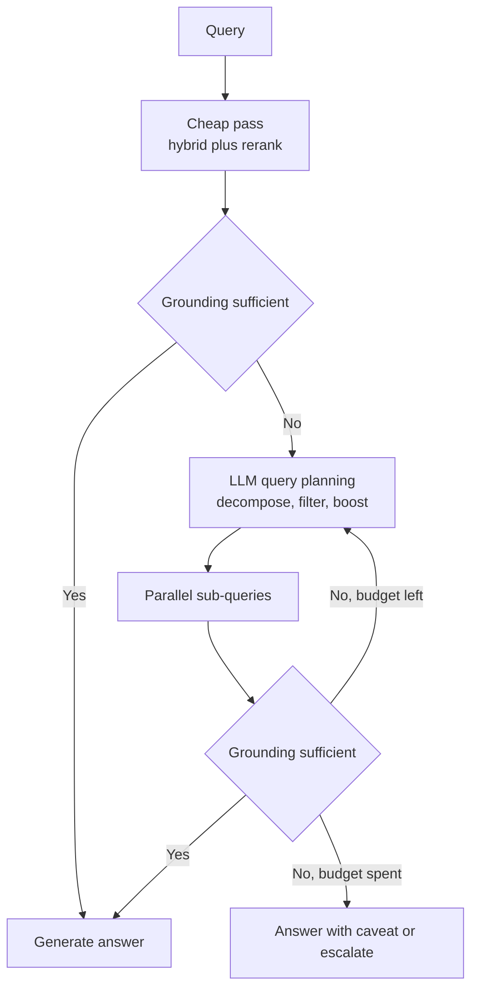

# Agentic RAG

رویکرد Agentic RAG از یک «پایپ‌لاین خطی» به سمت یک **«حلقه استدلال» (Reasoning Loop)** حرکت می‌کند. به جای یک‌بار بازیابی، یک Agent تصمیم می‌گیرد که برای پاسخ به یک پرسمان (query)، *چه زمانی* و *چه چیزی* را بازیابی کند. الگوهای غالب در محیط عملیاتی عبارتند از: Self-RAG (مدل Tokenهای بازتابی منتشر می‌کند)، Corrective RAG (ارزیاب بازیابی همراه با مسیریابی اصلاحی)، Adaptive RAG (طبقه‌بندی‌کننده‌ای که عمق پایپ‌لاین را انتخاب می‌کند)، ReAct روی اسناد، و تجزیه پرسمان چندمرحله‌ای (multi-hop query decomposition). فریم‌ورک LangGraph متداول‌ترین محیط زمان اجرای جریان کنترل (control-flow runtime) برای حلقه‌های دارای وضعیت (stateful loops) است؛ در حالی که LlamaIndex Workflows برای گونه‌های تک‌پایپ‌لاینی متمرکز بر بازیابی سنگین متداول است. در سال ۲۰۲۶، سرویس‌های جستجوی مدیریت‌شده ارائه بخش تطبیقی را به صورت پیکربندی آغاز کردند، و یک رویکرد جایگزین تحت عنوان «یک‌بار کامپایل کردن دانش» (compile the knowledge once) برای بارهای کاری که خودِ حلقه عامل اصلی هزینه است پدیدار شد.

## فهرست مطالب

- [مقایسه RAG خطی و Agentic RAG](#linear-vs-agentic-rag)
- [روش Self-RAG (بازتاب خود / Self-Reflection)](#self-rag-self-reflection)
- [روش Corrective RAG (CRAG)](#corrective-rag-crag)
- [حلقه‌های استدلال چندمرحله‌ای (Multi-Hop)](#multi-hop-reasoning-loops)
- [فیلترسازی مبتنی بر Agent و بازنگری برنامه](#agentic-filtering-and-plan-revision)
- [تلاش تطبیقی در بازیابی (Adaptive Retrieval Effort)](#adaptive-retrieval-effort)
- [دانش با یک‌بار کامپایل (Compile-Once Knowledge)](#compile-once-knowledge)
- [آموزش Agentهای جستجو: تله فریب متقابل (The Co-Cheating Trap)](#training-search-agents-the-co-cheating-trap)
- [سوالات مصاحبه](#interview-questions)
- [منابع](#references)

---

## مقایسه RAG خطی و Agentic RAG

| مدل | Linear RAG | Agentic RAG |
|---|---|---|
| **ساختار** | توالی از پیش تعیین‌شده | حلقه پویا |
| **خوداصلاحی** | ندارد | بالا (امکان بازیابی مجدد) |
| **پیچیدگی پرسمان** | ساده (تک‌مرحله‌ای) | دشوار (چندمرحله‌ای) |
| **تاخیر (Latency)** | پایین (ثابت) | متغیر (چندین نوبت) |

**اصل**: زمانی از Agentic RAG استفاده کنید که پرسمان نیازمند «اثبات ترکیبی» (Synthesized Proof) باشد، نه صرفاً «تطابق سند» (Document Match). برای آن بودجه‌بندی کنید: یک حلقه با ۳ تا ۴ تکرار (iteration) معمولاً ۸ تا ۱۲ ثانیه از ابتدا تا انتها طول می‌کشد؛ بنابراین اگر تجربه کاربری (UX) شما به پاسخی زیر ۳ ثانیه نیاز دارد، پرسمان‌های ساده را به یک مسیر سریع (Adaptive RAG) هدایت کنید.

---

## روش Self-RAG (بازتاب خود / Self-Reflection)

رویکرد **Self-RAG** که توسط Asai و همکاران (۲۰۲۳، ارائه‌شده در ICLR 2024) معرفی شد، مدل را آموزش می‌دهد تا «Tokenهای نقاد» (Critic Tokens) را برای ارزیابی کار خود تولید (emit) کند.

1. **بازیابی (Retrieve)**: مدل Chunkهای برتر (Top-K chunks) را واکشی می‌کند.
2. **ارزیابی (Evaluate)**: آیا اطلاعات مرتبط است؟ (نقاد: `Relevant`)
3. **تولید (Generate)**: آیا پاسخ پشتیبانی می‌شود؟ (نقاد: `Supported`)
4. **تکرار (Iterate)**: اگر پاسخ پشتیبانی نشود، مدل *به‌طور خودکار* یک جستجوی گسترده‌تر را آغاز می‌کند.

---

## روش Corrective RAG (CRAG)

رویکرد CRAG یک «لایه قابلیت اطمینان» (Reliability Layer) میان بازیابی و تولید اضافه می‌کند.

- **منطق (The Logic)**: 
  - اگر بازیابی **صحیح (Correct)** باشد: تولید مستقیم پاسخ.
  - اگر بازیابی **مبهم (Ambiguous)** باشد: استفاده از یک ابزار جستجوی وب (Web-Search) برای تکمیل اطلاعات.
  - اگر بازیابی **نادرست (Incorrect)** باشد: دور انداختن زمینه (context) و استفاده از جستجوی خارجی یا منطق fallback.

---

## حلقه‌های استدلال چندمرحله‌ای (Multi-Hop Reasoning Loops)

برای سوالاتی مانند «مدیرعامل شرکتی که گیت‌هاب را تصاحب کرد کیست؟»، سیستم باید:
1. **گام اول (Hop 1)**: جستجو برای «چه کسی گیت‌هاب را تصاحب کرد؟» (نتیجه: مایکروسافت).
2. **گام دوم (Hop 2)**: جستجو برای «مدیرعامل مایکروسافت» (نتیجه: ساتیا نادلا).

**الگوی مبتنی بر Agent**: این Agent یک «شیء وضعیت» (State Object) را حفظ کرده و پس از هر بازیابی، «زیرهدف» (Sub-goal) خود را به‌روزرسانی می‌کند تا زنجیره کامل شود.

---

## فیلترسازی مبتنی بر Agent و بازنگری برنامه (Agentic Filtering and Plan Revision)

ایجنت‌های (Agentهای) مدرن از **برنامه‌های زیرمرحله‌ای (Sub-Step Plans)** استفاده می‌کنند.
- به جای یک بازیابی بزرگ، Agent برنامه‌ای می‌نویسد: «ابتدا پایگاه داده داخلی‌مان را برای X بررسی می‌کنم، سپس API عمومی را برای Y جستجو خواهم کرد.»
- **بازنگری برنامه (Revised planning)**: اگر مرحله ۱ شکست بخورد، Agent مرحله ۲ را *بازنویسی می‌کند*.

---

## تلاش تطبیقی در بازیابی (Adaptive Retrieval Effort)

مشکل هزینه در Agentic RAG این است که هر پرسمان هزینه حلقه را پرداخت می‌کند، حتی پرسمان‌های ساده‌ای که یک بازیابی تکی به آن‌ها پاسخ می‌داد. رویکرد **Adaptive RAG** این مشکل را با یک مسیریاب حل می‌کند؛ در سال ۲۰۲۶ این مسیریاب به یک تنظیم مدیریت‌شده تبدیل شد.

سرویس Azure AI Search واضح‌ترین نمونه است. پایگاه‌های دانش آن در REST API نسخه 2026-04-01 برای بازیابی استخراجی (extractive retrieval) به مرحله دسترسی عمومی (GA) رسیدند (برنامه‌ریزی پرسمان با LLM و ترکیب پاسخ در وضعیت پیش‌نمایش باقی مانده‌اند). نسخه `2026-08-01-preview` تلاش `auto` را اضافه می‌کند (`"retrievalReasoningEffort": {"kind": "auto"}` که نیازمند یک مدل روی پایگاه دانش است و در نسخه‌های قبلی API خطای 400 برمی‌گرداند): ابتدا یک دور بازیابی سبک اجرا می‌شود، و ارتقا به برنامه‌ریزی پرسمان توسط LLM (تا سطح تلاش متوسط) تنها زمانی رخ می‌دهد که انطباق شواهد (grounding) ناکافی باشد. همین پیش‌نمایش به برنامه‌ریز اجازه می‌دهد سرنخ‌های پرسمان (query hints) را به فیلترها و تقویت‌کننده‌ها (boosts) تبدیل کند. به‌طور مجزا، منابع دانشی که در ژوئن ۲۰۲۶ اضافه شدند (سرورهای MCP، پلتفرم Fabric، و Azure SQL) به یک فراخوانی بازیابی اجازه می‌دهند به فراتر از نمایه‌های جستجو انشعاب یابد (fan out)؛ قبل از وابستگی به هر منبع، وضعیت preview یا GA آن را بررسی کنید.

چه آن را خریداری کنید و چه خودتان بسازید، طراحی یکسان است: یک مرحله اول ارزان‌قیمت، یک بررسی صریح کفایت (sufficiency check)، سقف معینی از دفعات ارتقا، و یک مسیر شکستِ مشخص. بررسی کفایت بخشی است که باید با سخت‌گیرانه‌ترین حالت ارزیابی شود، زیرا بررسیِ آسان‌گیرانه به‌طور نامحسوس Adaptive RAG را دوباره به RAG خطی تبدیل می‌کند.

---

## دانش با یک‌بار کامپایل (Compile-Once Knowledge)

رویکرد Agentic RAG در هر پرسمان، مجدداً ساختار را از Chunkهای خام استخراج می‌کند. **کامپایل دانش (Knowledge compilation)** این کار را به مرحله بارگذاری داده (ingestion) منتقل می‌کند: مجموعه اسناد (corpus) یک‌بار در قالب آرتیفکت‌های ساختاریافته کامپایل می‌شود و سپس به Agentها اجازه داده می‌شود که این آرتیفکت‌ها را پرسمان کنند.

- **پایگاه داده Pinecone Nexus** (پیش‌نمایش عمومی در ۱ جولای، دسترسی عمومی یا GA در ۶ اوت ۲۰۲۶): توصیفات یک متخصص حوزه کاری (subject-matter expert) به یک مانیفست یا Manifest (موجودیت‌ها، روابط، قالب‌های پاسخ) تبدیل می‌شود. Nexus اسناد منبع را در قالب خلاصه‌ها، گزیده‌های ساختاریافته و گراف‌های موجودیت-رابطه کامپایل می‌کند و Agentها از طریق زبان KnowQL با یک فراخوانی از آن‌ها پرس‌وجو می‌کنند. لایه داده (data plane) در حساب AWS، GCP یا Azure مشتری اجرا می‌شود و لایه کامپایل‌شده قابل خروجی‌گرفتن (export) است. نتایج گزارش‌شده توسط ارائه‌دهنده: در بنچمارک tau-Knowledge، مدل GPT-5.5 با Nexus دقت را حفظ کرد (۴۷.۴٪ در مقایسه با ۴۶.۴٪ بدون آن) با ۷۷٪ هزینه کمتر به ازای هر تسک و حدود ۳۵٪ فراخوانی کمتر مدل؛ در نسخه پیش‌نمایش، یک آزمون روی رویه قضایی اتحادیه اروپا به دقت ۸۷٪ در برابر ۴۵٪ برای خط مبنای Agentic RAG با حدود ۹ برابر Token کمتر دست یافت.
- **شرکت Cohere Compass Cloud** (بتای خصوصی، ۲۵ سپتامبر ۲۰۲۶): یک پشته (stack) مدیریت‌شده برای پارس، تعبیه‌سازی متراکم به‌علاوه پراکنده (dense-plus-sparse embed)، نمایه‌سازی، بازیابی آگاه از دسترسی‌ها (permission-aware retrieve) و بازرتبه‌بندی (rerank) که از طریق یک سرور اختصاصی MCP ارائه می‌شود تا Agentها بتوانند به مرور دامنه اسناد را محدود کنند.

| بعد | حلقه Agentic RAG | دانش با یک‌بار کامپایل (Compile-once knowledge) |
|---|---|---|
| مشخصه هزینه (Cost profile) | به ازای هر پرسمان (چندین فراخوانی LLM و جستجو) | پیش‌هنگام (کامپایل اولیه) به همراه کامپایل مجدد در زمان تغییرات |
| بهترین کاربرد | سوالات با پایان باز روی مجموعه‌ای از اسناد متغیر | الگوهای تکراری سوال روی حوزه‌ای با ساختار پایدار |
| حالت شکست (Failure mode) | جهش‌های شدید تاخیر (Latency) و هزینه، عدم قطعیت (non-determinism) | انحراف دانش (knowledge drift) میان کامپایل‌ها؛ سوالاتی که مانیفست پیش‌بینی نکرده بود |
| مسئول نگهداری | مهندسان حلقه را تنظیم می‌کنند | یک متخصص حوزه کاری مانیفست را نگهداری می‌کند |

هر دو نتیجه توسط ارائه‌دهنده اجرا شده‌اند، و مقایسه رویه قضایی در برابر خط مبنایی از Agentic RAG به انتخاب خودِ ارائه‌دهنده بوده است. با این حال، استدلال ساختاری معتبر است: اگر اکثر پرسمان‌ها همان چند نوع سوال را بپرسند، یک‌بار پرداخت هزینه برای ساختاردهی به اسناد، بهتر از پرداخت هزینه در هر پرسمان برای کشف دوباره ساختار است. خلاصه‌های جامعه (community summaries) در GraphRAG شکل اولیه‌تری از همین ایده هستند؛ رجوع کنید به [GraphRAG](07-graph-rag.md).

---

## آموزش Agentهای جستجو: تله فریب متقابل (The Co-Cheating Trap)

تیم‌هایی که Agentهای بازیابی خود را با یادگیری تقویتی (RL) آموزش می‌دهند، به‌طور فزاینده‌ای از **خودتکاملی (self-evolution)** استفاده می‌کنند: یک مدل پیشنهاددهنده (proposer) از روی اسناد سوال طرح می‌کند و یک مدل حل‌کننده (solver) یاد می‌گیرد به آن‌ها پاسخ دهد، در حالی که میزان توافق به عنوان پاداش در نظر گرفته می‌شود. مقاله «False Frontiers» (arXiv 2609.39102، ۳۰ سپتامبر ۲۰۲۶) نشان می‌دهد که این دو مدل **دچار فریب متقابل (co-cheat)** می‌شوند: آن‌ها روی خطاهای مشترک همگرا می‌گردند، به طوری که پاداش درون حلقه افزایش می‌یابد در حالی که درستی برچسب‌ها در ارزیابی خارجی راکد می‌ماند یا کاهش پیدا می‌کند.

- اعتبارسنجی چندنمونه‌ای (Multi-sample verification) کمک چندانی نمی‌کند: حجم توافق کاذب (false-agreement mass) فقط از ۶.۱٪ به ۵.۷٪ (در مدل 4B) و از ۸.۸٪ به ۷.۲٪ (در مدل 9B) کاهش می‌یابد.
- روش **CrossFit** مجموعه اسناد را به دو بخش تقسیم می‌کند و سوالاتِ یک بخش را با یک حل‌کننده کمکی که فقط روی بخش دیگر آموزش دیده امتیازدهی می‌کند، که این کار توافق کاذب را به ۳.۰٪ و ۳.۷٪ کاهش می‌دهد. در مدل‌های Qwen3.5-4B و 9B، این روش میانگین نتایج را در هفت بنچمارک جستجو به میزان ۸.۸ و ۸.۴ امتیاز نسبت به خودتکاملی جفت‌شده، و ۸.۷ و ۷.۸ امتیاز نسبت به Search-R1 بهبود می‌بخشد.

درس کلی برای هر حلقه داده‌های ساختگی (synthetic-data): هرگز اجازه ندهید مؤلفه‌ای که برچسب‌ها را تولید می‌کند، تنها قاضی آن‌ها نیز باشد. همواره یک اعتبارسنج مستقل کنار بگذارید و نمونه‌ای از برچسب‌ها را به‌صورت دستی ارزیابی و بازرسی کنید.

---

## سوالات مصاحبه

### سوال: «تعادل میان استدلال و بازیابی» (Reasoning-Retrieval Balance) در Agentic RAG چیست؟

**پاسخ قوی:**
هر «نوبت استدلال» (Reasoning turn) در یک حلقه Agentic، هزینه Token و تاخیر (Latency) برای کاربر اضافه می‌کند. هدف یک مهندس محیط عملیاتی پیدا کردن «آستانه بازیابی» (Retrieval Threshold) است. ما از **بودجه‌بندی Tokenها (Token-Budgeting)** استفاده می‌کنیم که در آن به Agent تنها اجازه ۳ تا ۵ «نوبت» داده می‌شود قبل از اینکه مجبور به ارائه پاسخ نهایی شود. همچنین از **بازیابی حدسی (Speculative Retrieval)** بهره می‌بریم؛ جایی که Agent دو مرحله بعدی خود را پیش‌بینی کرده و برای هر دو به‌طور هم‌زمان بازیابی انجام می‌دهد تا تاخیر (Latency) رفت و برگشت کاهش یابد. ارزان‌ترین نوبت، نوبتی است که هرگز اجرا نکنید؛ بنابراین من یک گیت تطبیقی (adaptive gate) در ابتدا قرار می‌دهم: یک مرحله ترکیبی به‌علاوه بازرتبه‌بندی تکی همراه با بررسی کفایت، که ارتقا به مرحله برنامه‌ریزی تنها در صورت شکست انجام می‌شود (Azure AI Search این قابلیت را تحت عنوان `retrievalReasoningEffort` با `kind: "auto"` در API نسخه 2026-08-01-preview ارائه داده است).

### سوال: چرا Agentic RAG اغلب منجر به کیفیت بالاتر اما «قابلیت اطمینان» (قطعیت / Determinism) پایین‌تر می‌شود؟

**پاسخ قوی:**
رویکرد Agentic RAG غیرقطعی (non-deterministic) است زیرا مدل در هر مرحله در حال «تصمیم‌گیری» برای مسیر خود است. یک تغییر کوچک در پرسمان کاربر ممکن است باعث شود Agent ابزار یا استراتژی جستجوی متفاوتی را انتخاب کند که منجر به قالب پاسخ متفاوتی می‌شود. راهکار استاندارد برای کاهش این اثر، استفاده از **فریم‌ورک‌های مقید Agent (مانند Constrained Agent Frameworks)** (نظیر LangGraph یا DSPy) است که در آن‌ها «گراف مسیرهای ممکن» به‌صورت دقیق تعریف شده است، حتی اگر انتخاب *میان* آن مسیرها تصادفی (stochastic) باشد.

### سوال: چه زمانی دانش را به جای اجرای یک حلقه بازیابی Agentic، از پیش کامپایل می‌کنید؟

**پاسخ قوی:**
زمانی که ساختار سوالات تکراری بوده و ساختار دامنه پایدار باشد. اگر ۸۰٪ پرسمان‌ها متغیرهایی از قبیل «کدام بندها در قرارداد X با خط‌مشی Y مغایرت دارند» یا «وضعیت موجودیت Z چیست» باشند، اینکه یک Agent در هر پرسمان این ساختار را مجدداً از Chunkها کشف کند به معنای پرداخت هزاران برابری همان هزینه است. یک‌بار کامپایل کردن (موجودیت‌ها، روابط، گزیده‌های نوع‌دار، همان‌طور که Pinecone Nexus یا نمایه‌ای به سبک GraphRAG انجام می‌دهد) این هزینه را به مرحله بارگذاری داده منتقل می‌کند و هر پرسمان را به یک فراخوانی ساختاریافته تبدیل می‌نماید. من زمانی که مجموعه اسناد سریع‌تر از توان کامپایل مجدد تغییر کند، زمانی که سوالات ماهیت پژوهشی با پایان باز داشته باشند، یا زمانی که صاحب حوزه‌ای برای نگهداری اسکیمای داده وجود نداشته باشد، دست به کامپایل نمی‌زنم؛ زیرا یک لایه کامپایل‌شده قدیمی یا ناقص، با اطمینان کاذب اما به‌طور کاملاً اشتباه پاسخ می‌دهد. در عمل من هر دو را اجرا می‌کنم: آرتیفکت‌های کامپایل‌شده برای الگوهای شناخته‌شده سوالات، به همراه fallback از نوع Agentic RAG روی Chunkهای خام برای سایر موارد؛ و نرخ بازگشت به fallback را به عنوان نشانه‌ای برای نیاز به گسترش اسکیما ردیابی می‌کنم.

---

## منابع
- Asai et al. "Self-RAG: Learning to Retrieve, Generate, and Critique through Self-Reflection" (2023)
- Yan et al. "Corrective Retrieval Augmented Generation (CRAG)" (2024)
- Jeong et al. "Adaptive-RAG: Learning to Adapt Retrieval-Augmented Large Language Models through Question Complexity" (2024)
- LangChain. "Agentic RAG with LangGraph" (2025)
- [مایکروسافت. «قابلیت‌های جدید در Azure AI Search»](https://learn.microsoft.com/en-us/azure/search/whats-new)
- [Pinecone. «Pinecone Nexus به طور عمومی در دسترس قرار گرفت» (اوت ۲۰۲۶)](https://www.pinecone.io/blog/pinecone-nexus-generally-available/)
- [«False Frontiers» (arXiv 2609.39102، سپتامبر ۲۰۲۶)](https://arxiv.org/abs/2609.39102)

---

*قبلی: [GraphRAG](07-graph-rag.md) | بعدی: [الگوهای پیشرفته بازیابی](09-advanced-retrieval-patterns.md)*

