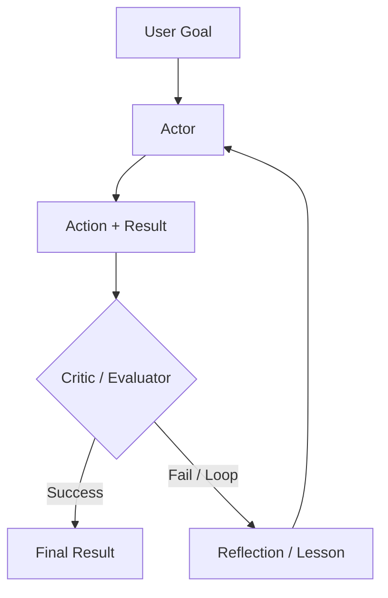

# حلقه‌های استدلال: ReAct و فراتر از آن

حلقه‌های استدلال جریان کنترل یک Agent را تعریف می‌کنند. در حالی که **ReAct** خط مبنای سال ۲۰۲۳ بود، سیستم‌های امروزی از الگوهای پیچیده‌تری مانند **Plan-and-Solve**، **Self-Reflexion** و **مقیاس‌پذیری در زمان استنتاج (Inference-Time Scaling)** استفاده می‌کنند که بر روی مدل‌های با قابلیت استدلال بومی (reasoning-native) اجرا می‌شوند.

## فهرست مطالب

- [تکامل حلقه](#the-evolution-of-the-loop)
- [ReAct: الگوی کلاسیک](#react-reasoning--acting)
- [حلقه‌های Self-Reflexion](#self-reflexion-loops)
- [الگوی Plan-and-Solve](#plan-and-solve)
- [مهندسی جریان (الگوی LangGraph)](#flow-engineering-langgraph)
- [پرسش‌های مصاحبه](#interview-questions)
- [منابع](#references)

---

## تکامل حلقه

| دوره | الگو | فلسفه اصلی |
|-----|---------|-----------------|
| **2023** | ReAct | درهم‌آمیختن فکر و عمل (Thought and Action). |
| **2024** | Reflexion | ارزیابی خطاها و تلاش مجدد. |
| **2025** | حلقه‌های سیستم ۲ (System 2 Loops) | استفاده از زنجیره فکر پنهان (Hidden CoT) برای منطق چندمرحله‌ای قابل اتکا. |
| **2026** | حلقه‌های مهاربندی‌شده مهندسی‌شده (Engineered harness loops) | تفکر درهم‌آمیخته بین فراخوانی ابزارها، در حالی که بستر مهارکننده (Harness) مدیریت خاتمه، اعتبارسنجی و بودجه‌ها را بر عهده دارد (ببینید: [مهندسی حلقه](12-loop-engineering.md)). |

---

## الگوی ReAct: استدلال + اقدام (Reasoning + Acting)

حلقه بنیادین برای ۹۰٪ از Agentها:
۱. **تفکر (Thought)**: "من باید X را پیدا کنم."
۲. **اقدام (Action)**: `search_engine("X")`
۳. **مشاهده (Observation)**: "X در Y قرار دارد."
۴. **تکرار (Repeat)**.

**نقد و بررسی (Critique)**: الگوی ReAct شکننده است. اگر جستجو نتیجه "هیچ نتیجه‌ای یافت نشد" را برگرداند، یک Agent ساده‌لوح مبتنی بر ReAct اغلب همان جستجو را دوباره امتحان می‌کند. حلقه‌های مدرن **"محدودیت‌های منفی" (Negative Constraints)** را تزریق می‌کنند (برای مثال، "نتایج جستجویی را که قبلاً دیده‌ایم دوباره امتحان نکن").

---

## حلقه‌های بازتاب شخصی (Self-Reflexion Loops)

الگوی Reflexion یک مرحله **"نقاد" (Critic)** را به حلقه اضافه می‌کند.

**مزیت**: با ذخیره این "تأملات" (Reflections) در حافظه کوتاه‌مدت، Agent یک "نقشه ذهنی" (Mental Map) از آنچه در طول نشست (Session) فعلی کارساز نیست ایجاد می‌کند.

---

## الگوی برنامه‌ریزی و حل (Plan-and-Solve)

به جای تصمیم‌گیری مرحله به مرحله (رویکرد حریصانه / Greedy)، Agent ابتدا یک **برنامه ایستا (Static Plan)** ایجاد می‌کند و سپس آن را اجرا می‌نماید.

۱. **برنامه‌ریز (Planner)**: "من ابتدا A، سپس B و بعد C را انجام خواهم داد."
۲. **مجری (Executor)**: مراحل را به اجرا درمی‌آورد.
۳. **برنامه‌ریز مجدد (Re-planner)**: اگر مرحله B با شکست مواجه شود، به جای یک اصلاح محلی، برنامه‌ریزی مجدد کامل را فعال می‌کند.

**چرا؟**: برنامه‌ریزی "خطاهای تصادفی" (Stochastic Errors) را کاهش می‌دهد. با متعهد شدن به یک مسیر مشخص، احتمال اینکه مدل توسط نتایج پر سر و صدای ابزارها دچار انحراف شود بسیار کمتر خواهد بود.

---

## مهندسی جریان (LangGraph)

سیستم‌های Agentic مدرن از "رابط‌های چت" به سمت **"ماشین‌های حالت" (State Machines)** حرکت کرده‌اند.

- **گراف‌های چرخه‌ای (Cyclic Graphs)**: به جای یک توالی خطی، ما گرافی را تعریف می‌کنیم که در آن مدل می‌تواند چندین بار به یک گره "پاک‌سازی" یا گره "اعتبارسنجی" برگردد.
- **میکرو-Agentها (Micro-Agents)**: هر گره در گراف یک Prompt یا ابزار تخصصی است.

**نکته ظریف و کلیدی**: دیگر "Agent" صرفاً همان LLM نیست؛ بلکه Agent همان **موتور اجرای گراف (Graph Execution Engine)** است.

---

## پرسش‌های مصاحبه

### پرسش: چه زمانی از یک "حلقه استدلال" (ReAct) در برابر معماری "Plan-and-Solve" استفاده می‌کنید؟

**پاسخ قوی:**
من **ReAct** را برای کارهای **اکتشافی (Exploratory)** که در آن‌ها محیط غیرقابل پیش‌بینی است انتخاب می‌کنم (برای مثال، مرور وب‌سایت جدیدی که هنوز ساختار URL آن را نمی‌دانید). در این حالت Agent باید به هر مشاهده واکنش نشان دهد. من **Plan-and-Solve** را برای جریان‌های کاری **قابل پیش‌بینی** اما پیچیده انتخاب می‌کنم (برای مثال، تولید یک گزارش مالی از ۵ API شناخته‌شده). برنامه‌ریزی از "سردرگمی و انحراف" مدل جلوگیری می‌کند و امکان موازی‌سازی بهتر مراحلی را که به یکدیگر وابسته نیستند فراهم می‌سازد.

### پرسش: "مقیاس‌پذیری در زمان استنتاج" (Inference-Time Scaling) چیست و چه ارتباطی با حلقه‌های Agentic دارد؟

**پاسخ قوی:**
مقیاس‌پذیری در زمان استنتاج (Inference-Time Scaling) (که توسط مدل o1 شرکت OpenAI در سال ۲۰۲۴ محبوب شد) به معنای صرف توان محاسباتی بیشتر *در حین تولید پاسخ* به جای صرف آن صرفاً در طول آموزش است. در APIهای کنونی، این قابلیت به صورت تنظیمات **تلاش (effort)** ظاهر می‌شود: مدل GPT-6 Astra پنج سطح از کم (low) تا حداکثر (max) را ارائه می‌دهد، و Claude Opus 5.5 و Fable 5.1 تفکر تطبیقی را با یک پارامتر effort مقیاس‌بندی می‌کنند. در یک کانتکست Agentic، تفکر بیشتر به این معناست که مدل قبل از اقدام به یک عمل، گزینه‌های جایگزین را می‌سنجد که می‌تواند تعداد فراخوانی‌های ابزار در "دنیای واقعی" و نرخ شکست را کاهش دهد. دو موضوع وجود دارد که من در مصاحبه آن‌ها را تفکیک می‌کنم. نخست، ارائه‌دهندگان اعلام نکرده‌اند که مدل‌های استدلال آن‌ها در داخل به صورت صریح جستجوی درختی (Tree Search) را اجرا می‌کنند؛ اگر من **درخت‌های جستجو (Search Trees)** (مانند best-of-N، MCTS با یک اعتبارسنج) را بخواهم، آن‌ها را در بستر مهار (Harness) پیاده‌سازی می‌کنم، جایی که می‌توانم شاخه‌ها را مشاهده کرده و به آن‌ها امتیاز دهم. دوم اینکه، تلاش (effort) یک اهرم تنظیم برای هزینه و تاخیر (Latency) است که من آن را برای هر مرحله تنظیم می‌کنم؛ بنابراین به جای پرداخت هزینه حداکثر تفکر برای تک‌تک فراخوانی‌های ابزار، برنامه‌ریز (Planner) را با تلاش بالا (high effort) و مراحل روتین مجری (Executor) را با تلاش پایین (low effort) اجرا می‌کنم.

---

## منابع
- یائو و همکاران. "ReAct: Synergizing Reasoning and Acting in Language Models" (2022). https://arxiv.org/abs/2210.03629
- شین و همکاران. "Reflexion: Language Agents with Verbal Reinforcement Learning" (2023). https://arxiv.org/abs/2303.11366
- وانگ و همکاران. "Plan-and-Solve Prompting" (2023). https://arxiv.org/abs/2305.04091

---

*بعدی: [استفاده از ابزار و پروتکل کانتکست مدل (MCP)](03-tool-use-and-mcp.md)*

