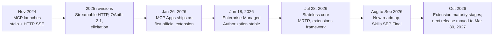
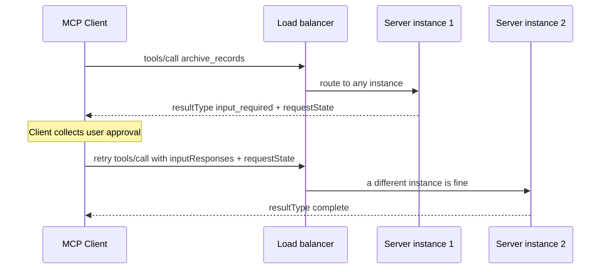
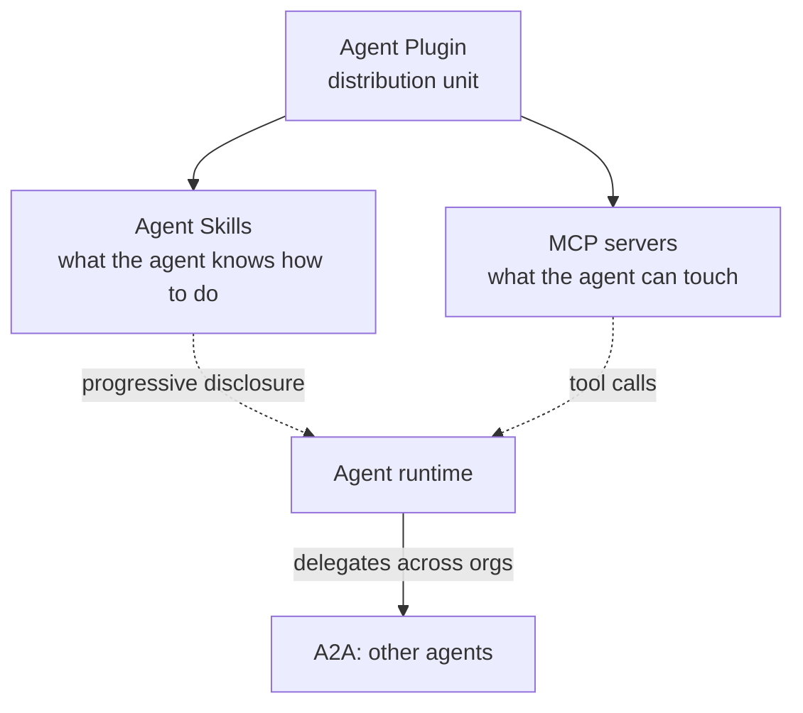
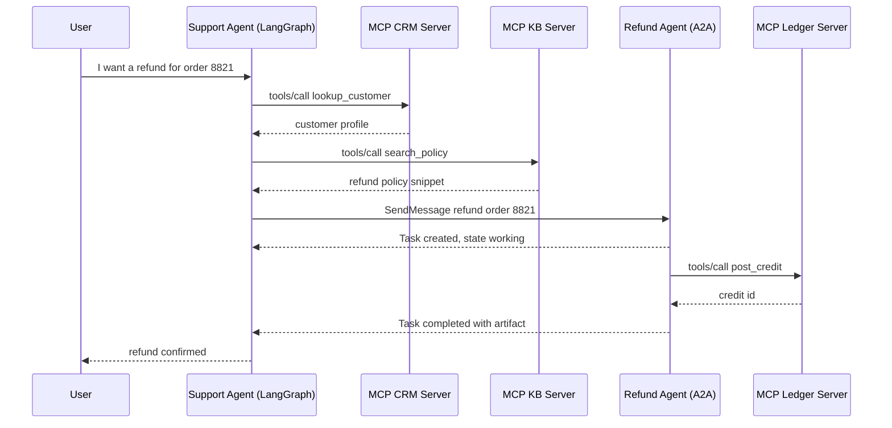
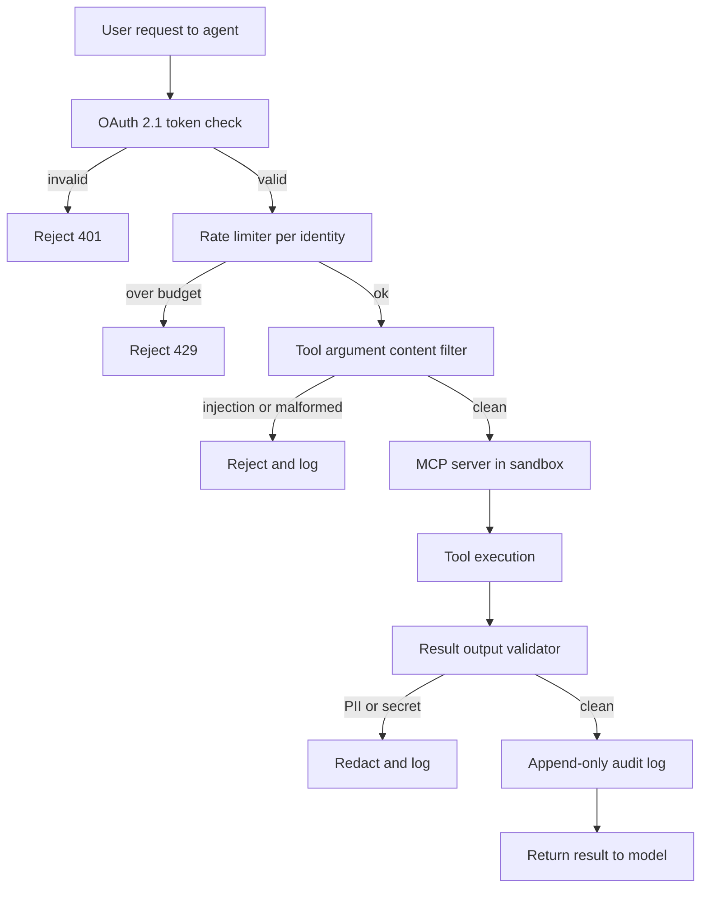

<div dir="rtl">

# استفاده از ابزار و MCP

ابزارها «دستان» یک Agent هستند. صنعت بر روی **Model Context Protocol (MCP)** استانداردسازی شده است، پروتکلی که تعاریف ابزار سفارشی و پراکنده را با یک لایه ارتباطی واحد جایگزین می‌کند که به صورت محلی روی stdio یا از راه دور روی Streamable HTTP اجرا می‌شود. مجوزدهی OAuth 2.1 و Streamable HTTP در بازنگری‌های مشخصات سال ۲۰۲۵ ارائه شدند (تحلیل‌ها و تفاسیر اغلب این را «MCP 2.0» می‌نامند، اما هیچ نسخه‌ای از مشخصات چنین نامی ندارد و نسخه‌های اصلی SDK 2.x در ژوئیه ۲۰۲۶ شماره‌گذاری مجزایی دارند)، و **بازنگری ۲۰۲۶-۰۷-۲۸** هسته پروتکل را به صورت بدون حالت (stateless) بازسازی کرد که بزرگ‌ترین بازطراحی اساسی از زمان عرضه MCP محسوب می‌شود (بخش [بازنویسی بدون حالت](#mcp-2026-07-28-the-stateless-rewrite) در ادامه را ببینید). به موازات آن، پروتکل **Agent-to-Agent (A2A)** لایه دسترسی به ابزار MCP را با هماهنگی میان Agentها تکمیل می‌کند و از اوت ۲۰۲۶ هر دو پروتکل زیر چتر واحد بنیاد لینوکس، یعنی Agentic AI Foundation قرار گرفته‌اند.

## فهرست مطالب

- [مکانیسم استفاده از ابزار](#the-tool-use-mechanism)
- [پروتکل Model Context Protocol (MCP)](#model-context-protocol-mcp)
- [تعریف ابزارهای با دقت بالا](#defining-high-precision-tools)
- [مقایسه MCP در برابر OpenAI Function Calling](#mcp-vs-openai-function-calling)
- [استریم فراخوانی‌های ابزار](#streaming-tool-calls)
- [بازنگری‌های ۲۰۲۵: Streamable HTTP و احراز هویت](#the-2025-revisions-streamable-http-and-auth)
- [ام‌سی‌پی ۲۰۲۶-۰۷-۲۸: بازنویسی بدون حالت](#mcp-2026-07-28-the-stateless-rewrite)
- [اکوسیستم و افزونه‌های MCP (نوامبر ۲۰۲۶)](#mcp-extensions-and-ecosystem-november-2026)
- [پلاگین‌های Agent](#agent-plugins)
- [پروتکل Agent-to-Agent (A2A)](#agent-to-agent-protocol-a2a)
- [چشم‌انداز پروتکل‌ها: ابزارها، Agentها و پرداخت‌ها](#the-protocol-landscape-tools-agents-and-payments)
- [نسخه A2A v1.0 و MCP در پروداکشن](#a2a-v10-and-mcp-in-production)
- [ابزارهای استفاده از کامپیوتر (Anthropic)](#computer-use-tools-anthropic)
- [سرویس Context7: سرور MCP مستندات زنده](#context7-live-documentation-mcp)
- [پرسش‌های مصاحبه](#interview-questions)
- [منابع](#references)

---

## مکانیسم استفاده از ابزار

استفاده از ابزار در یک چرخه ۳ مرحله‌ای رخ می‌دهد:
1. **ارائه اسکیما (Schema Presentation)**: اسکمای JSON مربوط به ابزارها در اختیار مدل قرار می‌گیرد.
2. **قصد و استخراج (Intent & Extraction)**: مدل یک فراخوانی یا «Call» خروجی می‌دهد (مانند `{"tool": "get_weather", "args": {"city": "Tokyo"}}`).
3. **اجرا و زمینه‌سازی (Execution & Contextualization)**: سیستم تابع را اجرا کرده و نتیجه را مجدداً به Prompt بازمی‌گرداند.

**نکته ظریف**: پشته‌های پروداکشن دیگر تعاریف ابزار را در Prompt سیستم به صورت هاردکد قرار نمی‌دهند، بلکه از **مانیفست‌های پویا (Dynamic Manifests)** استفاده می‌کنند که تنها ابزارهای لازم را بر اساس نیت کاربر واکشی می‌نمایند.

پنج تغییر در سمت ارائه‌دهندگان مدل در سال ۲۰۲۶ برای کد هارنس حائز اهمیت است:

- **قابلیت فراخوانی اجباری ابزار در بزرگ‌ترین مدل‌های Claude حذف شده است.** مدل‌های Fable 5.1، Mythos 5.1، Opus 5.5 و Sonnet 5.5 برای مقدار `any` یا `tool` در پارامتر `tool_choice` خطای HTTP 400 برمی‌گردانند؛ تنها مقادیر `auto` و `none` باقی مانده‌اند. مدل Haiku 5.5 همچنان مقدار اجباری `tool_choice` را می‌پذیرد، اما پاسخ در این حالت مستقیماً با فراخوانی ابزار شروع شده و حاوی هیچ بلاک تفکری (thinking block) نخواهد بود. الگوی استخراج قدیمی «اجبار به فراخوانی ابزار برای دریافت JSON» اکنون باید به `auto` به همراه استفاده دقیق از ابزار (strict tool use) یا خروجی‌های ساختاریافته (structured outputs) منتقل شود.
- **ابزارها می‌توانند در میانه گفتگو بدون از دست رفتن کش تغییر کنند.** نسخه بتای `inline-tools-2026-09-15` شرکت Anthropic (منتشرشده در ۲۲ سپتامبر) امکان تعریف، جایگزینی یا حذف ابزارها را درون یک پیام سیستم در میانه گفتگو بدون باطل کردن کش Prompt فراهم می‌کند و می‌تواند فهرست ابزارهای MCP واکشی‌شده را در یک بلاک `mcp_tool_listing` پین (Pin) کند تا سرور نتواند تعاریف را در میانه نشست تعویض نماید.
- **فراخوانی ابزار در GPT-6 Astra نیازمند Responses API است**، و Astra پارامترهای `temperature`، `top_p` و logprobs را نادیده می‌گیرد؛ بنابراین هارنس‌هایی که نمونه‌برداری را تنظیم می‌کردند یا logprobs را برای مسیریابی ابزار می‌خواندند، به مکانیسم دیگری نیاز دارند.
- **اهرم‌های تنظیم نمونه‌برداری در Claude نیز حذف شده‌اند.** تحت نسخه `2026-10-21` از Anthropic API (۲۱ اکتبر)، پارامترهای `temperature`، `top_p` و `top_k` روی همه مدل‌ها، حتی با مقادیر پیش‌فرض خود، خطای HTTP 400 بازمی‌گردانند. هر هشت نسخه اصلی جدید SDK و CLI (شامل Python 2.0.0، TypeScript 1.0.0، C# 13.0.0، Go 2.0.0، Java 3.0.0، PHP 1.0.0، Ruby 2.0.0 و `ant` CLI 2.0.0) این نسخه را به صورت پیش‌فرض ارسال می‌کنند و تحت مجوز Apache 2.0 بازنشر شده‌اند؛ از این رو، یک ارتقای معمول SDK هر کد مسیریابی ابزاری را که هنوز `temperature=0` ارسال می‌کند، دچار شکستگی خواهد کرد.
- **رشته‌های سمت سرور فهرست ابزارها را تثبیت می‌کنند.** نسخه بتای رشته‌های پیام Anthropic (۲ نوامبر ۲۰۲۶) پارامترهای system و tools را فقط هنگام درخواست ایجاد می‌پذیرد و تغییر در `tool_choice` یا `mcp_servers` را با خطای 400 `thread_fingerprint_mismatch` رد می‌کند، که این امر با تغییر ابزارها در میانه گفتگو تداخل دارد؛ همچنین رشته‌ها در هر لحظه ممکن است با خطای 404 مواجه شوند، بنابراین هارنس رونوشت‌ها (Transcript) را نگه داشته و دوباره بازپخش می‌کند (بخش [حافظه و وضعیت Agent](05-agent-memory-and-state.md#production-implementations) را ببینید).

---

## Model Context Protocol (MCP)

پروتکل MCP توسط شرکت Anthropic توسعه یافته (منتشرشده در نوامبر ۲۰۲۴) و اکنون استاندارد جهانی یکپارچه‌سازی ابزارها در میان Anthropic، OpenAI، Google، Microsoft و AWS است و به مدل‌ها اجازه می‌دهد فارغ از محل قرارگیری داده‌ها و ابزارها، با آن‌ها تعامل داشته باشند. حاکمیت این پروتکل در دسامبر ۲۰۲۵ به بنیاد Agentic AI Foundation وابسته به بنیاد لینوکس واگذار شد.

- **کلاینت MCP (MCP Client)**: برنامه هوش مصنوعی (مانند کد Agent شما).
- **سرور MCP (MCP Server)**: یک پروسه مستقل که ابزارها یا Tools (توابع)، منابع یا Resources (داده‌ها) و Promptها (قالب‌ها) را ارائه می‌دهد.
- **ارتباطات**: از JSON-RPC بر بستر stdio (محلی) یا Streamable HTTP (از راه دور) استفاده می‌کند.

### چرا MCP؟
- **امنیت**: ابزارها در پروسه مستقل خود اجرا می‌شوند، نه در منطق مدل.
- **قابلیت حمل (Portability)**: یک بار یک «ابزار Postgres» بنویسید و از آن در Claude، GPT یا Llama استفاده کنید.
- **کشف‌پذیری (Discoverability)**: متدهای استانداردشده `tools/list`، `resources/read` و `prompts/list` به همراه فراخوانی RPC با متد `server/discover` که در بازنگری ۲۰۲۶-۰۷-۲۸ اجباری شد.

---

## تعریف ابزارهای با دقت بالا

یک ابزار مناسب محیط‌های پروداکشن باید شامل موارد زیر باشد:

1. **اعتبارسنجی دقیق نوع داده (Strict Type Validation)**: از Pydantic یا Zod برای اعمال اسکیماها پیش از اجرای فراخوانی استفاده کنید، و حالت ابزار سخت‌گیرانه (strict tool mode) ارائه‌دهنده را فعال نمایید تا آرگومان‌ها در زمان تولید محدود به اسکیما باشند.
2. **داک‌استرینگ‌های تفصیلی (Detailed Docstrings)**: توضیح دهید که *چه زمانی نباید* از ابزار استفاده شود.
3. **آستانه‌های اطمینان (Confidence Thresholds)**: مدل را ملزم کنید که یک امتیاز `confidence` برای فراخوانی ابزار در خروجی ارائه دهد. با آن به عنوان یک سرنخ مسیریابی برخورد کنید، نه یک احتمال کالیبره‌شده.
4. **خطاهای تعمدی و قابل مشاهده برای مدل (Deliberate, Model-Visible Errors)**: از نسخه 2.1.0 مربوط به MCP Python SDK، خطاهای غیرمنتظره در یک هندلر لاگ می‌شوند و کلاینت تنها عبارت `Error executing tool <name>` را می‌بیند؛ برای پیام‌هایی که مدل باید بر اساس آن‌ها اقدام کند، `ToolError` صادر کنید. این رفتار پیش‌فرض درست است (زیرا ردگیری پشته یا stack trace جزئیات داخلی را افشا می‌کند)، اما به این معنی است که خطاهای قابل اقدام باید به صورت هدفمند طراحی شوند، نه اینکه نشت پیدا کنند.

```python
# MCP Python SDK 2.x: `pip install mcp` now resolves to 2.x, and FastMCP was renamed MCPServer.
# Projects not ready to migrate should pin mcp<2 (v1 receives security and critical fixes only).
from mcp.server import MCPServer

mcp = MCPServer("analytics")

@mcp.tool()
def execute_sql(query: str) -> list[dict]:
    """Run ONE read-only SELECT against the analytics replica.
    Do NOT use for DDL or writes: DROP, DELETE, and UPDATE are rejected
    by the database role, not just by this docstring."""
    ...  # parameterize, enforce a row limit, run under a read-only role
```

---

## مقایسه MCP با OpenAI Function Calling

| ویژگی | OpenAI Native | MCP |
|---------|---------------|-----|
| **میزان وابستگی (Coupling)** | بالا (مخصوص OpenAI) | پایین (مستقل / Agnostic) |
| **لایه انتقال (Transport)** | ارسال JSON در بدنه API | پروتکل JSON-RPC (محلی / از راه دور) |
| **دسترسی به داده (Data Access)**| بدون «منبع» بومی داده (Resource) | پشتیبانی بومی از `Resources` |
| **بهترین کاربرد (Best For)** | نمونه‌سازی اولیه (Prototyping) | ارکستراسیون سازمانی (Enterprise Orchestration) |

این مقایسه کمتر از آنچه جدول نشان می‌دهد حالت «یا این یا آن» دارد. سرویس Responses API متعلق به OpenAI، کیت توسعه نرم‌افزار Agents SDK آن، و همچنین Managed Agents API (نسخه بتای عمومی در ۱۰ سپتامبر ۲۰۲۶) همگی سرورهای MCP از راه دور را مصرف می‌کنند؛ بنابراین function calling فرمت ارتباطی درون API ارائه‌دهنده است و MCP نحوه بسته‌بندی، ایمن‌سازی و دسترسی به ابزار را مشخص می‌کند.

---

## استریم فراخوانی‌های ابزار

مدل‌های پیشرو از **حدس و گمان جزئی ابزار (Partial Tool Speculation)** پشتیبانی می‌کنند.
سیستم به جای انتظار برای تولید کامل JSON، به محض اینکه نام ابزار و شناسه‌های حیاتی در جریان استریم پدیدار شوند، شروع به «پیش‌واکشی» (Prefetching) نتایج ابزار می‌کند. این کار تاخیر (Latency) ادراک‌شده را تا **۴۰۰ الی ۸۰۰ میلی‌ثانیه** کاهش می‌دهد.

---

## بازنگری‌های ۲۰۲۵: Streamable HTTP و احراز هویت

بازنگری‌های مشخصات فنی MCP تاریخ‌گذاری می‌شوند و شماره‌گذاری نمی‌شوند: 2024-11-05، 2025-03-26، 2025-06-18، 2025-11-25، و 2026-07-28 (نسخه فعلی). بازنگری **2025-03-26** (مارس ۲۰۲۵) دو تغییر را معرفی کرد که MCP راه دور را کاربردی ساخت، و بازنگری 2025-06-18 مدل احراز هویت را به شکلی که امروزه استفاده می‌شود استحکام بخشید. عبارت «تصویب MCP 2.0 در مارس ۲۰۲۶» یک اشتباه متداول در تاریخ‌گذاری همین تغییرات با یک سال تاخیر است.

### ۱. لایه انتقال Streamable HTTP
پروتکل MCP در بدو انتشار، از stdio به صورت محلی یا از HTTP همراه با یک کانال مجزای Server-Sent Events از راه دور استفاده می‌کرد. **Streamable HTTP** ترکیب HTTP+SSE را با یک اندپوینت واحد جایگزین کرد: کلاینت پیام‌های JSON-RPC را به آن POST می‌کند، و سرور با یک پاسخ ساده JSON، یا در صورت نیاز به ارسال چندین پیام با یک استریم SSE پاسخ می‌دهد.

<div dir="ltr">

```
[MCP Client] ──── POST /mcp (JSON-RPC) ────→ [MCP Server]
             ←─── JSON response, or an SSE stream ───
```

</div>

- استقرار (Deployment) سرورهای MCP به عنوان میکروسرویس‌های ابری (نه صرفاً پروسه‌های محلی) را ممکن می‌سازد.
- پروتکل stdio همچنان به عنوان لایه انتقال محلی باقی می‌ماند؛ پروتکل HTTP+SSE از تاریخ 2025-03-26 منسوخ شده است و بازنگری 2026-07-28 آن را در مسیر رسمی منسوخ‌سازی مشخصات قرار داد.

### ۲. مجوزدهی با OAuth 2.1
سرورهای MCP از راه دور می‌توانند OAuth 2.1 همراه با PKCE را الزامی کنند. از تاریخ 2025-06-18 سرور MCP یک **سرور منبع (Resource Server)** تحت پروتکل OAuth است: سرور مجوزدهی خود را از طریق فراداده منبع محافظت‌شده (Protected Resource Metadata بر اساس RFC 9728) اعلام می‌کند و کلاینت‌ها باید پارامتر `resource` در RFC 8707 را ارسال کنند تا هر Token منحصراً وابسته به مخاطب هدف (Audience-bound) در یک سرور مشخص باشد. درخواستی که فاقد Token باشد با یک چالش مواجه می‌شود که به کلاینت می‌گوید از کجا شروع کند:

```http
HTTP/1.1 401 Unauthorized
WWW-Authenticate: Bearer resource_metadata="https://mcp.example.com/.well-known/oauth-protected-resource",
                         scope="files:read"
```

این امر سرورهای سازمانی MCP را با کنترل دسترسی دقیق به ازای هر سرور امکان‌پذیر می‌سازد. بازنگری 2025-11-25 اسناد فراداده شناسه کلاینت (Client ID Metadata Documents) را به عنوان مکانیسم پیشنهادی ثبت‌نام و موافقت تدریجی با محدوده دسترسی (Incremental scope consent) اضافه کرد؛ جایی که سرور در پاسخ به HTTP 403 `insufficient_scope`، محدوده مورد نیاز خود را اعلام می‌کند (افزایش سطح دسترسی یا step-up). سپس بازنگری 2026-07-28 ثبت پویای کلاینت (Dynamic Client Registration) را به نفع این اسناد فراداده منسوخ کرد و کلاینت‌ها را ملزم نمود تا در صورت ارسال پارامتر `iss` در RFC 9207 توسط سرور مجوزدهی، آن را اعتبارسنجی کنند؛ هر دوی این موارد در ادامه بررسی شده‌اند.

---

## نسخه 2026-07-28 پروتکل MCP: بازنویسی بدون وضعیت (Stateless Rewrite)

در تاریخ ۲۸ ژوئیه ۲۰۲۶، پروژه MCP بازنگری مشخصات (spec revision) **2026-07-28** را پس از یک دوره فریز ده‌هفته‌ای نسخه کاندیدای انتشار (release-candidate freeze) نهایی کرد؛ این بزرگ‌ترین بازنگری اساسی پروتکل از زمان راه‌اندازی MCP به شمار می‌رود. نکته برجسته اصلی: **هسته پروتکل اکنون بدون وضعیت (stateless) است**. دست‌دهی (handshake) `initialize` و هدر `Mcp-Session-Id` حذف شده‌اند؛ اکنون هر درخواست، نسخه پروتکل و قابلیت‌های کلاینت را در `_meta` حمل می‌کند و سرورها نیز هویت خود را در `_meta` نتایج اعلام می‌نمایند. وضعیت میان‌فراخوانی (cross-call state) به شناسه/هندل‌های صریح ایجادشده توسط سرور منتقل شده است که به عنوان آرگومان‌های معمولی ابزار ارسال می‌شوند. نتیجه عملی این است که یک سرور راه دور (remote) پروتکل MCP اکنون می‌تواند به صورت یک استقرار (Deployment) با مقیاس‌پذیری افقی در پشت یک متعادل‌کننده بار ساده با الگوریتم round-robin و با صفر وضعیت نشست مشترک اجرا شود؛ قابلیتی که پیش از این نیازمند نشست‌های چسبنده (sticky sessions) یا یک حافظه ذخیره‌سازی نشست مشترک بود.

### چگونه MCP به این نقطه رسید

<div dir="ltr">



</div>

### مقایسه سه نسل از MCP

| ابعاد (Dimension) | زمان راه‌اندازی (نوامبر ۲۰۲۴) | دوران Streamable HTTP (بازنگری‌های ۲۰۲۵) | بازنگری 2026-07-28 |
|---|---|---|---|
| **مدل نشست (Session model)** | دست‌دهی باوضعیت (Stateful) `initialize` | باوضعیت (Stateful)، هدر `Mcp-Session-Id` روی Streamable HTTP | بدون وضعیت (Stateless)؛ نسخه و قابلیت‌ها در هر درخواست داخل `_meta` قرار می‌گیرند |
| **لایه انتقال (Transport)** | stdio، HTTP+SSE | افزودن Streamable HTTP | پروتکل Streamable HTTP به همراه هدرهای مسیریابی اجباری `Mcp-Method` / `Mcp-Name`؛ پروتکل HTTP+SSE رسماً منسوخ (deprecated) شده است |
| **درخواست‌های آغازشده توسط سرور** | Sampling، roots (پوش سرور / server push) | افزودن elicitation | حذف شده؛ جایگزین‌شده با درخواست‌های چند رفت‌وبرگشتی (Multi Round-Trip Requests) (تلاش مجدد کلاینت همراه با وضعیت) |
| **ورودی کاربر در میانه فراخوانی** | ندارد | پوش `elicitation/create` | نتیجه `input_required` + تلاش مجدد کلاینت به همراه `requestState` |
| **کارهای طولانی‌مدت (Long-running work)** | ندارد | آزمایشی (Experimental) | افزونه رسمی Tasks (هندل‌های مبتنی بر نظرسنجی یا poll-based) |
| **رابط کاربری رندرشده توسط سرور** | ندارد | عرضه MCP Apps به عنوان یک افزونه (ژانویه ۲۰۲۶) | ادغام MCP Apps در فریم‌ورک رسمی افزونه‌ها |
| **احراز هویت (Auth)** | بدون استاندارد مشخص | پروتکل OAuth 2.1 به همراه PKCE، ثبت پویای کلاینت (Dynamic Client Registration)؛ افزودن CIMD و رضایت دامنه سطح‌بالا (step-up scope consent) در نسخه 2025-11-25 | مقاوم‌سازی OAuth: اعتبارسنجی `iss` مطابق RFC 9207، اعتبارات متصل به صادرکننده (issuer-bound credentials)، جایگزینی DCR با CIMD؛ افزونه EMA برای IdPهای سازمانی |
| **کش کردن لیست‌ها (List caching)** | ندارد | ندارد | الزام `ttlMs` + `cacheScope` در نتایج لیست و خواندن؛ ترتیب قطعی ابزارها برای اصابت به حافظه پنهان Prompt (Prompt-cache hits) |
| **بازیابی استریم (Stream recovery)** | ندارد | قابلیت ازسرگیری با `Last-Event-ID` در SSE | حذف شده؛ کلاینت‌ها درخواست را مجدداً ارسال می‌کنند، کارهای پایدار از افزونه Tasks استفاده می‌کنند |
| **مقیاس‌پذیری افقی (Horizontal scaling)** | تک‌پردازه (Single process) | نشست‌های چسبنده (Sticky sessions) در پشت متعادل‌کننده بار | هر نمونه به هر درخواستی پاسخ می‌دهد؛ بدون وضعیت مشترک |

### درخواست‌های چند رفت‌وبرگشتی (Multi Round-Trip Requests یا MRTR)

الگوی درخواست‌های آغازشده توسط سرور (`elicitation/create`، `sampling/createMessage`، `roots/list`) حذف شده است. زمانی که یک سرور در میانه فراخوانی به ورودی کاربر نیاز پیدا می‌کند، نتیجه‌ای با `resultType: "input_required"`، یک آرایه `inputRequests` و یک شیء مات (opaque blob) به نام `requestState` بازمی‌گرداند؛ کلاینت ورودی را جمع‌آوری کرده و درخواست اصلی را به همراه `inputResponses` پیوست‌شده مجدداً ارسال (retry) می‌کند. از آنجا که وضعیت درون درخواست مجدد حمل می‌شود، هر نمونه‌ای از سرور در پشت متعادل‌کننده بار می‌تواند فراخوانی متوقف‌شده را از سر بگیرد. این همان چیزی است که گیت‌های تأیید با دخالت انسان (human-in-the-loop approval gates) را با مقیاس‌پذیری افقیِ بدون وضعیت سازگار می‌سازد.

<div dir="ltr">



</div>

اکنون همه نتایج شامل یک فیلد اجباری `resultType` هستند (`complete` یا `input_required`؛ افزونه‌هایی نظیر Tasks مقادیر بیشتری به آن می‌افزایند)؛ نتایج حاصل از سرورهای قدیمی‌تر که فاقد این فیلد هستند به عنوان `complete` در نظر گرفته می‌شوند.

### چه مواردی منسوخ یا حذف شده‌اند

این بازنگری همچنین یک چرخه حیات رسمی برای ویژگی‌ها (شامل Active ،Deprecated ،Removed) با یک بازه حداقل دوازده‌ماهه برای منسوخ‌شدن (deprecation window) و یک رجیستری عمومی از ویژگی‌های منسوخ‌شده اتخاذ کرده است. برای ویژگی‌هایی که به تازگی در این بازنگری منسوخ شده‌اند (Roots ،Sampling ،Logging ،DCR)، زودترین زمان حذف ۲۸ ژوئیه ۲۰۲۷ خواهد بود؛ پروتکل HTTP+SSE که در مارس ۲۰۲۵ منسوخ شده بود، بر اساس زمان‌بندی قبلی خود پیش می‌رود. بر اساس توالی انتشار ماه‌های مارس و سپتامبر که در اکتبر (SEP-3398) به تصویب رسید، اولین نسخه‌ای که می‌تواند قابلیت‌های منسوخ‌شده در نسخه 2026-07-28 را عملاً حذف کند، نسخه سپتامبر ۲۰۲۷ است که به ناوگان سرورها یک ضرب‌الاجل مهاجرت مشخص و قابل برنامه‌ریزی می‌دهد.

| ویژگی (Feature) | وضعیت در 2026-07-28 | مسیر مهاجرت (Migrate to) |
|---|---|---|
| دست‌دهی `initialize`، هدر `Mcp-Session-Id` | حذف شده (Removed) | نسخه و قابلیت‌ها در `_meta` به ازای هر درخواست؛ فراخوانی RPC با `server/discover` برای بررسی و سنجش (probing) |
| `elicitation/create`، `sampling/createMessage`، `roots/list` | حذف شده (Removed) | درخواست‌های چند رفت‌وبرگشتی (Multi Round-Trip Requests) |
| قابلیت ازسرگیری استریم در SSE (`Last-Event-ID`) | حذف شده (Removed) | ارسال مجدد درخواست؛ استفاده از افزونه Tasks برای کارهای پایدار |
| قابلیت Roots | منسوخ شده (Deprecated) | ارسال دایرکتوری‌ها از طریق پارامترهای ابزار، URIهای منبع، یا پیکربندی سرور |
| قابلیت Sampling | منسوخ شده (Deprecated) | فراخوانی مستقیم API ارائه‌دهنده LLM |
| لاگ‌گیری (Logging) | منسوخ شده (Deprecated) | خروجی خطای استاندارد stderr (در stdio) یا OpenTelemetry |
| لایه انتقال HTTP+SSE | رسماً منسوخ شده (Formally deprecated) | پروتکل Streamable HTTP |
| ثبت پویای کلاینت یا Dynamic Client Registration (مطابق RFC 7591) | منسوخ شده (Deprecated) | اسناد فراداده شناسه کلاینت (Client ID Metadata Documents) (شناسه کلاینت یک URL است که فراداده کلاینت را میزبانی می‌کند) |

سازوکارهای RPC (`elicitation/create`، `sampling/createMessage`، `roots/list`) از پروتکل اصلی حذف شده‌اند، در حالی که ویژگی‌هایی که به آنها خدمت می‌کردند منسوخ شده و دارای مسیرهای مهاجرت هستند؛ به همین دلیل است که هر دو نوع سطر در جدول بالا دیده می‌شوند.

دو تغییر کوچک‌تر اما مهم در طراحی لایه انتقال: هدرهای HTTP با نام‌های `Mcp-Method` و `Mcp-Name` اکنون در درخواست‌های POST مبتنی بر Streamable HTTP اجباری هستند، تا متعادل‌کننده‌های بار، درگاه‌ها (gateways) و WAFها بتوانند ترافیک MCP را بدون نیاز به تجزیه بدنه JSON-RPC مسیریابی و فیلتر کنند؛ همچنین نتایج لیست‌ها (`tools/list`، `prompts/list`، `resources/list`) باید `ttlMs` و `cacheScope` را اعلام کنند، که رویکردی اصولی برای کش کردن کاتالوگ ابزارها در اختیار کلاینت‌ها قرار می‌دهد.

### فریم‌ورک افزونه‌ها (Extensions Framework)

هسته اکنون عمداً کوچک نگه داشته شده است؛ هر چیز دیگری یک **افزونه (extension)** است که با یک شناسه معکوس دامنه (reverse-DNS ID) مشخص می‌شود، به صورت مستقل از مشخصات هسته نسخه‌بندی می‌گردد و از طریق یک مسیر اختصاصی افزونه‌ها (Extensions Track) در فرآیند SEP مدیریت می‌شود.

**مراحل بلوغ (SEP-3392، نهایی‌شده در ۲۹ اکتبر ۲۰۲۶).** اکنون هر افزونه در یکی از سه مرحله قرار می‌گیرد و دایرکتوری مشخصات که در آن مستقر است (`specification/experimental/`، `beta/` یا `stable/`) نشان‌دهنده آن است:

| مرحله (Stage) | چه چیزهایی می‌توانند تغییر کنند | روی چه مواردی می‌توانید حساب کنید |
|---|---|---|
| **آزمایشی (Experimental)** | هر چیزی، در هر زمان و بدون اطلاع قبلی | هیچ چیز؛ این طراحی ممکن است به کلی ناپدید شود |
| **بتا (Beta)** | هر تغییری؛ تغییرات شکننده (breaking changes) باید نادر، دسته‌ای و مستند باشند | استفاده واقعی مورد استقبال است، اما تغییرات شکننده را هم در نظر داشته باشید |
| **پایدار (Stable)** | فقط همگام با یک بازنگری جدید در هسته پروتکل | رفتار در طول یک بازنگری پروتکل ثابت می‌ماند |

ارتقا به مشخصات هسته یک نقطه خروج است، نه مرحله چهارم. یک افزونه از مرحله Beta یا به Stable تبدیل می‌شود یا یک سند SEP در مسیر استانداردها (Standards Track SEP) آن را به هسته ارتقا می‌دهد؛ یک افزونه Stable نیز می‌تواند بعداً ارتقا یابد. پس از ارتقا در بازنگری R پروتکل، این قابلیت برای درخواست‌هایی که نسخه R یا بالاتر را اعلام می‌کنند به عنوان رفتار هسته عمل می‌کند، آخرین بازنگری افزونه همچنان بر بازنگری‌های قبلی حاکم است و مشخصات آن به دایرکتوری `specification/archived/` منتقل می‌شود. هر افزونه Beta مقصد نهایی مورد نظر خود را اعلام می‌کند: افزونه Tasks در مسیر پیوستن به هسته است، در حالی که Skills و Server Cards مقصدی را اعلام نکرده‌اند.

طبقه‌بندی اولیه، MCP Apps و احراز هویت سازمانی را در مرحله **Stable**؛ Tasks ،Skills و Server Cards را در مرحله **Beta**؛ و رهگیرها (interceptors)، نسخه‌ها (variants)، تریگرها و رویدادها (triggers and events) و حاشیه‌نویسی‌های ابزار (tool annotations) را در مرحله **Experimental** قرار داد. نکته آموزنده برای مصاحبه‌ها: یک SEP نهایی‌شده الزاماً یک رابط پایدار نیست. هر دو قابلیت Skills و Server Cards دارای SEPهای نهایی هستند و همچنان ممکن است دستخوش تغییرات شکننده شوند.

افزونه‌های رسمی عبارتند از:

| افزونه (Extension) | وضعیت (Status) | عملکرد آن (What it does) |
|---|---|---|
| **Tasks** (`io.modelcontextprotocol/tasks`) | بتا (Beta)؛ چرخه حیات بازطراحی‌شده مبتنی بر نظرسنجی (poll-based)، با مشارکت AWS | یک فراخوانی ابزار می‌تواند با یک هندل تسک (task handle) پاسخ دهد؛ کلاینت `tasks/get` را به صورت دوره‌ای استعلام (poll) می‌کند، ورودی‌های حین تسک را با `tasks/update` ارسال می‌کند و با `tasks/cancel` آن را لغو می‌نماید. این راهکار استاندارد برای کارهایی است که عمرشان فراتر از یک درخواست طول می‌کشد. |
| **MCP Apps** | پایدار (Stable)؛ رسمی از ۲۶ ژانویه ۲۰۲۶ | یک ابزار الگوی `ui://` را اعلام می‌کند؛ هاست آن را درون یک iframe در محیط ایزوله (sandboxed) بدون دسترسی به DOM و با سیاست امنیتی رد پیش‌فرض (deny-by-default CSP) رندر می‌کند، ارتباط میان رابط کاربری و هاست به صورت JSON-RPC از طریق postMessage منتقل می‌شود و اقدامات ناشی از رابط کاربری از همان مسیر رضایت فراخوانی ابزار (tool-call consent path) عبور می‌کنند. این قابلیت توسط Claude ،ChatGPT ،VS Code ،Goose و Microsoft 365 Copilot و دیگر پلتفرم‌ها رندر می‌شود. |
| **مجوزدهی مدیریت‌شده توسط سازمان (EMA / Enterprise-Managed Authorization)** | پایدار (Stable)؛ عرضه‌شده در ۱۸ ژوئن ۲۰۲۶ | یک سازمان دسترسی به سرور MCP را به صورت متمرکز از طریق IdP خود فراهم (provision) می‌کند: یک assertion مربوط به OIDC یا SAML طبق RFC 8693 با یک ID-JAG مبادله می‌شود که سپس از طریق اعطای حامل JWT یا JWT bearer grant (طبق RFC 7523) با یک Token دسترسی MCP مبادله می‌گردد، بدون اینکه صفحات رضایت به ازای هر کاربر نمایش داده شوند. سرویس Okta اولین IdP پشتیبانی‌شده بود؛ Claude و VS Code از همان زمان راه‌اندازی، پشتیبانی از آن را عرضه کردند. از ۳۰ اکتبر ۲۰۲۶، مستندات رسمی سرویس‌های Okta ،Ping Identity (نسخه PingFederate 13.1 به بالا) ،Descope ،Athenz ،Janssen و ThunderID را به عنوان صادرکننده و پذیرنده ID-JAG؛ سرویس‌های Auth0 ،WorkOS AuthKit و Scalekit را به عنوان پذیرنده در دسترسی زودهنگام (early access)؛ سرویس‌های Stytch و AuthPlane را به عنوان پذیرنده؛ و Keycloak را به صورت آزمایشی (نسخه 26.7.0 و بالاتر در پشت یک پرچم ویژگی / feature flag) فهرست کرده‌اند؛ صدور ID-JAG در Okta به ۲۵۰ عدد ID-JAG به ازای هر کاربر، به ازای هر برنامه منبع در هر ماه محدود شده است مگر اینکه Okta for AI Agents را خریداری کنید که یک سقف واقعی برای ناوگان‌های Agentها به شمار می‌رود، و پیاده‌سازی‌های مختلف از نسخه‌های پیش‌نویس متفاوتی پیروی می‌کنند. سازوکار اعطای ID-JAG خود هنوز یک پیش‌نویس اینترنتی (Internet-Draft نسخه -04) از کارگروه OAuth در IETF است و یک RFC به حساب نمی‌آید، بنابراین باید انتظار تغییرات در سطح پروتکل ارتباطی (wire-level changes) را داشته باشید. |

### چک‌لیست مهاجرت

- حذف منطق `initialize` و شناسه نشست (session-ID)؛ ارسال نسخه و قابلیت‌ها در `_meta`، و پیاده‌سازی RPC با نام `server/discover` (که اکنون الزامی / MUST است).
- تبدیل جریان‌های elicitation و sampling به MRTR: بازگرداندن `input_required` به همراه `requestState`، و پذیرش تلاش‌های مجدد به همراه `inputResponses`.
- انتقال هرگونه وضعیت بین‌فراخوانی (cross-call state) به هندل‌های صریحی که به عنوان آرگومان‌های ابزار ارسال می‌شوند، یا به‌کارگیری افزونه Tasks.
- ارسال هدرهای `Mcp-Method` و `Mcp-Name`، اعلام `ttlMs` و `cacheScope` در نتایج لیست‌ها، و بازگرداندن ابزارها با ترتیبی قطعی (deterministic order).
- برنامه‌ریزی برای مهاجرت احراز هویت از DCR به Client ID Metadata Documents؛ اعتبارسنجی `iss` مطابق RFC 9207 و عدم استفاده مجدد از اعتبارات کلاینت (client credentials) در میان صادرکنندگان مختلف.
- برآورد و تخصیص زمان و تلاش واقعی: خود نگه‌دارندگان هشدار می‌دهند که پیاده‌سازی‌های سفارشی با فرآیند ارتقا و بازنویسی قابل‌توجهی (significant uplift) مواجه خواهند شد.

منابع: modelcontextprotocol.io/specification/2026-07-28/changelog، blog.modelcontextprotocol.io

---

## اکستنشن‌ها و اکوسیستم MCP (نوامبر ۲۰۲۶)

مواردی از نقشه راه که این فصل تا مه ۲۰۲۶ دنبال می‌کرد، تا حد زیادی عرضه شده‌اند. وضعیت تا اوایل نوامبر ۲۰۲۶ به شرح زیر است:

| آیتم نقشه راه (چارچوب مه ۲۰۲۶) | وضعیت (نوامبر ۲۰۲۶) |
|---------------------------------|------------------------|
| مقیاس‌پذیری انتقال (Transport) / هسته بدون وضعیت (Stateless) | **عرضه شده** در بازنگری ۲۰۲۶-۰۷-۲۸ (ببینید: [بازنویسی بدون وضعیت](#mcp-2026-07-28-the-stateless-rewrite)). نقشه راه ۲۲ اوت فراتر می‌رود: Streamable HTTP به عنوان اتصال (Binding) واحد، که برای سرورهای محلی نیز روی stdin/stdout به کار گرفته می‌شود |
| برنامه‌های MCP (رابط‌های کاربری سمت سرور یا Server-rendered UIs) | **پایدار (Stable).** در ۲۶ ژانویه ۲۰۲۶ به عنوان نخستین اکستنشن رسمی عرضه شد؛ توسط Claude، ChatGPT، VS Code، Goose و Microsoft 365 Copilot، در میان سایر ابزارها، رندر می‌شود. بسته Apps SDK بدون تغییر پروتکل ارتباطی (Wire Protocol)، در ext-apps 2.0.0 (۸ سپتامبر) به پکیج‌های تایپ‌اسکریپت نسخه ۲ منتقل شد، بنابراین نماهای (Views) نسخه 2.x در میزبان‌های (Hosts) نسخه 1.x اجرا می‌شوند و میزبان‌های نسخه 2.x نیز نماهای نسخه 1.x را رندر می‌کنند: شکست‌ها در سطح SDK بدون شکست در پروتکل ارتباطی رخ داده‌اند، که فریم‌ورک اکستنشن‌ها دقیقاً برای همین هدف طراحی شده بود |
| اکستنشن وظایف (کارهای طولانی‌مدت / Long-running work) | **بتا (Beta).** با عنوان `io.modelcontextprotocol/tasks` در بازنگری ۲۰۲۶-۰۷-۲۸ عرضه شد و پیرامون هندل‌های وظیفه مبتنی بر نظرسنجی (Poll-based task handles) بازطراحی گردید، اما مخزن اکستنشن همچنان فقط حامل تگ‌های پیش‌انتشار v0.2.x است و مرحله بتا امکان اعمال تغییرات ساختارشکن (Breaking Changes) مستندشده را می‌دهد، بنابراین این رابط را در حال تثبیت در نظر بگیرید. کارگروه جدید وظایف و رویدادها (Tasks and Events Working Group که در اکتبر تشکیل شد) مالکیت آن را بر عهده دارد. نقشه راه ۲۲ اوت، Tasks (SEP-2663) را برای گنجاندن نهایی در هسته پروتکل هدف‌گذاری کرده است، پس از یک بررسی ترکیب‌پذیری (Composition review) به گونه‌ای که وظایف، اشتراک‌ها (Subscriptions) و اعلان‌های پیشرفت، چرخه حیات، مدل لغو (Cancellation) و سطح خطای یکسانی را به اشتراک بگذارند |
| احراز هویت سازمانی (Enterprise) | **پایدار (Stable).** در ۱۸ ژوئن ۲۰۲۶ به عنوان اکستنشن Enterprise-Managed Authorization عرضه شد (Okta اولین ارائه‌دهنده هویت یا IdP بود؛ Claude و VS Code در زمان عرضه). تا ۳۰ اکتبر جدول پشتیبانی به دوازده IdP و ارائه‌دهنده احراز هویت گسترش یافته بود، با سازگاری متقابل (Interop) ناهمگون میان پیش‌نویس‌های بازنگری. گام بعدی هویت Agent است: Tokenهای محدود به فرستنده DPoP (SEP-1932) و فدراسیون هویت بار کاری (Workload Identity Federation / SEP-1933) هنوز پیش‌نویس‌های باز هستند، هرچند کلاینت تایپ‌اسکریپت نسخه 2.1.0 هم‌اکنون DPoP را ارائه می‌دهد |
| کارت‌های سرور MCP (کشف پیش از اتصال / Pre-connection discovery) | **بتا (Beta).** سند SEP-2127 در ۶ اکتبر نهایی شد (اکستنشن `io.modelcontextprotocol/server-card`). یک کارت می‌تواند در هر URI قرار داشته باشد؛ `<streamable-http-url>/server-card` مکان پیشنهادی است و نه الزامی. کلاینت‌ها کارت‌ها را از طریق AI Catalog دامنه در `/.well-known/ai-catalog.json` می‌یابند، یک نمایه بین‌پروتکلی که توسط کارگروه Agent Card تحت بنیاد لینوکس نگهداری می‌شود و کارت‌های Agent مربوط به A2A و افزونه‌های Claude Code را نیز فهرست می‌کند. کارت‌ها عمداً هیچ فهرستی از ابزارها، منابع یا Promptها ندارند، بنابراین کلاینت همچنان ساختار ابزارها را از فراخوانی‌های فهرستی در زمان اجرا دریافت می‌کند. متمایز از `server/discover` RPC در هسته پروتکل |
| رجیستری MCP (MCP Registry) | همچنان در حالت پیش‌نمایش (`registry.modelcontextprotocol.io`)، API در نسخه v0.1 فریز شده است؛ زمان‌بندی عرضه عمومی (GA) اعلام نشده است. نسخه v1.8.1 (۶ اوت) مشکل تصاحب فضای نام سازمان (Organization-namespace takeover) در GitHub Pages را برطرف کرد |
| مهارت‌ها روی MCP (جدید) | **بتا (Beta).** این SEP (SEP-2640) در ۱۳ سپتامبر ۲۰۲۶ به عنوان اکستنشن `io.modelcontextprotocol/skills` نهایی شد و TypeScript SDK آن را در نسخه 2.4.0 (۲۳ اکتبر) عرضه کرد؛ در ادامه را ببینید |

**اکنون فرآیند کشف (Discovery) دارای دو لایه متمایز است که تفکیک آن‌ها حائز اهمیت است:** کشف پیش از اتصال از طریق AI Catalog یک دامنه که به کارت‌های سرور اشاره دارد (یک اکستنشن بتا؛ تأمین‌کننده داده‌های رجیستری‌ها، خزنده‌ها و لیست‌های مجاز / Allowlisting) در مقابل `server/discover` RPC درون پروتکل (هسته اجباری از تاریخ ۲۰۲۶-۰۷-۲۸؛ تأمین‌کننده مذاکره نسخه / Version negotiation). از آنجا که همین سند کاتالوگ سرورهای MCP و Agentهای A2A را نمایه می‌کند، یک پلتفرم سازمانی می‌تواند قابلیت‌های ریموت هر دو نوع را از یک نقطه در لیست مجاز قرار دهد، اما این موضوع را به عنوان یک رویکرد و جهت‌گیری در نظر بگیرید، نه یک استاندارد قطعی.

### اولویت‌های نقشه راه ۲۲ اوت

نگهدارندگان اصلی پروتکل در ۲۲ اوت ۲۰۲۶ یک نقشه راه ۶ تا ۱۲ ماهه را منتشر کردند که شامل بررسی تسریع‌شده SEP برای پنج حوزه می‌شود.

**زمان ارائه بازنگری بعدی.** سند SEP-3398 (پذیرفته‌شده، ادغام‌شده در ۲۷ اکتبر) انتشار برنامه‌ریزی‌شده برای دسامبر ۲۰۲۶ را به **۳۰ مارس ۲۰۲۷** موکول می‌کند، «مشروط به تأیید در تقویم گذار»، و زمان انتشار مشخصات (Spec) را به طور کلی در آخرین سه‌شنبه ماه‌های مارس و سپتامبر تعیین می‌نماید. هر انتشار یک چرخه هشت‌ماهه را طی می‌کند: فریز اولیه (Soft Freeze) از ۲.۵ ماه قبل، نسخه‌های بتای SDK از ۱.۵ ماه قبل، و فریز نهایی (Hard Freeze) از یک ماه قبل. اکنون یک SEP پیش از بررسی رسمی، به حامی مالی یا سازمانی از سوی یک کارگروه یا نگهدارنده اصلی (Core Maintainer) نیاز دارد. دو پیامد برنامه‌ریزی: هر موردی که تا زمان فریز اولیه نهایی نشود، شش ماه کامل به تعویق می‌افتد، و ارتقای SDKها می‌تواند بر اساس تاریخ‌های ثابت برنامه‌ریزی شود، به جای اینکه به عنوان اتفاقات غافلگیرکننده دنبال شوند.

| حوزه اولویت | معنای آن برای توسعه‌دهندگان |
|-------------|-----------------------------|
| **پریمیتیوهای پیام‌رسانی Agentic** | رویدادهای آغازشده توسط سرور (Server-initiated events) و وبهوک‌ها (اکنون تحت مالکیت کارگروه وظایف و رویدادها)؛ وظایف (Tasks)، اشتراک‌ها (Subscriptions) و اعلان‌های پیشرفت روی یک چرخه حیات واحد همگرا می‌شوند |
| **انتقال مبتنی بر HTTP (یا HTTP-native transport)** | یک اتصال واحد (Streamable HTTP) در همه جا، از جمله روی stdio برای سرورهای محلی؛ گسترش کش‌گذاری از `ttlMs` / `cacheScope` به ETagها، شامل نتایج نسخه‌بندی‌شده فراخوانی ابزار |
| **هویت Agent و امنیت سازمانی** | کارگروه هویت Agent (در حال تشکیل) برای نهایی‌سازی DPoP و یک مدل هویت واگذارشده (Delegated identity) مبتنی بر فدراسیون هویت بار کاری، ID-JAG و تبادل Token در RFC 8693، با هماهنگی گروه‌های OAuth و WIMSE در IETF؛ تصدیق حضور انسان (کلاینت تعاملی در مقابل Agent بدون رابط یا Headless Agent) در دست بحث است |
| **پریمیتیوهای بهبودیافته** | بازطراحی ساختار خروجی `tools/call` (بازگرداندن همزمان `content` و `structuredContent` منجر به پیاده‌سازی‌های واگرا شده بود)؛ یک مکانیزم آزمایشی کشف تدریجی (Progressive discovery) در سمت سرور برای کاتالوگ‌های بزرگ ابزار |
| **تجربه توسعه‌دهنده SDK** | یک قرارداد رسمی برای اکستنشن‌ها؛ آزمایشی برای تولید یک Tier 1 SDK و راهنماهای شروع سریع (Quickstarts) از روی مشخصات و مجموعه آزمون انطباق (Conformance suite) |

دو پرسش مصاحبه آینده‌نگرانه که این موارد ایجاد می‌کنند عبارتند از: چگونه یک Agent بدون رابط (Headless Agent) با هویت اختصاصی خود به یک سرور MCP دسترسی پیدا می‌کند، و چگونه بدون پر کردن پنجره زمینه (Context Window)، یک کاتالوگ با ۲۰۰۰ ابزار را ارائه می‌دهید.

### مهارت‌ها روی MCP (Skills over MCP)

مهارت‌های Agent (پوشه‌های `SKILL.md`) در ۱۹ اوت ۲۰۲۶ از وضعیت بتا در Claude API خارج شدند و خود این فرمت در ۲۲ اکتبر به پروژه‌ای تحت بنیاد هوش مصنوعی Agentic (یا Agentic AI Foundation) تبدیل شد. اکستنشن مهارت‌های MCP (که SEP آن در ۱۳ سپتامبر نهایی شد و از ۲۹ اکتبر در مرحله بتا قرار دارد) به سرور امکان می‌دهد مهارت‌ها را در کنار ابزارهایی که توصیف می‌کنند منتشر کند، به جای اینکه آن‌ها را درون یک فایل‌سیستم یا افزونه کپی کند. سرورهایی که این قابلیت را تعریف می‌کنند، متدهای `skills/list` و `skills/get` را پیاده‌سازی می‌نمایند و فایل‌های مهارتی با متد معمولی `resources/read` خوانده می‌شوند. هر مدخل مهارت، اطلاعات مقدماتی (Frontmatter) و یک مانیفست کامل فایل همراه با اندازه و خلاصه پیام (Digest) رمزنگاری‌شده SHA-256 به ازای هر فایل را به همراه دارد.

قوانین میزبان (Host) بخشی هستند که باید به خوبی فراگرفت، چرا که به این پرسش پاسخ می‌دهند: «چگونه مانع از آن می‌شوید که یک سرور ریموت بی‌سر و صدا دستورالعمل‌هایی را که Agent من بارگذاری می‌کند تغییر دهد؟»؛ این در واقع نسخه مهارتی از ترفند زیر پا خالی کردن ناگهانی ابزار (Tool Rug Pull) است:

- میزبان‌ها **باید** پیش از استفاده، اندازه، Digest و Frontmatter را اعتبارسنجی کنند و **باید** هرگونه تأییدیه پایدارشده را به کل مانیفست مقید سازند، به طوری که تغییر، اضافه یا حذف شدن یک فایل موجب ابطال تأییدیه شود.
- میزبان‌ها **نباید** فایل‌های مهارتی را پیش‌واکشی (Prefetch) کنند و **باید** محتوای مهارت را به عنوان غیرقابل اعتماد در نظر بگیرند.
- دسترسی‌های `allowed-tools` مربوط به یک مهارت یا هرگونه اجرای کد در سمت میزبان نیازمند تأیید صریح به ازای هر مهارت است، و خواندن متقابل میان سرورها (Cross-server read) نیازمند تأیید به ازای هر فراخوانی با ذکر نام هر دو سرور است.

پذیرش این قابلیت هنوز در مراحل اولیه است. سرور MCP مربوط به Hugging Face آن را پیاده‌سازی کرده است، و TypeScript SDK نسخه 2.4.0 (۲۳ اکتبر) قابلیت مهارت‌ها روی MCP را ارائه می‌دهد (`loadSkills` در سمت سرور، و یک `SkillsClient` که اندازه، Digest و Frontmatter را در هر بار خواندن اعتبارسنجی می‌کند؛ تنها ساختار اتصالی `attach` به عنوان آزمایشی علامت‌گذاری شده است)؛ آخرین نسخه منتشرشده از Python SDK (نسخه 2.3.0، ۲ اکتبر) پیش از این تاریخ عرضه شده است. از آنجا که این اکستنشن در وضعیت بتا قرار دارد، نسخه SDK را ثابت (Pin) کنید و پیش از رسیدن به وضعیت پایدار (Stable)، انتظار تغییرات ساختارشکن مستند را داشته باشید. مهارت‌ها در سایر پلتفرم‌ها نیز در حال تبدیل شدن به مصنوعات تولیدی (Production artifacts) نسخه‌بندی‌شده هستند (AWS در ۳۰ سپتامبر دستورات `update-skill` را برای جعبه‌ابزار Agent خود اضافه کرد)، بنابراین همانند وابستگی‌های بسته‌ها، برای آن‌ها نیز فرآیند تثبیت نسخه (Pinning) و بررسی به‌روزرسانی در نظر بگیرید.

**مقیاس اکوسیستم:** دانلودهای SDK به صدها میلیون بار در ماه می‌رسد. پست انتشار خود پروتکل در ۲۸ ژوئیه، آماری نزدیک به نیم میلیارد دانلود ماهانه را در میان Tier 1 SDKها اعلام کرد؛ Anthropic نیز به طور جداگانه ۴۰۰ میلیون دانلود ماهانه و رشد ۴ برابری در طول سال را گزارش داد، بنابراین این آمار تجمیعی را بیشتر به عنوان مرتبه بزرگی (Order of magnitude) در نظر بگیرید تا یک عدد دقیق، و پیش از استناد به آن، تعریف متریک را بررسی کنید. در ماه اوت، تنها یک دایرکتوری کانکتورها **بیش از ۹۵۰ سرور MCP** را فهرست کرده بود. در نسخه نهایی ۲۸ ژوئیه، شرکت‌های AWS، Cloudflare، Google Cloud، Microsoft و Netlify پشتیبانی رسمی خود را اعلام کردند. مایکروسافت Federated Copilot Connectors مبتنی بر MCP را معرفی کرد که از طریق مرکز مدیریت Microsoft 365 قابل مدیریت است، اپل محیط Xcode را به یک میزبان MCP برای Agentهای کدنویسی خارجی تبدیل کرد، و بلومبرگ یک مطالعه موردی عملیاتی از به کارگیری MCP به عنوان لایه ابزار-Agent داخلی خود منتشر نموده است.

**مهاجرت به بازنگری بدون وضعیت (Stateless) واقعی اما کند است.** آمار دانلود npm برای اکتبر ۲۰۲۶: حدود ۲۴۵.۸ میلیون دانلود برای نسخه v1 از TypeScript SDK (`@modelcontextprotocol/sdk`) در مقابل حدود ۶۲.۱ میلیون برای `@modelcontextprotocol/core`، ۴۹.۲ میلیون برای `@modelcontextprotocol/server`، و ۳۲.۹ میلیون برای `@modelcontextprotocol/client`. در یک مقایسه تک‌پکیجی، حجم نسخه v2 اکنون تقریباً ۱۳ تا ۲۵ درصد حجم نسخه v1 است که حدوداً دو برابر بازه ۸ تا ۱۳ درصدی ماه سپتامبر محسوب می‌شود، در حالی که نسخه v1 همچنان در حال رشد است (حدود ۲۰۷ میلیون در بازه ۳۰ روزه منتهی به ۱۴ اوت، ۲۳۱.۹ میلیون در سپتامبر). آمار دانلودها شامل نصب‌های CI و وابستگی‌های گذرا (Transitive dependencies) نیز می‌شود، بنابراین این نسبت را به عنوان یک روند در نظر بگیرید، نه آمارگیری دقیق سرورها. برای یک دوره طولانی همزیستی دو نسخه برنامه‌ریزی کنید: C# SDK v2.2.0 (۱۳ اوت) قابلیت `HttpServerSessionMode` را اضافه کرد که به یک اندپوینت واحد امکان می‌دهد به طور همزمان به کلاینت‌های باوضعیت (Stateful) نگارش ۲۰۲۵-۱۱-۲۵ و کلاینت‌های بدون وضعیت (Stateless) نگارش ۲۰۲۶-۰۷-۲۸ سرویس‌دهی کند؛ الگویی که در صورت مدیریت ناوگانی از سرورها با کلاینت‌های ناهمگن باید از آن الگوبرداری کرد.

نسخه‌های اصلی (Major) بسته SDK کد را می‌شکنند، حتی در مواردی که پروتکل ارتباطی دست‌نخورده باقی مانده باشد. در پایتون، دستور `pip install mcp` از زمان نسخه 2.0.0 (۲۸ ژوئیه) به نگارش 2.x متصل می‌شود: `FastMCP` به `MCPServer` تبدیل شد، یک `Client` واحد جایگزین لایه‌بندی انتقال بعلاوه `ClientSession` در نسخه v1 گردید، و نسخه v1 تنها اصلاحات امنیتی و حیاتی را دریافت می‌کند؛ بنابراین آموزش‌هایی که `FastMCP` را وارد (Import) می‌کنند در نصب‌های جدید با خطا مواجه می‌شوند. فریم‌ورک‌های Agent ظرف چند هفته این مسیر را دنبال کردند (OpenAI Agents SDK 0.20.0 از هر دو نسخه اصلی پشتیبانی می‌کند؛ LangChain 1.4.0 مسیریابی وقفه MCP را مشروط به دوره پروتکل مورد توافق قرار می‌دهد)، که نشان‌دهنده شعاع اثر (Blast radius) یک نسخه اصلی در وابستگی مشترک تمام فریم‌ورک‌ها است. اکنون Tier 1 SDKها شامل TypeScript، Python، C#، Go، Rust (ارتقایافته در ۲۱ اوت) و Ruby (ارتقایافته در ۲۸ سپتامبر) هستند؛ جاوا در سطح Tier 2 و زبان‌های Swift، PHP و Kotlin در سطح Tier 3 قرار دارند. مجموعه آزمون انطباق، مجموعه‌های نیازمندی منجمدشده را برای بازنگری منتشر می‌کند (که در اوایل نوامبر هنوز در نسخه 0.2.0-alpha.12 است).

**حکمرانی (Governance):** پروتکل MCP تحت نظارت بنیاد هوش مصنوعی Agentic در بنیاد لینوکس (AAIF) اداره می‌شود که در ۲۲ اکتبر چهار پروژه جدید (Agent Skills از Anthropic، Open Responses از OpenAI، OpenEnv از Hugging Face و OpenSandbox از Alibaba) را به شش پروژه اولیه (MCP، goose، AGENTS.md، agentgateway، A2A و Agent Router، که قبلاً Envoy AI Gateway نام داشت) اضافه کرد و اکنون به مجموع **۱۰ پروژه میزبانی‌شده و ۳۰۵ سازمان عضو** رسیده است. نکته کاربردی: فرمت مهارت‌ها، یک API باز به سبک Responses، محیط‌های Agent و محیط‌های ایزوله (Sandboxها) اکنون بنیاد مشترکی دارند که بر پروتکل ابزار نظارت می‌کند، بنابراین پرسش «آیا این سرمایه‌گذاری متکی بر یک ارائه‌دهنده منفرد است» برای بیشتر بخش‌های پشته فناوری Agent پاسخ یکسانی دارد. کارگروه حکمرانی یک نردبان مشارکت‌کنندگان (Contributor Ladder) و یک مدل تفویض اختیار را اجرا می‌کند که به کارگروه‌های تخصصی اجازه می‌دهد پیشنهادات بهبود مشخصات یا SEPs (Specification Enhancement Proposals) را بدون نیاز به بررسی کامل نگهدارندگان اصلی بپذیرند؛ بازنگری ۲۰۲۶-۰۷-۲۸ یک مسیر رسمی اکستنشن‌ها (Extensions Track) را اضافه کرد، از ۲۸ سپتامبر نویسندگان SEP باید پیش از ایجاد Pull Request برای SEP، پروپوزال را با کارگروه یا گروه علاقه‌مندی مرتبط مورد بحث قرار دهند، و طبق SEP-3398 یک SEP پیش از بررسی رسمی نیازمند حامی مالی/سازمانی از میان کارگروه‌ها یا نگهدارندگان اصلی است. بنیاد AAIF همچنین اولین مدرک MCP مستقل از ارائه‌دهنده را در ۱۴ سپتامبر تحت عنوان همکار پروتکل زمینه مدل یا Model Context Protocol Associate (MCPA) معرفی کرد: ۲۵۰ دلار، ۹۰ دقیقه، منطبق با بازنگری ۲۰۲۶-۰۷-۲۸، که ۲۴ درصد از آزمون به مباحث امنیت و حکمرانی اختصاص دارد.

منابع: modelcontextprotocol.io (مشخصات، نقشه راه، اکستنشن‌ها)، blog.modelcontextprotocol.io، github.com/modelcontextprotocol، aaif.io

---

## پلاگین‌های Agent (Agent Plugins)

پروتکل MCP نحوه دسترسی یک Agent به یک ابزار را استانداردسازی می‌کند. **پلاگین‌های Agent (Agent Plugins)** که در ۶ اوت ۲۰۲۶ به نسخه 1.0.0 رسید، نحوه *ارائه و ارسال (ship)* بسته‌ای از قابلیت‌ها به یک Agent را استانداردسازی می‌کند. این مشخصه، یک فرمت بسته‌بندی مستقل از ارائه‌دهنده (vendor-neutral) است که توسط یک کمیته راهبری فنی (technical steering committee) متشکل از Amazon ،Cursor ،Microsoft ،OpenAI و Vercel هدایت می‌شود، و GitHub در ۱۲ اوت آن را به طور عمومی در دسترس VS Code، Copilot CLI، Copilot SDK و اپلیکیشن Copilot قرار داد. نسخه 1.0.0 همچنان تنها نسخه منتشرشده است؛ یک پیش‌نویس کاری (working draft) برای نسخه 1.1.0 در ۱۹ اوت با پیشنهادهایی برای کشف مهارت‌های دارای فضای نام (namespaced skill discovery)، نام‌های نمایشی و آیکون‌های پرتابل (قابل‌حمل)، و داده‌های افزونه MCP به ازای هر سرور باز شد که همگی همچنان در محدوده مهارت‌ها به‌علاوه MCP که در ادامه شرح داده شده است، قرار دارند.

یک پلاگین در واقع یک دایرکتوری است:

<div dir="ltr">

```
my-plugin/
├── plugin.json          # required manifest
├── skills/              # optional: Agent Skills (SKILL.md files)
│   └── code-review/
│       └── SKILL.md
├── mcp.json             # optional: MCP server declarations
└── com.example.client/  # optional: client-specific extras, namespaced
```

</div>

طرحواره (اسکیما) فایل `mcp.json` از سه ساختار سرور پشتیبانی می‌کند (stdio همراه با command، args و env؛ پروتکل Streamable HTTP؛ و SSE) و دو متغیر محیطی `PLUGIN_ROOT` و `PLUGIN_DATA` را رزرو می‌نماید که کلاینت در زمان بارگذاری (load time) آن‌ها را تزریق می‌کند.

تصمیم طراحی که ارزش بررسی دارد این است که این مشخصه فنی از استانداردسازی چه مواردی **خودداری می‌کند**. تنها دو نوع مؤلفه قابل‌حمل (portable) هستند: مهارت‌ها (skills) و سرورهای MCP. دستورات (Commands)، قلاب‌ها (hooks)، ساب‌ایجنت‌ها (subagents)، قوانین (rules) و سرورهای LSP همگی خاص کلاینت باقی می‌مانند مگر اینکه در یک دایرکتوری دارای فضای نام حمل شوند. این کار سطح پرتابل را به اندازه کافی کوچک نگه می‌دارد تا یک پلاگین حقیقتاً در همه‌جا اجرا شود، و بخش‌های سریعاً در حال تغییر و وابسته به کلاینت را به فضاهای نامی منتقل می‌کند که در آنجا نتوانند قابلیت همکاری متقابل (interoperability) را مختل کنند.

### نحوه انطباق سه لایه در کنار یکدیگر

<div dir="ltr">



</div>

| لایه | استانداردسازی می‌کند | واحد | راهبری (Governance) |
|-------|--------------|------|------------|
| **Agent Skills** (`SKILL.md`) | رویه‌ها و دانش دامنه‌ای که Agent به کار می‌گیرد | یک پوشه حاوی frontmatter به‌علاوه اسکریپت‌ها و دارایی‌های (assets) اختیاری؛ همچنین می‌تواند از راه دور از طریق افزونه مهارت‌های MCP سرویس‌دهی شود | بنیاد لینوکس (Linux Foundation)، بنیاد Agentic AI (از ۲۲ اکتبر ۲۰۲۶)؛ مشخصات در agentskills.io |
| **MCP** | دسترسی به ابزارها، داده‌ها و منابع | یک سرور که با JSON-RPC بر بستر stdio یا Streamable HTTP ارتباط برقرار می‌کند | بنیاد لینوکس (Linux Foundation)، بنیاد Agentic AI |
| **Agent Plugins** | توزیع و نصب دو لایه فوق | یک دایرکتوری حاوی `plugin.json` | کمیته هدایت فنی پلاگین‌های Agent (Agent Plugins TSC) |
| **A2A** | تفویض وظایف بین Agentها فراتر از مرزهای ارائه‌دهنده یا سازمان | یک اندپوینت Agent که توسط یک Agent Card توصیف شده است (امضا اختیاری است) | بنیاد لینوکس (Linux Foundation)، بنیاد Agentic AI (از اوت ۲۰۲۶) |

نتیجه عملی برای تیم‌های پلتفرم: مدیریت سازمانی اکنون یک نقطه کنترل واحد دارد. GitHub از فایل موجود `managed-settings.json` مجدداً استفاده می‌کند تا نصب پلاگین، دسترسی به مارکت‌پلیس و لیست‌های مجاز سرور MCP همگی از طریق یک فایل یکسان مدیریت شوند. اگر در حال راه‌اندازی یک پلتفرم داخلی Agent هستید، پلاگین همان واحدی است که آن را بازبینی (review)، امضا و توزیع می‌کنید، نه سرور منفرد.

**هشدار امنیتی همراه با آن:** یک پلاگین، دستورالعمل‌ها (مهارت‌ها) را با قابلیت‌ها (سرورهای MCP) بسته‌بندی می‌کند، بنابراین نصب یک پلاگین بیشتر شبیه به نصب یک پکیج است تا افزودن یک نشانک (bookmark). تحلیل ایستا (Static analysis) بر روی مهارت‌ها سقف تشخیص سختی دارد؛ نتایج منتشرشده نشان‌دهنده ۹۳٪ تشخیص برای سرقت داده‌ها (data exfiltration)، اما تنها ۴۲٪ برای تزریق Prompt با زبان طبیعی (natural-language prompt injection) و **۰٪ برای تخریب هاست (host destruction)** هستند، زیرا مهارت‌های مخرب از دستورات شل معمولی استفاده می‌کنند که کاملاً مشابه دستورات مجاز به نظر می‌رسند. مهاجمان انطباق‌پذیر (Adaptive attackers) فراتر می‌روند: حمله Pretext (arXiv 2609.39607) با انتقال پی‌لودها از کد به زبان طبیعی و تقسیم آن‌ها بین فایل‌های مختلف، در ۹۷٪ مواقع توانست از اسکنر مهارت مبتنی بر LLM فرار کند. پلاگین‌ها را مانند وابستگی‌ها (dependencies) بازبینی کنید: نسخه‌ها را پین (pin) کنید، منابع امضاشده را ترجیح دهید، و هرگز اجازه ندهید یک پلاگین سطح عمل (action surface) متعلق به Agent بارگذاری‌کننده خود را گسترش دهد.

**و پین را اعتبارسنجی کنید.** آسیب‌پذیری Plugin4Shell (شرکت AIR Security، ۱۷ سپتامبر ۲۰۲۶) نشان داد که Claude Code ،Codex ،GitHub Copilot و Gemini CLI پلاگین‌های پین‌شده به یک SHA کامیت ۴۰ کاراکتری هگزادسیمال را بدون بررسی اینکه آیا درخت بررسی‌شده (checked-out tree) با پین مطابقت دارد یا خیر، نصب می‌کردند. گیت (Git) شاخه‌ای را ترجیح می‌دهد که نام آن برابر با SHA باشد؛ بنابراین در هاست‌هایی که نام‌های شاخه به شکل هش را می‌پذیرند، مالک مخزن می‌توانست کدهای از قبل تأییدشده را جابجا کند، و به‌روزرسانی‌های پس‌زمینه بدون هیچ کلیکی آن را دریافت (pull) می‌کردند. نرم‌افزارهای Claude Code (2.1.179) و Codex (0.146.0) این مشکل را برطرف کردند؛ Copilot در زمان افشای آسیب‌پذیری هیچ اصلاحیه‌ای ارائه نداده بود. راهکار کنترلی این است که کامیتی که در واقع پس از checkout در درخت کاری (working tree) وجود دارد شناسایی (resolve) شود و در صورت عدم تطابق، عملیات متوقف گردد. با افزایش قدرت افزونه‌های مهاربند (harness extensions)، ریسک و حساسیت همچنان رو به افزایش است: مادهای Claude Code (نسخه 2.1.287، ۱ اکتبر) توابع TypeScript توزیع‌شده با پلاگین هستند که می‌توانند فراخوانی ابزارها (tool calls) را بازنویسی کنند و درخواست‌های مجوز را تأیید یا رد نمایند؛ و شرکت Anthropic هشدار می‌دهد که این توابع سندباکس (sandboxed) نشده‌اند، بنابراین بازبینی پلاگین اکنون بخشی از مرز اعتماد (trust boundary) متعلق به Agent است.

---

## پروتکل Agent-to-Agent (A2A)

گوگل در آوریل ۲۰۲۵ پروتکل **Agent2Agent (A2A)** را برای حل مشکلی معرفی کرد که MCP به آن نمی‌پردازد: چگونه **Agentهای متعلق به ارائه‌دهندگان مختلف** با یکدیگر (و نه فقط با ابزارها) ارتباط برقرار کنند؟

### A2A چه مشکلی را حل می‌کند

پروتکل MCP مشخص می‌کند که چگونه یک Agent به **ابزارها و داده‌ها** متصل شود. پروتکل A2A مشخص می‌کند که چگونه یک **Agent هماهنگ‌کننده وظایف را به یک Agent متخصص** از ارائه‌دهنده یا فریم‌ورک متفاوت تفویض کند، حتی زمانی که آن‌ها حافظه، ابزارها یا زمینه (context) مشترکی ندارند.

### مبانی فنی (Technical Foundation)

- ساخته‌شده بر بستر HTTP با سه بایندینگ در نسخه v1.0: **JSON-RPC، gRPC و REST** (همان پایه و اساس وب مانند MCP، جهت یکپارچه‌سازی آسان)
- پشتیبانی از احراز هویت در سطح سازمانی با برابری نسبت به الگوهای احراز هویت OpenAPI
- **کارت‌های Agent (Agent Cards)**: اسناد متادیتای JSON که قابلیت‌ها، مهارت‌ها و اندپوینت یک Agent را توصیف می‌کنند و در آدرس `GET /.well-known/agent-card.json` (نه `agent.json`) ارائه می‌شوند. امضای آن‌ها با JWS اختیاری است

### چرخه حیات تسک در A2A (Task Lifecycle)

متدهای نسخه v1.0 عبارتند از `SendMessage`، `SendStreamingMessage`، `GetTask`، `ListTasks`، `CancelTask` و `SubscribeToTask` با بایندینگ‌های REST نظیر `POST /message:send` و `GET /tasks/{id}`. هیچ متدی به عنوان `POST /tasks` یا `tasks.create` وجود ندارد: کلاینت یک **پیام** ارسال می‌کند، و سرور تصمیم می‌گیرد که آیا مستقیماً پاسخ دهد یا یک **تسک** ایجاد کند. این دقیقاً همان انتخاب طراحی است که مصاحبه‌کنندگان به بررسی آن می‌پردازند.

<div dir="ltr">

```
[Client Agent] ── SendMessage (POST /message:send) ──→ [Remote Agent]
                                                        │ server decides: reply, or create a Task
               ←── Message, or Task {id, state: working} ┘
[Client Agent] ── SubscribeToTask / GetTask ──→
               ←── streamed status updates and artifacts
               ←── Task completed (final artifact)
```

</div>

تسک‌های A2A از عملیات طولانی‌مدت همراه با به‌روزرسانی‌های جریانی (streaming) وضعیت پشتیبانی می‌کنند، که این امر آن را برای جریان‌های کاری سازمانی که دقایق یا ساعت‌ها به طول می‌انجامند مناسب می‌سازد.

**آنچه نسخه v1.1 اضافه می‌کند (منتشرنشده).** کار بر روی شاخه `dev-1.1` شامل یک فیلد یکنواخت صعودی (monotonically increasing) به نام `Task.generation` است (ادغام‌شده در ۱۲ اوت ۲۰۲۶). کلاینت‌ها از آن برای تشخیص رویدادهای ازدست‌رفته، long-poll با `current_generation`، و انجام مقایسه و جایگزینی (compare-and-set) با `if_generation_match` استفاده می‌کنند که در صورت عدم تطابق، با خطای HTTP 412 یا کد `ABORTED` در gRPC شکست می‌خورد. این پاسخ کلاسیک برای هدایت ایمن یک تسک ریموت طولانی‌مدت توسط چندین کلاینت بدون از دست رفتن به‌روزرسانی‌ها (lost updates) است. در ماه اکتبر موارد بیشتری به همین شاخه اضافه شد: متد `SendLiveMessage` برای تعامل دوطرفه (ادغام‌شده در ۱۹ اکتبر)، آرتیفکت‌های نوشته‌شده توسط کلاینت در `SendMessage` (۲۰ اکتبر)، انتقال `SubscribeToTask` از متد POST به GET (۱۳ اکتبر)، و راهنمای کشف که اکنون کاتالوگ هوش مصنوعی (AI Catalog) را به `/.well-known/agent-card.json` ترجیح می‌دهد (۲۱ اکتبر). رابط خط فرمان رسمی A2A CLI برای یکپارچه‌سازی با مهاربندهای کدنویسی (coding-harness)، که یک آیتم از نقشه راه در سپتامبر بود، در ۲ اکتبر معرفی شد (a2a-cli v0.3.1 در ۱۶ اکتبر).

### پذیرش در صنعت (Industry Adoption)

- تحت حمایت بیش از ۵۰ شریک فناوری در زمان عرضه، از جمله Atlassian ،Salesforce ،SAP ،LangChain و PayPal
- اهدا به **بنیاد لینوکس (Linux Foundation)** در ژوئن ۲۰۲۵ و پذیرش در **بنیاد Agentic AI** به عنوان یک پروژه در مرحله رشد (Growth Stage) در ۱۷ اوت ۲۰۲۶، به طوری که MCP و A2A اکنون بنیاد بی‌طرف مشترکی دارند؛ AAIF به بیش از ۱۵۰ سازمان حامی و پشتیبانی بومی از A2A در Google Cloud، پلتفرم Amazon Bedrock AgentCore و Microsoft Azure AI Foundry اشاره می‌کند
- **نسخه 0.3** (ژوئیه ۲۰۲۵) پشتیبانی از gRPC، کارت‌های Agent امضاشده و پشتیبانی گسترده از Python SDK را اضافه کرد. **نسخه v1.0.0** در ۱۲ مارس ۲۰۲۶ عرضه شد و **v1.0.1** (۲۸ مه ۲۰۲۶) تا اوایل نوامبر ۲۰۲۶ همچنان آخرین انتشار مشخصات فنی است؛ هیچ نسخه 1.2 از پروتکل وجود ندارد. شماره‌های بالاتر متعلق به SDKها هستند: a2a-python 1.3.0 (۲۷ اکتبر؛ سری 1.2 یک حالت کلاستر چندنسخه‌ای اضافه کرد)، a2a-js 1.3.0، a2a-java 1.4.0.Final و a2a-go v2.7.0 (۲۱ اکتبر)
- موسسه NIST در فوریه ۲۰۲۶ یک «ابتکار استانداردهای AI Agent» را تا حدی در واکنش به شتاب و استقبال از A2A/MCP راه‌اندازی کرد

منابع: github.com/a2aproject/A2A (انتشارها، مشخصات فنی، نقشه راه)، aaif.io/blog/a2a-joins-aaif

---

## چشم‌انداز پروتکل‌ها: ابزارها، Agentها و پرداخت‌ها

در سیستم‌های سازمانی در محیط عملیاتی (production)، چندین پروتکل به طور همزمان در لایه‌های مختلف عمل می‌کنند:

| پروتکل | لایه | هدف | متولی راهبری |
|----------|-------|---------|-------------|
| **MCP** | ارتباط Agent با ابزار (Agent-to-Tool) | دسترسی همگانی به ابزار و داده | بنیاد لینوکس (بنیاد Agentic AI) |
| **A2A** | ارتباط Agent با Agent (Agent-to-Agent) | تفویض وظایف بین Agentها فراتر از ارائه‌دهندگان مختلف | بنیاد لینوکس (بنیاد Agentic AI، از اوت ۲۰۲۶) |
| **ACP** (پروتکل ارتباطی Agent) | ارتباطات Agent | پیام‌رسانی ناهمگام و سبک بین Agentها (REST) | با مبدا IBM؛ ادغام‌شده در A2A در اوت ۲۰۲۵ |

### چگونه یکدیگر را تکمیل می‌کنند

<div dir="ltr">

```
┌──────────────────────────────────────────┐
│            Enterprise System             │
│                                          │
│  ┌─────────┐  A2A   ┌─────────┐         │
│  │ Agent A  │◄──────►│ Agent B │         │
│  │(Vendor X)│        │(Vendor Y)│        │
│  └────┬─────┘        └────┬─────┘        │
│       │ MCP                │ MCP          │
│  ┌────▼─────┐        ┌────▼─────┐        │
│  │ DB Tool  │        │ API Tool │        │
│  │ Server   │        │ Server   │        │
│  └──────────┘        └──────────┘        │
└──────────────────────────────────────────┘
```

</div>

**بینش کلیدی**: MCP و A2A مکمل یکدیگر هستند، نه رقیب. MCP اتصال Agent به ابزار را مدیریت می‌کند؛ A2A هماهنگی Agent با Agent را مدیریت می‌نماید. سیستم‌های عملیاتی (production) از هر دو استفاده می‌کنند.

**نکته درباره ACP**: تیم پروتکل ارتباطی Agent یا ACP (که مبدا آن IBM بود) فعالیت‌های خود را در اوت ۲۰۲۵ در A2A ادغام کرد تا یک استاندارد یکپارچه ارتباط میان Agentها توسعه یابد. پروژه‌های جدید باید A2A را به عنوان پروتکل اصلی ارتباط Agent-to-Agent در نظر بگیرند.

### لایه تجارت (Commerce Layer)

Agentهایی که اقدام به خرید می‌کنند به یک لایه سوم نیاز دارند: اثبات قصد کاربر (user intent)، مدیریت احراز هویت تکمیلی (step-up authentication) در میانه فرایند تسویه‌حساب (checkout)، و پرداخت هزینه ابزارهای سنجش‌شده و مصرفی (metered tools). چهار ابتکار مختلف این لایه را پوشش می‌دهند که از نظر سطح بلوغ بسیار متفاوت هستند:

| پروتکل | مواردی که پوشش می‌دهد | وضعیت (اکتبر ۲۰۲۶) |
|----------|--------|-----------------------|
| **UCP** (پروتکل تجارت فراگیر / Universal Commerce Protocol) | کشف، سبد خرید و تسویه‌حساب در بخش‌های خرید، پرداخت و حوزه‌های مشترک | انتشار v2026-08-25 ساختار اولیه Actions را برای مراحل خارج از باند (out-of-band) مانند 3DS2 مستقل از ارائه‌دهنده، برنامه‌ریزی‌های پرداخت و پرداخت‌های خرد (split payments)، و ارائه‌دهندگان هویت تفویض‌شده اضافه کرد؛ پیش‌نویس رزرو اقامتگاه (Lodging Booking) در ۲۴ سپتامبر ادغام شد |
| **پروتکل Agentic Commerce** (OpenAI و Stripe) | سبد خرید، فید محصولات، سفارش‌ها، احراز هویت، MCP | همچنان دارای برچسب بتا؛ آخرین مشخصات دارای تاریخ ۲۰۲۶-۰۴-۱۷ |
| **AP2** (پروتکل پرداخت‌های Agent، گوگل) | دستورهای پرداخت (Payment mandates) که اثبات می‌کنند کاربر چه چیزی را مجاز کرده است | نسخه v0.2.0 (۲۸ آوریل ۲۰۲۶)؛ بدون انتشار جدید از آن زمان تاکنون |
| **x402** | پرداخت به ازای هر فراخوانی (Pay-per-call) بر بستر HTTP با استفاده از کد وضعیت 402؛ کارت‌ها و استیبل‌کوین‌ها | بنیاد x402 تحت بنیاد لینوکس در ۱۴ ژوئیه ۲۰۲۶ راه‌اندازی شد؛ بیش از ۵۰ عضو تا ۱ اکتبر |

به تداخل نام‌های اختصاری (acronym collision) توجه داشته باشید: در منابع قدیمی‌تر، "ACP" به معنای پروتکل ارتباطی Agent متعلق به IBM است (که اکنون بخشی از A2A است)؛ در منابع مربوط به تجارت، به معنای پروتکل Agentic Commerce شرکت‌های OpenAI و Stripe است. برای طراحی سیستم، پروتکل x402 بخشی است که به احتمال زیاد با یک Agent غیرتجاری ارتباط پیدا می‌کند: این پروتکل روشی استاندارد برای سنجش و پرداخت هزینه‌های فراخوانی‌های ابزاری API و MCP است که بودجه ابزار یک Agent را به هزینه‌کرد واقعی تبدیل می‌کند که به سقف‌های محدودیتی مشابه با مصرف Token نیاز دارد.

---

## نسخه ۱.۰ پروتکل A2A و MCP در محیط عملیاتی (Production)

نسخه ۱.۰.۰ پروتکل A2A در ۱۲ مارس ۲۰۲۶ عرضه شد (نه در رویداد Google Cloud Next در ماه آوریل، همان‌طور که اغلب به اشتباه تکرار می‌شود)، و این پروژه تا اوت ۲۰۲۶ که بنیاد Agentic AI Foundation بیش از ۱۵۰ سازمان حامی داشت، تحت نظارت آن قرار نگرفت. **امضای Agent Card پیش از نسخه ۱.۰ وجود داشته است**: نسخه ۰.۳.۰ پیش از این امضاهای JWS (RFC 7515) را تعریف کرده بود، و نسخه ۱.۰ رویه استاندارد امضا (نرمال‌سازی JSON بر اساس RFC 8785، با حذف فیلد امضاها از محتوای امضاشده) را ضمن اختیاری نگه داشتن امضا اضافه کرد. همین سازوکار به یک Agent کلاینت اجازه می‌دهد قبل از صدور وظیفه بررسی کند که آیا یک Agent از راه دور در آدرس `https://refunds.acme.com/.well-known/agent-card.json` واقعاً به شرکت ACME تعلق دارد یا خیر، مشروط بر اینکه ACME کارت خود را امضا کرده باشد و کلاینت امضا را اعتبارسنجی کند. پشتیبانی بومی کلاینت/سرور از A2A در Google ADK، LangGraph، CrewAI، LlamaIndex، Semantic Kernel و Microsoft Agent Framework (جانشین AutoGen) ارائه شده است.

### الگوی ترکیب (Composition Pattern): تفویض استرداد وجه توسط Agent پشتیبانی (Support Agent)

یک Agent پشتیبانی مشتریان در LangGraph، وضعیت مکالمه و مجموعه‌ای از ابزارهای MCP (شامل CRM، جستجوی تیکت، پایگاه دانش) را در اختیار دارد. زمانی که کاربر درخواست استرداد وجه می‌کند، این کار متعلق به Agent مالی استرداد وجه (Finance refund agent) از تیمی دیگر است که پشت یک اندپوینت A2A قرار دارد و سیاست‌ها، لاگ‌های حسابرسی (Audit Log) و کنترل‌های SOX خود را اعمال می‌کند. Agent پشتیبانی مستقیماً پایگاه داده استرداد را فراخوانی نمی‌کند؛ بلکه یک پیام A2A ارسال می‌کند و اجازه می‌دهد Agent مالی تصمیم‌گیری کند، از جمله اینکه آیا یک وظیفه طولانی‌مدت باز شود یا خیر.

<div dir="ltr">



</div>

Agent پشتیبانی هرگز دفتر کل مالی (Ledger) را مشاهده نمی‌کند. Agent استرداد وجه از طریق سرور MCP اختصاصی خود مالکیت دسترسی به دفتر کل را دارد و سیاست متفاوتی را اعمال می‌کند. وظیفه A2A ناهمگام (Asynchronous) است: Agent پشتیبانی می‌تواند در حین پردازش استرداد وجه، با پیامی مبنی بر انتظار، نوبت را به کاربر واگذار کند و پس از رسیدن خروجی (Artifact) مجدداً به جریان متصل شود.

### نکات برجسته نقشه راه ۲۰۲۶ پروتکل MCP: هر دو قابلیت عرضه شدند

دو مورد از نقشه راه که این بخش در اواسط سال ۲۰۲۶ دنبال می‌کرد، یعنی مقیاس‌پذیری لایه انتقال (Transport Scalability) و احراز هویت مدیریت‌شده سازمانی (Enterprise-Managed Auth)، هر دو عملیاتی شده‌اند. مقیاس‌پذیری انتقال نه در قالب بازیابی نشست (Session Resumption)، بلکه با طراحی معکوس تحقق یافت: بازنگری مورخ ۲۰۲۶-۰۷-۲۸ نشست‌ها را به طور کامل از هسته پروتکل حذف کرد (به [بازنویسی بدون وضعیت](#mcp-2026-07-28-the-stateless-rewrite) مراجعه کنید). احراز هویت سازمانی نیز تحت عنوان افزونه Enterprise-Managed Authorization در ژوئن ۲۰۲۶ عرضه شد. رویکرد مبتنی بر RFC 8707 همچنان پابرجاست و اکنون تقویت و امن‌تر (Hardened) شده است: سرورهای MCP در واقع سرورهای منبع OAuth (OAuth Resource Servers) هستند، Tokenها از طریق فیلد مخاطب (Audience-bound) به یک URI مشخص سرور مقید شده‌اند و نمی‌توان آن‌ها را میان سرورها بازپخش (Replay) کرد. مجموعه بعدی اولویت‌ها در [نقشه راه ۲۲ اوت](#what-the-august-22-roadmap-prioritizes) قرار دارد.

### امن‌سازی MCP برای محیط عملیاتی (MCP Production Hardening)

سرورهای MCP مبتنی بر STDIO به صورت ضمنی فرض می‌کنند که مرز فرآیند (Process Boundary) همان مرز اعتماد (Trust Boundary) است، و سال ۲۰۲۶ پیوسته اثبات کرد که این فرضیه نادرست است. خودِ مسیر اجرای فرآیند یک سطح حمله (Attack Surface) محسوب می‌شود: در Chainlit (شناسه CVE-2026-45018، بحرانی، رفع‌شده در نسخه ۲.۱۲.۰)، اندپوینت MCP stdio تنها نام فایل اجرایی را با یک فهرست مجاز (Allowlist) بررسی می‌کرد؛ بنابراین دستور `npx -y -c <payload>` تأیید می‌شد و دستورات دلخواه Shell را اجرا می‌کرد، و نبود تنظیمات `allowed_executables` نیز به معنای مجاز بودن همه دستورات بود. باید کل دستور و آرگومان‌های آن در فهرست مجاز قرار گیرد، نه صرفاً نام فایل باینری. راهکار معماری برای رفع این مشکل دو مرحله دارد:

۱. **مهاجرت سرورهای MCP مبتنی بر STDIO به بستر انتقال HTTP با TLS** تا جای ممکن. انتقال از طریق HTTP یک مرز اعتماد صریح (شبکه) را تحمیل می‌کند و امکان اعمال الزامات Resource Server در OAuth 2.1 را فراهم می‌سازد، قابلیتی که STDIO قادر به ارائه آن نیست. با این حال، HTTP به صورت خودکار امن‌تر نیست: یک سرور HTTP محلی که روی `0.0.0.0` بدون احراز هویت تنظیم (Bind) شده باشد، از طریق بازپیوند DNS (DNS Rebinding) از هر تب مرورگری قابل دسترس است. ابزار mysql_mcp_server قبل از نسخه ۰.۴.۲ (شناسه CVE-2026-59971 با امتیاز CVSS 10.0) دقیقاً همین آسیب‌پذیری را در حالت SSE داشت و به مرورگر قربانی اجازه می‌داد بدون احراز هویت متد `execute_sql` را فراخوانی کند، در حالی که حالت پیش‌فرض stdio آن تحت تأثیر قرار نگرفته بود. سرورهای محلی را به Loopback متصل (Bind) کنید، احراز هویت را اجباری نمایید، و هدرهای `Origin` و `Host` را اعتبارسنجی کنید.
۲. **برای سرورهای STDIO که امکان مهاجرت ندارند**، هر سرور را در یک کانتینر اختصاصی بدون Mount کردن سیستم فایل میزبان، بدون خروجی شبکه (Egress)، با بودجه‌بندی دقیق CPU و حافظه، و با یک ایمیج فقط‌خواندنی (Read-only) اجرا کنید. کانتینر را به عنوان مرز اعتماد در نظر بگیرید؛ شعاع آسیب نفوذ (Blast Radius) محدود به کانتینر خواهد بود. ایزوله‌سازی بدون سیاست کنترل ترافیک خروجی کافی نیست: ابزار ToolHive (شناسه CVE-2026-58197) به سرورهای MCP کانتینری اجازه می‌داد از طریق `host.docker.internal` به سرویس‌های هاست میزبان دسترسی پیدا کنند.

### سرقت هندل وضعیت (State-Handle Hijacking): سطح حمله جدید هسته بدون وضعیت

بازنویسی بدون وضعیت مورخ ۲۰۲۶-۰۷-۲۸ نشست‌های سطح پروتکل را حذف کرد؛ بنابراین سروری که نیازمند حفظ وضعیت در طول چندین درخواست است، اکنون یک هندل (Handle) صریح (مانند شناسه سبد خرید یا شناسه گردش کار) ایجاد کرده و آن را به عنوان یک آرگومان ابزار معمولی بازمی‌گرداند. سند اصلاح‌شده بهترین شیوه‌های امنیتی، حمله ناشی از این ساختار را **سرقت هندل وضعیت (state-handle hijacking)** می‌نامد، که در آن یک طرف غیرمجاز هندل را به دست آورده یا حدس می‌زند و از آن برای خواندن یا تغییر وضعیت کاربری دیگر استفاده می‌کند.

الزامات امنیتی مستقیماً از این موضوع نتیجه می‌شوند و به خاطر سپردن آن‌ها اهمیت بالایی دارد، زیرا حالت بروز خطا در این سناریو خاموش و بی‌صدا (Silent) است:

- سروری که احراز هویت و مجوزها را پیاده‌سازی می‌کند **باید تک‌تک درخواست‌های ورودی را اعتبارسنجی کند** و **نباید در اختیار داشتن هندل وضعیت را به عنوان احراز هویت تلقی کند**. یک هندل صرفاً یک نام است، نه یک گواهی‌نامه هویتی (Credential).
- هندل‌ها **باید غیرقطعی (Non-deterministic) باشند** و توسط یک مولد اعداد تصادفی امن تولید شوند.
- هندل‌ها **باید در سمت سرور به کاربر احراز هویت شده مقید شوند**؛ به عنوان مثال با کلیدگذاری وضعیت به صورت `<user_id>:<handle>`، به‌طوری که شناسه کاربر از Token تاییدشده استخراج شود و نه از هر داده‌ای که کلاینت ارسال می‌کند.

دلیل اینکه این موضوع اهمیتی فراتر از ظاهرش دارد این است: در عصر مبتنی بر وضعیت (Stateful)، خودِ نشست حامل هویت بود؛ بنابراین یک سرور سهل‌انگار نیز به طور تصادفی و رایگان تا حدی از ایزوله‌سازی بهره‌مند می‌شد. اما در معماری بدون وضعیت (Stateless)، هیچ چیز رایگان نیست. هر درخواست باید پیش از اینکه هندل معنایی پیدا کند، مجدداً مشخص سازد چه کسی درخواست‌کننده است.

**وضعیت دنیای واقعی امروز چقدر وخیم است؟** نخستین ممیزی پویا در مقیاس بزرگ روی سرورهای MCP متصل به اینترنت عمومی (arXiv 2608.00150، ۳۱ ژوئیه ۲۰۲۶) بیش از ۲۱,۰۰۰ نمونه عمومی در دسترس را شناسایی کرد، ۶۴۰ مورد را به عنوان محیط عملیاتی (Production) تایید نمود و ۴۱۴ مورد از آن‌ها را به صورت پویا آزمایش کرد. این ممیزی نشان داد که **۹۱.۸٪ آن‌ها اصلاً هیچ احراز هویت مبتنی بر OAuth نداشتند** و ۶۸۷ نمونه ابزار، امکان اجرای کنترل‌نشده Shell را در معرض خطر قرار داده بودند. هر سرور MCP قابل دسترس از اینترنت عمومی را باید پیش از اینکه به قابلیت جدیدی نیاز داشته باشد، نیازمند بازبینی مجوزها و احراز هویت دانست.

روند انتشار توصیه‌نامه‌های امنیتی (Advisories) از آن زمان تاکنون این موضوع را تایید می‌کند. بین ۱۵ اوت تا ۱ اکتبر ۲۰۲۶، پایگاه داده توصیه‌نامه‌های گیت‌هاب (GitHub Advisory Database) تعداد ۷۳ توصیه‌نامه بازبینی‌شده با عنوان MCP منتشر کرد (۹ مورد بحرانی)، که در رأس آن‌ها خواندن یا نوشتن دلخواه فایل یا پیمایش مسیر (Path Traversal) با حدود ۲۴ مورد، دور زدن احراز هویت یا مجوزها با حدود ۲۰ مورد، آسیب‌پذیری SSRF، و بازپیوند DNS یا عدم بررسی هدر Origin با ۸ مورد قرار داشتند. سرور محبوب اجتماعی **mcp-atlassian** (برای Jira و Confluence) در یک روز، یعنی ۲۲ سپتامبر، ۲۵ آسیب‌پذیری دریافت کرد (رفع‌شده در نسخه ۰.۲۲.۰): آسیب‌پذیری بحرانی آن (شناسه CVE-2026-77244) مربوط به اعتبارسنج Token در بستر HTTP بود که هر رشته غیرخالی را قبول می‌کرد، و چندین نقص در `upload_attachment` فایل‌های محلی سرور را به صورت دلخواه می‌خواندند و آن‌ها را به عنوان پیوست‌های Jira یا Confluence به بیرون نشت می‌دادند (Exfiltrate). سرور ساندباکس ContextForge شرکت IBM (شناسه CVE-2026-53710 با امتیاز CVSS 10.0، رفع‌شده در ۱.۰.۲) نشان داد که یک ساندباکس پایتون محافظت‌شده با Regex یک ساندباکس واقعی نیست: متدهای خاص (Dunder Names) ساخته‌شده در زمان اجرا، سلسله‌مراتب کلاس‌ها را پیمایش کرده و از طریق ابزار `execute_code` به `subprocess.Popen` رسیدند. از این تجربیات چهار قانون اساسی به دست می‌آید: Tokenها را به صورت رمزنگاری‌شده اعتبارسنجی کنید و هرگز صرف وجود داشتن آن‌ها را ملاک قرار ندهید؛ ابزارهای آپلود و پیوست فایل را به عنوان مجاری نشت داده‌ها (Exfiltration) تلقی کنید؛ آرگومان‌ها را در فهرست مجاز قرار دهید، نه صرفاً فایل‌های اجرایی را؛ و به کانتینرها علاوه بر ایزوله‌سازی، سیاست کنترل ترافیک خروجی (Egress Policy) اختصاص دهید.

### پروتکل بدون وضعیت، شیء اشتراکی: CVE-2026-111770

هسته بدون وضعیت یک میانبر وسوسه‌انگیز را ایجاد می‌کند: اگر هیچ درخواستی به نشست وابسته نیست، در زمان راه‌اندازی (Startup) یک شیء سرور و یک بستر انتقال بسازید و اجازه دهید تمام کلاینت‌ها از آن‌ها استفاده کنند. در SDK رسمی TypeScript این الگو منجر به نشت اطلاعات میان مستأجرها (cross-tenant / multi-tenant) شد. آسیب‌پذیری **CVE-2026-111770** (با امتیاز CVSS 7.7، اکتبر ۲۰۲۶): سرور یا بستر انتقالی که بین کلاینت‌ها به اشتراک گذاشته می‌شد، می‌توانست پاسخ‌های یک کلاینت را به کلاینت دیگری تحویل دهد. این مشکل نسخه‌های ۲.۰.۰ تا 2.2.x از `@modelcontextprotocol/server` را تحت تأثیر قرار می‌دهد و در نسخه ۲.۳.۰ برطرف شده است، اما رفع آن یک ارتقای سرراست (Drop-in upgrade) نیست: نسخه ۲.۳.۰ داشتن یک سرور و یک بستر انتقال به ازای هر درخواست (حالت بدون وضعیت) یا به ازای هر نشست را اجباری می‌کند؛ بنابراین برنامه‌هایی که در زمان راه‌اندازی آن‌ها را فقط یک بار ایجاد می‌کردند، باید بازسازی و تغییر ساختار داده شوند.

همان چرخه انتشار، یک پیش‌فرض دوم را نیز آشکار ساخت که ارزش دانستن دارد. بررسی مخاطب (Audience Check) که Tokenهای صادرشده برای سرویسی دیگر را رد می‌کند (شناسه CVE-2026-111771)، در نسخه‌های `sdk` 1.32.0 و `server` 2.3.0 برطرف شده است، اما این قابلیت **اختیاری (Opt-in)** است: تا زمانی که مقدار `expectedResource` را پاس ندهید، هیچ تغییری رخ نمی‌دهد. ارتقا بدون پیکربندی این مورد، رخنه امنیتی را باز می‌گذارد. آسیب‌پذیری سومی در ۱۵ اکتبر ۲۰۲۶ پدیدار شد: **CVE-2026-111768** (با امتیاز CVSS 7.5) نشان داد سرورها تعداد عناصر آرایه و کلیدهای اشیایی را که در هر درخواست اعتبارسنجی می‌کردند محدود نمی‌ساختند، به طوری که یک درخواست احراز هویت‌نشده در محدوده پیش‌فرض حجم ۴ مبی‌بایت (MiB) بدنه درخواست، می‌توانست حافظه Heap را پر کند (`sdk` 1.3.0 تا 1.31.0، و `server` 2.0.0 تا 2.2.0). راه‌حل ارائه‌شده در نسخه 1.32.0 و 2.3.0 گزینه `maxToolInputElements` را به `McpServer` اضافه می‌کند که به طور پیش‌فرض غیرفعال است؛ متن خود توصیه‌نامه امنیتی چنین است: «ارتقا به تنهایی هیچ چیزی را تغییر نمی‌دهد» و همچنین توصیه می‌کند که مقدار `maxRequestBodySize` را کاهش دهید.

کلاس خطای شیء اشتراکی مختص به MCP نیست. سرور A2A فریم‌ورک Strands Agents (شناسه **CVE-2026-115419** با امتیاز CVSS 8.1، ۲۲ اکتبر) تاریخچه مکالمه را میان فراخوانندگانی با مقادیر مختلف `context_id` به اشتراک می‌گذاشت؛ بنابراین در یک استقرار (Deployment) چندکاربره، یک فراخواننده احراز هویت شده می‌توانست تاریخچه کاربری دیگر را بخواند یا مدل را برای دیگران هدایت کند؛ نسخه‌های `strands-agents` 1.43.0 و `@strands-agents/sdk` 1.5.0 این Agent را از طریق یک کارخانه (Factory) به ازای هر `context_id` می‌سازند، و راه‌حل موقت اعلام‌شده، اختصاص یک سرور A2A به ازای هر مستأجر (tenant / multi-tenant) است.

اتصال هویت (Identity Binding) نیز باید از نوع Fail-closed باشد (در صورت بروز خطا، دسترسی مسدود شود). توصیه‌نامه امنیتی SDK سی‌شارپ MCP به شناسه GHSA-x863-g495-4cjc (با امتیاز CVSS 7.5، ۳ نوامبر) یک نشست Streamable HTTP مبتنی بر وضعیت را تنها از طریق کلیم‌های (Claims) `NameIdentifier`، `sub` یا UPN به کاربرش متصل می‌کرد؛ بنابراین اگر دو کاربر هیچ‌کدام از این سه کلیم را نداشتند، مقایسه آن‌ها به صورت `null == null` انجام می‌شد و کاربر دوم با در اختیار داشتن `Mcp-Session-Id` کاربر قربانی می‌توانست در نشست او فعالیت کرده و آن را خاتمه دهد. این سناریو به یک مدیریت‌کننده احراز هویت سفارشی (Custom Auth Handler) نیاز دارد که هیچ‌یک از این کلیم‌ها را صادر نکند، اما این قاعده کلی است: فقدان یک کلیم هویتی یک خطا محسوب می‌شود، نه یک مقدار قابل مقایسه. نسخه‌های ۱.۴.۲ و ۲.۳.۱ از `ModelContextProtocol.AspNetCore` این مورد را برطرف کرده‌اند؛ نسخه ۱.۴.۲ همچنین پشتیبانی از PKCE و صادرکننده متادیتا (Metadata Issuer) را اعتبارسنجی می‌کند، بنابراین سرورهایی که به کشف OAuth فاقد متادیتای مورخ ۲۰۲۵-۰۳-۲۶ تکیه دارند، باید صراحتاً با گزینه `ModelContextProtocol.Authentication.AllowLegacyOAuthMetadataFallback` آن را فعال سازند.

درس‌های آموخته‌شده فراتر از یک SDK تعمیم‌پذیر هستند:

- **«بدون وضعیت» (Stateless) رسانه انتقال را توصیف می‌کند، نه فرآیند شما را.** مسیریابی پاسخ، نقشه‌های درخواست‌های در حال پردازش (In-flight Request Maps) و بافرها همچنان در حافظه نگهداری می‌شوند؛ دامنه (Scope) این اشیاء را به یک درخواست یا نشست محدود کنید، و با دو کلاینت همزمان تست کنید که پاسخ‌های آن‌ها هرگز با یکدیگر تداخل نداشته باشند.
- **یک اصلاح امنیتی می‌تواند نیازمند تغییر کد باشد**، بنابراین ربات مدیریت وابستگی که صرفاً نسخه را ارتقا می‌دهد و تست‌های CI را پاس می‌کند، مدرکی بر رفع آسیب‌پذیری نیست. به جای بررسی صرف تغییرات نسخه (Changelog)، حتماً متن توصیه‌نامه امنیتی (Advisory) را مطالعه کنید.
- **اصلاحات اختیاری (Opt-in) نیازمند مسئول و مالک هستند.** آن‌ها را به عنوان وظایف پیکربندی پیگیری کنید و تستی اضافه نمایید تا اطمینان حاصل شود که یک Token صادرشده برای منبعی دیگر رد می‌شود.

### تداخل OAuth (OAuth Mix-Up): کلاینت چندسروری همان نایب سردرگم (Confused Deputy) است

در تاریخ‌های ۲۸ و ۳۰ سپتامبر ۲۰۲۶، SDKهای رسمی هشدارهای امنیتی مربوط به تداخل سرور مجوزدهی (authorization-server mix-up) را منتشر کردند (برای TypeScript شناسه CVE-2026-104850 / GHSA-6qxp-vccf-f47h و برای Python شناسه GHSA-qx49-fqc8-xw99، هر دو با امتیاز CVSS 7.5). کلاینت‌های OAuth در SDK به سرور MCP اجازه می‌دادند مشخص کند کدام سرور مجوزدهی اطلاعات اعتباری (credentials) کلاینت را دریافت کند؛ بنابراین یک سرور مخرب یا نفوذیافته می‌توانست سرور مجوزدهی اختصاصی خود را معرفی کند و بدون هیچ‌گونه تعامل کاربری، Tokenهای تازه‌سازی (refresh tokens) ذخیره‌شده، اسرار کلاینت (client secrets) یا اظهارنامه امضاشده (signed assertion) یک ارائه‌دهنده یکپارچه‌شده را به دست آورد. این مشکل در نسخه‌های 1.31.0 / 2.2.0 در TypeScript و نسخه‌های 1.30.0 / 2.2.0 در Python برطرف شد، اما ارتقای نسخه کل راه‌حل نیست:

- به ارائه‌دهندگان ارتباط ماشین‌به‌ماشین (مانند اعتبارسنجی کلاینت (client credentials)، کلید خصوصی JWT و دسترسی بین‌برنامه‌ای)، صادرکننده موردانتظار باید به‌صورت صریح داده شود (`expectedIssuer`؛ در پایتون `issuer=`، که در نسخه 3.0 الزامی است).
- اطلاعات اعتباری ذخیره‌شده پیش از ارتقا، فاقد صادرکننده هستند و تا زمان برچسب‌گذاری یا پاکسازی در معرض افشا باقی می‌مانند.
- فرآیندهای ورود تعاملی جدید همچنان به هر سرور مجوزدهی که سرور MCP نام ببرد مراجعه می‌کنند. اعتبارسنجی `iss` طبق استاندارد RFC 9207 پاسخ‌های مجوزدهیِ جابه‌جاشده را شناسایی می‌کند، اما به‌تنهایی مانع از ارسال اطلاعات اعتباری ذخیره‌شده توسط کلاینت به صادرکننده انتخابی سرور نمی‌شود.

قاعده طراحی: **هر داده اعتباری را به صادرکننده آن مقید کنید و هرگز اجازه ندهید یک سرور منبع تعیین کند که اسرار به کجا فرستاده شوند.**

### پیش‌فرض‌های SDK و مجوزدهی به تفکیک ابزار

**محدودیت‌هایی که SDKها اکنون به‌طور پیش‌فرض اعمال می‌کنند.** مجموعه‌ای از وصله‌های امنیتی مربوط به حملات منع سرویس (از ۱۹ اوت تا ۳۰ سپتامبر) مقادیر پیش‌فرضی را تغییر دادند که شایسته است در هر اندپوینت MCP پیاده‌سازی شوند: نسخه 2.1.0 در TypeScript و Python بدنه درخواست‌ها را به 4 MiB محدود می‌کنند (کد خطای HTTP 413) و TypeScript پردازش دسته‌ای پیام‌های JSON-RPC را به ۱۰۰ عدد محدود می‌سازد؛ نسخه‌های 1.30.0 و 2.2.0 در Python نشست‌های وضعیت‌دار (stateful) قدیمی را که ۳۰ دقیقه غیرفعال بوده‌اند می‌بندند و تعداد نشست‌های یک سرور را به ۱۰,۰۰۰ عدد محدود می‌کنند (فراتر از آن با خطای 503 مواجه می‌شود)، پس از آن‌که آسیب‌پذیری CVE-2026-59951 نشان داد نشست‌های وضعیت‌دارِ بازیافت‌نشده باعث اتمام حافظه می‌شوند؛ نسخه 1.8.0 در Go عمق تودرتویی JSON، اندازه رخدادهای SSE و طول خطوط stdio را محدود می‌کند. کلاینت نیز در معرض حمله است: کلاینت Python هر مقداری از `$ref` در یک `outputSchema` اعلام‌شده از سوی سرور را به‌صورت همگام و بدون مهلت زمانی واکشی می‌کرد (GHSA-rwrf-2pqf-9j8j) که امکان جعل درخواست سمت سرور (SSRF) و خواندن فایل‌های محلی را فراهم می‌کرد. کلاینت FastMCP حتی وضعیتی وخیم‌تر داشت (GHSA-gpgx-58w2-xwwf، بحرانی، ۱۶ اکتبر): یک سرور مخرب می‌توانست یک `outputSchema` برگرداند که عنوان خودارجاعِ آن بدون پاکسازی وارد `ForwardRef` پایتون می‌شد؛ بنابراین پارس کردن یک نتیجه ساختاریافته موفق از ابزار، کد مهاجم را با اختیارات کلاینت اجرا می‌کرد و از آنجا که مدیریت‌کننده استثنا صرفاً لاگ ثبت می‌کرد، فراخوانی موفقیت‌آمیز به نظر می‌رسید (در نسخه‌های 3.4.8 و 4.0.11 رفع شد؛ اسکیماهای گردآوری فرم ارائه‌شده توسط سرور مسیر حمله دوم بودند). مرورگرها نیز نوعی کلاینت هستند: انتقال مبتنی بر سرولت بدون وضعیت در Java SDK (شناسه GHSA-hp8w-r5wh-cw9q، با امتیاز CVSS 7.1، در ۲۰ اکتبر) بدون توجه به `Content-Type` به پارس JSON-RPC می‌پرداخت، به طوری که یک صفحه وب می‌توانست مرورگر بازدیدکننده را وادار به ارسال یک درخواست ساده `text/plain` از نوع no-cors حاوی `tools/call` کند، بدون اینکه به بررسی مقدماتی CORS یا بازپیوند DNS نیازی باشد (این مورد در `mcp-core` نسخه‌های 0.18.5، 1.1.5 و 2.1.0 برطرف شد؛ در همان روز آسیب‌پذیری GHSA-2hm9-qff2-hrpj نیز ثبت شد که شامل سیل درخواست‌های احرازهویت‌نشده `initialize` با نشست‌های هرگز بازیافت‌نشده بود). وضعیت سرور به ازای هر نشست، یک سطح حمله DoS است که استدلال عملیاتی اصلی برای بازنگری به سمت معماری بدون وضعیت محسوب می‌شود، و اسکیماهای خروجی ابزار نیز ورودی‌های تحت کنترل مهاجم برای کلاینت هستند.

**مجوزدهی به تفکیک ابزار، پیش از استانداردسازی رسمی.** سرور TypeScript نسخه 2.1.0 (۲۳ سپتامبر) چالش‌های محدوده دسترسی در زمان درخواست را به ازای هر ابزار، منبع و Prompt اضافه می‌کند (`requireScopes`) و پیش از اجرای هندلر خطای HTTP 403 `insufficient_scope` را برمی‌گرداند؛ همچنین کلاینت TypeScript نسخه 2.1.0 امکان استفاده از Tokenهای مقید به فرستنده DPoP (مطابق استاندارد RFC 9449 و پیش‌نویس SEP-1932) را اضافه کرده است تا یک Token حامل (bearer Token) سرقت‌شده به‌تنهایی کافی نباشد.

### چک‌لیست دفاع در عمق برای MCP در محیط پروداکشن

- تمام سرورهای ریموت MCP پشت OAuth 2.1 همراه با PKCE و Tokenهای مقید به مخاطب (RFC 8707) اجرا شوند، و امضا، صادرکننده و مخاطب را در هر درخواست اعتبارسنجی کنند. بررسی‌های مخاطب در SDK به‌طور پیش‌فرض غیرفعال هستند (`expectedResource` در TypeScript)، بنابراین آن‌ها را به‌همراه محدودیت اندازه ورودی `maxToolInputElements` (در TypeScript 1.32.0 / 2.3.0) که آن هم به‌طور پیش‌فرض غیرفعال است، به‌صورت صریح فعال کنید.
- هندل نشست یا وضعیت به یک هویت کاربری غیر تهی مقید شود؛ درخواستی که فاقد ادعای هویت است رد می‌شود و هرگز مقایسه نمی‌گردد (C# SDK 1.4.2 / 2.3.1).
- اشیای سرور و ترنسپورت به ازای هر درخواست یا هر نشست ایجاد شوند و هرگز بین کلاینت‌ها به اشتراک گذاشته نشوند (CVE-2026-111770).
- کلاینت‌ها هر داده اعتباری ذخیره‌شده را به صادرکننده آن مقید کنند و از ارسال آن به سرور مجوزدهی معرفی‌شده توسط سرور MCP خودداری ورزند.
- ابزارهای دارای قابلیت نوشتن و ابزارهای حساس نیازمند محدوده‌های دسترسی ارتقایافته باشند (خطای 403 `insufficient_scope`)؛ در استقرار (Deployment)های باارزش از Tokenهای مقید به DPoP استفاده شود.
- سرورهای محلی HTTP به لوپ‌بک مقید شوند، `Content-Type: application/json` را الزامی کنند، هدرهای `Origin` و `Host` را اعتبارسنجی نمایند، و حتی روی لوپ‌بک نیز احراز هویت را انجام دهند؛ بدنه درخواست‌ها محدود شود (4 MiB) و نشست‌های سرور دارای سقف معین بوده و بازیافت شوند.
- سرورهای STDIO درون کانتینری با پیکربندی `network: none`، سیستم فایل ریشه فقط‌خواندنی، بدون مانت کردن حجم‌های میزبان، و با اعمال محدودیت سقف برای `nproc` و `memory` اجرا شوند؛ دستورات راه‌اندازی آن‌ها به‌همراه آرگومان‌ها در لیست مجاز قرار گیرند.
- هر فراخوانی ابزار همراه با هویت کاربر، مخاطبِ Token مقیدشده، نام ابزار، هش آرگومان و هش نتیجه لاگ شود. لاگ‌ها به یک منبع ذخیره‌سازی فقط‌افزودنی ارسال شوند.
- یک محدودکننده نرخ درخواست در مقابل هر سرور MCP قرار گیرد که محدوده آن بر اساس هویت کاربر تعریف می‌شود. بودجه‌های بار ناگهانی برای ابزارهای با قابلیت نوشتن باید سخت‌گیرانه و محدود باشند.
- آرگومان‌های ابزار پیش از رسیدن به سرور از یک فیلتر محتوا عبور کنند: تشخیص تزریق Prompt (Prompt injection) مبتنی بر الگو روی فیلدهای متنی، اعتبارسنجی اسکیما روی فیلدهای ساختاریافته، و رد قطعی کاراکترهای کنترلی شل در ابزارهایی که به آن‌ها نیازی ندارند.
- کلاینت‌ها با اسکیماهای خروجی و گردآوریِ اعلام‌شده از سوی سرور به عنوان ورودی مهاجم برخورد کنند و کتابخانه‌های وصله‌شده را به کار گیرند (FastMCP نسخه 3.4.8 / 4.0.11 یا بالاتر).
- نتایج ابزار پیش از بازگشت به مدل از یک اعتبارسنج خروجی عبور کنند: تشخیص اطلاعات حساس هویتی (PII)، تشخیص اسرار امنیتی، سقف اندازه، و فیلتر محتوا برای نشانگرهای شناخته‌شده استخراج غیرمجاز داده‌ها.
- ابزارهای خطرناک (نوشتن فایل، اجرای شل، درخواست‌های HTTP خروجی) نیازمند مرحله تایید انسانی یا یک Token قابلیت امضاشده باشند و برای فراخوانی ایمن به مدل اتکا نشود.

جریان درخواست با در نظر گرفتن تمامی لایه‌های دفاعی:

<div dir="ltr">



</div>

این پایپ‌لاین تعمداً محافظه‌کارانه طراحی شده است. هر لایه می‌تواند درخواست را رد کند؛ تنها نتیجه‌ای که از هر پنج دروازه عبور کند به مدل می‌رسد.

**منابع این بخش:**
- [انتشار نسخه v1.0.1 در A2A](https://github.com/a2aproject/A2A/releases/tag/v1.0.1) و [پیوستن A2A به AAIF](https://aaif.io/blog/a2a-joins-aaif)
- [نقشه راه MCP](https://modelcontextprotocol.io/development/roadmap) و [نقشه راه جدید MCP (۲۲ اوت ۲۰۲۶)](https://blog.modelcontextprotocol.io/posts/mcp-roadmap/)
- [هشدار امنیتی تداخل OAuth در MCP TypeScript SDK (شناسه GHSA-6qxp-vccf-f47h)](https://github.com/modelcontextprotocol/typescript-sdk/security/advisories/GHSA-6qxp-vccf-f47h)
- [هشدار امنیتی سرور و ترنسپورت اشتراکی در MCP TypeScript SDK، شناسه CVE-2026-111770 (شناسه GHSA-jm63-cq47-j5jp)](https://github.com/advisories/GHSA-jm63-cq47-j5jp)
- [هشدار امنیتی اتمام المان‌های ورودی در MCP TypeScript SDK، شناسه CVE-2026-111768 (شناسه GHSA-46jr-4wx8-v453)](https://github.com/modelcontextprotocol/typescript-sdk/security/advisories/GHSA-46jr-4wx8-v453)
- [اجرای کد در کلاینت FastMCP از طریق outputSchema (شناسه GHSA-gpgx-58w2-xwwf)](https://github.com/PrefectHQ/fastmcp/security/advisories/GHSA-gpgx-58w2-xwwf)
- [هشدار امنیتی Content-Type در MCP Java SDK (شناسه GHSA-hp8w-r5wh-cw9q)](https://github.com/modelcontextprotocol/java-sdk/security/advisories/GHSA-hp8w-r5wh-cw9q)
- [مقیدسازی هویت نشست در MCP C# SDK (شناسه GHSA-x863-g495-4cjc)](https://github.com/modelcontextprotocol/csharp-sdk/security/advisories/GHSA-x863-g495-4cjc)
- [تاریخچه اشتراکی A2A در Strands Agents، شناسه CVE-2026-115419 (شناسه GHSA-4v6f-7vjh-6x4m)](https://github.com/strands-agents/sdk-python/security/advisories/GHSA-4v6f-7vjh-6x4m)
- [پشتیبانی از پیاده‌سازی مجوزدهی مدیریت‌شده سازمانی در MCP](https://modelcontextprotocol.io/extensions/auth/enterprise-managed-authorization)
- [پایگاه داده هشدارهای امنیتی گیت‌هاب: هشدارهای بازبینی‌شده MCP](https://github.com/advisories?query=type%3Areviewed+mcp)
- [استاندارد RFC 8707: نشانگرهای منبع برای OAuth 2.0](https://www.rfc-editor.org/rfc/rfc8707)
- [Adversa AI: برترین منابع امنیتی MCP در مه ۲۰۲۶](https://adversa.ai/blog/top-mcp-security-resources-may-2026/)
- [دسته‌بندی‌کننده‌های مشروطه (Constitutional Classifiers) انتروپیک](https://www.anthropic.com/research/constitutional-classifiers)

---

## ابزارهای کار با کامپیوتر (Computer-Use Tools) انتروپیک

شرکت انتروپیک (Anthropic) قابلیت استفاده از کامپیوتر (computer use) را در اکتبر ۲۰۲۴ به صورت بتا در مدل Claude 3.5 Sonnet عرضه کرد. این قابلیت در ۱۹ اوت ۲۰۲۶ روی Claude API (و در ۲۰ اوت روی Google Cloud؛ همچنان در فاز بتا روی Bedrock، پلتفرم Claude در AWS و Foundry) به عنوان یک **مجموعه ابزار (toolset)** سمت کلاینت با نام `computer_toolset_20260801` به مرحله دسترسی عمومی (GA) رسید: یک ورودی منفرد در آرایه ابزارها که به ۱۷ ابزار عضو (اسکرین‌شات، زوم، کلیک‌ها، کشیدن (drag)، تایپ، فشردن کلیدها، اسکرول، انتظار) با پیکربندی‌های اختصاصی برای هر عضو و بدون نیاز به هدر بتا بسط می‌یابد. ابعاد نمایشگر اکنون از اسکرین‌شات‌هایی که بازمی‌گردانید به دست می‌آید؛ فیلدهای قدیمی‌تر `name`، `display_width_px`، `display_height_px` و `display_number` رد می‌شوند.

| ابزار | قابلیت | توضیحات |
|------|------------|-------|
| `bash` (`bash_20250124`) | اجرای دستورات شل | نشست پایدار در طول نوبت‌ها |
| `text_editor` (`text_editor_20250728`, با نام `str_replace_based_edit_tool`) | خواندن، ایجاد و ویرایش فایل‌ها | `view`, `create`, `str_replace`, `insert` |
| `computer_toolset_20260801` | ماوس، صفحه‌کلید، اسکرین‌شات، زوم | ۱۷ عضو؛ اقدامات دسته‌ای؛ عرضه عمومی روی Claude API و Google Cloud |
| `browser_toolset_20260801` | هدایت مرورگری که برنامه شما میزبان آن است | ۳۱ عضو (۴ مورد اختیاری / opt-in)؛ هدف‌گیری مراجع عناصر درخت دسترسی‌پذیری و همچنین پیکسل‌ها؛ فقط روی Claude API و Google Cloud |

```python
import anthropic

client = anthropic.Anthropic()

response = client.messages.create(  # GA: no beta namespace or beta header
    model="claude-opus-5-5",
    max_tokens=4096,
    tools=[
        {"type": "computer_toolset_20260801"},  # display size comes from your screenshots
        {"type": "text_editor_20250728", "name": "str_replace_based_edit_tool"},
        {"type": "bash_20250124", "name": "bash"},
    ],
    messages=[{"role": "user", "content": "Open Firefox, go to GitHub, and clone my repo."}],
)
```

**دام مهاجرت:** مدل‌های Claude 5.5 (شامل Opus، Sonnet و Haiku) برای ابزار قدیمی‌تر `computer_20251124` روی Claude API و Google Cloud خطای HTTP 400 برمی‌گردانند (Bedrock هنوز آن را می‌پذیرد)، و نمونه‌هایی که `claude-3-7-sonnet-20250219` یا `claude-sonnet-4-20250514` را هدف قرار می‌دهند به مدل‌های بازنشسته‌شده اشاره دارند.

**اقدامات دسته‌ای دروازه بررسی انسانی را جابه‌جا می‌کنند.** مدل Claude اکنون می‌تواند چندین بلوک `tool_use` مربوط به کامپیوتر را در یک نوبت بازگرداند. مجری (executor) آن‌ها را به ترتیب اجرا می‌کند و با وقوع اولین شکست متوقف می‌شود، و به هر بلوک بعدی با `is_error` و پیام "Not executed: an earlier computer action in this turn failed." پاسخ می‌دهد. بنابراین یک رفت‌وبرگشت مدل می‌تواند یک اقدام چندمرحله‌ای پیامددار را به انجام برساند که تاخیر (Latency) و هزینه هر مرحله را کاهش می‌دهد، اما بدین معناست که تاییدیه‌ای که بین نوبت‌های مدل قرار گیرد بسیار دیر خواهد بود. مستندات Anthropic بررسی انسانی را پیش از اجرای هر بلوک قرار می‌دهد: تمام اقدامات درون دسته را هنگام دریافت بازبینی کنید و پیش از اجرای هر اقدام پیامددار، حتی در میانه یک دسته، متوقف شوید. با رد کردن اقدام مانند یک شکست برخورد کنید: برای آن بلوک `is_error` بازگردانید، باقی دسته را با متن توقف پاسخ دهید و اجازه دهید مدل دوباره برنامه‌ریزی کند.

**مراجع عناصر (Element refs) اهرم قابلیت اطمینان در وظایف وب هستند.** در مجموعه ابزار مرورگر، ابزار `read_page` درخت دسترسی‌پذیری را با مراجعی نظیر `[ref_2]` بازمی‌گرداند، و کلیک‌ها، ورودی فرم و آپلودها می‌توانند به جای مختصات، این مراجع را هدف قرار دهند. این مراجع در برابر جابه‌جایی چیدمان پایدار می‌مانند اما محدود به یک تب هستند و پس از ناوبری منقضی می‌شوند. انتروپیک متن و اسکرین‌شات‌های بازگشتی صفحه را برای تزریق Prompt (Prompt injection) بررسی می‌کند، و راهنمای امنیتی آن هم‌زمان به عنوان یک چک‌لیست حداقل دسترسی عمل می‌کند: یک پروفایل مرورگر تازه و بدون اطلاعات اعتباری، یک لیست مجاز دامنه‌ها در لایه شبکه که آدرس‌های loopback، link-local و محدوده‌های خصوصی را مسدود می‌کند، صرفاً آدرس‌های http/https، و غیرفعال بودن اعضای اختیاری (`javascript_exec`، `file_upload`، `read_console`، `read_network`) مگر آن‌که وظیفه جاری به آن‌ها نیاز داشته باشد.

**قواعد ایمنی پروداکشن برای استفاده از کامپیوتر:**
1. همواره در یک ماشین مجازی ایزوله‌شده/سندباکس (Docker + VNC، یا ابر E2B) اجرا شود
2. وضعیت بحرانی را پیش از اقدامات مخرب با اسکرین‌شات اعتبارسنجی کنید
3. برای اقدامات بازگشت‌ناپذیر (حذف فایل، ارسال فرم) از نظارت انسان در حلقه (HITL) استفاده کنید که پیش از اجرای هر کدام از این اقدامات، حتی در میانه دسته، بررسی شود
4. حلقه‌های مهارنشدنی را درون هارنس مهار کنید، نه با اتکا به مدل: حداکثر تعداد تکرار به همراه یک سقف هزینه که خارج از Agent اعمال شود (نشست‌های Claude Managed Agents بودجه قطعی را می‌پذیرند که با رسیدن به آن با وضعیت `budget_reached` متوقف می‌شوند). مستندات Anthropic تخمین می‌زند که هر اسکرین‌شات تقریباً ۱,۰۰۰ تا ۱,۸۰۰ Token ورودی مصرف می‌کند، بنابراین نشست‌های طولانی تحت سلطه Tokenهای ورودی قرار می‌گیرند؛ ابعاد اسکرین‌شات‌ها را به ۲۰۰۰ پیکسل یا کمتر در هر ضلع تغییر دهید، یا در هر درخواست ۲۰ تصویر یا کمتر ارسال کنید

---

## ابزار Context7: سرور MCP برای مستندات زنده

یکی از کاربردی‌ترین سرورهای MCP در سال ۲۰۲۶، سرور **Context7** است. این ابزار مشکل «داده‌های آموزشی قدیمی» را برای Agentهای کدنویسی حل می‌کند:

```
# Without Context7:
Agent: "I'll use langchain's `create_openai_tools_agent` function..."
(This API is from the 0.x line; LangChain is on 1.x)

# With Context7 MCP:
Agent -> MCP: resolve-library-id("langchain")
Agent -> MCP: query-docs(library_id, "create an agent with tools")
MCP -> Agent: Returns current 1.x docs
Agent: "I'll use the 1.x `create_agent` API..."
```

**راه‌اندازی به عنوان یک سرور ریموت (فایل `.mcp.json` در Claude Code):**
```json
{
  "mcpServers": {
    "context7": {
      "type": "http",
      "url": "https://mcp.context7.com/mcp",
      "headers": { "Authorization": "Bearer ${CONTEXT7_API_KEY}" }
    }
  }
}
```

همچنین Context7 یک نصاب هدایت‌شده (`npx ctx7 setup`) ارائه می‌دهد که کلید API را ایجاد کرده و Agent کدنویسی را پیکربندی می‌کند. دو ابزار آن `resolve-library-id` و `query-docs` هستند؛ Agent پیش از نوشتن کد بر اساس کتابخانه‌ای که ممکن است API آن پس از تاریخ نهایی آموزش مدل تغییر کرده باشد، این ابزارها را فراخوانی می‌کند. گذار از یک سرور محلی stdio مبتنی بر `npx` به یک اندپوینت میزبانی‌شده HTTP با کلید حامل (bearer key)، همان حرکت از محلی به ریموت است که کل این اکوسیستم در حال پیمودن آن است.

---

## پرسش‌های مصاحبه

### پرسش: پروتکل MCP چگونه مسئله «ابزارهای بیش از حد» (سرریز اسکما / Schema Overload) را حل می‌کند؟

**پاسخ قوی:**
خودِ MCP این مسئله را حل نمی‌کند. این پروتکل کاتالوگ را ارائه می‌دهد (`tools/list` که از تاریخ ۲۰۲۶-۰۷-۲۸ باید `ttlMs` و `cacheScope` را اعلام کند تا کلاینت‌ها بتوانند آن را کش کنند)، و کلاینت تصمیم می‌گیرد که مدل چه چیزی را ببیند. در سال ۲۰۲۳، بارگذاری ۵۰ اسکما (Schema) کیفیت انتخاب ابزار را کاهش می‌داد و کانتکست را می‌سوزاند. پاسخ فعلی سه بخش دارد. نخست، **بارگذاری به تعویق افتاده و جستجوی ابزار (deferred loading and tool search)**: بیشتر ابزارها را خارج از Prompt نگه دارید، به مدل اجازه دهید کاتالوگ را جستجو کند، و اسکما را تنها در صورت نیاز بارگذاری کنید. کِرسِر (Cursor) گزارش داد (آمارهای ارائه‌دهنده) که انتقال ابزارهای MCP به کانتکست پویا، در نشست‌هایی که یک ابزار MCP را فراخوانی می‌کردند، مجموع Tokenها را تا ۴۶.۹٪ کاهش داد، چرا که اکثر ابزارها تنها در اقلیتی از مکالمات مورد نیاز هستند. دوم، **تغییرات با حفظ کش (cache-preserving changes)**: در گذشته، افزودن یک ابزار کشِ Prompt را از آن نقطه به بعد باطل می‌کرد، در نتیجه بارگذاری پویا در تقابل با کش کردن قرار می‌گرفت. نسخه بتای `inline-tools-2026-09-15` شرکت Anthropic ابزارها را در یک پیام سیستمی در میانه مکالمه بدون باطل کردن کش اضافه می‌کند، و می‌تواند فهرست ابزارهای دریافت‌شده MCP را پین (Pin) کند تا سرور نتواند تعاریف را در میانه نشست جابه‌جا و تغییر دهد. سوم، **کشف تدریجی سمت سرور (server-side progressive discovery)**، که نقشه راه ۲۲ اوت MCP آن را به عنوان یک اولویت آزمایشی برای کاتالوگ‌هایی با چندین هزار ابزار فهرست کرده است. فراتر از حدود ۳۰ ابزار، من سطح تعامل را از طریق Subagent یا مهارت (Skill) نیز تفکیک می‌کنم تا هر کانتکست تنها آنچه را که واقعاً نیاز دارد حمل کند.

### پرسش: چرا جداسازی «منطق ابزار» (Tool Logic) از «برنامه Agent» (Agent App) با استفاده از سرورهای MCP اهمیت دارد؟

**پاسخ قوی:**
تفکیک دغدغه‌ها (Separation of concerns). اگر منطق ابزار (برای مثال یک اسکرپر پایتون) در یک سرور MCP جداگانه قرار گیرد، می‌توانم زیرساخت اسکرپینگ را مستقل از ارکستریتور LLM مقیاس‌بندی کنم. مهم‌تر از آن، این کار یک **ساندباکس امنیتی (Security Sandbox)** فراهم می‌آورد. اگر یک مدل تلاش کند از طریق آرگومان ابزار عمل تزریق (Injection) را انجام دهد، این کار تنها فرآیند سرور MCP را تحت تأثیر قرار می‌دهد، که می‌تواند در یک کانتینر با دسترسی شبکه صفر به وضعیت هسته Agent ایزوله شود. با این حال، این مرز دولبه است: توصیه‌نامه‌های امنیتی سال ۲۰۲۶ (تداخل OAuth یا OAuth mix-up، و آسیب‌پذیری SSRF مربوط به `$ref` در `outputSchema` در کلاینت پایتون) نشان می‌دهند که کلاینت نیز باید با هر سروری به عنوان ورودی غیرقابل اعتماد برخورد کند.

### پرسش: پروتکل‌های MCP و A2A چگونه در یک سیستم Multi-Agent در محیط عملیاتی با یکدیگر کار می‌کنند؟

**پاسخ قوی:**
آن‌ها به **لایه‌های ارتباطی متفاوتی** می‌پردازند. پروتکل MCP پروتکل Agent به ابزار (agent-to-tool) است: این پروتکل دسترسی استاندارد به پایگاه‌های داده، APIها و فایل‌ها را از طریق سرورهای MCP برای هر Agent فراهم می‌سازد. پروتکل A2A پروتکل Agent به Agent (agent-to-agent) است: این پروتکل به یک Agent هماهنگ‌کننده (از ارائه‌دهنده یا Vendor X) امکان می‌دهد بدون به اشتراک گذاشتن حافظه یا کانتکست، وظیفه‌ای را به یک Agent متخصص (از Vendor Y) تفویض کند. در محیط عملیاتی، من برای هر اتصال ابزاری از MCP استفاده می‌کنم و هر زمان که به هماهنگی میان Agentهای ارائه‌دهندگان مختلف (Cross-vendor) نیاز داشته باشم، از A2A بهره می‌گیرم. برای مثال، یک ارکستریتور تدارکات ساخته‌شده با LangGraph از MCP برای پرس‌وجو از یک پایگاه داده موجودی کالا استفاده می‌کند، سپس یک پیام `SendMessage` پروتکل A2A را به یک Agent تطبیق قوانین (Compliance Agent) که توسط تیمی دیگر میزبانی می‌شود ارسال می‌نماید، و آن Agent تصمیم می‌گیرد که آیا یک وظیفه طولانی‌مدت باز شود یا خیر. اصل کلیدی طراحی چنین است: MCP در داخل استک ابزارهای اختصاصی یک Agent، و A2A در فراتر از مرزهای سازمانی یا ارائه‌دهندگان (Vendorها). اکنون هر دو پروتکل تحت نظارت بنیاد Agentic AI Foundation قرار دارند، که به پرسش حاکمیتیِ «چه کسی پروتکل‌هایی را که روی آن‌ها سرمایه‌گذاری می‌کنیم کنترل می‌کند؟» بسیار بهتر از مشخصات ارائه‌شده توسط یک ارائه‌دهنده واحد پاسخ می‌دهد.

### پرسش: Agent شما از طریق OAuth به ده‌ها سرور MCP شخص ثالث متصل می‌شود. چگونه از سرقت اطلاعات هویتی (Credentials) مخصوص سایر سرورها توسط یک سرور مخرب جلوگیری می‌کنید؟

**پاسخ قوی:**
این همان حمله تداخل OAuth (OAuth mix-up attack) با کلاینتِ Agent در نقش معاون فریب‌خورده (Confused Deputy) است، و تا اواخر سپتامبر ۲۰۲۶ یک دسته باگ فعال در SDKهای رسمی بود (شناسه CVE-2026-104850 در TypeScript، و شناسه GHSA-qx49-fqc8-xw99 در Python): سرور می‌توانست سرور احراز هویت (Authorization Server) خود را معرفی کرده و Refresh Tokenها و کلیدهای محرمانه کلاینت (Client Secrets) ذخیره‌شده را جمع‌آوری کند. کنترل‌های من به این ترتیب است:

1. **مقیدسازی به صادرکننده (Issuer binding):** هر Refresh Token، کلید محرمانه کلاینت، یا ادعای امضاشده (Signed Assertion) ذخیره‌شده، صادرکننده‌ای را که از آن آمده است ثبت می‌کند، و کلاینت فارغ از آنچه متادیتای سرور می‌گوید، از ارائه آن در هر جای دیگری امتناع می‌ورزد. برای ارائه‌دهندگان ماشین به ماشین (M2M)، من صادرکننده مورد انتظار را به جای کشف خودکار، به صورت صریح پیکربندی می‌کنم.
2. **اعتبارسنجی پاسخ احراز هویت (Validate the authorization response):** صادرکننده مورد انتظار را قبل از هدایت مجدد (Redirect) ثبت کرده و هنگام بازگشت، پارامتر `iss` مربوط به RFC 9207 را بررسی کنید؛ مشخصات مورخ ۲۰۲۶-۰۷-۲۸ در هر حالتی که سرور احراز هویت آن را ارسال کند، این بررسی را الزامی کرده است.
3. **Tokenهای مقید به مخاطب و کوتاه‌مدت (Audience-bound, short-lived tokens)** (بر اساس RFC 8707)، تا اگر سروری به یک Token دست یافت، امکان بازپخش (Replay) آن برای سایر سرورهای همتا وجود نداشته باشد، به همراه DPoP در صورت پشتیبانی، تا یک Token سرقت‌شده بدون کلید مربوطه عملاً بی‌فایده باشد.
4. **یک فهرست مجاز (Allowlist) از سرورهای احراز هویت قابل قبول به ازای هر سرور MCP**، که در یک مخزن اطلاعات هویتی (Credential Vault) دور از دسترس مدل نگهداری می‌شود.
5. **پاکسازی پس از اعمال وصله (Post-patch hygiene):** ارتقای SDK از اطلاعات هویتی ذخیره‌شده پیش از ارتقا محافظت نمی‌کرد؛ بنابراین من آن‌ها را نشانه‌گذاری یا پاک (Wipe) می‌کردم و فرآیند دریافت مجدد رضایت (Re-consent) را اجباری می‌ساختم.

اصل بنیادین: یک سرور منبع (Resource Server) هرگز اجازه ندارد تعیین کند که اسرار (Secrets) به کجا فرستاده شوند.

### پرسش: بازنگری مورخ ۲۰۲۶-۰۷-۲۸ پروتکل MCP را بدون وضعیت (Stateless) کرد. آیا اکنون می‌توانید یک شیء سرور واحد را برای تمام کلاینت‌ها در پشت یک متعادل‌کننده بار (Load Balancer) اجرا کنید؟

**پاسخ قوی:**
اجرای نمونه‌های متعدد (Instances)، بله؛ اشتراک‌گذاری یک شیء میان چندین کلاینت، خیر. بدون وضعیت بودن به این معناست که هیچ نشست پروتکلی کلاینت را به یک نمونه خاص گره نمی‌زند، بنابراین هر نمونه مشابه (Replica) می‌تواند به هر درخواستی پاسخ دهد. این به معنای ایمن بودن اشتراک‌گذاری اشیاء درون‌فرآیندی نیست: سرور و بستر انتقال (Transport) همچنان نقشه‌های درخواست‌های در حال پردازش (In-flight request maps) و مسیریابی پاسخ‌ها را در خود نگه می‌دارند. SDK رسمی TypeScript با آسیب‌پذیری CVE-2026-111770 این موضوع را اثبات کرد: یک سرور یا بستر انتقال که میان چندین کلاینت به اشتراک گذاشته شده بود، می‌توانست پاسخ‌های یک کلاینت را به کلاینت دیگری تحویل دهد، و اصلاحیه نسخه ۲.۳.۰ نیازمند تغییر در کد بود: یک سرور و بستر انتقال به ازای هر درخواست یا نشست. طراحی من: ساخت شیء سرور به ازای هر درخواست در اندپوینت‌های بدون وضعیت، نگهداری وضعیتِ میان‌فراخوانی‌ها در هندل‌های (Handles) صادرشده از سرور که به کاربر احراز هویت شده مقید هستند، فعال‌سازی صریح بررسی مخاطب (Audience check) و محدودیت تعداد عناصر ورودی در SDK (هر دو ویژگی به صورت پیش‌فرض غیرفعال هستند)، و افزودن یک تست همزمانی با دو مستأجر (tenant / multi-tenant) که پاسخ‌های آن‌ها هرگز نباید با یکدیگر تلاقی پیدا کند. همچنین من انتظار دارم رپرهای (Wrappers) ساخته‌شده روی SDK این‌گونه اصلاحات را با چند هفته تاخیر دریافت کنند؛ بنابراین بررسی می‌کنم که فریم‌ورک من در عمل چه نسخه‌ای از SDK را بسته‌بندی (Bundle) کرده است.

---

## منابع
- پروتکل Model Context Protocol. "Specification revision 2026-07-28: Changelog" (ژوئیه ۲۰۲۶). https://modelcontextprotocol.io/specification/2026-07-28/changelog
- پروتکل Model Context Protocol. "Authorization" (بازنگری ۲۰۲۶-۰۷-۲۸). https://modelcontextprotocol.io/specification/2026-07-28/basic/authorization
- وبلاگ Model Context Protocol. "The New MCP Roadmap" (۲۲ اوت ۲۰۲۶). https://blog.modelcontextprotocol.io/posts/mcp-roadmap/
- پروتکل Model Context Protocol. "Skills extension overview" (سپتامبر ۲۰۲۶). https://modelcontextprotocol.io/extensions/skills/overview
- پروتکل Model Context Protocol. "SEP-3398: Release Cycle Updates" (پذیرفته‌شده در اکتبر ۲۰۲۶). https://github.com/modelcontextprotocol/modelcontextprotocol/blob/main/seps/3398-release-cycle-updates.md
- پروتکل Model Context Protocol. "SEP-3392: Extension Lifecycle" (نسخه نهایی اکتبر ۲۰۲۶). https://github.com/modelcontextprotocol/modelcontextprotocol/blob/main/seps/3392-extension-lifecycle.md
- پروتکل Model Context Protocol. "Extensions overview" (مراحل، ارتقا به هسته، و وضعیت فعلی هر افزونه). https://modelcontextprotocol.io/extensions/overview
- پروتکل Model Context Protocol. "SEP-2127: MCP Server Cards" (نسخه نهایی اکتبر ۲۰۲۶). https://github.com/modelcontextprotocol/modelcontextprotocol/pull/2127
- بنیاد Linux Foundation. "Agentic AI Foundation announces four new projects" (۲۲ اکتبر ۲۰۲۶). https://www.linuxfoundation.org/press/agentic-ai-foundation-announces-four-new-projects-agent-skills-open-responses-openenv-and-opensandbox
- وبلاگ Model Context Protocol. "Enterprise-Managed Authorization" (ژوئن ۲۰۲۶). https://blog.modelcontextprotocol.io/posts/enterprise-managed-auth/
- شرکت Anthropic. "The Model Context Protocol Specification" (2025)
- پروژه A2A Project. "Agent2Agent Protocol Specification v1.0.1" (مه ۲۰۲۶). https://github.com/a2aproject/A2A/releases/tag/v1.0.1
- بنیاد Agentic AI Foundation. "A2A joins AAIF's open agentic stack" (اوت ۲۰۲۶). https://aaif.io/blog/a2a-joins-aaif
- بنیاد Linux Foundation. "Agent2Agent Protocol Project" (2025)
- شرکت AIR Security. "Plugin4Shell" (سپتامبر ۲۰۲۶). https://www.air.security/blog-posts/plugin4shell
- شرکت Anthropic. مستندات "Computer use tool". https://platform.claude.com/docs/en/agents-and-tools/tool-use/computer-use-tool
- موسسه NIST. "AI Agent Standards Initiative" (فوریه ۲۰۲۶)
- مشخصات JSON-RPC 2.0 Specification.
- مستندات Pydantic Documentation.

---

*بعدی: [ارکستراسیون چند-Agent (Multi-Agent)](04-multi-agent-orchestration.md)*

</div>
