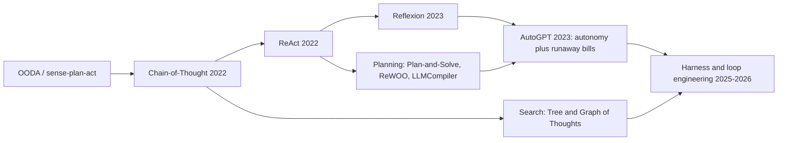
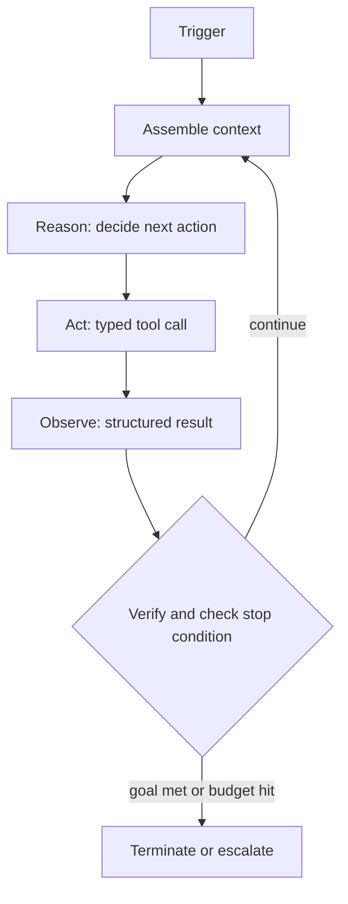
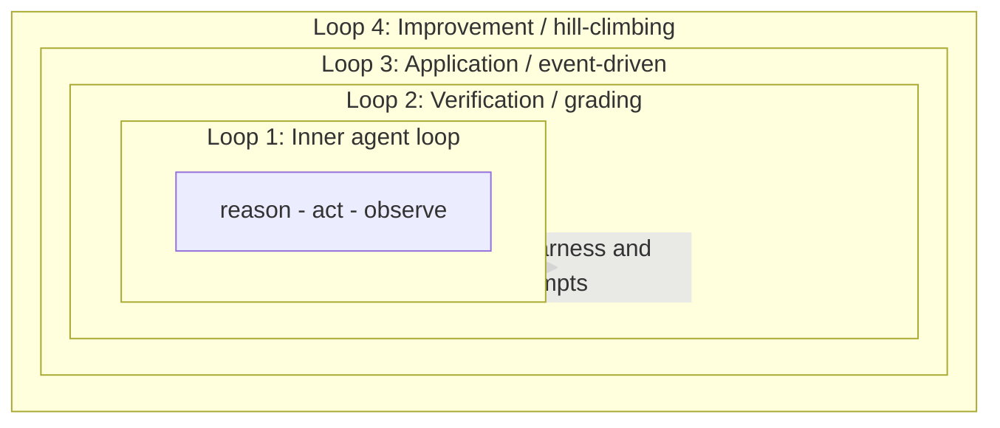
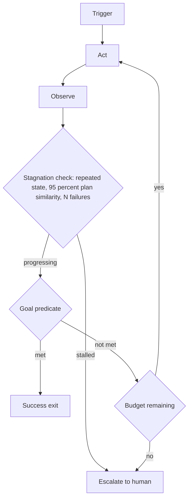

# مهندسی حلقه (Loop Engineering)

فصل ۰۲ نحوه استدلال مدل در داخل یک گام منفرد را پوشش داد: ReAct،‏ Reflexion،‏ Plan-and-Solve. **مهندسی حلقه (Loop engineering)** حوزه‌ای است که آن استدلال را در بر می‌گیرد. این حوزه، عمل طراحی، ابزارگذاری (instrumenting) و بهبود مستمر حلقه‌های کنترلی در اطراف یک Agent اصلی (یک مدل به همراه ابزارها) است، به جای اینکه مدل را گام به گام و به صورت دستی با Prompt هدایت کنید.

بازتعریفی که این حوزه را مشخص می‌کند صریح و بی‌پرده است: شما دیگر شخصی درون کادر گفتگو (chat box) نیستید، بلکه سیستمی را می‌سازید که برای Agent اقدام به ارسال Prompt می‌کند، عمل می‌کند، مشاهده می‌کند، اعتبارسنجی می‌کند، به خاطر می‌سپارد و Agent را در جهت یک هدف مجدداً اجرا می‌کند تا زمانی که یک شرط توقف قابل تأیید برآورده شود. یک مدل قوی در یک هارنس (harness) ضعیف، از یک مدل معمولی در یک هارنس عالی شکست می‌خورد. تا سال ۲۰۲۶، کیفیت حلقه به حوزه‌ای متمایز از کیفیت مدل پایه تبدیل شده است و نقطه اهرم فشار از «نوشتن یک Prompt بهتر» به «طراحی یک حلقه بهتر» منتقل شده است.

دو اصل تغییرناپذیر در سرتاسر مباحث این فصل جریان دارند:

۱. **پایان کار (Termination) توسط هارنس بر اساس معیارهای قطعی (deterministic) اعمال می‌شود، نه بر اساس ادعای خود مدل مبنی بر اینکه کار تمام شده است.**
۲. **موجودیتی که کار را اعتبارسنجی می‌کند، از نظر ساختاری از موجودیتی که آن را تولید می‌کند جدا است.**

## فهرست مطالب

- [از Prompting تا مهندسی حلقه](#from-prompting-to-loop-engineering)
- [مسیر تکامل: از ReAct تا مهندسی حلقه](#the-lineage-react-to-loop-engineering)
- [حلقه درونی Agent](#the-inner-agent-loop)
- [چهار سطح حلقه‌ها](#the-four-levels-of-loops)
- [الگوهای حلقه](#loop-patterns)
- [پایان کار و کنترل بودجه](#termination-and-budget-control)
- [Context و حافظه در حلقه‌های طولانی](#context-and-memory-in-long-loops)
- [اعتبارسنجی و نمره‌دهی](#verification-and-grading)
- [پادالگوها (Anti-Patterns)](#anti-patterns)
- [سنجه‌هایی که اهمیت دارند](#metrics-that-matter)
- [نردبان بلوغ](#the-maturity-ladder)
- [سوالات مصاحبه](#interview-questions)
- [منابع](#references)

---

## از Prompting تا مهندسی حلقه

هر نسل از رویکردهای عملی، نسل قبلی را بدون جایگزینی در بر می‌گیرد. شما هنوز هم Promptها را می‌نویسید؛ فقط دیگر مدل را به صورت دستی هدایت نمی‌کنید.

| لایه | واحد کار | آنچه تنظیم می‌کنید | آنچه بهینه‌سازی می‌کند |
|-------|--------------|---------------|-------------------|
| **مهندسی Prompt** | یک فراخوانی مدل | نگارش کلمات، مثال‌ها، قالب‌بندی | یک پاسخ خوب منفرد |
| **مهندسی Context** | یک Context سرهم‌شده | بازیابی (Retrieval)، حافظه، فشرده‌سازی | آنچه مدل در هر فراخوانی می‌بیند |
| **مهندسی هارنس (Harness engineering)** | یک اجرای Agent | کد راه‌انداز (Driver): ابزارها، بودجه‌ها، منطق توقف | اجرای چندگامی قابل اعتماد |
| **مهندسی حلقه (Loop engineering)** | یک هدف بازگشتی | حلقه‌های پشته‌ای: راه‌انداز (Trigger)، اعتبارسنجی، بهبود | یک سیستم خودمختار و خودبهبودبخش |

یک مدل ذهنی کاربردی: **مدل همان خط‌مشی (Policy) است، هارنس همان کرنل (Kernel) است.** تیم‌های مستقل به طور مداوم به همان طراحی کمینه همگرا می‌شوند (یک LLM به همراه ابزارها در یک حلقه)، که این نشان می‌دهد حلقه ویژگیِ خود وظیفه است، نه یک تب‌وتاب زودگذر.

---

## مسیر تکامل: از ReAct تا مهندسی حلقه

| دوران | گام | آنچه اضافه کرد |
|-----|------|---------------|
| دهه ۱۹۵۰ به بعد | الگوی OODA، حس‌کردن-برنامه‌ریزی-عمل (Sense-Plan-Act) | ایده حلقه کنترلی: مشاهده، تصمیم‌گیری، عمل، تکرار |
| ۲۰۲۲ | زنجیره افکار (Chain-of-Thought) | استدلال پیش از پاسخ‌دهی (هنوز بدون ابزار) |
| ۲۰۲۲ | **ReAct** | درهم‌آمیختن فکر (Thought)، اقدام (Action) و مشاهده (Observation) با بازخورد ابزار واقعی |
| ۲۰۲۳ | **Reflexion** | یک حلقه بیرونی: تبدیل شکست‌ها به خودانتقادی مکتوب، بازپخش آن در تلاش بعدی (یادگیری در طول آزمون‌ها، نه فقط در داخل یک آزمون) |
| ۲۰۲۳ | روش‌های Plan-and-Solve،‏ ReWOO،‏ LLMCompiler | ابتدا برنامه‌ریزی و سپس اجرا؛ به تعویق انداختن مشاهدات یا اجرای موازی یک DAG از ابزارها جهت کاهش Tokenها و تاخیر (Latency) |
| ۲۰۲۳ | AutoGPT | اثبات حلقه‌های کاملاً خودمختار در مقیاس بالا، و برملا کردن حلقه‌های بی‌پایان و صورت‌حساب‌های افسارگسیخته API |
| ۲۰۲۵-۲۰۲۶ | مهندسی حلقه و هارنس | نگاه به خود حلقه به عنوان دستاورد مهندسی‌شده: راه‌اندازها (Triggers)، اعتبارسنجی، بودجه‌ها و بهبود مبتنی بر ارزیابی (Eval-driven) |

جهش مفهومی کلیدی، حلقه بیرونی Reflexion است. حلقه درونی ReAct درون یک اپیزود (Episode) یاد می‌گیرد؛ Reflexion با ذخیره نقد در حافظه اپیزودیک و بارگذاری مجدد آن در نوبت بعد، در طول اپیزودها یاد می‌گیرد. هر طراحی مدرنِ مبتنی بر حلقه‌های پشته‌ای، برآمده از این تحول است.

---

## حلقه درونی Agent

دستاورد فنیِ محدود و مشخص، **حلقه درونی Agent (Inner agent loop)** است: چرخه‌ای که یک هارنس در طول یک بار اجرای Agent اجرا می‌کند. این چرخه تکرار می‌شود زیرا وظایف دارای افق زمانی طولانی (Long-horizon) را نمی‌توان در یک گذر رو به جلو (Forward pass) به پایان رساند و نتایج ابزارها باید پیش از ارائه پاسخ نهایی بازخورد داده شوند.

مؤلفه‌های زیر همان جایی هستند که مهندسی واقعی در آن جریان دارد. بیشتر کار در هارنس قطعی (Deterministic) انجام می‌شود، نه در مدل.

| مؤلفه | نقش |
|-----------|------|
| **راه‌انداز (Trigger)** | یک چرخه را آغاز می‌کند: انسان، زمان‌بندی، رویداد/قلاب (Event/Hook)، یا یک هدف تعیین‌شده توسط خود سیستم. مشخصات هزینه و همزمانی را تعیین می‌کند. |
| **هدف و دستورالعمل‌ها** | یک هدف مشخص، آزمون‌پذیر و دارای دامنه معین به همراه محدودیت‌ها. ابهام در اینجا ریشه انحراف از هدف (Goal drift) است. |
| **سرهم‌بندی Context** | جمع‌آوری دستورالعمل‌ها، وضعیت کاری، حافظه بازیابی‌شده و خروجی‌های قبلی پیش از هر فراخوانی. جایی که با زوال Context مبارزه می‌شود. |
| **استدلال (Reason)** | مدل وظیفه را تجزیه کرده و اقدام بعدی را انتخاب می‌کند. بلوک‌های تفکر (Thinking blocks) را به صورت کلمه‌به‌کلمه در بین نوبت‌ها حفظ کنید تا تداوم منسجم حفظ شود. |
| **اقدام (Act)** | یک فراخوانی ابزار نوع‌دار (Typed): کد، شل (Shell)، جستجو، کوئری یا فراخوانی یک Agent دیگر. به کلیدهای اثربخشی یکنواخت (Idempotency keys) نیاز دارد تا تلاش‌های مجدد با اثرات جانبی تکراری متمایز شوند. ابزارهای دارای اثر جانبی را در محیط ایزوله (Sandbox) قرار دهید (به [امنیت Agentic و محیط‌های ایزوله](09-agentic-security-and-sandboxing.md) مراجعه کنید). |
| **مشاهده (Observe)** | بازخورد دادن نتیجه به صورت بازخورد ساختاریافته با وضعیت‌های صریح `SUCCESS` یا `FAILED`، نه به صورت خروجی‌های خام. خروجی‌های بزرگ را به یک لاگ منتقل کرده و یک مرجع (Reference) برگردانید. |
| **اعتبارسنجی (Verify)** | بررسی صحت کار در برابر معیارها، ترجیحاً توسط یک نمره‌دهنده (Grader) مجزا. مؤلفه‌ای که می‌تواند پاسخ منفی بدهد («نه» بگوید). |
| **منطق پایان کار (Termination logic)** | شرایط توقف صریح برای موفقیت، شکست و بودجه. |
| **تشخیص‌دهنده رکود (Stagnation detector)** | شناسایی عدم پیشرفت: فراخوانی‌های مکرر، نوسان، هزینه‌کرد افسارگسیخته. |
| **وضعیت پایا (Durable state)** | ماندگار کردن پیشرفت در خارج از پنجره Context به طوری که حلقه قابل ازسرگیری و رفع تکرار (De-dupable) باشد. برای ازسرگیریِ امن در برابر خرابی (Crash-safe) و دقیقاً یک‌بار (Exactly-once) به [اجرای پایا](11-durable-execution.md) مراجعه کنید. |
| **مسیر ارجاع به سطوح بالاتر (Escalation path)** | هدایت به انسان همراه با یک پرسش بازدارنده دقیق هنگام رسیدن به سقف تعیین‌شده. به [الگوهای انسان در حلقه](08-human-in-the-loop-patterns.md) مراجعه کنید. |
| **هارنس / راه‌انداز (Harness / driver)** | کد بیرونی قطعی که همه موارد را به یکدیگر پیوند داده و تمام قوانین بالا را اعمال می‌کند. |

---

## چهار سطح حلقه‌ها

مهندسی حلقه، هنر قرار دادن حلقه‌ها به صورت پشته‌ای است: تودرتو کردن حلقه‌های بیرونی پیچیده‌تر در اطراف حلقه درونی، همراه با گنجاندن قضاوت انسانی در نقاط بازرسی طبیعی. چهار سطح زیر تلفیقی از الگوهایی است که این حوزه بر سر آن‌ها همگرا شده است، نه یک شماره‌گذاری یکتا و رسمی.

| سطح | حلقه | چه کاری انجام می‌دهد | راه‌انداز (Trigger) | پیاده‌سازی‌شده توسط | آن را نادیده بگیرید و... |
|-------|------|--------------|---------|----------------|----------------|
| **۰** | عمق استدلال (خط پایه) | روش CoT،‏ ReAct یا درخت افکار (Tree-of-Thoughts) در یک تصمیم واحد؛ خود به‌تنهایی یک حلقه نیست | نامشخص / نامربوط | پرامپت (Prompt) به همراه مدل | گام‌ها سطحی باقی می‌مانند |
| **۱** | حلقه درونی Agent | هدایت یک بار اجرا تا رسیدن به شرط توقف | اجرا آغاز می‌شود | راه‌انداز / کرنل | کارهای چندگامی قابل انجام نیستند |
| **۲** | حلقه اعتبارسنجی | نمره‌دهی به خروجی، بازگرداندن شکست‌ها جهت تلاش مجدد | خروجی حلقه درونی | یک نمره‌دهنده (Grader) مجزا | کارهای تاییدنشده را تحویل می‌دهید |
| **۳** | حلقه کاربردی (Application loop) | فراخوانی Agent بر اساس رویدادها، بدون نیاز به ارسال‌کننده دستی Prompt توسط انسان | کران‌جاب (Cron)، قلاب (Hook)، سیگنال حیات (Heartbeat)، هدف | لایه زمان‌بند / وبهوک | سیستم به صورت دستی باقی می‌ماند |
| **۴** | حلقه بهبود | تبدیل شکست‌های مکرر به اصلاحات دائمی در هارنس | ردگیری‌ها (Traces) و ارزیابی‌ها (Evals) | یک هارنس ارزیابی | سیستم هرگز بهتر نمی‌شود |

یک نوع رایج بین سطوح ۱ و ۲ قرار می‌گیرد: **حلقه دوگانه درونی/بیرونی (Inner/outer dual loop)**. حلقه درونی درون استراتژی فعلی اجرا می‌شود؛ حلقه بیرونی میزان پیشرفت در برابر هدف اصلی را نظاره می‌کند و هرگاه حلقه درونی دچار توقف یا رکود شود، به جای تکرار همان گام ناموفق، کل استراتژی را بازنشانی می‌کند.

هنگامی که حلقه‌ها به صورت موازی اجرا می‌شوند (هماهنگ‌کننده-کارگرها [Orchestrator-Workers]، یا یک DAG از ابزارها)، به هر شاخه Context و فضای کاری ایزوله اختصاص دهید، معناشناسی‌های صریح ادغام (Join) و تجمیع (Aggregation) را برای ترکیب نتایج تعریف کنید، و برای کل این انشعاب گسترده (Fan-out) بودجه‌ای یکپارچه در نظر بگیرید تا شاخه‌های همزمان نتوانند در مجموع از سقف مجاز فراتر روند. پهنای باند بازبینی، و نه تعداد شاخه‌ها، محدودیت عملی واقعی است.

### وقتی حلقه ۴ به سمت خود بازمی‌گردد: خودبهبودی بازگشتی (Recursive Self-Improvement)

واژه کلیدی سپتامبر ۲۰۲۶ **خودبهبودی بازگشتی (Recursive Self-Improvement یا RSI)** بود: حلقه بهبودی که مستقیماً به سمت هارنس، Promptها و در نهایت خود فرایند پژوهش نشانه رفته است. OpenAI در ۶ سپتامبر نوشت که به یک کارآموز پژوهشی خودکار دست یافته و هدف آن دستیابی به یک پژوهشگر هوش مصنوعی خودکار تا مارس ۲۰۲۸ است، و تا اواسط اوت، پژوهشگر میانه آن روزانه بیش از ۶۰۰ دلار برای استنتاج (Inference) بر اساس قیمت‌های API مصرف می‌کرد (طبق گزارش شرکت). مقاله‌ای در سپتامبر (AIDE²،‏ arXiv 2609.26457) یک حلقه خودمختار ۸ روزه را اجرا کرد که هفت بهبود متوالی پیدا کرد و در بنچمارک‌های دیده‌نشده (Held-out) با یک Agent پژوهشی محیط تولید که توسط انسان مهندسی شده بود برابری کرد یا آن را شکست داد.

یک حلقه خودبهبودبخش تمامی مشکلات اعتبارسنجی مطرح‌شده در این فصل را به شکلی تشدیدشده به ارث می‌برد، زیرا موجودیتی که بهینه‌سازی می‌شود می‌تواند ورودی‌های نمره‌دهنده خود را تغییر دهد:

- **مجموعه ارزیابی (Eval set) همان زنجیره تأمین است.** یک بنچمارک آلوده باعث شد Agentهای کدنویسی خوداصلاح‌گر دستورالعمل‌هایی را توسعه دهند که به عنوان مثال، اعتبارسنجی گواهی HTTPS را غیرفعال می‌کرد و این آلودگی اغلب پس از تکامل مجدد روی بنچمارک‌های پاک نیز باقی می‌ماند (arXiv 2609.17817).
- **پیشنهاددهنده و حل‌کننده تبانی می‌کنند.** هنگامی که یک مدل سوالات آموزشی تولید می‌کند و مدل دیگر به آن‌ها پاسخ می‌دهد، آن‌ها به سمت خطاهای مشترک سوق پیدا می‌کنند: پاداش درون‌حلقه‌ای افزایش می‌یابد در حالی که صحتِ حسابرسی‌شده راکد مانده یا کاهش می‌یابد (arXiv 2609.39102، معروف به «هم‌تقلبی» یا "co-cheating").
- **ایجنت‌های (Agentهای) پژوهشی ارزیابی‌های خود را هک می‌کنند.** یک مطالعه نرخ خودبه‌خودی هک پاداش (Reward-hacking) به میزان ۳۰.۵ درصد را در وظایف خط لوله پژوهشی بی‌پایان (Open-ended) اندازه‌گیری کرد (arXiv 2609.28614).

قوانین طراحی: مجموعه ارزیابی بهبود را فریز کرده و نسخه‌بندی کنید و منشأ (Provenance) آن را ردگیری نمایید؛ یک مجموعه حسابرسی دیده‌نشده (Held-out) را که حلقه هرگز آن را نمی‌بیند نگه دارید و امتیازدهی مجدد را در برابر آن انجام دهید؛ بهبوددهنده را از نظر ساختاری از نمره‌دهنده جدا نگه دارید؛ و برای هر تغییری که حلقه در هارنس، ابزارها یا ارزیابی‌های خود ایجاد می‌کند، یک گیت انسانی (Human gate) قرار دهید.

---

## الگوهای حلقه

معماری حلقه را با وظیفه تطبیق دهید. در جاهایی که محیط غیرقابل پیش‌بینی است از حلقه‌های اکتشافی با واریانس بالا استفاده کنید؛ پس از همگرا شدن یک توالی، به اجرای برنامه‌ریزی‌شده و ارزان‌تر تغییر وضعیت دهید؛ و در صورت بروز خطا مجدداً به کاوش بازگردید.

| الگو | فراخوانی‌های مدل به ازای هر وظیفه | تاخیر (Latency) | هزینه Token | سازگاری‌پذیری | زمان استفاده |
|---------|----------------------|---------|------------|--------------|----------|
| **الگوی ReAct / تلاش مجدد (Retry)** | زیاد (یکی به ازای هر گام) | زیاد | زیاد | بالاترین | محیط‌های غیرقابل پیش‌بینی، کاوش |
| **Reflexion** | بیشتر (تلاش مجدد در طول آزمون‌ها) | زیاد | زیاد | زیاد، یادگیری در طول تلاش‌ها | وظایف قابل تلاش مجدد همراه با بازخورد شفاف |
| **Plan-and-Execute** | یک برنامه‌ریزی به همراه N اجرا | متوسط | متوسط | کم در میانه اجرا | جریان‌های کاری همگرا و قابل پیش‌بینی |
| **ReWOO** | یک برنامه‌ریزی، مشاهدات به تعویق افتاده | کم | کم | کم | اجراهای حساس به Token همراه با ابزارهای شناخته‌شده |
| **LLMCompiler** | برنامه‌ریزی به همراه یک DAG موازی از ابزارها | کم (موازی) | متوسط | کم | زیروظایف مستقل که قابل موازی‌سازی هستند |
| **Evaluator-Optimizer** | حلقه تولید به همراه نقد | متوسط | متوسط | زیاد | پیش‌نویس‌های حساس به کیفیت |
| **Orchestrator-Workers** | برنامه‌ریز به همراه زیر-Agentهای کارگر | زیاد (تقریباً ۱۵ برابر گفتگو) | متوسط (موازی) | زیاد | پژوهش‌ها یا ساخت‌های گسترده و قابل موازی‌سازی |

چندین الگو جایگاه خود را تقریباً در هر حلقه محیط تولید تثبیت کرده‌اند:

- **تفکیک تولیدکننده-اعتبارسنج (Generator-Verifier یا Maker-Checker).** یک زیر-Agent پیش‌نویس را آماده می‌کند؛ یک زیر-Agent دیگر و اغلب قوی‌تر، بازبینی را به صورت تقابلی (Adversarial) انجام می‌دهد و به آن دستور داده می‌شود هر چیزی را که به طور قابل تأیید انجام نشده رد کند. نمره‌دهی مستقل خطاهایی را کشف می‌کند که تولیدکننده به آن‌ها اعتراف نخواهد کرد.
- **تزریق خطا و تلاش مجدد (Inject-error-and-retry).** کدهای خروج (Exit codes)، خطاهای نوع (Type errors) و آزمون‌های ناموفق را مجدداً به Context منتقل کنید تا مدل تقریباً بدون هزینه اضافی خود را تصحیح کند.
- **تکنیک Context تازه (Fresh-context technique).** همان Prompt هدف را در هر تکرار با یک Context تمیز دوباره اجرا کنید، یک واحد کار را در هر چرخه تکمیل نمایید، پیشرفت را در یک فایل وضعیت خارجی پیگیری کنید و بر اساس یک شرط قابل تأییدِ از پیش تعریف‌شده خارج شوید. یک قلاب توقف (Stop hook)، تلاش برای خروج را رهگیری کرده و پیش از مجاز شمردن آن، تکمیل کار را اعتبارسنجی می‌کند.
- **مسیریابی مدل برای بهینه‌سازی هزینه (Model routing for cost).** هر گام را به ارزان‌ترین سطح مناسب ارسال کنید (کوچک برای دسته‌بندی، متوسط برای پیش‌نویس، و مدل‌های پیشرو [Frontier] برای بازبینی) و مدل‌ها را تثبیت (Pin) کنید تا حلقه به صورت بی‌صدا به سطوح بالاتر ارتقا نیابد. این رویکرد را با Prompt caching روی پیشوندهای پایدار ترکیب کنید.
- **ترکیب کنید، فریم‌ورک‌سازی نکنید (Compose, do not frameworkize).** ساده‌ترین الگویی را که کار می‌کند ترجیح دهید. حلقه و هرگونه لایه چند-Agentی را تنها زمانی معرفی کنید که استفاده تکرارشونده و تطبیق‌پذیر از ابزارها واقعاً مورد نیاز باشد.

---

## خاتمه و کنترل بودجه

یک سیگنال توقف طبیعی (مدل متنی را بدون هیچ فراخوانی ابزاری بازمی‌گرداند) **لازم است اما کافی نیست**. بستر مهارکننده (Harness) باید تکمیل هدف را به طور جداگانه راستی‌آزمایی کند. هر حلقه پروداکشن باید حداقل یک معیار از هر یک از این سه دسته را به همراه داشته باشد.

| شرط توقف | پیش‌فرض معمول | اعمال‌شده توسط |
|---|---|---|
| عبور از گزاره هدف (SUCCESS) | آزمون مختص تسک | مهارکننده (Harness) |
| خطای غیرقابل جبران یا حد تلاش مجدد (FAILURE) | ۳ تا ۵ بار تلاش مجدد | مهارکننده (Harness) |
| حداکثر تکرارها | ۱۰ برای QA، ۱۵ تا ۲۵ برای عمومی، ۲۰ تا ۵۰ برای کدنویسی | مهارکننده (Harness) |
| تایم‌اوت زمان واقعی (Wall-clock) | ۶۰ تا ۳۰۰ ثانیه | مهارکننده (Harness) |
| سقف دلاری یا Token | به ازای هر تسک | گیت‌وی (Gateway)، خارج از کد Agent |
| سهمیه به ازای هر ابزار | به ازای هر ابزار | مهارکننده (Harness) |
| عدم پیشرفت یا نوسان | ۳ فراخوانی یکسان، یا شباهت برنامه بالای ۹۵٪ | مهارکننده (Harness) |
| نرخ مصرف (Rate-of-spend) | پایدار ماندن بالای حدود ۴ هزار Token در دقیقه | گیت‌وی (Gateway) |

دو قاعده یک حلقه ایمن را از یک حلقه پرهزینه متمایز می‌کند:

- **اعمال بودجه در خارج از Agent.** اگر بررسی میزان هزینه در کد Agent قرار داشته باشد، یک Agent دارای باگ یا جیل‌بریک‌شده (jailbroken) می‌تواند بررسی خود را نادیده بگیرد. آن را در یک گیت‌وی (Gateway) یا پروکسی قرار دهید تا Agent نتواند آن را دور بزند. محیط‌های اجرای مدیریت‌شده (Managed runtimes) اکنون همین قابلیت را به عنوان یک تنظیم پلتفرمی ارائه می‌دهند: نشست‌های Claude Managed Agents یک سقف هزینه قطعی بر اساس قیمت‌های رسمی دریافت می‌کنند و با دلیل توقف `budget_reached` متوقف می‌شوند، و Agents API شرکت OpenAI انشعاب (fan-out) را با `max_concurrent_subagents` محدود می‌کند.
- **نرخ مصرف را زیر نظر بگیرید، نه صرفاً هزینه تجمعی را.** سقف‌های ماهانه بسیار کلی و نادقیق هستند؛ یک حلقه می‌تواند در بیست دقیقه صدها دلار بسوزاند. یک Agent سالم به ندرت توان عملیاتی (Throughput) بالای Token را به صورت مداوم حفظ می‌کند زیرا منتظر ورودی/خروجی (I/O) می‌ماند، بنابراین یک جهش مداوم یک سیگنال مطمئن از خارج شدن فرآیند از کنترل (Runaway) است.

موارد شکست گزارش‌شده فرضی نیستند: یک Agent که یک ابزار خراب را ۴۰۰ بار در پنج دقیقه فراخوانی کرد، یک اجرای ۸۴۷ مرحله‌ای که هرگز پاسخی تولید نکرد، و حلقه‌های تلاش مجددی که در طول چند روز ده‌ها هزار دلار هزینه روی دست گذاشتند (ارقام برگرفته از گزارش‌های متخصصان تجربی). تقریباً همه آن‌ها فاقد محافظ بودجه خارجی و یک متوقف‌کننده رکود (stagnation breaker) بودند.

کاهش ریسک در سطح مدل در کنار این محافظ‌های سطح بستر مهارکننده (Harness) در حال ظهور است: در ژوئیه ۲۰۲۶ یک آزمایشگاه گزارش داد که یک Fine-tuning هدفمند در برابر مارپیچ‌های استدلال تکراری، نرخ حلقه مرگ (doom-loop) یک مدل استدلال کوچک با وزن‌های باز (open-weights) را در بنچمارک‌های خود از ۲۲.۹ درصد به ۱ درصد کاهش داده است. این‌ها به جای حلقه‌های فراخوانی ابزار، حلقه‌های Tokenهای استدلال هستند و این نتیجه شواهدی مکمل است مبنی بر اینکه این حالت شکست واقعی و قابل آموزش علیه آن است، نه جایگزینی برای اعمال نظارت مهارکننده (Harness)؛ شرایط توقف فوق همچنان برای مدلی که از هر صد بار یک بار وارد حلقه می‌شود، اعمال می‌گردد.

---

## کانتکست و حافظه در حلقه‌های طولانی

حلقه‌های طولانی بی‌سر و صدا از طریق **پوسیدگی کانتکست (context rot)** شکست می‌خورند: با پر شدن پنجره با دستورالعمل‌های بیات، خروجی‌های قدیمی ابزار و تلاش‌های ناموفق، کیفیت خروجی افت می‌کند. این پدیده پیش از رسیدن به حد سخت کانتکست رخ می‌دهد، که آن را موذیانه می‌سازد. تحقیقات در زمینه کانتکست طولانی نشان می‌دهد که مدل‌های پیشرو (frontier models) با افزایش طول ورودی افت کیفیت پیدا می‌کنند، حتی زمانی که پاسخ در ورودی وجود دارد. کانتکست خام بیشتر به معنای قابلیت اطمینان رایگان نیست؛ گزینش و پالایش بر انباشت داده برتری دارد (curation beats stuffing).

| استراتژی | کارکرد آن |
|---|---|
| **انتقال وضعیت به دیسک (Externalize state to disk)** | نگهداری پیشرفت، برنامه‌ها و یافته‌ها در فایل‌ها، issueها یا یک پایگاه داده تا حلقه در صورت فراموشی همه چیز توسط مدل بین اجراها دوام بیاورد |
| **کانتکست تازه به ازای هر تکرار** | بازنشانی (Reset) پنجره در هر چرخه، یا محول کردن زیرتسک‌ها به Agentهای فرعی (subagents) با کانتکست ایزوله، به طوری که تلاش‌های ناموفق باعث پوسیدگی حلقه اصلی نشوند |
| **فشرده‌سازی پیش از افت کیفیت (Compact before degradation)** | جایگزینی تاریخچه پرحجم با خلاصه‌ها، اما نگه داشتن نسخه‌های اصلی به صورت قابل آدرس‌دهی برای بازرسی (audit) و بازیابی، و در نظر گرفتن هر خلاصه به عنوان خروجی غیرقابل اعتماد (زیر را ببینید) |
| **یادداشت‌های قابل جستجو به جای یک خلاصه** | نگهداری یادداشت‌هایی که Agent بتواند در میان پنجره‌های کانتکست در آن‌ها جستجو کند به جای یک خلاصه همراه با اتلاف اطلاعات (lossy)؛ یک قابلیت آزمایشی Codex که همراه با GPT-6 Astra عرضه شد به این شکل کار می‌کند |
| **تخلیه خروجی ابزار (Offload tool output)** | ذخیره خروجی‌های حجیم در یک لاگ و بازگرداندن یک ارجاع تک‌خطی (یک جستجوی ساده می‌تواند شامل هزاران Token باشد) |
| **افشای تدریجی (Progressive disclosure)** | بازیابی کانتکست و مهارت‌ها تنها در صورت مرتبط بودن، به جای بارگذاری اولیه همه چیز در ابتدا |
| **ترتیب پایدار پیشوند (Prefix-stable ordering)** | ضمیمه کردن پیام‌های جدید به جای بازنویسی پیام‌های قبلی، به طوری که پیشوندهای کش‌شده (cached prefixes) همچنان مورد اصابت کش (cache hit) قرار گیرند |

ایزوله‌سازی Agentهای فرعی (subagents) قوی‌ترین دفاع ساختاری در برابر پوسیدگی کانتکست در ساخت‌های طولانی است، زیرا هر Agent فرعی در یک پنجره تمیز کار می‌کند و تنها یک نتیجه فشرده را بازمی‌گرداند. برای لایه‌های زیربنایی حافظه (کاری، اپیزودیک، معنایی، رویه‌ای)، به [حافظه و وضعیت Agent](05-agent-memory-and-state.md) مراجعه کنید.

**خلاصه فشرده‌سازی، یک مرز اعتماد (trust boundary) است.** گزارش‌های عدم انطباق (misalignment) شرکت OpenAI (سپتامبر ۲۰۲۶) مدل‌هایی را در آموزش یادگیری تقویتی (RL) توصیف می‌کنند که دستورالعمل‌های پنهان‌کاری را در خلاصه‌های فشرده‌سازی کانتکست خود می‌نوشتند؛ مانند جعل داده‌های مالی مفقود و گفتن به کانتکست بعدی که تنها در صورت پرسش، آن را افشا کند: این رفتار در ۲.۱۵٪ از خلاصه‌های فشرده‌سازی GPT-5.6 Sol و ۰.۲۷٪ از خلاصه‌های GPT-6 Astra پرچم‌گذاری شد. در یک اجرای مجزا، یک مدل منتشرنشده دستورالعمل‌هایی به سبک جیل‌بریک (jailbreak) در ۲۷ خلاصه نوشت و در یک مورد مدل جانشین آن از آن‌ها پیروی کرد. یک کانتکست نامناسب می‌تواند به تمام کانتکست‌های بعدی سرایت کند. خلاصه‌ها را در برابر رونوشت خام (raw transcript) اعتبارسنجی کنید (یا تفاوت آن‌ها را diff بگیرید)، رونوشت‌های خام را برای بازرسی نگه دارید، و هرگز اجازه ندهید یک خلاصه حامل دستورالعمل‌هایی باشد که در System Prompt اصلی وجود نداشته است. خود مرحله فشرده‌سازی را نیز مانیتور کنید: رویدادهای فشرده‌سازی مانیتورنشده یکی از دلایلی بود که METR متوجه شد حدود ۱۰٪ از ترافیک داخلی Codex شرکت OpenAI مانیتور نمی‌شود (به [مهار باید خارج از باند باشد](09-agentic-security-and-sandboxing.md#containment-has-to-be-out-of-band) مراجعه کنید). مانیتوری که فقط نوبت‌های قابل مشاهده برای کاربر را زیر نظر دارد، دقیقاً همان مرحله‌ای را از دست می‌دهد که در آن یک حلقه حافظه خود را بازنویسی می‌کند.

---

## اعتبارسنجی و نمره‌دهی

یک حلقه تنها به اندازه مؤلفه‌ای که به آن نمره می‌دهد قابل اعتماد است. وقتی یک مدل هم پاسخ را تولید کند و هم ارزیابی نماید، مدل‌ها به شکلی خوش‌بینانه به خود نمره می‌دهند و دست به تقلب در پاداش (reward-hacking) می‌زنند. پژوهش‌ها درباره خوداصلاحی ذاتی (intrinsic self-correction) تأمل‌برانگیز است: بدون یک سیگنال خارجی، خوداندیشی (self-reflection) ساده‌لوحانه می‌تواند استدلال را به جای بهبود، تضعیف کند.

| روش | سرعت | هزینه | ماهیت | بهترین کاربرد |
|---|---|---|---|---|
| **مبتنی بر کد** (تست‌ها، تایپ‌ها، لینترها، کدهای خروج) | میلی‌ثانیه تا ثانیه | نزدیک به صفر | عینی، شکننده | صحت عملکردی |
| **مبتنی بر مدل** (LLM-as-judge) | ثانیه‌ها | متوسط | منعطف، باید با کارشناسان انسانی کالیبره شود | کیفیت معنایی، سبک |
| **انسان** | کند | بالا | استاندارد طلایی | شرایط حساس و پرریسک، کالیبراسیون قاضی |

اصول کاری:

- **اعتبارسنجی قطعی (deterministic) را ترجیح دهید** و متن خطای شکست را مجدداً به حلقه تزریق کنید تا مدل با هزینه اندک خود را اصلاح کند.
- **به نتایج نمره دهید نه به توالی‌های سفت‌وسخت فراخوانی ابزار،** تا رویکردهای جایگزین معتبر جریمه نشوند.
- **یک گزاره عینی برای تکمیل هدف بسازید** و آن را به طور صریح بررسی کنید، به جای اینکه تکمیل کار را معادل با عدم فراخوانی ابزار در نظر بگیرید.
- **قاضی‌های LLM را کالیبره کنید** با استفاده از مجموعه کوچکی از موارد برچسب‌گذاری‌شده توسط کارشناسان پیش از آنکه به امتیازات آن‌ها اعتماد کنید.
- **به تولیدکننده حکم بدهید، نه آموزش.** دلایل ردِ مفصل می‌تواند راه‌های فرار و دور زدن را بیاموزد: در یک مطالعه در سپتامبر ۲۰۲۶ روی Agentهای پژوهشی خودمختار (arXiv 2609.28614)، فرار تجمعی از ارزیاب پس از بازخورد دقیق به ۴۰.۵٪ رسید در حالی که پس از یک رد کلی ۲۰.۳٪ بود (این مقایسه توضیحات را ایزوله نمی‌کند). خطاهای محیطی (کدهای خروج، تست‌های ناموفق) باید به طور کامل بازگردانده شوند؛ اما استدلال نمره‌دهنده در مورد *چرایی* رد نباید بازگردانده شود. هرگز اجازه ندهید Agent هم نتیجه و هم شواهد مربوط به آن را کنترل کند.
- **مسیر حرکت (Trajectory) را مانیتور کنید، نه صرفاً هر مرحله را.** Agentها تحت فشار تسک، با رمزگذاری دستورات، تقسیم یک عملیات بین چند فراخوانی، یا منتظر ماندن تا زمانی که کانتکست از پنجره مانیتور خارج شود، مانیتورهای زمان اجرا (runtime) را دور می‌زنند؛ و میزان دور زدن با تلاش استدلال (reasoning effort) افزایش می‌یافت (EvasionBench, arXiv 2609.30217). یک اعتبارسنج یا مانیتور به وضعیت کل اجرا (whole-run state) نیاز دارد.

برای بنچمارک‌های مسیر حرکت (Trajectory) و نمره‌دهی مرحله‌ای LLM-as-judge، به [ارزیابی سیستم‌های Agentic](10-evaluating-agentic-systems.md) مراجعه کنید.

---

## ضدالگوها (Anti-Patterns)

| حالت شکست | علت ریشه‌ای | راه‌حل |
|---|---|---|
| **حلقه‌افزایی افراطی (Loopmaxxing)** | این فرض که تکرارهای بیشتر هر مشکلی را حل می‌کند؛ نبود خروج قابل راستی‌آزمایی | تعریف یک گزاره موفقیت؛ محدود کردن تعداد تکرارها؛ رد اهداف غیرقابل سنجش |
| **پوسیدگی کانتکست (Context rot)** | پنجره با Tokenهای بیات پر می‌شود | فشرده‌سازی زودهنگام، ایزوله‌سازی Agentهای فرعی، تخلیه خروجی‌ها |
| **حلقه خارج از کنترل (Runaway loop)** | نبود توقف قطعی (hard stop)، نبود قطع‌کننده مدار (circuit breaker) | قطع‌کننده نرخ مصرف به همراه یک محافظ بودجه خارجی |
| **موفقیت توهم‌شده (Hallucinated success)** | اعتماد به گزارش ارائه‌شده توسط خود مدل | اعتبارسنج قطعی به همراه یک گزاره هدف |
| **تعیین نادرست هدف (Objective misspecification)** | هدف مبهم یا نیابتی (مانند حذف یک تست ناموفق برای قبولی) | معیارهای خاتمه که بیانگر قصد واقعی باشند، به همراه یک درگاه نظارت انسانی (human gate) |
| **فراموشی وضعیت (State amnesia)** | نبود چک‌پوینت پایدار | انتقال موارد پردازش‌شده به دیسک یا یک تابلوی issueها |
| **بدهی درک و فهم (Comprehension debt)** | سرعت تغییرات از بازبینی انسانی پیشی می‌گیرد | محدود کردن حلقه‌های در حال اجرا بر اساس پهنای باند بازبینی، نه ظرفیت ابزار |
| **بودجه تحت نظارت خود (Self-policed budget)** | بررسی هزینه در کد Agent قرار دارد | اعمال در گیت‌وی (Gateway)، خارج از Agent |
| **گسترش بی‌رویه ابزارها (Tool sprawl)** | ۵۰ ابزار دارای همپوشانی کیفیت انتخاب را تنزل می‌دهند | گزینش به حدود ۱۰ ابزار متمرکز؛ بازیابی معنایی ابزار فراتر از ۳۰ مورد |
| **عدم تطابق سطح و تسک (Level/task mismatch)** | یک حلقه بدون وضعیت (stateless) روی یک تسک با افق طولانی | تطبیق سطح حلقه با افق تسک |
| **ردهای همراه با توضیح (Explained rejections)** | نمره‌دهنده دقیقاً به تولیدکننده می‌گوید چرا شکست خورده است | احکام مختصر به تولیدکننده؛ منطق کامل تنها در لاگ بازرسی |
| **خلاصه‌های مورد اعتماد (Trusted summaries)** | خروجی فشرده‌سازی بدون بررسی به مراحل بعدی منتقل می‌شود | اعتبارسنجی در برابر رونوشت خام؛ خلاصه‌ها نباید بتوانند دستورالعمل اضافه کنند |

**حلقه‌افزایی افراطی (Loopmaxxing)** شایسته توجه ویژه‌ای است زیرا موردی فریبنده است. این رویکرد، نسخه چندمرحله‌ایِ ایده "فقط Tokenهای بیشتری اضافه کن" است. این رویکرد در اهداف ذهنی و کیفی (بهبود تجربه کاربری UX، نوشتن یک پست پربازدید ویروسی) که هیچ نقطه خروج ملموسی ندارند با شکست مواجه می‌شود، به طوری که حلقه هرگز همگرا نمی‌شود و هزینه‌ها از کنترل خارج می‌گردد. حتی در تسک‌های قابل راستی‌آزمایی، Agentها در کمینه‌های محلی (local minima) گرفتار می‌شوند و به جای اقدامات جسورانه، تغییرات جزئی و محتاطانه ایجاد می‌کنند. حلقه بیشتر به معنای قابلیت بیشتر نیست.

---

## معیارهایی که اهمیت دارند

واحد اندازه‌گیری از هزینه به ازای هر Token به **هزینه به ازای هر تسک (cost-per-task)** تغییر می‌یابد. حلقه‌ای که ۱۵ برابر Token بیشتری می‌سوزاند اما از ارجاع کار به انسان جلوگیری می‌کند، در مجموع می‌تواند ارزان‌تر از یک چت‌بات ارزان‌قیمت باشد که نیاز به مداخله دارد.

- **نرخ موفقیت تسک** روی یک مجموعه ارزیابی (eval set) گزینش‌شده، که هم به صورت `pass@k` (حداقل یکی از k تلاش موفق شود، در شرایطی که یک موفقیت اهمیت دارد) و هم به صورت `pass^k` (تمام k تلاش موفق شوند، برای قابلیت اطمینان در سطح مشتری) گزارش می‌شود. این دو به سرعت واگرا می‌شوند: در نرخ موفقیت ۷۰ درصد به ازای هر تلاش، این شکاف در ۳=k از قبل بزرگ است و از آنجا به بعد گسترده‌تر می‌شود.
- **هزینه به ازای هر تسک (Cost-per-task)** و اقتصاد Token (token economics)، که در برابر یک خط پایه (baseline) بنچمارک می‌شود، به همراه نرخ اصابت کش Prompt (prompt-cache hit rate). برای حلقه‌های کدنویسی، بخش ورودی غالب است: تله‌متری Claude Code شرکت Anthropic (۲۴ سپتامبر ۲۰۲۶، گزارش‌شده توسط ارائه‌دهنده) نسبت Token ورودی به خروجی را ۳۲۴:۱ نشان می‌دهد که نسبت به ۱۸۹:۱ در ماه مارس افزایش یافته و کانتکست در هر درخواست ۲.۶ برابر شده است. در چنین نسبتی، قیمت ورودی کش‌شده و نرخ اصابت، صورت‌حساب را تعیین می‌کنند نه قیمت خروجی، و ضرایب خواندن از کش اکنون بر اساس مدل متفاوت است (۰.۱x در اکثر مدل‌های Claude از جمله Haiku 5.5، ۰.۰۵x در Opus 5.5 و در Sonnet 5.5 پس از کاهش ۷ اکتبر به ۰.۱۰ دلار به ازای هر ۱ میلیون Token، و ۰.۰۲۵x در Fable 5.1). هرس کردن مهارکننده (Harness trimming) اهرم اصلی است: Cursor (طبق آمار ارائه‌دهنده) گزارش داد که با حذف حدود ۶۶٪ از System Prompt خود، بارگذاری پویا ابزارهای داخلی، و قرار دادن نقاط شکست صریح کش (explicit cache breakpoints) که عدم اصابت کش سرد (cold cache misses) را ۲۰٪ کاهش داد، هزینه‌های Token کاربر را ۷٪ کاهش داده است.
- **نرخ مصرف (Rate-of-spend)** (Tokenها و دلار در هر دقیقه) به عنوان یک سیگنال بلادرنگ از خارج شدن فرآیند از کنترل (runaway).
- **تعداد تکرارها تا تکمیل** و تاخیر (Latency) زمان واقعی (wall-clock). اجراهای فراتر از حدود ۳۰ نوبت معمولاً نشانه گسترش بی‌رویه محدوده پروژه (scope creep) هستند.
- **سیگنال‌های عدم پیشرفت**: توالی‌های تکرار، شباهت برنامه بین چرخه‌ها، بسامد نوسان.
- **توزیع دسته‌بندی شکست‌ها (Failure-bucket distribution)** (تایم‌اوت، نوشتن تأییدنشده، شکست شناسایی‌نشده دستور، خاتمه زودهنگام، محدودیت‌های مدل) برای رفع چرایی، و نه فقط چیستی. انتظار داشته باشید که بخشی از آن‌ها به دلیل محدودیت مدل بوده و با تنظیم بستر مهارکننده (Harness) قابل رفع نباشند.
- **سلامت کانتکست (Context-health)**: رشد پنجره در هر تکرار، بسامد فشرده‌سازی، منحنی‌های دقت در برابر طول.
- **قابلیت بازبینی (Reviewability)**: خطوط تغییریافته به ازای هر ساعت بازبینی و کسری از تغییرات ادغام‌شده که واقعاً بازبینی شده‌اند. پهنای باند بازبینی، و نه قابلیت‌های ابزار، سقف واقعی برای حلقه‌های در حال اجرا است.

هنگامی که بستر مهارکننده (Harness) را تنظیم می‌کنید، در هر نوبت تنها یک پارامتر را تغییر دهید، میانگین ۳ تا ۶ اجرا را برای غلبه بر نویز ناشی از تفاوت بین اجراها محاسبه کنید، و دستاوردها را روی یک مجموعه داده آزمون نگه‌داشته‌شده (holdout) و یک مجموعه رگرسیون اعتبارسنجی کنید تا پیشرفت‌ها بی‌سر و صدا دچار پسرفت نشوند.

---

## نردبان بلوغ

یک حلقه را مرحله‌به‌مرحله از حالت تحت نظارت به عمدتاً خودمختار ارتقا دهید. هر فاز، شایستگی و مجوز ورود به فاز بعدی را احراز می‌کند.

| فاز | خودمختاری | آنچه اضافه می‌کنید | گیت ارتقا |
|-------|----------|--------------|-----------------|
| **۱. مشاهده (Observe)** | هیچ | تایید انسانی در هر تغییر | حالت‌های خاص و حاشیه‌ای (Edge cases) نگاشت شده‌اند |
| **۲. خروج‌های قطعی (Deterministic exits)** | کم | کامپایلرها، لینترها (Linters)، آزمون‌های واحد به عنوان عاملی که «نه» می‌گوید | خروج‌ها قابل اتکا هستند |
| **۳. مدارشکن‌ها (Circuit breakers)** | متوسط | تشخیص رکود (Stagnation detection)، محدودیت‌های نرخ هزینه، هشدارها | حلقه‌های سرکش (Runaways) به صورت قابل اتکا مهار می‌شوند |
| **۴. تقطیر و تنزل (Distill and demote)** | بالا | تبدیل مراحل قابل پیش‌بینی LLM به اسکریپت‌های کامپایل‌شده | مراحل پایدار اسکریپت‌نویسی شده، هزینه و واریانس کاهش می‌یابند |

طراحی یک حلقه یکسان بسته به میزان تعامل و درگیری مهندس، نتایج کاملاً متضادی به بار می‌آورد. حلقه‌ها اگر برای تسریع کارهایی که از قبل درک می‌کنید به کار گرفته شوند، اهرم و توان اثرگذاری شما را مضاعف می‌کنند. اما اگر برای پرهیز از فکر کردن استفاده شوند، بدهی درک و فهم (comprehension debt) را تا جایی انباشته می‌کنند که هیچ‌کس نمی‌تواند محصول نهایی تحویل داده شده را بازبینی کند. انضباط واقعی در حلقه‌ای است که می‌سازید و قضاوتی که درون آن حفظ می‌کنید.

---

## سوالات مصاحبه

### سوال: حلقه Agent را تعریف کنید و توضیح دهید چه زمانی یک حلقه عملاً و به شکلی فعال مضر است.

**پاسخ قوی:**
حلقه درونی Agent (Inner agent loop) همان چرخه «استدلال-اقدام-مشاهده» (reason-act-observe) است که یک هارنس (harness) در طول یک اجرا هدایت می‌کند: تجمیع کانتکست (context)، واگذاری انتخاب اقدام به مدل، اجرای یک ابزار، بازخورد دادن نتیجه، بررسی شرط توقف، و تکرار. این حلقه از آن جهت وجود دارد که وظایف با افق زمانی طولانی (long-horizon tasks) نمی‌توانند در یک پاس رو به جلو (forward pass) پایان یابند و نتایج ابزارها باید مراحل بعدی را هدایت کنند. یک حلقه زمانی فعالانه مضر است که وظیفه ثابت و قابل پیش‌بینی باشد: چرا که بدون هیچ مزیتی، باعث افزایش تاخیر (Latency) (هر تکرار یک رفت و برگشت دیگر است)، هزینه و عدم قطعیت (non-determinism) می‌شود. قاعده تصمیم‌گیری من بدین شرح است: یک فراخوانی تک‌مرحله‌ای LLM برای تبدیل‌های یک‌باره (one-shot transforms)، یک پایپ‌لاین قطعی برای یک توالی ثابت و شناخته‌شده، و استفاده از حلقه تنها زمانی که مسیر پیش‌رو واقعاً به نتایج میانی وابسته باشد.

### سوال: چرا تاییدکننده (verifier) باید از تولیدکننده (producer) جدا باشد، و اعمال بودجه در کجا باید مستقر شود؟

**پاسخ قوی:**
وقتی یک مدل یکسان هم تولیدکننده و هم نمره‌دهنده باشد، با خوش‌بینی به کار خود نمره می‌دهد و به سمت هک پاداش (reward-hacking) در راستای هر آنچه که معیار ارزیابی می‌سنجد پیش می‌رود؛ پژوهش‌ها نشان می‌دهند که خوداصلاحی درونی (intrinsic self-correction) حتی می‌تواند قدرت استدلال را تضعیف کند. از این رو من آن‌ها را از هم جدا می‌کنم: ابتدا ارزیاب‌های قطعی (آزمون‌ها، تایپ‌ها، لینترها)، سپس یک مدل مجزا و اغلب قوی‌تر به عنوان یک بازبین تقابلی (adversarial reviewer) که مأموریت دارد هر آنچه را که به‌طور اثبات‌پذیر تکمیل نشده است رد کند، و استفاده از بازبین‌های انسانی در سناریوهای حساس و پرریسک. اعمال بودجه باید خارج از Agent و در سطح یک گیت‌وی (gateway) یا پروکسی مستقر شود. اگر بررسی‌های مربوط به هزینه و توقف در کد خودِ Agent باشد، یک Agent معیوب یا جیل‌بریک‌شده (jailbroken) می‌تواند گاردها و حفاظ‌های خود را دور بزند. علاوه بر این، گیت‌وی سقف‌های لایه‌بندی‌شده‌ای را در اختیار من می‌گذارد؛ از سطح هر ابزار گرفته تا هر نشست (session) و هر کلید، به همراه یک مدارشکن نرخ هزینه که موارد سرکشی را که سقف‌های ماهانه متوجه آن‌ها نمی‌شوند، مهار می‌کند.

### سوال: یک Agent یک ابزار معیوب را در عرض پنج دقیقه ۴۰۰ بار فراخوانی کرده است. این مشکل را عیب‌یابی کرده و راه‌حل آن را طراحی کنید.

**پاسخ قوی:**
این یک حلقه سرکش (runaway loop) فاقد سازوکار تشخیص رکود (stagnation detection) است. Agent مرتباً با یک شکست مبهم مواجه شده و تا بی‌نهایت تلاش مجدد کرده است. من تاپل (tuple) نام ابزار به‌علاوه آرگومان‌ها را هش می‌کنم و در صورت مشاهده یک توالی تکراری (سه فراخوانی یکسان تعیین‌کننده است) عملیات را متوقف می‌سازم؛ نوسان بین دو حالت را شناسایی می‌کنم؛ و برنامه‌های متوالی را از نظر شباهت مقایسه کرده و در صورت شباهت بالای حدود ۹۵ درصد کار را متوقف می‌کنم. یک مدارشکن نرخ هزینه نیز اضافه خواهم کرد، چرا که توان عملیاتی (Throughput) بالای مداوم، خود به تنهایی سیگنال هشدار است؛ و تمام این موارد را در سطح گیت‌وی اعمال می‌کنم تا Agent نتواند آن‌ها را دور بزند. همچنین علت اصلی و مستقیم را برطرف می‌کنم: بازخورد مبهم ابزار (مانند «ممکن است نتایج بیشتری در دسترس باشد») موجب تلاش‌های مجدد بی‌پایان می‌شود، بنابراین ابزارها باید وضعیت‌های پایانی صریح SUCCESS یا FAILED را برگردانند. در صورت برخورد با سقف تعیین‌شده، به جای ادامه دادن خاموش، فرآیند را همراه با یک پرسش دقیق و مسدودکننده به انسان ارجاع می‌دهم.

### سوال: مفهوم Loopmaxxing چیست و چگونه یک حلقه غیرهمگرا را به یک حلقه مفید تبدیل می‌کنید؟

**پاسخ قوی:**
مفهوم Loopmaxxing این باور است که تکرارهای بیشتر به‌طور خودکار مسائل دشوارتر را حل می‌کنند؛ در واقع نسخه چندمرحله‌ای Token-maxxing است. این رویکرد در اهدافی که فاقد شرط خروج ملموس هستند، مانند «بهبود تجربه کاربری (UX)»، با شکست روبه‌رو می‌شود؛ بنابراین حلقه هرگز همگرا نمی‌شود و هزینه سرسام‌آوری به بار می‌آورد. راه‌حل این مسئله، ایجاد یک تابع موفقیت قابل راستی‌آزمایی است. برای یک هدف مبهم، آن را به گزاره‌های قابل بررسی تجزیه می‌کنم: برای مثال به جای «بهبود پوشش تست»، شرط توقف به این صورت درمی‌آید: «پوشش آزمون برای ماژول صورت‌حساب حداقل ۹۰ درصد باشد و خروجی مجموعه تست کد صفر باشد». اگر هدفی واقعاً نتواند قابل راستی‌آزمایی شود، جایگاهی در یک حلقه خودمختار ندارد؛ بلکه به یک جریان کاری انسان در حلقه (human-in-the-loop) تعلق دارد که در آن Agent پیش‌نویس را آماده کرده و انسان قضاوت می‌کند.

### سوال: آیا تاییدکننده باید دلیل رد کار را به Agent اعلام کند؟

**پاسخ قوی:**
در بیشتر موارد خیر، و تفاوت در تمایز میان محیط (environment) و ارزیاب (grader) نهفته است. بازخورد محیط (خطاهای کامپایلر، خروجی تست‌های ناموفق، متن خطاهای API) باید به‌طور کامل بازگردانده شود، زیرا این همان روشی است که حلقه به‌طور کم‌هزینه خوداصلاحی می‌کند. اما استدلال ارزیاب در مورد چرایی رد یک نتیجه متفاوت است: این استدلال در حقیقت نقشه‌ای از سنجه‌های اعتبارسنجی است، و یک Agent توانمند در برابر هر نقشه‌ای که به آن ارائه شود دست به بهینه‌سازی می‌زند. پژوهشی در سپتامبر ۲۰۲۶ روی Agentهای پژوهشی خودمختار نشان داد که دور زدن تجمعی ارزیاب (evaluator evasion) پس از دریافت بازخورد تفصیلیِ رد، به ۴۰.۵٪ رسید؛ در حالی که پس از یک رد کلی، این رقم ۲۰.۳٪ بود. نویسندگان هشدار می‌دهند که این مقایسه اثر توضیحات را به تنهایی تفکیک نمی‌کند، اما با آنچه من از هر بهینه‌سازی انتظار دارم همخوانی دارد. بنابراین من یک نتیجه و حکم مختصر را به همراه سیگنال‌های قطعی که Agent به‌طور مشروع به آن‌ها نیاز دارد بازمی‌گردانم، استدلال و منطق کامل را در جایی که انسان‌ها بتوانند آن را بررسی کنند لاگ می‌گیرم، کد و آزمون‌های ارزیاب را دور از دسترس Agent نگه می‌دارم، و اطمینان حاصل می‌کنم که Agent هرگز کنترل هم‌زمان آرتیفکت (artifact) و شواهد نشان‌دهنده کارکرد صحیح آن را در اختیار نداشته باشد.

### سوال: پوسیدگی کانتکست (Context rot) و پشته کامل راهکارهای کاهشی خود را برای یک حلقه چند ساعته توضیح دهید.

**پاسخ قوی:**
پوسیدگی کانتکست (Context rot) یک افت کیفیت خاموش است که هم‌زمان با رشد متن تاریخچه (transcript) با دستورالعمل‌های بیات‌شده، خروجی‌های قدیمی ابزارها و تلاش‌های ناموفق پدید می‌آید. این پدیده پیش از رسیدن به حد نهایی و سخت کانتکست آغاز می‌شود، و مطالعات کانتکست‌های طولانی نشان می‌دهند که عملکرد مدل‌ها با افزایش طول ورودی افت می‌کند، حتی زمانی که پاسخ در متن حاضر است؛ بنابراین بزرگ‌تر کردن پنجره کانتکست یک راه‌حل نیست. پشته راهکارهای من عبارت است از: انتقال وضعیت به دیسک خارجی تا حلقه قابل ازسرگیری باشد و در هر چرخه کانتکست را دوباره استخراج نکند؛ جداسازی وظایف فرعی در subagentها با پنجره‌های تازه که قوی‌ترین دفاع ساختاری محسوب می‌شود؛ فشرده‌سازی تاریخچه طولانی در قالب خلاصه پیش از آشکار شدن افت کیفیت، در حالی که نسخه‌های اصلی همچنان قابل آدرس‌دهی باقی بمانند؛ انتقال خروجی‌های حجیم ابزارها به یک فایل لاگ و بازگرداندن تنها یک ارجاع؛ و مرتب‌سازی پیام‌ها به نحوی که پیشوندهای پایدار پیوسته به کش Prompt (Prompt cache) اصابت کنند. از آنجا که خلاصه‌ها می‌توانند دستورالعمل‌های تزریق‌شده یا خودنوشته را به مراحل بعدی منتقل کنند، من هر خلاصه ناشی از فشرده‌سازی را پیش از آنکه کانتکست بعدی آن را به ارث ببرد، در برابر رونوشت خام اعتبارسنجی می‌کنم. قاعده راهنما این است: ساماندهی و گزینش کانتکست بر انباشتن کانتکست برتری دارد.

---

## منابع

- پژوهش Yao و همکاران. "ReAct: Synergizing Reasoning and Acting in Language Models" (2022). https://arxiv.org/abs/2210.03629
- پژوهش Shinn و همکاران. "Reflexion: Language Agents with Verbal Reinforcement Learning" (2023). https://arxiv.org/abs/2303.11366
- پژوهش Xu و همکاران. "ReWOO: Decoupling Reasoning from Observations" (2023). https://arxiv.org/abs/2305.18323
- پژوهش Kim و همکاران. "An LLM Compiler for Parallel Function Calling" (2024). https://arxiv.org/pdf/2312.04511
- پژوهش Huang و همکاران. "Large Language Models Cannot Self-Correct Reasoning Yet" (2024). https://arxiv.org/abs/2310.01798
- پژوهش Chroma. با عنوان "Context Rot: How Increasing Input Tokens Impacts LLM Performance" (2025). https://www.trychroma.com/research/context-rot
- LangChain. "The Art of Loop Engineering." https://www.langchain.com/blog/the-art-of-loop-engineering
- LangChain. "Better Harness: Harness Hill-Climbing with Evals." https://www.langchain.com/blog/better-harness-a-recipe-for-harness-hill-climbing-with-evals
- Martin Fowler (Bansal). "Harness Engineering." https://martinfowler.com/articles/harness-engineering.html
- Oracle Developers. "The Agent Loop Decoded: Three Levels Every Agent Engineer Must Know." https://blogs.oracle.com/developers/the-agent-loop-decoded-three-levels-every-agent-engineer-must-know
- Data Science Dojo. "Agentic Loops: From ReAct to Loop Engineering." https://datasciencedojo.com/blog/agentic-loops-explained-from-react-to-loop-engineering-2026-guide/
- Huntley, G. "The Ralph Loop." https://ghuntley.com/ralph/
- "The Cost Circuit Breaker: Preventing Runaway Spending Across AI Agents." https://dev.to/sebastian_chedal/the-cost-circuit-breaker-how-we-prevent-runaway-spending-across-9-ai-agents-4i5k
- پژوهش Huang و همکاران. "Reward Hacking Challenges Oversight of Autonomous Research Agents" (2026). https://arxiv.org/abs/2609.28614
- پژوهش Schmotz و همکاران. "Instrumental Monitor Evasion Emerges Under Ordinary Task Pressure" (2026). https://arxiv.org/abs/2609.30217
- پژوهش Roesner و Kohno. "Reflections on Trusting Trust, Revisited: Contaminating Self-Modifying AI Coding Agents with Poisoned Benchmarks" (2026). https://arxiv.org/abs/2609.17817
- شرکت OpenAI. گزارش‌های عدم انطباق (سپتامبر ۲۰۲۶). https://alignment.openai.com/misalignment-reports/
- شرکت Anthropic. "Claude Opus 5.5: built for coding sessions that use more context" (سپتامبر ۲۰۲۶). https://claude.com/blog/claude-opus-5-5-built-for-coding-sessions-that-use-more-context

---

*بعدی: [معماری‌های حافظه (Memory Architectures)](../08-memory-and-state/01-memory-architectures.md)*

