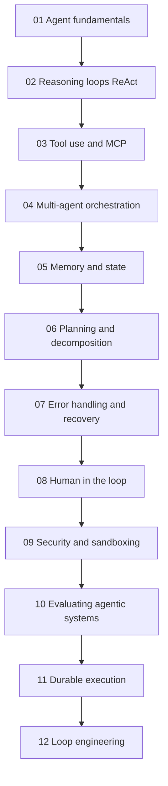
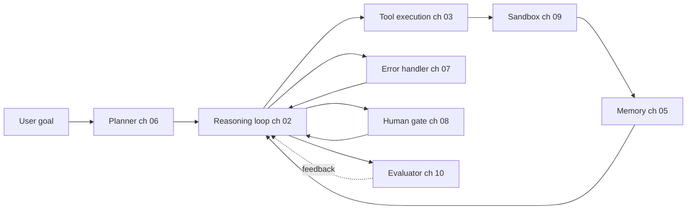

# سیستم‌های Agentic

ساخت Agentهای هوش مصنوعی پروداکشن در سال ۲۰۲۶: حلقه‌های استدلال، استفاده از ابزار MCP، ارکستراسیون multi-agent، حافظه، برنامه‌ریزی، بازیابی از خطا، انسان در حلقه (human-in-the-loop) و ارزیابی.

Agentها یک فناوری منفرد نیستند. آن‌ها ترکیبی از حلقه استدلال، لایه ابزار، حافظه، برنامه‌ریز، مدیریت‌کننده خطا و ارزیاب هستند. ۱۲ فصل موجود در این پوشه، هر لایه را به صورت عمیق پوشش می‌دهند و به گونه‌ای مرتب شده‌اند که فصل‌های ابتدایی، واژگان و مفاهیم مورد استفاده در فصل‌های بعدی را پایه‌گذاری می‌کنند.

## ترتیب فصل‌ها

## معماری مرجع

مفاهیم هر فصل با یکی از مؤلفه‌های یک Agent مستقرشده (deployed) مطابقت دارد. نمودار زیر نشان می‌دهد که مطالب هر فصل در کجای یک سیستم پروداکشن قرار می‌گیرد:

## فایل‌های موجود در این پوشه

| فایل | مباحث تحت پوشش |
|------|----------------|
| [01-agent-fundamentals.md](01-agent-fundamentals.md) | چه چیزی یک سیستم را به یک «Agent» تبدیل می‌کند؛ تمایز میان Agent و گردش کار (workflow)؛ چه زمانی باید هر یک را انتخاب کرد. |
| [02-reasoning-loops-react-and-beyond.md](02-reasoning-loops-react-and-beyond.md) | روش‌های ReAct ،Plan-and-Execute ،Reflexion و Tree-of-Thought؛ الگوهای طراحی حلقه. |
| [03-tool-use-and-mcp.md](03-tool-use-and-mcp.md) | فراخوانی تابع (Function calling)، پروتکل زمینه مدل (Model Context Protocol یا MCP)، بازنویسی بدون وضعیت (stateless) مورخ ۲۰۲۶-۰۷-۲۸، تقویم انتشار (هدف‌گذاری بازنگری بعدی برای ۳۰ مارس ۲۰۲۷) و مراحل بلوغ افزونه‌ها، افزونه مهارت‌ها (skills extension)، نسخه ۱.۰ از A2A، پروتکل‌های تجارت Agentic، مقاوم‌سازی پروداکشن در MCP (موج هشدارهای امنیتی، تداخل OAuth، نشت سرور اشتراکی) و جعبه‌ابزارهای تعامل با کامپیوتر (computer-use). |
| [04-multi-agent-orchestration.md](04-multi-agent-orchestration.md) | چه زمانی ساختار multi-agent مفید است و چه زمانی آسیب می‌زند؛ الگوهای ناظر (supervisor)، ازدحامی (swarm)، پایپ‌لاین (workflows as code) و مناظره (debate)؛ هماهنگ‌کننده‌های مدیریت‌شده (managed coordinators). |
| [05-agent-memory-and-state.md](05-agent-memory-and-state.md) | سلسله‌مراتب حافظه L1 تا L4 (کاری [Working]، رویدادی [Episodic]، معنایی [Semantic] و رویه‌ای [Procedural]) همراه با مصالحه‌ها (tradeoffs)؛ پالایش در زمان نوشتن (write-time) در برابر زمان استراحت (sleep-time) در برابر زمان خواندن (read-time)؛ و چه زمانی حافظه عملکرد Agentها را تضعیف می‌کند. |
| [06-planning-and-decomposition.md](06-planning-and-decomposition.md) | تجزیه وظایف (Task decomposition)، استخراج نیازمندی‌ها، بازنگری برنامه و برنامه‌ریزی با افق بلندمدت (long-horizon planning). |
| [07-error-handling-and-recovery.md](07-error-handling-and-recovery.md) | خطاهای ابزار، تلاش‌های مجدد (retries)، محافظ‌های حلقه (loop guards)، کلیدهای قطع اضطراری (kill switches) و زمان مهار (containment time)، و راهکارهای جایگزین بین‌تأمین‌کننده‌ای (cross-vendor fallback). |
| [08-human-in-the-loop-patterns.md](08-human-in-the-loop-patterns.md) | گیت‌های تایید، خودمختاری مشروط به خط‌مشی (policy-gated autonomy)، تاییدشویی (approval laundering)، ارجاع به سطوح بالاتر (escalation) و خودمختاری تحت نظارت (supervised autonomy). |
| [09-agentic-security-and-sandboxing.md](09-agentic-security-and-sandboxing.md) | ساندباکس‌های اجرای کد، کنترل دسترسی به قابلیت‌ها (capability gating)، تزریق Prompt در Agentها، گزارش حوادث سال ۲۰۲۶ و مهار برون‌باندی (out-of-band containment). |
| [10-evaluating-agentic-systems.md](10-evaluating-agentic-systems.md) | ارزیابی مسیر عملکرد (trajectory evals)، بنچمارک‌های فعلی Agentها و تله‌های گزارش‌دهی آن‌ها، یکپارچگی ارزیابی، و داوران مدل تصمیم‌گیری (decision-model judges). |
| [11-durable-execution.md](11-durable-execution.md) | تاب‌آوری در برابر کرش‌ها در Agentهای دیرپا (long-running): تاریخچه رویدادها، بازپخش (replay)، اثرات جانبی دقیقاً یک‌بار (exactly-once side effects)، پلتفرم Temporal و محیط‌های اجرای مدیریت‌شده Agentها. |
| [12-loop-engineering.md](12-loop-engineering.md) | مهندسی حلقه‌ها در اطراف یک Agent: چهار سطح حلقه، خودبهبودبخشی بازگشتی (recursive self-improvement)، کنترل خاتمه و بودجه، فرسودگی کانتکست (context rot)، اعتبارسنجی، الگوهای ضدطراحی مانند loopmaxxing، و نردبان بلوغ. |

## فصل‌های مکمل

- [استفاده از ابزار و Agentهای کامپیوتری](../17-tool-use-and-computer-agents/) این بخش را با OpenClaw، استفاده از کامپیوتر (Computer Use) و چشم‌انداز تعامل ابزار و Agent گسترش می‌دهد.
- [ارکستراسیون با LangGraph](../09-frameworks-and-tools/02-langgraph-orchestration.md) رایج‌ترین فریم‌ورک پیاده‌سازی برای الگوهای این بخش است.
- [Agentic RAG](../06-retrieval-systems/08-agentic-rag.md) نقطه تلاقی میان Agentها و بازیابی اطلاعات است.
- [قابلیت اطمینان و ایمنی](../13-reliability-and-safety/) مبحث امنیت Agentic را فراتر از ساندباکس‌سازی فصل ۰۹ گسترش می‌دهد.

## نکات کلیدی

- Agentها یک فناوری منفرد نیستند؛ آن‌ها ترکیبی از حلقه استدلال، لایه ابزار، حافظه، برنامه‌ریز و ارزیاب هستند. ابتدا فصل ۰۱ را بخوانید.
- پروتکل MCP استاندارد تعامل‌پذیری ابزارها در سال ۲۰۲۶ است (نسخه بازنگری فعلی مشخصات ۲۰۲۶-۰۷-۲۸ است، بازنگری بعدی برای ۳۰ مارس ۲۰۲۷ هدف‌گذاری شده و همراه با A2A تحت نظر Agentic AI Foundation اداره می‌شود)؛ پروتکل‌های سفارشی برای ابزار نسازید مگر اینکه دلیل قانع‌کننده‌ای داشته باشید، و مرحله بلوغ هر افزونه را پیش از اتکا به آن بررسی کنید.
- ارکستراسیون multi-agent (فصل ۰۴) بیش از حد به کار گرفته می‌شود؛ در اکثر کاربردها، یک single-agent همراه با ابزارهای مناسب، بر multi-agent غلبه می‌کند.
- حافظه (فصل ۰۵) و بازیابی از خطا (فصل ۰۷) جایی هستند که بیشتر باگ‌های Agentهای پروداکشن در آن‌ها رخ می‌دهد؛ بودجه و توان ارزیابی خود را به این بخش‌ها اختصاص دهید.
- انسان در حلقه (فصل ۰۸) یک راهکار پشتیبان (fallback) نیست؛ گیت‌ها را به صورت هدفمند برای اقدامات پرریسک طراحی کنید. تاییدیه‌ها و دسته‌بندی‌کننده‌های مجوز ریسک را کاهش می‌دهند، اما مهار (ساندباکس، سیاست خروج ترافیک [egress policy]، یک مسیر قطع اضطراری برون‌باندی [out-of-band kill path]) مرز نهایی است (فصل ۰۹).
- مهندسی حلقه (فصل ۱۲) اکنون یک تخصص مستقل است: یک مدل قوی در یک بستر اجرایی (harness) ضعیف در برابر یک مدل معمولی در بستری عالی شکست می‌خورد. شرایط خاتمه و بودجه‌ها را در بستر اجرایی اعمال کنید و اعتبارسنج (verifier) را از تولیدکننده (producer) جدا نگه دارید.

