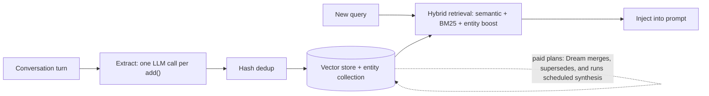

<div dir="rtl">

# حافظه Agentic با Mem0

**پلتفرم Mem0** (و همتایان آن Zep، Letta و Cognee) نمایانگر گذار از «لاگ‌های غیرفعال» به **حافظه فعال (Active Memory)** است. این سیستم‌ها گفت‌وگوها را به‌طور خودکار هضم و تحلیل (digest) می‌کنند تا یک پروفایل کاربری ماندگار و در حال تکامل بسازند که شخصی‌سازی را در تمام تعاملات بهبود می‌بخشد. Mem0 را برای جامع‌ترین لایه حافظه مستقل (standalone)؛ Zep را برای پایپ‌لاین‌های محیط عملیاتی آگاه از زمان (temporal-aware)؛ Letta را برای Agentهای با اجرای طولانی‌مدت که حافظه آن‌ها باید به‌صورت فایل‌های قابل بررسی توسط انسان باشد (این ابزار در سال ۲۰۲۶ از صفحه‌بندی به سبک MemGPT به MemFS مبتنی بر Git مهاجرت کرد)؛ و Cognee را برای RAG اولویت‌دار بر پایه گراف دانش (knowledge-graph-first) انتخاب کنید.

## جدول مطالب

- [فلسفه Mem0](#the-mem0-philosophy)
- [نحوه کار: حلقه هضم و تحلیل](#how-it-works-the-digest-loop)
- [حافظه‌های خودبه‌روزرسان](#self-updating-memories)
- [یکپارچه‌سازی Mem0 با LangGraph](#integrating-mem0-with-langgraph)
- [شخصی‌سازی در مقیاس بالا](#personalization-at-scale)
- [انتخاب یک لایه حافظه](#choosing-a-memory-layer)
- [سوالات مصاحبه](#interview-questions)
- [منابع](#references)

---

## فلسفه Mem0

حافظه سنتی *همه چیز* را ذخیره می‌کند.
اما Mem0 **بینش‌ها (Insights)** را ذخیره می‌کند.
به‌جای ذخیره «کاربر گفت که ماگ‌های قهوه آبی را دوست دارد، اما فقط برای محیط کار»، Mem0 یک حقیقت کوتاه مانند «ماگ‌های قهوه آبی را در محل کار ترجیح می‌دهد» را ذخیره می‌کند که با کاربر برچسب‌گذاری شده و به موجودیت‌هایی که ذکر می‌کند پیوند داده شده است.

---

## نحوه کار: حلقه هضم و تحلیل

مسیر نوشتن در Python SDK مربوط به Mem0 در نسخه v2.0.0 (۱۶ آوریل ۲۰۲۶) تغییر کرد؛ نسخه فعلی v2.2.1 (۲۵ سپتامبر ۲۰۲۶) است.

<div dir="ltr">



</div>

1. **مشاهده (Observe)**: Agent نوبت‌های گفت‌وگو را به `add()` ارسال می‌کند.
2. **استخراج (Extract)**: یک فراخوانی منفرد LLM حقایق به‌یادماندنی را شناسایی کرده و آن‌ها را **اضافه** می‌کند. نسخه v2 فقط افزودنی (ADD-only) است: هیچ مرحله مقایسه و به‌روزرسانی یا حذف وجود ندارد و فقط حذف داده‌های تکراری با هش (hash deduplication) انجام می‌شود.
3. **ذخیره‌سازی (Store)**: حقایق در پایگاه داده برداری (Vector Database) موجود شما قرار می‌گیرند، همراه با پیوندهای موجودیت در یک مجموعه موازی `{collection}_entities`.
4. **بازیابی (Retrieve)**: شباهت معنایی، BM25 و تقویت مبتنی بر موجودیت در یک امتیاز واحد با هم ادغام (fused) می‌شوند.

**مدیریت تعارض به کجا منتقل شد؟** حلقه نسخه v1 هر حقیقت جدید را با حقایق موجود مقایسه می‌کرد و رکوردهای دارای تعارض را به‌روزرسانی یا حذف می‌نمود. در v2 این قابلیت به ویژگی **Dream** پلتفرم منتقل شد (راه‌اندازی شده در ۴ اوت ۲۰۲۶، فقط برای پلن‌های Pro و Enterprise)، که در طول استخراج عملیات ادغام و جایگزینی را انجام می‌دهد و سنتز زمان‌بندی‌شده را خارج از مسیر درخواست اجرا می‌کند. اگر از SDK متن‌باز استفاده می‌کنید، هر دو تناقض («ساکن برلین است»، و سپس «به لیسبون نقل مکان کرد») باقی می‌مانند، و شما باید آن‌ها را در زمان خواندن حل کنید (اولویت دادن به جدیدتر بودن، نمایش هر دو) یا فرآیند یکپارچه‌سازی (consolidation job) اختصاصی خود را اجرا نمایید.

---

## حافظه‌های خودبه‌روزرسان

حافظه Agentic مدرن **بازگشتی (Recursive)** است.
- اگر کاربری به یک وظیفه اشاره کند: «باید تا روز جمعه بودجه را تمام کنم.»
- در روز پنج‌شنبه، Agent باید این موضوع را به یاد بیاورد و بپرسد: «بودجه چطور پیش می‌رود؟»
- این امر با **بازاندیشی دوره‌ای (Periodic Reflection)** محقق می‌شود: یک فرآیند زمان‌بندی‌شده، «گره‌های هدف» (Goal Nodes) فعال را بررسی کرده و «یادآورهای پیشگیرانه» (Proactive Reminders) تولید می‌کند. یکپارچه‌سازی در زمان خواب (Sleep-time consolidation) اکنون به یک دسته‌بندی محصول تبدیل شده است: قابلیت Dream در پلن‌های پولی Mem0، و پیش‌نمایش تحقیقاتی Dreams متعلق به Anthropic برای مخازن حافظه Managed Agents، که به‌جای ویرایش مستقیم مخزن زنده، یک مخزن بازسازماندهی‌شده می‌نویسد که داده‌های تکراری در آن ادغام و ورودی‌های قدیمی جایگزین شده‌اند.

---

## یکپارچه‌سازی Mem0 با LangGraph

در یک معماری ماشین وضعیت (state-machine)، ابزار Mem0 به‌عنوان یک **ارائه‌دهنده وضعیت خارجی (External State Provider)** عمل می‌کند.

<div dir="ltr">

```python
# Conceptual LangGraph node (Mem0 OSS SDK)
from mem0 import Memory

memory = Memory()

def memory_node(state: AgentState):
    # Pull the facts relevant to this turn, scoped to the user
    hits = memory.search(
        query=state["last_user_message"],
        filters={"user_id": state["user_id"]},
        top_k=5,
    )
    # Inject into the global reasoning state
    return {"user_profile": hits}

def remember_node(state: AgentState):
    memory.add(
        [{"role": "user", "content": state["last_user_message"]}],
        user_id=state["user_id"],
    )
    return {}
```

</div>

---

## شخصی‌سازی در مقیاس بالا

برای برنامه‌های سازمانی (میلیون‌ها کاربر)، Mem0 موارد زیر را مدیریت می‌کند:
- **سازگاری و یکپارچگی (Consistency)**: هوش مصنوعی نام کاربر را در سراسر وب‌اپلیکیشن، اپلیکیشن موبایل و ربات Slack «به یاد می‌آورد».
- **کاهش اصطکاک (Friction Reduction)**: نپرسیدن مجدد سوالات احراز صلاحیت مشابه.

---

## انتخاب یک لایه حافظه

| لایه | بستر | چه زمانی آن را انتخاب کنیم |
|-------|-----------|--------------|
| **Mem0 v2** | حقایق در پایگاه داده برداری (Vector Database) شما به همراه یک نمایه موجودیت | شخصی‌سازی میان‌نشستی (Cross-session)؛ زمانی که برای هر عملیات نوشتن یک فراخوانی LLM می‌خواهید و نیازی به دیتابیس اضافی ندارید |
| **Zep / Graphiti** | گراف دانش زمانی (`valid_at` / `invalid_at` به ازای هر یال) | حقایق در طول زمان تغییر می‌کنند و به پرس‌وجوهای «در آن زمان چه چیزی درست بود؟» نیاز دارید |
| **Letta (MemFS)** | فایل‌های Markdown با پشتیبانی Git، به‌طور پیش‌فرض بدون نمایه برداری | ایجنت‌های (Agentهای) با اجرای طولانی‌مدت که در آن‌ها انسان‌ها حافظه را بازبینی و نسخه‌گذاری می‌کنند |
| **Claude memory tool / Managed Agents memory stores** | فایل‌های مونت‌شده در فضای کاری Agent | از قبل روی Claude Managed Agents یا بسترهای به سبک Claude Code اجرا می‌شوید |
| **Cognee** | گراف دانش ساخته‌شده از اسناد | حافظه‌ای که بخش عمده آن دانش بارگذاری‌شده است تا مکالمه |

**ارزیابی را روی وظایف خودتان انجام دهید، نه جداول ارائه‌دهندگان.** آزمون DolphinBench مربوط به Mem0 (۲۲ سپتامبر ۲۰۲۶؛ ۶۰۰ آزمایش مبتنی بر استفاده از ابزار روی تاریخچه‌های شبیه‌سازی‌شده حدود 500K از Tokenها به ازای هر پرسنونا) یک بستر آزمون مفید است، اما نتایج آن توسط ارائه‌دهنده گزارش شده است: Mem0 روی بستر Hermes با GPT-5.6 Luna امتیاز ۷۰.۶۷٪ را در مقایسه با ۶۵.۶۷٪ برای حافظه داخلی کسب کرد، و روی Claude Code با Claude Sonnet 5 امتیاز ۳۲.۳۳٪ در برابر ۲۶.۳۳٪ را به دست آورد، جایی که Honcho با ۳۵.۸۳٪ امتیاز بالاتری ثبت کرد. همیشه یک بازوی بدون حافظه (no-memory arm) را برای مقایسه در نظر بگیرید: بررسی MemTrapBench نشان داد تمام استراتژی‌های حافظه آزمایش‌شده عملکرد ضعیف‌تری نسبت به حالت بدون حافظه داشتند.

---

## سوالات مصاحبه

### پرسش: چرا باید به‌جای یک اسکریپت سفارشی Python که در Postgres می‌نویسد، از یک سرویس اختصاصی مانند Mem0 استفاده کنیم؟

**پاسخ قوی:**
مقیاس‌پذیری و **حذف داده‌های تکراری (Deduplication)**، به‌علاوه کیفیت بازیابی. یک اسکریپت سفارشی اغلب رکوردهای تکراری ایجاد می‌کند یا در **حل هویت متناقض (Conflicting Identity Resolution)** با مشکل مواجه می‌شود (به‌عنوان مثال، کاربر در Slack با نام «Om» و در Discord با نام «om.bharatiya» شناخته می‌شود). Mem0 ابزارهایی شامل Promptهای استخراج آزمایش‌شده، پیوند موجودیت‌ها (entity linking)، بازیابی ترکیبی (شباهت معنایی، BM25 و تقویت موجودیت ادغام‌شده در یک امتیاز واحد) و تفکیک محدوده به ازای هر کاربر را ارائه می‌دهد. پرسش طراحی که من مطرح می‌کنم این است که **محل مدیریت تعارض کجاست**: مسیر متن‌باز Mem0 v2 فقط افزودنی (ADD-only) است و عملیات ادغام یا جایگزینی به ویژگی پولی Dream منتقل شده است. بنابراین «استفاده از Mem0» همچنان من را با این انتخاب مواجه می‌کند که هزینه یکپارچه‌سازی را بپردازم، یک تسک شبانه بنویسم، یا تناقضات را در زمان خواندن با قوانین اولویت تازگی حل کنم.

### پرسش: چگونه با «خستگی حافظه» (Memory Fatigue) که در آن یک Agent جزئیات گذشته نامربوط بیش از حدی را مطرح می‌کند، برخورد می‌کنید؟

**پاسخ قوی:**
ما از **ارتباط آستانه‌گذاری‌شده (Thresholded Relevance)** استفاده می‌کنیم. Mem0 برای هر حقیقت بازیابی‌شده یک امتیاز ارتباط برمی‌گرداند، و ما تنها حقایقی را تزریق می‌کنیم که امتیازی بالاتر از آستانه کالیبره‌شده روی مجموعه ارزیابی اختصاصی خودمان داشته باشند؛ این امتیاز بین نسخه‌ها قابل مقایسه نیست (امتیاز ادغام‌شده v2 با شباهت کسینوسی v1 یکسان نیست)، بنابراین پس از ارتقای نسخه، آن را مجدداً کالیبره کنید. علاوه بر این، از **بازیابی منفی (Negative Retrieval)** استفاده می‌کنیم: به Agent دستور داده می‌شود که تنها در صورتی از حافظه استفاده کند که مستقیماً با یک توهم (hallucination) احتمالی در تضاد باشد یا به یک «مورد ناشناخته» (Unknown) فعلی پاسخ دهد. ما همچنین **هرس حافظه (Memory Pruning)** را انجام می‌دهیم که در آن حافظه‌های «کم‌ارزش» (مانند «کاربر اشاره کرد که باران می‌بارد») پس از ۲۴ ساعت به‌طور خودکار حذف می‌شوند. در نهایت، من موفقیت وظایف را با فعال و غیرفعال بودن حافظه می‌سنجَم، زیرا MemTrapBench نشان داد حافظه‌های مرتبط و صحیح نیز می‌توانند مدل را به سمت پاسخ اشتباه سوق دهند.

---

## منابع
- [Mem0: ساخت Agentهای هوش مصنوعی آماده محیط عملیاتی با حافظه بلندمدت مقیاس‌پذیر (arXiv 2504.19413)](https://arxiv.org/abs/2504.19413)
- [یادداشت‌های انتشار Mem0 v2.0.0](https://github.com/mem0ai/mem0/releases/tag/v2.0.0)
- [انتشارهای Mem0 (نسخه v2.2.1، ۲۵ سپتامبر ۲۰۲۶)](https://github.com/mem0ai/mem0/releases)
- [مخزن Letta Code (سیستم MemFS، حافظه ردیابی‌شده با Git)](https://github.com/letta-ai/letta-code)؛ سرور بازنشسته‌شده V1 در شاخه بایگانی [letta-ai/letta](https://github.com/letta-ai/letta) قرار دارد.
- [Zep: یک معماری گراف دانش زمانی برای حافظه Agent (مقاله arXiv 2501.13956)](https://arxiv.org/abs/2501.13956)
- [پایگاه محک MemTrapBench (مقاله arXiv 2608.20202)](https://arxiv.org/abs/2608.20202)

---

*بعدی: [کَشینگ معنایی](05-semantic-caching.md)*

</div>