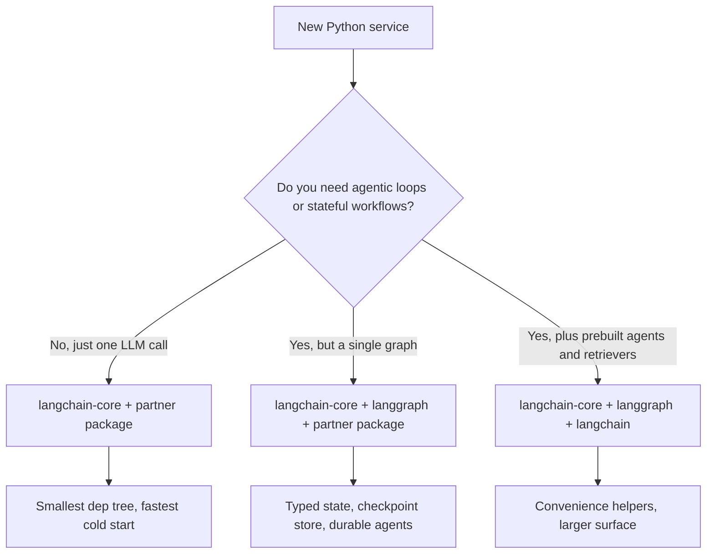

<div dir="rtl">

# بررسی عمیق LangChain (LangChain Deep Dive)

فریم‌ورک LangChain دیگر صرفاً یک «کتابخانه مهندسی Prompt» نیست. این فریم‌ورک به یک **اکوسیستم ماژولار (Modular Ecosystem)** برای توسعه برنامه‌های کاربردی LLM در سطح تجاری و عملیاتی (Production-grade) تبدیل شده است. فریم‌ورک LangGraph (که در اکتبر ۲۰۲۵ به نسخه ۱.۰ ارتقا یافت و محیط اجرای پیش‌فرض برای تمامی Agentهای LangChain محسوب می‌شود) وظیفه ارکستراسیون باحالت (Stateful Orchestration) را بر عهده دارد. در همین حال، **زبان بیان LangChain (یا LCEL - LangChain Expression Language)** همچنان سریع‌ترین راه برای ساخت زنجیره‌های ترکیب‌پذیر (Composable Chains) به شمار می‌رود.

تصویر وضعیت نسخه‌ها (Version snapshot) با ذکر تاریخ انتشار، از آنجا که این اعداد ماهانه تغییر می‌کنند: نسخه `langchain` 1.4.9 (۴ نوامبر ۲۰۲۶)، نسخه `langchain-core` 1.7.6 (۵ نوامبر ۲۰۲۶؛ در نسخه 1.7.5 بلوک‌های محتوای رد درخواست مدل استانداردسازی شدند)، و `langgraph` 1.2.20 (۵ نوامبر ۲۰۲۶). در اکوسیستم جاوااسکریپت، نسخه `langchain` 1.6.1 و `@langchain/core` 1.3.4 (۳ نوامبر) و `@langchain/langgraph` 1.7.0 (۵ نوامبر) عرضه شده‌اند. ارتقای پایتون را از همین حالا برنامه‌ریزی کنید: در نسخه‌های `langchain` 1.4.8 و `langchain-core` 1.7.4 (۲ نوامبر) هشدار داده شده است که پشتیبانی از Python 3.10 در نسخه‌های `langchain-core` 1.8.0 و `langchain` 1.5.0 پایان می‌یابد، زیرا نسخه Python 3.10 در ۱ اکتبر ۲۰۲۶ به پایان دوره عمر (EOL) خود رسیده است.

## جدول محتوا

- [پشته نرم‌افزاری LangChain](#the-langchain-stack)
- [زبان LCEL: برنامه‌نویسی با پایپ‌ها (Pipes)](#lcel-programming-with-pipes)
- [انتزاع‌های استاندارد (Core)](#standard-abstractions)
- [مدیریت پیچیدگی (بسته‌های Community در برابر Partner)](#managing-complexity)
- [حرکت LangChain به سوی ماژولار بودن](#langchain-modularity-push)
- [پرسش‌های مصاحبه](#interview-questions)
- [منابع](#references)

---

## پشته نرم‌افزاری LangChain

این اکوسیستم اکنون به سه لایه مجزا تقسیم شده است:
۱. **بخش LangChain Core**: انتزاع‌های حداقلی برای دستورهای Prompt، پارسرهای خروجی (Output Parsers)، و قابلیت‌های Runnable (همراه با وابستگی‌های حداقلی).
۲. **بخش‌های LangChain Community و Partner**: یکپارچه‌سازی با بیش از ۵۰۰ پایگاه داده، مدل و ابزار مختلف.
۳. **فریم‌ورک LangGraph**: لایه ارکستراسیون باحالت (که در فصل بعد به آن پرداخته می‌شود).

---

## زبان LCEL: برنامه‌نویسی با پایپ‌ها

زبان بیان LangChain (یا LCEL) از عملگر `|` برای ساخت یک **گراف غیرمدور جهت‌دار (DAG)** از مراحل اجرا استفاده می‌کند.

<div dir="ltr">

```python
# Standard RAG chain
chain = (
    {"context": retriever, "question": RunnablePassthrough()}
    | prompt
    | model.with_structured_output(Schema) 
)
```

</div>

**چرا استفاده از LCEL توصیه می‌شود؟**
- **پشتیبانی پیش‌فرض از ناهمگامی (Async by Default)**: هر زنجیره‌ای به طور پیش‌فرض از متدهای `.ainvoke()` و `.astream()` پشتیبانی می‌کند.
- **اجرای موازی (Parallelism)**: شاخه‌های متعدد به صورت خودکار و موازی اجرا می‌شوند.
- **مشاهده‌پذیری (Observability)**: ادغام خودکار با **LangSmith** برای مشاهده و مصورسازی کامل ردپاها (Traces).

---

## انتزاع‌های استاندارد

### ۱. کلاس‌های Runnable
این مفهوم به عنوان «کلاس پایه (Base Class)» برای همه چیز در LangChain عمل می‌کند. کلاس‌های Runnable یک واسط یکپارچه برای متدهای `.invoke`، `.batch` و `.stream` فراهم می‌سازند.

### ۲. ابزارها و فراخوانی ابزار (Tools & Tool-Calling)
فریم‌ورک LangChain دارای پشتیبانی درجه‌یک از **پروتکل MCP (Model Context Protocol)** است و از نسخه `langchain` 1.4.0 (۳ سپتامبر ۲۰۲۶)، این قابلیت به جای یک آداپتور جداگانه مستقیماً درون پکیج اصلی قرار گرفته است.
- فضای نام `langchain.mcp` و کلاس `MCPAdapter`، ابزارهای هر سرور MCP را به ابزارهای بومی LangChain تبدیل می‌کنند.
- درخواست‌های استخراج اطلاعات (Elicitation requests) در MCP بر اساس نسخه پروتکل مذاکره‌شده با سرور هدایت می‌شوند (نشست‌های باحالت دوره ۲۰۲۵ در برابر بازبینی بدون‌حالت ۲۰۲۶-۰۷-۲۸)، بنابراین یک Agent می‌تواند هم با سرورهای قدیمی و هم سرورهای جدید ارتباط برقرار کند.
- در نسخه Python SDK 2.0 پروتکل MCP (۲۸ ژوئیه ۲۰۲۶)، نام `FastMCP` به `MCPServer` تغییر یافت. آموزش‌هایی که از `from mcp.server.fastmcp import FastMCP` استفاده می‌کنند در نصب‌های جدید دچار خطا می‌شوند؛ بنابراین نسخه را روی `mcp<2` قفل (Pin) کنید یا کد را تطبیق دهید.

### ۳. پارسرهای خروجی و خروجی ساختاریافته (Output Parsers and Structured Output)
در حالی که سیستم‌های اولیه از رجکس (Regex) استفاده می‌کردند، کدهای امروزی از متد `.with_structured_output()` بهره می‌برند که به طور فزاینده‌ای به جای فراخوانی ابزار، به **خروجی ساختاریافته با شمای بومی JSON (Native JSON-schema structured output)** ارائه‌دهنده نگاشت می‌شود. ترفند قدیمی مبتنی بر تحمیل یک فراخوانی ابزار واحد برای دریافت JSON در حال کنار گذاشته شدن است:
- مدل‌های Claude Fable 5.1، Opus 5.5 و Sonnet 5.5 در صورت دریافت `tool_choice` از نوع `any` یا `tool`، خطای HTTP 400 بازمی‌گردانند. پکیج `langchain-anthropic` نسخه 1.7.3 (۲۲ سپتامبر ۲۰۲۶) متد `with_structured_output` را برای Fable و Opus 5.5 به `method="json_schema"` هدایت می‌کند و نسخه 1.7.5 (۲۹ سپتامبر) مدل Sonnet 5.5 را نیز اضافه کرده است.
- مدل GPT-6 Astra پارامترهای سفارشی `temperature`، `top_p` و `logprobs` را نمی‌پذیرد و فراخوانی ابزار آن مستلزم استفاده از API Responses است. پکیج `langchain-openai` نسخه 1.6.3 (۲۱ سپتامبر) این محدودیت‌ها را مدیریت کرده و مسیریابی استنتاج‌شده Responses API را ارائه می‌دهد.

این درس صرفاً مختص LangChain نیست: هر پوشش‌دهنده‌ای (Wrapper) که پارامترهای نمونه‌برداری را به صورت سخت‌کد نوشته باشد یا فراخوانی ابزار را اجباری کند، با جدیدترین مدل‌های پیشرو دچار شکست می‌شود؛ بنابراین پیش از ارتقای شناسه‌های مدل (Model IDs)، بسته‌های همکار (Partner Packages) را ارتقا دهید.

---

## مدیریت پیچیدگی

> [!TIP]
> **بهترین شیوه در محیط عملیاتی (Production Best Practice)**: از به‌کارگیری پکیج `langchain-community` در مسیرهای بحرانی خودداری کنید. از **بسته‌های همکار (Partner Packages)** (مانند `langchain-openai` و `langchain-pinecone`) استفاده کنید تا از معضل تداخل وابستگی‌ها (Dependency Hell) جلوگیری کرده و پایداری سیستم را بهبود ببخشید.

---

## حرکت LangChain به سوی ماژولار بودن

این اکوسیستم فرآیند طولانی مهاجرت خود از ایمپورت‌های یکپارچه و یکپارچه‌طلب (Monolithic) در `langchain` به یک ساختار لایه‌بندی‌شده با مرزهای وابستگی مشخص را به پایان رسانده است. این تفکیک با این هدف انجام شده است که تیم‌ها بتوانند دقیقاً بخش‌های مورد نیاز خود را انتخاب کنند، بدون اینکه مجبور به بارگذاری بیش از ۵۰۰ یکپارچه‌سازی مختلف شوند.

### ساختار لایه‌بندی بسته‌ها بر اساس عرضه رسمی

| نام بسته | هدف و کاربرد | وابستگی‌های مستقیم |
|---------|---------|---------------------|
| بسته `langchain-core` | کلاس‌های Runnable، دستورهای Prompt، پارسرهای خروجی، انتزاع‌های ابزار | کتابخانه‌های Pydantic و `tenacity` و تقریباً بدون هیچ وابستگی دیگر |
| بسته `langchain` | قابلیت `create_agent`، میان‌افزارها، بازیاب‌های مرجع، آداپتور MCP (`langchain.mcp`، از نسخه 1.4.0) | بسته `langchain-core` |
| بسته `langgraph` | ارکستراسیون گراف باحالت، ذخیره‌سازی وضعیت (Checkpointing)، قابلیت Time-travel | بسته `langchain-core` |
| بسته‌های `langchain-openai`، `langchain-anthropic`، `langchain-google-vertexai` و غیره | بسته‌های همکار ارائه‌دهندگان (Provider partner packages) | بسته `langchain-core` + اس‌دی‌کی اختصاصی ارائه‌دهنده |
| بسته `langchain-community` | طیف گسترده‌ای از یکپارچه‌سازی‌های جانبی (همچنان در دسترس است، اما در مسیرهای عملیاتی توصیه نمی‌شود) | وابستگی‌های پرتعداد |
| بسته `langchain-classic` | زنجیره‌های قدیمی نسخه v0، نگهداری‌شده برای تسهیل فرآیند مهاجرت | بسته `langchain-core` |

بسته `langchain-core` تنها بسته‌ای است که بر اساس بیانیه رسمی انتشار نسخه v1 ([وبلاگ LangChain، راهنمای ساخت با LangChain 1.0](https://blog.langchain.com/langchain-1-0/)) با رابط پایدار و تضمین سازگاری رو به عقب عرضه می‌شود.

### استانداردسازی JSON Schema در میان کتابخانه‌های اعتبارسنجی

بزرگ‌ترین تغییر برای کدهای کاربردی این است: متدهای `with_structured_output()`، `bind_tools()` و دکوراتور `@tool` اکنون از هر شیء سازگار با [JSON Schema](https://json-schema.org/) پشتیبانی می‌کنند. این موارد عبارتند از:

- **کتابخانه Pydantic v2** (پیش‌فرض تاریخی)
- **طرح‌واره‌های [Zod 4](https://zod.dev/v4)** که مستقیماً در نسخه جاوااسکریپت / تایپ‌اسکریپت LangChain ارسال می‌شوند (نسخه Zod 4 دارای قابلیت صدور داخلی JSON Schema است)
- **کتابخانه [Valibot](https://valibot.dev/)** (اعتبارسنجی تابعی و با قابلیت Tree-shaking در تایپ‌اسکریپت)
- **کتابخانه [ArkType](https://arktype.io/)** (تایپ‌های TypeScript به عنوان اسکیمای زمان اجرا)
- ساختارهای ساده dict و TypedDict در پایتون
- اسناد دست‌نویس JSON Schema

این موضوع در [راهنمای خروجی ساختاریافته LangChain v1](https://docs.langchain.com/oss/python/langchain/structured-output) و [راهنمای خروجی ساختاریافته در JS](https://js.langchain.com/docs/how_to/structured_output) مستند شده است. اثر کاربردی این تغییر: انتخاب فریم‌ورک دیگر تعیین‌کننده کتابخانه اعتبارسنجی نیست و تیم‌هایی که پیش از این برای لایه HTTP خود روی Valibot یا ArkType استانداردسازی کرده‌اند، می‌توانند همان شِماها را به عنوان تعاریف ابزار LangChain مجدداً استفاده کنند.

<div dir="ltr">

```python
# Python: TypedDict tool schema, no Pydantic in the path
# Needs langchain-anthropic >= 1.7.5 for Sonnet 5.5 (forced tool_choice returns 400)
from typing import TypedDict, Annotated
from langchain_anthropic import ChatAnthropic

class CreateInvoice(TypedDict):
    """Create an invoice for a customer."""
    customer_id: Annotated[str, ..., "Stripe customer id"]
    amount_cents: Annotated[int, ..., "Amount in cents, > 0"]

llm = ChatAnthropic(model="claude-sonnet-5-5")
structured = llm.with_structured_output(CreateInvoice)
```

</div>

<div dir="ltr">

```typescript
// TypeScript: Valibot schema reused for both HTTP and tool calling
import * as v from "valibot";
import { ChatAnthropic } from "@langchain/anthropic";
import { toJsonSchema } from "@valibot/to-json-schema";

const CreateInvoice = v.object({
  customer_id: v.pipe(v.string(), v.description("Stripe customer id")),
  amount_cents: v.pipe(v.number(), v.minValue(1)),
});

const llm = new ChatAnthropic({ model: "claude-sonnet-5-5" });
// @langchain/anthropic defaulted to a forced tool call as of 1.5.12, which
// Fable 5.1, Opus 5.5 and Sonnet 5.5 reject with a 400: ask for native JSON-schema output.
const structured = llm.withStructuredOutput(toJsonSchema(CreateInvoice), {
  method: "jsonSchema",
});
```

</div>

### زمان استفاده از langchain-core به تنهایی در برابر نسخه کامل LangChain

<div dir="ltr">



</div>

رویکرد پیشنهادی برای معماری:

- **کدهای کتابخانه‌ای و SDK**: تنها به `langchain-core` وابسته باشید. توسعه‌دهندگان بلوک‌های ساختمانی با قابلیت استفاده مجدد (مانند ذخیره‌سازهای برداری، تقسیم‌کننده‌های Chunk، و ابزارهای سفارشی) هرگز نباید `langchain` یا بسته‌های همکار را به عنوان وابستگی مستقیم اضافه کنند. [راهنمای یکپارچه‌سازی‌های LangChain](https://docs.langchain.com/oss/python/integrations/providers) این مورد را یک قانون قطعی برای مشارکت‌کنندگان در `langchain-community` اعلام کرده است.
- **سرویس‌های کاربردی و نرم‌افزاری**: ترکیب `langchain-core` + بسته‌های همکاری که واقعاً فراخوانی می‌کنید + `langgraph` در صورتی که گردش کار چندمرحله‌ای دارید. از خود بسته `langchain` (خود پکیج، نه کل نام تجاری) صرف‌نظر کنید، مگر اینکه صریحاً از یک بازیاب داخلی یا زنجیره‌های قدیمی استفاده نمایید.
- **نوت‌بوک‌ها و پیش‌نمونه‌ها (Prototypes)**: پکیج `langchain` به دلیل سهولت و راحتی گزینه مناسبی است.

تعیین دقیق نسخه (Pinning) اهمیت دارد. نسخه `langchain-core >= 1.0` حداقل پایه پشتیبانی‌شده برای کدهای جدید است. بر اساس خط‌مشی انتشار LangChain، نسخه‌های LangChain 0.3 و LangGraph 0.4 تا **دسامبر ۲۰۲۶** در حالت تعمیر و نگهداری (صرفاً وصله‌های امنیتی و اصلاحات بحرانی) قرار دارند و شاخه 1.x تا زمان انتشار نسخه 2.0 تحت پشتیبانی بلندمدت (LTS) خواهد بود. اگر هنوز نسخه 0.3 را در محیط عملیاتی اجرا می‌کنید، فرآیند مهاجرت به 1.x را اکنون زمان‌بندی نمایید؛ چرا که پس از دسامبر ۲۰۲۶ حتی وصله‌های امنیتی نیز متوقف خواهند شد.

### نکات مهاجرت برای کدهای موجود

- کلاس‌های `LLMChain`، `RetrievalQA`، `ConversationalRetrievalChain` و `AgentExecutor` در بسته `langchain-classic` قرار گرفته و منجمد (Frozen) شده‌اند. جایگزین آن‌ها پایپ‌های LCEL یا در اغلب موارد، یک گراف در `langgraph` است ([راهنمای مهاجرت LangChain v1](https://docs.langchain.com/oss/python/migrate/langchain-v1)).
- دکوراتورهای ابزار اکنون از `langchain_core.tools` ایمپورت می‌شوند، نه از `langchain.tools`.
- پارسرهای خروجی که به نسخه Pydantic v1 وابسته هستند باید بازنویسی شوند. نسخه `langchain-core` v1.0 لایه انطباق (Shim) مربوط به نسخه v1 را حذف کرده است ([یادداشت‌های انتشار](https://github.com/langchain-ai/langchain/releases/tag/langchain-core%3D%3D1.0.0)).
- پکیج `langchain-core` نسخه 1.6.4 (۲۱ سپتامبر ۲۰۲۶) کلاس‌های تاریخچه پیام‌های چت را منسوخ اعلام کرده است. وضعیت گفتگو متعلق به چک‌پوینترهای LangGraph است.
- نسخه `langchain-core` 1.7.0 (۲۲ اکتبر ۲۰۲۶) و `@langchain/core` 1.3.0 آرگومان‌های فراخوانی ابزار را به جای ارائه‌ی اسنپ‌شات‌های کلی از آرگومان‌ها تا آن لحظه، به صورت تکه‌های `tool-call-delta` استریم می‌کنند. متغیر `.tool_calls` و پیام مونتاژشده بدون تغییر باقی می‌مانند، اما هر کدی که رویدادهای خام استریم را در حین فراخوانی می‌خواند (شامل ترنسفورمرهای استریم سفارشی و کلاینت‌های قدیمی‌تر SDK در LangGraph) باید ابتدا به‌روزرسانی شود؛ در صورت لزوم نسخه را روی `langchain-core<1.7` (یا `@langchain/core<1.3.0`) قفل کنید.
- کدهایی که از `langchain-mcp-adapters` استفاده می‌کردند می‌توانند در نسخه‌های 1.4 به بالا به `langchain.mcp` منتقل شوند؛ تا زمانی که جریان‌های احراز هویت و استخراج داده را روی سرورهای خود آزمایش نکرده‌اید، این آداپتور را قفل نگه دارید.

---

## پرسش‌های مصاحبه

### پرسش: مزیت اصلی LCEL نسبت به زنجیره‌های سنتی پایتون (توالی فراخوانی توابع) چیست؟

**پاسخ قوی:**
زبان LCEL قابلیت **استریمینگ و موازی‌سازی خودکار (Automatic Streaming and Parallelization)** را فراهم می‌کند. در یک زنجیره سنتی پایتون، من باید مدیریت `asyncio.gather` برای مراحل موازی و ژنراتورهای سفارشی برای استریمینگ را به صورت دستی پیاده‌سازی کنم. معماری `Runnable` در LCEL این فرآیند را در پشت صحنه مدیریت می‌کند. اگر من یک بلوک `RunnableParallel` تعریف کنم، LangChain آن‌ها را به طور همزمان اجرا می‌نماید. مهم‌تر از آن، LCEL امکان **مسیریابی پویا (Dynamic Routing)** را از طریق `RunnableBranch` فراهم می‌کند که ساخت منطق‌های پیچیده را بدون عبارات تو در توی if/else بسیار ساده می‌سازد.

### پرسش: فریم‌ورک LangChain اغلب به خاطر «سنگین و حجیم بودن بیش از حد (Bloated)» مورد انتقاد قرار می‌گیرد. چگونه با استفاده از آن یک سیستم عملیاتی سبک و بهینه معماری می‌کنید؟

**پاسخ قوی:**
راهکار کلیدی در **ایمپورت کردن صرفاً بخش Core** نهفته است. من از `langchain-core` برای انتزاع‌ها و از **بسته‌های همکار خاص** (مانند `langchain-anthropic`) برای مدل استفاده می‌کنم. من از بسته `langchain-community` و کلاس‌های قدیمی `Chain` (مانند `LLMChain` یا `RetrievalQA`) که عملاً منسوخ شده‌اند اجتناب می‌ورزم. من منطق برنامه را با استفاده از المان‌های پایه **Runnable** می‌سازم که درخت وابستگی را بسیار کوچک و مسیر اجرا را شفاف نگه می‌دارد.

### پرسش: یک زنجیره استخراج ساختاریافته روی Claude Opus 5 کار می‌کرد، اما پس از اینکه تیم شناسه مدل را به Opus 5.5 تغییر داد، با خطای HTTP 400 مواجه شد. چه اتفاقی افتاده و راهکار اصلاح آن چیست؟

**پاسخ قوی:**
این زنجیره تقریباً به طور قطع خروجی ساختاریافته را از طریق **تحمیل فراخوانی ابزار** (`tool_choice` از نوع `tool` یا `any`) به دست می‌آورده است، که به مدت دو سال ترفند استاندارد فریم‌ورک‌ها محسوب می‌شد. مدل‌های Fable 5.1، Opus 5.5 و Sonnet 5.5 اجبار در انتخاب ابزار را با خطای 400 رد می‌کنند و قابلیت تفکر (Thinking) نیز در مدل Opus 5.5 قابل غیرفعال‌سازی نیست. راهکار فوری، ارتقای پکیج `langchain-anthropic` است (نسخه 1.7.3 متد `with_structured_output` را به خروجی بومی JSON-schema برای Fable و Opus 5.5 هدایت می‌کند؛ نسخه 1.7.5 مدل Sonnet 5.5 را نیز اضافه می‌کند) یا اینکه متد `with_structured_output(..., method="json_schema")` به صورت صریح فراخوانی شود. استفاده از حالت صریح عادت امن‌تری است، زیرا همه یکپارچه‌سازی‌ها بازمسیردهی خودکار ندارند: به عنوان مثال پکیج `@langchain/anthropic` در اکوسیستم جاوااسکریپت تا نسخه 1.5.12 به صورت پیش‌فرض از فراخوانی اجباری ابزار استفاده می‌کرد، بنابراین در آنجا باید خودتان `method: "jsonSchema"` را ارسال کنید. اصلاح فرآیندی اهمیت بیشتری دارد: شناسه مدل یک وابستگی نرم‌افزاری است، بنابراین تعویض مدل باید از همان درگاه ارزیابی (Eval gate) ارتقای پکیج‌ها عبور کند و بسته‌های همکار باید قبل از تغییر شناسه مدل ارتقا یابند، نه پس از آن. من همچنین کل پایگاه کد را برای پارامترهای هاردکدشده `temperature` و `tool_choice` بررسی (Grep) می‌کنم، زیرا مدل GPT-6 Astra پارامترهای سفارشی نمونه‌برداری را رد می‌کند، و تحت نسخه API انتروپیک `2026-10-21` (پیش‌فرض در SDKهای اصلی اکتبر) هر مدل کلود برای پارامترهای `temperature`، `top_p` یا `top_k`، حتی در صورت ارسال مقادیر پیش‌فرض، خطای 400 بازمی‌گرداند.

---

## منابع
- مستندات LangChain برای کلاس `RunnableSequence` (ترکیب LCEL با عملگر `|`): https://reference.langchain.com/python/langchain-core/runnables/base/RunnableSequence
- مستندات LangChain برای «خط‌مشی انتشار» (نگهداری LangChain 0.3 و LangGraph 0.4 تا دسامبر ۲۰۲۶): https://docs.langchain.com/oss/python/release-policy
- یادداشت‌های انتشار LangChain برای نسخه `langchain==1.4.0` (پروتکل MCP در هسته، ۳ سپتامبر ۲۰۲۶): https://github.com/langchain-ai/langchain/releases/tag/langchain%3D%3D1.4.0
- مستندات Anthropic با عنوان «ویژگی‌های جدید در Claude Sonnet 5.5» (بازگشت خطای ۴۰۰ برای `tool_choice` اجباری): https://platform.claude.com/docs/en/models/sonnet-5-5/whats-new-sonnet-5-5
- مستندات وبلاگ LangChain با عنوان «فریم‌ورک‌های ایجنتی LangChain و LangGraph به نقاط عطف نسخه v1.0 رسیدند» (۲۲ اکتبر ۲۰۲۵): https://www.langchain.com/blog/langchain-langgraph-1dot0

---

*بخش بعدی: [ارکستراسیون با LangGraph](02-langgraph-orchestration.md)*

</div>