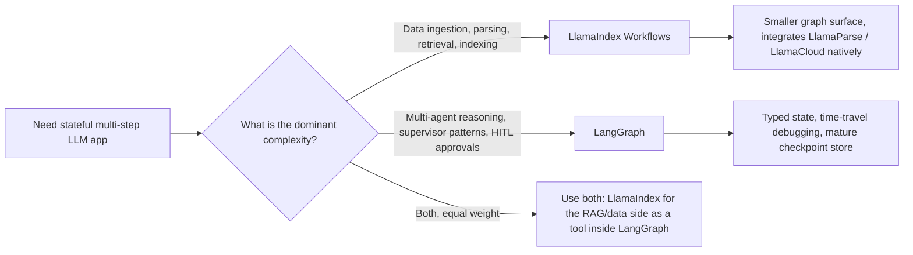

<div dir="rtl">

# فریم‌ورک LlamaIndex (LlamaIndex)

در حالی که فریم‌ورک LangChain بر «ارکستراسیون» متمرکز است، **LlamaIndex** متخصص اصلی در حوزه **هوش مصنوعی داده‌محور (Data-Centric AI)** محسوب می‌شود. این ابزار از یک کتابخانه RAG به فریم‌ورکی برای **گردش‌های کاری (Workflows)** و **دستکاری ایجنتی داده‌ها (Agentic Data Manipulation)** تکامل یافته است و شرکت توسعه‌دهنده آن از آن زمان تمرکز تجاری خود را بر پارس و استخراج اسناد محدود کرده است (به بخش [سیگنال راهبردی](#strategic-signal-the-company-is-betting-on-parsing) مراجعه کنید).

## جدول محتوا

- [فلسفه فریم‌ورک داده‌محور](#the-data-framework-philosophy)
- [گردش‌های کاری LlamaIndex](#llamaindex-workflows)
- [نمایه‌سازی پیشرفته: فراتر از جستجوی برداری](#advanced-indexing)
- [سرویس ابری LlamaCloud و دریافت مدیریت‌شده داده‌ها](#llamacloud-and-managed-ingestion)
- [عامل‌ها به عنوان ابزار](#agents-as-tools)
- [گردش‌های کاری LlamaIndex: فریم‌ورک نرم‌افزاری رویدادمحور](#llamaindex-workflows-event-driven-application-framework)
- [پرسش‌های مصاحبه](#interview-questions)
- [منابع](#references)

---

## فلسفه فریم‌ورک داده‌محور

فریم‌ورک LlamaIndex بر این باور بنا شده است که **داده‌ها از مدل اهمیت بیشتری دارند**.
- **گره داده‌ای (The Node)**: هر تکه از داده‌ها (Chunk) یک «Node» است که با فراداده‌های غنی (روابط، خلاصه‌ها و پیوندهای والد-فرزند) همراه شده است.
- **بازیاب (The Retriever)**: فریم‌ورک LlamaIndex متنوع‌ترین مجموعه بازیاب‌ها را ارائه می‌دهد (بازیاب‌های خلاصه‌محور، گراف دانش، درختی و کلیدواژه‌ای).

---

## گردش‌های کاری LlamaIndex

در سال ۲۰۲۴، فریم‌ورک LlamaIndex قابلیت **Workflows** را به عنوان پاسخ خود به LangGraph معرفی کرد.
- **معماری رویدادمحور (Event-Driven Architecture)**: گره‌ها از طریق انتشار رویدادها (`Events`) با یکدیگر ارتباط برقرار می‌کنند.
- **هم‌زمانی (Concurrency)**: گردش‌های کاری به طور بومی غیرهمگام (Async) هستند و پردازش داده‌های موازی در مقیاس بزرگ را بسیار بهتر از زنجیره‌های خطی مدیریت می‌کنند.

<div dir="ltr">

```python
# Conceptual Workflow
class RAGWorkflow(Workflow):
    @step
    async def ingest(self, ev: StartEvent) -> RetrievalEvent:
        # Custom logic...
        return RetrievalEvent(results=nodes)
```

</div>

---

## نمایه‌سازی پیشرفته

۱. **گراف‌های ویژگی (Property Graphs)**: اتصال تکه‌های برداری به گره‌های گراف برای سیستم‌های RAG.
۲. **تقسیم‌کننده‌های آگاه از کانتکست (Context-Aware Splitters)**: گروه‌بندی متن بر اساس «مفهوم و معنا» به جای «تعداد Token» (با استفاده از مدل‌های کوچک‌تر LLM برای یافتن نقاط شکست بهینه).
۳. **مسیریابی پویا (Dynamic Pathing)**: بازیاب بر اساس پیچیدگی پرسش تصمیم می‌گیرد که *کدام* نمایه (Index) را مورد پرس‌وجو قرار دهد.

---

## سرویس ابری LlamaCloud و دریافت مدیریت‌شده داده‌ها

برای مقیاس‌های سازمانی، LlamaIndex بر پلتفرم **LlamaCloud** تمرکز دارد.
- **دریافت مدیریت‌شده داده‌ها (Managed Ingestion)**: مدیریت پارس کردن فایل‌های PDF، نویسه‌خوان نوری (OCR) و استخراج جداول به صورت یک سرویس ابری.
- **پارس کردن به عنوان یک مدل**: استفاده از مدل‌های زبانی-دیداری (VLM) برای «فهمیدن» چیدمان بصری اسناد به جای پارسرهای مبتنی بر قانون. ابزار LlamaParse و محصول جدیدتر LiteParse ابزارهای اختصاصی پارس این شرکت هستند و محصول Extract اسناد پارس‌شده را به رکوردهای داده‌ای نوع‌دار تبدیل می‌کند.

### سیگنال راهبردی: تمرکز شرکت بر پارس اسناد

در ۱۱ سپتامبر ۲۰۲۶، جری لیو (مدیرعامل LlamaIndex) یادداشتی را به README ریپازیتوری `llama_index` اضافه کرد (در PR شماره #23020) مبنی بر اینکه تمرکز اصلی شرکت به LlamaParse، LiteParse و بنچمارک‌های ParseBench و ExtractBench معطوف شده است، در حالی که فریم‌ورک متن‌باز همچنان به عنوان یک جعبه‌ابزار باز در دسترس خواهد بود. چرخه‌ی انتشار نسخه‌ها نیز این رویکرد را تایید می‌کند: نسخه `llama-index` 0.14.22 (۱۴ مه)، 0.14.23 (۲۴ ژوئن)، 0.14.24 (۱۹ اوت) و 0.14.25 (۲۱ سپتامبر ۲۰۲۶، که عمدتاً شامل رفع وابستگی‌ها برای هشدارهای امنیتی در پکیج‌های یکپارچه‌سازی بود)، در حالی که پکیج `llama-index-workflows` پیوسته در حال به‌روزرسانی است (نسخه 2.26.1 در ۲۱ اکتبر ۲۰۲۶)؛ پکیج هسته در ماه اکتبر اصلاً هیچ انتشاری نداشت. خروجی وبلاگ شرکت برای ماه‌های اوت و سپتامبر تقریباً به طور کامل بر استخراج داده متمرکز بوده است: بنچمارک ExtractBench (۱۱ اوت)، نسخه بتای Turbo extraction (۳ سپتامبر)، به‌روزرسانی‌های LiteParse (۲۲ سپتامبر) و عرضه Extract v2.5 (۱ اکتبر).

معنای این سیگنال برای طراحی سیستم: از LlamaIndex در بخش‌هایی استفاده کنید که قوی‌ترین عملکرد را دارد (دریافت داده، پارس، و عناصر اولیه بازیابی) و آن را پشت اینترفیس بازیابی اختصاصی خود نگه دارید. آن را به زمان اجرای عمومی برای ایجنت‌هایی که انتظار دارید سال‌ها فعال باشند تبدیل نکنید؛ کاهش سرعت توسعه متن‌باز به معنای رفع کمتر باگ‌ها برای یکپارچه‌سازی‌هایی است که به آن‌ها وابسته هستید.

---

## عامل‌ها به عنوان ابزار

فریم‌ورک LlamaIndex با ایجنت‌ها به عنوان **بازیاب‌های سطح بالا (High-Level Retrievers)** رفتار می‌کند.
- شما می‌توانید یک موتور پرس‌وجوی پیچیده LlamaIndex را به عنوان یک ابزار «کپسوله‌سازی» کنید و آن را در اختیار یک Agent در LangGraph قرار دهید.
- **مزیت اصلی**: عامل بدون نیاز به آگاهی از جزئیات فنی پایگاه داده برداری یا شمای گراف، به یک «دسترسی هوشمند به داده‌ها» دست می‌یابد.

---

## گردش‌های کاری LlamaIndex: فریم‌ورک نرم‌افزاری رویدادمحور

شعار این شرکت در سال ۲۰۲۴ این بود که «Workflows پاسخ ما به LangGraph است.» اما شعار امروزی متفاوت است: Workflows یک فریم‌ورک رویدادمحور عمومی برای هر نوع برنامه هوش مصنوعی است که RAG صرفاً یکی از کاربردهای احتمالی آن محسوب می‌شود. ابزار Workflows اکنون در بسته اختصاصی خود یعنی `llama-index-workflows` زندگی می‌کند که `llama-index-core` به آن وابسته بوده و آن را با نام `llama_index.core.workflow` مجدداً اکسپورت می‌کند؛ مستندات رسمی آن را به عنوان سطح اصلی برنامه معرفی می‌کنند که در آن نمایه‌ها و بازیاب‌ها بلوک‌های ساختمانی هستند که از درون مراحل فراخوانی می‌شوند ([مستندات گردش‌های کاری LlamaIndex](https://developers.llamaindex.ai/python/framework/understanding/workflows/)). یک ظرافت در نام‌گذاری وجود دارد که باید به آن توجه کرد: بسته **Workflows** در اواسط سال ۲۰۲۵ به نسخه ۱.۰ رسید و اکنون روی شاخه 2.x به عنوان یک بسته مستقل قرار دارد (`llama-index-workflows` نسخه 2.26.1، ۲۱ اکتبر ۲۰۲۶)، در حالی که خود هسته اصلی فریم‌ورک `llama-index` همچنان روی شاخه 0.x باقی مانده است (0.14.25، ۲۱ سپتامبر ۲۰۲۶، که در اوایل نوامبر همچنان آخرین نسخه است). برای بررسی اینکه چگونه این تغییرات ناپایدار نسخه‌ها آموزش‌ها را می‌شکند و چگونه از آن جان سالم به در ببرید، به فصل [مدیریت تغییرات ناپایدار فریم‌ورک‌ها](12-navigating-framework-churn.md) مراجعه کنید.

### تغییرات معماری

| بعد مقایسه | نسخه اولیه LlamaIndex (پیش از Workflows) | نسخه متمرکز بر گردش‌کار (Workflows-First) |
|-----------|--------------------------|-----------------------------------|
| انتزاع اصلی | موتور پرس‌وجو (Query engine)، موتور چت | کلاس `Workflow` همراه با متدهای `@step` |
| کنترل جریان | خطی؛ موتورهای پرس‌وجوی تو در تو | مراحل، زیرکلاس‌های نوع‌دار `Event` را مصرف یا منتشر می‌کنند |
| مدیریت وضعیت | ضمنی درون نمونه‌های موتور | شیء صریح `Context` با وضعیت قابل سریال‌سازی |
| هم‌زمانی | مشارکتی از طریق موتورهای پرس‌وجوی async | قابلیت درجه‌یک: انتشار چندین رویداد، انشعاب به بیرون (Fan-out)، و الحاق (Join) |
| ماندگاری | فاقد پشتیبانی | زمینه به یک دیکشنری سریال‌سازی می‌شود (`to_dict` / `from_dict`) برای از سرگیری مجدد |
| استریمینگ | به ازای هر موتور | متد `ctx.write_event_to_stream()` از درون هر مرحله |
| انسان در چرخه | پیاده‌سازی دستی | الگوی `InputRequiredEvent` / `HumanResponseEvent` |

### مدل ذهنی رویدادمحور

<div dir="ltr">

```python
from llama_index.core.workflow import (
    Workflow, step, Event, StartEvent, StopEvent, Context
)

class RetrievedEvent(Event):
    nodes: list

class JudgedEvent(Event):
    nodes: list
    keep: bool

class GraphRAG(Workflow):
    @step
    async def plan(self, ctx: Context, ev: StartEvent) -> RetrievedEvent:
        await ctx.store.set("query", ev.query)  # workflows 2.x: state lives on ctx.store
        nodes = await self.retriever.aretrieve(ev.query)
        return RetrievedEvent(nodes=nodes)

    @step
    async def judge(self, ctx: Context, ev: RetrievedEvent) -> JudgedEvent:
        keep = await self.relevance_judge(ev.nodes, await ctx.store.get("query"))
        return JudgedEvent(nodes=ev.nodes, keep=keep)

    @step
    async def answer(self, ctx: Context, ev: JudgedEvent) -> StopEvent:
        if not ev.keep:
            return StopEvent(result="No good evidence found.")
        return StopEvent(result=await self.llm.acomplete(...))
```

</div>

دو ویژگی برجسته از این معماری حاصل می‌شود:

۱. موتور اجرا صرفاً بر اساس **نوع رویداد (Event Type)** مسیرها را توزیع می‌کند، بنابراین اضافه کردن یک شاخه جدید صرفاً به معنای تعریف یک زیرکلاس جدید از `Event` و مرحله‌ای است که آن را مصرف می‌کند، بدون نیاز به ویرایش یک مسیریاب مرکزی.
۲. **هم‌زمانی داده‌محور است**: مرحله‌ای که سه شیء `RetrievedEvent` منتشر می‌کند، به طور خودکار سه فراخوانی پایین‌دستی تابع `judge` را منشعب می‌نماید و مرحله الحاق آن‌ها را با `ctx.collect_events` جمع‌آوری می‌کند.

### مقایسه Workflows با LangGraph

<div dir="ltr">



</div>

| بعد مقایسه | فریم‌ورک LlamaIndex Workflows (نسخه 2.x) | فریم‌ورک LangGraph (نسخه 1.x) |
|-----------|----------------------------|-----------------|
| المان اولیه کنترل جریان | توزیع رویدادها (Event dispatch) | گره‌ها و یال‌های گراف، به علاوه وضعیت کاهش‌دهنده نوع‌دار |
| مدل وضعیت | زمینه منعطف `Context` (مشابه دیکشنری) | وضعیت نوع‌دار بر پایه Pydantic / TypedDict همراه با ردیوسرها |
| از سرگیری / سفر در زمان | زمینه قابل سریال‌سازی، از سرگیری اولیه | چک‌پوینت‌های درجه‌یک، انشعاب از هر گره دلخواه ([مستندات ماندگاری LangGraph](https://docs.langchain.com/oss/python/langgraph/persistence)) |
| یکپارچه‌سازی‌های بومی | پلتفرم LlamaParse، LlamaCloud، تمامی لودرهای LlamaHub | ارزیابی با LangSmith، تمامی یکپارچه‌سازی‌های LangChain |
| بهترین تناسب با پیچیدگی | ساختارهای داده‌محور: پارس، امبد، بازیابی و پالایش داده | ساختارهای منطق‌محور: برنامه‌ریزی، اقدام، بازاندیشی و واگذاری وظایف |
| ابزارهای کمکی چندعاملی | قابلیت `AgentWorkflow`، ایجنت‌های مبتنی بر فراخوانی تابع ([LlamaIndex AgentWorkflow](https://developers.llamaindex.ai/python/framework/understanding/agent/multi_agent/)) | قابلیت `create_agent` (در LangChain 1.x)، بسته‌های سرپرست و Swarm، گراف‌های سفارشی |
| رابط کاربری استریمینگ | متد `ctx.write_event_to_stream` + پروتکل AG-UI | متد `astream_events` نسخه v2، پروتکل AG-UI |

چه زمانی باید از LlamaIndex Workflows به جای LangGraph استفاده کرد:

- بخش دشوار پروژه **دریافت داده‌ها (Data Ingestion)** است، نه استدلال ایجنتی. پلتفرم‌های LlamaCloud، LlamaParse و پشته Property Graph همگی به صورت بومی پیاده‌سازی شده‌اند و نیازی به آداپتورهای رابط ندارند ([نمای کلی LlamaCloud](https://www.llamaindex.ai/llamacloud)).
- به **موازی‌سازی سندمحور** نیاز دارید: پارس ۱۰۰۰ فایل PDF، اجرای موازی مرحله امبدینگ به ازای هر تکه داده، و تجمیع نهایی در یک به‌روزرسانی نمایه.
- در اکوسیستم **TypeScript** روی LlamaIndex.TS کد می‌زنید (ابتدا پوشش قابلیت‌ها را با هسته پایتون مقایسه کنید؛ بیشتر سرمایه‌گذاری‌ها به پایتون و محصولات پارس میزبانی‌شده اختصاص دارد).

چه زمانی LangGraph برتری دارد:

- بخش دشوار پروژه خود **حلقه کنترل ایجنت** است: عامل‌های متعدد، الگوهای نظارتی، وقفه و از سرگیری پایدار، و بازپخش عملیات.
- به قابلیت **اشکال‌زدایی سفر در زمان (Time-travel Debugging)** به صورت پیش‌فرض نیاز دارید. مکانیزم Resume در LlamaIndex برای بازیابی پس از خرابی مناسب است، اما برای انشعاب از یک وضعیت تاریخی دلخواه آن‌گونه که در چک‌پوینت‌های LangGraph ممکن است، طراحی نشده است.
- از قبل روی پشته ارزیابی LangSmith مستقر هستید و خواهان یکپارچگی در سطح Trace بدون واسطه هستید.

### رویکرد معماری در پروژه‌های واقعی

بسیاری از معماری‌های پیشرفته سازمانی از هر دو فریم‌ورک به طور همزمان استفاده می‌کنند: LlamaIndex Workflows برای لایه داده (دریافت، نمایه‌سازی، بازیابی ترکیبی و Reranking) که به عنوان یک ابزار بسته‌بندی شده است، و LangGraph برای لایه کنترل ایجنت بر روی آن. این الگویی است که در [مقایسه فریم‌ورک‌های AIMultiple](https://research.aimultiple.com/agentic-ai-frameworks/) و همچنین در [دستورالعمل یکپارچه‌سازی ترکیبی LlamaIndex](https://developers.llamaindex.ai/python/framework/understanding/workflows/) به آن اشاره شده است.

اگر برای یک برنامه جدید و صفرکیلومتر صرفاً باید یکی از آن‌ها را انتخاب کنید، سوال اصلی این است: **آیا تیم شما زمان بیشتری را صرف مهندسی داده می‌کند یا ارکستراسیون ایجنت‌ها؟** پاسخ به این سوال فریم‌ورک برنده را تعیین می‌کند.

---

## پرسش‌های مصاحبه

### پرسش: اکنون هر دو فریم‌ورک LangChain و LlamaIndex دارای قابلیت‌های «گراف / گردش کار» هستند. چگونه میان آن‌ها انتخاب می‌کنید؟

**پاسخ قوی:**
من **LlamaIndex Workflows** را برای وظایف **داده‌محور (Data-Intensive)** انتخاب می‌کنم، در جایی که پیچیدگی اصلی در فرآیند دریافت، پارس چندوجهی و بازیابی پیچیده داده‌ها است. معماری رویدادمحور آن کاملاً با پردازش داده‌های موازی در مقیاس عظیم همخوانی دارد. در مقابل، **LangGraph** را برای سیستم‌های چندعاملی **منطق‌محور (Logic-Intensive)** برمی‌گزینم، جایی که پیچیدگی در منطق «استدلال» و «انسان در چرخه» قرار دارد. در بسیاری از معماری‌های سطح بالا از **ترکیب هر دو** استفاده می‌کنیم: LlamaIndex برای موتور RAG و LangGraph برای سرپرست ایجنتی کل سیستم. من همچنین به جهت‌گیری تجاری شرکت توسعه‌دهنده وزن می‌دهم: LlamaIndex در سپتامبر ۲۰۲۶ اعلام کرد که تمرکز اصلی‌اش بر پارس و استخراج است، بنابراین من آن را در لایه داده و پشت اینترفیس اختصاصی خودم نگه می‌دارم، نه اینکه لایه کنترل کل سیستم را به آن وابسته سازم.

### پرسش: مفهوم «Property Graph» در LlamaIndex چیست و چرا نسبت به معماری RAG برداری پایه برتری دارد؟

**پاسخ قوی:**
یک Property Graph انعطاف‌پذیری **معنایی بردارها** را با دقت **ساختاری پایگاه‌های داده** ترکیب می‌کند. در معماری پایه RAG، ممکن است تکه متنی درباره «پروژه آلفا» پیدا کنید، اما نمی‌دانید مالک آن چه کسی است. در یک Property Graph، تکه برداری گره‌ای است که به یک گره `User` و یک گره `Timeline` متصل شده است. این ساختار امکان **استدلال سراسری (Global Reasoning)** را فراهم می‌سازد (مثلاً: «همه اسناد نوشته‌شده توسط تام در ماه گذشته درباره پروژه آلفا را پیدا کن»). در حالی که RAG پایه بسیاری از این گره‌های مرتبط را صرفاً به این دلیل که کلمه کلیدی دقیق «آلفا» در آن‌ها وجود ندارد، از دست می‌دهد.

---

## منابع
- وبلاگ رسمی LlamaIndex با عنوان «معرفی Workflows 1.0: فریم‌ورکی سبک برای سیستم‌های ایجنتی» (۳۰ ژوئن ۲۰۲۵): https://www.llamaindex.ai/blog/announcing-workflows-1-0-a-lightweight-framework-for-agentic-systems
- یادداشت تمرکز در README ریپازیتوری `llama_index` (درخواست پول‌ریکوئست #23020، ۱۱ سپتامبر ۲۰۲۶): https://github.com/run-llama/llama_index
- فهرست یکپارچه‌سازی‌های LlamaIndex (مخزن LlamaHub به این آدرس منتقل شده است): https://developers.llamaindex.ai/python/framework/community/integrations

---

*بخش بعدی: [DSPy: برنامه‌نویسی مدل‌های زبانی](05-dspy.md)*

</div>