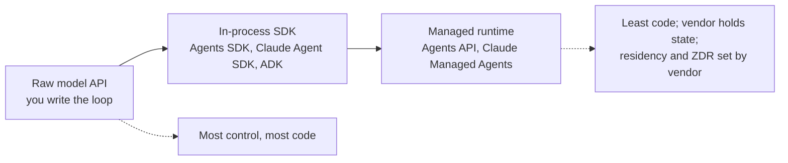

<div dir="rtl">

# فریم‌ورک Microsoft Agent Framework، CrewAI و چشم‌انداز Agent SDK

چشم‌انداز فریم‌ورک‌های چند-عاملی (Multi-Agent) در طول سال گذشته به سمت یکپارچگی حرکت کرد. مایکروسافت پروژه‌های AutoGen و Semantic Kernel را در قالب **Microsoft Agent Framework** ادغام کرد که نسخه عمومی (GA 1.0) آن در تاریخ ۲ آوریل ۲۰۲۶ عرضه شد؛ اکنون AutoGen در حالت تعمیر و نگهداری (Maintenance Mode) قرار دارد و توسط جامعه کاربری مدیریت می‌شود. فریم‌ورک CrewAI به نسخه 1.15.35 (۳ نوامبر ۲۰۲۶) رسید و قابلیت‌های Checkpointing و Flowهای اعلامی (Declarative Flows) را اضافه کرد؛ طبق ادعای ارائه‌دهنده، بیش از ۶۰ درصد از شرکت‌های Fortune 500 از آن استفاده می‌کنند. هر آزمایشگاه بزرگ هوش مصنوعی اکنون Agent SDK اختصاصی خود را عرضه می‌کند: کیت Claude Agent SDK از شرکت Anthropic، کیت Agents SDK از OpenAI، کیت ADK از Google و کیت Strands Agents از AWS. در سال ۲۰۲۶، آزمایشگاه‌ها اجاره دادن خود حلقه عاملیت را نیز به‌عنوان یک سرویس مدیریت‌شده آغاز کردند: سرویس Claude Managed Agents، سرویس OpenAI Agents API (بتای عمومی از ۱۰ سپتامبر ۲۰۲۶) و Bedrock Managed Agents (پیش‌نمایش از ۲۹ سپتامبر ۲۰۲۶). تا نوامبر ۲۰۲۶ هیچ‌یک از این سه مورد به دسترسی عمومی (GA) نرسیده‌اند، هرچند که بستر اجرای مدیریت‌شده Bedrock AgentCore متعلق به AWS از ۱۷ ژوئن ۲۰۲۶ به وضعیت GA رسیده است (بخش [محیط‌های اجرای مدیریت‌شده Agent](#managed-agent-runtimes) را ببینید).

شماره نسخه‌ها در این فصل همراه با تاریخ انتشار آورده شده‌اند، زیرا این SDKها تقریباً هر یک یا دو هفته یک‌بار به‌روزرسانی می‌شوند. نسخه‌ها را به‌صورت دقیق قفل (Pin) کنید.

## فهرست مطالب

- [فریم‌ورک CrewAI: دیدگاه مدیریتی](#crewai-the-manager-perspective)
- [فریم‌ورک Microsoft Agent Framework (جانشین AutoGen)](#microsoft-agent-framework-autogens-successor)
- [چشم‌انداز Agent SDK](#the-agent-sdk-landscape)
- [محیط‌های اجرای مدیریت‌شده Agent](#managed-agent-runtimes)
- [الگوهای Swarm و ارتباطات نظیربه‌نظیر (P2P)](#swarms-and-p2p)
- [ماتریس مقایسه فریم‌ورک‌ها](#framework-comparison-matrix)
- [پرسش‌های مصاحبه](#interview-questions)
- [منابع](#references)

---

## فریم‌ورک CrewAI: دیدگاه مدیریتی <a id="crewai-the-manager-perspective"></a>

فریم‌ورک CrewAI پیرامون مفهوم **فرایند (Process)** ساخته شده است.
- **عامل‌های نقش‌محور (Role-Based Agents)**: شما یک «پژوهشگر» (Researcher)، یک «نویسنده» (Writer) و یک «مدیر» (Manager) تعریف می‌کنید.
- **وظایف (Tasks)**: اهداف صریح همراه با خروجی‌های مشخص.
- **ارکستراسیون فرایند (Process Orchestration)**: ترتیبی (Sequential) یا سلسه‌مراتبی (Hierarchical - که در آن یک Agent مدیر تفویض اختیار و اعتبارسنجی می‌کند). یک فرایند مبتنی بر اجماع (Consensus-based) مدت‌هاست که در مستندات CrewAI به‌عنوان قابلیت برنامه‌ریزی‌شده ذکر شده است، بنابراین معماری خود را بر پایه آن طراحی نکنید.

### جریان‌های کاری CrewAI Flows

جریان‌های کاری **Flows** در CrewAI یک **لایه ماشین حالت (State-Machine Layer)** بر روی الگوی کلاسیک Crew اضافه می‌کنند:

<div dir="ltr">

```python
from crewai.flow.flow import Flow, listen, start

class ContentFlow(Flow):
    @start()
    def research_topic(self):
        # Returns research output
        return research_crew.kickoff({"topic": self.state["topic"]})
    
    @listen(research_topic)
    def write_article(self, research):
        # Triggered after research completes
        return writing_crew.kickoff({"research": research})
    
    @listen(write_article)
    def publish(self, article):
        # Final step
        return publisher.publish(article)
```

</div>

### فریم‌ورک CrewAI 1.14 و 1.15: رقابت بر سر پایداری (Durability)

| انتشار | تاریخ | تغییرات اعمال‌شده |
|---|---|---|
| نسخه 1.14.0 | ۷ آوریل ۲۰۲۶ | ثبت **چک‌پوینت (Checkpointing)** از وضعیت زمان اجرا (`CheckpointConfig`، `SqliteProvider`)، بازنویسی سیستم رویدادها و Executor، محافظت‌های SSRF و اعتبارسنجی مسیر/URL در ابزارهای RAG. **تغییر شکننده**: ابزار `CodeInterpreterTool` حذف شد |
| نسخه 1.15.0 | ۲۵ ژوئن ۲۰۲۶ | **بارگذاری اعلانی Flow** (از طریق `FlowDefinition` همراه با اکشن‌های crew)، حالت DMN، تجمیع میزان مصرف توکن در تمام فراخوانی‌های LLM |
| نسخه‌های 1.15.22 / 1.15.23 | ۱۶ سپتامبر / ۲۸ سپتامبر ۲۰۲۶ | رویدادهای توقف و بازخورد انسانی در تریس‌ها، نام‌های مستعار اتصال، Embeddingهای OpenRouter، پشتیبانی بومی از Gemini 3.8 Flash |
| نسخه‌های 1.15.24 تا 1.15.35 | ۷ اکتبر تا ۳ نوامبر ۲۰۲۶ | دوازده پچ منتشرشده روی همان خط در کمتر از چهار هفته؛ نسخه 1.16 یا 2.0 وجود ندارد. نسخه‌های دقیق را Pin کنید و تغییرات هر لاگ را بخوانید |

سری نسخه 1.13 (بهار ۲۰۲۶) بخش‌های سازمانی مهمی را اضافه کرد: مستندسازی SSO، ماتریس دسترسی RBAC، تفویض وظایف A2A، و اصلاحاتی برای مدل‌های OpenAI که پارامتر `stop` را حذف کرده بودند.

**موارد کاربرد**: ترکیب CrewAI + Flows برای **اتوماسیون فرایندهای کسب‌وکار** (پایپ‌لاین‌های محتوا، جریان‌های کاری تحلیل داده) که ساختار شفافی دارند بسیار مناسب است. طبق گزارش CrewAI، این سیستم اجرای حدود ۲ میلیارد فرایند عاملی را پشتیبانی کرده است (آمار ارائه‌دهنده). با اضافه شدن Checkpointing و Flowهای اعلانی، این قاعده قدیمی که «CrewAI برای سرعت، LangGraph برای مدیریت وضعیت» کم‌رنگ‌تر از گذشته شده است؛ تفاوت‌های باقی‌مانده بیشتر مربوط به عمق خطایابی (Time Travel با ایجاد شاخه از چک‌پوینت) و وسعت اکوسیستم است.

---

## فریم‌ورک Microsoft Agent Framework (جانشین AutoGen) <a id="microsoft-agent-framework-autogens-successor"></a>

### ادغام بزرگ: AutoGen + Semantic Kernel = Agent Framework

مایکروسافت پلتفرم **Microsoft Agent Framework (یا MAF)** را به‌عنوان جانشین مستقیم AutoGen و Semantic Kernel و با همان تیم‌های توسعه‌دهنده ایجاد کرد. نسخه MAF 1.0 در تاریخ ۲ آوریل ۲۰۲۶ برای دات‌نت و پایتون به صورت عمومی (GA) عرضه شد (اطلاعیه رسمی مایکروسافت مربوط به ۳ آوریل است) و به‌عنوان یک API پایدار با پشتیبانی طولانی‌مدت (LTS) معرفی گردید. این پلتفرم تقریباً هفتگی به‌روزرسانی می‌شود: نسخه پایتون 1.24.0 و نسخه دات‌نت 1.27.0 در ۳۰ اکتبر ۲۰۲۶. عبارت «پایدار با LTS» همچنان به این معناست که باید توضیحات انتشار را به‌دقت بخوانید: نسخه پایتون 1.22.0 (۱۵ اکتبر) رکوردهای پایداری می‌نویسد که رانتایم‌های قبل از 1.22 قادر به خواندن آن نیستند، بنابراین نباید ورکرها با نسخه‌های ترکیبی را روی یک منبع داده اجرا کنید یا بعد از ارتقا به نسخه قبل برگردید؛ همچنین نسخه پایتون 1.23.0 (۲۲ اکتبر) سه تغییر شکننده داشت (زیرساخت MCP 2.x، محدوده‌های الزامی اعتبارسنجی AG-UI، و تغییر نام `extra_run_args` شل داکر به `unsafe_extra_run_args`). یک SDK برای زبان Go نیز در پیش‌نمایش عمومی قرار دارد.

**دستاوردهای حاصل از این ادغام:**
- **از AutoGen**: انتزاع‌های ساده برای الگوهای مکالمه تک‌عاملی و چندعاملی (گفتگوی گروهی، نوبت‌گردشی یا Round-robin، و انتقال وظایف یا Handoffs)
- **از Semantic Kernel**: مدیریت نشست در سطح سازمانی، ایمنی نوع‌ها (Type Safety)، فیلترها، تله‌متری، و پشتیبانی گسترده از مدل‌ها و Embeddingها

### مسیر مهاجرت

مخزن AutoGen دارای یک بنر **حالت نگهداری (Maintenance Mode)** است: قابلیت جدیدی اضافه نمی‌شود، «از این پس توسط جامعه کاربری مدیریت خواهد شد» و کاربران جدید به MAF هدایت می‌شوند. آخرین نسخه `autogen-agentchat` نسخه 0.7.5 (۳۰ سپتامبر ۲۰۲۵) است. مایکروسافت راهنماهای مهاجرت از هر دو ابزار AutoGen و Semantic Kernel را منتشر کرده است. اگر پروژه جدیدی را آغاز می‌کنید، مستقیماً از MAF استفاده کنید.

### قابلیت‌های کلیدی

<div dir="ltr">

```python
# Microsoft Agent Framework (Python 1.x): handoff workflow with an approval gate
import os
from typing import Annotated

from agent_framework import FileCheckpointStorage, tool
from agent_framework.foundry import FoundryChatClient
from agent_framework.orchestrations import HandoffBuilder
from azure.identity import AzureCliCredential

client = FoundryChatClient(
    project_endpoint=os.environ["FOUNDRY_PROJECT_ENDPOINT"],
    model=os.environ["FOUNDRY_MODEL"],
    credential=AzureCliCredential(),
)

@tool(approval_mode="always_require")  # the workflow pauses for a human before this runs
def process_refund(order_number: Annotated[str, "Order number"]) -> str:
    """Process a refund for an order."""
    return f"Refund queued for {order_number}"

triage = client.as_agent(name="triage_agent", instructions="Route the customer to a specialist.")
refunds = client.as_agent(name="refund_agent", instructions="Handle refunds.", tools=[process_refund])

workflow = (
    HandoffBuilder(
        name="support",
        participants=[triage, refunds],
        checkpoint_storage=FileCheckpointStorage(storage_path="./checkpoints"),  # resume after restarts
    )
    .with_start_agent(triage)
    .build()
)
```

</div>

**نقاط برجسته فریم‌ورک:**
- **پشتیبانی یکپارچه از دات‌نت و پایتون**: مدل برنامه‌نویسی یکسان در هر دو زبان (نسخه Go در پیش‌نمایش)
- **جریان‌های کاری (Workflows)**: ارکستراسیون‌های متوالی، همروند، Handoff و چت گروهی، به‌علاوه جریان‌های کاری تابعی و مبتنی بر گراف، همراه با Checkpointing و امکان پاسخ‌دهی در پس‌زمینه با قابلیت اتصال مجدد
- **عامل مهارکننده (Harness Agent)**: یک Agent دارای ساختار مشخص برای وظایف طولانی و چندمرحله‌ای همراه با برنامه‌ریزی و ردیابی کارهای در حال انجام، فشرده‌سازی زمینه، دسترسی به فایل و حافظه، تأیید ابزار، و قابلیت مشاهده‌پذیری داخلی
- **قابلیت‌های اضافه‌شده در سپتامبر ۲۰۲۶** (به‌روزرسانی ۲۴ سپتامبر مایکروسافت): میزبانی AG-UI (پایدار در پایتون، پیش‌نمایش در دات‌نت)، ارائه‌دهندگان حافظه Foundry و Cosmos DB (پیش‌نمایش پایتون)، پیاده‌سازی CodeAct از طریق `HyperlightCodeActProvider` که کدهای نوشته‌شده توسط مدل را در یک میکرو ماشین مجازی Hyperlight اجرا می‌کند (مایکروسافت گزارش می‌دهد که این کار حدود ۵۰ درصد تأخیر کمتر و بیش از ۶۰ درصد مصرف توکن کمتری در بار کاری ارزیابی‌شده دارد)، کانال‌هایی برای OpenAI Responses، تلگرام، پروتکل‌های A2A و MCP، و یک افزونه Durable Azure Functions
- **پروتکل‌ها**: پشتیبانی از تعامل‌پذیری MCP و A2A هر دو در نسخه 1.x عرضه شده‌اند
- **پشتیبانی از ارائه‌دهندگان چندگانه**: کانکتورهای رسمی برای Foundry، Azure OpenAI، OpenAI، Anthropic، Bedrock، Gemini و Ollama

---

## چشم‌انداز Agent SDK <a id="the-agent-sdk-landscape"></a>

اکنون هر آزمایشگاه بزرگ هوش مصنوعی فریم‌ورک عاملی اختصاصی خود را ارائه می‌دهد. الگوی مشترک در سه‌ماهه سوم ۲۰۲۶ میان آن‌ها عبارت است از: APIهای مبتنی بر مهارکننده (Harness-first)، وضعیت پایدار (Durable State)، و اجرای کد در محیط‌های ایزوله (Sandbox) به‌صورت پیش‌فرض.

### کیت توسعه Claude Agent SDK (از شرکت Anthropic)

کیت Claude Agent SDK (که نام قبلی آن Claude Code SDK بود) همان ابزارها، حلقه عاملیت و مدیریت زمینه‌ای را ارائه می‌دهد که قدرت‌بخش ابزار Claude Code هستند و به‌صورت کتابخانه‌ای در زبان‌های پایتون (`claude-agent-sdk` نسخه 0.2.178، ۴ نوامبر ۲۰۲۶) و تایپ‌اسکریپت (`@anthropic-ai/claude-agent-sdk` نسخه 0.3.318، ۳ نوامبر ۲۰۲۶) در دسترس است.

- **ابزارهای داخلی**: خواندن فایل، اجرای دستورات، ویرایش کد، تا Agentها بدون نیاز به پیاده‌سازی ابزارهای سفارشی به کار خود بپردازند
- **زیرعامل‌ها (Subagents)**: تعاریف نام‌گذاری‌شده برای زیرعامل‌ها همراه با زمینه اختصاصی و لیست مجاز ابزارها
- **سازوکارهای کنترلی**: پارامترهای `max_turns`، `max_budget_usd`، `effort`، و حالت‌های دسترسی از جمله `auto` (مبتنی بر طبقه‌بندی‌کننده) و `dontAsk`
- **محیط‌های استقرار**: سرویس‌های Claude API، Amazon Bedrock، Google Cloud (Vertex AI) و Microsoft Foundry
- **نکته حساس**: این SDK با CLI ابزار Claude Code یکپارچه است؛ بنابراین تغییر در CLI می‌تواند پیش‌فرض‌های SDK را تغییر دهد. هنگامی که Claude Code مدل‌های Opus 5.5 (نسخه 2.1.280 در ۲۲ سپتامبر) و Sonnet 5.5 (نسخه 2.1.284 در ۲۸ سپتامبر) را به گزینه‌های پیش‌فرض تبدیل کرد، سیستم CI این SDK دچار اختلال شد و مجبور به Pin کردن مدل‌ها شدند. از نسخه 2.1.302 (۱۶ اکتبر)، نشست‌های SDK که بدون تعیین حالت دسترسی باشند در ارائه‌دهندگان متفرقه، در زمان خاموش بودن تله‌متری، یا در نصب تازه با حالت `default` آغاز می‌شوند. همواره پارامترهای `model=` و `permission_mode=` را به‌صراحت مشخص کنید.
- **رفتار بازدارنده هوک‌ها در صورت خطا (Fail Open)**: اگر تابع Hook دچار خطا شود یا مقدار `None` برگرداند، به اکشن اجازه اجرا می‌دهد؛ حتماً پارامتر `on_failure="block"` را روی تمام Hookهای امنیتی تنظیم کنید (پایتون `claude-agent-sdk` نسخه 0.2.177 یا بالاتر، Claude Code نسخه 2.1.317 یا بالاتر). جزئیات کامل در [Claude Code](09-claude-code.md).

### کیت توسعه OpenAI Agents SDK

فریم‌ورک سبک‌وزن شرکت OpenAI برای جریان‌های کاری چندعاملی با استفاده از ساختارهای بومی پایتون و تایپ‌اسکریپت. نسخه پایتون `openai-agents` در 0.24.0 (۱۵ اکتبر ۲۰۲۶) قرار دارد؛ نسخه 0.23.0 هرگز در PyPI منتشر نشد و تغییرات آن در 0.23.1 (۲ اکتبر) عرضه گردید. نسخه جاوااسکریپت `@openai/agents` در 0.21.0 (۲۰ اکتبر) قرار دارد.

یک نسخه بازطراحی‌شده از SDK در حالت پیش‌نمایش است. در ۳ نوامبر ۲۰۲۶ شرکت OpenAI نسخه `openai-agents-python` نسخه v0.24.0-alpha.6 را منتشر کرد که فقط از طریق GitHub Releases توزیع شد و بسته‌هایی شامل «رانتایم بومی» ارائه داد؛ همچنین نسخه `openai-agents-js` نسخه v0.22.0-alpha.1 که «مهارکننده تعبیه‌شده Codex» را معرفی کرد. پیش‌نمایش پایتون بخش `Runner` را با `Agent.run()` / `Agent.run_sync()` جایگزین می‌کند (نام‌های مستعار Runner حذف شده‌اند)، اعلان‌های Agent را تغییرناپذیر (Immutable) می‌سازد، شیء‌های `Session` و `Turn` را اضافه می‌کند (`Turn.get_result()`، `Turn.cancel()`)، از افزایش سطح دسترسی‌های اولیه نشست جلوگیری می‌کند، یک `NetworkPolicy` برای دستورات بومی می‌افزاید و آداپتور اختیاری MCP Tasks را ارائه می‌دهد. این رویکرد همانند Anthropic است: مهارکننده عملیاتی شرکت سازنده تبدیل به SDK می‌شود. کدهای مبتنی بر Runner در صورت نهایی شدن این تغییر نیازمند مهاجرت خواهند بود، بنابراین ساخت Agent را پشت یک کارخانه (Factory) متمرکز نگه دارید.

- **مبتنی بر Handoff**: عامل‌ها وظایف را با Handoff به یکدیگر تفویض می‌کنند و نیازی به یک سرپرست مرکزی نیست
- **حفاظ‌ها (Guardrails)**: گاردریلهای ورودی و خروجی؛ نسخه 0.22.1 (۸ سپتامبر) گاردریل‌های سراسری برای سرور MCP را اضافه کرد
- **یکپارچه‌سازی با MCP**: نسخه 0.20.0 از هر دو نسخه ۱ و ۲ پایتون MCP SDK پشتیبانی می‌کند (برنامه‌هایی با احراز هویت HTTP سفارشی در MCP باید از تایپ‌های نسخه اصلی نصب‌شده استفاده کنند یا به `mcp<2` مقید شوند)
- **عامل‌های محیط ایزوله (Sandbox Agents)**: (از نسخه 0.14.0، آوریل ۲۰۲۶): کلاس `SandboxAgent`، مانیفست‌ها، اسنپ‌شات‌ها و کلاینت‌های سندباکس میزبانی‌شده
- **ابزارهای تست** (نسخه 0.21.0، ۱۵ اوت): ماژول مستقل `agents.testing`، به‌علاوه ماژول‌های تست صدا و بلادرنگ؛ نیازمند نسخه OpenAI Python SDK 3.0 یا بالاتر است
- **تغییرات پیش‌فرضی که باید برای آن‌ها برنامه‌ریزی کرد**: نسخه 0.20.0 (۱۱ اوت) مدل `gpt-5.6-luna` را به مدل پیش‌فرض ضمنی تبدیل کرد، و نسخه 0.22.0 (۱۹ اوت) برنامه‌هایی را که همزمان با یک کلاینت صریح، پارامترهای `organization` یا `project` را ارسال می‌کردند دچار خطا کرد. سری 0.23 چهار مقدار پیش‌فرض را یک‌باره تغییر داد: مدل `gpt-transcribe` مدل پیش‌فرض صوت-به-متن شد، تاریخچه نشست نیازمند پوشش‌های رمزنگاری‌شده گردید، جزئیات خطای پیش‌فرض ابزارها فیلتر (Redact) شد، و فرآیند استدلال از خروجی‌های پیش‌فرض تریس حذف شد
- **عامل‌های بلادرنگ (Realtime Agents)**: مدل `gpt-realtime-2.1` از نسخه 0.18.0 (۷ ژوئیه ۲۰۲۶) پیش‌فرض عامل‌های بلادرنگ بوده است. پشتیبانی از مدل دوطرفه همزمان (Full-duplex) با نام `gpt-live-1` (عرضه عمومی ۱۰ سپتامبر) تا نسخه 0.22.3 غایب بود؛ پیش از برنامه‌ریزی، مستندات نسخه جاری را بررسی کنید. مدل‌های اولیه `gpt-realtime` و `gpt-realtime-mini` در ۲۰ ژانویه ۲۰۲۷ از رده خارج می‌شوند، بنابراین از مدل‌های خانواده 2.1 استفاده کنید

### جعبه‌ابزار OpenAI AgentKit (در حال خاموشی بخشی از خدمات)

مجموعه AgentKit (اکتبر ۲۰۲۵) شامل یک رابط بصری **Agent Builder**، ابزار **ChatKit** (یک رابط کاربری چت قابل جاسازی و تم‌پذیر)، یک **Connector Registry** (حکمرانی متمرکز بر نحوه اتصال منابع داده و ابزارها در محصولات OpenAI) و ابزار **Evals** پیرامون Responses API و Agents SDK بود. دو بخش از این ابزارها در حال خارج شدن از سرویس هستند:

- سرویس **Agent Builder** در تاریخ ۳۰ نوامبر ۲۰۲۶ خاموش می‌شود (اعلام پایان پشتیبانی در ۳ ژوئن ۲۰۲۶). شرکت OpenAI کاربران را به استفاده از Agents SDK یا ChatGPT Workspace Agents هدایت می‌کند.
- پلتفرم **Evals** در تاریخ ۳۰ نوامبر ۲۰۲۶ خاموش می‌شود (راهنمای OpenAI همچنین به حالت فقط-خواندنی از ۳۱ اکتبر اشاره داشت) و راهنمای مهاجرت به Promptfoo را ارائه می‌دهد. پروژه Promptfoo اکنون بخشی از OpenAI است اما با مجوز MIT و سازگار با ارائه‌دهندگان مختلف باقی مانده است. بخش Reusable Prompts نیز در ۳۰ نوامبر ۲۰۲۶ خاموش خواهد شد.

**پیامد این تغییرات**: شرکت OpenAI تمرکز خود را بر روی دو انتهای طیف گذاشته است: توسعه کد-محور (Agents SDK) و کاملاً مدیریت‌شده (Agents API، در ادامه). بخش میانی رابط بصری (Visual-builder) هشت ماه پس از معرفی منسوخ شد. تعاریف Agentها را همواره در کدهایی که مالکیت آن‌ها را در اختیار دارید ذخیره کنید؛ یک خروجی بوم بصری (Canvas Export) منبع پایداری برای کد اصلی نیست.

### کیت توسعه OpenAI Apps SDK

کیت Apps SDK استاندارد **Model Context Protocol (MCP)** را گسترش می‌دهد تا یک سرور MCP بتواند در کنار ابزارهای خود، یک رابط کاربری نیز ارائه دهد. توسعه‌دهنده هم منطق برنامه و هم رابط تعاملی را تعریف می‌کند و این برنامه درون کلاینتی مانند ChatGPT رندر می‌شود. پروژه MCP همین ایده را به‌عنوان افزونه **MCP Apps** استانداردسازی کرد که طبق مراحل بلوغ افزونه‌ها که در ۲۹ اکتبر ۲۰۲۶ مصوب شد (SEP-3392) در وضعیت پایدار (Stable) قرار گرفت؛ کیت توسعه آن در ۸ سپتامبر ۲۰۲۶ به نسخه 2.0.0 رسید و به بسته‌های v2 TypeScript SDK ارتقا یافت، در حالی که پروتکل ارتباطی بدون تغییر باقی ماند، بنابراین نماهای نسخه 2.x همچنان در میزبان‌های 1.x قابل نمایش هستند. بخش [استفاده از ابزارها و MCP](../07-agentic-systems/03-tool-use-and-mcp.md) را ببینید.

### کیت توسعه Google Agent Development Kit (یا ADK)

فریم‌ورک گوگل که برای اکوسیستم گوگل بهینه‌سازی شده اما با مدل‌های گوناگون سازگار است:

- **نسخه‌ها**: نسخه پایتون 2.0 در ۱۹ مه ۲۰۲۶ عمومی (GA) شد و اکنون 2.13.0 (۲۳ اکتبر) است؛ نسخه Go 2.0 در ۳۰ ژوئن عرضه شد (`google.golang.org/adk/v2`) و اکنون v2.7.1 (۴ نوامبر) است؛ نسخه TypeScript 2.0.0 در ۲۱ اوت به GA رسید و اکنون 2.4.0 (۲۸ اکتبر) است؛ نسخه جاوا در سری 1.x باقی مانده است (1.14.0، ۲ نوامبر). پچ‌های خط نسخه پایتون 1.x همچنان ارائه می‌شوند.
- **شکست تله‌متری در نسخه 2.13.0**: نسخه پایتون 2.13.0 به‌طور پیش‌فرض از اسکیمای OpenTelemetry GenAI semconv 1.44 استفاده می‌کند و بازه (Span) با نام `call_llm` را حذف کرده است، بنابراین داشبوردهایی که به آن وابسته بودند بدون نمایش خطا غیرفعال می‌شوند؛ با تنظیم `ADK_TELEMETRY_SCHEMA_VERSION_OPT_IN=otel_semconv_1_36` می‌توانید در حین مهاجرت از اسکیمای قدیمی استفاده کنید.
- **دو تغییر پیش‌فرض در Go v2.7.0 (۲ نوامبر)**: ردیابی‌ها اکنون از استانداردهای معنایی OpenTelemetry GenAI v2 پیروی می‌کنند (یک رویداد `gen_ai.client.inference.operation.details` به ازای هر فراخوانی مدل جایگزین لاگ‌های قبلی شده است، و یک والد جدید `invoke_workflow` برای Agentها افزوده شده است؛ استفاده از `otel_semconv_1_36` فرمت قبلی را حداقل تا ۳۱ مارس ۲۰۲۷ حفظ می‌کند)، و هر اجرا به‌طور پیش‌فرض به ۵۰۰ فراخوانی مدل محدود شده که با خطای `agent.ErrLLMCallsLimitExceeded` پایان می‌یابد. این سقف را می‌توان با `RunConfig.MaxLLMCalls` یا `ADK_MAX_LLM_CALLS` افزایش داد (-1 به معنی بدون محدودیت است؛ برخلاف پایتون که عدد 0 به معنی پیش‌فرض است). این نسخه همچنین نیازمند Go 1.26.10 است و مدل‌های آزمایشی Claude و کشف ابزار مبتنی بر جستجو برای کاتالوگ‌های بزرگ MCP را اضافه کرده است.
- **جریان‌های کاری گرافی (نسخه 2.0)**: گراف‌های ایستا و پویا، توزیع و تجمیع شاخه‌ها (`JoinNode`)، تلاش مجدد و مهلت زمانی به ازای هر گره، اعتبارسنجی اسکیما، و توقف و ادامه همراه با دخالت انسان. کیت ADK-TS 2.0 کلاس‌های `SequentialAgent`، `ParallelAgent` و `LoopAgent` را منسوخ کرده است (هنوز با اخطار کار می‌کنند).
- **پشتیبانی بومی از A2A**: پشتیبانی داخلی از پروتکل Agent-to-Agent برای ارکستراسیون میان چند تأمین‌کننده
- **یکپارچگی با Vertex AI**: امکان استقرار روی رانتایم موتور Agent (یا Agent Engine Runtime) برای میزبانی مدیریت‌شده

با معرفی ADK 2.0، گوگل نیز در کنار مایکروسافت (جریان‌های کاری MAF) و LangGraph قرار می‌گیرد که جریان‌های کاری گرافی با Agentها به‌عنوان گره را ارائه می‌دهند، که مرزبندی پیشین «LangGraph برای گراف‌ها، و SDK آزمایشگاه‌ها برای حلقه‌های ساده» را از میان می‌برد. کیت‌های Claude Agent SDK و OpenAI Agents SDK همچنان بر یک حلقه عاملی منفرد همراه با زیرعامل‌ها یا Handoffها متمرکز هستند.

### سایر کیت‌های توسعه Agent SDK

کیت توسعه AWS با نام **Strands Agents** پردانلودترین SDK آزمایشگاه‌ها در PyPI است (حدود ۳۷.۱ میلیون بار دانلود در بازه ۳۰ روزه منتهی به ۱ نوامبر ۲۰۲۶ که مانند همه آمارهای مشابه تحت تأثیر CI بالا رفته است؛ نسخه `strands-agents` 1.63.0 در ۳۰ اکتبر)؛ بسته‌های جدید آن مدل پیش‌فرض خود را در ۲۲ سپتامبر به Claude Opus 5 تغییر دادند که تغییر بی‌صدای دیگری در تنظیمات پیش‌فرض بود. فریم‌ورک **Vercel AI SDK 7** (۲۵ ژوئن ۲۰۲۶) یک کلاس پایدار `WorkflowAgent` و یک کلاس آزمایشی `HarnessAgent` اضافه کرد که کدهای Claude Code، Codex و سایر مهارکننده‌ها را در پسِ یک API واحد اجرا می‌کند. کتابخانه‌های Pydantic AI و Mastra در فصل [Pydantic AI و Mastra](11-pydantic-ai-and-mastra.md) پوشش داده شده‌اند؛ نسخه‌های Haystack 3 و Agno 3 نیز در [راهنمای انتخاب فریم‌ورک](08-framework-selection-guide.md) بررسی شده‌اند.

---

## محیط‌های اجرای مدیریت‌شده Agent <a id="managed-agent-runtimes"></a>

طیف تصمیم‌گیری میان «ساخت یا اجاره» برای حلقه عاملیت اکنون سه حالت دارد. با یک API خام مدل، شما خودتان حلقه را کدنویسی می‌کنید. با یک SDK درون-فرایندی (In-process)، حلقه درون سرویس شما اجرا می‌شود. در یک محیط اجرای مدیریت‌شده (Managed Runtime)، حلقه، وضعیت آن، و غالباً محیط ایزوله سندباکس همگی نزد ارائه‌دهنده میزبانی و اجرا می‌شوند.

<div dir="ltr">



</div>

| محیط اجرا | وضعیت | مواردی که تحویل می‌دهید | مدل صورت‌حساب | محدودیت‌هایی که باید بررسی شوند |
|---|---|---|---|---|
| سرویس **Claude Managed Agents** | نسخه بتا (هدر `managed-agents-2026-04-01`) روی Claude API، پلتفرم Claude در AWS و از ۲۲ اکتبر روی Claude در Google Cloud | نشست‌ها؛ سندباکس‌های میزبانی‌شده توسط Anthropic یا محلی؛ مخازن حافظه؛ استقرارهای زمان‌بندی‌شده Cron (از ۹ ژوئن)؛ سیاست مجوزدهی `auto` ارزیابی‌شده در سمت سرور (۱۰ سپتامبر)؛ پیکربندی عامل‌ها به‌صورت کد (Agents-as-code) از طریق دستور `ant apply` و فایل قفل `claude-lock.json` (در نسخه ant CLI 1.30.0، ۳ سپتامبر) | هزینه توکن به‌علاوه ۰.۰۸ دلار به ازای هر ساعت زمان اجرای فعال نشست (زمان عدم فعالیت رایگان است)؛ محدودیت‌های سخت‌گیرانه بودجه نشست با رویداد `budget_reached` متوقف می‌شوند (۷ اوت)؛ بدون تخفیف Batch | فقط مدل‌های Claude |
| سرویس **OpenAI Agents API** | بتای عمومی از ۱۰ سپتامبر ۲۰۲۶ | مهارکننده Codex: نشست‌های پایدار، فشرده‌سازی زمینه، بازیابی از خطا، زیرعامل‌ها (مقدار پیش‌فرض `max_concurrent_subagents` برابر با ۶ است)؛ سندباکس‌های میزبانی‌شده توسط OpenAI یا سرور محلی؛ کاربری رایانه از طریق مرورگر میزبانی‌شده (۲۹ سپتامبر) | بدون هزینه مجزای API؛ نرخ‌های مصرف مدل، ابزار و کانتینر (سندباکس‌ها با نرخ‌های ۰.۰۳، ۰.۱۲ یا ۰.۴۸ دلار برای هر نشست ۲۰ دقیقه‌ای با رم‌های ۱، ۴ یا ۱۶ گیگابایت)؛ از ۹ اکتبر، محاسبات سندباکس میزبانی‌شده فقط در طول نوبت‌های فعال صورت‌حساب می‌شود | در نسخه بتا داده‌ها فقط در ایالات متحده نگهداری می‌شوند و سیاست نگهداری صفر داده (Zero Data Retention) اعمال نمی‌شود |
| سرویس **Bedrock Managed Agents** (با پشتیبانی OpenAI) | پیش‌نمایش عمومی از ۲۹ سپتامبر ۲۰۲۶ | یک سرویس Agents API سفارشی‌سازی‌شده درون AWS، با نقش IAM مجزا به ازای هر عامل، ثبت لاگ‌های CloudTrail و نیاز به تأیید قبل از اقدامات پرریسک | بدون هزینه اضافی در دوره پیش‌نمایش | فقط در مناطق us-east-1، us-east-2 و us-west-2 |
| بستر مدیریت‌شده **Bedrock AgentCore** | نسخه GA از ۱۷ ژوئن ۲۰۲۶ در تمام مناطق تجاری AgentCore؛ نسخه 1.0 از AgentCore CLI (بسته `@aws/agentcore` 1.0.0) به صورت GA در ۲۸ اکتبر | حلقه ارکستراسیون، اجرای ابزارها، مدیریت زمینه، و وضعیت ذخیره‌شده، همراه با امکان تغییر مدل و ارائه‌دهنده در میانه نشست | طبق تعرفه‌های AgentCore (در اینجا بررسی نشده است) | امکان خروجی به کدهای مبتنی بر Strands (قابلیت خروجی به Claude Agent SDK به‌زودی)؛ ابزار `agentcore migrate` برای پروژه‌های موجود |
| سرویس **Foundry Agent Service** | نسخه GA روتین‌ها از ۲۴ سپتامبر ۲۰۲۶ | عامل‌های میزبانی‌شده همراه با تریگرهای دوره‌ای، تایمر و رویدادی | مدل مصرفی Azure | کنترل‌های ترافیک خروجی شبکه همچنان در پیش‌نمایش هستند |

محیط‌های اجرای مدیریت‌شده یک **سنجه دوم هزینه** (زمان اجرای نشست یا سندباکس) را علاوه‌بر توکن‌ها اضافه می‌کنند، بنابراین مدل محاسبه هزینه به ازای هر تسک باید رفتار زمان اجرا و زمان بیکاری (Idle) را لحاظ کند. این سنجه‌ها به سمت محاسبه فقط زمان فعال میل می‌کنند: سرویس Claude فقط ساعات فعالیت نشست را محاسبه می‌کند، و OpenAI از ۹ اکتبر هزینه محاسبات سندباکس را صرفاً در طول نوبت‌های فعال محاسبه می‌کند؛ بنابراین اگر یک Agent منتظر تأیید انسان بماند، در هیچ‌یک از این دو سیستم هزینه سندباکس مصرف نمی‌شود. این محیط‌ها ریسک وابستگی را نیز متمرکز می‌کنند: حادثه ۲۹ سپتامبر OpenAI باعث شد Agents API همراه با سرویس‌های Responses، ChatGPT و Codex حدود ۵ ساعت و ۲۰ دقیقه دچار اختلال شود؛ در نتیجه استراتژی پشتیبان (Fallback) باید میان ارائه‌دهندگان مختلف باشد، نه فقط بین مدل‌ها.

یک راهکار میانی بین اجرای مستقیم حلقه و اجاره دادن آن وجود دارد: **میزبانی مدیریت‌شده برای حلقه خودتان**. بستر AWS AgentCore Runtime V2 (معرفی در ۱۸ سپتامبر ۲۰۲۶، فعال‌سازی با `platformVersion V2`) هر نمونه جدید را از روی یک اسنپ‌شات از Agent مقداردهی‌شده بازیابی می‌کند؛ طبق گزارش AWS، شروع سرد صدک ۷۵ (P75 cold start) حدود ۲ ثانیه در مقایسه با ۵.۴ تا ۳۰ ثانیه در رانتایم قبلی است که با نرخی بالاتر اما در حجم گیگابایت-ساعت بسیار کمتری محاسبه می‌شود (آمار ارائه‌دهنده). فریم‌ورک و حلقه شما، اما روی سرورهای آن‌ها.

---

## الگوهای Swarm و ارتباطات نظیربه‌نظیر (P2P) <a id="swarms-and-p2p"></a>

هر دو فریم‌ورک (و چشم‌انداز گسترده‌تر SDKها) **الگوهای Swarm** را پذیرفته‌اند.
- **انتقال وظیفه (Handoff)**: به جای یک ناظر مرکزی، عامل‌ها گفتگو را به مرتبط‌ترین فرد متخصص «واگذار» می‌کنند. فریم‌ورک MAF فرآیند دست‌به‌دست شدن را به‌صورت یک شبکه مش پیاده‌سازی می‌کند که در آن به هر Agent ابزارهای دست‌به‌دست کردن تزریق می‌شود؛ کیت OpenAI Agents SDK نیز همین کار را با ساختار اولیه Handoff خود انجام می‌دهد.
- **مثال**: یک «Agent فروش» متوجه می‌شود که کاربر یک سؤال فنی دارد و گفتگو را به «Agent پشتیبانی» واگذار می‌کند.
- **نکته حساس**: عملیات Handoff در واقع یک فراخوانی ابزار است؛ بنابراین Agent گیرنده هر زمینه‌ای را دریافت می‌کند که فریم‌ورک تصمیم به ارسال آن گرفته باشد. برای نمونه، MAF پیام‌های کاربر و Agent را منتقل می‌کند اما فراخوانی ابزارها و نتایج آن‌ها را فیلتر می‌نماید؛ بنابراین فرض نکنید که Agent بعدی خروجی ابزار Agent قبلی را دیده است.

---

## ماتریس مقایسه فریم‌ورک‌ها <a id="framework-comparison-matrix"></a>

| ویژگی | فریم‌ورک CrewAI | پلتفرم MS Agent Framework | فریم‌ورک LangGraph | کیت Claude Agent SDK | کیت OpenAI Agents SDK | کیت Google ADK |
|---|---|---|---|---|---|---|
| **نسخه فعلی** | نسخه 1.15.35 (۳ نوامبر) | پایتون 1.24.0، دات‌نت 1.27.0 (۳۰ اکتبر) | نسخه 1.2.20 (۵ نوامبر) | پایتون 0.2.178 (۴ نوامبر)، تایپ‌اسکریپت 0.3.318 (۳ نوامبر) | پایتون 0.24.0 (۱۵ اکتبر)، جاوااسکریپت 0.21.0 (۲۰ اکتبر) | پایتون 2.13.0 (۲۳ اکتبر)، تایپ‌اسکریپت 2.4.0 (۲۸ اکتبر)، گو 2.7.1 (۴ نوامبر)، جاوا 1.14.0 (۲ نوامبر) |
| **انتزاع اصلی** | وظیفه / فرایند / Flow | کارفرما / Agent (یا Workflow/Agent) | وضعیت / گراف (State/Graph) | حلقه Agent + زیرعامل‌ها | دست‌به‌دست / Agent (یا Handoff/Agent) | عاملیت + جریان کار گرافی |
| **معماری** | اعلانی + ماشین حالت | جریان‌های کاری گرافی | گراف وضعیت چرخه‌ای | درخت سلسه‌مراتبی | تبادل دست‌به‌دست در Swarm | گراف جهت‌دار |
| **سهولت استفاده** | بالا | متوسط | پایین | متوسط | بالا | متوسط |
| **میزان کنترل** | کم تا متوسط | متوسط تا بالا | بالا | متوسط | کم تا متوسط | متوسط تا بالا |
| **وضعیت پایدار** | قابلیت Checkpointing (از ۱.۱۴ به بعد) | چک‌پوینت‌های Workflow | ابزارهای Checkpointer و قابلیت Time Travel | امکان Resume و Fork نشست‌ها | نشست‌ها و وضعیت اجرای قابل سریال‌سازی | نشست‌ها، توقف/ادامه گراف (نسخه ۲.۰) |
| **بهترین کاربرد** | اتوماسیون فرایندهای تجاری | سیستم‌های سازمانی دات‌نت / پایتون | ارکستراسیون پیچیده | عامل‌های کدنویسی و ابزاری | سامانه‌های چندعاملی سریع | هوش مصنوعی گوگل کلود |
| **چندزبانه بودن** | زبان Python | پلتفرم‌های NET. و Python (پیش‌نمایش Go) | زبان‌های Python و TS | زبان‌های Python و TS | زبان‌های Python و TS | زبان‌های Python، TS، Go و Java |
| **پشتیبانی از MCP** | بله | بله | بله (در هسته langchain از نسخه 1.4.0) | به‌صورت محلی (Native) | بله (نسخه‌های ۱ و ۲ از MCP SDK) | بله |
| **پشتیبانی از A2A** | بله (از ۱.۱۳ به بعد) | بله | از طریق ابزارها | خیر (مستقیم) | خیر (مستقیم) | به‌صورت محلی (Native) |

---

## پرسش‌های مصاحبه <a id="interview-questions"></a>

### پرسش: چه زمانی از CrewAI به جای LangGraph استفاده می‌کنید؟

**پاسخ قوی:**
معیار اصلی **سرعت در برابر دقت** است، هرچند این شکاف نسبت به سال گذشته بسیار باریک‌تر شده است. من زمانی از **CrewAI** استفاده می‌کنم که نیاز داشته باشم تیمی از Agentها را برای یک فرایند استاندارد (مانند تولید محتوا یا تحلیل داده) به‌سرعت راه‌اندازی کنم؛ ساختارهای نقش و وظیفه همراه با قابلیت Flows در این فریم‌ورک با کمترین کد به نتیجه می‌رسند و از نسخه 1.14 قابلیت Checkpoint و از نسخه 1.15 بارگذاری اعلانی Flowها اضافه شده است. در سوی دیگر، زمانی به سراغ **LangGraph** می‌روم که به **کنترل دقیق (Granular Control)** بر تک‌تک تغییر وضعیت‌ها، خطایابی با انشعاب از هر چک‌پوینت (Time-travel Debugging)، وقفه‌های چندمرحله‌ای نیازمند دخالت انسان، یا منطق پیچیده بازیابی از خطا نیاز داشته باشم که در قالب استعاره «تیم ایفای نقش» نمی‌گنجد. در خصوص میزان پذیرش نیز به سنجه‌های واقعی اشاره می‌کنم: CrewAI ستاره‌های بیشتری در گیت‌هاب دارد (حدود ۶۰.۴ هزار در برابر ۴۴.۳ هزار در نوامبر ۲۰۲۶)، اما دانلود ماهانه LangGraph در PyPI حدود ۱۸ برابر بیشتر است (۴۴.۸ میلیون در برابر ۲.۴ میلیون)؛ بنابراین LangGraph ابزاری است که تیم‌های عملیاتی بیشتری در محیط تولید به آن وابسته‌اند.

### پرسش: مایکروسافت فریم‌ورک AutoGen را به نفع Agent Framework به حالت نگهداری منتقل کرد. این موضوع چه تأثیری بر پیاده‌سازی‌های موجود AutoGen دارد؟

**پاسخ قوی:**
پیاده‌سازی‌های فعلی به کار خود ادامه می‌دهند، اما AutoGen اکنون توسط جامعه کاربری نگهداری می‌شود و هیچ قابلیت جدیدی به آن افزوده نخواهد شد؛ آخرین نسخه `autogen-agentchat` نیز نسخه 0.7.5 در سپتامبر ۲۰۲۵ بود. این وضعیت مسئله را به یک دغدغه امنیتی تبدیل می‌کند تا صرفاً فقدان قابلیت‌های جدید: نگهداری یک فریم‌ورک بدون پشتیبانی رسمی که دارای اعتبارنامه‌ها و دسترسی به ابزارهای سیستمی است اقدامی پرریسک به شمار می‌رود. فریم‌ورک MAF از ۲ آوریل ۲۰۲۶ با وضعیت پشتیبانی بلندمدت (LTS) در دسترس عموم قرار گرفته است و مایکروسافت راهنمای مهاجرت جامعی ارائه می‌دهد: ساختار `AssistantAgent` در AutoGen به `Agent` در MAF نگاشت می‌شود، ساختار `GroupChat` به ارکستراسیون‌های Workflow تبدیل می‌گردد، و قابلیت‌های سازمانی Semantic Kernel (نشست‌ها، تله‌متری، فیلترها) به‌صورت بومی منتقل می‌شوند. استراتژی من مهاجرت در سایه یک چارچوب ارزیابی (Eval Harness) است که موفقیت تسک‌ها و ردپای فراخوانی ابزارها را قبل و بعد از تغییر مقایسه کند، و کار را از Agentهایی آغاز می‌کنم که بالاترین سطوح دسترسی را دارند.

### پرسش: چگونه از ایجاد «حلقه‌های بی‌نهایت» (Infinite Loops) که در آن‌ها Agentها بدون حل مسئله مدام با یکدیگر گفتگو می‌کنند جلوگیری می‌کنید؟

**پاسخ قوی:**
ما از **شرایط خاتمه (Termination Conditions)** و **حداکثر نوبت‌های مکالمه (Max Conversational Turns)** استفاده می‌کنیم. علاوه بر این، یک «عامل نقاد» (Critic Agent) تعریف می‌کنیم که تنها وظیفه‌اش تشخیص درجا زدن مکالمه است. اگر نقاد یک الگوی تکراری و دَوَرانی را شناسایی کند، یک نماینده کاربر (User Proxy) را فراخوانی می‌کند تا مکالمه را متوقف کند یا مدیر چت گروهی را مجبور به تغییر مسیر استدلال نماید. همچنین **سرعت مصرف توکن (Token Velocity)** را مانیتور می‌کنیم: اگر یک جفت Agent ظرف ۲ دقیقه ۱۰۰ هزار توکن بدون پیشرفت ملموس مصرف کنند، نشست به‌طور خودکار قطع می‌شود. پلتفرم‌های مدرن اکنون سقف هزینه را به یک کنترل سطح اول تبدیل کرده‌اند: بودجه نشست در Claude Managed Agents پردازش را با رویداد `budget_reached` متوقف می‌کند، در Claude Agent SDK پارامتر `max_budget_usd` وجود دارد، حالت خودکار Handoff در MAF دارای سقف نوبت به ازای هر عامل است، و LangGraph محدودیت بازگشت (Recursion Limits) و Checkpointing را در اختیار می‌گذارد تا حلقه متوقف‌شده به جای حذف شدن، قابل بازبینی و ازسرگیری باشد.

### پرسش: چه زمانی حلقه Agent را به یک محیط اجرای مدیریت‌شده مانند OpenAI Agents API یا Claude Managed Agents واگذار می‌کنید؟

**پاسخ قوی:**
زمانی که هزینه ساخت بخش‌های زیرساختی دشوار (نشست‌های پایدار، فشرده‌سازی زمینه، بازیابی از کرش، چرخه عمر سندباکس، ارزیابی مجوزها در هر فراخوانی) بیشتر از هزینه وابستگی به ارائه‌دهنده (Lock-in) باشد، و به شرطی که سیاست‌های داده‌ای آن رانتایم با الزامات کار ما همخوانی داشته باشد. شرط دوم معمولاً تعیین‌کننده است: بتای OpenAI Agents API فقط داده‌ها را در آمریکا نگهداری می‌کند و سیاست عدم نگهداری داده (Zero Data Retention) را ارائه نمی‌دهد، که استفاده از آن را برای بسیاری از بارهای کاری قانونی غیرممکن می‌سازد؛ علاوه بر این، هر سه رانتایم مدیریت‌شده هنوز در مرحله بتا یا پیش‌نمایش هستند و قراردادها و قیمت‌های آن‌ها موقتی است. من همچنین سنجه دوم هزینه (ساعت‌های اجرای نشست یا زمان محاسبات فعال سندباکس در کنار توکن‌ها) و شعاع آسیب (Blast Radius) را مدل‌سازی می‌کنم، چرا که قطعی ارائه‌دهنده اکنون همزمان مدل، مهارکننده و سندباکس را متوقف می‌کند. معماری پیشنهادی من معمولاً شامل یک ارکستریتور بی‌طرف در سمت خودمان است که رانتایم‌های مدیریت‌شده را به‌عنوان عامل‌های برگ (Leaf Agents) در پس یک رابط استاندارد قرار می‌دهد، در حالی که تعاریف Agentها به‌صورت کد درون مخزن نگه داشته می‌شوند (مانند `ant apply` همراه با یک commit از lockfile) تا هر زمان لازم شد بتوان محیط اجرا را تعویض کرد.

---

## منابع <a id="references"></a>
- مستندات CrewAI. تاریخچه تغییرات و نسخه‌ها (1.14.0، 1.15.x): https://github.com/crewAIInc/crewAI/releases
- مستندات Microsoft. نمای کلی Agent Framework (سال ۲۰۲۶): https://learn.microsoft.com/en-us/agent-framework/overview/
- مستندات Microsoft. انتشار نسخه ۱.۰ مایکروسافت ایجنت فریم‌ورک (آوریل ۲۰۲۶): https://devblogs.microsoft.com/agent-framework/microsoft-agent-framework-version-1-0/
- مستندات Microsoft Learn. راهنمای مهاجرت از AutoGen به Microsoft Agent Framework: https://learn.microsoft.com/en-us/agent-framework/migration-guide/from-autogen/
- مستندات Anthropic. معرفی Claude Agent SDK (سال ۲۰۲۶): https://code.claude.com/docs/en/agent-sdk/python
- مستندات OpenAI. نسخه‌های انتشار Agents SDK: https://github.com/openai/openai-agents-python/releases
- مستندات OpenAI. نمای کلی Agents API (نسخه بتا، سپتامبر ۲۰۲۶): https://developers.openai.com/api/docs/guides/agents-api/overview
- مستندات OpenAI. سرویس‌های منسوخ‌شده (Agent Builder، Evals، Reusable Prompts): https://developers.openai.com/api/docs/deprecations
- [مستندات OpenAI. معرفی AgentKit (سال ۲۰۲۵)](https://openai.com/index/introducing-agentkit/)
- [مستندات OpenAI. معرفی Apps SDK (سال ۲۰۲۵)](https://developers.openai.com/apps-sdk)
- مستندات Google. کیت توسعه عاملی Agent Development Kit (سال ۲۰۲۶): https://google.github.io/adk-docs
- مستندات OpenAI. مخزن Swarm (پروژه آموزشی چندعاملی، جایگزین‌شده با Agents SDK): https://github.com/openai/swarm

---

*مبحث بعدی: [راهنمای انتخاب فریم‌ورک](08-framework-selection-guide.md)*

</div>