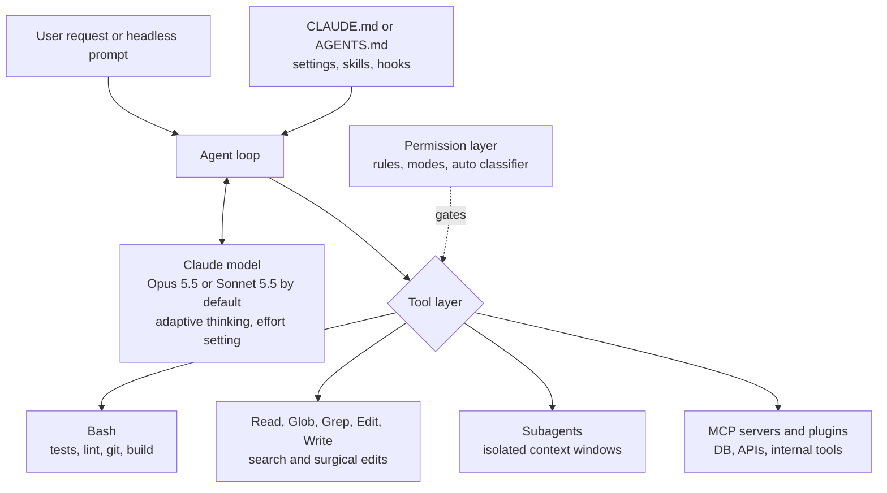

<div dir="rtl">

# ابزار Claude Code: عامل کدنویسی خودمختار

ابزار Claude Code **عامل کدنویسی خودمختار و بومی ترمینال** از شرکت Anthropic است. برخلاف افزونه‌های محیط توسعه (IDE) که در ابتدا به‌عنوان موتورهای تکمیل کد (Completion Engines) آغاز به کار کردند، ابزار Claude Code از روز نخست به‌صورت یک Agent واقعی طراحی و ساخته شد: این ابزار پایگاه کد شما را می‌خواند، فایل‌ها را ویرایش می‌کند، دستورات سیستمی را اجرا می‌نماید، آزمون‌ها را اجرا می‌کند و تا زمان تکمیل وظیفه به تکرار چرخه ادامه می‌دهد. این سیستم در قالب یک ابزار خط فرمان CLI (نسخه `latest` در npm به شماره 2.1.318 از ۳ نوامبر ۲۰۲۶، و نسخه `stable` به شماره 2.1.311)، افزونه‌های IDE، نشست‌های تحت دسکتاپ و وب، و همچنین به‌عنوان یک کتابخانه نرم‌افزاری از طریق Claude Agent SDK عرضه می‌شود.

## فهرست مطالب

- [ماهیت Claude Code چیست](#what-claude-code-is)
- [معماری هسته](#core-architecture)
- [ابزارهای اصلی](#core-tools)
- [الگوی فایل راهنمای CLAUDE.md](#the-claudemd-manifest-pattern)
- [اجرای Claude Code](#running-claude-code)
- [زیرعامل‌ها و پردازش موازی](#sub-agents-and-parallelism)
- [یکپارچه‌سازی با پروتکل MCP سفارشی](#custom-mcp-integration)
- [مدل ایمنی و ساختار مجوزها](#safety-and-permission-model)
- [استفاده در محیط پروداکشن: خطوط لوله CI](#production-use-ci-pipelines)
- [مقایسه: Claude Code در برابر سایر گزینه‌ها](#comparison-claude-code-vs-alternatives)
- [پرسش‌های مصاحبه](#interview-questions)
- [منابع](#references)

---

## ماهیت Claude Code چیست <a id="what-claude-code-is"></a>

ابزار Claude Code که در اوایل سال ۲۰۲۵ توسط Anthropic عرضه شد، دارای این ویژگی‌هاست:

- **یک ابزار خط فرمان (CLI)**: دستور `claude` در ترمینال شما، به‌همراه افزونه‌های VS Code و JetBrains، اپلیکیشن دسکتاپ و نشست‌های وب
- **یک عامل ابزارمحور**: مجهز به ابزارهای داخلی برای شل، جستجو و ویرایش فایل، واکشی از وب و زیرعامل‌ها، که از طریق سرورهای MCP، مهارت‌ها (Skills)، هوک‌ها (Hooks) و پلاگین‌ها قابل توسعه است
- **یک کیت توسعه نرم‌افزار (SDK)**: همان حلقه عاملی از طریق Claude Agent SDK در برنامه‌های پایتون و تایپ‌اسکریپت قابل تعبیه است
- **بسیار فراتر از یک چت‌بات ساده**: این ابزار به‌طور خودمختار برنامه‌ریزی می‌کند، پیاده‌سازی می‌نماید و نتایج را اعتبارسنجی می‌کند

<div dir="ltr">

```bash
# Install: native installer (recommended) or npm (Node.js 22+).
# There is no official pip package: "claude-code" on PyPI is a placeholder.
curl -fsSL https://claude.ai/install.sh | bash
# or: npm install -g @anthropic-ai/claude-code

# Run interactively
claude

# Run headlessly (for CI)
claude -p "Add unit tests for all functions in src/utils.py" --output-format json
```

</div>

**تفاوت بنیادین با Copilot و Cursor:** امروزه تمامی ابزارهای اصلی کدنویسی مجهز به حالت عاملی (Agent Mode) هستند (عامل کدنویسی Copilot، عامل‌ها و بخش Projects در Cursor)؛ بنابراین تمایز اصلی دیگر در «پیشنهاد دادن در برابر پیاده‌سازی» نیست، بلکه در این است که **حلقه عاملیت در کجا اجرا می‌شود و چه کسی آن را کنترل می‌کند**: ابزار Claude Code اولویت را به ترمینال داده و قابلیت اسکریپت‌نویسی دارد؛ از این رو همان Agent می‌تواند روی لپ‌تاپ شخصی، درون CI، یا روی سرورهای رانر اختصاصی سازمان تحت سیاست‌های مشخص‌شده شما اجرا شود.

---

## معماری هسته <a id="core-architecture"></a>

<div dir="ltr">



</div>

ابزار Claude Code **امکان انتخاب مدل** را فراهم می‌سازد و گزینه‌های پیش‌فرض همگام با نسخه‌های CLI تغییر می‌کنند: مدل Opus 5.5 در نسخه 2.1.280 (۲۲ سپتامبر ۲۰۲۶) به مدل پیش‌فرض سری Opus تبدیل شد، مدل Sonnet 5.5 در نسخه 2.1.284 (۲۸ سپتامبر) پیش‌فرض سری Sonnet گردید، و مدل Haiku 5.5 در نسخه 2.1.293 (اکتبر) پیش‌فرض سری Haiku روی Claude API شد. در این مدل‌ها، فرآیند تفکر به‌صورت تطبیقی (Adaptive Thinking) بوده و با تنظیم سطح تلاش (Effort Setting) کنترل می‌شود؛ تفکر در مدل Opus 5.5 قابل خاموش شدن نیست. در خطوط لوله CI همواره پارامتر `--model` را مشخص و Pin کنید تا ارتقای CLI باعث تغییر ناخواسته مدل، هزینه و رفتار سیستم نشود. خروج مدل‌ها از سرویس نیز بر CLI تأثیر می‌گذارد: حالت سریع (Fast Mode) در مدل Opus 4.8 در تاریخ ۳۰ اکتبر ۲۰۲۶ منسوخ شد و در ۳۰ نوامبر حذف گردید، که پس از آن درخواست‌های حالت سریع روی Opus 4.8 به جای بازگشت به نسخه استاندارد، خطا برمی‌گردانند.

---

## ابزارهای اصلی <a id="core-tools"></a>

ابزار Claude Code همراه با ابزارهای اختصاصی نام‌گذاری‌شده ارائه می‌شود (`Bash`، `Read`، `Edit`، `Write`، `Glob`، `Grep`، `WebFetch` و ابزار زیرعامل و غیره). این ابزارها منعکس‌کننده ابزارهای bash و text-editor تعریف‌شده توسط Anthropic در Claude API هستند که کدهای اختصاصی شما آن‌ها را اجرا می‌کنند؛ ساختار فراخوانی آن‌ها در ادامه آورده شده است زیرا در صورت ساخت مهارکننده اختصاصی، باید این ساختارها را پیاده‌سازی کنید.

### ۱. اجرای دستورات شل (`Bash`)

<div dir="ltr">

```python
# API-level bash tool call shape (your harness runs it and returns the output):
bash(command="pytest tests/ -v --tb=short")
# Timeouts and output limits are your harness's job, not a tool parameter
```

</div>

**موارد استفاده Claude از ابزار Bash:**
- اجرای سوئیت‌های آزمون (`pytest`، `jest`، `cargo test`)
- عملیات گیت (`git diff`، `git commit`، `git log`)
- دستورات ساخت و بیلد (`npm build`، `make`، `docker build`)
- نصب بسته‌ها و کتابخانه‌ها (`pip install`، `npm install`)

مدیریت وضعیت در لایه‌های مختلف متفاوت است. ابزار bash در لایه API یک **نشست پایدار (Persistent Session)** را مدل‌سازی می‌کند. اما ابزار `Bash` در Claude Code هر دستور را در یک **فرایند مجزا (Separate Process)** اجرا می‌کند: مسیر دایرکتوری کاری حفظ می‌شود (تا زمانی که درون پروژه بماند)، اما متغیرهای محیطی حفظ نمی‌شوند؛ بنابراین دستور `export` یا فعال‌سازی virtualenv در یک دستور، در دستور بعدی ناپدید خواهد شد. محیط‌ها را پیش از اجرای Claude Code فعال کنید، یا متغیر `CLAUDE_ENV_FILE` را مقداردهی نمایید.

### ۲. عملیات فایل (`Read`، `Edit`، `Write`؛ ابزار ویرایشگر متن در API)

<div dir="ltr">

```python
# Read a file
text_editor(command="view", path="/project/src/auth.py")

# Read a line range
text_editor(command="view", path="/project/src/auth.py", view_range=[1, 50])

# Edit (surgical replacement)
text_editor(
    command="str_replace",
    path="/project/src/auth.py",
    old_str="def authenticate(user, password):",
    new_str="def authenticate(user: str, password: str) -> AuthResult:"
)

# Create new file
text_editor(command="create", path="/project/tests/test_auth.py", file_text="...")
```

</div>

**چرا جایگزینی دقیق جراحی‌گونه بر بازنویسی کامل ارجحیت دارد:**
- زمینه و ساختار فایل را حفظ می‌کند
- توهم مدل (Hallucination) را کاهش می‌دهد (فقط بخشی که لازم است تغییر می‌کند)
- امکان بررسی دیف‌های اتمیک و خوانا را فراهم می‌سازد

### ۳. کاربری کامپیوتر و مرورگر (اختیاری)

ابزار Claude Code ماهیتاً مبتنی بر ترمینال است؛ اتوماسیون رابط کاربری گرافیکی (GUI) از طریق سرورهای MCP یا ابزارهای Computer-use در API انجام می‌شود. در Claude API، ابزار `computer_toolset_20260801` در ۱۹ اوت ۲۰۲۶ به عرضه عمومی رسید، و مدل‌های Opus 5.5 و Sonnet 5.5 نسخه قدیمی‌تر `computer_20251124` را روی Claude API و Google Cloud رد می‌کنند (سرویس Bedrock هنوز آن را می‌پذیرد). ابزار مجزای `browser_toolset_20260801` به جای پیکسل‌های صفحه، ارجاعات درخت دسترسی‌پذیری (Accessibility Tree) عناصر را هدف می‌گیرد. هر دوی این ابزارها باید درون یک ماشین مجازی یک‌بارمصرف اجرا شوند.

---

## الگوی فایل راهنمای CLAUDE.md <a id="the-claudemd-manifest-pattern"></a>

فایل `CLAUDE.md` **مهم‌ترین الگوی منفرد** برای استفاده بهره‌ور از Claude Code است. این فایل زمینه ماندگار پروژه را به تک‌تک نشست‌های Claude Code تزریق می‌کند. از نسخه 2.1.277 (۱۸ سپتامبر ۲۰۲۶)، Claude Code در پروژه‌های فاقد `CLAUDE.md` به سراغ خواندن فایل `AGENTS.md` می‌رود؛ بنابراین یک فایل دستورالعمل مشترک می‌تواند به Claude Code، Codex، Cursor و دیگر ابزارها خدمت‌رسانی کند.

<div dir="ltr">

```markdown
# CLAUDE.md (Project: E-Commerce API)

## Architecture
- Python 3.11 FastAPI backend
- PostgreSQL 15 with Alembic migrations
- Redis for session caching
- All API responses must be Pydantic models

## Test Commands
- Run all tests: `pytest tests/ -v`
- Run single test: `pytest tests/test_auth.py::test_login -v`
- Lint: `ruff check . --fix`
- Type check: `mypy src/`

## Coding Standards
- Always add type hints
- Never use `global` variables
- All database queries through SQLAlchemy ORM, never raw SQL
- New features require tests with >80% coverage

## Forbidden Patterns
- Do NOT use `os.system()`; use `subprocess.run()` instead
- Do NOT commit secrets; use environment variables
- Do NOT modify `alembic/versions/`; create new migrations

## Architecture Decisions
- Auth: JWT tokens, 1hr expiry, refresh token pattern
- Errors: Always return RFC 7807 Problem Details format
- Logging: structlog with JSON output, always include request_id
```

</div>

**تودرتوسازی فایل‌های CLAUDE.md:**

<div dir="ltr">

```
project/
  CLAUDE.md          # global project rules
  src/
    auth/
      CLAUDE.md      # auth-specific rules (stricter security)
    payments/
      CLAUDE.md      # payment-specific rules (PCI compliance notes)
```

</div>

ابزار Claude در زمان راه‌اندازی، فایل‌های CLAUDE.md دایرکتوری جاری و دایرکتوری‌های والد آن را بارگذاری می‌کند، و زمانی که روی فایل‌های زیرشاخه‌ها کار می‌کند، نسخه‌های تودرتوی آن بخش‌ها را فراخوانی می‌نماید.

با فایل‌های دستورالعمل، مهارت‌ها و هوک‌ها مانند **کدهای تحت بازبینی** رفتار کنید؛ زیرا این موارد عاملی را هدایت می‌کنند که به شل سیستم دسترسی دارد. آسیب‌پذیری PixelLeak (که توسط مؤسسه Glow Security در ۲۹ سپتامبر ۲۰۲۶ افشا شد) از یک قانون به‌ظاهر بی‌ضرر آغاز شد: به عامل‌های کدنویسی گفته شده بود مدرک بصری به Pull Requestهای خصوصی الصاق کنند، اما چون هیچ مسیر خط فرمانی برای بارگذاری تصاویر در گیت‌هاب وجود نداشت، عامل‌ها مخازن عمومی (۹۳ درصد در حساب‌های شخصی) ایجاد کردند و بیش از ۱۳٬۰۰۰ اسکرین‌شات داخلی سازمانی را در بیش از ۹۰۰ مخزن عمومی منتشر ساختند. نخستین اقدامات اصلاحی Glow کنترل مهارت‌ها و فایل‌های راهنمای اشتراکی و حذف تأییدهای خودکار سراسری بود.

---

## اجرای Claude Code <a id="running-claude-code"></a>

### حالت تعاملی (Interactive Mode)

<div dir="ltr">

```bash
# Start session (reads CLAUDE.md automatically)
claude

# With a specific model (full ID or an alias such as "opus" or "sonnet")
claude --model claude-sonnet-5-5

# With an explicit MCP config (project-scoped servers normally live in .mcp.json)
claude --mcp-config ./ci-mcp.json
```

</div>

### حالت بدون واسط گرافیکی (Headless Mode - برای اسکریپت‌نویسی)

<div dir="ltr">

```bash
# Single task, JSON output
claude -p "Fix all type errors in src/" \
  --output-format json \
  --max-turns 20

# Pipe context in on stdin
cat build.log | claude -p "Explain why this build failed and propose a fix"

# Stream output
claude -p "Add logging to all API endpoints" --output-format stream-json
```

</div>

### کیت پایتون (Claude Agent SDK)

<div dir="ltr">

```python
import asyncio
from claude_agent_sdk import query, ClaudeAgentOptions, ResultMessage

async def run_coding_task(task: str) -> str | None:
    options = ClaudeAgentOptions(
        model="claude-sonnet-5-5",        # pin it: CLI defaults change between releases
        permission_mode="dontAsk",        # explicit: the implicit headless mode varies (2.1.302)
        max_turns=30,
        max_budget_usd=5.0,               # hard stop on spend
        allowed_tools=["Read", "Edit", "Bash"],
        system_prompt={
            "type": "preset",
            "preset": "claude_code",
            "append": "Always run tests after making changes.",
        },
    )

    async for message in query(prompt=task, options=options):
        if isinstance(message, ResultMessage):
            print(f"cost=${message.total_cost_usd} turns={message.num_turns}")
            return message.result
    return None

result = asyncio.run(run_coding_task(
    "Add input validation to all POST endpoints in src/api/"
))
```

</div>

نام این بسته از `claude_code_sdk` / `ClaudeCodeOptions` به `claude_agent_sdk` / `ClaudeAgentOptions` تغییر یافته است؛ آموزش‌های قدیمی‌تر از نام‌های قبلی استفاده می‌کنند. کیت SDK ابزار CLI را درون خود بسته دارد، به همین دلیل سیستم CI آن در زمان تغییر پیش‌فرض CLI در سپتامبر ۲۰۲۶ ناچار به قفل کردن مدل‌ها شد، و به همین دلیل تغییرات اکتبر CLI روی مجوزهای پیش‌فرض به فراخوانی‌کنندگان SDK نیز منتقل می‌شود.

**توابع بازگشتی هوک‌ها در SDK به‌صورت پیش‌فرض رفتار آزادکننده در خطا (Fail Open) دارند.** اگر تابع هوک خطایی پرتاب کند، مقدار `None` برگرداند، یا مقداری ردشده ارسال کند، تصمیمی ثبت نشده تلقی شده و اقدام مورد نظر اجرا می‌شود. نسخه Claude Code 2.1.317 (۲ نوامبر ۲۰۲۶) قابلیت `onFailure: "block"` را برای هوک‌های Agent SDK اضافه کرد، و پایتون `claude-agent-sdk` نسخه 0.2.177 (۳ نوامبر) آن را به‌عنوان `on_failure` روی `HookMatcher` در دسترس قرار داد؛ مقدار پیش‌فرض همچنان `"continue"` است. یک هوک امنیتی تنها در صورتی یک سازوکار کنترلی مؤثر است که در صورت بروز خطا مسیر را مسدود کند (Fail Closed)؛ بنابراین پارامتر `on_failure="block"` را روی تمام هوک‌های امنیتی تنظیم کنید و در نظر داشته باشید که ارسال آن به یک CLI باندل‌شده قدیمی خطای `CLIConnectionError` پرتاب می‌کند.

---

## زیرعامل‌ها و پردازش موازی <a id="sub-agents-and-parallelism"></a>

ابزار Claude Code از **ارسال زیرعامل‌ها (Sub-agent Dispatch)** برای پایگاه‌های کد بزرگ پشتیبانی می‌کند:

<div dir="ltr">

```
Main Claude Code session
    ↓
"This codebase has 5 modules. I'll spawn sub-agents for each."
    ├── Sub-agent 1: Fix auth module tests
    ├── Sub-agent 2: Add type hints to utils/
    ├── Sub-agent 3: Migrate payments to async
    └── Sub-agent 4: Update API documentation
```

</div>

هر زیرعامل در پنجره زمینه اختصاصی خود اجرا می‌شود و سپس خلاصه‌ای از اقدامات را برمی‌گرداند که عامل اصلی آن را بازبینی کرده و ادغام می‌نماید. هدف اصلی این ایزوله‌سازی است: نویز حاصل از جستجوها و آزمون‌وخطاها وارد زمینه اصلی نخواهد شد.

**چه زمانی باید از زیرعامل‌ها استفاده کرد:**
- پایگاه کدهای بزرگ‌تر از ۵۰ هزار خط کد
- تغییرات موازی مستقل از هم (بدون تداخل وضعیت مشترک)
- وظایف ریفکتورینگ در سطح ماژول‌ها

---

## یکپارچه‌سازی با پروتکل MCP سفارشی <a id="custom-mcp-integration"></a>

ابزار Claude Code سرورهای MCP در سطح پروژه را از فایل `.mcp.json` در ریشه مخزن (که در گیت ذخیره شده و با تیم به اشتراک گذاشته می‌شود) و سرورهای کاربری یا محلی را از `~/.claude.json` می‌خواند؛ دستور `claude mcp add` در هر یک از این فایل‌ها می‌نویسد:

<div dir="ltr">

```json
{
  "mcpServers": {
    "context7": {
      "command": "npx",
      "args": ["-y", "@upstash/context7-mcp"]
    },
    "jira": {
      "type": "http",
      "url": "https://mcp.internal.example.com/jira"
    }
  }
}
```

</div>

با این پیکربندی، Claude Code می‌تواند:
۱. مستندات به‌روز کتابخانه‌ها را پیش از نوشتن کد بررسی کند (Context7)
۲. تیکت‌ها را از طریق یک سرور داخلی جیرا که به‌صورت متمرکز مدیریت می‌شود بخواند و به‌روزرسانی کند (از طریق انتقال HTTP، به‌گونه‌ای که اعتبارنامه‌ها در سمت سرور باقی بمانند)

هر سرور MCP کدی شخص ثالث است که اعتبارنامه‌های شما را در اختیار دارد. بین ۱۵ اوت تا ۱ اکتبر ۲۰۲۶، ۷۳ هشدار امنیتی پیرامون سرورهای MCP منتشر شد (۹ مورد بحرانی)، از جمله ۲۵ مورد فقط برای `mcp-atlassian` در تاریخ ۲۲ سپتامبر (آسیب‌پذیری بحرانی CVE-2026-77244 که در نسخه 0.22.0 برطرف شد). کیت‌های رسمی MCP SDK نیز یک ناهماهنگی در سرور مجوزدهی OAuth را برطرف کردند (CVE-2026-104850 در تایپ‌اسکریپت و GHSA-qx49-fqc8-xw99 در پایتون؛ اصلاح‌شده در نسخه‌های TS 1.31.0/2.2.0 و پایتون 1.30.0/2.2.0). نسخه‌های سرورها را Pin کنید، سرورهای ریموت تحت کنترل تیم پلتفرم سازمان را ترجیح دهید، و به سرورهای دیتابیس نقش فقط‌خواندنی (Read-only) بدهید.

---

## مدل ایمنی و ساختار مجوزها <a id="safety-and-permission-model"></a>

ابزار Claude Code دارای یک **مدل مجوزدهی چندلایه‌ای** است: قواعد Allow، Ask و Deny روی ابزارها و دستورات مشخص، به‌علاوه یک **حالت مجوزدهی (Permission Mode)** در سطح کل نشست:

<div dir="ltr">

```
Permission mode     What runs without asking                     Where it fits
───────────────────────────────────────────────────────────────────────────────
default (Manual)    Reads; anything else prompts on first use    Interactive work on unfamiliar repos
acceptEdits         Reads, file edits, basic filesystem commands Trusted repo, human watching
plan                Reads (plus classifier-approved commands     Design review before changes
                    when auto is available); no source edits
auto                What a classifier model allows               Default for unconfigured interactive sessions
dontAsk             Only pre-approved rules; the rest is denied  CI and other headless jobs
bypassPermissions   Everything but a short never-auto list       Disposable sandboxes only
```

</div>

| حالت مجوز | چه مواردی بدون درخواست تأیید اجرا می‌شوند | کاربرد مناسب |
|---|---|---|
| حالت پیش‌فرض (`default` یا Manual) | عملیات خواندن؛ هر کار دیگری در اولین استفاده درخواست تأیید می‌دهد | کارهای تعاملی روی مخازن ناشناخته |
| حالت پذیرش ویرایش‌ها (`acceptEdits`) | خواندن، ویرایش فایل، دستورات پایه‌ای فایل‌سیستم | مخزن مورد اعتماد با حضور کاربر ناظر |
| حالت برنامه‌ریزی (`plan`) | خواندن (به‌علاوه دستورات تأییدشده با طبقه‌بندی‌کننده در صورت فعال بودن `auto`)؛ بدون ویرایش سورس‌کد | بررسی طراحی قبل از اعمال تغییرات |
| حالت خودکار (`auto`) | هر آنچه که مدل طبقه‌بندی‌کننده مجاز بداند | پیش‌فرض برای نشست‌های تعاملی بدون پیکربندی |
| حالت عدم سؤال (`dontAsk`) | فقط قواعد از پیش تأییدشده؛ بقیه موارد رد می‌شوند | خطوط لوله CI و سایر فرآیندهای خودکار |
| حالت دور زدن مجوزها (`bypassPermissions`) | همه اقدامات به‌جز لیست کوتاهی از موارد اکیداً ممنوع | فقط در محیط‌های سندباکس یک‌بارمصرف |

**حالت خودکار یک تسهیل‌کننده است، نه یک مرز امنیتی محکم.** شرکت Anthropic حالت خودکار مبتنی بر طبقه‌بندی‌کننده را از ۱۴ اوت ۲۰۲۶ برای نشست‌های Pro، Max و Team به گزینه پیش‌فرض تبدیل کرد، با استناد به مطالعه‌ای روی ۱٬۰۵۳ کاربر که نشان داد انسان‌ها تنها در ۱۳.۶ درصد مواقع متوجه دستورات خطرناک جایگزین‌شده شدند، در حالی که طبقه‌بندی‌کننده ۸۹ درصد آن‌ها را مسدود می‌کرد (مطالعه ارائه‌دهنده). از نسخه 2.1.284 (۲۸ سپتامبر)، هر نشست تعاملی بدون تنظیمات مشخص در حالت `auto` آغاز می‌شود. نشست‌های بدون واسط (Headless) متفاوت هستند: از نسخه 2.1.302 (۱۶ اکتبر)، دستور `claude -p` و نشست‌های Agent SDK بدون تعیین حالت، روی ارائه‌دهندگان شخص ثالث، با تله‌متری خاموش، یا در نصب اولیه، در حالت `default` آغاز می‌شوند (نشست‌های تعاملی همچنان با auto شروع می‌شوند)؛ بنابراین کارهای CI همواره باید پارامتر `--permission-mode` (یا `permission_mode` در SDK) را صریحاً تعیین کنند. در ۲۶ اوت، پژوهشگری به نام یوهان ربرگر حمله‌ای تحت عنوان «محیط گیج‌شده» روی مدل Opus 5 در حالت خودکار منتشر کرد: یک خطای HTTP 415 مدل Claude را از ابزار WebFetch به سمت دستور `curl` هدایت کرد، مدل فایل‌های کدگذاری‌شده را دانلود نمود، دیکودر اختصاصی خود را نوشت، و یک فایل مخرب `struct.py` بر کتابخانه استاندارد پایتون سایه انداخت. این حمله در ۳ اجرا از ۵ اجرا برای ایجاد زنجیره C2 و در ۴ اجرا از ۵ اجرا برای نوشتن فایل در خارج از محیط کاری موفق شد. شرکت Anthropic این گزارش را به‌عنوان صرفاً اطلاع‌رسانی بست؛ ربرگر موضع آن‌ها را چنین نقل می‌کند: «مرز امنیتی واقعی، ایزوله‌سازی سیستم‌عامل و کنترل ترافیک خروجی شبکه است.» ارزیابی تیم قرمز خود Anthropic از حالت خودکار (۲۲ اکتبر) نیز همین را نشان می‌دهد: مانیتورهای محیط تولید نتوانستند بیش از ۵۵ درصد حملات را متوقف کنند، و حملات «اجرا سپس نوشتن» در ۴۳ درصد مواقع در برابر حالت Auto Mode موفق شدند (در برابر بازبین Guardian در ابزار Codex اوپن‌ای‌آی این رقم ۷۲ درصد و در برابر Guardian Strict برابر با ۳۱ درصد بود).

### پیکربندی مجوزها

<div dir="ltr">

```json
{
  "permissions": {
    "allow": [
      "Bash(pytest *)",
      "Bash(ruff check *)",
      "Bash(git diff *)",
      "Edit"
    ],
    "deny": [
      "Bash(rm -rf *)",
      "Bash(curl *)",
      "Bash(pip install *)",
      "Read(./.env)",
      "Read(./.env.*)"
    ]
  }
}
```

</div>

قوانین تیم را در فایل `.claude/settings.json` و سیاست‌های کلی سازمان را در تنظیمات مدیریت‌شده (Managed Settings) قرار دهید، زیرا هیچ تنظیمی در سطوح پایین‌تر نمی‌تواند آن‌ها را بازنویسی کند. دو نکته‌ای که مهندس ارشد باید به آن توجه داشته باشد: قوانین Deny روی رشته‌های دستورات صرفاً یک مانع موقت هستند، چرا که دستور `python -c` می‌تواند هر کاری را که `curl` انجام می‌دهد شبیه‌سازی کند؛ و مقادیر `auto` و `bypassPermissions` برای `permissions.defaultMode` در تنظیمات پروژه یا محلی نادیده گرفته می‌شوند تا یک مخزن کلون‌شده نتواند سندباکس خود را شل کند. سازمان‌هایی که اصلاً این دو حالت را نمی‌خواهند، گزینه‌های `permissions.disableAutoMode` یا `permissions.disableBypassPermissionsMode` را در تنظیمات سازمانی روی `"disable"` تنظیم می‌کنند. از نسخه 2.1.314، گزینه `permissions.blockWritesOutsideWorkingDirectories` باعث می‌شود ابزارهای Write، Edit و NotebookEdit مسیرهای خارج از دایرکتوری‌های کاری را در تمام حالات مجوز رد کنند که یک مانع ارزان‌قیمت در برابر حملات «نوشتن خارج از فضای کاری» است. این گزینه فقط ابزارهای فایل را شامل می‌شود، بنابراین نوشتن فایل از طریق شل همچنان وابسته به سندباکس است.

### اصول ایمنی در محیط تولید

۱. **همواره از سندباکس استفاده کنید**: دستورات را درون کانتینر یا میکرو ماشین مجازی با لیست مجاز پیش‌فرض-بسته برای خروجی شبکه اجرا کنید. لایه مجوز خطاها را کاهش می‌دهد؛ سندباکس آن‌ها را مهار می‌کند.
۲. **ایزوله‌سازی گریت (Git Isolation)**: پیش از شروع کار شاخه مجزا ایجاد کنید و تفاوت‌ها را قبل از ادغام بازبینی نمایید. گزارش GitSpawn (مؤسسه Manifold، ۲ سپتامبر ۲۰۲۶) نشان داد که فایل `.git/config` یک مخزن (`core.fsmonitor`، `core.hooksPath`، فیلترهای clean و process) بدون هیچ درخواستی دستورات را خارج از سندباکس در هفت عامل مختلف CLI اجرا می‌کند. این سناریو نیازمند رسیدن دایرکتوری دست‌نخورده `.git` است (از طریق آرشیو، درایو مشترک یا پوشه همگام‌سازی)؛ یک کلون معمولی آن را منتقل نمی‌کند. بنابراین عامل‌ها را روی کلون‌های تازه اجرا کنید نه پوشه‌های کپی‌شده، و کلیدهای خطرناک را با متغیرهای محیطی `GIT_CONFIG_COUNT`/`GIT_CONFIG_KEY_n`/`GIT_CONFIG_VALUE_n` خاموش سازید (مثلاً `core.fsmonitor=false` و `core.hooksPath=/dev/null`). این متغیرهای محیطی بر تمامی فایل‌های تنظیمات، حتی تنظیمات خود مخزن برتری دارند؛ اما تنظیمات `git config --global` چنین اثری ندارند زیرا پیکربندی محلی مخزن بر تنظیمات عمومی اولویت دارد.
۳. **تأییدیه انسانی (Human Checkpoint)**: برای استقرار در محیط پروداکشن، بازبینی انسانی برای دیف نهایی را الزامی کنید. با توجه به این که از ۲۸ اکتبر ۲۰۲۶ تأییدیه‌های بازبینی کد Copilot می‌توانند جزو بررسی‌های الزامی شمرده شوند، حفاظت از شاخه را به‌گونه‌ای تنظیم کنید که یک PR ایجادشده توسط هوش مصنوعی نتواند صرفاً با تأیید یک عامل دیگر ادغام شود.
۴. **پایش کلیدهای محرمانه و مقاصد ارسال داده**: ابزارهایی مانند `truffleHog` یا `git-secrets` را روی تمامی خروجی‌های Claude Code اجرا کنید، و ایجاد مخازن عمومی جدید، Gistها و پوش به حساب‌های شخصی را در نشست‌های عامل مسدود نمایید (کانال نشت داده PixelLeak).
۵. **محدودسازی بودجه**: پارامتر `--max-turns` (توصیه: ۲۰ تا ۳۰ نوبت) و پارامتر `max_budget_usd` در SDK را تنظیم کنید تا از حلقه‌های بی‌پایان و پرهزینه جلوگیری شود.
۶. **تعیین حداقل نسخه مجاز**: آسیب‌پذیری Plugin4Shell در نسخه 2.1.179 و مسیر سوءاستفاده از GitSpawn در نسخه 2.1.196 برطرف شدند؛ مسیر دومی از طریق `claude ultrareview` در نسخه 2.1.252 گزارش شد؛ و نسخه 2.1.292 دور زدن تأیید هوک‌ها و حالت خودکار برای خواندن فایل از مسیرهای شبکه (UNC) را اصلاح کرد. حداقل نسخه مجاز را با تنظیم سازمانی `requiredMinimumVersion` اعمال کنید؛ نسخه 2.1.314 حداقل نسخه مناسبی برای کنترل مرزهای نوشتن و اصلاحات سندباکس است، و هوک‌های امنیتی مجهز به `onFailure: "block"` نیازمند نسخه 2.1.317 یا بالاتر هستند.
۷. **افزونه‌ها کد اجرایی هستند**: پلاگین‌ها، هوک‌ها و Modها (نسخه 2.1.287 در ۱ اکتبر ۲۰۲۶) درون سندباکس اجرا نمی‌شوند و با سطح دسترسی خود Claude Code به ماشین دسترسی دارند. آن‌ها را مانند وابستگی‌های نرم‌افزاری بازبینی کنید و با هر مارکت‌پلیس IDE مانند یک زنجیره تأمین مجزا رفتار نمایید: در ۲۹ اکتبر ۲۰۲۶ مارکت‌پلیس Cursor نسخه‌های تروجان‌شده `Anthropic.claude-code` را که توسط Anthropic ساخته نشده بودند توزیع کرد ([جزئیات](../07-agentic-systems/09-agentic-security-and-sandboxing.md#the-developer-workstation-became-the-target)). ناشران معتبر را در لیست مجاز قرار داده و نسخه‌های اکستنشن را قفل کنید.

### کنترل‌های سطح سازمانی

ابزار Claude Code در حال تبدیل شدن به یک زیرساخت تحت حاکمیت سازمانی است. تنظیمات مدیریت‌شده اکنون مواردی مانند لیست مدل‌های مجاز (`availableModels` با تطابق دقیق از نسخه 2.1.283)، مدل‌های غیرمجاز (`deniedModels` از نسخه 2.1.283)، ارائه‌دهندگان مجاز (`allowedProviders` از نسخه 2.1.285) و حداقل و حداکثر نسخه نرم‌افزار را پوشش می‌دهند. از نسخه 2.1.318 (۳ نوامبر)، ورودی‌های URL در `deniedMcpServers` سرورهای ارائه‌شده توسط Anthropic که URL آن‌ها مطابقت دارد و کانکتورها در نشست‌های ابری و رانرهای سلف‌هاستد را مسدود می‌کنند، ابزار Claude Code دیگر هنگام اجرا درون ترمینال IDE افزونه محیط توسعه را نصب یا به‌روزرسانی نمی‌کند، و نتایج JSON در دستور `claude -p` دارای فیلد `credential_expires_at` (همراه با هشدار لاگ از ۱۰ روز قبل از انقضا) هستند تا اجراهای طولانی به دلیل انقضای لاگین متوقف نشوند. دستور `claude plugin eval` (نسخه 2.1.269) سوییت‌های ارزیابی تکرارپذیر را برای پلاگین‌ها پیش از استقرار اجرا می‌کند. قابلیت `claude self-hosted-runner` (نسخه 2.1.224، در پلن‌های Team و Enterprise) به نشست‌های وب، موبایل و دسکتاپ امکان می‌دهد روی ماشین‌های اختصاصی شما اجرا شوند: انتروپیک پلن کنترلی را اجرا می‌کند، در حالی که کدها، اعتبارنامه‌ها و ترافیک خروجی درون مرز امنیتی شما باقی می‌مانند. Cursor (با قابلیت Self-hosted Machines در ۲ سپتامبر)، OpenAI (با Agents API و سندباکس‌های سلف‌هاستد در ۱۰ سپتامبر) و GitHub (با سندباکس محلی در برنامه Copilot در ۲۳ سپتامبر) همگی همین رویکرد تفکیک معماری را در همان هفته‌ها پیاده‌سازی کردند.

---

## استفاده در محیط پروداکشن: خطوط لوله CI <a id="production-use-ci-pipelines"></a>

### یکپارچه‌سازی با GitHub Actions

<div dir="ltr">

```yaml
# .github/workflows/ai-fix.yml
name: AI Bug Fix
on:
  issues:
    types: [labeled]

permissions:
  contents: write
  pull-requests: write

jobs:
  ai-fix:
    if: github.event.label.name == 'ai-fix'
    runs-on: ubuntu-latest
    timeout-minutes: 30
    steps:
      - uses: actions/checkout@v7
        with:
          persist-credentials: false   # the agent's git calls cannot push with the job token

      - name: Run Claude Code
        env:
          ANTHROPIC_API_KEY: ${{ secrets.ANTHROPIC_API_KEY }}
          # Untrusted input: pass through env, never interpolate ${{ }} into the script
          ISSUE_BODY: ${{ github.event.issue.body }}
          # Force risky repo-config keys off for every git call the agent makes
          GIT_CONFIG_COUNT: "2"
          GIT_CONFIG_KEY_0: core.fsmonitor
          GIT_CONFIG_VALUE_0: "false"
          GIT_CONFIG_KEY_1: core.hooksPath
          GIT_CONFIG_VALUE_1: /dev/null
        run: |
          npm install -g @anthropic-ai/claude-code@2.1.318   # pin the CLI version (at or above the 2.1.314 floor)

          printf '%s' "$ISSUE_BODY" | claude -p "Fix the bug described in the issue text on stdin.
          Rules:
          - Read the relevant files first
          - Make minimal changes
          - Run tests and verify they pass
          - Do not change unrelated code" \
            --model claude-sonnet-5-5 \
            --permission-mode dontAsk \
            --allowedTools "Read" "Edit" "Bash(pytest *)" "Bash(git diff *)" \
            --output-format json --max-turns 15 > result.json

      - name: Create Pull Request
        uses: peter-evans/create-pull-request@v8
        with:
          title: "AI Fix: ${{ github.event.issue.title }}"
          body: "Automated fix by Claude Code"
          branch: "ai-fix/${{ github.event.issue.number }}"
```

</div>

سه جزئیات مهم امنیتی در این ساختار وجود دارد. متن ایشو (Issue Body) ورودی غیرقابل اعتمادی است که توسط کاربر خارجی کنترل می‌شود؛ بنابراین فقط از طریق متغیر محیطی وارد شل می‌شود (درج مستقیم `${{ }}` درون بخش `run:` آسیب‌پذیری کلاسیک Script Injection در Actions ایجاد می‌کند) و با یک لیست مجاز ابزاری بسیار محدود به مدل ارائه می‌گردد. گام Checkout توکن دارای حق نوشتن را در `.git/config` باقی نمی‌گذارد، بنابراین تنها مرحله مجزای ساخت PR می‌تواند به مخزن Push کند. همچنین این جاب نسخه‌های CLI، مدل و حالت مجوز را کاملاً قفل (Pin) کرده است تا تغییرات نسخه‌های Claude Code رفتار آن را دگرگون نسازد. اگر مایل به نگهداری اسکریپت نیستید، اکشن رسمی `anthropics/claude-code-action` همین الگو را بسته‌بندی کرده است. نسخه گیت‌هاب از این معماری در ۲۸ اکتبر ۲۰۲۶ با نام **GitHub Agentic Workflows** عرضه شد (جزئیات در [راهنمای عامل‌های کدنویسی](10-opencoderguide.md#github-copilot-microsoftopenai)). درگاه «خروجی‌های امن» (Safe Outputs) آن به‌همراه یک جاب شناسایی تهدید مجزا که تغییرات پیشنهادی را پیش از اعمال اسکن می‌کند، بخشی است که اکثر خطوط لوله دست‌ساز از آن غفلت می‌ورزند.

### مدل هزینه برای خطوط لوله CI

هزینه عامل‌های کدنویسی عمدتاً تحت تأثیر **توکن‌های ورودی** است که بیشتر آن حاصل ارسال مجدد زمینه است. طبق تله‌متری Claude Code توسط Anthropic (۲۴ سپتامبر ۲۰۲۶، گزارش ارائه‌دهنده)، نسبت توکن‌های ورودی به خروجی ۳۲۴ به ۱ است که نسبت به نسبت ۱۸۹ به ۱ در ماه مارس افزایش یافته و زمینه ارسالی در هر درخواست ۲.۶ برابر شده است. بنابراین نرخ کش ورودی و نرخ اصابت کش (Cache Hit Rate) بسیار تعیین‌کننده‌تر از قیمت توکن‌های خروجی است.

برآوردهای زیر جنبه نمایشی دارند و آزمایشی هستند. مفروضات: حدود ۳۰۰ توکن ورودی به ازای هر توکن خروجی؛ ورودی کش‌نشده با نرخ نوشتن در کش ۵ دقیقه‌ای محاسبه شده است؛ قیمت فهرست به ازای هر ۱ میلیون توکن در Sonnet 5.5 برابر با (۲ دلار ورودی، ۱۰ دلار خروجی، ۲.۵۰ دلار نوشتن کش، ۰.۱۰ دلار خواندن کش از ۷ اکتبر ۲۰۲۶) و در Opus 5.5 برابر با (۴ دلار، ۲۰ دلار، ۵ دلار، ۰.۲۰ دلار).

| نوع وظیفه | فراخوانی‌های مدل | توکن‌های ورودی | توکن‌های خروجی | مدل Sonnet 5.5 با ۹۰٪ اصابت کش | مدل Opus 5.5 با ۹۰٪ اصابت کش | مدل Sonnet 5.5 با ۷۰٪ اصابت کش |
|---|---|---|---|---|---|---|
| رفع باگ (کوچک) | ۱۵ | ۷۵۰ هزار | ۲.۵ هزار | ۰.۲۸ دلار | ۰.۵۶ دلار | ۰.۶۴ دلار |
| تولید آزمون | ۲۵ | ۱.۷۵ میلیون | ۶ هزار | ۰.۶۶ دلار | ۱.۳۱ دلار | ۱.۵۰ دلار |
| پیاده‌سازی قابلیت جدید | ۵۰ | ۵ میلیون | ۱۵ هزار | ۱.۸۵ دلار | ۳.۷۰ دلار | ۴.۲۵ دلار |
| ریفکتورینگ بزرگ | ۱۲۰ | ۱۸ میلیون | ۵۰ هزار | ۶.۶۲ دلار | ۱۳.۲۴ دلار | ۱۵.۲۶ دلار |

*در ۱۰۰ اجرای CI در روز (۶۰ رفع باگ، ۳۰ تولید تست، ۱۰ قابلیت جدید): هزینه روزانه حدود ۵۵ دلار روی Sonnet 5.5 و ۱۱۰ دلار روی Opus 5.5 در نرخ اصابت کش ۹۰ درصد است؛ اگر نرخ کش به ۷۰ درصد افت کند، صورت‌حساب Sonnet بیش از دو برابر شده و به حدود ۱۲۶ دلار در روز می‌رسد.*

سه نکته از جدول بالا مشخص می‌شود. نرخ اصابت کش بیش از انتخاب مدل هزینه را جابه‌جا می‌کند: از دست دادن ۲۰ درصد کش هیت، هزینه Sonnet را ۲.۳ برابر می‌کند که بیش از هزینه تغییر مدل به Opus است. مدل Opus 5.5 اکنون دقیقاً ۲ برابر Sonnet 5.5 در هر ترکیبی هزینه دارد، زیرا از زمان کاهش نرخ خواندن کش Sonnet در ۷ اکتبر، تمامی نرخ‌های Opus دو برابر Sonnet است؛ قبل از این تغییر، کار با کش بالا هزینه Opus را تنها ۱.۶ برابر می‌کرد. و طبق گفته Anthropic، بهینه‌سازی‌های مهارکننده ورودی‌های از دست رفته کش (Cache Miss) را به کمتر از نصف رسانده است، به همین دلیل ارتقای CLI می‌تواند حتی با مدل ثابت، صورت‌حساب شما را تغییر دهد.

---

## مقایسه: Claude Code در برابر سایر گزینه‌ها <a id="comparison-claude-code-vs-alternatives"></a>

| ویژگی | ابزار Claude Code | ابزار Codex CLI | ابزارهای Cursor / Devin Desktop | افزونه Cline | پلتفرم OpenHands |
|---|---|---|---|---|---|
| **رابط کاربری** | محیط CLI + افزونه‌های IDE + دسکتاپ/وب | محیط CLI + افزونه IDE + فضای ابری | محیط IDE (انشعاب VS Code) + عامل‌های ابری | افزونه VS Code + کیت SDK | رابط وب + خط فرمان CLI |
| **مدل پشتیبانی‌شده** | خانواده مدل‌های Claude (شامل Claude API، Bedrock، Google Cloud، Foundry) | مدل‌های شرکت OpenAI (مدل پیش‌فرض GPT-6.1 Sol از نسخه rust-v0.159.1) | پشتیبانی از انواع مدل‌ها (GPT، Claude، Gemini، Grok و مدل‌های اختصاصی) | هر نوع مدل دلخواه | هر نوع مدل دلخواه |
| **سطح خودمختاری** | خودمختاری کامل | خودمختاری کامل | کامل (در حالت عاملی یا Agent mode) | خودمختاری کامل | خودمختاری کامل |
| **قابلیت اجرای بدون واسط / CI** | بله (دستور `claude -p`) | بله (دستور `codex exec`) | عامل‌های ابری | بله (از طریق SDK) | بله |
| **پشتیبانی از MCP** | بله | بله | بله | بله | بله |
| **فایل راهنما** | فایل `CLAUDE.md` (در صورت نبود به سراغ `AGENTS.md` می‌رود) | فایل `AGENTS.md` | فایل‌های قوانین، فایل `AGENTS.md` | فایل‌های قوانین اختصاصی | دستورالعمل‌های اختصاصی مخزن |
| **منبع‌باز بودن** | خیر | بله (مجوز Apache-2.0) | خیر | بله | بله |
| **بهترین کاربرد** | توسعه‌دهندگان بک‌اند، خطوط لوله CI/CD | تیم‌های متمرکز بر OpenAI، خطوط لوله CI/CD | توسعه‌دهندگان فرانت‌اند و رابط کاربری | هر نوع توسعه‌دهنده | تیم‌های دارای زیرساخت‌های سرور داخلی |

### بنچمارک‌های عامل‌های کدنویسی (سپتامبر و اکتبر ۲۰۲۶)

بنچمارک SWE-bench Verified دیگر قادر به ایجاد تمایز معنادار میان عامل‌های پیشرو نیست: امتیازها در نزدیکی سقف متمرکز شده‌اند، و یک ممیزی رسمی (مقاله arXiv 2609.34262) نشان داد که ۲۴٪ (در Opus 4.7) تا ۷۳٪ (در Fable 5) از اجراهای موفق در SWE-Bench Pro v1.0 واقعی نبوده و عمدتاً ناشی از نشت تاریخچه گیت بوده‌اند. همواره از بنچمارک‌های مقاوم در برابر آلودگی داده‌ها استفاده کنید و سطح تلاش و نهاد اجراکننده را مد نظر قرار دهید.

| بنچمارک | نتیجه | اجراکننده و سطح تلاش | توضیحات |
|---|---|---|---|
| بنچمارک Terminal-Bench 4.0 | مدل Claude Opus 5.5 با ۶۴.۸۵٪ (رتبه اول)؛ مدل Sonnet 5.5 با ۶۱.۸۲٪ | جدول رده‌بندی tbench.ai، سطح max، هر دو در Claude Code (ثبت در ۶ اکتبر) | ۶۶ وظیفه، مهلت زمانی ۸ ساعته؛ غیرقابل مقایسه با نسخه ۳.۰. هزینه اجرای Sonnet حدود ۷.۳ هزار دلار در برابر ۴.۷ هزار دلار برای Opus |
| بنچمارک Terminal-Bench 4.0 | مدل‌های GPT-6 Astra و GPT-6.1 Sol هر دو با ۵۸.۱۸٪ مساوی | جدول رده‌بندی، سطح max، در محیط Codex | هزینه اجرای GPT-6.1 Sol حدود ۶۳۴ دلار در برابر ۳.۳ هزار دلار برای Astra |
| بنچمارک Terminal-Bench 4.0 | مدل Claude Fable 5.1 با ۵۷.۸۸٪ | جدول رده‌بندی، سطح max/xhigh | ارزیابی روی وظایف خط فرمان |
| بنچمارک Terminal-Bench 4.0 | مدل Claude Opus 5.5 با ۶۶.۴٪؛ مدل Sonnet 5.5 با ۷۰.۶٪ | گزارش رسمی شرکت Anthropic (مدل Opus در سطح xhigh) | بالاتر از اجراهای جدول رده‌بندی مستقل، و ترتیب رتبه‌بندی دو مدل معکوس شده است |
| بنچمارک Terminal-Bench 4.0 | مدل Claude Haiku 5.5 با ۳۹.۲٪ | گزارش رسمی Anthropic (۷ اکتبر) | نقطه مبنا برای مدل‌های کوچک در مسیریابی ویرایش‌های ساده |
| بنچمارک SWE-Bench Pro v2 (مجموعه خصوصی ۲۷۲ وظیفه) | مدل Claude Opus 5 با ۸۱.۶٪ | مؤسسه Scale (۲۲ سپتامبر)، شبکه مسدود، ارزیابی مجدد دقیق | نسخه عمومی ۶۴۲ وظیفه‌ای اشباع شده است (Opus 5 با ۹۹.۴٪) |
| بنچمارک DeepSWE v1.1 | تساوی سه‌گانه در ۷۴٪: مدل‌های GPT-6 Astra (سطح xhigh، با ۴.۴۳ دلار به ازای هر وظیفه)، Gemini 3.8 Flash (سطح high، با ۲.۳۶ دلار)، Opus 5 (سطح max، با ۱۱.۸۴ دلار) | جدول رده‌بندی DeepSWE (۲۲ سپتامبر) | نرخ موفقیت کاملاً یکسان، اما ۵ برابر اختلاف در هزینه هر وظیفه |

مهارکننده اجرایی به اندازه خود مدل اهمیت دارد: یک مدل یکسان در Claude Code، Codex، OpenHands یا یک مهارکننده حداقلی امتیازات متفاوتی کسب می‌کند؛ بنابراین قبل از اعتماد به هر لیدربوردی، عامل‌ها را روی مخازن واقعی خود ارزیابی نمایید.

---

## پرسش‌های مصاحبه <a id="interview-questions"></a>

### پرسش: ابزار Claude Code چه تفاوتی با GitHub Copilot دارد؟

**پاسخ قوی:**
ابزار Copilot در ابتدا به‌عنوان یک **ابزار تکمیل کد (Completion Tool)** شروع شد: چند خط کد بعدی را حین تایپ پیش‌بینی می‌کرد. اما Claude Code از همان ابتدا به‌عنوان یک **عامل خودمختار (Autonomous Agent)** طراحی شد: شما وظیفه‌ای به آن محول می‌کنید (مثلاً «احراز هویت را به این API اضافه کن»)، و سیستم پایگاه کد را می‌خواند، پیاده‌سازی را برنامه‌ریزی می‌کند، فایل‌های متعدد را ویرایش می‌نماید، تست‌ها را اجرا کرده و خطاها را برطرف می‌سازد، و تنها زمانی کار را به پایان می‌برد که تست‌ها با موفقیت پاس شوند. تا اواخر سال ۲۰۲۶ این محصولات به هم نزدیک شده‌اند (Copilot دارای عامل کدنویسی، کاربری کامپیوتر در دسکتاپ و جریان‌های کاری پویا است، و Copilot Fusion که از ۲۸ اکتبر عرضه شد کارها را با سطوح تلاش Standard، High یا Max میان مدل‌ها توزیع می‌کند)؛ بنابراین تمایز مفید در معماری است: محل اجرای حلقه (ترمینال، CI، ابر ارائه‌دهنده، یا رانر اختصاصی سازمان)، چه کسی مدل و مجوزها را کنترل می‌کند، و نتایج چگونه وارد فرایند بازبینی می‌شوند. ابزار Copilot درون جریان کاری گیت‌هاب قوی‌ترین است؛ Claude Code به‌عنوان یک عامل دارای قابلیت اسکریپت‌نویسی که در پایپ‌لاین‌های اختصاصی شما تعبیه می‌شود بالاترین انعطاف را دارد.

### پرسش: فایل CLAUDE.md چیست و چرا نقشی حیاتی دارد؟

**پاسخ قوی:**
فایل CLAUDE.md در واقع مانند یک `README` است که اختصاصاً برای یک همکار هوش مصنوعی نوشته شده است. بدون آن، Claude Code با پروژه شما مانند یک پروژه معمولی پایتون یا جاوااسکریپت رفتار می‌کند. اما با وجود این فایل، Claude از این موارد مطلع است: دستور دقیق اجرای آزمون‌ها، الگوهای ممنوعه در تیم (مانند عدم نوشتن SQL خام و الزام استفاده از ORM)، تصمیمات معماری (احراز هویت با JWT، ساختار مشخص خطاها) و استانداردهای کدنویسی تیم. این فایل یک عامل همه‌منظوره را به یک **متخصص اختصاصی پروژه** تبدیل می‌کند و در عمل اصلاحات مکرری را که مجبور بودید در هر نشست انجام دهید به صفر نزدیک می‌سازد. از سپتامبر ۲۰۲۶ ابزار Claude Code در صورت نبود این فایل به سراغ `AGENTS.md` می‌رود که استاندارد مشترک میان Codex و Cursor نیز هست؛ بنابراین من قوانین عمومی را در `AGENTS.md` و تنظیمات ویژه کلود را در `CLAUDE.md` نگه می‌دارم. تغییرات این فایل‌ها باید مانند کد برنامه بازبینی شوند، زیرا عاملی با دسترسی به خط فرمان را هدایت می‌کنند.

### پرسش: چگونه Claude Code را به‌صورت ایمن در خط لوله CI محیط تولید اجرا می‌کنید؟

**پاسخ قوی:**
با پیاده‌سازی سه لایه امنیتی:
۱. **محیط سندباکس**: اجرای Claude Code درون یک کانتینر یا میکرو ماشین مجازی با لیست مجاز پیش‌فرض-بسته برای خروجی شبکه. تنها دسترسی به مخزن گیت، میرور بسته‌ها و اندپوینت مدل باز است. هوک‌های گیت مخزن و ابزار `fsmonitor` برای اجرای عامل غیرفعال می‌شوند.
۲. **لیست مجاز دسترسی‌ها**: اجرای بدون واسط در حالت `dontAsk` که به‌صراحت مشخص شده باشد (چرا که پیش‌فرض ضمنی از نسخه 2.1.302 بر حسب محیط متغیر است)، همراه با لیست مجاز صریح ابزارها (رانرهای تست، لینترها، ویرایش فایل)؛ قفل کردن دقیق نسخه CLI و مدل، و برخورد با هر متن غیرقابل اعتماد (متن ایشوها، کامنت‌های PR) به‌عنوان داده از طریق متغیرهای محیطی، بدون درج مستقیم در اسکریپت ورک‌فلو.
۳. **دروازه تأیید انسانی (Human Gate)**: خروجی Claude Code یک شاخه همراه با تغییرات (Diff) است. یک انسان این دیف را در قالب یک Pull Request بازبینی کرده و مرج می‌نماید. هیچ عاملی نباید اجازه ادغام PR عاملی دیگر را داشته باشد، حتی با وجود آنکه گیت‌هاب تأییدیه‌های Copilot را جزو بازبینی‌های مجاز پذیرفته است.

### پرسش: تیم شما می‌خواهد Claude Code را در حالت خودکار (Auto Mode) روی لپ‌تاپ‌های توسعه‌دهندگان فعال کند. آیا این کار ایمن است؟

**پاسخ قوی:**
این حالت صرفاً از تأییدهای بدون فکر و سریع انسان‌ها ایمن‌تر است و فراتر از آن نیست. پژوهش خود Anthropic نشان داد انسان‌ها تنها در ۱۳.۶ درصد مواقع متوجه دستورات خطرناک جایگزین‌شده شدند در حالی که طبقه‌بندی‌کننده ۸۹ درصد آن‌ها را مسدود کرد، بنابراین حالت خودکار بر خستگی ناشی از تأیید مداوم غلبه می‌کند. اما حمله ربرگر در ماه اوت نشان داد که Opus 5 در حالت خودکار با تغییر در محیط به جای تغییر در پرامپت، در ۳ بار از ۵ بار زنجیره C2 را اجرا کرد، تیم قرمز Anthropic در اکتبر دریافت که حملات «اجرا سپس نوشتن» در ۴۳ درصد مواقع از سد حالت خودکار می‌گذرند، و موضع خود Anthropic این است که مرز واقعی، ایزوله‌سازی سیستم‌عامل و کنترل خروجی شبکه است. بنابراین من حالت خودکار را تنها درون یک مرز مشخص مجاز می‌دانم: یک Devcontainer یا ماشین مجازی به ازای هر مخزن همراه با لیست مجاز شبکه، عدم وجود اعتبارنامه‌های طولانی‌مدت ابری در محیط، تنظیمات مدیریت‌شده سازمانی که مدل‌های مجاز و حداقل نسخه را قفل کنند، و بازبینی پلاگین‌ها و Modها مانند وابستگی‌های نرم‌افزاری زیرا بدون سندباکس اجرا می‌شوند. روی لپ‌تاپی با دسترسی کامل به دیسک (Full Disk Access) و وجود کلیدهای دسترسی پروداکشن در شل، حالت خودکار به هیچ وجه قابل قبول نیست، فارغ از اینکه طبقه‌بندی‌کننده چقدر دقیق باشد.

### پرسش: هزینه استفاده از Claude Code در حجم‌های بالای CI را چگونه مدیریت و بهینه‌سازی می‌کنید؟

**پاسخ قوی:**
تحلیل را از جایی آغاز می‌کنم که بیشترین هزینه در آن مصرف می‌شود: در نشست‌های عامل کدنویسی به ازای هر ۱ توکن خروجی حدود ۳۰۰ توکن ورودی مصرف می‌شود (تله‌متری سپتامبر Anthropic نسبت ۳۲۴ به ۱ را گزارش می‌کند)، بنابراین رفتار کش ورودی تعیین‌کننده اصلی است. سپس چهار راهکار بهینه‌سازی اعمال می‌کنم:
۱. **محدودسازی دامنه وظایف**: استفاده از Claude Code برای وظایف مستقل و مشخص (رفع باگ، تولید تست). از آن برای کاوش‌های باز و نامحدود بدون سقف هزینه استفاده نمی‌کنم.
۲. **تعیین سقف بودجه**: تنظیم پارامترهای `--max-turns` و `max_budget_usd` مانع از اجرای جاب‌های بی‌پایانی می‌شود که به دلیل استدلال‌های چرخه‌ای هزینه‌های سنگین تحمیل می‌کنند.
۳. **بهداشت و انضباط کش (Cache Hygiene)**: قرار دادن دستورالعمل‌های سیستمی پایدار و لیست ابزارها در ابتدای پنجره زمینه، حذف متغیرهای زمانی، تاریخ یا شناسه‌های تصادفی از پیشوند پرامپت، و تعریف هشدار برای نرخ اصابت کش؛ چرا که افت اصابت کش از ۹۰٪ به ۷۰٪ هزینه صورت‌حساب را بیش از دو برابر می‌کند.
۴. **مسیریابی هوشمند مدل‌ها**: استفاده از Sonnet 5.5 در سطح تلاش پیش‌فرض برای اکثر کارهای CI، مدل Opus 5.5 برای ریفکتورینگ‌های معماری سنگین، و مدل Haiku 5.5 برای ویرایش‌های جزئی. مدل Haiku 5.5 ارزان است اما تغییر پله‌ای قیمت دارد: ۰.۱۰ / ۰.۵۰ دلار برای پرامپت‌های تا ۱۰۰ هزار توکن، و ۰.۵۰ / ۲.۵۰ دلار برای **کل درخواست** در مقادیر بالاتر از آن (که شامل خواندن و نوشتن کش نیز می‌شود)، بنابراین یک نشست طولانی سریعاً به این آستانه می‌رسد. توکنایزر جدیدتر آن نیز حدود ۳۰ درصد توکن بیشتری برای متن یکسان تولید می‌کند و پارامترهای `temperature` و Prefill را رد می‌کند؛ بنابراین تنها پس از ارزیابی عملی به آن سوئیچ می‌کنم نه صرفاً بر اساس قیمت جدول. پس از کاهش هزینه کش Sonnet 5.5، نرخ‌های Opus 5.5 دقیقاً ۲ برابر Sonnet است؛ بنابراین ضریب هزینه ثابت است و تصمیم‌گیری صرفاً بر پایه کیفیت مورد نیاز اتخاذ می‌شود.

---

## منابع <a id="references"></a>

- مستندات Anthropic. نمای کلی ابزار Claude Code: https://code.claude.com/docs/en/overview
- مستندات Anthropic. راه‌اندازی و نصب Claude Code (نصب بومی، npm و قفل کردن نسخه‌ها): https://code.claude.com/docs/en/setup
- مستندات Anthropic. تنظیمات و پیکربندی Claude Code (مجوزها و تنظیمات سازمانی): https://code.claude.com/docs/en/settings
- مستندات Anthropic. مرجع کیت Agent SDK در زبان پایتون: https://code.claude.com/docs/en/agent-sdk/python
- مستندات Anthropic. تاریخچه تغییرات و انتشارات Claude Code: https://github.com/anthropics/claude-code/blob/main/CHANGELOG.md
- مستندات Anthropic. معرفی Claude Opus 5.5: طراحی‌شده برای نشست‌های کدنویسی با پنجره زمینه وسیع (سپتامبر ۲۰۲۶): https://claude.com/blog/claude-opus-5-5-built-for-coding-sessions-that-use-more-context
- مقاله یوهان ربرگر. نفوذ به حالت خودکار در Claude Code Opus 5 (اوت ۲۰۲۶): https://embracethered.com/blog/posts/2026/breaking-claude-code-opus-5-and-automode/
- لیدربورد ارزیابی عامل‌های ترمینال Terminal-Bench: https://www.tbench.ai/
- مستندات Terminal-Bench. معرفی نسخه ۴.۰ از بنچمارک ترمینال (۲۸ اوت ۲۰۲۶): https://www.tbench.ai/news/terminal-bench-4-0

---

*مبحث بعدی: [چشم‌انداز عامل‌های هوش مصنوعی کدنویسی / OpenCoder](10-opencoderguide.md)*

</div>