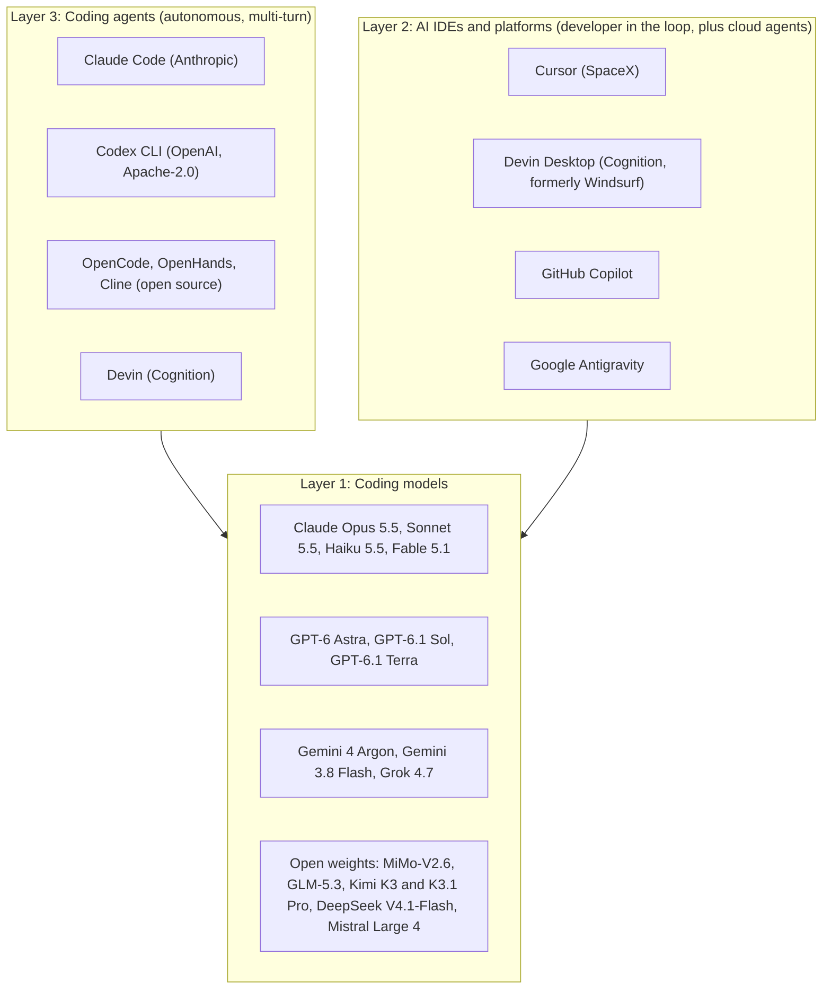

<div dir="rtl">

# پلتفرم OpenCoder: چشم‌انداز عامل‌های هوش مصنوعی کدنویسی

چشم‌انداز عامل‌های هوش مصنوعی کدنویسی ابتدا با رشدی انفجاری روبرو شد و سپس به مرحله یکپارچگی رسید. تا نوامبر ۲۰۲۶، این فضا به سه ساختار مشخص تقسیم شده است: عامل‌های ترمینال تحت پشتیبانی آزمایشگاه‌ها یا جوامع کاربری بزرگ (مانند Claude Code، Codex CLI، OpenCode، Antigravity CLI و Kiro CLI)، محیط‌های توسعه متصل به شرکت‌های سازنده مدل (Cursor از اوت ۲۰۲۶ بخشی از شرکت SpaceX شده است؛ Cognition در ژوئیه ۲۰۲۵ محیط Windsurf را خرید و در ژوئن ۲۰۲۶ آن را به Devin Desktop تغییر نام داد)، و معماری تفکیک‌شده که در آن تأمین‌کننده پلن کنترلی را اجرا می‌کند در حالی که زیرساخت شما کدهای اجرایی را میزبانی می‌نماید. این راهنما مدل‌های کدنویسی با وزن باز، محیط‌های توسعه عاملی، عامل‌های منبع‌باز، و نحوه انتخاب ابزار متناسب با جریان کاری مهندسی شما را پوشش می‌دهد.

## فهرست مطالب

- [چشم‌انداز هوش مصنوعی کدنویسی (۲۰۲۶)](#the-ai-coding-landscape-2026)
- [مدل‌های کدنویسی با وزن‌های باز](#open-weight-coding-models)
- [محیط‌های توسعه مبتنی بر هوش مصنوعی (AI-Native IDEs)](#ai-native-ides)
- [عامل‌های کدنویسی منبع‌باز](#open-source-coding-agents)
- [تحلیل عمیق بنچمارک‌ها](#benchmark-deep-dive)
- [مقایسه هزینه‌ها](#cost-comparison)
- [راهنمای انتخاب](#selection-guide)
- [معماری سیستم در محیط پروداکشن](#production-architecture)
- [پرسش‌های مصاحبه](#interview-questions)
- [منابع](#references)

---

## چشم‌انداز هوش مصنوعی کدنویسی (۲۰۲۶) <a id="the-ai-coding-landscape-2026"></a>

چشم‌انداز ابزارهای هوش مصنوعی کدنویسی دارای سه لایه متمایز است:

<div dir="ltr">



</div>

مرزهای این لایه‌ها در حال محو شدن است. سازندگان محیط‌های توسعه مدل‌های اختصاصی خود را آموزش می‌دهند (مدل Composer در Cursor، مدل SWE-2 در Cognition که طبق ادعای سازنده از پس‌آموزش Kimi K3 شکل گرفته است)، عامل‌های آزمایشگاه‌ها افزونه‌های اختصاصی IDE ارائه می‌دهند، و کلاس تجربی `HarnessAgent` در Vercel AI SDK 7 با کل مهارکننده‌های کدنویسی مانند وابستگی‌های قابل تعویض رفتار می‌کند.

---

## مدل‌های کدنویسی با وزن‌های باز <a id="open-weight-coding-models"></a>

این مدل‌ها قابلیت میزبانی اختصاصی (Self-hosted)، Fine-tuning و استقرار مستقل بدون وابستگی به APIهای ابری را دارند. با این حال، حتماً مجوز استفاده (License) را پیش از انتخاب مدل مطالعه کنید؛ زیرا در سال ۲۰۲۶ چندین مدل کدنویسی «باز» دارای شروط محدودکننده تجاری هستند.

### مرز کنونی مدل‌های باز (نوامبر ۲۰۲۶)

| مدل | تاریخ انتشار | پارامترهای کل / فعال | نوع مجوز | نکات مرتبط با کدنویسی |
|---|---|---|---|---|
| مدل‌های **Xiaomi MiMo-V2.6-Pro / -Flash** | ۲۱ سپتامبر ۲۰۲۶ | ۱.۰۲T / ۴۲B؛ ۳۰۹B / ۱۵B | مجوز MIT | پنجره زمینه ۱M؛ تا قبل از نسخه ۵.۰ در شاخص Artificial Analysis در صدر مدل‌های باز بود |
| مدل **Mistral Large 4** | انتشار وزن‌ها در ۲۹ اکتبر ۲۰۲۶ | حدود ۱T / ۴۹B (۵۲B با Embedding) | مجوز اکوسیستم منبع‌باز میسترال: **هرگونه** کسب‌وکار ارائه مدل به‌عنوان سرویس (MaaS) نیازمند مجوز تجاری مجزا بدون آستانه درآمدی است | نرخ API برابر ۰.۷۰ / ۲.۱۰ دلار در ۱M |
| مدل **Meta Muse Spark Open** | ۱۵ اکتبر ۲۰۲۶ | ۸۱۶B / ۴۲B | مجوز مدل Muse، با آستانه MaaS برای درآمد بالای ۲۰ میلیون دلار | قبل از ساخت محصول کدنویسی میزبانی‌شده روی آن، شرایط مجوز را بررسی کنید |
| مدل **Z.ai GLM-5.3** | انتشار وزن‌ها در ۲۸ اوت ۲۰۲۶ | ۷۴۴B / ۴۰B | مجوز MIT، به‌علاوه بازبینی امنیتی برای ارائه‌دهندگان MaaS با درآمد بالای ۱۰ میلیارد دلار طی ۱۲ ماه | نرخ API برابر ۱.۴۰ / ۴.۴۰ دلار در ۱M؛ امتیاز ۲۱۱ از ۲۷۲ در مجموعه خصوصی SWE-Bench Pro v2 |
| مدل **Moonshot Kimi K3.1 Pro** | انتشار وزن‌ها در ۴ نوامبر ۲۰۲۶ (نسخه API در ۲۳ اکتبر) | ۲.۸T / ۱۰۴B فعال | مجوز Kimi K3.1-Pro: یک اعطای سفارشی مشابه MIT و نه خود MIT؛ نیازمند توافق‌نامه مجزا برای کسب‌وکارهای MaaS با درآمد بالای ۲۰ میلیون دلار در ۱۲ ماه؛ درج لوگو در UI برای کاربران ماهانه بالای ۱۰۰ میلیون نفر یا درآمد ماهانه بالای ۲۰ میلیون دلار | حدود ۱.۵۶ ترابایت وزن‌های MXFP4، پنجره زمینه ۱M؛ امتیاز ۴۶ در شاخص AA نسخه ۵.۰.۱ که بالاترین امتیاز در میان مدل‌های باز است |
| مدل **Moonshot Kimi K3** | ژوئیه ۲۰۲۶ | ۲.۸T / ۱۰۴B فعال | مجوز سفارشی: توافق‌نامه مجزا برای ارائه‌دهندگان MaaS با درآمد کل بالای ۲۰ میلیون دلار طی ۱۲ ماه | امتیاز ۲۱۴ از ۲۷۲ در مجموعه خصوصی SWE-Bench Pro v2؛ مدل پایه برای Cognition SWE-2 و Fireworks Ember-1 |
| مدل **Z.ai GLM-5.3-Flash** | ۲۶ اوت ۲۰۲۶ | ۳۲۰B / ۱۸B | مجوز MIT | نرخ API برابر ۰.۱۵ / ۰.۵۰ دلار در ۱M |
| مدل **DeepSeek V4.1-Flash** | ۱۰ سپتامبر ۲۰۲۶؛ به‌روزرسانی با نسخه V4.1-Flash-1017 (۱۷ اکتبر) که اکنون سرویس‌دهنده `deepseek-flash` است | ستون فقرات ۵۵۲B؛ در پیش‌پر کردن ۸B و در کدگشایی ۱۶B فعال | مجوز MIT | گزارش ارائه‌دهنده از امتیاز ۷۴.۲ در DeepSWE v1.1 با حداکثر سطح تلاش (در انتشار اولیه) |
| مدل **Qwen3.8-Flash-Next** | ۲۶ اوت ۲۰۲۶ | ۱۲۵B / ۶B به‌علاوه یک جدول ۵۱B از n-gram | مجوز Qwen Community License 1.0 | هر کسب‌وکار MaaS یا **دستیار کدنویسی تجاری** نیازمند دریافت مجوز مجزا از Qwen بدون هیچ سقف حداقلی برای درآمد است؛ استفاده صرفاً درون‌سازمانی معاف است |
| مدل **Qwen3.8-27B** | سال ۲۰۲۶ | ۲۷B متراکم (Dense) | مجوز Apache 2.0 | مناسب رده تک کارت گرافیک GPU؛ همچنین پایه مدل Ternary Bonsai 2 27B (با ۱.۷۲ بیت به ازای هر وزن، حجم ۵.۹۵ گیگابایت) |
| مدل **IBM Granite 4.2** | ۲۵ اوت ۲۰۲۶ | مدل‌های متراکم ۳B / ۸B / ۳۰B | مجوز Apache 2.0 | پنجره زمینه ۱۲۸K (قابل ارتقا تا ۵۱۲K)؛ گزارش ارائه‌دهنده از امتیاز ۵۷ در SWE-bench Verified برای نسخه ۳۰B |
| مدل **MiMo-V2.6-Distill-Qwen-9B** | ۲۱ سپتامبر ۲۰۲۶ | ۹B | مجوز MIT | گزارش ارائه‌دهنده از کسب ۶۱.۱٪ در SWE-bench Verified و ۴۴.۶٪ در SWE-bench Pro |

**تله مجوزهای بهره‌برداری**: طبق مجوز Qwen Community License 1.0، استارتاپی که یک عامل کدنویسی تجاری را بر پایه Qwen3.8-Flash-Next ایجاد می‌کند از همان روز اول نیازمند مجوز رسمی از شرکت Alibaba است که حتی از مجوز مدل پرچمدار 2.4T خود Qwen سخت‌گیرانه‌تر است. مدل Mistral Large 4 نیز برای هر کسی که آن را به‌عنوان یک سرویس تجاری عرضه کند شرط مشابهی بدون سقف درآمدی دارد. بازبینی مجوزها را در کنار بنچمارک‌ها در چک‌لیست ارزیابی قرار دهید.

**ارزیابی شکاف هوش عمومی**: در شاخص Artificial Analysis Intelligence Index v5.0.1 (۳ نوامبر ۲۰۲۶)، مدل Kimi K3.1 Pro امتیاز ۴۶ و برترین مدلی که AA آن را منبع‌باز نامیده، یعنی DeepSeek V4.1 Flash 1017، در بالاترین سطح تلاش امتیاز ۳۳ کسب کرده است، در مقایسه با امتیاز ۵۹ برای Claude Opus 5.5 در بالاترین سطح تلاش؛ بنابراین شکاف میان ۱۳ تا ۲۶ امتیاز است. در سوی دیگر، در ارزیابی خصوصی Scale روی SWE-Bench Pro v2، مدل‌های Kimi K3 و GLM-5.3 تنها ۳ تا ۴ امتیاز با Opus 5 فاصله دارند. هر دو گزاره درست هستند: مدل‌های وزن باز در وظایف متمرکز روی مخزن بسیار به رقبا نزدیک‌اند، اما در ارزیابی‌های جامع و کلی‌تر فاصله بیشتری دارند.

### مدل‌های کوچک قدیمی‌تر که همچنان برای تکمیل کد (Completion) استفاده می‌شوند

مدل‌های رده ۲۰۲۴ همچنان برای تکمیل کد سریع با روش پر کردن در میان (Fill-In-the-Middle یا FIM) روی سخت‌افزارهای معمولی که نیازی به قابلیت‌های عاملی ندارند، محبوب هستند. امتیازات HumanEval+ در جدول زیر مستخرج از گزارش فنی Qwen2.5-Coder هستند، به جز مدل StarCoder2 که بر اساس کارت مدل Hugging Face آن ثبت شده است. این مدل‌ها در وظایف عاملی بسیار عقب‌تر از پرچمداران فعلی قرار دارند.

| مدل | تعداد پارامترها | پنجره زمینه | بنچمارک HumanEval+ | نوع مجوز |
|---|---|---|---|---|
| مدل Qwen2.5-Coder-32B-Instruct | تعداد ۳۲B | اندازه ۱۲۸K | ۸۷.۲٪ | مجوز Apache 2.0 |
| مدل Qwen2.5-Coder-7B-Instruct | تعداد ۷B | اندازه ۱۲۸K | ۸۴.۱٪ | مجوز Apache 2.0 |
| مدل Qwen2.5-Coder-1.5B-Instruct | تعداد ۱.۵B | اندازه ۳۲K | ۶۶.۵٪ | مجوز Apache 2.0 |
| مدل DeepSeek-Coder-V2-Lite-Instruct | معماری ۱۶B MoE (فعال ۲.۴B) | اندازه ۱۲۸K | ۷۵.۶٪ | مجوز DeepSeek model license |
| مدل‌های StarCoder2-15B / 7B / 3B | اندازه ۱۵B / ۷B / ۳B | اندازه ۱۶K | ۳۷.۸٪ (مدل پایه ۱۵B؛ ۶۳.۴٪ برای نسخه StarCoder2-15B-Instruct-v0.1) | مجوز BigCode OpenRAIL-M |

<div dir="ltr">

```python
# Self-hosted with vLLM (use vLLM >= 0.32.0: earlier releases, 0.30.x included,
# have published advisories; 0.32.0 also removed the default CORS wildcard)
from vllm import LLM

model = LLM(
    model="Qwen/Qwen2.5-Coder-32B-Instruct",
    tensor_parallel_size=2,  # 2× A100 80GB
)
response = model.generate("def fibonacci(n: int) -> list[int]:")
```

</div>

### راهنمای انتخاب مدل باز

<div dir="ltr">

```
Low-latency completions (< 100ms) on a laptop or single GPU?
  → Qwen2.5-Coder-1.5B/7B or StarCoder2-3B (FIM-trained, mature tooling)

Agentic coding, single GPU, permissive license?
  → Qwen3.8-27B (Apache 2.0) or Granite 4.2 30B

Agentic coding on one 8-GPU node?
  → GLM-5.3-Flash or MiMo-V2.6-Flash (MIT); DeepSeek V4.1-Flash needs H200/B200-class memory

Best self-hosted quality, multi-node budget?
  → MiMo-V2.6-Pro, GLM-5.3, Kimi K3.1 Pro or Kimi K3 (check each license gate)

Building a coding-assistant product to sell?
  → Read the license first: Qwen Community License 1.0 requires a separate license
```

</div>

---

## محیط‌های توسعه مبتنی بر هوش مصنوعی (AI-Native IDEs) <a id="ai-native-ides"></a>

### محیط توسعه Cursor

**وب‌سایت:** cursor.com | **پایه اصلی:** انشعاب از VS Code | **قیمت‌گذاری:** نسخه Pro از ۲۰ دلار در ماه، دارای پلن‌های سازمانی و تیمی

محیط Cursor پیشروترین IDE بومی هوش مصنوعی است و از اواسط اوت ۲۰۲۶ **بخشی از شرکت SpaceX** شده است (طی معامله‌ای با ارزش تخمینی ۶۰ میلیارد دلار از سهام SpaceX). مدل‌های Grok 4.6 و 4.7 در وبلاگ رسمی Cursor معرفی شدند. در ۲۸ اوت ۲۰۲۶، شرکت OpenAI به SpaceX اعلام کرد که قرارداد ارائه مدل‌های خود به Cursor را با ضرب‌الاجل قطع سرویس در **۱۲ نوامبر ۲۰۲۶** خاتمه خواهد داد و مدل‌های بعدی (شامل GPT-6 Astra) را تا زمانی که Cursor متعلق به SpaceX است ارائه نخواهد کرد.

| ویژگی | توضیحات |
|---|---|
| **عامل اختصاصی (Agent)** | ویرایش عاملی همزمان چند فایل؛ نام Composer اکنون به مدل کدنویسی اختصاصی Cursor اطلاق می‌شود |
| **تکمیل خودکار با کلید Tab** | پیش‌بینی و تکمیل هوشمند خطوط بعدی کد |
| **عامل‌های ابری (Cloud Agents)** | اجرا روی زیرساخت سرورهای Cursor یا اجرای سلف‌هاستد روی ماشین‌های سازمان (مانند AWS Lambda، Coder، Cloudflare، Daytona، Modal، Namespace، Vercel یا E2B) |
| **پروژه‌ها (Projects)** | یک عامل هماهنگ‌کننده کار را برنامه‌ریزی کرده و به صدها زیرعامل موازی تفویض می‌کند؛ طبق اعلام سازنده، کاربران قابلیت Projects حدود ۳۰٪ بیشتر PR ثبت می‌کنند |
| **استقرار و بازبینی امنیتی** | مانیتورینگ سلامت تغییرات به ازای هر محیط در زمان دیپلوی، و اسکنر امنیتی برای شناسایی باگ‌های قابل سوءاستفاده (در پلن‌های Teams و Enterprise) |
| **قوانین و دستورالعمل‌ها** | تنظیم دستورالعمل‌های پروژه در مسیر `.cursor/rules`، و پشتیبانی از فایل `AGENTS.md` |
| **تنوع مدل‌ها** | پشتیبانی از مدل‌های Anthropic، Google، xAI Grok و مدل‌های اختصاصی Cursor؛ مدل‌های OpenAI تا زمان انقضای قرارداد |

**بهترین کاربرد**: توسعه‌دهندگان فرانت‌اند و فول‌استک که ویرایش عاملی را درون یک رابط گرافیکی آشنا می‌خواهند، و تیم‌هایی که خواهان عامل‌های ابری بدون دغدغه ارکستراسیون دستی هستند.

**محدودیت‌ها**: منبع‌بسته بودن؛ ارسال کدها به سرورهای Cursor مگر با فعال‌سازی Privacy Mode و ماشین‌های سلف‌هاستد؛ و وابستگی به مارکت‌پلیس اختصاصی افزونه‌ها که در ۲۹ اکتبر ۲۰۲۶ منجر به انتشار نسخه‌های تروجان‌شده از افزونه Claude Code گردید.

### محیط توسعه Devin Desktop (متعلق به Cognition، نام پیشین Windsurf)

**مستندات:** docs.devin.ai/desktop | **پایه اصلی:** انشعاب از VS Code | **نسخه:** 3.11.238 (۳۰ اکتبر ۲۰۲۶)

محیط Windsurf توسط شرکت Codeium ساخته شد، در ژوئیه ۲۰۲۵ توسط **Cognition** (سازنده عامل Devin) خریداری گردید و در نسخه v3.0.12 (۲ ژوئن ۲۰۲۶) به **Devin Desktop** تغییر نام داد. مستنداتی که هنوز از واژه «Windsurf» استفاده می‌کنند مربوط به همین محصول هستند. شرکت Cognition مدل پرچمدار خود با نام SWE-2 را منحصراً درون Devin عرضه کرده است.

| ویژگی | توضیحات |
|---|---|
| **ویرایش عاملی (Agentic Editing)** | قابلیتی که در دوران Windsurf با نام Cascade شناخته می‌شد |
| **جریان‌های کاری مشترک (Flows)** | نشست‌های همزمان عامل و توسعه‌دهنده که در آن عامل اقدامات و ادیت‌های برنامه‌نویس را پایش می‌کند |
| **تنوع مدل‌ها** | دسترسی به مدل‌های پیشرو آزمایشگاه‌های گوناگون در کنار مدل اختصاصی Cognition |
| **یکپارچگی دوگانه** | هم محیط توسعه IDE و هم عامل خودمختار Devin از یک شرکت واحد ارائه می‌شوند |

**بهترین کاربرد**: تیم‌هایی که یک IDE پیشرفته با آزادی انتخاب مدل می‌خواهند، یا سازمان‌هایی که هم‌اکنون از عامل مستقل Devin استفاده می‌کنند و مایلند IDE یکپارچه با آن داشته باشند.

<a id="github-copilot-microsoftopenai"></a>

### سرویس GitHub Copilot (متعلق به Microsoft/OpenAI)

| ویژگی | وضعیت (نوامبر ۲۰۲۶) |
|---|---|
| تکمیل کد | همچنان پیشتاز بازار از نظر تعداد کاربران نصب‌شده |
| عامل کدنویسی | ارجاع دادن ایشو و دریافت خودکار Pull Request |
| تأییدیه‌های بازبینی کد | عرضه عمومی در ۲۸ اکتبر ۲۰۲۶: در صورت فعال‌سازی مدیر، تأییدهای Copilot جزو تأییدیه‌های الزامی شمرده می‌شوند؛ همچنین حالت بازبینی Max (پیش‌نمایش عمومی) چندین عامل مستقل از تأمین‌کنندگان مختلف را برای بررسی کد اجرا می‌کند |
| جریان‌های کاری عاملی (Agentic Workflows) | عرضه عمومی در ۲۸ اکتبر ۲۰۲۶ روی گیت‌هاب: اتوماسیون‌های مارک‌داون به اکشن‌های گیت‌هاب کامپایل شده و در کانتینر ایزوله درون فایروال اجرا می‌شوند |
| مجوزهای کمکی (Assisted Permissions) | مدل LLM به‌صورت خودکار دستورات، مسیرهای فایل و URLهای کاملاً امن را تأیید کرده و برای موارد مشکوک سؤال می‌پرسد |
| کاربری کامپیوتر و جریان‌های پویا | پیش‌نمایش عمومی از ۱ اکتبر ۲۰۲۶ در ابزار و کلاینت Copilot |
| قابلیت Copilot Fusion | عرضه عمومی در ۲۸ اکتبر ۲۰۲۶: مسیریابی وظایف میان مدل‌های مختلف با سطوح تلاش Standard، High و Max در قالب جریان‌های Single، Cascade یا Critique |
| سندباکس محلی | اعمال محدودیت‌های فایل‌سیستم، شبکه و کلیدهای محرمانه درون اپلیکیشن Copilot (پیش‌نمایش عمومی، پیش‌فرض خاموش) |
| تنوع مدل‌ها | انتخاب خودکار مدل با رده‌های کارایی، تعادل و هوشمندی؛ مدل‌های OpenAI، Anthropic و گوگل |
| قابلیت‌های سازمانی | حفاظت از مالکیت فکری، سیاست‌های سازمانی، و کنترل ارجاع به کدهای منبع‌باز |

**بهترین کاربرد**: سازمان‌های بزرگ و تیم‌های سازمانی که بر بستر اکوسیستم مایکروسافت و گیت‌هاب فعالیت می‌کنند.

### پلتفرم Google Antigravity

پلتفرم Antigravity بستر توسعه عاملی گوگل است؛ یک **محیط کاری عامل‌محور** به جای یک ویرایشگر متن سنتی. نسخه Antigravity 2.0 (۱۹ مه ۲۰۲۶) این سیستم را به یک خانواده محصول تبدیل کرد: اپلیکیشن دسکتاپ برای هماهنگی چند عامل محلی، محیط IDE، ابزار **Antigravity CLI** و یک کیت SDK جامع.

| ویژگی | جزئیات |
|---|---|
| **مدیر عامل‌ها (Agent Manager)** | نمای اختصاصی برای راه‌اندازی، رصد و هدایت همزمان چندین عامل کدنویسی غیرهمزمان به جای ویرایش تک‌تک فایل‌ها |
| **برنامه‌ریزی و آرتیفکت‌ها** | عامل‌ها پیش از اجرا و در حین کار، یک برنامه کاری و آرتیفکت‌های قابل بازبینی (دیف‌ها، لیست تسک‌ها، نشست‌های زنده مرورگر) تولید می‌کنند |
| **مرورگر داخلی** | عامل‌ها می‌توانند رابط‌های کاربری ساخته‌شده را مستقیماً درون مرورگر اجرا کرده و تست بصری بگیرند |
| **انتخاب مدل** | استفاده از مدل‌های Gemini به‌صورت پیش‌فرض، همراه با پشتیبانی از Claude و مدل‌های وزن باز |
| **قابلیت‌های سازمانی** | ارائه در اشتراک‌های Gemini Enterprise همراه با کنترل‌های سندباکس، سقف بودجه، و لاگ‌های حسابرسی مرکزی |
| **عامل API** | نسخه پیش‌نمایش جدید با نام `antigravity-preview-09-2026` جایگزین نسخه قبلی شد و ابزارهای جدید و ویرایش محدوده‌ای سطرها را معرفی کرد |

گوگل ابزار Antigravity CLI را به‌عنوان جانشین رسمی Gemini CLI معرفی کرده است؛ این ابزار در ۱۸ ژوئن ۲۰۲۶ جایگزین Gemini CLI برای کاربران نسخه‌های رایگان، Pro و Ultra شد. همچنین گوگل در حال خاموش کردن **Jules** (عامل کدنویسی ابری غیرهمزمان) است و به کاربران توصیه شده کارهای خود را به Antigravity منتقل کنند.

**بهترین کاربرد**: توسعه‌دهندگانی که می‌خواهند به جای سطح «ویرایش کد»، در سطح «تعریف هدف و وظیفه» کار کنند، و سازمان‌های مبتنی بر گوگل کلود.

<a id="kiro-aws"></a>

### ابزار Kiro (متعلق به AWS)

ابزار Kiro محیط توسعه و خط فرمان عاملی شرکت آمازون است. نسخه **Kiro CLI 3.0.0** (۳ نوامبر ۲۰۲۶) مهارکننده نسخه ۳ را به‌صورت پیش‌فرض برای نشست‌های تعاملی و اسکریپت‌های دارای آرگومان `--trust-all-tools` قرار داد. قابلیت V3 دستور `/autonomous on` را اضافه کرده که کارهای درون سندباکس را بدون تأیید نوبتی اجرا می‌کند.

---

## عامل‌های کدنویسی منبع‌باز <a id="open-source-coding-agents"></a>

### ابزار OpenCode

**مخزن گیت‌هاب:** github.com/anomalyco/opencode | **نوع مجوز:** MIT

محبوب‌ترین عامل کدنویسی منبع‌باز با بیش از ۲۲۴ هزار ستاره در گیت‌هاب و حدود ۱۵ میلیون دانلود در ماه اکتبر. این ابزار ترمینال دارای یک رابط متنی (TUI) است که با تمامی ارائه‌دهندگان مدل، از جمله مدل‌های محلی کار می‌کند و از سرورهای MCP پشتیبانی می‌نماید. این ابزار پاسخ استاندارد برای «معادل منبع‌باز Claude Code با آزادی در انتخاب مدل» به شمار می‌رود.

### ابزار Codex CLI (متعلق به OpenAI)

**مخزن گیت‌هاب:** github.com/openai/codex | **نوع مجوز:** Apache-2.0

عامل خط فرمان منبع‌باز شرکت OpenAI (با بیش از ۱۳۳ هزار ستاره در گیت‌هاب؛ نسخه بر پایه راست rust-v0.166.0 در ۲۹ اکتبر؛ بیش از ۸۲ میلیون دانلود ماهانه در npm). نکات کلیدی سال ۲۰۲۶:

- **مدل پیش‌فرض**: مدل GPT-6.1 Sol از نسخه rust-v0.159.1 مدل پیش‌فرض شد.
- **امکانات جدید**: محیط‌های ابری با قابلیت استفاده مجدد، نمای `/agents` برای وظایف موازی، بازبینی خودکار کد در PRهای گیت‌هاب و GitLab، و رده **Ultrafast** برای تولید بسیار سریع‌تر کد.
- **اصلاحات امنیتی**: پچ‌های امنیتی آسیب‌پذیری‌های GitSpawn و Plugin4Shell در نسخه‌های اخیر.
- **اجرای بدون واسط**: استفاده از دستور `codex exec` برای پایپ‌لاین‌های CI.

<a id="openhands-formerly-opendevin"></a>

### پلتفرم OpenHands (نام پیشین OpenDevin)

**مخزن گیت‌هاب:** github.com/OpenHands/OpenHands | **نوع مجوز:** MIT

پلتفرم OpenHands از نسخه v1.24.0 (۲۵ سپتامبر ۲۰۲۶) تحت عنوان **Agent Canvas** عرضه می‌شود: یک مرکز کنترل سلف‌هاستد که عامل منبع‌باز OpenHands یا هر عامل سازگار با پروتکل Agent Client Protocol (مانند Claude Code، Codex، Gemini) را روی بک‌اندهای مختلف اجرا می‌کند.

<div dir="ltr">

```bash
# Docker sandbox option from the upstream README (pin the tag you tested)
export PROJECTS_PATH="$HOME/projects"   # only these folders are visible to the agent
mkdir -p "$PROJECTS_PATH" "$HOME/.openhands"
docker run -it --rm \
  -p 127.0.0.1:8000:8000 \
  -e AGENT_CANVAS_ALLOW_LAN_SESSION_KEY=true \
  -v "$HOME/.openhands:/home/openhands/.openhands" \
  -v "${PROJECTS_PATH}:/projects" \
  ghcr.io/openhands/agent-canvas:1.24.0
# UI at http://localhost:8000/canvas; models are configured as LLM profiles in the UI.
# Publish only on 127.0.0.1: on a LAN or public interface, drop the session-key
# injection flag and follow the upstream self-hosting hardening guide.
```

</div>

**معماری سیستم:**

<div dir="ltr">

```
Agent Canvas (web UI, automations: schedules, webhooks, Slack, GitHub, Linear)
    ↓
Agent Server (OpenHands SDK)
    ├── OpenHands agent, or an ACP agent (Claude Code, Codex, Gemini)
    └── Backend: local process, Docker (one container per conversation),
        a VM, or OpenHands Cloud / Enterprise
```

</div>

**ویژگی‌های شاخص:**
- **پشتیبانی از هر مدل دلخواه**: پروفایل‌های LLM از Claude، GPT، Gemini و مدل‌های وزن باز پشتیبانی می‌کنند
- **بک‌اندهای اجرای قابل تعویض**: هدایت عامل‌ها روی سیستم محلی، درون کانتینرهای داکر مجزا، یا روی سرورهای اشتراکی
- **اتوماسیون‌ها**: اجرای برنامه‌ریزی‌شده یا تریگرشده با وب‌هوک برای ادغام در CI

### ابزار Aider (پروژه قدیمی)

**مخزن گیت‌هاب:** github.com/Aider-AI/aider | **نوع مجوز:** Apache 2.0

ابزار Aider پیشگام عامل‌های کدنویسی مبتنی بر ترمینال و سازگار با ساختار گیت بود. با این حال این پروژه اکنون به حالت غیرفعال درآمده است و آخرین نسخه رسمی آن در فوریه ۲۰۲۶ عرضه شد. از آنجا که مهارکننده آن برای محدودیت‌های API مدل‌های جدید (مانند رد کردن پارامترهای سفارشی sampling در Claude و GPT-6) به‌روزرسانی نشده، برای پروژه‌های جدید استفاده از OpenCode یا Codex CLI توصیه می‌شود.

<div dir="ltr">

```bash
# 2025-era usage, shown for its git-native workflow; claude-3-7-sonnet-20250219
# was retired Feb 19, 2026, and current Claude models may reject the sampling
# parameters Aider sends
pip install aider-chat
aider --model claude-3-7-sonnet-20250219
/add src/auth.py src/models.py
> Add JWT authentication to the User model
```

</div>

### افزونه Cline (برای VS Code)

**مخزن گیت‌هاب:** github.com/cline/cline | **نوع مجوز:** Apache 2.0

افزونه منبع‌باز VS Code برای کدنویسی عاملی (با بیش از ۷۱ هزار ستاره در گیت‌هاب) همراه با یک SDK برای تعبیه در سایر محیط‌ها:

<div dir="ltr">

```
VS Code
  └── Cline Extension
        ├── Any model (Claude, GPT, Gemini, Ollama)
        ├── File system access (read/write any file)
        ├── Terminal (bash commands)
        ├── Browser (playwright)
        └── MCP servers (any MCP tool)
```

</div>

**نقاط تمایز کلیدی:**
- **پشتیبانی بومی از MCP**: یکپارچگی کامل با ابزارهای استاندارد پروتکل کانتکست مدل
- **مجوزدهی برای هر اقدام**: درخواست تأیید برای دستورات شل و ویرایش فایل‌ها به‌صورت پیش‌فرض
- **انعطاف‌پذیری مدل‌ها**: اتصال به هر اندپوینت سازگار با فرمت OpenAI (شامل سرورهای محلی Ollama)
- **کاملاً رایگان و منبع‌باز**: بدون هزینه اشتراک (صرفاً پرداخت هزینه مصرف API به ارائه‌دهنده)

---

## تحلیل عمیق بنچمارک‌ها <a id="benchmark-deep-dive"></a>

### بنچمارک‌های جاری حوزه کدنویسی

بنچمارک SWE-bench Verified دیگر قادر به تمایز میان عامل‌های پیشرو نیست؛ نمرات همگی در نزدیکی سقف اشباع شده‌اند و ممیزی‌های رسمی نشان داده‌اند بخش قابل توجهی از موفقیت‌ها ناشی از وجود راه‌حل‌ها در تاریخچه گیت مخازن بوده است. همواره نمرات را همراه با سطح تلاش و مرجع اجراکننده ارزیابی کنید:

| بنچمارک | نتایج | اجراکننده | دلیل اهمیت |
|---|---|---|---|
| نسخه SWE-Bench Pro v2 (مجموعه خصوصی ۲۷۲ وظیفه) | مدل Claude Opus 5 امتیاز ۲۲۲ (۸۱.۶٪)، Kimi K3 امتیاز ۲۱۴ (۷۸.۷٪)، GLM-5.3 امتیاز ۲۱۱، Gemini 3.8 Flash امتیاز ۲۱۱ | مؤسسه Scale (۲۲ سپتامبر ۲۰۲۶)، سندباکس بدون شبکه، ارزیابی مجدد دقیق | اندازه‌گیری سالم؛ مدل‌های متن‌باز Kimi K3 و GLM-5.3 تنها ۳ تا ۴ امتیاز با Opus 5 فاصله دارند |
| بنچمارک Terminal-Bench 4.0 | مدل‌های Claude Opus 5.5 با ۶۴.۸۵٪، Claude Sonnet 5.5 با ۶۱.۸۲٪، GPT-6 Astra و GPT-6.1 Sol هر دو با ۵۸.۱۸٪، و Claude Fable 5.1 با ۵۷.۸۸٪ (همگی در بالاترین سطح تلاش) | جدول رده‌بندی tbench.ai؛ ثبت در ۶ اکتبر | مدل GPT-6.1 Sol با هزینه حدود ۶۳۴ دلار عملکردی معادل Astra با هزینه ۳.۳ هزار دلار ارائه داده است |
| بنچمارک DeepSWE v1.1 (۱۱۳ وظیفه اختصاصی) | تساوی سه‌گانه در ۷۴٪: مدل‌های GPT-6 Astra (سطح xhigh با ۴.۴۳ دلار به ازای وظیفه)، Gemini 3.8 Flash (سطح high با ۲.۳۶ دلار)، و Opus 5 (سطح max با ۱۱.۸۴ دلار) | جدول رده‌بندی DeepSWE، ۲۲ سپتامبر | درصد موفقیت کاملاً برابر با اختلاف ۵ برابری در هزینه نهایی |

> [!NOTE]
> نتایج به‌شدت به مدل پایه، سطح تلاش و مهارکننده اجرایی وابسته‌اند. یک مدل یکسان می‌تواند در Claude Code، Codex، OpenHands یا یک مهارکننده حداقلی چندین امتیاز جابه‌جا شود؛ بنابراین عامل‌ها را با انضباط آزمایشگاهی روی مخازن سازمانی خود ارزیابی کنید.

### سوابق تاریخی: HumanEval+ و LiveCodeBench (داده‌های ۲۰۲۵)

این دو بنچمارک از معیارهای ارزیابی خط مقدم بازنشسته شده‌اند، اما به‌عنوان نقطه مرجع تاریخی حفظ می‌شوند:

| مدل | امتیاز HumanEval+ |
|---|---|
| مدل Claude 3.7 Sonnet | ۹۳.۶٪ |
| مدل GPT-4o (2024-08-06) | ۸۶.۰٪ |
| مدل Qwen2.5-Coder-32B-Instruct | ۸۷.۲٪ |
| مدل DeepSeek-Coder-V2-Instruct | ۸۲.۳٪ |
| مدل StarCoder2-15B | ۳۷.۸٪ |

| مدل | امتیاز LiveCodeBench |
|---|---|
| مدل o3 (سطح تلاش high) | ۶۸.۱٪ |
| مدل Claude 3.7 Sonnet | ۵۴.۲٪ |
| مدل GPT-4.5 | ۳۸.۷٪ |
| مدل Qwen2.5-Coder-32B | ۴۳.۲٪ |
| مدل DeepSeek-R1 | ۵۷.۰٪ |

---

## مقایسه هزینه‌ها <a id="cost-comparison"></a>

### سرویس‌های API بسته در برابر میزبانی باز اختصاصی

**سناریو: ۱٬۰۰۰ وظیفه رفع باگ عاملی در روز.** به ازای هر وظیفه: حدود ۱۵ فراخوانی مدل، ۷۵۰ هزار توکن ورودی (عمدتاً زمینه بازارسالی، با ۹۰٪ کش هیت)، و ۲.۵ هزار توکن خروجی. مقادیر زیر برآوردهای تخمینی طبق قیمت‌های رسمی است؛ کیفیت بر مبنای Artificial Analysis Index v5.0 سنجیده شده است.

| رویکرد | هزینه به ازای هر وظیفه | هزینه ماهانه (۳۰ روز) | شاخص AA Index v5.0 | توضیحات |
|---|---|---|---|---|
| مدل Claude Sonnet 5.5 (از طریق API) | حدود ۰.۲۸ دلار | حدود ۸٬۴۰۰ دلار | ۵۴ | هزینه خواندن کش ۰.۱۰ دلار در ۱M از تاریخ ۷ اکتبر |
| مدل Claude Opus 5.5 (از طریق API) | حدود ۰.۵۶ دلار | حدود ۱۶٬۸۰۰ دلار | ۵۸ | تمامی نرخ‌ها دقیقاً ۲ برابر Sonnet است |
| مدل GPT-6.1 Sol (از طریق API) | حدود ۰.۲۸ دلار | حدود ۸٬۴۰۰ دلار | ۵۵ | هزینه خواندن کش ۰.۱۰ دلار در ۱M؛ هم‌قیمت با Sonnet 5.5 در این بار کاری |
| مدل GPT-6 Astra (از طریق API) | حدود ۱.۷۴ دلار | حدود ۵۲٬۰۰۰ دلار | ۵۷ | هزینه خواندن کش ۱ دلار در ۱M؛ توصیه به اختصاص برای پیچیده‌ترین تسک‌ها |
| مدل DeepSeek V4.1-Flash (از طریق API، اوج مصرف) | حدود ۰.۲۳ دلار | حدود ۶٬۹۰۰ دلار | ۳۲ (در نسخه ۵.۰) | در ساعات کم‌مصرف نصف قیمت محاسبه می‌شود |
| میزبانی اختصاصی GLM-5.3-Flash (روی یک گره ۸ کارت H100 به‌صورت شبانه‌روزی) | وابسته به میزان اشغال | حدود ۱۶٬۹۰۰ دلار هزینه سرور | ۲۸ | بدون احتساب زمان مهندسی، نگهداری و آن‌کال |

**بینش‌های کلیدی**:
- در کدنویسی عاملی، **توکن‌های ورودی حاکم بر هزینه‌اند**؛ بنابراین قیمت خواندن کش و نرخ اصابت کش بسیار مؤثرتر از قیمت اعلامی توکن‌های ورودی اولیه هستند.
- میزبانی محلی (Self-hosting) تنها در شرایطی صرفه اقتصادی دارد که استفاده پایدار و پیوسته در سقف ظرفیت وجود داشته باشد. دلایل اصلی استقرار محلی امروزه بیشتر متمرکز بر حاکمیت داده، فاین‌تیونینگ روی کدهای محرمانه سازمانی، و استقلال از ارائه‌دهندگان ابری است.

---

## راهنمای انتخاب <a id="selection-guide"></a>

### درخت تصمیم‌گیری سریع

<div dir="ltr">

```
What is your primary need?

├─ IDE coding assistance (completions + chat + agent)?
│  ├─ Microsoft ecosystem / enterprise? → GitHub Copilot
│  ├─ Want best quality and cloud agents? → Cursor
│  └─ Want free + model choice? → Cline (Devin Desktop for a full IDE with model choice)
│
├─ Autonomous agent for standalone coding tasks?
│  ├─ Best quality, Claude models acceptable? → Claude Code
│  ├─ OpenAI shop, or want an open-source CLI from a lab? → Codex CLI
│  ├─ Need open source with any model? → OpenCode (terminal) or OpenHands (web UI)
│  └─ VS Code embedded, MCP-native? → Cline
│
├─ Self-hosted model for custom deployment?
│  ├─ Best quality? → MiMo-V2.6-Pro, GLM-5.3, Kimi K3.1 Pro or Kimi K3 (check licenses)
│  ├─ One node? → GLM-5.3-Flash or MiMo-V2.6-Flash
│  ├─ Single GPU, Apache 2.0? → Qwen3.8-27B or Granite 4.2 30B
│  └─ Fast completions / edge? → Qwen2.5-Coder-1.5B/7B or StarCoder2-3B
│
└─ CI/CD pipeline integration?
   ├─ Best results? → Claude Agent SDK or `claude -p` (headless), `codex exec`
   ├─ Open-source? → OpenHands automations (webhook-triggered) or OpenCode
   └─ Managed loop? → OpenAI Agents API or Claude Managed Agents (both still beta; check residency and ZDR)
```

</div>

### ماتریس مقایسه ابزارها

| ابعاد | ابزار Claude Code | ابزار Codex CLI | محیط Cursor | ابزار OpenCode | پلتفرم OpenHands | افزونه Cline |
|---|---|---|---|---|---|---|
| **سطح خودمختاری** | کامل | کامل | کامل (حالت عاملی) | کامل | کامل | کامل |
| **قفل بودن مدل** | انحصاری Claude | پیش‌فرض OpenAI | پشتیبانی از انواع مدل‌ها | پشتیبانی از انواع مدل‌ها | پشتیبانی از انواع مدل‌ها | پشتیبانی از انواع مدل‌ها |
| **منبع‌باز بودن** | خیر | بله | خیر | بله | بله | بله |
| **قابلیت اجرا در CI / بدون واسط** | بله | بله | عامل‌های ابری | بله | بله | بله (از طریق SDK) |
| **رابط کاربری** | خط فرمان، افزونه IDE، دسکتاپ | خط فرمان، افزونه IDE، ابر | محیط کامل IDE | ترمینال متنی (TUI) | تحت وب | افزونه VS Code |
| **پشتیبانی از MCP** | بله | بله | بله | بله | بله | بله |
| **اجرای سلف‌هاستد** | بله (از طریق self-hosted runner) | بله | بله (از طریق Self-hosted Machines) | بله | بله | بله |
| **مدل هزینه** | اشتراک ماهانه یا API | اشتراک ماهانه یا API | از ۲۰ دلار در ماه | رایگان + هزینه API | رایگان + هزینه API | رایگان + هزینه API |

---

## معماری سیستم در محیط پروداکشن <a id="production-architecture"></a>

### پلتفرم عامل‌های کدنویسی در سطح سازمان

در ادامه نحوه ساخت یک پلتفرم داخلی عامل‌های کدنویسی هوش مصنوعی نمایش داده شده است. ساختار استاندارد در سال ۲۰۲۶ مبتنی بر **تفکیک دو صفحه کنترلی و اجرایی (Split Plane)** است: تأمین‌کننده عامل برنامه‌ریزی و فراخوانی مدل‌ها را هدایت می‌کند، در حالی که اجرا، مدیریت اعتبارنامه‌ها و شبکه درون مرز امن سازمان شما باقی می‌ماند.

<div dir="ltr">

```
┌────────────────────────────────────────────────────────────┐
│             ENTERPRISE CODING AGENT PLATFORM               │
├────────────────────────────────────────────────────────────┤
│                                                            │
│  Developer                                                 │
│     ↓ (Jira ticket / PR description)                       │
│  ┌──────────────────────────────────┐                      │
│  │        TASK INTAKE LAYER         │                      │
│  │  • Parse task from Jira/GitHub   │                      │
│  │  • Classify: simple/complex      │                      │
│  │  • Route to model tier + budget  │                      │
│  └──────────────┬───────────────────┘                      │
│                 │                                          │
│    Simple fix   │   Complex feature                        │
│        ↓        │        ↓                                 │
│  ┌──────────┐   │  ┌──────────────────┐                    │
│  │ Mid-tier │   │  │ Frontier model,  │                    │
│  │  model   │   └→ │ same harness     │                    │
│  └────┬─────┘      └────────┬─────────┘                    │
│       │                     │                              │
│       └──────────┬──────────┘                              │
│                  ↓                                         │
│  ┌──────────────────────────────────┐                      │
│  │   EXECUTION PLANE (your infra)   │                      │
│  │  • Container/microVM per task    │                      │
│  │  • Egress allowlist, no prod keys│                      │
│  └──────────────┬───────────────────┘                      │
│                 ↓                                          │
│  ┌──────────────────────────────────┐                      │
│  │         REVIEW LAYER             │                      │
│  │  • Git diff → PR creation        │                      │
│  │  • Auto-run CI tests             │                      │
│  │  • Human review (required)       │                      │
│  └──────────────────────────────────┘                      │
│                 ↓                                          │
│         Merge to main (human approved)                     │
│                                                            │
└────────────────────────────────────────────────────────────┘
```

</div>

### تصمیمات کلیدی در محیط پروداکشن

| تصمیم | گزینه‌ها | توصیه پیشنهادی |
|---|---|---|
| **مدل مناسب برای عامل** | مدل‌های Claude Opus 5.5 / Sonnet 5.5، GPT-6.1 Sol، GPT-6 Astra، مدل‌های باز (GLM-5.3، Kimi K3.1 Pro، Kimi K3، MiMo-V2.6) | قفل کردن یک مدل به ازای هر دسته وظیفه (برای نمونه Sonnet 5.5 یا GPT-6.1 Sol به‌صورت پیش‌فرض، و مدل‌های پیشرو برای وظایف دشوار) و اجرای مجدد آزمون‌های ارزیابی با انتشار هر نسخه جدید |
| **ورود وظایف (Task Intake)** | دستی، وب‌هوک جیرا، لیبل‌های گیت‌هاب | لیبل گیت‌هاب که ورک‌فلوی Actions را تریگر کند |
| **اجرای کد** | محلی، داکر، میکرو ماشین مجازی، رانر سلف‌هاستد | کانتینر یا میکرو ماشین مجازی درون محیط امن سازمان همراه با لیست مجاز ترافیک خروجی |
| **بازبینی انسانی** | پول ریکوئست (PR)، تأیید در اسلک، خودکار | بازبینی انسانی اجباری برای PR، هرگز به‌صورت ادغام خودکار انجام نشود؛ تأییدیه‌های عامل‌ها نباید جایگزین بازبینی‌های الزامی شوند |
| **کنترل هزینه‌ها** | سقف نوبت‌ها، بودجه، مسیریابی مدل، کشینگ | سقف نوبت و بودجه مالی به ازای هر تسک، هشدارهای نرخ اصابت کش، استفاده از مدل‌های ارزان‌تر برای کارهای ساده |
| **سیاست مدیریت نسخه‌ها** | شناور، قفل‌شده، قفل‌شده با حداقل مجاز | قفل کردن نسخه‌های CLI عامل‌ها با رعایت کف امنیتی نسخه (برای نمونه Claude Code نسخه 2.1.292 به بالا و Codex نسخه 0.146.0 به بالا که پچ‌های GitSpawn و Plugin4Shell را شامل می‌شوند) |

---

## پرسش‌های مصاحبه <a id="interview-questions"></a>

### پرسش: چگونه بین Claude Code، Cursor و OpenHands انتخاب می‌کنید؟

**پاسخ قوی:**
این تصمیم بر اساس سه محور اصلی اتخاذ می‌شود:
۱. **نیاز به رابط کاربری**: اگر توسعه‌دهندگان نیازمند محیط دیداری و مشاهده تغییرات درون متن کد هستند، Cursor یا Devin Desktop مناسب‌ترین گزینه‌ها هستند. اما اگر وظیفه به‌صورت اسکریپت‌شده، دسته‌ای یا بدون واسط در خطوط لوله CI انجام می‌گیرد (مانند رفع خودکار باگ یا تولید تست)، ابزارهای Claude Code، Codex CLI یا OpenHands انتخاب اول خواهند بود.
۲. **کنترل و انتخاب مدل**: اگر آزادی کامل در اتصال هر مدلی (یا مدل‌های فاین‌تیون‌شده سازمانی) مد نظر باشد، ابزارهای OpenCode یا OpenHands راه‌حل هستند. اگر تمرکز روی بهترین خروجی خانواده Claude باشد، Claude Code و برای اکوسیستم OpenAI، ابزار Codex CLI برتری دارند.
۳. **الزامات امنیتی و منبع‌باز بودن**: تیم‌های امنیت سازمانی معمولاً خواستار ابزارهایی هستند که کدهای آن قابل ممیزی باشد؛ در این حالت OpenCode (مجوز MIT)، OpenHands (مجوز MIT) و Codex CLI (مجوز Apache-2.0) اولویت دارند. مالکیت پلتفرم‌ها نیز اکنون بخشی از ارزیابی است: Cursor بخشی از SpaceX است و OpenAI در حال خاتمه دادن به ارائه مدل‌های خود به آن است. بنابراین من قراردادهای سطح دسترسی را بررسی کرده و لایه مسیریابی مدل‌های خودکار را تحت کنترل مستقیم تیم خودمان نگه می‌دارم.

برای یک شرکت رو به رشد، ترکیب استاندارد عبارت است از: Cursor برای توسعه روزمره برنامه‌نویسان، Claude Code یا Codex برای کارهای دسته‌ای متصل به ایشوها، و OpenHands یا OpenCode برای خطوط لوله مستقل CI.

### پرسش: چرا مدل‌های کدنویسی با وزن‌های باز (Open-Weight) برای شرکت‌ها و سازمان‌های بزرگ اهمیت دارند؟

**پاسخ قوی:**
به سه دلیل بنیادین:
۱. **حاکمیت و محرمانگی داده‌ها**: اگرچه APIهای تجاری تعهد به عدم آموزش روی داده‌ها و حذف لاگ‌ها ارائه می‌دهند، اما در صنایعی مانند سلامت (HIPAA)، بانکداری و بخش‌های دفاعی، خروج کدهای اختصاصی از شبکه سازمان طبق مقررات ممنوع است. استقرار مدل‌های وزن باز در مراکز داده داخلی این الزام را برطرف می‌سازد.
۲. **شخصی‌سازی و فاین‌تیونینگ**: مدل‌های باز قابلیت آموزش تخصصی روی فریم‌ورک‌های اختصاصی و پایگاه کدهای داخلی را دارند. با توجه به محدود شدن ابزارهای فاین‌تیونینگ سلف‌سرویس در OpenAI، خطوط لوله مبتنی بر مدل‌های باز بر بستر زیرساخت‌های سرور اختصاصی اهمیت بیشتری یافته‌اند.
۳. **استقلال و پایداری عملیاتی**: عدم تأثیرپذیری از تغییرات ناگهانی و ناخواسته مدل‌ها توسط ارائه‌دهندگان ابری، و استقلال از جدول زمانی بازنشستگی آن‌ها.

شکاف کیفی در تسک‌های مبتنی بر مخزن کد به‌شدت باریک شده است: در آزمون خصوصی Scale روی SWE-Bench Pro v2، مدل‌های Kimi K3 (۷۸.۷٪) و GLM-5.3 (۷۷.۶٪) تنها ۳ تا ۴ درصد با Claude Opus 5 (۸۱.۶٪) فاصله دارند. با این حال، در ارزیابی‌های مفهومی و عمومی گسترده‌تر این شکاف همچنان ملموس است، بنابراین ارزیابی بر اساس بار کاری واقعی سازمان پیش‌نیاز تصمیم‌گیری است.

### پرسش: استراتژی تست و آزمون را برای یک عامل کدنویسی هوش مصنوعی در CI چگونه طراحی می‌کنید؟

**پاسخ قوی:**
من از یک ساختار ارزیابی سه سطحی استفاده می‌کنم:
۱. **آزمون‌های کارکردی (Functional Tests - خودکار در هر اجرا)**:

<div dir="ltr">

```
Agent output → Run pytest → Pass rate metric
```

</div>

۲. **مقایسه با حقیقت زمینه‌ای (Ground Truth - به‌صورت هفتگی)**:

<div dir="ltr">

```
Known bug → Agent fix → Compare to expert fix
Metric: Semantic similarity of diff (not byte-exact)
```

</div>

۳. **ارزیابی انسانی (Human Evaluation - نمونه‌گیری ۵ درصدی از PRها)**:

<div dir="ltr">

```
Senior engineer rates: Correctness, Style, Safety, 1-5 scale
```

</div>

علاوه بر این، **نرخ پسرفت (Regression Rate)** رصد می‌شود: اگر اقدام عامل باعث شکست خوردن تستی شود که پیش‌تر موفق بوده، اجرا متوقف می‌گردد. همچنین محیط تست مانند بنچمارک SWE-Bench Pro v2 ایزوله می‌شود: سندباکس به جز اندپوینت مدل هیچ دسترسی به اینترنت ندارد، تاریخچه گیت منتهی به راه‌حل پاکسازی می‌شود، و دیف نهایی روی یک ایمیج کاملاً خام و پاک ارزیابی می‌گردد تا از کشف متقلبانه پاسخ‌ها توسط عامل جلوگیری شود.

### پرسش: گیت‌هاب اکنون به تأییدیه‌های بازبینی کد Copilot اجازه می‌دهد جزو بازبینی‌های الزامی محاسبه شوند. آیا این قابلیت را فعال می‌کنید؟

**پاسخ قوی:**
تنها در یک دامنه بسیار محدود و محافظه‌کارانه. این قابلیت به مدیران اجازه می‌دهد مشخص کنند Copilot کدام مسیرهای فایل را می‌تواند تأیید کند. من آن را صرفاً برای مسیرهای کم‌ریسک (مانند اصلاحات مستندات، کلاینت‌های تولیدشده خودکار، یا تغییرات صرفاً در تست‌ها) مجاز می‌دانم تا بار بازبینی تکراری را کاهش دهد؛ اما برای بخش‌های زیرساختی، احراز هویت، درگاه‌های پرداخت، فایل‌های CI و فایل‌های راهنمای خود عامل‌ها آن را مسدود می‌کنم. اصل تخطی‌ناپذیر، **تفکیک وظایف (Separation of Duties)** است: یک Pull Request ایجادشده توسط یک عامل هوش مصنوعی هرگز نباید صرفاً توسط یک عامل هوش مصنوعی دیگر تأیید و ادغام شود؛ زیرا همان نقاط کوری که باگ را تولید کرده‌اند ممکن است منجر به تأیید اشتباه آن نیز بشوند.

---

## منابع <a id="references"></a>

- مستندات Scale. بنچمارک کدنویسی SWE-Bench Pro v2 (سپتامبر ۲۰۲۶): https://scale.com/leaderboard
- جدول رده‌بندی بنچمارک ترمینال Terminal-Bench: https://www.tbench.ai/
- مقاله arXiv 2609.34262. روش‌های حفظ بنچمارک‌ها در برابر دور زدن عامل‌ها: شناسایی و مقابله با موفقیت‌های غیرواقعی (سپتامبر ۲۰۲۶): https://arxiv.org/abs/2609.34262
- مخزن پروژه OpenCode: https://github.com/anomalyco/opencode
- مخزن ابزار Codex CLI: https://github.com/openai/codex
- مخزن ابزار Gemini CLI: https://github.com/google-gemini/gemini-cli
- مستندات Google. معرفی پلتفرم Google Antigravity CLI: https://antigravity.google/blog/introducing-google-antigravity-cli
- مستندات Cursor. پیوستن Cursor به شرکت SpaceX (اوت ۲۰۲۶): https://cursor.com/blog/joining-spacex
- بیانیه رسمی OpenAI. تصمیم‌گیری پیرامون Cursor پس از تصاحب توسط SpaceX (۲۸ اوت ۲۰۲۶): https://openai.com/index/our-decision-on-cursor-following-its-acquisition-by-spacex/
- مستندات GitHub. بازبینی کد با Copilot: ادغام مطمئن با حالت Max و تأییدیه‌های الزامی (۲۸ اکتبر ۲۰۲۶): https://github.blog/changelog/2026-10-28-copilot-code-review-merge-with-confidence-with-max-and-approvals
- مستندات GitHub. عرضه عمومی جریان‌های کاری عاملی GitHub Agentic Workflows (۲۸ اکتبر ۲۰۲۶): https://github.blog/changelog/2026-10-28-github-agentic-workflows-generally-available
- مستندات GitHub. دسترسی سازمان‌های گیت‌هاب به Copilot (۲۸ اکتبر ۲۰۲۶): https://github.blog/changelog/2026-10-28-github-enterprise-now-includes-access-to-github-copilot
- مستندات OpenCode. یادداشت‌های انتشار نسخه v2.2.0 (۲۷ اکتبر ۲۰۲۶): https://github.com/anomalyco/opencode/releases/tag/v2.2.0
- مستندات Kiro CLI. تاریخچه تغییرات نسخه ۳.۰ (۳ نوامبر ۲۰۲۶): https://kiro.dev/changelog/cli/3-0/
- وبلاگ شرکت Cognition: https://cognition.com/blog
- مستندات Qwen2.5-Coder: https://qwenlm.github.io/blog/qwen2.5-coder/
- مستندات DeepSeek-Coder-V2: https://github.com/deepseek-ai/DeepSeek-Coder-V2
- مستندات StarCoder2: https://huggingface.co/blog/starcoder2
- مخزن پروژه OpenHands: https://github.com/OpenHands/OpenHands
- وب‌سایت پروژه Aider: https://aider.chat/
- مخزن افزونه Cline: https://github.com/cline/cline
- وب‌سایت Cursor: https://cursor.com/
- مستندات Devin Desktop. تاریخچه تغییرات (تغییر نام از Windsurf در ژوئن ۲۰۲۶): https://docs.devin.ai/desktop/changelog
- مستندات GitHub. ارکستراسیون و مسیریابی مدل‌ها با GitHub Copilot Fusion (۲۸ اکتبر ۲۰۲۶): https://github.blog/changelog/2026-10-28-route-and-orchestrate-models-with-github-copilot-fusion/
- مستندات Cursor. اطلاعیه امنیتی افزونه Claude Code (اکتبر ۲۰۲۶): https://cursor.com/blog/claude-code-extension-security-notice
- مستندات Jules. اطلاعیه پایان کار سرویس (۲۹ اکتبر ۲۰۲۶): https://jules.google/docs/changelog/
- وبلاگ توسعه‌دهندگان گوگل. ساخت با پلتفرم Google Antigravity: https://developers.googleblog.com/build-with-google-antigravity-our-new-agentic-development-platform/
- لیدربورد بنچمارک LiveCodeBench: https://livecodebench.github.io/

---

*مبحث قبلی: [ابزار Claude Code](09-claude-code.md) | مبحث بعدی: [راهنمای انتخاب فریم‌ورک](08-framework-selection-guide.md)*

</div>