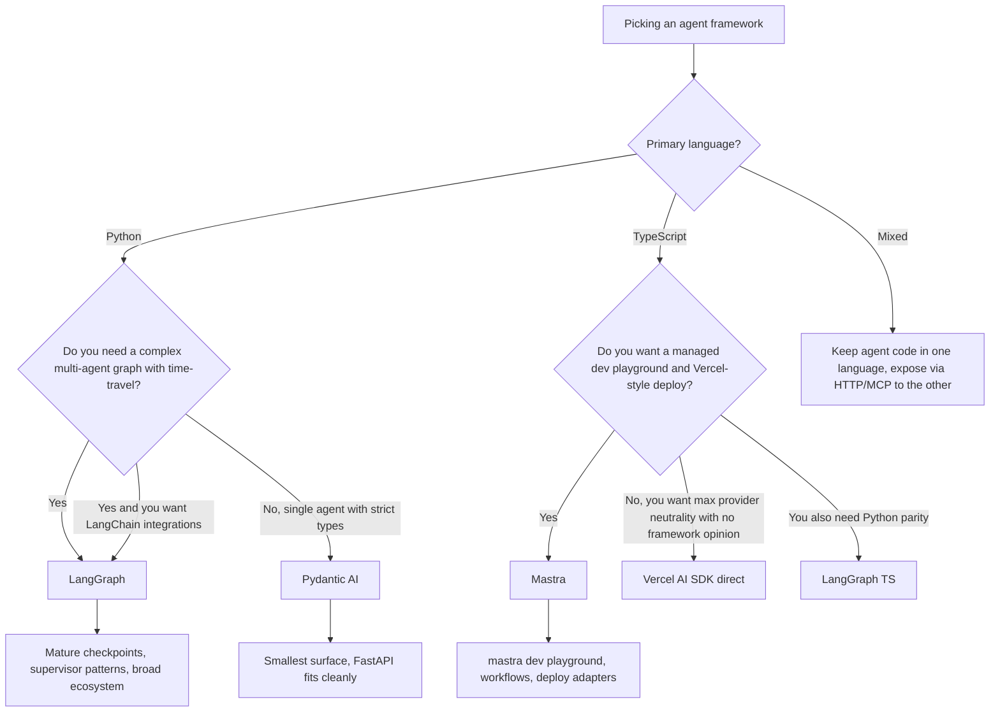

<div dir="rtl">

# فریم‌ورک‌های Pydantic AI و Mastra: فریم‌ورک‌های عاملی مبتنی بر سیستم نوع‌ها (۲۰۲۶)

بحث و مناظره پیرامون فریم‌ورک‌های عاملی دیگر محدود به «LangGraph یا LlamaIndex» نیست. اکنون دو بازیگر جدید سهم قابل توجهی از محیط‌های عملیاتی را برای تیم‌هایی که ایمنی نوع‌ها (Type Safety) را بر گستردگی ابزارها ترجیح می‌دهند به خود اختصاص داده‌اند: **Pydantic AI** در دنیای پایتون (با حدود ۵.۴ میلیون دانلود ماهانه در PyPI تا نوامبر ۲۰۲۶) و **Mastra** در دنیای تایپ‌اسکریپت (با حدود ۸.۲ میلیون دانلود ماهانه پکیج `@mastra/core` در npm طی اکتبر ۲۰۲۶). هر دوی این فریم‌ورک‌ها پارادایم سنتی «ورودی رشته، خروجی رشته» را که فریم‌ورک‌های قدیمی‌تر پذیرفته بودند رد می‌کنند، و هر دو بر این باورند که تست، ارزیابی و نگهداری یک عامل کاملاً تایپ‌شده بسیار ساده‌تر و قابل‌اطمینان‌تر از یک عامل هوشمند اما بدون تایپ مشخص است.

## فهرست مطالب

- [ماهیت این فریم‌ورک‌ها چیست](#what-these-frameworks-are)
- [فریم‌ورک Pydantic AI: عامل‌های تایپ‌شده در پایتون](#pydantic-ai-typed-agents-in-python)
- [فریم‌ورک Mastra: عامل‌های بومی تایپ‌اسکریپت](#mastra-typescript-first-agents)
- [مقایسه با LangGraph](#comparison-with-langgraph)
- [نحوه انتخاب فریم‌ورک مناسب](#choosing-a-framework)
- [مراجع و نمونه‌های عملیاتی در محیط تولید](#production-references)
- [پرسش‌های مصاحبه](#interview-questions)
- [منابع](#references)

---

## ماهیت این فریم‌ورک‌ها چیست <a id="what-these-frameworks-are"></a>

هر دو فریم‌ورک Pydantic AI و Mastra از دل نارضایتی نسبت به وابستگی به فریم‌ورک‌ها (Lock-in) و چسباندن پرامپت‌های بدون تایپ شکل گرفتند. آن‌ها بر مجموعه اصول یکسانی تمرکز دارند:

- حلقه عاملیت **توسط کدهای برنامه‌نویسی تعریف می‌شود**، نه توسط گراف‌های تعریف‌شده در فایلهای YAML یا JSON.
- فراخوانی ابزارها، خروجی‌های ساختاریافته و نقاط توقف برای بازخورد انسانی، همگی **در امضای توابع دارای تایپ دقیق هستند**.
- قابلیت حمل میان تأمین‌کنندگان یک الزام اساسی است: جابه‌جایی میان Anthropic، OpenAI یا Google تنها با تغییر یک خط کد انجام می‌پذیرد.
- آزمون‌های ارزیابی (Evals)، ردگیری (Tracing) و استقرار، بخش‌های درجه‌یک و درونی فریم‌ورک هستند و نه ویژگی‌هایی که بعداً اضافه شده باشند.

تفاوت‌ها بیشتر به پشته نرم‌افزاری تیم‌ها بازمی‌گردد: یکی برای سرویس‌های پایتونی طراحی شده که پیشاپیش از Pydantic برای اعتبارسنجی HTTP استفاده می‌کنند؛ و دیگری تیم‌های اکوسیستم Next.js و Node را هدف قرار داده که به دنبال تجربه توسعه شبیه به Vercel هستند.

---

## فریم‌ورک Pydantic AI: عامل‌های تایپ‌شده در پایتون <a id="pydantic-ai-typed-agents-in-python"></a>

### وضعیت کنونی

کتابخانه [Pydantic AI](https://ai.pydantic.dev/) نسخه ۱.۰ خود را در سپتامبر ۲۰۲۵ و **نسخه پایدار v2.0.0 را در ۲۳ ژوئن ۲۰۲۶** عرضه کرد؛ و در تاریخ **۴ نوامبر ۲۰۲۶ به نسخه 2.66.0 رسید**، در حالی که انتشارات پچ سری 1.x نیز همچنان ادامه دارد ([تاریخچه انتشارات PyPI](https://pypi.org/project/pydantic-ai/#history)). نسخه‌های 2.66.0 و 1.107.10 را به‌عنوان حداقل نسخه در نظر بگیرید: آن‌ها دو آسیب‌پذیری مهم را برطرف کرده‌اند، از جمله GHSA-m5vj-8mcw-82qx (که در آن ابزار `web_fetch_tool` قبل از اعمال محدودیت محتوا، JSON را در حلقه رویداد بازنویسی می‌کرد و یک سند تودرتو می‌توانست حلقه را مسدود کند) و GHSA-mfx5-pc32-32m8 (مشکل بازگشت نمایی در پترن‌های ماسک کردن کلیدهای خصوصی)، به‌همراه رفع خطای SSRF در لیست مسدودسازی آدرس‌های متادیتای کلود. نسخه 2.60.0 نیز نشت اعتبارنامه در مسیر سرور MCP به فرانت‌اند چت را اصلاح کرد؛ بنابراین اعتبارنامه‌های MCP را در هدرها قرار دهید و هرگز در آدرس URL نگذارید. این کتابخانه توسط سازندگان Pydantic توسعه یافته که پلتفرم [Pydantic Logfire](https://pydantic.dev/logfire) را نیز مدیریت می‌کنند و دارای مجوز متن‌باز MIT است.

نسخه ۲ دارای معماری **مبتنی بر مهارکننده (Harness-first)** است: یک *قابلیت (Capability)* یک واحد ترکیب‌پذیر است که ابزارها، هوک‌های چرخه حیات، دستورالعمل‌ها و تنظیمات مدل را یکپارچه می‌کند، و کتابخانه رسمی Pydantic AI Harness موارد بیشتری مانند `StepPersistence` را برای ذخیره و ازسرگیری ارائه می‌دهد. تغییرات شکننده و رفتاری مهم هنگام ارتقا از نسخه ۱:

- رشته‌های اتصال `openai:` اکنون از **Responses API** استفاده می‌کنند؛ برای ماندن در حالت Chat Completions باید از `openai-chat:` استفاده کنید.
- مقدار پیش‌فرض `end_strategy` به `'graceful'` تغییر یافته و بسته خام اولیه افزونه‌های ارائه‌دهنده کمتری را به‌صورت پیش‌فرض نصب می‌کند.
- ویژگی `builtin_tools` به `native_tools` تغییر نام داده و پیشوند `grok:` به `xai:` تبدیل شده است.
- یکپارچه‌سازی با Outlines و شیم سازگاری FastMCP حذف شده‌اند، و پشتیبانی از پروتکل A2A به بسته `fasta2a` منتقل شده است.
- ابزار دقیق‌سازی پیش‌فرض اکنون نسخه ۵ با ویژگی‌های `gen_ai.aggregated_usage` است؛ بنابراین داشبوردهای مبتنی بر نام‌های قبلی نیازمند به‌روزرسانی هستند.

بخش‌های اصلی سطح دسترسی:
- کلاس `Agent` دارای پارامتر نوع خروجی و لیستی از ابزارهای دارای تایپ.
- آداپتورهای تأمین‌کننده برای Anthropic، OpenAI، Google، xAI، Mistral، Groq، Cohere، Ollama و هر اندپوینت سازگار با فرمت OpenAI.
- ردگیری بومی OpenTelemetry و ارسال به Logfire یا هر جمع‌آوری‌کننده OTLP.
- ابزار `pydantic_evals` برای طراحی مجموعه‌های ارزیابی اعلانی همراه با داوری LLM و نمره‌دهی مبتنی بر کد.
- رابط `Graph` API برای طراحی ماشین‌های حالت صریح در شرایطی که حلقه ساده Agent پاسخگو نیست.

### چرا تیم‌ها این فریم‌ورک را انتخاب می‌کنند

<div dir="ltr">

```python
from dataclasses import dataclass
from pydantic import BaseModel, Field
from pydantic_ai import Agent, RunContext

class RefundDecision(BaseModel):
    approved: bool
    amount_cents: int = Field(ge=0)
    reason: str

@dataclass
class Deps:
    orders: OrdersRepo  # your data-access layer

agent = Agent(
    "anthropic:claude-sonnet-5-5",
    deps_type=Deps,
    output_type=RefundDecision,
    instructions="You are a refund analyst. Approve only if policy allows.",
)

@agent.tool
async def lookup_order(ctx: RunContext[Deps], order_id: str) -> dict:
    """Look up an order by id."""
    return await ctx.deps.orders.get(order_id)

result = await agent.run("Refund order 1234", deps=Deps(orders=db))
assert isinstance(result.output, RefundDecision)
```

</div>

سه ویژگی ساختاری این فریم‌ورک را در محیط پروداکشن جذاب می‌سازد:

۱. **نوع خروجی تضمین‌شده است.** شیء `result.output` قطعاً از نوع `RefundDecision` است یا اینکه کل فراخوانی با خطا متوقف می‌شود. هیچ تغییر ساختار ناخواسته در قالب رشته رخ نمی‌دهد.
۲. **ابزارها تابع هستند، نه دیکشنری‌های بی‌ساختار.** اسکیما مستقیماً از امضای پایتونی و داک‌استرینگ تابع در زمان ثبت تولید می‌شود؛ بنابراین ناسازگاری میان اسکیمای مدل و کدهای اجرایی ممکن نیست.
۳. **تزریق وابستگی‌ها (Dependency Injection) کاملاً صریح است.** شیء `ctx.deps` یک ظرف داده دارای نوع است که آزمون واحد (Unit Test) را با داده‌های ساختگی (Mock) فوق‌العاده ساده می‌سازد.

مستندات ارزیابی Pydantic AI روندی را نشان می‌دهد که در آن همان مدل Pydantic که در ساختار عملیاتی پروداکشن به کار رفته، هم برای نوع خروجی LLM و هم به‌عنوان `expected_output` در سنجه‌های ارزیابی استفاده می‌شود.

**خروجی‌های ساختاریافته در مدل‌های جدید**: مدل‌های Claude Fable 5.1، Opus 5.5 و Sonnet 5.5 انتخاب اجباری ابزار (Forced Tool Choice) را رد می‌کنند، و مدل GPT-6 Astra برای ابزارها نیازمند Responses API است. هر فریم‌ورکی که استخراج خروجی ساختاریافته را بر پایه فراخوانی اجباری ابزار بنا کرده باشد باید این رفتار را تطبیق دهد. نسخه Pydantic AI 2.52.0 این مدل‌های Claude را با ویژگی `supports_forced_tool_choice=False` علامت‌گذاری کرده است: اجبار خروجی در این مدل‌ها به‌طور خودکار به `auto` تبدیل می‌شود در حالی که مقدار صریح `tool_choice='required'` خطای کاربر تولید می‌کند. شناسه `NativeOutput` در Pydantic AI مستقیماً خروجی بومی JSON-schema ارائه‌دهنده را درخواست می‌کند.

### چه زمانی Pydantic AI انتخابی ایده‌آل است

- سرویس شما مبتنی بر **پایتون** است و هم‌اکنون از Pydantic برای اعتبارسنجی HTTP بهره می‌برد (معماری‌های FastAPI نمونه استاندارد هستند).
- به دنبال **اسکیماهای دقیق و سخت‌گیرانه** در تمام طول مسیر هستید: لایه ورودی HTTP، فراخوانی ابزار مدل، خروجی مدل، و ردیف پایگاه داده.
- خواهان **قابلیت حمل میان ارائه‌دهندگان مدل** بدون نیاز به توسعه لایه‌های واسط سفارشی هستید.
- ترجیح می‌دهید حلقه عاملیت را به‌صورت کدهای متداول و شفاف پایتون بنویسید تا گراف‌های پیچیده تعریفی.

### چه زمانی مناسب نیست

- نیازمند یک **گراف اعلانی پیچیده** برای هماهنگی چندعاملی با الگوهای سرپرست (Supervisor) هستید. اگرچه قابلیت `Graph` وجود دارد، اما بسیار ساده‌تر از LangGraph است.
- نیازمند **خطایابی در طول زمان (Time-travel Debugging)** با قابلیت ایجاد شاخه از هر گره گراف هستید.
- نیازمند تنوع گسترده ابزارهای آماده در اکوسیستم LangChain (اتصال‌دهنده‌های پایگاه‌های برداری، بارگذارهای اسناد و غیره) هستید.

---

## فریم‌ورک Mastra: عامل‌های بومی تایپ‌اسکریپت <a id="mastra-typescript-first-agents"></a>

### وضعیت کنونی

فریم‌ورک [Mastra](https://mastra.ai/) توسط تیم توسعه‌دهنده Gatsby بنیان‌گذاری شد، در اکتبر ۲۰۲۵ جذب سرمایه بذری ۱۳ میلیون دلاری خود را اعلام کرد و **نسخه ۱.۰ آن در ۲۰ ژانویه ۲۰۲۶ منتشر شد**. بسته `@mastra/core` در **۳۰ اکتبر ۲۰۲۶ به نسخه 1.81.0 رسید**، با بیش از **۲۹.۳ هزار ستاره در گیت‌هاب** و حدود **۸.۲ میلیون دانلود ماهانه در npm** طی اکتبر ۲۰۲۶ ([مخزن mastra-ai/mastra](https://github.com/mastra-ai/mastra)).

**شرایط مجوز**: فریم‌ورک Mastra در ژوئیه ۲۰۲۵ مجوز خود را به **Apache 2.0** تغییر داد. تمامی کدهای خارج از پوشه‌های `ee/` تحت مجوز Apache 2.0 هستند؛ کدهای درون دایرکتوری‌های `ee/` تحت مجوز تجاری سازمانی Mastra قرار دارند. پیش از استفاده تجاری بسته‌های واردشده را بررسی کنید.

امکانات کلیدی:
- ساختارهای بنیادین `Agent`، `Workflow` و `Tool` با استنتاج کامل نوع‌ها در تایپ‌اسکریپت.
- یک **سرور توسعه محلی داخلی** (`mastra dev`) همراه با محیط رابط کاربری Playground، اجرای آزمون‌های ارزیابی، و بازبین ردگیری‌ها.
- یکپارچگی عمیق با **AI SDK** شرکت Vercel برای استریمینگ داده‌ها، فراخوانی‌های چندمرحله‌ای ابزارها، و تعویض ارائه‌دهنده.
- حافظه داخلی و سیستم RAG مجهز به آداپتورهای `libsql` و `pgvector`.
- استقرار تک‌دستوری روی **Mastra Cloud**، Vercel، Cloudflare Workers یا سرورهای Node.

### چرا تیم‌ها این فریم‌ورک را انتخاب می‌کنند

<div dir="ltr">

```typescript
import { Agent } from "@mastra/core/agent";
import { createTool } from "@mastra/core/tools";
import { anthropic } from "@ai-sdk/anthropic";
import { z } from "zod";

const lookupOrder = createTool({
  id: "lookup-order",
  description: "Look up an order by id",
  inputSchema: z.object({ orderId: z.string() }),
  outputSchema: z.object({ status: z.string(), totalCents: z.number() }),
  execute: async ({ orderId }) => ordersDb.get(orderId),
});

export const refundAgent = new Agent({
  name: "refund-agent",
  model: anthropic("claude-sonnet-5-5"),
  instructions: "You are a refund analyst. Approve only if policy allows.",
  tools: { lookupOrder },
});
```

</div>

سه قابلیت محوری این فریم‌ورک را متمایز می‌سازد:

۱. **استنتاج کامل نوع‌ها در سراسر سیستم.** اسکیماهای Zod به‌طور همزمان اعتبارسنجی زمان اجرای ابزار، اسکیمای JSON ارائه‌شده به مدل، و تایپ متغیر ورودی تابع `execute` را تعیین می‌کنند؛ یک منبع واحد برای حقیقت داده‌ها.
۲. **محیط توسعه `mastra dev` قابلیتی شگفت‌انگیز است.** این دستور یک رابط کاربری محلی را اجرا می‌کند که به شما امکان می‌دهد هر عاملی را فراخوانی کنید، ردپای تریس‌ها را بازپخش نمایید، آزمون‌های ارزیابی را اجرا کنید و ورودی و خروجی ابزارها را بدون نیاز به نوشتن فرانت‌اند مانیتور نمایید.
۳. **جریان‌های کاری تراز اول.** متد `createWorkflow` یک گراف دارای نوع از مراحل کاری (هر مرحله یک ابزار یا عامل Mastra) ایجاد می‌کند که از انشعاب، تعلیق / ازسرگیری، و بازخورد انسانی همراه با اعتبارسنجی نوع‌ها پشتیبانی می‌کند.

### چه زمانی Mastra انتخابی ایده‌آل است

- تیم مهندسی شما **تایپ‌اسکریپت‌محور** است و سایر بخش‌های برنامه روی Next.js، Node، Bun یا Cloudflare Workers توسعه یافته است.
- به دنبال **تجربه توسعه سطح بالا مشابه Vercel** هستید: یک CLI واحد، رابط Playground محلی، و ابزارهای استقرار منسجم.
- رابط‌های کاربری استریم‌شده اهمیت بالایی دارند و مایلید از هوک‌های `useChat` و `streamText` در Vercel AI SDK بهره بگیرید.
- نیازمند **جریان‌های کاری تعلیق و ازسرگیری** همراه با مراحل تأیید انسانی تعبیه‌شده به‌صورت پیش‌فرض هستید.

### چه زمانی مناسب نیست

- نیازمند **کتابخانه بزرگی از عامل‌های آماده** یا اتصالات متنوع جامعه کاربری هستید (اکوسیستم آن نسبت به LangChain کوچک‌تر است).
- تیم و بخش عمده زیرساخت‌های هوش مصنوعی شما مبتنی بر **پایتون** است. برقراری ارتباط میان پایتون و تایپ‌اسکریپت روی لایه HTTP شدنی است اما به تأخیر سیستم می‌افزاید.
- نیازمند رفتارهای استنتاج سفارشی در سطح مقالات دانشگاهی (مانند متدهای رمزگشایی اختصاصی) هستید. در این صورت در اکوسیستم پایتون بمانید.

---

## مقایسه با LangGraph <a id="comparison-with-langgraph"></a>

| بعد مقایسه | فریم‌ورک Pydantic AI 2.x | فریم‌ورک Mastra 1.x | فریم‌ورک LangGraph 1.x |
|---|---|---|---|
| **زبان برنامه‌نویسی** | زبان Python | زبان TypeScript | هر دو زبان Python و TypeScript |
| **نوع مجوز** | مجوز MIT | مجوز Apache 2.0 (دایرکتوری‌های `ee/` دارای سورس در دسترس) | مجوز MIT |
| **واحد اصلی** | کلاس تایپ‌شده `Agent` همراه با `output_type`، ترکیب‌شده از قابلیت‌ها | ساختارهای تایپ‌شده `Agent` و `Workflow` | گراف گره‌ها بر روی وضعیت تایپ‌شده |
| **منبع اسکیما** | کتابخانه Pydantic v2 | کتابخانه Zod | استاندارد JSON Schema (پشتیبانی از Pydantic، Zod، Valibot، ArkType) |
| **استقلال از ارائه‌دهنده** | آداپتورهای داخلی | از طریق Vercel AI SDK | از طریق بسته‌های همکار LangChain |
| **سیستم چندعاملی** | دستی یا از طریق `Graph` API | ترکیب `Workflow` و استفاده از عامل به‌عنوان ابزار | توابع `create_supervisor`، ساختار Swarm، گراف‌های سفارشی |
| **پایداری وضعیت** | چک‌پوینت‌های `pydantic_graph`؛ قابلیت `StepPersistence` در مهارکننده | اسنپ‌شات ورک‌فلو + آداپتورهای ذخیره‌سازی | مخازن چک‌پوینت تراز اول (Postgres، Redis، SQLite، حافظه) |
| **خطایابی Time-Travel** | خیر | بازپخش (Replay) در محیط آزمایشی محلی | بله، امکان انشعاب از هر چک‌پوینت دلخواه |
| **فریم‌ورک ارزیابی** | ابزار `pydantic_evals` | ارزیابی‌های داخلی Mastra | پلتفرم LangSmith یا ابزارهای خارجی |
| **پایش و ردگیری** | پروتکل OTLP / سرویس Logfire | پروتکل OTLP / پلتفرم Mastra Cloud | سرویس LangSmith یا پروتکل OTLP |
| **میزان وابستگی** | بدون وابستگی به LangChain | بدون وابستگی به LangChain | وابستگی شدید به اکوسیستم LangChain |
| **وسعت اکوسیستم** | کوچک اما رو به رشد | کوچک اما رو به رشد | بسیار وسیع (یکپارچه‌سازی‌های LangChain) |

<div dir="ltr">



</div>

---

## نحوه انتخاب فریم‌ورک مناسب <a id="choosing-a-framework"></a>

سه عامل تصمیم‌گیری اصلی به ترتیب اهمیت:

۱. **زبان توسعه سرویس موجود.** برای سرویس‌های پایتونی از Pydantic AI یا LangGraph پایتون استفاده کنید. برای سرویس‌های تایپ‌اسکریپت از Mastra یا LangGraph TS بهره ببرید. عبور از مرز زبان‌ها معمولاً هزینه‌ای بیشتر از انتخاب ابزار بومی همان زبان دارد.
۲. **ساختار پیچیدگی سیستم.** اگر ماهیت عامل اساساً «یک LLM + چند ابزار + ساختار خروجی مشخص» است، Pydantic AI یا Mastra کاملاً کافی بوده و نگهداری آن‌ها کم‌هزینه‌تر است. اگر با چندین عامل همکار، انشعاب‌های پیچیده، تلاش‌های مجدد و فرآیندهای تأیید چندمرحله‌ای سروکار دارید، ساختار گراف و چک‌پوینت‌های LangGraph برتری می‌یابد.
۳. **میزان وابستگی به اکوسیستم.** فریم‌ورک LangGraph امکانات یکپارچه‌سازی با LangChain، ارزیابی در LangSmith و اکوسیستم آن را فراهم می‌آورد. در مقابل، Pydantic AI و Mastra تضمین‌های نوع تمیزتر و راه‌اندازی اولیه سریع‌تری ارائه می‌دهند اما اتصالات جانبی را باید خودتان پیاده‌سازی کنید.

یک قاعده سرانگشتی کاربردی: اگر طولانی‌ترین بخش کد شما لیست ابزارهاست، از Pydantic AI یا Mastra استفاده کنید. اما اگر طولانی‌ترین بخش کد ماشین حالت و منطق گردش کار است، به سراغ LangGraph بروید.

---

## مراجع و نمونه‌های عملیاتی در محیط تولید <a id="production-references"></a>

شاخص‌های پذیرش در صنعت و موارد مطالعاتی تا اوایل نوامبر ۲۰۲۶:

- **فریم‌ورک Pydantic AI**
  - حدود ۵.۴ میلیون دانلود در PyPI در بازه ۳۰ روزه منتهی به اول نوامبر ۲۰۲۶، تقریباً هم‌رده با DSPy و حدود دو برابر آمار دانلود CrewAI (آمارهای دانلود تحت تأثیر CI افزایش دارند و شاخصی نسبی هستند).
  - مسیر متداول پذیرش در شرکت‌های مبتنی بر FastAPI است، زیرا همان مدل‌های Pydantic به‌طور همزمان لایه مرزی HTTP و نوع خروجی مدل را مدیریت می‌کنند.
- **فریم‌ورک Mastra**
  - حدود ۸.۲ میلیون دانلود ماهانه پکیج `@mastra/core` در npm طی اکتبر ۲۰۲۶، بالاتر از کیت تایپ‌اسکریپت `@openai/agents` (با ۷.۵ میلیون) و پشت سر پکیج `ai` متعلق به Vercel AI SDK (با ۱۱۵.۴ میلیون) که Mastra بر پایه آن توسعه یافته است.
- **فریم‌ورک LangGraph** (جهت مقایسه و ارجاع)
  - ربات SQL لینکدین، دستیارهای کدنویسی اوبر، شرکت‌های کلارنا، الاستیک، ریپلیت و ده‌ها شرکت بزرگ دیگر بر بستر LangGraph مستقر هستند.

---

## پرسش‌های مصاحبه <a id="interview-questions"></a>

### پرسش: چه زمانی Pydantic AI را به جای LangGraph برای یک سرویس پایتونی انتخاب می‌کنید؟

**پاسخ قوی:**
زمانی Pydantic AI را انتخاب می‌کنم که ماهیت عامل اساساً یک مدل منفرد با خروجی دارای ساختار مشخص و چند ابزار باشد، و سایر بخش‌های سرویس بر پایه Pydantic شکل گرفته باشند (مانند FastAPI یا SQLModel). مزیت بزرگ این است که یک کلاس Pydantic واحد پاسخ HTTP، ساختار خروجی مدل، و سنجه ارزیابی را تعریف می‌کند و هیچ ناهمخوانی اسکیمایی به وجود نمی‌آید. در سوی دیگر، زمانی به سراغ LangGraph می‌روم که به یک گراف چندعاملی واقعی همراه با امکان بازگشت به گذشته از روی چک‌پوینت‌ها (Time Travel)، الگوهای نظارتی (Supervisor)، یا اتصالات گسترده اکوسیستم LangChain نیاز داشته باشم. سؤال کلیدی من این است: آیا پیچیده‌ترین بخش طراحی سیستم لیست ابزارهاست یا ماشین حالت؟ اگر لیست ابزارها باشد Pydantic AI، و اگر ماشین حالت باشد LangGraph.

### پرسش: آیا Mastra جایگزینی برای Vercel AI SDK است؟

**پاسخ قوی:**
خیر، هرچند هم‌پوشانی آن‌ها افزایش یافته است. فریم‌ورک Mastra برای فراخوانی‌های ارائه‌دهندگان و استریم داده‌ها مستقیماً بر روی Vercel AI SDK بنا شده است. کیت AI SDK نیز قابلیت‌های عاملی اضافه کرده است (نسخه ۶ ابزار `ToolLoopAgent` را افزود و نسخه ۷ ابزار بادوام `WorkflowAgent` و مهارکننده آزمایشی `HarnessAgent` را معرفی کرد). با این حال، آنچه Mastra اضافه می‌کند **مدیریت حافظه**، **قابلیت RAG**، **آزمون‌های ارزیابی داخلی**، **جریان‌های کاری تایپ‌شده** با تعلیق و ازسرگیری، و محیط آزمایشی **`mastra dev`** است. اگر صرفاً به یک حلقه اجرای ابزار پایدار در یک برنامه Next.js نیاز داشته باشید، AI SDK به‌تنهایی کافی است. اما اگر این ابزارهای جانبی و رابط آزمایشی محلی را بدون نیاز به کدنویسی اختصاصی بخواهید، Mastra لایه‌ای است که آن‌ها را فراهم می‌کند.

### پرسش: نسخه 2.0 فریم‌ورک Pydantic AI مفهوم پیشوند مدل openai: را تغییر داد. چرا یک مهندس ارشد باید به تغییر پیش‌فرض تک‌خطی مانند این اهمیت دهد؟

**پاسخ قوی:**
زیرا بدون تغییر حتی یک خط از کدهای ما، پروتکل ارتباطی روی شبکه دگرگون شد. در نسخه ۲، پیشوند `openai:gpt-6.1-sol` به جای مسیر Chat Completions از مسیر جدید Responses API عبور می‌کند (برای حفظ مسیر قبلی باید از `openai-chat:` استفاده کرد). این تغییر می‌تواند فرمت فراخوانی ابزارها، نحوه رفتار توکن‌های استدلال و کشینگ، پارامترهای مجاز، و لاگ‌های تریس را کاملاً تغییر دهد؛ علاوه بر این، در نسخه ۲ نام اتریبیوت‌های تله‌متری به استانداردهای جدید `gen_ai` تغییر یافت که می‌توانست داشبوردهای مانیتورینگ را بی‌صدا از کار بیندازد. این اتفاق در همان رده تغییر مدل پیش‌فرض در SDKها قرار می‌گیرد. راهکار دفاعی نیز یکسان است: قفل کردن دقیق نسخه فریم‌ورک، اجرای سوییت ارزیابی و بررسی شکل تریس‌ها در هر ارتقا، و مشخص کردن صریح گزینه‌های تعیین‌کننده رفتار سیستم به جای تکیه بر مقادیر پیش‌فرض.

### پرسش: یک «فریم‌ورک عاملی تایپ‌شده» در محیط تولید عملاً چه دستاوردی به همراه دارد؟

**پاسخ قوی:**
سه مزیت محوری در پروداکشن به دست می‌آید: نخست، **جلوگیری از ورود داده‌های مخرب یا نامعتبر به عمق سیستم**. اسکیمای ارائه‌شده به مدل از همان تعاریف Pydantic یا Zod استخراج می‌شود که در زمان اجرا داده‌ها را اعتبارسنجی می‌کنند؛ بنابراین اگر مدل یک فیلد توهم‌آمیز بسازد، مرحله پارس کردن پیش از آنکه کد بعدی اجرا شود آن را رد می‌کند. دوم، **آزمون‌های واحد (Unit Test) شفاف و ایزوله**. یک ابزار دارای تایپ صرفاً تابعی با ورودی و خروجی مشخص است که تست آن بدون نیاز به فراخوانی مدل ممکن است. سوم، **ارزیابی‌های آگاه از ساختار (Schema-aware Evals)**. سیستم ارزیابی می‌تواند دو شیء داده‌ای را فیلد به فیلد مقایسه کند به جای آنکه خروجی‌های متنی را با هم بسنجد؛ این کار تغییرات پس‌رونده ظریف مانند اختیاری شدن یک فیلد ضروری یا اضافه شدن مقادیر ناشناخته به یک Enum را بلافاصله شناسایی می‌نماید.

---

## منابع <a id="references"></a>

- مستندات انتشار نسخه v2.0.0 در Pydantic AI (ژوئن ۲۰۲۶): https://github.com/pydantic/pydantic-ai/releases/tag/v2.0.0
- مستندات رسمی Pydantic AI: https://ai.pydantic.dev/
- مستندات ارزیابی‌ها در Pydantic AI: https://ai.pydantic.dev/evals/
- مخزن رسمی فریم‌ورک Mastra: https://github.com/mastra-ai/mastra
- وبلاگ Mastra، تغییر مجوز از ELv2 به Apache 2.0 (ژوئیه ۲۰۲۵): https://mastra.ai/blog/apache-license
- مستندات رسمی Mastra: https://mastra.ai/
- مستندات سرمایه‌گذاری Mastra (اکتبر ۲۰۲۵): https://mastra.ai/blog/seed-round
- راهنمای فریم‌ورک Mastra در Generative.inc: https://generative.inc/blog/mastra-typescript-agent-framework
- مستندات LangGraph 1.x: https://docs.langchain.com/oss/python/langgraph/
- فهرست مشتریان LangGraph در وب‌سایت LangChain: https://www.langchain.com/built-with-langgraph
- وب‌سایت رسمی Vercel AI SDK: https://ai-sdk.dev/
- مستندات معرفی Vercel AI SDK 7 (ژوئن ۲۰۲۶): https://vercel.com/blog/ai-sdk-7
- گزارش مقایسه‌ای فریم‌ورک‌های عاملی هوش مصنوعی در AIMultiple (سال ۲۰۲۶): https://research.aimultiple.com/agentic-ai-frameworks/

---

*مبحث بعدی: برای مشاهده معیارهای تصمیم‌گیری جامع به [راهنمای انتخاب فریم‌ورک](08-framework-selection-guide.md) مراجعه کنید.*

</div>