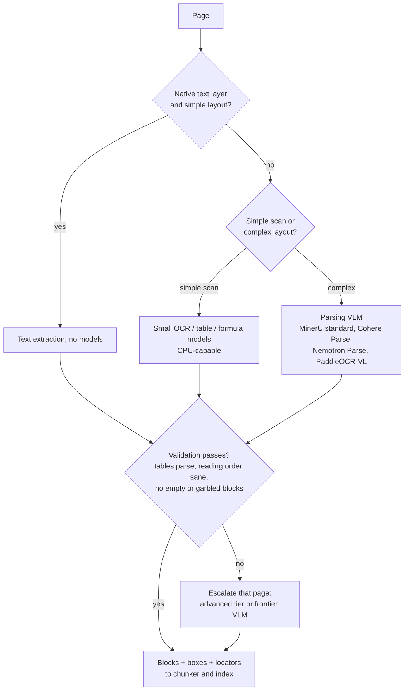

# سامانه OCR و تحلیل چیدمان اسناد (Layout Analysis)

تجزیه و پارس اسناد دیگر صرفاً یک دوراهی میان موتورهای کلاسیک OCR و مدل‌های بزرگ چندحالته پیشرو (Frontier Multimodal LLMs) نیست. امروزه یک لایه میانی از **مدل‌های بینایی-زبانی تخصصی در پارس اسناد (Specialist Document-Parsing VLMs)** (مدل‌های کوچک بینایی-زبانی که برای تبدیل صفحات به خروجی‌های ساختاریافته آموزش دیده‌اند) متن‌های Markdown، جداول، کادرهای مرزی (Bounding Boxes) و ترتیب خوانش را با کسری از هزینه مدل‌های پیشرو به ازای هر صفحه ارائه می‌دهند. پرسش طراحی سیستم از «کدام مدل بهتر می‌خواند؟» به «هر صفحه به کدام سطح نیاز دارد و هزینه هر صفحه در حجم کاری من چقدر است؟» تغییر یافته است.

## فهرست مطالب

- [سه لایه پردازش: موتورهای OCR، مدل‌های VLM پارس‌کننده و مدل‌های VLM پیشرو](#the-three-tiers-ocr-engines-parsing-vlms-frontier-vlms)
- [استخراج چیدمان با مدل‌های بینایی-LLM](#vision-llm-layout-extraction)
- [پارس چندلایه و مکان‌یاب‌های در سطح بلوک](#tiered-parsing-and-block-level-locators)
- [ترتیب خوانش و ساختار منطقی](#reading-order-and-logical-structure)
- [مدیریت اسکن‌های بی‌کیفیت و متون دست‌نویس](#handling-low-quality-scans-and-handwriting)
- [موازنه‌های هزینه و تأخیر](#cost-and-latency-tradeoffs)
- [پرسش‌های مصاحبه](#interview-questions)
- [منابع](#references)

---

## سه لایه پردازش: موتورهای OCR، مدل‌های VLM پارس‌کننده و مدل‌های VLM پیشرو 

| ویژگی | موتورهای کلاسیک OCR (مانند Tesseract، AWS Textract، Azure AI Document Intelligence و Google Document AI) | مدل‌های VLM پارس اسناد (مانند Cohere Parse، Mistral OCR 4.1، MinerU، PaddleOCR-VL، Nemotron 3.5 Parse و DeepSeek-OCR 2) | مدل‌های VLM پیشرو (مانند Claude Opus 5.5 / Sonnet 5.5، GPT-6 Sol، Gemini 4 Argon؛ و مدل رده سریع Gemini 3.8 Flash به‌عنوان جایگزین اقتصادی) |
|---|---|---|---|
| **مکانیسم اصلی** | تشخیص کاراکتر به‌علاوه قواعد چیدمان یا مدل‌های ساده | مدل کوچک VLM که برای رونویسی صفحات به ساختار آموزش دیده است | درک عمومی توکن‌های بصری |
| **ترتیب خوانش** | ساده؛ در چیدمان‌های پیچیده دچار شکست می‌شود | به‌صورت صریح پیش‌بینی می‌شود | ضمنی؛ معمولاً درست است اما قابل ممیزی نیست |
| **هندسه و مختصات** | کادرهای کلمه‌به‌کلمه همراه با امتیاز اطمینان | کادرهای بلوک‌به‌بلوک (متن، جدول، تصویر) همراه با ترتیب خوانش | لایه ممیزی کلمه‌به‌کلمه ارائه نمی‌دهد |
| **جداول** | متدهای API مجزا برای جدول؛ ضعف در سلول‌های ادغام‌شده | ساختار درون‌خطی به صورت HTML یا Markdown | ارائه Markdown یا HTML بنا به درخواست |
| **حالت شکست** | خطای خواندن کاراکترها؛ متن توهم‌آمیز نمی‌سازد | امکان توهم در صفحات مخدوش و بی‌کیفیت | توانایی تولید متن روان، قابل‌باور اما کاملاً اشتباه |
| **عامل تعیین‌کننده هزینه** | مصرف CPU یا هزینه API به ازای هر صفحه | تعداد صفحات در ثانیه به ازای هر GPU، یا حدود ۱.۵۰ دلار به ازای هر ۱٬۰۰۰ صفحه از طریق API | مصرف توکن: حدود ۴ دلار (در Gemini 3.8 Flash، قیمت معرفی) تا ۲۳ دلار (در Claude Opus 5.5) به ازای هر ۱٬۰۰۰ صفحه طبق قیمت‌های رسمی اکتبر ۲۰۲۶ |

**شکاف کیفی چقدر است؟** در بنچمارک ParseBench، یک ارزیابی پارس اسناد که شرکت Cohere برای راه‌اندازی محصول خود اجرا کرد (گزارش ارائه‌دهنده، اوت ۲۰۲۶)، میانگین‌ها به این ترتیب بودند: مدل GPT-5.5 برابر ۸۴.۴، مدل Claude Opus 4.8 برابر ۸۴.۳، مدل Gemini 3.5 Flash برابر ۸۱.۸، سرویس Cohere Parse برابر ۷۹.۲، ابزار LlamaParse (در حالت مقرون‌به‌صرفه) برابر ۷۸.۳، ابزار Google Document AI برابر ۵۷.۳، و AWS Textract برابر ۵۳.۳. این اعداد نشان می‌دهند که مدل‌های پیشرو برتر حدود پنج امتیاز از Cohere Parse جلوتر هستند، و سرویس‌های OCR کلاسیک بیش از بیست امتیاز از هر دو عقب‌تر قرار دارند. این شکاف عمیق احتمالاً ناشی از فاکتورهایی است که بنچمارک پارس اسناد به آن‌ها پاداش می‌دهد (جداول، ترتیب خوانش، خروجی ساختاریافته) و نباید صرفاً به‌معنای ناتوانی Textract در خواندن حروف تلقی شود.

**مدل‌های VLM پارس اسناد در سال ۲۰۲۶ با سرعت بالایی پیشرفت کردند.** بیشتر آن‌ها دارای وزن‌های باز (Open weights) هستند؛ در حالی که Cohere Parse صرفاً به‌صورت API یا محیط اختصاصی ارائه می‌شود. نمرات جدول زیر از بنچمارک‌ها و مراجع متفاوتی گردآوری شده‌اند، بنابراین آن‌ها را در امتداد سطرها با یکدیگر مقایسه نکنید:

| مدل | تاریخ انتشار | توضیحات |
|---|---|---|
| مدل DeepSeek-OCR 2 | ۲۷ ژانویه ۲۰۲۶ | مجوز Apache 2.0 |
| مدل PaddleOCR-VL | نسخه ۱.۵ در ۲۹ ژانویه ۲۰۲۶ | مقایسه ارائه‌شده توسط Jina امتیاز نسخه ۱.۶ را برابر ۹۶.۳۴ در OmniDocBench v1.6 نشان می‌دهد؛ مجوز Apache 2.0 |
| مدل Chandra OCR 2 | ۱۸ مارس ۲۰۲۶ | امتیاز ۸۵.۸ در olmOCR-Bench؛ کد منبع با مجوز Apache 2.0، اما وزن‌ها تحت نسخه تغییریافته OpenRAIL-M ارائه شده است: استفاده رایگان برای تحقیقات، استفاده شخصی و استارتاپ‌های با جذب سرمایه یا درآمد کمتر از ۲ میلیون دلار، غیرمجاز برای کاربردهایی که با API شرکت Datalab رقابت کنند؛ در غیر این صورت نیازمند مجوز تجاری پولی |
| مدل Surya OCR 2 | ۲۷ مه ۲۰۲۶ | کد منبع با مجوز Apache 2.0؛ وزن‌ها تحت نسخه تغییریافته OpenRAIL-M: رایگان برای تحقیقات، استفاده شخصی و استارتاپ‌های با سرمایه یا درآمد کمتر از ۵ میلیون دلار؛ در غیر این صورت نیازمند مجوز پولی |
| مدل NVIDIA Nemotron Parse 2.0 | ۳ اوت ۲۰۲۶ | کمتر از ۱ میلیارد پارامتر؛ دسته‌بندی چیدمان، کادرهای مرزی، ترتیب خوانش، تبدیل نمودار به جدول؛ مجوز OpenMDW-1.1؛ با مدل Nemotron 3.5 Parse جایگزین شد |
| مدل NVIDIA Nemotron 3.5 Parse | ۱۷ اکتبر ۲۰۲۶ | حدود ۰.۶۳۱ میلیارد پارامتر شامل سر پیش‌بینی چندتوکنی، مجوز OpenMDW-1.1، همراه با پیش‌نویس‌کننده اختیاری ۸۹.۳ میلیون پارامتری DFlash2 (۴ نوامبر). شرکت NVIDIA امتیاز ParseBench را ۷۲.۷۴ در تک‌گذر، ۷۴.۹۲ در دوگذر و ۷۵.۲۰ در سه‌گذر گزارش می‌دهد در مقایسه با ۶۳.۹۱ برای نسخه Nemotron Parse 2.0: تعداد گذرها اکنون اهرمی برای تنظیم دقت و هزینه است |
| مدل Mistral OCR 4.1 (شناسه `mistral-ocr-4-1`) | ۱۶ ژوئیه ۲۰۲۶ (عرضه عمومی ۳۱ اوت) | وزن‌های بسته، نرخ API برابر ۴ دلار به ازای هر ۱٬۰۰۰ صفحه (۰.۴۰ دلار برای صفحات کش‌شده). شناسه `mistral-ocr-latest` به آن اشاره می‌کند؛ شرکت میسترال نسخه OCR 4.0 را در ۲۹ سپتامبر منسوخ و روز بعد بازنشسته کرد، بنابراین شناسه نسخه‌بندی‌شده را قفل کنید نه نام مستعار |
| سرویس Cohere Parse (شناسه `parse-v5.0`) | ۲۷ اوت ۲۰۲۶ | وزن‌های بسته؛ مدل VLM با ۲.۳ میلیارد پارامتر، نرخ API برابر ۱.۵۰ دلار به ازای هر ۱٬۰۰۰ صفحه؛ خروجی Markdown با جداول HTML، یا بلوک‌های مرتب همراه با کادرهای مرزی |
| مدل jina-ocr-v1 | ۱۴ سپتامبر ۲۰۲۶ | ساخته‌شده بر پایه DeepSeek-OCR (تعداد ۳.۴ میلیارد پارامتر کل، حدود ۵۷۰ میلیون پارامتر فعال MoE)؛ امتیاز ۹۱.۱۴ در OmniDocBench v1.6 و ۸۳.۴ در olmOCR-Bench؛ مجوز CC BY-NC 4.0، بنابراین بدون دریافت مجوز تجاری قابل استفاده برای مصارف تجاری نیست |
| جعبه‌ابزار MinerU 4.0 | ۱۶ سپتامبر ۲۰۲۶ | جعبه‌ابزار مجهز به رده‌های کیفی و یک CLI عاملی؛ مجوز MinerU Open Source License (مجوز Apache 2.0 به‌همراه شروط اضافه): استفاده تجاری مجاز است، اما نیازمند مجوز مجزا برای کاربران فعال ماهانه بالای ۱۰۰ میلیون نفر یا درآمد ماهانه بالای ۲۰ میلیون دلار است، و سرویس‌های آنلاین باید نام MinerU را ذکر کنند |

پیش از اتکا به نتایج بنچمارک، شرایط مجوزها را به دقت بررسی کنید. پارسری که نتوانید آن را به مرحله عملیاتی برسانید گزینه‌ای قابل استفاده نیست، و اصطلاح «وزن‌های باز» طیف وسیعی از مجوزها را در بر می‌گیرد؛ از Apache 2.0 گرفته تا مجوزهای غیرتجاری یا دارای سقف درآمدی که یک شرکت رو به رشد ممکن است به‌سرعت از آن فراتر برود.

---

## استخراج چیدمان با مدل‌های بینایی-LLM 

گردش کار پایه همچنان مبتنی بر فرآیند **اسکرین‌شات به مارک‌داون (Screenshot-to-Markdown)** است:
۱. **تبدیل به تصویر (Rasterize)**: صفحات PDF را به تصویر تبدیل کنید (صفحاتی که دارای لایه متنی بومی قابل استفاده هستند ممکن است اصلاً نیازی به این مرحله نداشته باشند).
۲. **پرامپت‌نویسی بصری (Visual Prompting)**: از مدل بخواهید «صفحه زیر را با حفظ جداول و سرتیترها به قالب استاندارد GitHub Markdown رونویسی کند.»
۳. **بازیابی ساختاریافته (Structured Recovery)**: از درک فضایی مدل برای بازسازی سلسله‌مراتب منطقی سند بهره بگیرید.

برای معماری RAG، خروجی را **به‌صورت بلوک‌های مجزا بخواهید، نه صرفاً یک متن مارک‌داون پیوسته**. فهرستی از بلوک‌های دارای نوع (سرتیتر، پاراگراف، جدول، شکل، زیرنویس) همراه با شماره صفحه، کادر مرزی و شاخص ترتیب خوانش به شما امکان می‌دهد قطعه‌بندی (Chunking) را روی مرزهای واقعی انجام دهید، ساختار اتمیک جداول را حفظ کنید، و به جای کل یک سند به یک بخش مشخص از صفحه ارجاع دهید. مدل‌های VLM پارس اسناد این اطلاعات را به‌صورت بومی ارائه می‌دهند (مانند خروجی `blocks` در Cohere Parse و کلاس‌ها و کادرهای چیدمان در Nemotron Parse 2.0)؛ در مقابل، با یک VLM پیشرو باید این ساختار را از طریق خروجی‌های ساختاریافته (Structured Outputs) درخواست کرده و صحت آن را اعتبارسنجی نمایید.

---

## پارس چندلایه و مکان‌یاب‌های در سطح بلوک 

بیشتر صفحات در یک مجموعه اسناد واقعی ساده هستند. پرداخت هزینه مدل‌های پیشرو VLM برای یک فایل PDF که اساساً دیجیتالی تولید شده و دارای لایه متنی تمیز است هدر دادن منابع به شمار می‌رود؛ بنابراین هر صفحه را به ارزان‌ترین لایه‌ای هدایت کنید که اعتبارسنجی را با موفقیت پشت سر بگذارد.

ابزار MinerU 4.0 (۱۶ سپتامبر ۲۰۲۶) این منطق را درون خود پیاده‌سازی کرده است. این ابزار به جای انتخاب دستی بک‌اند، چهار سطح کیفی ارائه می‌دهد: رده **flash** (بدون مدل؛ استفاده از متن بومی PDF و اسناد دیجیتال)، رده **basic** (مدل‌های کوچک OCR، فرمول و جدول؛ قابل اجرا روی پردازنده CPU)، رده **standard** (مدل‌های کوچک به‌همراه یک VLM؛ حالت پیش‌فرض) و رده **advanced** (استنتاج عمیق‌تر برای اسناد دشوار). این ابزار همچنین فرمت‌های DOCX، PPTX، XLSX، EPUB، OFD، HTML و CSV را به‌صورت بومی و بدون نیاز به تبدیل به PDF پارس می‌کند.

**مکان‌یاب‌ها اعتبارسنجی ارجاعات را میسر می‌سازند.** ابزار خط فرمان `mineru` در MinerU 4.0 (دارای دستورات parse، read، find، search و watch) مکان‌یاب‌های پایداری مانند `doc:{id}/tier:{tier}/page:{page}/block:{block}` را برمی‌گرداند و اسناد طولانی را به‌صورت تدریجی می‌خواند (۱۰ صفحه نخست به‌همراه درخواست ادامه)، بنابراین یک Agent می‌تواند دقیقاً به یک بلوک استناد کند و یک بازبین انسانی دقیقاً همان بخش را باز کند. فرآیند پارس محلی است مگر اینکه پرچم `--remote` ارسال شود. ابزار Docling نیز همین مسیر را با ارائه بک‌اندهای ماژولار VLM طی کرد: افزونه NVIDIA Nemotron Parse 2.0 در نسخه v2.128.0 (۱۶ سپتامبر)، افزونه MinerU 2.5 Pro در نسخه v2.130.0 (۲۲ سپتامبر)، و افزونه Nemotron 3.5 Parse در نسخه v2.141.0 (۲۰ اکتبر).

نام، نسخه و سطح کیفی پارسر را در تمامی بلوک‌ها ذخیره کنید. ابزار Docling الگوریتم ترتیب خوانش خود را در نسخه v2.132.0 (۱ اکتبر ۲۰۲۶) تغییر داد؛ ارتقای یک پارسر می‌تواند توالی متن را جابه‌جا کرده و مرزهای چانک‌ها را تغییر دهد، که به‌صورت خاموش کیفیت بازیابی را متأثر می‌سازد. پیش از ارتقا در محیط پروداکشن، نمونه‌ای از اسناد را مجدداً پارس کرده و تفاوت‌ها (Diff) را بررسی کنید.

**ورکرهای پارسر یک سطح حمله به شمار می‌روند.** فایل‌های غیرقابل اعتماد آفیس و اسناد PDF از بسته‌های LibreOffice، دیکودرهای تصویر و پیش‌پردازشگرهای VLM عبور می‌کنند، بنابراین ورکرها را مانند هر کدی که ورودی‌های خصمانه را پردازش می‌کند ایزوله و سندباکس نمایید. انتشار سلف‌هاستد Reducto نسخه v1.12.21 (۲۹ اکتبر ۲۰۲۶) نمونه‌ای عینی را به همراه داشت: در گره‌هایی که پادها به سرویس متادیتای نمونه ابری (IMDSv1، یا IMDSv2 با سقف پرش ۲) دسترسی داشتند، پارس یک سند غیرقابل اعتماد در LibreOffice می‌توانست به نقش IAM گره دست یابد. راه‌حل تنظیم سقف پرش IMDSv2 روی ۱ یا مسدودسازی آدرس 169.254.169.254 در سطح فضای نام (Namespace) است. پادهای پارسر را بدون دسترسی به متادیتا، بدون نقش گره، و با ترافیک خروجی محدود به مقصد نتایج اجرا کنید.

---

## ترتیب خوانش و ساختار منطقی 

> [!IMPORTANT]
> یکی از خطاهای متداول در سیستم‌های RAG ساده، شکستن یک پاراگراف در میان ستون‌های مجاور است.
> مدل‌های بینایی با «دیدن» فضای میان ستون‌ها (Gutter) و توالی صحیح متن از این خطا جلوگیری می‌کنند، برخلاف پارسرهای مبتنی بر قاعده که ممکن است متن را در راستای عرضی هر دو ستون بخوانند.

مدل‌های VLM پارس اسناد، ترتیب خوانش را به‌عنوان یک خروجی صریح پیش‌بینی می‌کنند که قابل ارزیابی و بررسی است (برای مثال، می‌توان صفحاتی را که ترتیب پیش‌بینی‌شده در آن‌ها بیش از یک بار بین ستون‌ها جابه‌جا می‌شود علامت‌گذاری کرد). مدل‌های VLM پیشرو معمولاً این ترتیب را درست درک می‌کنند اما ابزاری برای ممیزی در اختیار شما نمی‌گذارند؛ بنابراین برای اسناد حقوقی و مقالات علمی چندستونه، استفاده از پارسرهایی که شاخص ترتیب خوانش تولید می‌کنند ارجحیت دارد.

---

## مدیریت اسکن‌های بی‌کیفیت و متون دست‌نویس 

مدل‌های بینایی مدرن نسبت به سیستم‌های OCR کلمه‌محور در برابر موارد زیر بسیار مقاوم‌تر هستند:
- **کجی و چرخش تصویر (Skew and rotation)**: معمولاً بدون نیاز به گام تصحیح زاویه (Deskew) پردازش می‌شوند، هرچند تصحیح زاویه سبک همچنان به مدل‌های پارس کوچک کمک می‌کند.
- **پس دادن جوهر از پشت صفحه (Bleed-through)**: زمینه معنایی به مدل کمک می‌کند متون محو پشت صفحه را نادیده بگیرد.
- **یادداشت‌های دست‌نویس (Handwritten annotations)**: می‌توان آن‌ها را در یک فیلد مجزا به نام `annotations` استخراج نمود.

مقاوم بودن به معنای قابل‌اعتماد بودن مطلق نیست. در صفحات با افت کیفیت، شکست پرخطر این است که مدل متنی روان و باورپذیر را رونویسی کند که اصلاً روی صفحه وجود ندارد. برای فیلدهای حساس و حیاتی (مانند مبالغ مالی، تاریخ‌ها، شناسه‌ها)، یک گذر OCR کلاسیک را به‌عنوان کنترل متقابل اجرا کنید و توکن‌هایی را که VLM تولید کرده اما OCR در صفحه پیدا نکرده است علامت‌گذاری نمایید؛ همچنین دست‌خط‌های دارای اطمینان پایین را به جای اعتماد به یک مدل منفرد، به بازبینی انسانی ارجاع دهید.

---

## موازنه‌های هزینه و تأخیر 

ردیف‌های مربوط به مدل‌های پیشرو فرض می‌کنند که در هر صفحه حدود ۱.۷ هزار توکن ورودی (تصویر صفحه به‌علاوه پرامپت) و ۸۰۰ توکن خروجی با قیمت‌های رسمی ۲ نوامبر ۲۰۲۶ (بدون تغییر از ۱ اکتبر)، پیش از اعمال توکن‌های استدلال مصرف می‌شود؛ استفاده از Batch API این هزینه‌ها را به نصف کاهش می‌دهد.

| گزینه | موارد کاربرد | توان عملیاتی (Throughput) | هزینه (به ازای ۱K صفحه) |
|---|---|---|---|
| مدل‌های **VLM پارس اسناد به‌صورت سلف‌هاستد** (MinerU، PaddleOCR-VL، Nemotron 3.5 Parse، DeepSeek-OCR 2) | داده‌های دارای اطلاعات هویتی حساس (PII)، استقرار درون‌سازمانی، حجم بالا | متغیر بر اساس مدل؛ برای مقیاس، مدل jina-ocr-v1 نرخ ۲.۵۷ صفحه بر ثانیه را روی یک A100 با همروندی ۳۲ گزارش می‌دهد (گزارش سازنده) | هزینه هر ساعت GPU تقسیم بر (صفحات در ثانیه ضرب‌در ۳.۶)؛ حدود ۰.۲۲ دلار به ازای ۲ دلار در هر ساعت GPU با ۲.۵ صفحه بر ثانیه، در ظرفیت اشغال کامل |
| سرویس **Cohere Parse API** | پارسر تخصصی مدیریت‌شده | ۴.۵ صفحه در ثانیه به ازای هر GPU؛ ۳۶ صفحه در ثانیه به ازای هر گره ۸ کارت H100 (گزارش سازنده) | ۱.۵۰ دلار |
| سرویس **Mistral OCR 4.1 API** | پارسر تخصصی مدیریت‌شده | منتشر نشده است | ۴ دلار (۰.۴۰ دلار برای موارد کش‌شده) |
| مدل **Gemini 3.8 Flash** | گزینه جایگزین اقتصادی مدل‌های پیشرو در حجم بالا | ۱ تا ۲ ثانیه برای هر صفحه | حدود ۴ دلار در قیمت معرفی؛ حدود ۹ دلار از ۱ ژانویه ۲۰۲۷ |
| مدل‌های **Claude Sonnet 5.5 / GPT-6 Sol** | صفحات دشوار، دقت بالای حقوقی | ۳ تا ۵ ثانیه برای هر صفحه | حدود ۱۱ دلار |
| مدل **Claude Opus 5.5** | فقط برای پیچیده‌ترین صفحات | ۳ تا ۵ ثانیه برای هر صفحه | حدود ۲۳ دلار |

شرکت Cohere همچنین امکان استقرار در محیط اختصاصی مشتری (Model Vault) را ارائه می‌دهد و بیان می‌کند که این روش هزینه استنتاج را نسبت به API تا ۲۳٪ در نرخ اشغال ۵۰٪ و تا ۶۱٪ در اشغال کامل کاهش می‌دهد (گزارش ارائه‌دهنده). نکته مربوط به ضریب اشغال برای تمام گزینه‌های سلف‌هاستد صادق است: استخر کارت‌های گرافیکی که برای ساعات اوج بار طراحی شده و در بقیه روز بیکار بماند، چندین برابر گران‌تر از هزینه برآوردشده در اشغال کامل خواهد بود.

---

## پرسش‌های مصاحبه 

### پرسش: با وجود مدل‌های بزرگ زبانی دیداری (Vision LLMs)، چرا همچنان از ابزارهایی مانند AWS Textract یا Azure AI Document Intelligence استفاده می‌کنید؟

**پاسخ قوی:**
سه دلیل همچنان معتبر هستند، و یک دلیل دیگر اعتباری ندارد.

۱. **هندسه کلمه‌به‌کلمه همراه با امتیازات اطمینان.** ابزارهای ماسک‌کردن داده‌ها (Redaction)، نگاشت فیلدهای فرم و رابط‌های کاربری بازبینی انسانی به یک کادر مرزی و ضریب اطمینان برای تک‌تک کلمات نیاز دارند. مدل‌های VLM پارس اسناد اکنون کادرهای در سطح بلوک و ترتیب خوانش را ارائه می‌دهند، بنابراین این بحث که «تنها OCR کادر مرزی تولید می‌کند» به کارهای نیازمند تفکیک دقیق در سطح کلمه محدود شده است.
۲. **حالت و الگوی شکست (Failure Mode).** ابزارهای OCR کاراکترها را اشتباه می‌خوانند، اما متن روان و من‌درآوردی جعل نمی‌کنند. برای کارهای منطبق با الزامات قانونی، من از خروجی OCR به‌عنوان کنترلی بر VLM استفاده می‌کنم: هر توکنی از VLM که OCR نتواند آن را در صفحه بیابد علامت‌گذاری می‌شود.
۳. **فرآیندهای تدارکات سازمانی و انطباق قانونی.** گاهی یک سرویس ابری تأییدشده و مدیریت‌شده که درون قراردادهای ابری فعلی سازمان قرار دارد، تنها گزینه‌ای است که خریدار تحت نظارت‌های قانونی می‌تواند به‌سرعت آن را تصویب کند.

آنچه دیگر صحت ندارد این ادعاست که «سرویس‌های OCR در درک ساختار بهتر هستند». در بنچمارک ParseBench ارائه‌شده توسط Cohere، ابزار Textract میانگین ۵۳.۳ و Google Document AI میانگین ۵۷.۳ را کسب کردند، در مقایسه با ارقام حدود ۷۸ تا ۸۴ برای پارسرهای تخصصی و مدل‌های پیشرو. بنابراین الگوی برتر، یک سیستم ترکیبی (Hybrid) است: OCR برای استخراج کلمات و هندسه دقیق، VLM برای درک ساختار کلی، و اعتبارسنجی متقابل میان آن دو.

### پرسش: چگونه یک سند PDF پانصد صفحه‌ای را با استفاده از مدل‌های بینایی به‌صورت کارآمد پردازش می‌کنید؟

**پاسخ قوی:**
من از الگوی **مسیریابی‌شده و موازی Map-Reduce** استفاده می‌کنم.
۱. **مسیریابی (Route)**: صفحاتی که دارای یک لایه متنی بومی تمیز هستند اصلاً وارد مدل بینایی نمی‌شوند؛ مابقی صفحات به یک VLM پارس اسناد هدایت می‌گردند، و تنها صفحاتی که در اعتبارسنجی رد شوند به یک مدل پیشرو منتقل خواهند شد.
۲. **توزیع و اجرا (Map)**: راه‌اندازی ورکرهای موازی (از طریق AWS Lambda، Modal یا استخر GPU) که هر یک ۱۰ صفحه را پردازش کنند. با ۵۰ ورکر و نرخ ۱ تا ۲ ثانیه برای هر صفحه، هر ورکر ظرف ۱۰ تا ۲۰ ثانیه به پایان می‌رسد؛ بنابراین زمان پردازش کلی از ۸ تا ۱۷ دقیقه ترتیبی به کمتر از یک دقیقه کاهش می‌یابد، به شرطی که سقف نرخ درخواست (Rate Limits) ارائه‌دهنده اجازه ۵۰ درخواست همزمان را بدهد و هر درخواست در سقف حجم Payload بگنجد. سقف‌ها در پلتفرم‌های مختلف متفاوت است: Anthropic در ۲۸ اکتبر ۲۰۲۶ سقف حجم پیام‌ها و شمارش توکن را در API مستقیم Claude از ۳۲ مگابایت به ۱۲۸ مگابایت افزایش داد، در حالی که پلتفرم مدیریت‌شده گوگل برای Claude سقف ۳۰ مگابایت دارد؛ بنابراین یک درگاه هوشمند باید تصاویر صفحات را متناسب با کمترین سقف بسته‌بندی کند.
۳. **یکپارچه‌سازی (Consolidate)**: در مرحله نهایی، بلوک‌ها در امتداد مرزهای صفحات به هم پیوند داده می‌شوند، جداولی که بین دو صفحه نصف شده‌اند ترمیم می‌گردند، و پیوستگی سرتیترها بررسی می‌شود.
۴. **نمایه‌سازی (Index)**: بلوک‌ها به همراه شماره صفحه، مختصات کادر و فراداده مکان‌یاب ذخیره می‌شوند تا هر چانک بتواند به بخش دقیق منبع خود ارجاع دهد.

### پرسش: شما نیاز دارید ماهانه ۵ میلیون صفحه را برای تغذیه سیستم RAG پارس کنید. مدل VLM پیشرو، سرویس API تخصصی یا میزبانی اختصاصی (Self-hosted)؟

**پاسخ قوی:**
من هر سه گزینه را قیمت‌گذاری کرده و سپس به جای انتخاب منفرد، یک سازوکار مسیریابی طراحی می‌کنم.

- **مدل VLM پیشرو برای همه چیز**: حدود ۵۷ هزار دلار در ماه با Claude Sonnet 5.5 یا GPT-6 Sol طبق قیمت‌های رسمی (با استفاده از Batch API تقریباً نصف می‌شود)، یا حدود ۲۱ هزار دلار با Gemini 3.8 Flash در قیمت معرفی که از اول ژانویه ۲۰۲۷ با پایان تخفیف به حدود ۴۳ هزار دلار می‌رسد.
- **سرویس API تخصصی**: پردازش ۵ میلیون صفحه با نرخ ۱.۵۰ دلار در هر ۱٬۰۰۰ صفحه در Cohere Parse برابر با ۷٬۵۰۰ دلار در ماه است.
- **مدل VLM پارس به‌صورت سلف‌هاستد**: با نرخ ۲.۵ صفحه در ثانیه به ازای هر GPU، پردازش ۵ میلیون صفحه حدود ۵۵۶ ساعت GPU نیاز دارد که بر اساس شاخص ۲.۹۳ دلار در هر ساعت H100 (اول نوامبر ۲۰۲۶) با فرض اشغال کامل حدود ۱٬۶۰۰ دلار در ماه می‌شود. هزینه واقعی زمانی که استخر برای ساعات پیک طراحی شود و نیروهای فنی برای نگهداری آن در نظر گرفته شوند بالاتر خواهد بود، و نوع مجوز نیز باید استفاده تجاری را مجاز بداند (برای مثال مجوز CC BY-NC 4.0 در jina-ocr-v1 این اجازه را نمی‌دهد).

طرح معماری من: استفاده از مدل سلف‌هاستد یا API تخصصی برای بخش عمده صفحات، اعتبارسنجی تک‌تک صفحات، و هدایت چند درصد معدودی که دچار خطا می‌شوند (نمودارهای پیچیده، دست‌خط‌ها، جداول فشرده) به یک مدل پیشرو. با نرخ ارجاع ۵ درصدی، این مقدار معادل ۲۵۰ هزار صفحه در مدل پیشرو خواهد بود که کمتر از ۳ هزار دلار هزینه دارد. قبل از نهایی کردن تصمیم، ۵۰۰ صفحه از اسناد واقعی خودمان را در هر گزینه اجرا می‌کنم؛ زیرا مقایسه ParseBench توسط ارائه‌دهنده اجرا شده و برتری ۵ امتیازی مدل‌های پیشرو ممکن است در اسناد سازمان ما اثر متفاوتی داشته باشد.

---

## منابع 
- مستندات Cohere. معرفی سرویس Cohere Parse و تاریخچه تغییرات (اوت ۲۰۲۶)
- مستندات Jina AI. پارس سریع‌تر اسناد روی کارت‌های گرافیکی اقتصادی با jina-ocr-v1 و کارت مدل (سپتامبر ۲۰۲۶)
- مستندات OpenDataLab. یادداشت‌های انتشار MinerU 4.0 (سپتامبر ۲۰۲۶)
- مستندات NVIDIA. کارت مدل Nemotron Parse 2.0 (اوت ۲۰۲۶) و [کارت مدل Nemotron 3.5 Parse](https://huggingface.co/nvidia/Nemotron-3.5-Parse) (اکتبر ۲۰۲۶)
- [تاریخچه تغییرات Mistral](https://docs.mistral.ai/getting-started/changelog) (مدل OCR 4.1؛ بازنشستگی OCR 4.0 در ۳۰ سپتامبر ۲۰۲۶)
- [تاریخچه تغییرات Reducto](https://docs.reducto.ai/changelog) (هشدار امنیتی نسخه v1.12.21، ۲۹ اکتبر ۲۰۲۶)
- مستندات Docling. یادداشت‌های انتشار نسخه‌های v2.128.0 تا v2.141.0 (سپتامبر تا اکتبر ۲۰۲۶)
- مؤسسه OpenDataLab. بنچمارک OmniDocBench (نسخه ۱.۶)
- مؤسسه Allen Institute for AI. بنچمارک olmOCR-Bench

---

*مباحث مرتبط: [معماری RAG چندحالته](../06-retrieval-systems/12-multimodal-rag.md) | [مطالعه موردی: هوش اسناد](../16-case-studies/10-document-intelligence.md)*

