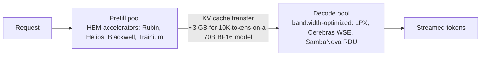
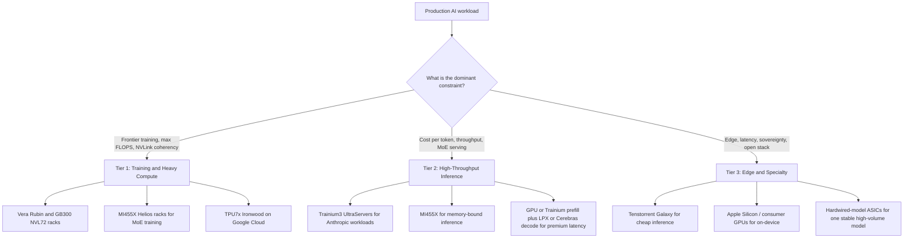

<div dir="rtl">

# زیرساخت‌های مدل‌های بزرگ زبانی (LLM Infrastructure)

توسعه و ساخت سیستم‌های عملیاتی مبتنی بر LLM نیازمند درک عمیق گزینه‌های استقرار، الگوهای مقیاس‌پذیری و الزامات پایش و بهره‌برداری است. این فصل به بررسی جامع لایه زیرساخت اختصاص دارد.

## فهرست مطالب

- [گزینه‌های استقرار](#deployment-options)
- [معماری سرویس‌دهی (Serving)](#serving-architecture)
- [الگوهای مقیاس‌پذیری](#scaling-patterns)
- [مدیریت هزینه‌ها](#cost-management)
- [پایش و سیستم‌های هشدار](#monitoring-and-alerting)
- [بازیابی پس از فاجعه (Disaster Recovery)](#disaster-recovery)
- [چشم‌انداز شتاب‌دهنده‌های سخت‌افزاری هوش مصنوعی](#ai-accelerator-landscape)
- [پرسش‌های مصاحبه](#interview-questions)
- [منابع](#references)

---

## گزینه‌های استقرار <a id="deployment-options"></a>

### ارائه‌دهندگان API در برابر میزبانی اختصاصی (Self-Hosted)

| معیار | ارائه‌دهندگان API | میزبانی اختصاصی (سلف‌هاستد) |
|---|---|---|
| زمان راه‌اندازی | چند دقیقه | چند روز تا چند هفته |
| بار عملیاتی و نگهداری | صفر | قابل توجه |
| هزینه در حجم پایین | پایین‌تر | بالاتر (هزینه‌های ثابت سرور) |
| هزینه در حجم بالا | بالاتر | پایین‌تر (مزیت صرفه به مقیاس) |
| کنترل بر میزان تأخیر | محدود | کنترل کامل |
| حریم خصوصی داده‌ها | داده‌ها از زیرساخت شما خارج می‌شوند | داده‌ها درون شبکه محلی باقی می‌مانند |
| تنوع مدل‌ها | مدل‌های ارائه‌شده توسط تأمین‌کننده | هر مدل متن‌باز یا وزن باز دلخواه |
| شخصی‌سازی | فرآیند Fine-tuning محدود به API | کنترل کامل بر تمام لایه‌ها و وزن‌ها |

### چه زمانی باید از ارائه‌دهندگان API استفاده کرد

<div dir="ltr">

```python
# Decision framework
def should_use_api(requirements: dict) -> bool:
    # Strong signals for API
    if requirements["time_to_market"] == "urgent":
        return True
    if requirements["query_volume"] < 100_000_per_month:
        return True
    if requirements["team_ml_expertise"] == "low":
        return True
    
    # Strong signals for self-hosted
    if requirements["data_residency"] == "strict":
        return False
    if requirements["latency_p99_ms"] < 100:
        return False
    if requirements["query_volume"] > 10_000_000_per_month:
        return False
    
    # Default to API for simplicity
    return True
```

</div>

### گزینه‌های میزبانی اختصاصی (سلف‌هاستد)

| گزینه | پیچیدگی | عملکرد | کاربرد |
|---|---|---|---|
| موتور vLLM | متوسط | فوق‌العاده | موتور متن‌باز پیش‌فرض برای محیط‌های عملیاتی |
| موتور SGLang | متوسط | فوق‌العاده | ترافیک‌های با پیشوند سنگین و پردازش‌های عاملی (کش رادیکس)، خروجی ساختاریافته |
| موتور TensorRT-LLM | متوسط تا بالا | بهترین (انویدیا) | اوج توان عملیاتی انویدیا؛ بک‌اند PyTorch از نسخه ۱.۰ به بعد پیش‌فرض بوده است و نیازی به بیلد جداگانه ندارد |
| پلتفرم‌های NVIDIA Dynamo / llm-d | بالا | در سطح ناوگان سرورها | ارکستراسیون در لایه بالاتر از موتورها: مسیریابی آگاه از KV، تفکیک پیش‌پر کردن (Prefill) و کدگشایی (Decode) |
| موتور TGI (متعلق به Hugging Face) | متوسط | بسیار خوب | در حالت نگهداری (مخزن در مارس ۲۰۲۶ بایگانی شد)؛ هاگینگ‌فیس اکنون vLLM یا SGLang را برای استقرارهای جدید توصیه می‌کند |
| ابزار Ollama | کم | خوب | محیط توسعه، مقیاس کوچک |
| کتابخانه llama.cpp | کم | خوب | استنتاج روی پردازنده CPU، دستگاه‌های لبه (Edge) |

**قفل کردن و پچ کردن موتورهای استنتاج.** موتورهای سرویس‌دهی امروزه به وابستگی‌هایی پر از آسیب‌پذیری‌های امنیتی (CVE) تبدیل شده‌اند. فریم‌ورک vLLM بین ۱۱ اوت تا ۲۸ سپتامبر ۲۰۲۶ بیش از ۲۰ هشدار امنیتی منتشر کرد، از جمله آسیب‌پذیری اجرای کد از راه دور هنگام بارگذاری مدل (CVE-2026-90553 که حتی با `trust_remote_code=False` کدهای مخرب را اجرا می‌کرد) و خطایی که با یک درخواست بدون احراز هویت کل موتور را از کار می‌انداخت (CVE-2026-93592) که هر دو در نسخه 0.28.0 برطرف شدند؛ ماه اکتبر نیز آسیب‌پذیری‌های دیگری مانند دسترسی به Ghostscript در دیکود تصویر را به همراه داشت. حداقل نسخه پایه برای vLLM نسخه 0.32.0 یا بالاتر است (با در نظر گرفتن مسدود بودن پیش‌فرض CORS و پایتون ۳.۱۱)؛ و نسخه 0.33.0 (۲ نوامبر) برای هر میزبانی که مدل‌های متفرقه را بارگذاری می‌کند ضروری است. موتور SGLang نیز دارای آسیب‌پذیری‌های بحرانی مانند CVE-2026-111391 و CVE-2026-93034 است؛ بنابراین هنگام اجرای نسخه v0.5.23 باید لیست مجاز `SGLANG_ZMQ_ALLOWED_PEERS` را تنظیم کنید و اندپوینت‌های دیباگ و ZMQ را درون محیط ایزوله پاد نگه دارید. ابزار Ollama نیز صرفاً برای سیستم‌های محلی توسعه‌دهندگان در نسخه 0.35.0 به بالا مناسب است تا از پیمایش مسیر `/api/pull` جلوگیری شود. جزئیات بیشتر در [زیرساخت سرویس‌دهی](../04-inference-optimization/06-serving-infrastructure.md) و [امنیت LLM](../12-security-and-access/01-llm-security.md#securing-the-ai-stack-itself) ارائه شده است.

**ثبت و ذخیره محلی وزن‌ها (Mirroring).** اکثر خطوط لوله استقرار مدل‌های وزن باز، چک‌پوینت‌ها را مستقیماً از Hugging Face بارگیری می‌کنند؛ شرکتی که انویدیا در ۳ سپتامبر ۲۰۲۶ توافق خرید آن به مبلغ ۱۲.۹۳ میلیارد دلار را تأیید کرد. صرف‌نظر از سرانجام این معامله، سرویس‌دهی از یک رجیستری داخلیِ ممیزی‌شده، وابستگی به زنجیره تأمین خارجی را حذف می‌کند و سد دفاعی محکمی در برابر حملات مخازن آلوده است.

---

## معماری سرویس‌دهی (Serving Architecture) <a id="serving-architecture"></a>

### سرویس‌دهی تک‌مدلی (Single Model Serving)

<div dir="ltr">

```
┌─────────────┐     ┌─────────────┐     ┌─────────────┐
│   Client    │────▶│   Gateway   │────▶│  LLM Server │
└─────────────┘     └─────────────┘     └─────────────┘
                           │
                           ▼
                    ┌─────────────┐
                    │    Cache    │
                    └─────────────┘
```

</div>

### سرویس‌دهی چندمدلی (Multi-Model Serving)

<div dir="ltr">

```
                    ┌────────────────────────────────┐
                    │         Load Balancer          │
                    └───────────────┬────────────────┘
                                    │
            ┌───────────────────────┼───────────────────────┐
            │                       │                       │
            ▼                       ▼                       ▼
    ┌───────────────┐       ┌───────────────┐       ┌───────────────┐
    │  OpenAI Pool  │       │  Claude Pool  │       │  Open-weight  │
    │  (API calls)  │       │  (API calls)  │       │ (self-hosted) │
    └───────────────┘       └───────────────┘       └───────────────┘
```

</div>

### الگوی مسیریاب مدل (Model Router Pattern)

<div dir="ltr">

```python
class ModelRouter:
    def __init__(self):
        self.models = {
            "simple": GPT6Luna(),
            "complex": ClaudeOpus55(),
            "code": ClaudeSonnet55(),
            "long_context": Gemini38Flash(),
            "vision": GPT6Sol()
        }
        self.classifier = QueryClassifier()
    
    async def route(self, request: Request) -> Response:
        # Classify request type
        request_type = self.classifier.classify(request)
        
        # Route to appropriate model
        model = self.models[request_type]
        
        # Execute with fallback
        try:
            return await model.generate(request)
        except RateLimitError:
            return await self.fallback(request, request_type)
    
    async def fallback(self, request: Request, original_type: str) -> Response:
        # Define fallback order
        fallbacks = {
            "simple": ["complex", "long_context"],
            "complex": ["simple"],
            "code": ["complex"]
        }
        
        for fallback_type in fallbacks.get(original_type, []):
            try:
                return await self.models[fallback_type].generate(request)
            except Exception:
                continue
        
        raise ServiceUnavailableError("All models unavailable")
```

</div>

---

## الگوهای مقیاس‌پذیری <a id="scaling-patterns"></a>

### مقیاس‌پذیری افقی (Horizontal Scaling)

<div dir="ltr">

```python
# Kubernetes HPA config for LLM service
hpa_config = """
apiVersion: autoscaling/v2
kind: HorizontalPodAutoscaler
metadata:
  name: llm-service-hpa
spec:
  scaleTargetRef:
    apiVersion: apps/v1
    kind: Deployment
    name: llm-service
  minReplicas: 2
  maxReplicas: 20
  metrics:
  - type: Resource
    resource:
      name: cpu
      target:
        type: Utilization
        averageUtilization: 70
  - type: Pods
    pods:
      metric:
        name: requests_per_second
      target:
        type: AverageValue
        averageValue: 100
"""
```

</div>

میزان استفاده از CPU برای یک پروکسی بدون حالت (Stateless API Proxy) سیگنال مناسبی است؛ اما برای پادهای سرویس‌دهنده GPU معیار بسیار ضعیفی است، زیرا CPU ممکن است بیکار باشد در حالی که حافظه و محاسبات GPU کاملاً اشباع شده است. پادهای GPU را بر اساس عمق صف درخواست‌ها، درصد اشغال کش KV، یا نسبت زمان رسیدن به اولین توکن (TTFT) نسبت به تعهدات سطح خدمت (SLO) مقیاس‌دهی کنید. همچنین به موتور اجازه دهید به جای صف‌بندی نامحدود بار اضافی را رد کند؛ در همین راستا، فریم‌ورک vLLM 0.29 پرچم‌های `--max-num-queued-reqs` و `--max-num-queued-tokens` را برای کنترل پذیرش بار معرفی کرد.

**شروع سرد (Cold Start) سرعت مقیاس‌پذیری را محدود می‌کند.** پاد GPU که دقایقی را صرف بارگذاری وزن‌ها می‌کند نمی‌تواند جهش‌های ناگهانی ترافیک را مهار کند. موتورهای استنتاج اکنون مستقیماً زمان بارگذاری را هدف گرفته‌اند: نسخه vLLM 0.30 قابلیت شروع سریع Fast Start (`--load-format ipc_cache`) را اضافه کرد که وزن‌های پساکوانتایز شده را در حافظه نگه داشته و با CUDA IPC به موتور جدید متصل می‌کند. محیط‌های مدیریت‌شده از اسنپ‌شات‌ها بهره می‌برند: سرویس AWS AgentCore Runtime V2 نمونه‌ها را از اسنپ‌شات عامل اولیه بازیابی می‌کند و زمان شروع سرد صدک ۷۵ را از ۵.۴ تا ۳۰ ثانیه به حدود ۲ ثانیه رسانده است. همواره زمان تا آماده‌به‌کار شدن واقعی (Time-to-ready) را بسنجید و ظرفیت گرم کافی برای پوشش فاصله مقیاس‌دهی حفظ کنید.

### مقیاس‌دهی سخت‌افزار GPU در میزبانی اختصاصی

| مقیاس | پردازنده‌های GPU | پیکربندی پیشنهادی |
|---|---|---|
| محیط توسعه/تست | ۱ | یک کارت منفرد L4 یا L40S |
| محیط عملیاتی کوچک | ۲ تا ۴ | کارت‌های H100 یا H200 همراه با موازی‌سازی تانسوری |
| محیط عملیاتی متوسط | ۴ تا ۸ | تعداد ۸ کارت H200 یا B200 با موازی‌سازی تانسوری |
| محیط عملیاتی بزرگ | ۸ به بالا | چند گره‌ای، یا رک‌های مقیاس بزرگ NVL72 (شامل GB300 یا Vera Rubin) برای مدل‌های عظیم MoE |

محاسبه ظرفیت را بر مبنای حافظه انجام دهید نه فقط محاسبات خام (FLOPS): حجم وزن‌ها به‌علاوه کش KV در سطح همروندی و طول زمینه مورد نظر شما، تعداد کارت‌های گرافیکی لازم را مشخص می‌کند؛ ضمن اینکه مدل‌های MoE نیازمند اقامت کامل تمامی کارشناسان (Experts) در حافظه هستند.

### معماری مبتنی بر صف (Queue-Based Architecture)

برای بارهای کاری ناهمگام با توان عملیاتی بالا:

<div dir="ltr">

```
┌─────────────┐     ┌─────────────┐     ┌─────────────┐
│  Producers  │────▶│    Queue    │────▶│  Consumers  │
└─────────────┘     │  (Redis/    │     │  (LLM       │
                    │   SQS)      │     │   Workers)  │
                    └─────────────┘     └─────────────┘
                                               │
                                               ▼
                                        ┌─────────────┐
                                        │  Results    │
                                        │  Store      │
                                        └─────────────┘
```

</div>

<div dir="ltr">

```python
class AsyncLLMProcessor:
    def __init__(self):
        self.queue = RedisQueue("llm_requests")
        self.results = RedisResults("llm_results")
    
    async def submit(self, request: Request) -> str:
        request_id = generate_id()
        await self.queue.enqueue({
            "id": request_id,
            "request": request.to_dict()
        })
        return request_id
    
    async def get_result(self, request_id: str, timeout: int = 300) -> Response:
        return await self.results.wait_for(request_id, timeout)
    
    # Worker process
    async def worker_loop(self):
        while True:
            job = await self.queue.dequeue()
            try:
                result = await self.llm.generate(job["request"])
                await self.results.store(job["id"], result)
            except Exception as e:
                await self.results.store_error(job["id"], str(e))
```

</div>

---

## مدیریت هزینه‌ها <a id="cost-management"></a>

### ردیابی و محاسبه هزینه‌ها

<div dir="ltr">

```python
class CostTracker:
    # USD per 1M tokens, standard-tier list prices as of November 2026.
    # Load these from config in production: rates, cache multipliers and tiers change often.
    PRICING = {
        "claude-opus-5-5": {"input": 4.00, "cached_input": 0.20, "output": 20.00},
        "claude-sonnet-5-5": {"input": 2.00, "cached_input": 0.10, "output": 10.00},
        "claude-haiku-5-5": {"input": 0.10, "cached_input": 0.01, "output": 0.50},
        "gpt-6-sol": {"input": 2.00, "cached_input": 0.20, "output": 10.00},
        "gpt-6.1-terra": {"input": 1.00, "cached_input": 0.05, "output": 5.00},
        "gpt-6-luna": {"input": 0.10, "cached_input": 0.01, "output": 0.50},
    }
    
    # Whole-request repricing once the prompt (cached tokens included) passes a
    # threshold: (threshold, input and cache multiplier, output multiplier).
    LONG_CONTEXT = {
        "claude-haiku-5-5": (100_000, 5.0, 5.0),  # $0.50 / $2.50 above 100K
        "gpt-6-sol": (272_000, 2.0, 1.5),         # $4 / $15 above 272K
        "gpt-6.1-terra": (272_000, 2.0, 1.5),     # $2 / $7.50 above 272K
        "gpt-6-luna": (272_000, 2.0, 1.5),        # $0.20 / $0.75 above 272K
    }
    
    def calculate_cost(
        self,
        model: str,
        uncached_tokens: int,
        output_tokens: int,
        cached_tokens: int = 0
    ) -> float:
        # Expects disjoint counts from normalize_usage, never a raw provider total.
        # Omitted for brevity: cache-write premiums and service-tier multipliers.
        pricing = self.PRICING[model]
        in_mult, out_mult = 1.0, 1.0
        if model in self.LONG_CONTEXT:
            threshold, lc_in, lc_out = self.LONG_CONTEXT[model]
            if uncached_tokens + cached_tokens > threshold:
                in_mult, out_mult = lc_in, lc_out
        input_cost = in_mult * (
            uncached_tokens * pricing["input"] + cached_tokens * pricing["cached_input"]
        ) / 1_000_000
        output_cost = out_mult * (output_tokens / 1_000_000) * pricing["output"]
        return input_cost + output_cost
    
    @staticmethod
    def normalize_usage(provider: str, usage: dict) -> dict:
        # Providers disagree on whether cached tokens sit inside the input count;
        # subtracting them from an Anthropic total undercounts spend, even below zero.
        if provider == "anthropic":
            # input_tokens already excludes cache reads and cache writes.
            # Writes are priced at the base input rate here (premium omitted above).
            return {
                "uncached": usage["input_tokens"]
                + usage.get("cache_creation_input_tokens", 0),
                "cached": usage.get("cache_read_input_tokens", 0),
                "output": usage["output_tokens"],
            }
        if provider == "openai":
            # input_tokens includes cached tokens, so subtract them
            cached = usage.get("input_tokens_details", {}).get("cached_tokens", 0)
            return {
                "uncached": usage["input_tokens"] - cached,
                "cached": cached,
                "output": usage["output_tokens"],
            }
        raise ValueError(f"No usage normalizer for provider {provider!r}")
    
    def track(self, request_id: str, provider: str, model: str, usage: dict):
        tokens = self.normalize_usage(provider, usage)
        cost = self.calculate_cost(
            model,
            tokens["uncached"],
            tokens["output"],
            tokens["cached"]
        )
        
        self.metrics.record(
            "llm_cost",
            cost,
            tags={"model": model, "request_id": request_id}
        )
        
        return cost
```

</div>

### استراتژی‌های بهینه‌سازی هزینه

| استراتژی | میزان صرفه‌جویی | نحوه پیاده‌سازی |
|---|---|---|
| مسیریابی مدل‌ها (Model routing) | ۵۰ تا ۸۰ درصد | هدایت کوئری‌های ساده به مدل‌های ارزان‌تر |
| کش کردن پرامپت‌ها (Prompt caching) | ۷۵ تا ۹۸ درصد روی پیشوند کش‌شده (۹۰ درصد در اکثر مدل‌ها) | استفاده از پیشوند ثابت؛ هزینه خواندن کش در اکثر مدل‌ها 0.1x ورودی است، از حدود 0.02x در DeepSeek تا 0.25x در Grok |
| کش کردن پاسخ‌ها (Response caching) | ۳۰ تا ۷۰ درصد روی ترافیک‌های پر از تکرار | کش‌های تطابق دقیق و کش‌های معنایی |
| بهینه‌سازی پرامپت‌ها (Prompt optimization) | ۱۰ تا ۳۰ درصد | پرامپت‌های کوتاه‌تر، خروجی‌های ساختاریافته |
| رده‌های Batch و Flex | ۵۰ درصد | استفاده از اندپوینت‌های دسته‌ای (Batch) یا رده Flex برای پردازش‌های ناهمگام |
| میزبانی اختصاصی (Self-hosting) | متغیر | در مقیاس‌های بالا می‌تواند ارزان‌تر باشد؛ هرچند هزینه اجاره GPU در سال ۲۰۲۶ افزایش یافته است |

جزئیات کامل ساختار قیمت‌گذاری، جریمه‌های پرامپت‌های بسیار طولانی، و ضرایب مربوطه در فصل [FinOps و اقتصاد توکن](04-finops-and-token-economics.md) بررسی شده است.

### هشدارهای بودجه و سقف هزینه

<div dir="ltr">

```python
class BudgetManager:
    def __init__(self, daily_budget: float, alert_threshold: float = 0.8):
        self.daily_budget = daily_budget
        self.alert_threshold = alert_threshold
    
    async def check_and_alert(self):
        today_cost = await self.get_today_cost()
        utilization = today_cost / self.daily_budget
        
        if utilization >= 1.0:
            await self.alert("CRITICAL: Daily budget exceeded", today_cost)
            # Consider enabling cost controls
            await self.enable_rate_limiting()
        elif utilization >= self.alert_threshold:
            await self.alert("WARNING: Approaching daily budget", today_cost)
    
    async def enable_rate_limiting(self):
        # Reduce throughput to stay within budget
        self.rate_limiter.set_rate(
            requests_per_minute=self.calculate_safe_rate()
        )
```

</div>

بودجه‌های داخلی سازمان خود را همواره به مراتب پایین‌تر از سقف‌های سخت‌گیرانه ارائه‌دهندگان تنظیم کنید؛ زیرا رسیدن به سقف ارائه‌دهنده سرویس کل سازمان را قطع می‌کند (Fail closed). برای نمونه در پلتفرم انتروپیک، رسیدن به سقف ماهانه خطای HTTP 429 با کد `enforced_spend_limit_reached` تولید می‌کند که تا اول ماه میلادی بعد برطرف نمی‌شود؛ بنابراین سیستم هشدار داخلی شما باید بسیار زودتر فعال شود.

---

## پایش و سیستم‌های هشدار <a id="monitoring-and-alerting"></a>

### سنجه‌های کلیدی

<div dir="ltr">

```python
LLM_METRICS = {
    # Latency
    "ttft_seconds": "Time to first token",
    "total_latency_seconds": "Total request time",
    
    # Throughput
    "requests_per_second": "Request rate",
    "tokens_per_second": "Token generation rate",
    
    # Resources
    "gpu_utilization": "GPU compute usage",
    "gpu_memory_utilization": "GPU memory usage",
    "kv_cache_utilization": "KV cache usage",
    
    # Quality (sampled)
    "quality_score": "LLM-as-judge score",
    "faithfulness_score": "RAG faithfulness",
    
    # Errors
    "error_rate": "Failed requests percentage",
    "rate_limit_hits": "Rate limit rejections",
    "refusal_rate": "Safety refusals by category (some are billed)",
    
    # Caching
    "cache_hit_rate": "Share of input tokens read from the prompt cache",
    
    # Cost
    "cost_per_request": "Average cost per request",
    "daily_cost": "Total daily spend"
}
```

</div>

### پیکربندی هشدارها

<div dir="ltr">

```yaml
alerts:
  - name: high_error_rate
    condition: error_rate > 0.05
    for: 5m
    severity: critical
    
  - name: high_latency
    condition: p99_latency > 10s
    for: 5m
    severity: warning
    
  - name: cost_spike
    condition: hourly_cost > 2 * avg_hourly_cost
    for: 1h
    severity: warning
    
  - name: quality_degradation
    condition: avg_quality_score < 3.5
    for: 30m
    severity: warning
    
  - name: gpu_memory_pressure
    condition: gpu_memory_utilization > 0.95
    for: 5m
    severity: warning

  - name: generation_probe_failing
    condition: synthetic_generation_success_rate < 1.0
    for: 2m
    severity: critical
```

</div>

آخرین هشدار موردی است که بسیاری از تیم‌ها از آن غفلت می‌کنند. اندپوینت `/health` یک موتور صرفاً نشان می‌دهد که پروسس وب زنده است، اما اثبات نمی‌کند که موتور توانایی تولید توکن دارد. یک باگ شناخته‌شده vLLM که در نسخه 0.31.0 برطرف شد، نشان داد که یک درخواست می‌تواند ترد پردازش ورودی را متوقف کند در حالی که اندپوینت سلامت همچنان کد 200 برمی‌گرداند اما تمام درخواست‌های تولید توکن هنگ می‌کردند. بنابراین یک پروب تولید ساختگی چندتوکنی را به فواصل کوتاه اجرا کنید تا از آماده بودن واقعی هر رپلیکا مطمئن شوید.

---

## بازیابی پس از فاجعه (Disaster Recovery) <a id="disaster-recovery"></a>

### تغییر مسیر خودکار میان چند ارائه‌دهنده (Multi-Provider Failover)

<div dir="ltr">

```python
class MultiProviderClient:
    def __init__(self):
        self.providers = [
            OpenAIClient(),
            AnthropicClient(),
            GoogleClient()
        ]
        self.primary = 0
    
    async def generate(self, request: Request) -> Response:
        # Try primary provider first
        try:
            return await self.providers[self.primary].generate(request)
        except (RateLimitError, ServiceError) as e:
            return await self.failover(request, e)
    
    async def failover(self, request: Request, original_error: Exception) -> Response:
        for i, provider in enumerate(self.providers):
            if i == self.primary:
                continue
            try:
                response = await provider.generate(request)
                # Log failover for monitoring
                self.log_failover(self.primary, i, original_error)
                return response
            except Exception:
                continue
        
        raise AllProvidersUnavailable("All LLM providers failed")
```

</div>

مقصد بازگشتی (Failover Target) حتماً باید یک شرکت تأمین‌کننده دیگر باشد، زیرا حوادث قطعی معمولاً کل سرویس‌های یک ارائه‌دهنده را به‌صورت همزمان متوقف می‌سازند. حادثه ۲۹ سپتامبر ۲۰۲۶ شرکت OpenAI همزمان API، ChatGPT و Codex را به مدت ۵ ساعت و ۲۰ دقیقه دچار اختلال کرد، و وضعیت انتروپیک نیز حداقل ۱۲ حادثه بحرانی را بین اوت و سپتامبر ۲۰۲۶ ثبت نموده است. مباحث مربوط به جریان استریمینگ و وضعیت گفتگو در [درگاه‌های هوش مصنوعی و مسیریابی مدل‌ها](03-ai-gateways-and-model-routing.md#fallback-and-reliability) آمده است.

### چرخه حیات مدل‌ها یک دغدغه DR است

مدلی که طبق برنامه قبلی خاموش می‌شود در واقع قطعی قابل پیش‌بینی است، و امروزه تقویم بازنشستگی در پلتفرم‌های ابری مختلف بسیار متناقض و فشرده است:

| ریسک | نمونه در سال ۲۰۲۶ | سازوکار کنترلی |
|---|---|---|
| یک مدل مشابه با تاریخ‌های بازنشستگی متفاوت در پلتفرم‌های مختلف | مدل Claude Sonnet 4.5 در Claude API و فاندری در ۳۰ نوامبر ۲۰۲۶ بازنشسته می‌شود در حالی که در Bedrock تا ۸ آوریل ۲۰۲۷ فعال است؛ مدل Opus 4.1 در ۵ اوت در Claude API بازنشسته شد اما در Bedrock تا ژانویه ۲۰۲۷ با نرخ بالاتر فعال است. مدل‌های Gemini نیز در Vertex AI تاریخ‌های بازنشستگی متفاوتی نسبت به API مستقیم دارند | کلید رجیستری مدل را بر اساس جفت (مدل، پلتفرم) تنظیم کنید نه صرفاً نام مدل |
| از دست رفتن دسترسی در حالت آماده‌به‌کار (Idle) | مدل‌های Bedrock در وضعیت Legacy مشتریان جدید را مسدود می‌کنند، و کاربران فعلی پس از ۱۵ روز بی‌تحرکی ممکن است دسترسی خود را از دست بدهند | مدل‌های فصلی و DR را طبق برنامه زمانی تست و فعال کنید، نه فقط در زمان حادثه |
| مهلت‌های زمانی کوتاه برای اطلاع‌رسانی | مدل‌های Bedrock که از ۷ سپتامبر ۲۰۲۶ عرضه شدند اطلاعیه Legacy شش ماهه یا ۴۵ روزه دارند؛ انتروپیک ۶۰ روز مهلت می‌دهد؛ و اوپن‌ای‌آی اسنپ‌شات‌های GPT-4o و مدل‌های فاین‌تیون آن‌ها را با اطلاعیه ۳ ماهه خاموش کرد | کلاس اطلاع‌رسانی را به ازای هر مدل رصد کنید؛ بر حداقل زمان اعلامی تکیه نکنید؛ یک مدل جایگزین آماده داشته باشید |
| حذف مدل‌ها توسط هاست‌های مدل‌های متن‌باز | شرکت Groq مدل‌های Llama 3.3 70B و Llama 3.1 8B را برای پلن‌های رایگان در ۱۶ اوت بازنشسته کرد | مدل‌های وزن باز را روی حداقل دو ارائه‌دهنده میزبانی مختلف توزیع و مسیریابی کنید |
| تغییر مسیر بی‌صدای نام‌های مستعار (Alias rerouting) | از ۸ اکتبر گوگل درخواست‌های `gemini-3.7-flash` را به `gemini-3.8-flash` هدایت می‌کند، بنابراین رشته نام ثابت می‌ماند اما مدل عوض می‌شود | اسنپ‌شات‌های دارای تاریخ دقیق را قفل کنید؛ در صورت تغییر شناسه مدل هشدار صادر نمایید |

### افت تدریجی و عملکرد در شرایط بحران (Graceful Degradation)

<div dir="ltr">

```python
class GracefulDegradation:
    def __init__(self):
        self.cache = ResponseCache()
        self.fallback_responses = FallbackResponses()
    
    async def handle_outage(self, request: Request) -> Response:
        # Level 1: Try cache
        cached = await self.cache.get_similar(request.query)
        if cached and cached.similarity > 0.9:
            return Response(
                content=cached.response,
                metadata={"source": "cache", "degraded": True}
            )
        
        # Level 2: Try fallback responses
        fallback = self.fallback_responses.get(request.intent)
        if fallback:
            return Response(
                content=fallback,
                metadata={"source": "fallback", "degraded": True}
            )
        
        # Level 3: Graceful error
        return Response(
            content="I am currently experiencing issues. Please try again later or contact support.",
            metadata={"source": "error", "degraded": True}
        )
```

</div>

---

## چشم‌انداز شتاب‌دهنده‌های سخت‌افزاری هوش مصنوعی <a id="ai-accelerator-landscape"></a>

فضای سخت‌افزار در سال ۲۰۲۶ با شتابی بی‌سابقه متحول شد. تعهدات ظرفیت پردازشی در قراردادهای ابری از مرز **یک تریلیون دلار** فراتر رفت، زنجیره تأمین از انحصار یک شرکت خارج شد، بزرگ‌ترین بازیگران در حال ساخت تراشه‌های اختصاصی استنتاج هستند، و گلوگاه اصلی تا ماه اکتبر به جای طراحی تراشه‌ها به محدودیت حافظه و تأمین انرژی برق منتقل شده است. این بخش تصویری دقیق برای معماران سیستم در جلسات برنامه‌ریزی ظرفیت ارائه می‌دهد.

### شرکت انویدیا: پلتفرم‌های Vera Rubin NVL72 و Blackwell Ultra

رک **Vera Rubin NVL72** پرچمدار نوین انویدیا است. انویدیا تولید کامل آن را در ۳۱ مه ۲۰۲۶ اعلام کرد و در گزارش مالی ۲۶ اوت رک‌های روبین در کلودهای CoreWeave، Google Cloud، Azure، OCI و Nebius مستقر شدند؛ در ۲۷ اکتبر نیز اوراکل کلود دسترسی عمومی به نمونه‌های Vera Rubin NVL72 را برقرار کرد. تراشه **B300** (معروف به Blackwell Ultra) که در مارس ۲۰۲۵ معرفی شد، تا سه‌ماهه منتهی به اکتبر ۲۰۲۵ به پرفروش‌ترین معماری انویدیا تبدیل شد و اکنون ستون فقرات اصلی استقرارهای انبوه به شمار می‌رود.

| مشخصه | رک Vera Rubin NVL72 | رک B300 / GB300 NVL72 |
|---|---|---|
| حافظه HBM به ازای هر GPU | مقدار ۲۸۸ گیگابایت HBM4 با پهنای باند ۱۹.۲ ترابایت بر ثانیه | مقدار ۲۸۸ گیگابایت HBM3e با پهنای باند حدود ۸ ترابایت بر ثانیه |
| ساختار رک | تعداد ۷۲ پردازنده گرافیکی Rubin به‌همراه ۳۶ پردازنده مرکزی Vera | تعداد ۷۲ پردازنده گرافیکی Blackwell Ultra به‌همراه ۳۶ پردازنده مرکزی Grace |
| کل حافظه HBM در هر رک | مقدار ۲۰.۷ ترابایت با پهنای باند حدود ۱٬۴۰۰ ترابایت بر ثانیه | حدود ۲۰ ترابایت با پهنای باند تا ۵۷۶ ترابایت بر ثانیه |
| پهنای باند تجمیعی NVLink در هر رک | مقدار ۲۱۶ ترابایت بر ثانیه | حدود ۱۳۰ ترابایت بر ثانیه |
| اوج توان پردازش FP4 در هر رک | مقدار ۳٬۶۰۰ پتافلاپس استنتاج NVFP4 (۵۰ پتافلاپس به ازای هر GPU) | مقدار ۱٬۴۴۰ پتافلاپس تنک، ۱٬۰۸۰ متراکم (حدود ۱۵ به ازای هر GPU متراکم) |
| وضعیت عرضه | تولید انبوه از ۳۱ مه ۲۰۲۶؛ عرضه عمومی روی کلود اوراکل از ۲۷ اکتبر ۲۰۲۶ | عرضه از نیمه دوم ۲۰۲۵؛ معماری پیشتاز بازار انویدیا |

هر دو دارای حافظه ۲۸۸ گیگابایت به ازای هر پردازنده هستند، اما پهنای باند روبین به مراتب بالاتر است؛ مزیت روبین بیش از آنکه در گنجاندن مدل‌های بزرگ‌تر باشد، در پردازش‌های سنگین کدگشایی (Decode) و زمینه‌های بسیار طولانی (Long-context) خود را نشان می‌دهد.

ادعای انویدیا این است که روبین هزینه هر یک میلیون توکن را به یک‌دهم GB200 می‌رساند. با این حال بنچمارک‌های مستقل مانند SemiAnalysis نشان می‌دهند خروجی به تعهدات سطح خدمت (SLO) و مدل مالکیت وابسته است (حدود ۶۷ برابر توان نسبت به هزینه در سرعت ۱۷۰ توکن در ثانیه برای مالکیت کامل، اما تنها ۶۲ درصد بهبود در مدل اجاره سه ساله در سرعت ۸۰ توکن بر ثانیه). بنچمارک مستقل Artificial Analysis در ۱۵ اکتبر برتری روبین نسبت به GB300 را صرفاً بین **۱.۱۴ تا ۱.۴۵ برابر** در توان پردازشی به ازای هر مگاوات برق ارزیابی کرد. شتاب‌دهنده‌ها را همیشه روی منحنی پارتو میان توان عملیاتی و تعامل‌پذیری در سطح SLO خود مقایسه کنید، نه بر مبنای ادعاهای تک‌کاربره.

### تفکیک مراحل پیش‌پر کردن و کدگشایی میان تراشه‌های مختلف (Cross-Chip Prefill and Decode)

الگوی برتر کاهش تأخیر در سال ۲۰۲۶، تقسیم پردازش یک درخواست میان دو نوع سیلیکون است: پردازنده‌های با حافظه HBM بالا برای مرحله محاسباتی پیش‌پر کردن (Prefill)، و قطعات بهینه‌شده در پهنای باند برای مرحله کدگشایی (Decode).

- سیستم **NVIDIA Groq 3 LPX** در ۲۴ اوت ۲۰۲۶ وارد فاز تولید کامل شد: ۲۵۶ تراشه LPU و ۱۲۸ گیگابایت حافظه فوق‌سریع SRAM به ازای هر رک. در جفت شدن با Vera Rubin، انویدیا از ترکیب روبین برای پیش‌پر کردن و LPX برای کدگشایی پشتیبانی می‌کند. نکته منفی ظرفیت است: یک رک LPX به دلیل محدودیت حجم SRAM در ورودی‌های ۱۰۰ هزار توکنی حداکثر پاسخگوی بچ سایز ۱۲ است، به همین دلیل رده‌های فوق سریع قیمت‌گذاری مجزایی دارند. این فناوری حاصل قرارداد لایسنس انویدیا با Groq در دسامبر ۲۰۲۵ بوده است.
- ترکیب **AWS Trainium به‌همراه Cerebras**: سرورهای Trainium برای مرحله پیش‌پر کردن و سیستم‌های Cerebras CS-3 برای کدگشایی متصل از طریق شبکه EFA در بستر Bedrock.
- ترکیب **AMD Helios به‌همراه Cerebras**: رک‌های Helios برای پیش‌پر کردن و موتورهای مقیاس ویفر برای کدگشایی.
- معماری **Intel و SambaNova**: پردازنده‌های گرافیکی برای پیش‌پر کردن و تراشه‌های SambaNova RDU برای کدگشایی.

<div dir="ltr">



</div>

مسئله اصلی این است که آیا زمان انتقال کش KV برتری سرعت را از بین می‌برد یا خیر. یک پرامپت ۱۰ هزار توکنی در مدل Llama-3.1-70B نیازمند انتقال حدود ۳ گیگابایت داده کش است که روی شبکه ۴۰۰ گیگابیت حدود ۶۵ میلی‌ثانیه به تأخیر اضافه می‌کند. این تفکیک زمانی توجیه دارد که خروجی معتبر منطبق بر SLO را افزایش دهد.

### پردازنده AMD MI455X و رک‌های سرور Helios

خانواده پردازنده‌های [AMD MI400](https://www.amd.com/en/products/accelerators/instinct/mi400.html) گزینه دوم معتبر در بازار است، و تراشه اصلی آن **MI455X** است که در قالب رک‌های ۷۲ پردازنده‌ای **Helios** عرضه می‌شود.

| مشخصه | شتاب‌دهنده MI455X / رک Helios |
|---|---|
| میزان حافظه | مقدار **۴۳۲ گیگابایت** HBM4 به ازای هر GPU |
| پهنای باند حافظه | مقدار ۲۳.۳ ترابایت بر ثانیه به ازای هر GPU |
| اوج توان FP4 | حدود ۴۰ پتافلاپس MXFP4 به ازای هر GPU؛ ۲.۹ اگزاTarget در هر رک Helios |
| ساختار رک | رک **Helios**: تعداد ۷۲ کارت گرافیکی MI455X، ۱۸ پردازنده EPYC Venice، شبکه Pensando |
| پشته نرم‌افزاری | پلتفرم ROCm 10.x همراه با پشتیبانی کامل از PyTorch، vLLM و SGLang |

حافظه ۴۳۲ گیگابایتی ویژگی برجسته آن است: ۵۰ درصد بیشتر از ۲۸۸ گیگابایت در B300 و روبین، در حالی که پهنای باند و محاسبات FP4 تقریباً هم‌سطح روبین است. برای سرویس‌دهی مدل‌های MoE و زمینه‌های فوق‌طولانی، این مزیت حافظه تعیین‌کننده است. شرکت AMD شکاف نرم‌افزاری را پر کرده و پلتفرم ROCm 10 به بلوغ رسیده است. آزمایشگاه‌های بزرگ مانند انتروپیک (قرارداد استقرار تا ۲ گیگاوات)، متا، مایکروسافت، اوپن‌ای‌آی و اوراکل نخستین رک‌های هلیوس را فعال کرده‌اند؛ هرچند حجم بالای تجاری در بازار OEM در اواخر ۲۰۲۶ و ۲۰۲۷ شکل می‌گیرد.

### پردازنده‌های TPU گوگل و تراشه‌های سفارشی استنتاج

شرکت‌های گوگل، متا و اوپن‌ای‌آی اکنون سخت‌افزارهای آموزش را از استنتاج تفکیک کرده‌اند:

| مالک | قطعه سیلیکونی | وضعیت | توضیحات |
|---|---|---|---|
| شرکت Google | شتاب‌دهنده TPU7x (Ironwood) | عرضه عمومی در ۳۱ مارس ۲۰۲۶ | معرفی نسخه‌های TPU 8t (آموزش) و 8i (استنتاج). در ۲۷ اکتبر ۲۰۲۶ اوراکل و گوگل اعلام کردند OCI از سال ۲۰۲۷ پردازنده‌های TPU را ارائه خواهد کرد |
| شرکت OpenAI (با همکاری Broadcom) | تراشه Jalapeño | ارسال در اواخر ۲۰۲۶، عرضه انبوه در ۲۰۲۷ | صرفاً برای استنتاج؛ توان ۱۳.۴ پتافلاپس MXFP4 و ۲۱۶ گیگابایت حافظه HBM4 به ازای هر تراشه |
| شرکت Meta | تراشه MTIA 400 | معرفی در Hot Chips، اوت ۲۰۲۶ | با اولویت آموزش؛ توان ۱۲ پتافلاپس، ۲۸۸ گیگابایت حافظه؛ نسخه ویژه استنتاج MTIA 450 در سال ۲۰۲۷ |
| شرکت AMD (شرکت Taalas) | تراشه‌های ASIC با مدل سخت‌افزاری | اعلام تصاحب در ۶ اوت ۲۰۲۶ | وزن‌های مدل روی سیلیکون حک شده‌اند: مدل Llama 3.1 8B را با سرعت ۱۷٬۰۰۰ توکن بر ثانیه اجرا می‌کند؛ هر تغییری فراتر از LoRA نیازمند ساخت مجدد تراشه است |

تراشه‌های Taalas در انتهای طیف کارایی در برابر انعطاف‌پذیری قرار دارند و تنها برای یک مدل باثبات و با حجم بسیار عظیم مقرون‌به‌صرفه هستند.

### تراشه AWS Trainium3 و قرارداد ۱۰۰ میلیارد دلاری انتروپیک

در ۲۰ آوریل ۲۰۲۶، شرکت‌های آمازون و Anthropic توافقی برای استقرار **تا ۵ گیگاوات** ظرفیت پردازشی بر پایه Trainium امضا کردند: تعهد پرداخت **بیش از ۱۰۰ میلیارد دلار طی ده سال** از سوی انتروپیک، و سرمایه‌گذاری ۵ تا ۲۰ میلیارد دلاری آمازون.

| مشخصه | تراشه Trainium3 |
|---|---|
| فرایند ساخت | معماری ۳ نانومتری |
| ساختار سرور | سرور **Trn3 UltraServer** با **۱۴۴ تراشه** در هر سیستم |
| توان محاسباتی | حدود **۴.۴ برابر** بهتر نسبت به نسل قبل Trainium2 |
| نوع حافظه | حافظه HBM3e |
| شبکه ارتباطی | شبکه NeuronLink در سطح سرور، و شبکه EFA در سطح کلاستر |

پیامد استراتژیک: آمازون اکنون یک بستر سخت‌افزاری عمودی کامل دارد (تراشه‌های Trainium + شبکه Annapurna + زیرساخت EC2 و Bedrock) که از نظر نسبت کارایی به قیمت برای مدل‌های Claude کاملاً با انویدیا رقابت می‌کند. چالش اصلی: نیازمندی به بازنویسی کرنل‌ها با **AWS Neuron SDK** به جای CUDA است که برای مقیاس‌های بزرگ کاملاً توجیه‌پذیر اما برای مقیاس‌های کوچک دشوار است.

### عرضه اولیه عمومی شرکت Cerebras (مه ۲۰۲۶)

شرکت Cerebras در ۱۳ مه ۲۰۲۶ با قیمت هر سهم ۱۸۵ دلار عرضه عمومی شد و حدود ۵.۵ میلیارد دلار سرمایه جذب کرد، و در نخستین روز معاملاتی ارزش بازار آن به حدود **۶۷ میلیارد دلار** رسید. آمازون پیش از IPO همکاری با آن را برای تفکیک پیش‌پر کردن (با Trainium) و کدگشایی (با CS-3) آغاز کرد. همچنین Cerebras سیستم جدید **CS-4** را معرفی نمود. این رویداد مسیر تأمین مالی را برای رقبای غیرانویدیایی باز کرد.

### پلتفرم Tenstorrent Galaxy Blackhole

سیستم [Galaxy از شرکت Tenstorrent](https://tenstorrent.com/hardware/galaxy) در تاریخ **۲۸ آوریل ۲۰۲۶** به عرضه عمومی رسید.

| مشخصه | سرور Galaxy Blackhole |
|---|---|
| ظرفیت هر سرور | تعداد **۳۲ تراشه Blackhole** |
| معماری پردازنده | هسته‌های RISC-V و کاشی‌های Tensix |
| اوج توان پردازش | حدود **۲۳ پتافلاپس** BlockFP8 در هر سرور |
| ظرفیت حافظه | مقدار ۱ ترابایت GDDR6 با پهنای باند ۱۶ ترابایت بر ثانیه، به‌علاوه ۶.۲ گیگابایت حافظه روی‌تراشه SRAM |
| قیمت فهرست | شروع از **۱۶۰٬۰۰۰ دلار** برای هر سرور ۳۲ تراشه‌ای در اکتبر ۲۰۲۶ |
| معماری نرم‌افزار | کنترل پلن کاملاً منبع‌باز مبتنی بر RISC-V، فریمور منبع‌باز، کامپایلر باز |

این سیستم برای دیتاسنترهای حاکمیتی و کلودهایی که خواهان فرار از انحصار نرم‌افزاری CUDA هستند گزینه‌ای اقتصادی و جذاب برای استنتاج است.

### پروژه Stargate و مقیاس سرمایه‌گذاری‌های ابری

مقیاس توسعه زیرساخت‌ها فراتر از تراشه‌ها رفته و مستقیماً به تأمین نیرو و ابعاد نیروگاه‌ها گره خورده است. پروژه **Stargate** (پلتفرم زیرساختی مشترک OpenAI با اوراکل و سافت‌بانک) در سپتامبر ۲۰۲۵ به هدف **۱۰ گیگاوات و ۵۰۰ میلیارد دلار** هدف‌گذاری شد. به گفته سم آلتمن، تعهدات دیتاسنتری این شرکت در افق هشت ساله به حدود **۱.۴ تریلیون دلار** می‌رسد. با این حال گلوگاه واقعی محدودیت‌های فیزیکی تأمین برق، بسته‌بندی پیشرفته و ظرفیت حافظه HBM در جهان است؛ ضمن اینکه مخالفت‌های محلی در آمریکا روند صدور مجوز برای دیتاسنترهای هوش مصنوعی را به چالش کشیده است.

این فشارها به بازار اجاره سرورها نیز منتقل شده است: قیمت اجاره هر کارت B200 از ۵.۸۸ دلار در اوایل اکتبر به ۶.۷۰ دلار در نوامبر ۲۰۲۶ رسید؛ در حالی که قیمت توکن‌های API به طور مداوم افت کرد. بنابراین نقطه سربه‌سر اقتصادی میان میزبانی اختصاصی و API به نفع APIها جابه‌جا شده است.

### استراتژی ناوگان سه لایه‌ای (Three-Tier Fleet Strategy)

<div dir="ltr">



</div>

| لایه | چه نیازمندی‌هایی را پوشش می‌دهد | سخت‌افزار پیش‌فرض | دلایل انتخاب |
|---|---|---|---|
| **لایه ۱: آموزش و محاسبات سنگین** | آموزش مدل‌های پیشرو، استنتاج استدلالی سنگین، مدل‌های عظیم MoE چندتریلیون پارامتری | **رک‌های Vera Rubin NVL72**، **رک‌های GB300 NVL72**، **رک‌های MI455X Helios**، **تراشه‌های TPU7x** | نیاز حیاتی به یکپارچگی حافظه در سطح NVLink و بزرگ‌ترین استخرهای حافظه HBM |
| **لایه ۲: استنتاج با توان بالا** | محصولات API، بک‌اندهای RAG، پلتفرم‌های عاملی | **تراشه‌های Trainium3**، **پردازنده‌های MI455X**، **شتاب‌دهنده‌های B300**، تفکیک پیش‌پر کردن/کدگشایی چندتراشه‌ای (مانند **Rubin + LPX**) | بهینه‌سازی توان خروجی معتبر بر اساس SLO و ثبات صدک ۹۹، متناسب با معماری MoE |
| **لایه ۳: پردازش لبه و تخصصی** | سیستم‌های فوق سریع در تأخیر، دیتاسنترهای حاکمیتی، الزام به فریمور منبع‌باز، بودجه کل پایین | **سرورهای Tenstorrent Galaxy**، **تراشه‌های Apple Silicon**، کارتهای گرافیکی تجاری، تراشه‌های اختصاصی ثابت | بهینگی هزینه نسبت به عملکرد، پشته باز، الزامات رگولاتوری منطقه‌ای |

پیام بنیادین برای سال ۲۰۲۶ این است: **هیچ معمار ارشد سیستمی دیگر پروژه‌ای جدی را منحصراً حول یک تأمین‌کننده واحد طراحی نمی‌کند.** تنوع چندتأمینی (Multi-vendor) به استاندارد جدید تبدیل شده است.

---

## پرسش‌های مصاحبه <a id="interview-questions"></a>

### پرسش: چگونه زیرساخت پاسخگویی به یک میلیون کوئری LLM در روز را طراحی می‌کنید؟

**پاسخ قوی:**
حجم ۱ میلیون کوئری در روز معادل میانگین ۱۲ درخواست در ثانیه است، با این احتمال که در ساعات اوج بار به ۳ تا ۵ برابر این مقدار برسد. رویکرد من به این شرح است:

**معماری:**
- استفاده از توزیع‌کننده بار (Load Balancer) در سراسر چندین اندپوینت و منطقه ابری
- بهره‌گیری از مسیریاب مدل (Model Router) برای بهینه‌سازی هزینه (ارسال پرسش‌های ساده به مدل‌های سبک‌تر)
- لایه کش Redis برای پرسش‌های متداول و پرکاربرد
- معماری صف‌بندی‌شده ناهمگام برای بارهای کاری غیربلادرنگ

**بهینه‌سازی هزینه در این مقیاس حیاتی است:**
- هدایت ۶۰ تا ۷۰ درصد درخواست‌های ساده به یک مدل بسیار ارزان (مانند GPT-6 Luna یا Claude Haiku 5.5 با حفظ اندازه پرامپت زیر سقف ۱۰۰ هزار توکن)
- حفظ ثبات پیشوند پرامپت‌ها برای بهره‌مندی حداکثری از کش ارائه‌دهنده، به‌همراه کش معنایی با هدف اصابت بالای ۳۰ درصد
- استفاده از رده‌های Batch یا Flex برای درخواست‌های غیرفوری با تخفیف ۵۰ درصدی
- در این مقیاس، میزبانی محلی برای وظایف تخصصی مشخص از نظر اقتصادی کاملاً رقابتی می‌شود

**قابلیت اطمینان و پایداری:**
- ساختار چندتأمینی همراه با بازگشت خودکار میان ارائه‌دهندگان مختلف (نه صرفاً بین مدل‌های یک شرکت)
- محدودسازی نرخ درخواست (Rate Limiting) به ازای هر کاربر برای پیشگیری از سوءاستفاده
- معماری مبتنی بر صف جهت مهار جهش‌های ناگهانی ترافیک
- افت عملکرد تدریجی (Graceful degradation) در زمان بروز قطعی نزد ارائه‌دهندگان

**پایش و مانیتورینگ:**
- رصد هزینه‌ها به‌صورت بلادرنگ همراه با هشدارهای چندسطحی بودجه
- پایش صدک‌های تأخیر (p50، p95، p99)
- ارزیابی مداوم کیفیت خروجی با نمونه‌گیری دوره‌ای
- ردگیری نرخ خطاها و برخوردهای نرخ مجاز (Rate limit hits)

در حجم ۱ میلیون کوئری با فرضیات میانگین ۲ هزار توکن ورودی و ۲ هزار توکن خروجی، هزینه یک مدل رده متوسط (نرخ ۲ / ۱۰ دلار) حدود ۲۴ هزار دلار در روز است. مسیریابی ۶۵ درصد ترافیک به یک مدل ارزان قیمت این صورت‌حساب را به حدود ۹ هزار دلار در روز می‌رساند. توکن‌های خروجی بخش عمده هزینه را تشکیل می‌دهند، بنابراین تعیین سقف دقیق برای طول خروجی مهم‌ترین اهرم بعدی صرفه‌جویی است.

### پرسش: چه زمانی میزبانی اختصاصی (سلف‌هاستد) را به استفاده از APIهای ابری ترجیح می‌دهید؟

**پاسخ قوی:**
چارچوب تصمیم‌گیری من شامل چندین فاکتور اساسی است:

**استفاده از ارائه‌دهندگان API زمانی که:**
- حجم کوئری‌ها کمتر از ۱ میلیون درخواست در ماه است (نقطه سربه‌سر هزینه)
- زمان ورود به بازار (Time-to-Market) یک اولویت فوری است
- تیم فاقد تجربه عمیق در مهندسی زیرساخت‌های GPU است
- دسترسی فوری به جدیدترین مدل‌های مرزی جهان ضروری است
- حجم بار کاری متغیر و غیرقابل پیش‌بینی است

**انتخاب میزبانی اختصاصی (Self-host) زمانی که:**
- الزامات قانونی و امنیتی خروج داده‌ها از شبکه سازمان را ممنوع می‌کنند
- حجم پردازش ماهانه از ۱۰ میلیون کوئری فراتر می‌رود (صرفه‌جویی مقیاس)
- نیاز به تأخیر زیر ۱۰۰ میلی‌ثانیه در صدک ۹۹ وجود دارد
- نیاز به شخصی‌سازی وزن‌های مدل یا فرآیندهای فاین‌تیونینگ اختصاصی است
- کنترل کامل بر رفتار مدل و حذف تغییرات ناگهانی سمت سرور ارائه‌دهنده الزامی است

**رویکرد ترکیبی (Hybrid) معمولاً بهترین نتیجه را به همراه دارد:**
- میزبانی محلی برای بارهای کاری پایدار، پرتکرار و با حجم بالا
- استفاده از API برای جهش‌های ترافیکی پیش‌بینی‌نشده و مدل‌های تخصصی
- استفاده از API به‌عنوان مسیر جایگزین (Fallback) در صورت بروز مشکل در سرورهای محلی

هزینه‌های پنهان میزبانی اختصاصی را نباید نادیده گرفت: خرید یا اجاره سرورهای گران‌قیمت، زمان مهندسی برای مدیریت و عیب‌یابی، و پچ کردن مداوم موتورهای سرویس‌دهی که مدام آسیب‌پذیری‌های امنیتی منتشر می‌کنند (حداقل نیازمند ۱ تا ۲ مهندس زیرساخت اختصاصی). در بازار ۲۰۲۶ که هزینه اجاره سرورها بالا رفته و مدل‌های کوچک API بسیار ارزان شده‌اند، توجیه سلف‌هاستد امروزه بیشتر بر پایه امنیت، تأخیر و استقلال شکل می‌گیرد تا صرفاً قیمت.

### پرسش: چگونه یک شتاب‌دهنده سخت‌افزاری یا پلتفرم سرویس‌دهی جدید را برای ناوگان زیرساختی خود ارزیابی می‌کنید؟

**پاسخ قوی:**
من هرگز کار را با ادعای تبلیغاتی تولید توکن در ثانیه (که معمولاً روی بچ سایز ۱ گزارش می‌شود و در پروداکشن وجود ندارد) آغاز نمی‌کنم. فرآیند ارزیابی من به این شرح است:

۱. **بازپخش الگوی ترافیک واقعی سازمان.** بارهای کاری عاملی چندنوبته، دارای زمینه‌های طولانی و با استفاده مکرر از پیشوندها هستند؛ بنابراین از تریس‌های واقعی بازپخش‌شده یا بنچمارک‌های عاملی مانند AgentX استفاده می‌کنم نه بارهای ساختگی تک‌نوبته.
۲. **ترسیم منحنی پارتو (Pareto Curve)** میان توان عملیاتی کل و میزان تعامل‌پذیری هر کاربر، و قرائت نتایج در سطح تعهدات خدمت (SLO) سازمان. تفاوت میان ادعاهای تبلیغاتی و واقعیت در همین نقطه آشکار می‌شود (مثلاً تفاوت ۶۷ برابری در برابر برتری ۱.۱۴ برابری روبین بر مبنای توان بر مگاوات).
۳. **بررسی ظرفیت حافظه در وهله اول:** حجم وزن‌ها به‌علاوه کش KV در حداکثر همروندی، اقامت کامل کارشناسان در مدل‌های MoE، و در معماری‌های تفکیک‌شده هزینه انتقال کش میان استخرها (حدود ۳ گیگابایت برای پرامپت ۱۰ هزار توکنی در مدل ۷۰ میلیاردی).
۴. **محاسبه هزینه و پختگی پشته نرم‌افزاری.** عدم بهینگی کرنل‌ها می‌تواند نتایج را معکوس کند؛ تست‌ها باید روی همان نسخه دقیق موتوری انجام شوند که در پروداکشن استفاده خواهد شد.
۵. **سنجش ریسک تأمین و قفل شدن به تأمین‌کننده:** تاریخ‌های تحویل واقعی، تعهدات دوره‌ای اجاره، و میزان کدهای وابسته به CUDA که به سیستم تحمیل می‌شود.

در نهایت، پیش از هرگونه تعهد مالی سنگین، بخشی از ترافیک سایه (Shadow Traffic) پروداکشن را روی آن مستقر کرده و عملکرد را در عمل می‌سنجم.

---

## منابع <a id="references"></a>

- مستندات vLLM: https://docs.vllm.ai/
- مستندات SGLang: https://github.com/sgl-project/sglang
- مستندات TensorRT-LLM: https://github.com/NVIDIA/TensorRT-LLM
- مستندات NVIDIA Dynamo: https://github.com/ai-dynamo/dynamo
- مخزن Text Generation Inference (در حالت نگهداری): https://github.com/huggingface/text-generation-inference
- مستندات NVIDIA Vera Rubin NVL72: https://www.nvidia.com/en-us/data-center/vera-rubin-nvl72/
- مستندات NVIDIA Groq 3 LPX: https://nvidianews.nvidia.com/news/nvidia-groq-3-lpx-now-in-full-production-with-world-class-speed-for-agentic-ai
- تحلیل SemiAnalysis پیرامون استنتاج عاملی در Vera Rubin NVL72: https://newsletter.semianalysis.com/p/vera-rubin-nvl72-agentic-inference
- گزارش Artificial Analysis پیرامون بنچمارک AA-AgentPerf در Vera Rubin NVL72: https://artificialanalysis.ai/articles/vera-rubin-nvl72-agentperf
- هشدار امنیتی vLLM با شناسه GHSA-4xqp-c3mv-qff7: https://github.com/vllm-project/vllm/security/advisories/GHSA-4xqp-c3mv-qff7
- مستندات چرخه حیات مدل‌های Amazon Bedrock: https://docs.aws.amazon.com/bedrock/latest/userguide/model-lifecycle.html
- نسخه‌ها و تاریخ‌های بازنشستگی مدل‌ها در Vertex AI: https://docs.cloud.google.com/vertex-ai/generative-ai/docs/learn/model-versions
- توضیحات انتشار پلتفرم AMD ROCm: https://rocm.docs.amd.com/en/latest/about/release-notes.html
- بیانیه مالی شرکت AMD برای سه‌ماهه سوم ۲۰۲۶ (۳ نوامبر ۲۰۲۶): https://newsroom.amd.com/documents/2026/11/84f4476b-f064-4f0f-957c-fe484853e178.pdf?download=1
- اطلاعیه همکاری اوراکل و گوگل در ارائه TPUها روی OCI (۲۷ اکتبر ۲۰۲۶): https://www.googlecloudpresscorner.com/2026-10-27-Oracle-Brings-Google-TPUs-to-Oracle-Cloud-Infrastructure
- گزارش مجله Scientific American از نتایج آرای مردمی پیرامون دیتاسنترها: https://www.scientificamerican.com/article/2026-election-results-show-widespread-opposition-to-ai-data-centers/
- شاخص‌های قیمت اجاره سیلیکون در Silicon Data: https://www.silicondata.com/products/silicon-index/b200
- ساختار قیمت‌گذاری OpenAI: https://developers.openai.com/api/docs/pricing
- ساختار قیمت‌گذاری Anthropic: https://platform.claude.com/docs/en/about-claude/pricing

---

*مبحث بعدی: [خطوط لوله CI/CD برای برنامه‌های LLM](02-cicd.md)*

</div>