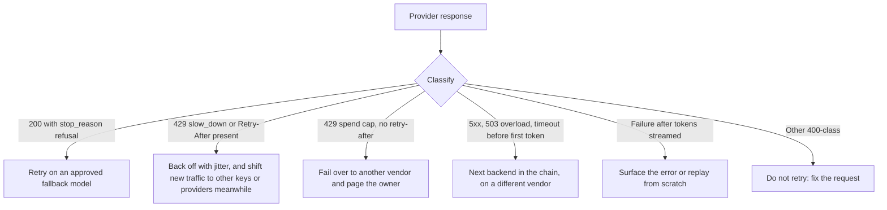

# درگاه‌های هوش مصنوعی و هدایت مدل (AI Gateways and Model Routing)

دلیل استفاده از یک لایه هدایت و مسیریابی (Routing Layer) اکنون تجربی و اثبات‌شده است، نه صرفاً یک آرمان تئوریک. طبق گزارش سال ۲۰۲۶ شرکت Datadog درباره وضعیت مهندسی هوش مصنوعی (State of AI Engineering)، **۶۹٪ شرکت‌ها سه مدل یا بیشتر را در محیط پروداکشن اجرا می‌کنند**، و **خطاهای محدودیت نرخ (Rate-limit) یا کمبود ظرفیت، بزرگ‌ترین حالت شکست منفرد در پروداکشن هستند** (حدود ۵٪ از درخواست‌ها با شکست مواجه می‌شوند و تقریباً ۶۰٪ از این شکست‌ها ناشی از کمبود ظرفیت است). دیدگاه خود Datadog این است: پیچیدگی عملیاتی، و نه هوش مدل، اکنون مانع اصلی برای دستیابی به هوش مصنوعی مطمئن در مقیاس بالا محسوب می‌شود.

به محض اینکه به چندین مدل وابسته شوید و حجم ترافیک شما غیرجزئی باشد، هر ارائه‌دهنده منفرد (Single provider) به یک نقطه شکست منفرد (SPOF) تبدیل می‌شود؛ و محدودیت‌های نرخ (Rate limits)، نه کیفیت مدل، مواردی هستند که ساعت ۲ بامداد شما را بیدار و احضار (Page) می‌کنند. یک **درگاه هوش مصنوعی (AI Gateway)** ابزار استاندارد برای کاهش این ریسک است. این فصل به بررسی وظایف آن، نحوه عملکرد مسیریابی و بازگشت اضطراری (Fallback)، چشم‌انداز ابزارهای سال ۲۰۲۶، و زمان نیاز واقعی شما به آن می‌پردازد.

## فهرست مطالب

- [درگاه هوش مصنوعی چیست](#درگاه-هوش-مصنوعی-چیست-what-an-ai-gateway-is)
- [استراتژی‌های هدایت و مسیریابی (Routing Strategies)](#استراتژیهای-هدایت-و-مسیریابی-routing-strategies)
- [بازگشت اضطراری و پایایی (Fallback and Reliability)](#بازگشت-اضطراری-و-پایایی-fallback-and-reliability)
- [چشم‌انداز ابزارهای ۲۰۲۶ (The 2026 Tool Landscape)](#چشمانداز-ابزارهای-۲۰۲۶-the-2026-tool-landscape)
- [الگوهای معماری (Architecture Patterns)](#الگوهای-معماری-architecture-patterns)
- [امن‌سازی درگاه (Securing the Gateway)](#امنسازی-درگاه-securing-the-gateway)
- [آیا در حال حاضر به یک درگاه نیاز دارید؟](#آیا-در-حال-حاضر-به-یک-درگاه-نیاز-دارید-do-you-need-a-gateway-yet)
- [پرسش‌های مصاحبه (Interview Questions)](#پرسشهای-مصاحبه-interview-questions)
- [مراجع (References)](#مراجع-references)

---

## درگاه هوش مصنوعی چیست (What an AI Gateway Is)

یک درگاه هوش مصنوعی یا AI Gateway (که به آن LLM gateway، LLM proxy یا LLM router نیز گفته می‌شود) یک **صفحه کنترل (Control Plane) بین برنامه‌های کاربردی شما و ارائه‌دهندگان مدل** است که یک API سازگار و یکپارچه (تقریباً همیشه سازگار با فرمت OpenAI) را در معرض استفاده قرار می‌دهد و دغدغه‌های فراگیر و مشترکی را متمرکز می‌کند که در غیر این صورت در سراسر تمام سرویس‌ها پخش می‌شدند.

| وظیفه (Job) | عملکرد آن (What it does) |
|---|---|
| رابط یکپارچه (Unified API) | ارائه یک اینترفیس سازگار با مدل OpenAI در میان ارائه‌دهندگان مختلف؛ بدون نیاز به چسب‌های کدنویسی مجزا برای هر ارائه‌دهنده |
| هدایت مدل (Model routing) | انتخاب اینکه کدام مدل/استقرار (Deployment) به هر درخواست پاسخ دهد |
| زنجیره‌های بازگشت (Fallback chains) | در صورت بروز خطای قابل تکرار (Retryable)، تلاش مجدد با ارائه‌دهنده/مدل بعدی در یک لیست اولویت‌بندی‌شده |
| توزیع بار (Load balancing) | پخش ترافیک روی کلیدها (Keys)، مناطق (Regions)، استقرارها، و ارائه‌دهندگان مختلف |
| تلاش مجدد همراه با عقب‌نشینی (Retries with backoff) | عقب‌نشینی نمایی (Exponential backoff) به همراه نوسان تصادفی (Jitter)، با رعایت هدر `Retry-After` |
| مدیریت محدودیت نرخ (Rate-limit handling) | تشخیص خطاهای 429، دوره استراحت (Cooldown) برای استقرارهای مسدودشده، و هدایت مجدد ترافیک |
| کلیدهای مجازی و بودجه‌ها (Virtual keys + budgets) | کلیدهای مجزا به ازای هر تیم یا کلید با بودجه دلاری و سقف‌های سخت‌گیرانه (Hard caps) |
| ردیابی هزینه (Spend tracking) | انتساب هزینه‌ها در سطح توکن و دلار به ازای هر کلید، تیم، یا مدل |
| پایش‌پذیری و مشاهده‌پذیری (Observability) | ردگیری‌های متمرکز (Centralized traces): چه کسی فراخوانی کرد، چه مواردی امتحان شد، چرا شکست خورد، و کدام مدل برنده شد |
| کش‌سازی (Caching) | کش‌سازی تطابق دقیق (Exact-match) و معنایی (Semantic) جهت کاهش هزینه و تاخیر |
| حصارهای ایمنی / داده‌های حساس (Guardrails / PII) | فیلتر کردن و پالایش/سانسور (Redaction) پرامپت‌ها و پاسخ‌ها در نقطه گلوگاه ورودی |

مدل ذهنی: یک درگاه، مسئله اتصال و چسب کدنویسی `N ارائه‌دهنده × M دغدغه` را در کد برنامه به یک نقطه گلوگاه واحد با اعمال سیاست‌ها تبدیل می‌کند. هزینه آن، یک پرش شبکه (Network hop) اضافی و مؤلفه‌ای است که باید دسترسی‌پذیری بالای (High Availability) آن را حفظ کنید، که تنش اصلی در ادامه خواهد بود.

---

## استراتژی‌های هدایت و مسیریابی (Routing Strategies)

استراتژی‌های هدایت و مسیریابی، نردبانی از پیچیدگی و بار محاسباتی (Overhead) فزاینده را تشکیل می‌دهند. به عنوان یک دیدگاه تقریبی از مقیاس (آمارهای ارائه‌دهندگان و متخصصان، صرفاً در حد مرتبه بزرگی): هدایت مبتنی بر قانون (Rule-based) کمتر از ۱ میلی‌ثانیه، هدایت مبتنی بر امبدینگ/معنایی حدود ۵ میلی‌ثانیه، و طبقه‌بندهای سنگین‌تر ML یا روش LLM-as-router حدود ۵۰ تا ۱۰۰ میلی‌ثانیه اضافه می‌کنند؛ همه این‌ها در برابر تاخیر معمول ۵۰۰ تا ۲۰۰۰ میلی‌ثانیه‌ای خود مدل قرار دارند.

| استراتژی (Strategy) | مبنای تصمیم‌گیری | بهترین کاربرد | سربار (Overhead) | حالت‌های شکست (Failure modes) |
|---|---|---|---|---|
| حالت ایستا / دستی (Static / manual) | مدل کدنویسی‌شده به‌صورت سخت (Hard-coded) به ازای هر مسیر | بارهای کاری ساده و قابل پیش‌بینی | حدود ۰ میلی‌ثانیه | شکننده؛ عدم انطباق با قطعی‌ها یا تغییرات قیمت |
| مبتنی بر تسک (Task-based) | نگاشت نوع تسک به یک مدل | آرایه‌شناسی (Taxonomy) مشخص از تسک‌ها | کمتر از ۱ میلی‌ثانیه | اشتباه در طبقه‌بندی؛ قدیمی و منسوخ شدن آرایه‌شناسی تسک‌ها |
| مبتنی بر هزینه (Cost-based) | ارزان‌ترین مدلی که شروط را برآورده کند | سقف‌های هزینه، کارهای دسته‌ای (Batch) | کمتر از ۱ میلی‌ثانیه | می‌تواند باعث افت کیفیت شود؛ مدل ارزان‌تر ممکن است با محدودیت نرخ مواجه شود |
| مبتنی بر تاخیر (Latency-based) | کمترین تاخیر مشاهده‌شده یا مورد انتظار | تجربه کاربری بی‌درنگ (Real-time UX) | حدود ۱ تا ۵ میلی‌ثانیه | هجوم ترافیک به سمت یک اندپوینت سریع؛ چولگی ناشی از راه‌اندازی اولیه (Cold-start skew) |
| مبتنی بر قابلیت (Capability-based) | قابلیت مورد نیاز (کانتکست طولانی، بینایی، ابزارها) | نیازهای ناهمگن و متنوع | ۱ تا ۵ میلی‌ثانیه | تخصیص بیش از حد منابع (Over-provisioning) به مدل «بهترین» |
| معنایی (Semantic) | امبد کردن درخواست، تطبیق با یک مسیر | تفکیک قصد (Intent dispatch)، دشواری مختلط | حدود ۵ تا ۵۰ میلی‌ثانیه | انحراف امبدینگ (Embedding drift)؛ حالت‌های مبهم دنباله توزیع؛ نیاز به تنظیم دقیق آستانه |
| مدل LLM به عنوان روتِر (LLM-as-router) | یک مدل LLM کوچک درخواست را طبقه‌بندی و انتخاب می‌کند | موارد مبهمی که روش امبدینگ از دست می‌دهد | حدود ۵۰ تا ۱۰۰ میلی‌ثانیه | اضافه شدن یک فراخوانی LLM با هزینه و سطح خطای مختص به خود |
| آبشاری (Cascade) | اول مدل ارزان، ارتقا به مدل قوی‌تر در صورت اعتماد پایین | تعادل هزینه و کیفیت در مقیاس بالا | ترتیبی (Sequential) | هزینه مضاعف روی کوئری‌های ارتقایافته؛ امتیاز اعتماد پر از نویز |
| آگاه از کش KV-cache (در میزبانی شخصی) | کدام نسخه همتاسازی‌شده قبلاً پیشوند پرامپت را در کش KV نگه داشته است | ناوگان‌های خودمیزبان با پیشوندهای مشترک و ایجنت‌های چندمرحله‌ای | کم | ایجاد نقاط داغ (Hot-spotting) روی پیشوندهای محبوب؛ اندیس کش منسوخ |

سه نکته که در عمل اهمیت دارند. **هدایت معنایی (Semantic routing)** یک مسیر را بر اساس شباهت امبدینگ و بدون فراخوانی LLM انتخاب می‌کند؛ یک الگوی رایج پروداکشن، یک ساختار ترکیبی دو مرحله‌ای است که اکثریت قاطع درخواست‌ها را به‌صورت معنایی مدیریت می‌کند و موارد مبهم انتهای توزیع (Ambiguous tail) را به یک LLM-as-router می‌فرستد (ابزار vLLM Semantic Router، در نسخه v0.4.0 از ۲۷ سپتامبر ۲۰۲۶، یک پیاده‌سازی متن‌باز در این زمینه است). مدل‌های تصمیم‌گیری (Decision models) پله جدیدتری در این میان هستند: آنها به جای متن، یک پاسخ تایپ‌شده (گزاره منطقی، انتخاب یا امتیاز) را به همراه احتمال بازمی‌گردانند، چه به‌صورت میزبانی‌شده (Decisions API شرکت OpenAI که فقط برای ورودی صورت‌حساب صادر می‌کند) یا روی مدل‌های باز از طریق vLLM و SGLang؛ [تم ۱۶ در Research Radar](../RESEARCH-RADAR.md#16-decision-models-typed-answers-with-probabilities) جزئیات را پوشش می‌دهد. آستانه‌ها را بر روی ترافیک واقعی خود کالیبره کنید، زیرا مقالات اولیه از احتمالات با اعتماد بیش از حد پایین (Underconfident) و مدل‌هایی گزارش داده‌اند که وضعیت را به‌درستی می‌خوانند اما همچنان اکشن اشتباه را انتخاب می‌کنند.

روش‌های **آبشاری (Cascades)** پربازده‌ترین راهکار برای کاهش هزینه هستند: ابزار RouteLLM (توسعه‌یافته توسط UC Berkeley / LMSYS، کنفرانس ICLR 2025) گزارش داد که با هدایت تنها کسری از فراخوانی‌ها به یک مدل پیشرو، به حدود ۹۵٪ کیفیت آن مدل دست یافته و کاهش هزینه‌ای در بازه ۴۵ تا ۸۵ درصد را ثبت کرده است. این بازه را به عنوان سقف ویژه بنچمارک در نظر بگیرید، نه یک تضمین قطعی؛ نرخ ارتقا (Escalation rate) متغیر زنده هزینه است و آبشاری که بیشتر ترافیک را ارتقا دهد، صرفه‌جویی کمی خواهد داشت. شکاف بین سطوح قیمتی عمیق است و درخواست ارتقایافته هزینه تمام فراخوانی‌هایی را که لمس کرده است پرداخت می‌کند. نردبان سه سطحی OpenAI از زمان عرضه GPT-6.1 Terra (در ۲۶ اکتبر، ۱ دلار ورودی / ۵ دلار خروجی) بازگشته است: نسبت Luna (با ۰.۱۰ / ۰.۵۰ دلار) به Terra برابر ۱۰ برابر است و نسبت Luna به Sol (با ۲ / ۱۰ دلار) برابر ۲۰ برابر است؛ بنابراین ارتقای Luna به Sol حدود ۲۱ برابر یک درخواست فقط-Luna هزینه دارد، در حالی که یک گام میانی با Terra می‌تواند ترافیک با دشواری متوسط را با نصف قیمت Sol پاسخ دهد. فرآیندهای آبشاری اکنون به یک الگوی محصول واقعی نیز تبدیل شده‌اند: ویژگی GitHub Copilot Fusion (عرضه عمومی GA در ۲۸ اکتبر ۲۰۲۶) با گردش‌کارهای Single ،Cascade و Critique در سطوح تلاش Standard ،High یا Max ترافیک را بین مدل‌ها هدایت می‌کند.

هدایت **آگاه از کش KV (KV-cache-aware routing)** تصمیم‌گیری را برای ناوگان‌های خودمیزبان به لایه پایین‌تر از ارائه‌دهنده منتقل می‌کند: انتخاب‌کننده اندپوینت در Kubernetes Gateway API Inference Extension (که در آگوست ۲۰۲۶ به پروژه llm-d منتقل شد) و روتِر NVIDIA Dynamo هر درخواست را به نسخه‌ای می‌فرستند که کش آن از قبل پیشوند پرامپت را نگه‌داری می‌کند، و گوگل برای GKE Inference Gateway چندکلاستره خود، سربار روتینگ زیر ۱٪ را گزارش کرده است.

هدایت و بازگشت اضطراری با هم ترکیب می‌شوند: در مسیر موفق (Happy path) بر اساس هزینه/کیفیت/تاخیر هدایت کنید، و در مسیر ناموفق (Unhappy path) برای اطمینان‌پذیری به ارائه‌دهندگان دیگر بازگردید (Fallback). یک سیستم آبشاری اساساً یک هدایت مبتنی بر کیفیت است که قابلیت بازگشت اضطراری اطمینان‌بخش در آن تعبیه شده است.

---

## بازگشت اضطراری و پایایی (Fallback and Reliability)

این بخش مستقیماً به داده‌های گزارش Datadog پاسخ می‌دهد: محدودیت‌های نرخ عامل بیشتر شکست‌های محیط پروداکشن هستند، و سازوکار بازگشت اضطراری پادزهر آن است.

**زنجیره‌های بازگشت (Fallback chains)** هر زمان که ارائه‌دهنده اصلی دچار یک شکست *قابل تکرار (Retryable)* شود (خطای محدودیت نرخ 429، خطای 5xx، انقضای تایم‌اوت، یا عدم یافتن مدل)، درخواست را بر روی ارائه‌دهنده/مدل بعدی مجدداً امتحان می‌کنند. خطاهای کلاس 429 و 5xx را فقط پس از طبقه‌بندی دقیق آنها مجدداً امتحان کنید؛ هرگز خطاهای سمت کلاینت کلاس 400 را دوباره امتحان نکنید، زیرا این کار فقط سهمیه (Quota) را هدر می‌دهد.

**تلاش‌های مجدد اصولی (Retries done right)** از سه قانون پیروی می‌کنند: عقب‌نشینی نمایی (Exponential backoff - در هر شکست زمان بیشتری صبر کنید)، نوسان تصادفی (Jitter - زمان انتظار را تصادفی کنید تا کلاینت‌ها همزمان امتحان نکنند و ازدحام ناگهانی Thundering herd ایجاد نشود که قطعی را وخیم‌تر کند)، و رعایت هدر `Retry-After` (ارائه‌دهندگان OpenAI و Anthropic آن را روی خطاهای معمولی 429 ارسال می‌کنند؛ از رابطه `max(retry_after, computed_backoff)` استفاده کنید). نادیده گرفتن `Retry-After` رایج‌ترین باگ در پیاده‌سازی عقب‌نشینی است.

**انشعاب بر اساس کد خطا، نه صرفاً کد وضعیت (Status):** هر خطای 429 به معنای «کمی بعد دوباره تلاش کنید» نیست. از ۲ سپتامبر ۲۰۲۶، شرکت OpenAI خطای 429 را با کد `slow_down` در زمان‌هایی که ترافیک بسیار سریع اوج می‌گیرد بازمی‌گرداند (به‌آرامی ترافیک را بالا ببرید و به `Retry-After` احترام بگذارید) و خطای 503 را در اضافه بار موقت مدل صادر می‌کند. سقف هزینه ماهانه در Anthropic خطای 429 را با کد `error_code: enforced_spend_limit_reached` و بدون هدر `retry-after` برمی‌گرداند: هیچ تلاش مجددی قبل از روز اول ماه بعد موفق نخواهد شد، بنابراین باید فوراً به ارائه‌دهنده دیگر منتقل شوید (Failover) و مسئول مربوطه را پیج (Page) کنید. همچنین در مدل‌های Claude Fable 5.1، Fable 5، Opus 5.5، Opus 5 و Sonnet 5.5، رد درخواست توسط طبقه‌بند ایمنی به عنوان پاسخ HTTP 200 همراه با `stop_reason: "refusal"` و یک دسته‌بندی در `stop_details` می‌آید. با این پاسخ به جای یک موفقیت، مانند یک سیگنال هدایت و روتینگ برخورد کنید؛ قابلیت بتای سمت سرور Anthropic به نام `fallbacks: "default"` روی مدلی که برای آن دسته توصیه می‌کند تلاش مجدد انجام می‌دهد (مقاصد مجاز Fable 5.1 شامل Claude Opus 4.8 و Opus 5 هستند).

**تغییر مسیر اضطراری (Failover) میان ارائه‌دهندگان مختلف، نه فقط میان مدل‌ها:** قطعی‌ها معمولاً تمام سطح خدمات یک ارائه‌دهنده را به‌طور همزمان از کار می‌اندازند. حادثه ۲۹ سپتامبر ۲۰۲۶ شرکت OpenAI، کل API (از جمله Agents API)، ChatGPT و Codex را به مدت حدود ۵ ساعت و ۲۰ دقیقه دچار اختلال کرد، و فید وضعیت Anthropic حداقل ۱۲ حادثه بزرگ یا بحرانی را بین ۱۶ آگوست تا ۲۹ سپتامبر ۲۰۲۶ ثبت کرده است. زنجیره‌ای که فقط به یک مدل هم‌خانواده در همان ارائه‌دهنده سوئیچ کند، از چنین حوادثی جان سالم به در نخواهد برد.

**تغییر مسیر در جریان استریمینگ (Streaming failover) پنجره زمانی محدودی دارد:** شما فقط پیش از ارسال اولین توکن می‌توانید تغییر مسیر تمیزی داشته باشید. گیت‌وی Envoy AI Gateway 1.1 (در ۲۱ آگوست ۲۰۲۶) پارامتر `streamIdleTimeout` را اضافه کرد که اگر هیچ توکنی به موقع نرسد، به بک‌اند بعدی سوئیچ می‌کند. پس از اینکه استریم توکن‌ها آغاز شد، چاره کار یا بازپخش از ابتدا است (تولید خروجی تکراری که کلاینت باید آن را دور بیندازد) یا نمایش صریح خطا به کاربر.

**وضعیت مکالمه (Conversation state) همیشه قابل انتقال نیست:** مدل‌های Claude Fable 5.1، Opus 5.5، Sonnet 5.5 و Haiku 5.5 بلوک‌های تفکر (Thinking blocks) را به مدل و مکالمه مقید می‌کنند: بلوک‌هایی که مدل جایگزین نمی‌تواند بخواند، بدون هیچ هشداری حذف می‌شوند؛ و در حساب‌هایی که در ۳۱ آگوست ۲۰۲۶ یا پس از آن ایجاد شده‌اند، تغییر در پیشوند قبل از یک بلوک تفکر منجر به خطای 400 می‌شود. بلوک‌های Sonnet 5.5 و Haiku 5.5 همچنین به حساب تولیدکننده وابسته هستند. درگاهی که یک ایجنت چندمرحله‌ای را در میانه مکالمه به مدل یا حسابی دیگر منتقل کند، یا تاریخچه را برای تزریق یادآوری‌ها بازنویسی نماید، استدلال را از دست می‌دهد یا با خطای سخت (Hard-fail) متوقف می‌شود. فرآیند Failover را در مرز نوبت‌های مکالمه (Turn boundaries) انجام دهید، تاریخچه مکالمات را فقط-افزودنی (Append-only) نگه دارید، و مسیر بازگشت اضطراری را به عنوان یک پیکربندی درجه یک ارزیابی کنید. مدل‌های Fable 5.1، Opus 5.5 و Sonnet 5.5 انتخاب اجباری ابزار (`tool_choice` با مقادیر `any` یا `tool`) را با خطای 400 رد می‌کنند (مدل Haiku 5.5 آن را می‌پذیرد اما از تفکر صرف‌نظر می‌کند)، و تحت نسخه `2026-10-21` از API شرکت Anthropic، که نسخه‌های اصلی جدید SDK (پایتون 2.0.0، تایپ‌اسکریپت 1.0.0، Go 2.0.0) به‌طور پیش‌فرض ارسال می‌کنند، هرگونه مقدار `temperature`، `top_p` یا `top_k` روی تمام مدل‌های Claude با خطای 400 مواجه می‌شود، حتی اگر روی مقادیر پیش‌فرض باشند. درگاهی که درخواست‌ها را بین ارائه‌دهندگان مختلف ترجمه می‌کند، باید این پارامترها را به تفکیک مقصد حذف کند نه اینکه عیناً عبور دهد.

**چرخه حیات مدل‌ها در پلتفرم‌های مختلف متفاوت است:** مدل Claude Opus 4.1 در تاریخ ۵ آگوست ۲۰۲۶ از Claude API بازنشسته شد، اما تا ۸ ژانویه ۲۰۲۷ روی پلتفرم Bedrock اجرا می‌شود (با قیمت‌های بالاتر دسترسی تمدیدشده از ۸ اکتبر)؛ مدل Grok 4 در ۱۵ مه از xAI API بازنشسته شد و شناسه اسلاگ `grok-4` اکنون به‌طور بی‌صدا به `grok-4.3` نگاشت شده و با نرخ‌های آن صورت‌حساب صادر می‌کند، اما پلتفرم Azure Foundry همچنان Grok 4 را در وضعیت GA فهرست می‌کند. رجیستری مدل درگاه را بر اساس زوج `(model, platform)` کلیدگذاری کنید، در غیر این صورت بازگشت چندابری ممکن است روی مدلی بیفتد که بازنشسته شده، قیمت آن تغییر کرده یا نسخه متفاوتی است. مدل پشت یک شناسه ثابت نیز می‌تواند تغییر کند: شرکت OpenAI یک باگ انکودینگ تصویر در `gpt-6-sol` و `gpt-6-luna` را در ۲۵ سپتامبر ۲۰۲۶ بدون تغییر شناسه آنها برطرف کرد، و گوگل از ۸ اکتبر درخواست‌های `gemini-3.7-flash` را به `gemini-3.8-flash` هدایت می‌کند. شناسه مدلی را که هر پاسخ گزارش می‌دهد لاگ کنید و در صورت تغییر آن هشدار دهید (که تغییر مسیر نام مستعار را کشف می‌کند)، و ارزیابی‌ها (Evals) را بر اساس یک زمان‌بندی منظم در برابر شناسه‌هایی که به آنها هدایت می‌کنید اجرا کنید تا تغییرات پشت شناسه‌های ثابت شناسایی شوند.

**قطع‌کننده‌های مدار (Circuit breakers)** وضعیت سلامت اندپوینت را به‌طور سراسری رصد می‌کنند و هنگامی که نرخ شکست از یک آستانه عبور می‌کند باز می‌شوند، تا از ارسال مداوم درخواست به یک ارائه‌دهنده از کار افتاده یا دارای گلوگاه جلوگیری کنند. این قابلیت را با دوره‌های خنک‌سازی (Cooldowns) ترکیب کنید که یک استقرار ناموفق را برای یک بازه زمانی مشخص پارک کرده و سپس خودکار بازیابی می‌کنند.

**توزیع بار (Load balancing)** میان چندین کلید، منطقه جغرافیایی، و ارائه‌دهنده، سقف موثر محدودیت نرخ شما را چند برابر می‌کند که مستقیم‌ترین راهکار ساختاری برای خطاهای ناشی از کمبود ظرفیت است.

نکته هشداری که باید درونی شود: **تلاش‌های مجدد کورکورانه قطعی‌ها را تشدید می‌کنند** زیرا در حین بروز خطا، بار مضاعف وارد می‌سازند. عقب‌نشینی، نوسان تصادفی (Jitter)، مدارشکن‌ها، طبقه‌بندی کدهای خطا، و هدر `Retry-After` مواردی هستند که یک درگاه برطرف‌کننده محدودیت نرخ را از درگاهی که اوضاع را بدتر می‌کند متمایز می‌سازند. بخش [الگوهای پایایی](../13-reliability-and-safety/03-reliability-patterns.md) را ببینید.

---

## چشم‌انداز ابزارهای ۲۰۲۶ (The 2026 Tool Landscape)

نسخه‌ها و ادعاهای دقیق مربوط به ویژگی‌ها را مقطعی در نظر بگیرید، و توجه داشته باشید که برخی از ارقام مقایسه‌ای زیر برگرفته از بازاریابی ارائه‌دهندگان است.

- ابزار **LiteLLM** (پراکسی متن‌باز و خودمیزبان به همراه SDK) استاندارد دوفاکتو است: بیش از ۱۰۰ ارائه‌دهنده پشت یک API با فرمت OpenAI، استراتژی‌های هدایت (تاخیر، مصرف، هزینه، کمترین مشغولیت)، بازگشت‌های اولویت‌بندی‌شده، کلیدهای مجازی با بودجه دلاری، و پشتیبانی درونی از OpenTelemetry. انتقاد رایج این است که پیکربندی YAML در مقیاس حاکمیت سازمانی دچار چالش می‌شود. محبوبیت بالای آن همچنین آن را به یک هدف اصلی تبدیل کرده است؛ بخش [امن‌سازی درگاه](#امنسازی-درگاه-securing-the-gateway) را ببینید.
- سرویس **OpenRouter** (تجمیع‌کننده مدیریت‌شده) سریع‌ترین گستره و بدون نیاز به عملیات (Zero-ops) را در بیش از ۴۰۰ مدل فراهم می‌کند و قیمت‌گذاری مستقیم ارائه‌دهنده را بدون حاشیه سود اعمال می‌نماید (کارمزد مستندشده BYOK اعمال می‌شود). شرکت Stripe با خرید آن موافقت کرد (اعلام‌شده در ۱۹ آگوست ۲۰۲۶؛ OpenRouter اعلام کرده روتینگ همچنان بی‌طرف خواهد ماند). این سرویس مسیریابی منطقه‌ای داخل آمریکا (us.openrouter.ai در ۹ سپتامبر) را در کنار مسیریابی اروپایی (EU) برای پلن‌های Business و Enterprise اضافه کرد، یک Batch API با تخفیف کلی ۵۰٪ روی بیش از ۷۰ مدل ارائه داد (۲۲ سپتامبر)، و قابلیت Auto Router را معرفی کرد که بر اساس هزینه ۷ روز گذشته بازار هدایت می‌کند. مصالحه‌ها شامل یک هاپ خارجی، خروج داده‌ها از محیط امن شما، و ورود یک شرکت پرداخت به ارزیابی ریسک ارائه‌دهندگان شما هستند.
- پلتفرم **Portkey** (مدیریت‌شده، با سطح خودمیزبانی) خود را به عنوان یک صفحه کنترل کامل معرفی می‌کند: هدایت، بازگشت اضطراری، پایش‌پذیری در سطح توکن، کش معنایی، و گاردریل‌ها.
- درگاه **Cloudflare AI Gateway** (مدیریت‌شده در لبه / Edge) در پایش‌پذیری و کش‌سازی قدرتمند است و در زمینه هدایت نیز در حال ارتقا است: در ۴ نوامبر ۲۰۲۶ نام‌های مستعار مدل (Model aliases) را اضافه کرد، یک استخر نام‌گذاری‌شده از مدل‌ها به ازای هر درگاه که با یک نام واحد فراخوانی می‌شوند و از بازگشت ترتیبی یا هدایت هوشمند استفاده می‌کنند، بنابراین مدل‌های پشت یک نام مستعار بدون نیاز به استقرار مجدد تغییر می‌کنند. اعمال بودجه هنوز سبک‌تر از LiteLLM است. از ۳ نوامبر، درگاه‌های جدید ایجادشده از طریق API احراز هویت را به‌طور پیش‌فرض فعال دارند (که پس از فعال‌سازی خاموش نمی‌شود)، اما درگاه‌های بدون احراز هویت قدیمی تنظیمات خود را حفظ می‌کنند، بنابراین درگاه‌های قدیمی‌تر را ممیزی کنید. سرویس بازیابی مدیریت‌شده Cloudflare به نام AI Search در اول اکتبر ۲۰۲۶ به مرحله GA رسید، که نشانه‌ای از جذب قابلیت‌های بازیابی و پایه‌گذاری (Grounding) توسط درگاه‌ها است.
- درگاه **Langfuse AI Gateway** (نسخه بتای عمومی از ۴ نوامبر ۲۰۲۶) یک پلتفرم پایش‌پذیری است که لایه درگاه را درون خود ادغام می‌کند: برنامه‌ها درخواست‌های بومی OpenAI (بخش‌های Responses و Chat Completions) و Anthropic Messages را به Langfuse ارسال می‌کنند، که آن را با اعتبارات ذخیره‌شده ارائه‌دهنده در Langfuse به جلو هدایت کرده و هر فراخوانی را به عنوان یک لاگ ردیابی‌شده ثبت می‌کند. تیم‌ها کلیدهای درگاه را با لیست‌های مجاز مدل به ازای هر کلید، انقضا، ابطال و ردیابی هزینه صادر می‌کنند؛ هیچ ترجمه API وجود ندارد و در نسخه بتا فقط OpenAI و Anthropic پشتیبانی می‌شوند. مصالحه در اینجا، تخصیص ساده‌تر هزینه در برابر تمرکز امانت‌داری کلیدها و تمام پرامپت‌ها در سیستم پایش‌پذیری شما است، که همان نگرانی شعاع تخریب (Blast-radius) مربوط به LiteLLM در ادامه را ایجاد می‌کند.
- ابزار **Kong AI Gateway** (پلتفرم مدیریت API) قابلیت‌های هدایت LLM (شامل هدایت معنایی)، تلاش مجدد/بازگشت، کش معنایی، و پاک‌سازی داده‌های حساس (PII sanitizer) را به یک درگاه بالغ می‌آورد؛ بهترین انتخاب برای زمانی است که از قبل Kong را اجرا می‌کنید.
- درگاه **Envoy AI Gateway** (متن‌باز و بومی کوبرنتیز) به یک API پایدار نسخه 1.x دست یافت (نسخه v1.0.0 در ۲۳ ژوئن، نسخه v1.1.0 در ۲۱ آگوست ۲۰۲۶): شمارش توکن در میان ارائه‌دهندگان، اعتبارات بالادستی به ازای هر درخواست (`credentialOverride`)، بازگشت در وضعیت بی‌کاری استریم قبل از اولین توکن، هدایت MCP با انتخاب بک‌اند پیش‌فرض-ممنوع (Default-deny)، و قراردادهای معنایی GenAI در OpenTelemetry. این پروژه در سپتامبر ۲۰۲۶ با نام Agent Router به بنیاد Agentic AI Foundation ملحق شد، در کنار agentgateway که ترافیک ایجنت‌ها (MCP و A2A) را پروکسی می‌کند.
- درگاه‌های استنتاج کوبرنتیز (**Kubernetes inference gateways**) برای مدل‌های خودمیزبان: افزونه Gateway API Inference Extension به همراه llm-d (انتخاب اندپوینت آگاه از کش KV و پیش‌بینی‌کننده تاخیر) و روتِر NVIDIA Dynamo. این ابزارها به جای انتخاب ارائه‌دهنده، یک همتاساز (Replica) را انتخاب می‌کنند و در زیر یک درگاه در سطح ارائه‌دهنده قرار می‌گیرند.
- روتِرهای بومی ابری (**Cloud-native routers**) (مانند روتینگ هوشمند پرامپت AWS Bedrock و Google Vertex) ارتباط تنگاتنگی با ابرهای خود دارند؛ اما محدودیت‌های سخت‌گیرانه نرخ به ازای هر حساب همچنان استفاده از یک لایه چندارائه‌دهنده‌ای را سودمند می‌سازد.

**خودمیزبان در برابر مدیریت‌شده (Self-hosted vs managed)**، مصالحه‌های اصلی: حالت خودمیزبان (LiteLLM، Kong، Envoy) داده‌ها را درون مرز امنیتی شما نگه می‌دارد، کنترل کامل می‌دهد، و برای انطباق سخت‌گیرانه الزامی است؛ اما *شما* باید پراکسی را با دسترسی‌پذیری بالا (HA) نگه‌داری کنید، وگرنه خود آن به نقطه شکست منفرد (SPOF) تبدیل می‌شود. حالت مدیریت‌شده (OpenRouter، Portkey، Cloudflare) تقریباً بدون نیاز به عملیات بوده و پیاده‌سازی سریعی دارد، اما داده‌ها از یک شخص ثالث عبور می‌کنند و شما دسترسی‌پذیری آنها را به عنوان یک وابستگی سخت به ارث می‌برید.

---

## الگوهای معماری (Architecture Patterns)

- **محل قرارگیری درگاه:** بین سرویس‌های برنامه کاربردی و ارائه‌دهندگان، به عنوان یک سرویس با مقیاس‌پذیری افقی یا یک سایدکار (Sidecar). تمام ترافیک LLM از آن عبور می‌کند، بنابراین الزامات پایایی هر زیرساخت در مسیر حیاتی (Critical path) را به ارث می‌برد.
- **هزینه پرش شبکه (Network-hop tax):** درگاه یک پرش اضافه می‌کند. با هم‌مکانی (Co-locating) آن با برنامه خود (همان منطقه/VPC/کلاستر) به گونه‌ای که پرش زیر یک میلی‌ثانیه باشد، نازک نگه داشتن لایه پراکسی، و کش‌سازی تهاجمی به طوری که موارد اصابت (Hits) ارائه‌دهنده را کاملاً دور بزنند، این هزینه را کاهش دهید. این پرش در برابر تاخیر ۵۰۰ تا ۲۰۰۰ میلی‌ثانیه‌ای مدل ناچیز است، اما زیر بار سنگین واقعی خواهد بود.
- **اجازه ندهید درگاه به یک SPOF تبدیل شود:** این ریسک اصلی معماری است. چندین نسخه همتاسازی‌شده بدون حالت (Stateless replicas) را پشت یک لودبالانسر اجرا کنید، وضعیت مشترک را به بیرون منتقل کنید (Redis برای محدودیت نرخ و شمارنده‌های مصرف، یک دیتابیس برای کلیدها و هزینه‌ها)، و سلامت نسخه‌ها را پایش (Health-check) کنید. درگاهی که همه‌چیز را متمرکز می‌کند اما به صورت یک نمونه واحد اجرا می‌شود، صرفاً نقطه شکست منفرد شما را *جابه‌جا کرده است*.
- **رویکرد چندمنطقه‌ای (Multi-region):** نسخه‌ها را در هر منطقه مستقر کنید، هدایت را به‌صورت محلی در همان منطقه انجام دهید، و از بازگشت بین‌منطقه‌ای/بین‌ارائه‌دهنده‌ای استفاده کنید تا قطعی در یک منطقه به جای دیگری هدایت شود.
- **هدایت اقامتگاه داده (Residency routing):** پردازش درون‌منطقه‌ای اکنون به ازای هر درخواست یا اندپوینت قابل انتخاب است (`inference_geo` در Anthropic، اندپوینت‌های اقامتگاهی OpenAI و دامنه‌های منطقه‌ای `us.` / `eu.`، اندپوینت‌های منطقه‌ای Bedrock و Google Cloud، و همچنین us.openrouter.ai و eu.openrouter.ai)، و اقامتگاه داده معمولاً حدود ۱۰٪ هزینه اضافه دارد (OpenRouter هزینه اضافی دریافت نمی‌کند). درگاه جای مناسبی است تا اقامتگاه داده را به ازای هر مستاجر (Tenant) تثبیت کنید، به گونه‌ای که فقط ترافیک مقید به اقامتگاه داده هزینه اضافی را بپردازد، و اطمینان حاصل کنید که زنجیره بازگشت هرگز جغرافیای الزامی را ترک نمی‌کند. ریزدانگی اقامتگاه بر اساس پلتفرم متفاوت است: در مدل‌های Claude روی Google Cloud (مدیریت‌شده توسط گوگل)، اندپوینت‌های منطقه‌ای فقط مدل Claude Sonnet 4.6 و قبل از آن را ارائه می‌دهند، بنابراین مدل‌های Opus 5.5، Sonnet 5.5، Haiku 5.5 و Fable 5.1 باید از اندپوینت سراسری یا اندپوینت‌های چندمنطقه‌ای `us` یا `eu` استفاده کنند که برای Sonnet 4.5 و بعد از آن ۱۰٪ گران‌تر از سراسری است، و توان عملیاتی رزروشده (Provisioned throughput) به اندپوینت منطقه‌ای نیاز دارد.
- **اعمال کوچک‌ترین سقف اندازه درخواست در زنجیره:** در ۲۸ اکتبر ۲۰۲۶ شرکت Anthropic سقف اندازه درخواست فرست‌پارتی برای Messages و Token Counting را از ۳۲ مگابایت به ۱۲۸ مگابایت افزایش داد، در حالی که Agent Platform شرکت گوگل همچنان حجم پیام‌های Claude را به ۳۰ مگابایت محدود می‌کند. یک PDF حجیم که روی ارائه‌دهنده اصلی کار می‌کند ممکن است در بازگشت اضطراری شکست بخورد، بنابراین اندازه را قبل از هدایت با سخت‌گیرانه‌ترین بک‌اند چک کنید.
- **کش‌سازی و پایش‌پذیری:** تطابق دقیق برای پرامپت‌های یکسان، کش معنایی برای پرامپت‌های بسیار نزدیک، و اسپن‌های OpenTelemetry حاوی کاربر/کلید، مدل‌های آزمایش‌شده، دلایل شکست، بازگشت اضطراری برنده، تاخیر هر مرحله، و هزینه دقیق. این اطلاعات همان چیزی است که حالت شکست ناشی از محدودیت نرخ را به جای یک موضوع مبهم، کاملاً شفاف و مشهود می‌سازد. بخش [مشاهده‌پذیری و پایش‌پذیری](../14-evaluation-and-observability/02-observability.md) را ببینید.

---

## امن‌سازی درگاه (Securing the Gateway)

یک درگاه تمام کلیدهای ارائه‌دهندگان، تمام پرامپت‌ها و تمام پاسخ‌ها را در یک فرآیند متمرکز می‌کند، که آن را به باارزش‌ترین هدف در پشته هوش مصنوعی تبدیل می‌سازد. هشدارهای امنیتی و حوادث سال ۲۰۲۶ مربوط به LiteLLM این الگو را به وضوح نشان می‌دهند:

| اطلاعیه امنیتی (Advisory) | چه اتفاقی افتاد | اصلاح‌شده در |
|---|---|---|
| شناسه CVE-2026-37004 (بحرانی، CVSS 9.8) | تزریق قالب احرازهویت‌نشده در اندپوینت `/prompts/test` امکان اجرای دستورات سیستم‌عامل را فراهم می‌کرد | نسخه 1.83.7 |
| شناسه CVE-2026-49468 (بحرانی) | دور زدن احراز هویت از طریق هدر Host | نسخه 1.84.0 |
| شناسه CVE-2026-84377 (متوسط، CVSS 6.5) | هر کاربر احرازهویت‌شده پراکسی می‌توانست پارامترهای `api_base`، `base_url`، `model_list` یا زنجیره بازگشت را به هاست خود هدایت کند، تا پراکسی کلیدهای ذخیره‌شده ارائه‌دهنده را به آنجا بفرستد (به همراه آسیب‌پذیری SSRF) | پچ‌های تفکیک‌شده 1.88.6 تا 1.96.2؛ راهکار موقت: `general_settings.allow_client_side_credentials=false` |
| شناسه امنیتی GHSA-92x9-889m-jgmw | نسخه‌های آلوده litellm 1.82.7، 1.82.8 و 1.107.0 روی PyPI (نسخه 1.107.0 همان بیلد ۲۱ اکتبر در ادامه است که در ۲۹ اکتبر به اطلاعیه افزوده شد) | هرگز این نسخه‌ها را نصب نکنید؛ نسخه‌ها را بر اساس هش تثبیت کنید |
| شناسه CVE-2026-114612 (بحرانی، CVSS 9.9) | یک کلید واحد هم اسرار در حالت سکون (At rest) را رمزگذاری می‌کرد و هم توکن‌های نشست را تولید می‌کرد؛ بنابراین یک کاربر داخلی می‌توانست یک اعتبار ادمین جعلی رمزگذاری‌شده توسط پراکسی بسازد و آن را به عنوان توکن Bearer بازپخش کند؛ قابل اکسپلویت در پیکربندی پیش‌فرض از نسخه 1.91.0 | نسخه‌های 1.100.4، 1.101.3، 1.102.2، 1.103.1 |
| شناسه امنیتی GHSA-w4c7-34wj-hqm8 (بحرانی، CVSS 10.0، فقط پراکسی‌های با لایسنس سازمانی) | یک درخواست احرازهویت‌نشده می‌توانست پراکسی را وادار کند یک فایل محلی مانند متغیرهای محیطی فرآیند حاوی کلید اصلی (Master key) را بخواند و آن را به URL انتخابی مهاجم بفرستد | نسخه‌های 1.103.10، 1.104.8، 1.105.6، 1.106.5؛ تعریف لیست مجاز خروجی (Egress allowlisting) مرحله سرقت را مسدود می‌کند |
| نفوذ زنجیره تامین ۲۱ اکتبر (October 21 supply-chain compromise) | یک کلید ادمین داخلی که در ۲۷ مه در یک مخزن عمومی ثبت شده بود و هرگز ابطال نشد، در ۱۰ اکتبر منجر به دستیابی به توکن مالک سازمان گیت‌هاب و سرقت اسرار CI شد؛ در ۲۱ اکتبر هفت پکیج ویل مخرب در PyPI (نسخه litellm 1.107.0) و ایمیج‌های Docker Hub و GHCR از طریق یک فورک مشابه به مدت حدود دو ساعت منتشر شدند که اعتبارات ابری، کلیدهای ارائه‌دهندگان، کلیدهای اصلی و مجازی، و اسرار محیطی را جمع‌آوری می‌کردند | تعویض (Rotate) تمام اسرار در هر هاستی که این بیلدها را دریافت کرده است؛ تثبیت پکیج‌ها با هش و ایمیج‌ها با دایجست (Digest) |
| افشای کلید Cosign (پیگیری رویداد ۲۱ اکتبر) | پروژه LiteLLM اعلام کرد بخش خصوصی کلید قبلی امضای ایمیج احتمالاً افشا شده است، بنابراین ایمیج‌های مسموم نسخه 1.107.0 امضای معتبر کلید قدیمی را دارند و دستور موفقیت‌آمیز `cosign verify` امن بودن آنها را اثبات نمی‌کند. این پروژه کلید را در ۲۳ اکتبر تعویض کرد (اولین نسخه‌های با کلید جدید: 1.103.8، 1.104.6، 1.105.4 و 1.106.3 در ۲۴ اکتبر) و اثرانگشت SHA-256 کلید جدید را در ۳۰ اکتبر منتشر کرد | به امضاهای کلید قدیمی فقط روی ایمیج‌های منتشرشده قبل از ۲۱ اکتبر اعتماد کنید، دایجست‌ها را در برابر فهرست بیلدهای آلوده بررسی کنید، و اسکریپت‌های cosign و سیاست‌های پذیرش کوبرنتیز (Kyverno، کنترلر سیاست Sigstore، Connaisseur) را با کلید جدید بازنویسی کنید |

در مجموع، هر پراکسی در خط نسخه خود به نسخه‌های 1.100.4، 1.101.3، 1.102.2، 1.103.1 یا بالاتر نیاز دارد، و یک پراکسی با لایسنس سازمانی به 1.103.10، 1.104.8، 1.105.6 یا 1.106.5 نیازمند است. منظور از «بالاتر» هرگز نسخه 1.107.0 نیست که بیلد آلوده است: از خط 1.107 صرف‌نظر کنید و نسخه 1.108.0 (۴ نوامبر) را دریافت کنید، مگر اینکه از قبل روی یک نسخه پیش‌انتشار قانونی پس از حادثه مانند 1.107.0rc3 باشید. درس مهم برای مصاحبه‌ها: بررسی امضا تنها به اندازه امانت‌داری و حفاظت از کلید معتبر است، و پس از سرقت اسرار CI، خروجی تایید سبز برای یک بیلد آلوده نتیجه‌ای کاملاً طبیعی و مورد انتظار است.

قواعد طراحی برگرفته از این تجربیات:

- **هرگز به فراخواننده اجازه ندهید مقصد ارسال اعتبارات را انتخاب کند:** هاست‌های بالادستی را در لیست سفید (Allowlist) قرار دهید و پارامترهای هدایت ارائه‌شده توسط کلاینت (`api_base` و زنجیره‌های بازگشت) را در لبه سیستم حذف کنید. این همان قاعده پیوند صادرکننده (Issuer-binding) است که در رفع اشتباه پروتکل OAuth برای MCP در بخش [کنترل دسترسی](../12-security-and-access/02-access-control.md#agent-and-tool-authorization) ذکر شد.
- **اسرار طولانی‌مدت را تا حد امکان از پراکسی دور نگه دارید:** اعتبارات را به ازای هر درخواست از طریق یک والت (Vault) تزریق کنید (مانند `credentialOverride` در Envoy)، به جای کلیدهای استاتیک ارائه‌دهنده از هویت بار کاری (Workload identity) استفاده کنید (شرکت OpenAI قابلیت فدراسیون هویت بار کاری با mTLS و X.509 را در ۲۹ آگوست ۲۰۲۶ به مرحله GA رساند)، و برای کلیدهای باقیمانده طول عمر کوتاه تعیین کنید (OpenAI قابلیت انقضای کلید را در ۱۰ سپتامبر اضافه کرد).
- **با درگاه به عنوان بخشی از زنجیره تامین رفتار کنید:** نسخه‌ها و هش‌ها را تثبیت کنید، ایمیج‌های کانتینر را بر اساس دایجست قفل کنید، از یک مخزن آینه‌ای با دوره قرنطینه کوتاه قبل از تایید انتشارهای جدید نصب را انجام دهید، اطلاعیه‌های امنیتی آن را دنبال کنید، و هرگز اندپوینت‌های مدیریت یا تست را در معرض اینترنت قرار ندهید. حادثه ماه اکتبر با یک کلید نشت‌کرده آغاز شد که هیچ‌کس برای بیش از چهار ماه آن را باطل نکرده بود؛ بنابراین انضباط ارائه‌دهنده نیز بخشی از مدل تهدید شما است.
- **ترافیک خروجی (Egress) را در لیست مجاز قرار دهید:** یک درگاه تنها باید به مجموعه‌ای مشخص از هاست‌های ارائه‌دهنده دسترسی داشته باشد و نه هیچ جای دیگر. با تعریف لیست مجاز برای ترافیک خروجی، یک باگ خواندن فایل مانند GHSA-w4c7-34wj-hqm8 نمی‌تواند کلید اصلی را به خارج بفرستد، و یک بیلد دستکاری‌شده تروجان نمی‌تواند با سرور کنترل خود ارتباط برقرار کند.
- **فرض را بر وقوع نفوذ بگذارید و شعاع تخریب (Blast radius) را محدود کنید:** تفکیک استقرار درگاه‌ها بر اساس مناطق اعتماد، تخصیص کلیدهای ارائه‌دهنده به ازای هر درگاه، و تعیین سقف هزینه به ازای هر کلید تا نشت یک اعتبار دارای سقف خسارت باشد. سهمیه‌های به ازای هر کلید یک ابزار کنترلی امنیتی هستند، نه فقط FinOps: تیم اطلاعات تهدیدات گوگل (Google Threat Intelligence) و Mandiant در ۳ نوامبر ۲۰۲۶ گزارش دادند حوادث سرقت منابع LLMjacking که آنها مدیریت کردند در یک روز بیش از ۱۰۰,۰۰۰ دلار هزینه جعلی ایجاد کرده بود که عمدتاً از طریق توکن‌های هویت ابری سرقت‌شده رخ داده بود (بخش [کنترل دسترسی](../12-security-and-access/02-access-control.md) را ببینید).
- **هر درخواست را به یک مشتری نهایی منتسب کنید:** در ۲۰ اکتبر ۲۰۲۶ شرکت Anthropic قابلیت پروفایل‌های کاربری (User profiles) را راه‌اندازی کرد: پلتفرم هر مشتری نهایی را ثبت می‌کند (`POST /v1/user_profiles`) و شناسه دریافتی را در هدر `anthropic-user-profile-id` (یک فیلد بدنه در Claude روی Amazon Bedrock) ارسال می‌نماید، بنابراین محدودیت امنیتی یا مسدودسازی می‌تواند به جای کل سازمان، روی یک مشتری خاص اعمال شود. مستندات Anthropic هشدار می‌دهد که بدون پروفایل، یک مشتری نهایی می‌تواند موجب اعمال جریمه و محدودیت برای کل سازمان شما شود. درگاه طبیعی‌ترین مکان برای الصاق شناسه پروفایل مستاجر و هشدار روی وبهوک‌های سازمانی است که شروع یا پایان محدودیت‌ها را گزارش می‌دهند.

---

## آیا در حال حاضر به یک درگاه نیاز دارید؟ (Do You Need a Gateway Yet?)

**احتمالاً خیر** (از یک انتزاع نازک درون‌برنامه‌ای استفاده کنید) زمانی که یک ارائه‌دهنده واحد، یک نمونه اولیه (Prototype)، یا یک تا دو ارائه‌دهنده پشت یک پوشش‌دهنده (Wrapper) کوچک دارید که کاملاً در ذهن شما قابل مدیریت است. فراخوانی‌های مستقیم SDK با قطعات متحرک کمتر، ساده‌تر هستند. این همان ایده لایه نازک است که در فصل [مدیریت تغییرات مداوم فریم‌ورک‌ها](../09-frameworks-and-tools/12-navigating-framework-churn.md) مطرح شد.

**شما نیاز دارید** هنگامی که چندین مورد از این شرایط برقرار باشد: وجود ۳ مدل یا بیشتر یا چند ارائه‌دهنده (اکثریت ۶۹ درصدی)؛ وجود چندین تیم با دسترسی اشتراکی به مدل که به کلیدهای مجازی، بودجه‌بندی و انتساب هزینه نیاز دارند؛ وقوع واقعی خطاهای محدودیت نرخ؛ وجود منطق پراکنده تلاش مجدد/بازگشت/مدیریت کلید در کدبیس شما (نشانه‌ای که پیاده‌سازی دیگر زودهنگام نیست)؛ یا زمانی که نمی‌توانید بدون یک پروژه جانبی به سوالات «کدام ارائه‌دهنده به این درخواست پاسخ داد؟» یا «هر تیم چقدر هزینه کرده است؟» پاسخ دهید.

**ساخت در برابر خرید (Build vs buy):** انتزاع نازک درون‌برنامه‌ای برای ۱ تا ۲ ارائه‌دهنده بهترین است؛ خودمیزبانی یک درگاه متن‌باز (در وهله اول LiteLLM) زمانی بهترین است که به اقامتگاه داده یا کنترل عمیق نیاز دارید و تیم پلتفرم شما پهنای باند کافی دارد؛ خرید راه‌حل مدیریت‌شده زمانی بهترین است که قابلیت‌ها را بدون دردسر نگه‌داری زیرساخت می‌خواهید و وابستگی به شخص ثالث برای شما قابل قبول است.

**مراحل پیاده‌سازی و استقرار (Rollout) به ترتیب:** کار را در حالت سایه/مشاهده (Shadow/observe mode) آغاز کنید، ابتدا بارهای کاری غیرحیاتی را منتقل نمایید، کلیدهای مجازی و بودجه‌ها را اضافه کنید تا قبل از اعمال اجباری، انتساب هزینه محقق شود، زنجیره‌های بازگشت اضطراری را برای بدترین مقصران محدودیت نرخ اضافه کنید، سپس با تثبیت پایایی لایه‌های کش و هدایت را بیفزایید، و پیش از آنکه درگاه بار ترافیکی حیاتی را به دوش بکشد، دسترسی‌پذیری بالای آن را تضمین کنید.

---

## پرسش‌های مصاحبه (Interview Questions)

### پرسش: خطاهای محدودیت نرخ (Rate-limit) مهم‌ترین عامل شکست در پروداکشن شما هستند. یک درگاه چگونه کمک می‌کند و چگونه ممکن است اوضاع را بدتر کند؟

**پاسخ قوی:**
یک درگاه با توزیع بار میان چندین کلید، منطقه جغرافیایی و ارائه‌دهنده (که ظرفیت مجاز محدودیت نرخ را چند برابر می‌کند) و با انتقال ترافیک به یک ارائه‌دهنده جایگزین در زمان وقوع خطای 429 از طریق زنجیره بازگشت اولویت‌بندی‌شده کمک می‌کند، به طوری که گلوگاه یک ارائه‌دهنده منفرد تبدیل به قطعی کامل سیستم نشود. همچنین این شکست را شفاف و مشهود می‌سازد: ردیابی‌های متمرکز نشان می‌دهند کدام ارائه‌دهنده امتحان شد و چرا شکست خورد. اما اگر تلاش‌های مجدد خام‌دستانه باشند اوضاع را بدتر می‌کند: تلاش‌های مجدد کورکورانه و آنی دقیقاً در همان لحظه‌ای که ارائه‌دهنده دچار بار اضافه است بار بیشتری تزریق می‌کنند، که یک ازدحام ناگهانی (Thundering herd) ایجاد کرده و قطعی را عمیق‌تر می‌سازد. راهکارها عبارتند از: عقب‌نشینی نمایی همراه با نوسان تصادفی (Jitter)، رعایت هدر `Retry-After` ارائه‌دهنده، و یک قطع‌کننده مدار (Circuit breaker) که کوبیدن مداوم به یک اندپوینت غیرفعال را به‌طور سراسری متوقف می‌کند نه اینکه به ازای هر درخواست دوباره تکرار نماید. من همچنین خطاها را بر اساس کد خطا طبقه‌بندی می‌کنم نه فقط کد وضعیت HTTP: خطای 429 با کد `slow_down` در OpenAI به معنای شیب ملایم‌تر ارسال ترافیک است، در حالی که خطای 429 سقف هزینه در Anthropic تا ماه آینده برطرف نخواهد شد و باید به جای تلاش مجدد، موجب انتقال فوری (Failover) و هشدار به اپراتور شود. زنجیره‌های بازگشت باید بین ارائه‌دهندگان مختلف باشند، زیرا قطعی یک ارائه‌دهنده معمولاً تمام مدل‌های آن را از کار می‌اندازد. و خود درگاه نیز باید با وضعیت برون‌سپاری‌شده دارای دسترسی‌پذیری بالا (HA) باشد، وگرنه صرفاً نقطه شکست منفرد را جابه‌جا کرده است.

### پرسش: چه زمانی راه‌اندازی یک درگاه کامل زیاده‌روی (Overkill) است، و به جای آن چه کاری انجام می‌دهید؟

**پاسخ قوی:**
برای یک ارائه‌دهنده منفرد یا یک پروتوتایپ، درگاه یک بار اضافی است؛ این کار یک پرش شبکه و مسئولیت حفظ HA را برای قابلیت‌هایی اضافه می‌کند که هنوز به آنها نیازی ندارید. من از یک انتزاع نازک درون‌برنامه‌ای استفاده می‌کنم: وابستگی به SDK ارائه‌دهنده در پشت یک اینترفیس کوچک اختصاصی، همراه با یک زنجیره بازگشت پایه و الگوریتم عقب‌نشینی. زمانی به سراغ یک درگاه واقعی می‌روم که وارد فضای چند ارائه‌دهنده‌ای شوم، چندین تیم نیازمند بودجه و انتساب هزینه باشند، یا دردسرهای مکرر محدودیت نرخ پیش بیاید، که تقریباً همان زمانی است که منطق تلاش مجدد و مدیریت کلیدها در سراسر سرویس‌ها کپی-پیست می‌شود. حتی در آن زمان نیز ابتدا آن را در حالت سایه (Shadow mode) مستقر می‌کنم و پیش از واگذاری بار کاری اصلی، از دسترسی‌پذیری بالای آن مطمئن می‌شوم.

### پرسش: درگاه شما تمام کلیدهای ارائه‌دهندگان را در خود دارد. چگونه آن را امن می‌کنید؟

**پاسخ قوی:**
من با آن مانند سرویس جواهر تاج و حیاتی‌ترین بخش برخورد می‌کنم، زیرا یک باگ می‌تواند تمام کلیدها را همزمان افشا کند؛ پروژه LiteLLM یک آسیب‌پذیری بحرانی RCE بدون احراز هویت (CVE-2026-37004 با CVSS 9.8)، نقصی که به هر کاربر احرازهویت‌شده امکان می‌داد فراخوانی‌ها را همراه با کلیدهای ذخیره‌شده اپراتور به هاست خود هدایت کند (CVE-2026-84377)، و در اکتبر نشت کلید اصلی در پراکسی‌های Enterprise (با CVSS 10.0) داشت. نخست، فراخوانندگان هرگز مقاصد ارسال اعتبارات را انتخاب نمی‌کنند: من هاست‌های بالادستی را در لیست مجاز قرار می‌دهم، پارامترهای مدل `api_base` را در لبه سیستم حذف می‌کنم، و ترافیک خروجی را محدود می‌کنم تا حتی یک باگ خواندن فایل نتواند اسرار را به خارج بفرستد. دوم، نگه‌داری اسرار دائمی را به حداقل می‌رسانم: هویت بار کاری (Workload identity) یا mTLS به ارائه‌دهندگان در صورت پشتیبانی، تزریق اعتبارات به ازای هر درخواست از طریق یک والت، طول عمر کوتاه برای کلیدها، و کلید و سقف بودجه مجزا به ازای هر استقرار درگاه تا در صورت نشت، خسارت محدود باشد. سوم، امنیت زنجیره تامین: پکیج‌ها با هش و ایمیج‌ها با دایجست از یک رجیستری آینه‌ای قفل می‌شوند (انتشارهای PyPI برای LiteLLM در سال ۲۰۲۶ دو بار دستکاری شدند که بار دوم همراه با ایمیج‌های کانتینری و ناشی از سرقت اسرار CI بود)، پیگیری اطلاعیه‌ها با تعهد زمانی مشخص (SLA) برای اعمال پچ، قرار دادن اندپوینت‌های مدیریت در شبکه خصوصی، و تلقی کلیدهای امضا به عنوان اسراری که پس از هر نفوذ CI تعویض می‌شوند، زیرا ایمیج‌های آلوده LiteLLM با کلید قبلی آن تایید می‌شدند. در نهایت، تمام مقاصد بالادستی را لاگ می‌کنم و روی هر هاستی خارج از لیست مجاز هشدار می‌دهم، که نحوه شناسایی حملات تغییر مسیر است.

### پرسش: چگونه تغییر مسیر اضطراری (Failover) یک مکالمه طولانی ایجنت را به ارائه‌دهنده‌ای دیگر انجام می‌دهید؟

**پاسخ قوی:**
با دقت و احتیاط بسیار، زیرا وضعیت یک ایجنت برخلاف یک درخواست ساده قابل حمل نیست. من فرآیند تغییر مسیر را در مرز نوبت‌های مکالمه (Turn boundaries) انجام می‌دهم، نه در حین استریم: قبل از اولین توکن، انقضای زمان بی‌کاری استریم (Stream-idle timeout) می‌تواند به بک‌اند بعدی برود، اما پس از شروع ارسال توکن‌ها، یا باید از ابتدا بازپخش کنم یا خطا را نمایش دهم. وضعیت استدلال در جدیدترین مدل‌های Claude مقید به مدل است: بلوک‌های تفکری که مدل دیگر نمی‌تواند بخواند حذف می‌شوند، و تغییر پیشوند می‌تواند در حساب‌های جدیدتر خطای 400 بدهد؛ بنابراین مدل جایگزین تاریخچه قابل مشاهده و نتایج ابزارها را دریافت می‌کند نه استدلال‌های مخفی را، و مکالمه را به‌صورت فقط-افزودنی نگه می‌دارم. ساختار درخواست‌ها نیز متفاوت است (جدیدترین مدل‌های Claude پارامتر اجباری `tool_choice` را رد می‌کنند)، بنابراین درگاه باید به ازای هر مقصد پارامترها را تبدیل و تنظیم کند نه اینکه صرفاً آنها را پاس بدهد. من مسیر بازگشت را به عنوان پیکربندی مستقل خود ارزیابی می‌کنم، تغییر مسیر را میان ارائه‌دهندگان مختلف تنظیم می‌کنم تا یک قطعی واحد هر دو مسیر را از بین نبرد، و رجیستری مدل‌ها را بر اساس زوج مدل و پلتفرم کلیدگذاری می‌کنم تا تغییر مسیر هرگز روی استقرارهای بازنشسته یا دارای تغییر قیمت نیفتد.

---

## مراجع (References)

- شرکت Datadog، [گزارش State of AI Engineering 2026](https://www.datadoghq.com/state-of-ai-engineering/) و [بیانیه مطبوعاتی](https://www.datadoghq.com/about/latest-news/press-releases/datadog-state-of-ai-engineering-report-2026/)
- مستندات [مسیریابی در LiteLLM](https://docs.litellm.ai/docs/routing) و [توزیع بار](https://docs.litellm.ai/docs/proxy/load_balancing)
- پروژه RouteLLM، [بلاگ LMSYS](https://www.lmsys.org/blog/2024-07-01-routellm/) و [گیت‌هاب](https://github.com/lm-sys/routellm)
- یادداشت انتشار [Envoy AI Gateway v1.1.0](https://github.com/envoyproxy/ai-gateway/releases/tag/v1.1.0)
- مستندات [Kong AI Gateway](https://developer.konghq.com/ai-gateway/)
- مستندات [OpenRouter BYOK](https://openrouter.ai/docs/guides/overview/auth/byok) و [پیوستن OpenRouter به Stripe](https://openrouter.ai/blog/announcements/openrouter-is-joining-stripe/)
- اطلاعیه‌های امنیتی LiteLLM شامل [GHSA-6wvf-77m9-58rm](https://github.com/advisories/GHSA-6wvf-77m9-58rm) (شناسه CVE-2026-37004)، [GHSA-3cv6-jpf6-8222](https://github.com/advisories/GHSA-3cv6-jpf6-8222) (شناسه CVE-2026-84377)، [GHSA-7hp6-4w63-5g45](https://github.com/BerriAI/litellm/security/advisories/GHSA-7hp6-4w63-5g45) (شناسه CVE-2026-114612) و [GHSA-w4c7-34wj-hqm8](https://github.com/BerriAI/litellm/security/advisories/GHSA-w4c7-34wj-hqm8)؛ [گزارش حادثه ۲۱ اکتبر](https://docs.litellm.ai/blog/security-incident-oct-21-2026)
- شرکت OpenAI، [راهنمای Decisions API](https://developers.openai.com/api/docs/guides/decisions)
- یادداشت انتشار [Gateway API Inference Extension v1.6.0](https://github.com/kubernetes-sigs/gateway-api-inference-extension/releases/tag/v1.6.0)
- شرکت Anthropic، مستندات [امتناع‌ها و بازگشت اضطراری (Refusals and fallback)](https://platform.claude.com/docs/en/build-with-claude/refusals-and-fallback) و [محدودیت‌های نرخ](https://platform.claude.com/docs/en/api/rate-limits)
- شرکت OpenAI، [گزارش تغییرات API (Changelog)](https://developers.openai.com/api/docs/changelog)
- شرکت Anthropic، مستندات [پروفایل‌های کاربری (User profiles)](https://platform.claude.com/docs/en/manage-claude/user-profiles) و [مدل‌های Claude در Google Cloud (مدیریت‌شده توسط گوگل)](https://platform.claude.com/docs/en/build-with-claude/claude-models-on-google-cloud/google-managed)
- شرکت Cloudflare، [گزارش تغییرات AI Gateway](https://developers.cloudflare.com/changelog/?product=ai-gateway)؛ پلتفرم Langfuse، [بتای عمومی AI Gateway](https://langfuse.com/changelog/2026-11-04-ai-gateway-public-beta) (۴ نوامبر ۲۰۲۶)
- گروه هوش تهدیدات گوگل (Google Threat Intelligence Group)، [مطلب LLMjacking: کسب درآمد از مدل‌های ابری به خطر افتاده](https://cloud.google.com/blog/topics/threat-intelligence/llmjacking-monetizing-compromised-cloud-models) (۳ نوامبر ۲۰۲۶)

---

*قبلی: [CI/CD برای کاربردهای LLM](02-cicd.md) · بعدی: [FinOps و اقتصاد توکن](04-finops-and-token-economics.md)*

