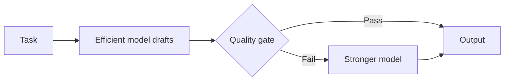

<div dir="rtl">

# روش‌های گروهی و آنسامبل برای پایایی LLM (Ensemble Methods for LLM Reliability)

روش‌های گروهی یا آنسامبل (Ensemble Methods) نقشی حیاتی در پایایی سیستم‌های پروداکشن ایفا می‌کنند. این فصل الگوهای هماهنگی چندمدلی را پوشش می‌دهد که موجب ارتقای دقت و کاهش پدیده توهم (Hallucination) می‌شوند.

## فهرست مطالب

- [چرا روش‌های آنسامبل اهمیت دارند (Why Ensembles Matter)](#چرا-روشهای-آنسامبل-اهمیت-دارند-why-ensembles-matter)
- [آنسامبل‌های ارزیابی (Evaluation Ensembles)](#آنسامبلهای-ارزیابی-evaluation-ensembles)
- [آنسامبل‌های تولید پاسخ (Generation Ensembles)](#آنسامبلهای-تولید-پاسخ-generation-ensembles)
- [الگوهای چندایجنت (Multi-Agent Patterns)](#الگوهای-چندایجنت-multi-agent-patterns)
- [مقایسه آنسامبل در برابر داوری (Ensemble vs Arbitration)](#مقایسه-آنسامبل-در-برابر-داوری-ensemble-vs-arbitration)
- [مصالحه‌های هزینه و دقت (Cost-Accuracy Tradeoffs)](#مصالحههای-هزینه-و-دقت-cost-accuracy-tradeoffs)
- [پرسش‌های مصاحبه (Interview Questions)](#پرسشهای-مصاحبه-interview-questions)
- [مراجع (References)](#مراجع-references)

---

## چرا روش‌های آنسامبل اهمیت دارند (Why Ensembles Matter)

خروجی‌های حاصل از یک مدل واحد برای کاربردهای حساس و پرریسک غیرقابل‌اعتماد هستند:
- مدل‌ها فکت‌ها و حقایق را تحریف می‌کنند (پدیده توهم)
- استدلال آنها می‌تواند دچار نقص و مغالطه باشد
- خروجی‌ها از یک نمونه تا نمونه بعدی نوسان دارند
- ارزیابی‌های مبتنی بر یک داور واحد دارای سوگیری (Bias) هستند

روش‌های گروهی و آنسامبل از طریق افزونگی و تنوع، پایایی سیستم را ارتقا می‌دهند.

### آرایه‌شناسی روش‌های آنسامبل

| دسته‌بندی (Category) | هدف | روش‌ها (Methods) |
|---|---|---|
| ارزیابی (Evaluation) | کاهش سوگیری داور | هیئت داوران (Panel of Judges)، مقایسه زوجی (Pairwise Comparison) |
| تولید پاسخ (Generation) | بهبود کیفیت خروجی | خودسازگاری (Self-Consistency)، روش Best-of-N |
| راستی‌آزمایی (Verification) | کاهش توهم (Hallucination) | مناظره چندایجنت (Multi-Agent Debate)، اعتبارسنجی فکت‌ها |
| ترکیب و سنتز (Synthesis) | ترکیب دیدگاه‌ها | آمیخته‌ای از ایجنت‌ها (Mixture of Agents) |
| ارتقا و تشدید (Escalation) | صرف توان محاسباتی مدل قوی تنها در صورت نیاز | ساختار آبشاری (Cascade)، نقد بین‌خانواده‌ای (Cross-Family Critique) |

---

## آنسامبل‌های ارزیابی (Evaluation Ensembles)

### هیئت داوران مدل‌های زبانی (PoLL)

چندین مدل متنوع به یک خروجی یکسان نمره می‌دهند:

<div dir="ltr">

```python
class PanelOfJudges:
    """
    Production implementation of PoLL pattern.
    Key insight: Diversity of judges matters more than individual judge quality.
    """
    def __init__(self, judges: list, aggregation: str = "mean"):
        # Use diverse model families, not just different sizes
        # Good: [Claude Sonnet 5.5, GPT-6.1 Sol, Gemini 3.8 Flash, GLM-5.3]
        # Bad: [GPT-6 Astra, GPT-6.1 Sol, GPT-6 Luna] - same family bias
        self.judges = judges
        self.aggregation = aggregation
    
    async def evaluate(self, question: str, answer: str, rubric: str) -> dict:
        # Parallel evaluation for latency
        judgments = await asyncio.gather(*[
            judge.score(question, answer, rubric) 
            for judge in self.judges
        ])
        
        scores = [j["score"] for j in judgments]
        
        # Track inter-judge agreement for confidence
        agreement = 1 - (np.std(scores) / max(np.mean(scores), 0.01))
        
        if self.aggregation == "mean":
            final_score = np.mean(scores)
        elif self.aggregation == "median":  # More robust to outliers
            final_score = np.median(scores)
        elif self.aggregation == "trimmed_mean":  # Drop highest and lowest
            final_score = np.mean(sorted(scores)[1:-1])
        
        return {
            "score": final_score,
            "confidence": agreement,
            "individual_scores": scores,
            "needs_review": agreement < 0.7  # Flag for human review
        }
```

</div>

**موارد استفاده مناسب:** ارزیابی‌های پرریسک و حیاتی، ساخت مجموعه‌داده‌های بنچمارک، و زمانی که سوگیری یک داور منفرد غیرقابل قبول است.

**توافق نظر به معنای درستی و دقت نیست:** داورها به شیوه‌های همبسته دچار شکست می‌شوند، بنابراین هیئتی از داورها که با هم توافق دارند ممکن است با اعتمادبه‌نفس بالا با هم اشتباه کنند. یک مطالعه در سپتامبر ۲۰۲۶ مدل تصمیم‌گیری Jev را که نمرات تایپ‌شده بازمی‌گرداند با داوران LLM مبتنی بر روباریک مقایسه کرد: داوران LLM بین ۱۶ تا ۳۲۵ برابر گران‌تر بودند و ۲۸ تا ۳۵۰ برابر زمان بیشتری بردند، با این حال در خطاهای با بالاترین اعتماد Jev، حدود ۹۶٪ از آرای LLM همان پاسخ اشتباه را تکرار کردند و هیچ ساختار آبشاری نتوانست بیش از ۲.۷ امتیاز نسبت به بهترین داور منفرد برتری یابد. هیئت‌های داوری واریانس را کاهش می‌دهند و آبشارها هزینه‌ها را کم می‌کنند؛ اما هیچ‌کدام نقاط کور مشترک میان داورها را رفع نمی‌کنند. همواره یک مجموعه طلایی برچسب‌گذاری‌شده توسط انسان نگه‌داری کنید و هیئت را با آن بسنجید، نه با خودش.

### مقایسه زوجی همراه با رفع سوگیری مکانی (Positional Debiasing)

داوران LLM دچار سوگیری موقعیت مکانی هستند و غالباً پاسخی را که اول بیاید ترجیح می‌دهند. همیشه هر دو ترتیب را اجرا کنید:

<div dir="ltr">

```python
async def pairwise_compare_debiased(model, response_a: str, response_b: str, criteria: str) -> dict:
    """
    Critical: Models have significant positional bias.
    Always run both orderings and aggregate.
    """
    # Run both orderings in parallel
    result_ab, result_ba = await asyncio.gather(
        model.compare(first=response_a, second=response_b, criteria=criteria),
        model.compare(first=response_b, second=response_a, criteria=criteria)
    )
    
    # If A wins in both positions -> Strong signal for A
    if result_ab["winner"] == "first" and result_ba["winner"] == "second":
        return {"winner": "A", "confidence": "high"}
    
    # If B wins in both positions -> Strong signal for B
    elif result_ab["winner"] == "second" and result_ba["winner"] == "first":
        return {"winner": "B", "confidence": "high"}
    
    # Winner depends on position -> Positional bias detected
    else:
        return {
            "winner": "tie",
            "confidence": "low",
            "note": "Positional bias detected"
        }
```

</div>

---

## آنسامبل‌های تولید پاسخ (Generation Ensembles)

### روش خودسازگاری و اکثریت آرا (Self-Consistency)

تولید مسیرهای استدلال متعدد و رأی‌گیری روی پاسخ نهایی:

<div dir="ltr">

```python
class SelfConsistencyDecoder:
    """
    Key parameters:
    - k (sample count): 5-10 for most tasks, 15-20 for hard math
    - temperature: 0.5-0.8 for reasoning tasks, where the API still accepts it
    
    Too low temperature = not enough diversity
    Too high temperature = too much noise
    """
    
    def __init__(self, model, k: int = 7, temperature: float | None = 0.7):
        self.model = model
        self.k = k
        self.temperature = temperature  # None for models with fixed sampling
    
    async def generate_with_consistency(self, prompt: str) -> dict:
        # Pass temperature only if the target model accepts it
        sampling = {} if self.temperature is None else {"temperature": self.temperature}
        
        # Generate k reasoning paths in parallel
        responses = await asyncio.gather(*[
            self.model.generate(prompt, **sampling)
            for _ in range(self.k)
        ])
        
        # Extract final answers (task-specific)
        answers = [self.extract_answer(r) for r in responses]
        
        # Majority voting
        answer_counts = Counter(answers)
        majority_answer, majority_count = answer_counts.most_common(1)[0]
        
        # Confidence = proportion of votes for winner
        confidence = majority_count / self.k
        
        # Get best reasoning path that led to majority answer
        best_reasoning = self.select_best_reasoning(
            responses, answers, majority_answer
        )
        
        return {
            "answer": majority_answer,
            "confidence": confidence,
            "num_paths": self.k,
            "reasoning": best_reasoning,
            "vote_distribution": dict(answer_counts)
        }
    
    def extract_answer(self, response: str) -> str:
        # Task-specific answer extraction
        # For math: extract the final number
        # For code: extract the function
        # Implement based on your task
        pass
```

</div>

**بهترین کاربرد برای:** ریاضیات، منطق، و کدنویسی با پاسخ‌های قابل اعتبارسنجی. دستاوردهای اولیه این روش روی مدل‌های سال ۲۰۲۲ بدون استدلال درونی سنجیده شده بود؛ این اعداد را به مدل‌های مدرن دارای استدلال تعمیم ندهید و قبل از پرداخت هزینه k برابری، دستاورد آن را روی ارزیابی‌های اختصاصی خود بسنجید.

### ناپدید شدن پارامترهای کنترل سمپلینگ

دستورالعمل سنتی برای تنوع پاسخ‌ها دما (Temperature) را تنظیم می‌کرد. در APIهای پیشرو این دکمه تنظیمی در حال حذف است:

| پلتفرم (Platform) | وضعیت تا نوامبر ۲۰۲۶ (Status) |
|---|---|
| رابط Claude API | از نسخه `2026-10-21` از API شرکت Anthropic، پارامترهای `temperature`، `top_p` و `top_k` روی تمام مدل‌ها با هر مقداری (حتی مقدار پیش‌فرض) خطای 400 برمی‌گردانند؛ تمام ۸ کیت توسعه و CLI اصلی این نسخه را پیش‌فرض ارسال می‌کنند. نسخه‌های قبلی نیز مقادیر غیرپیش‌فرض را در مدل‌های Claude 4.7 به بعد رد می‌کردند |
| رابط Gemini API | پارامترهای `temperature`، `top_p` و `top_k` در ۲۱ ژوئیه ۲۰۲۶ منسوخ شدند؛ مدل Gemini 3.8 Flash استدلال را با `thinking_level` کنترل می‌کند |
| مدل OpenAI GPT-6 Astra | بدون پارامترهای سفارشی `temperature` یا `top_p`، و فاقد خروجی `logprobs` |

این تغییر چه اثری بر روش‌های آنسامبل دارد:

- **تنوع از منابع دیگری به دست می‌آید:** سمپلینگ پیش‌فرض روی این مدل‌ها خودبه‌خود تصادفی است، بنابراین k نمونه همچنان اختلاف نظر خواهند داشت. در صورت نیاز به تنوع بیشتر، به جای دما، پرامپت، سطح تلاش استدلال، یا خانواده مدل را تغییر دهید.
- **اطمینان از آرا به دست می‌آید، نه از logprobs:** در نبود logprobs روی Astra، سهم آرا در میان نمونه‌ها (یا امتیاز داور) سیگنال اعتماد محسوب می‌شود.
- **از مدل‌های جدید Claude نخواهید استدلال خود را متنی بنویسند:** پرامپتی که یک بخش `<thinking>` یا فیلد `reasoning` در JSON طلب کند، می‌تواند به عنوان `reasoning_extraction` رد شود و این امتناع‌ها هزینه دارند. روی پاسخ‌های نهایی رأی‌گیری کنید.

### روش Best-of-N با مدل پاداش (Reward Model)

تولید N کاندید، امتیازدهی با مدل پاداش، و بازگرداندن بهترین گزینه:

<div dir="ltr">

```python
class BestOfNSampler:
    """
    Key considerations:
    1. N selection: N=4-8 for interactive, N=16-64 for batch
    2. Reward model ensemble reduces (does not prevent) reward hacking
    3. Monitor sample diversity - if too similar, BoN is wasted compute
    """
    
    def __init__(self, generator, reward_models: list, n: int = 8):
        self.generator = generator
        self.reward_models = reward_models  # Ensemble for robustness
        self.n = n
    
    async def generate_best(self, prompt: str) -> dict:
        # Generate N candidates in parallel
        candidates = await asyncio.gather(*[
            self.generator.generate(prompt, temperature=0.8)  # drop on fixed-sampling models
            for _ in range(self.n)
        ])
        
        # Score with reward model ensemble
        scored_candidates = []
        for candidate in candidates:
            rm_scores = await asyncio.gather(*[
                rm.score(prompt, candidate) for rm in self.reward_models
            ])
            
            # Conservative aggregation makes reward hacking harder
            # Use 25th percentile instead of mean
            conservative_score = np.percentile(rm_scores, 25)
            
            scored_candidates.append({
                "response": candidate,
                "score": conservative_score,
                "rm_agreement": 1 - np.std(rm_scores) / np.mean(rm_scores)
            })
        
        # Select best by conservative score
        best = max(scored_candidates, key=lambda x: x["score"])
        
        # Compute diversity metric
        diversity = self.compute_diversity(candidates)
        
        return {
            "response": best["response"],
            "score": best["score"],
            "n_sampled": self.n,
            "diversity_score": diversity,
            "low_diversity_warning": diversity < 0.3
        }
    
    def compute_diversity(self, candidates: list) -> float:
        # Embed candidates and compute average pairwise distance
        embeddings = [embed(c) for c in candidates]
        similarities = []
        for i in range(len(embeddings)):
            for j in range(i + 1, len(embeddings)):
                similarities.append(cosine_similarity(embeddings[i], embeddings[j]))
        return 1 - np.mean(similarities)  # Higher = more diverse
```

</div>

**بهترین کاربرد برای:** تولید محتوای بی‌پایان و تسک‌های خلاقانه. بازدهی توسط ارزیاب محدود می‌شود: در برابر یک مدل پاداش تقریبی، روش Best-of-N ابتدا کیفیت واقعی را افزایش می‌دهد اما با بزرگ شدن N می‌تواند آن را دچار افت کند؛ بنابراین خروجی‌ها را با ارزیابی‌های انسانی تطبیق دهید و N را متعادل نگه دارید.

---

## الگوهای چندایجنت (Multi-Agent Patterns)

### مناظره چندایجنت (Multi-Agent Debate)

نقد تکرارشونده و متقابل چند مدل بر روی پاسخ‌های یکدیگر:

<div dir="ltr">

```python
class MultiAgentDebate:
    """
    Pattern: Multiple models debate to reduce hallucinations.
    
    Most effective when:
    1. Models have different biases (diverse model families)
    2. 2-3 rounds is optimal (more = diminishing returns)
    3. Explicit "devil's advocate" prompting improves results
    """
    
    def __init__(self, debaters: list, rounds: int = 2):
        self.debaters = debaters
        self.rounds = rounds
    
    async def debate(self, question: str) -> dict:
        # Round 0: Initial positions
        positions = await asyncio.gather(*[
            debater.generate(f"Answer this question with reasoning: {question}")
            for debater in self.debaters
        ])
        
        debate_history = [{"round": 0, "positions": positions}]
        
        # Debate rounds
        for round_num in range(1, self.rounds + 1):
            new_positions = []
            
            for i, debater in enumerate(self.debaters):
                other_positions = [p for j, p in enumerate(positions) if j != i]
                
                critique_prompt = f"""
Question: {question}

Your previous answer: {positions[i]}

Other perspectives:
{self.format_positions(other_positions)}

Consider the other perspectives. If they raise valid points, update your answer.
If you still disagree, explain why with specific reasoning.
Provide your final answer.
"""
                new_position = await debater.generate(critique_prompt)
                new_positions.append(new_position)
            
            positions = new_positions
            debate_history.append({"round": round_num, "positions": positions})
        
        # Final synthesis
        final_answer = await self.synthesize(question, debate_history)
        
        return {
            "answer": final_answer,
            "rounds": self.rounds,
            "consensus_reached": self.check_consensus(positions),
            "debate_history": debate_history
        }
```

</div>

**بهترین کاربرد برای:** راستی‌آزمایی فکت‌ها و کاهش پدیده توهم در پاسخ‌های پیچیده.

### آمیخته‌ای از ایجنت‌ها (Mixture of Agents - MoA)

معماری لایه‌ای که در آن چندین مدل به تجمیع‌کننده‌ها خروجی می‌دهند:

<div dir="ltr">

```
┌─────────────────────────────────────────────────────────────────┐
│                    MIXTURE OF AGENTS (MoA)                       │
├─────────────────────────────────────────────────────────────────┤
│                                                                  │
│  Layer 1 (Proposers):                                           │
│  ┌─────────┐  ┌─────────┐  ┌─────────┐  ┌─────────┐            │
│  │ Claude  │  │  GPT-6  │  │ Gemini  │  │ Llama   │            │
│  └────┬────┘  └────┬────┘  └────┬────┘  └────┬────┘            │
│       │            │            │            │                   │
│       └────────────┴─────┬──────┴────────────┘                  │
│                          │                                       │
│  Layer 2 (Aggregator):   ▼                                      │
│  ┌──────────────────────────────────────────────────┐           │
│  │  "Given these perspectives: [R1, R2, R3, R4]    │           │
│  │   Synthesize the best answer..."                │           │
│  └────────────────────────┬─────────────────────────┘           │
│                           │                                      │
│                           ▼                                      │
│                    [Final Output]                                │
└─────────────────────────────────────────────────────────────────┘
```

</div>

<div dir="ltr">

```python
class MixtureOfAgents:
    def __init__(self, proposers: list, aggregator):
        self.proposers = proposers
        self.aggregator = aggregator
    
    async def generate(self, prompt: str) -> str:
        # Layer 1: Get diverse proposals
        proposals = await asyncio.gather(*[
            proposer.generate(prompt) for proposer in self.proposers
        ])
        
        # Layer 2: Aggregate
        aggregation_prompt = f"""
Given the following question and multiple expert responses, 
synthesize the best possible answer.

Question: {prompt}

Expert responses:
{self.format_proposals(proposals)}

Synthesize the best answer, combining the strongest elements from each response.
"""
        
        final_answer = await self.aggregator.generate(aggregation_prompt)
        return final_answer
```

</div>

**بهترین کاربرد برای:** ترکیب و یکپارچه‌سازی‌های پیچیده، تولید گزارش، و مسائل چندحوزه‌ای.

### ساختار آبشاری و نقد بین‌خانواده‌ای (Cascades and Cross-Family Critique)

دو الگوی ارزان‌تر اکنون در ابزارهای توسعه‌دهندگان عرضه شده‌اند. قابلیت GitHub Copilot Fusion ترافیک را میان مدل‌ها هدایت کرده و یکی از سه گردش کار را اجرا می‌کند:

- **حالت تک‌مدلی (Single):** یک مدل واحد به عنوان خط مبنا.
- **حالت آبشاری (Cascade):** یک مدل بهینه پیش‌نویس اولیه را می‌سازد، یک دروازه کیفیت تصمیم می‌گیرد، و کار تنها در صورت رد شدن از گیت به مدل قوی‌تر ارتقا می‌یابد. هزینه با نرخ ارتقا تعیین می‌شود، نه قیمت مدل قوی.
- **حالت نقد (Critique):** یک منتقد از یک خانواده مدل متفاوت پیش‌نویس را بازبینی می‌کند و تدوین‌کننده یک بار آن را اصلاح می‌نماید. یک دور نقد هزینه را محدود نگه می‌دارد، و منتقدی از خانواده دیگر کمتر احتمال دارد نقاط کور مشترک داشته باشد.

<div dir="ltr">



</div>

سیستم آبشاری تنها به اندازه گیت کیفیت آن دقیق است. اگر گیت، داوری از همان خانواده مدل پیش‌نویس‌کننده باشد، اشتباهات آن را نادیده خواهد گرفت؛ بنابراین گیت‌هایی را ترجیح دهید که موارد قابل اثبات را چک کنند: موفقیت آزمون‌ها، اعتبارسنجی اسکیما، یا ارجاع به مستندات معتبر.

---

## مقایسه آنسامبل در برابر داوری (Ensemble vs Arbitration)

### تمایز مفهومی

| جنبه مقایسه (Aspect) | یادگیری گروهی (Ensemble Learning) | داوری و انتخاب مدل (Model Arbitration) |
|---|---|---|
| **هدف** | ترکیب تمام خروجی‌ها | انتخاب تنها یک خروجی برتر |
| **سازوکار** | تجمیع (رأی‌گیری، میانگین‌گیری) | گزینش (امتیازدهی، رتبه‌بندی) |
| **روابط میان مدل‌ها** | مشارکتی و هم‌افزا | رقابتی |
| **خروجی نهایی** | ترکیب مرکبی از تمام مدل‌ها | خروجی مدل واحد برنده |
| **زمان استفاده مناسب** | نیاز به استحکام و کاهش واریانس | نیاز به بالاترین کیفیت ممکن |

### چارچوب تصمیم‌گیری

<div dir="ltr">

```
Is there a single "correct" answer format?
├── Yes (classification, math)
│   └── Use Ensemble (voting/averaging)
│
└── No (creative writing, open QA)
    └── Use Arbitration (best-of-N)
        └── Do you have reliable scoring?
            ├── Yes → Reward model selection
            └── No → LLM-as-judge or human
```

</div>

---

## مصالحه‌های هزینه و دقت (Cost-Accuracy Tradeoffs)

### ماتریس هزینه آنسامبل

| روش (Method) | ضریب هزینه (Cost Multiplier) | تاخیر (Latency) | اثر مورد انتظار | کاربرد مناسب |
|---|---|---|---|---|
| مدل منفرد (Single Model) | ضریب 1x | ضریب 1x | خط مبنا | کاربردهای کم‌خطر و حجم بالا |
| خودسازگاری با k=3 | ضریب 3x | ضریب 1x (موازی) | متوسط؛ تقسیم سه‌گانه اکثریت قاطع ندارد | استدلال، حساس به تاخیر |
| خودسازگاری با k=10 | ضریب 10x | ضریب 1x (موازی) | اثر چشم‌گیرتر روی پاسخ‌های قابل راستی‌آزمایی با بازدهی نزولی در kهای بالاتر | ریاضیات، حساسیت بالا به دقت |
| روش Best-of-N با N=8 | ضریب 8x به علاوه امتیازدهی | ضریب 1x (موازی) | محدود به دقت ارزیاب؛ در برابر مدل پاداش قابل هک افت می‌کند | تولید خلاقانه متن |
| هیئت داوران با ۳ عضو (Panel of Judges) | ضریب 3x ارزیابی | ضریب 1x (موازی) | کاهش سوگیری داوری | تسک‌های ارزیابی و سنجش |
| مناظره چندایجنت (Multi-Agent Debate) | ضریب 6x | ضریب 3x | کاهش چشم‌گیر توهم | پاسخ‌های حساس به فکت‌های دقیق |
| آمیخته‌ای از ایجنت‌ها (Mixture of Agents) | ضریب 5 تا 8 برابر | ضریب 2x | ترکیب و یکپارچه‌سازی بهتر | گزارش‌های پیچیده چندوجهی |
| ساختار آبشاری همراه با گیت کیفیت (Cascade) | ضریب 1x به علاوه هزینه گیت + (نرخ ارتقا × مدل قوی) | ضریب 1x، و 2x در صورت ارتقا | نزدیک به کیفیت مدل قوی در صورت اطمینان به گیت | حجم بالا با امکان سنجش دقیق گیت |
| نقد بین‌خانواده‌ای (یک دور) | حدود 3x | حدود 3x (ترتیبی) | کشف خطاهای مختص به خانواده مدل | بازبینی کد، پیش‌نویس‌های حساس به صحت |

ستون اثرگذاری صرفاً نشان‌دهنده جهت تغییرات است. اندازه اثر به مدل و تسک وابسته است، بنابراین هر روش را پیش از پرداخت ضریب هزینه، روی مجموعه ارزیابی خود بسنجید.

### چه زمانی نباید از آنسامبل استفاده کرد

| موقعیت و وضعیت | چرا استفاده نشود | جایگزین مناسب |
|---|---|---|
| جستجو و بازیابی فکت ساده | نبود سود ناشی از تنوع پاسخ‌ها | یک فراخوانی منفرد RAG |
| نیاز به تاخیر کمتر از ۵۰۰ میلی‌ثانیه | آنسامبل تاخیر را افزایش می‌دهد | مدل منفرد به همراه کش‌سازی |
| هزینه محدودیت و اولویت اصلی است | روش‌های آنسامبل هزینه‌ها را ضرب می‌کنند | تقطیر مدل (Model Distillation) |
| همبستگی بالای مدل‌ها با یکدیگر | نبود تنوع مساوی با نبود فایده است | استفاده از مدل‌های دارای تنوع واقعی |

---

## پرسش‌های مصاحبه (Interview Questions)

### پرسش: چه زمانی از روش خودسازگاری (Self-Consistency) در برابر روش Best-of-N استفاده می‌کنید؟

**پاسخ قوی:**
این دو روش اهداف متفاوتی را دنبال می‌کنند:

**روش خودسازگاری (Self-Consistency)** برای تسک‌هایی با پاسخ‌های قابل استخراج و سنجش‌پذیر است:
- مسائل ریاضی: استخراج عدد نهایی و رأی‌گیری اکثریت
- طبقه‌بندی: رأی‌گیری روی برچسب‌ها
- پرسش و پاسخ کوتاه: رأی‌گیری روی پاسخ

نکته کلیدی این است که شما می‌توانید پاسخ‌ها را بر اساس برابری مستقیم مقایسه کنید. در جایی که API دما را در اختیار می‌گذارد، مقدار 0.5 تا 0.8 تنوع کافی را با حفظ انسجام فراهم می‌کند؛ در مدل‌های با سمپلینگ ثابت (مانند مدل‌های جدید Claude یا GPT-6 Astra) یا مدل‌هایی با پارامترهای منسوخ (مانند Gemini)، به سمپلینگ پیش‌فرض تکیه می‌کنم و در صورت نیاز تنوع پرامپت یا مدل را اضافه می‌نمایم. برای اکثر تسک‌ها از k=5-10 استفاده می‌کنم.

**روش Best-of-N** برای تولید محتوای باز است که در آن پاسخ منفرد صحیحی وجود ندارد:
- نگارش خلاقانه
- توضیحات و مقالات
- کدهایی که می‌توانند به روش‌های مختلف نوشته شوند

در اینجا به یک مدل پاداش یا داور برای امتیازدهی به کاندیداها نیاز دارم زیرا نمی‌توانم صرفاً برابری را چک کنم (معمولاً N=8-16). چالش اصلی اجتناب از هک مدل پاداش (Reward Hacking) است، بنابراین از آنسامبل‌های مدل پاداش با تجمیع محافظه‌کارانه استفاده می‌کنم.

### پرسش: چگونه از هک شدن مدل پاداش در روش Best-of-N جلوگیری می‌کنید؟

**پاسخ قوی:**
هک پاداش زمانی است که مدل به جای ارتقای واقعی کیفیت، نقاط ضعف مدل پاداش را اکسپلویت می‌کند.

**اقدامات من برای کاهش ریسک:**
۱. **آنسامبل مدل‌های پاداش:** استفاده از ۳ مدل پاداش متنوع یا بیشتر. نمونه‌ای که یک مدل را هک کند، بعید است همه آنها را دور بزند.
۲. **تجمیع محافظه‌کارانه:** به جای میانگین نمرات، از صدک ۲۵ یا حداقل نمره استفاده می‌کنم تا نمونه‌هایی برگزیده شوند که نزد تمام ارزیاب‌ها نمره خوبی دارند.
۳. **مانیتورینگ تنوع نمونه‌ها:** اگر تنوع افت شدیدی پیدا کند، مدل احتمالاً در حال اکسپلویت یک باگ پاداش باریک است.
۴. **کالیبراسیون دوره‌ای با انسان:** اطمینان از اینکه نمونه‌های برگزیده مدل پاداش واقعاً با ترجیحات انسانی تطابق دارند.
۵. **معیارهای چندبعدی:** امتیازدهی بر اساس چند معیار (کیفیت، ایمنی، ارتباط) و الزام به کسب نمره قبولی در همه آنها، نه یک نمره میانگین تجمیعی. مطالعات نشان می‌دهند جمع نمرات اجازه می‌دهد نقاط قوت کاذب نقص‌های ایمنی را بپوشانند؛ سنجش مستقل هر بعد ایمنی را تضمین می‌کند.

### پرسش: هیئت داوران سه‌نفره LLM شما بر سر ۹۵٪ از احکام با یکدیگر توافق دارند. آیا این خبر خوبی است؟

**پاسخ قوی:**
به خودی خود خیر. توافق بالا تنها ثبات هیئت را نشان می‌دهد، نه درستی آن را. داورها دارای داده‌های آموزش و نقاط کور مشترک هستند، بنابراین خطاهای آنها همبسته است. یک مطالعه در سپتامبر ۲۰۲۶ نشان داد در خطاهای قطعی یک ارزیاب، حدود ۹۶٪ از آرای هیئت LLM همان خطای واحد را تکرار کردند.

**مواردی که من بررسی می‌کنم:**
۱. **دقت در برابر یک مجموعه داده طلایی برچسب‌خورده توسط انسان:** توافق داورها جایگزین حقیقت زمینی (Ground truth) نیست.
۲. **مواردی که هیئت همگی با انسان مخالفت کرده‌اند:** این موارد نقطه کور مشترک را نشان می‌دهند و باید به مجموعه طلایی افزوده شوند.
۳. **تنوع واقعی مدل‌ها:** استفاده از خانواده‌های مدل کاملاً متفاوت، و برای معیارهای چک‌لیستی، استفاده از یک مدل تصمیم‌گیری تایپ‌شده به جای یک LLM متنی دیگر. سه داور از یک خانواده، صرفاً یک داور با سه برابر هزینه است.
۴. **بررسی سوگیری مکانی و طول متن:** با جابجایی ترتیب پاسخ‌ها و نرمال‌سازی طول متن.

اگر هیئت روی مجموعه طلایی دقیق عمل کند، توافق ۹۵ درصدی به این معناست که می‌توانم تعداد داورها را به یک یا دو کاهش دهم تا هزینه کم شود. اما اگر دقیق نباشد، این توافق صرفاً در حال پوشاندن مشکل بوده است.

---

## مراجع (References)

- مقاله Verga و همکاران، «جایگزینی داوران با هیئت منصفه: ارزیابی خروجی‌های LLM با هیئتی از مدل‌های متنوع» (۲۰۲۴)
- مقاله Wang و همکاران، «خودسازگاری استدلال زنجیره تفکر را در مدل‌های زبانی بهبود می‌بخشد» (ICLR 2023): https://arxiv.org/abs/2203.11171
- مقاله Gao، Schulman و Hilton، «قوانین مقیاس‌پذیری برای بهینه‌سازی بیش از حد مدل پاداش» (۲۰۲۲): https://arxiv.org/abs/2210.10760
- مقاله Du و همکاران، «بهبود صحت و استدلال در مدل‌های زبانی از طریق مناظره چندایجنت» (۲۰۲۳)
- مقاله Wang و همکاران، «آمیخته‌ای از ایجنت‌ها توانمندی‌های مدل‌های بزرگ زبان را ارتقا می‌دهد» (۲۰۲۴)
- مقاله Zheng و همکاران، «داوری با LLM به عنوان داور در MT-Bench و Chatbot Arena» (۲۰۲۳)
- مقاله Wang و همکاران، «مدل‌های بزرگ زبان ارزیاب‌های منصفی نیستند» (۲۰۲۳)
- مقاله Rao و Callison-Burch، «مقایسه JEV با LLMها به عنوان داوران روباریک: ارزان‌تر، سریع‌تر، و خطاکار در همان نقاط» (arXiv 2609.29769, 2026): https://arxiv.org/abs/2609.29769
- گزارش تغییرات گیت‌هاب، عرضه HydraFusion در VS Code و اپلیکیشن GitHub Copilot (۳۰ سپتامبر ۲۰۲۶): https://github.blog/changelog/2026-09-30-hydrafusion-in-vs-code-and-the-github-copilot-app
- گزارش تغییرات گیت‌هاب، عرضه عمومی Copilot Fusion (۲۸ اکتبر ۲۰۲۶): https://github.blog/changelog/2026-10-28-route-and-orchestrate-models-with-github-copilot-fusion/
- مقاله Liu و همکاران، «امتیاز بالاتر، پاسخ بدتر: کاهش هک پاداش در RL مبتنی بر روباریک» (arXiv 2609.38847, 2026): https://arxiv.org/abs/2609.38847

---

*قبلی: [گاردریل‌ها و ایمنی](01-guardrails.md) · بعدی: [الگوهای پایایی](03-reliability-patterns.md)*

</div>