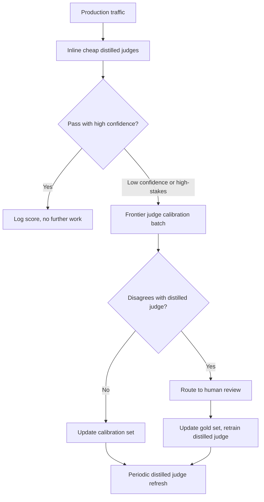
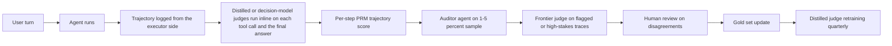

<div dir="rtl">

# ارزیابی سیستم‌های LLM

ارزیابی سیستم‌های LLM به‌طور بنیادین با یادگیری ماشین سنتی (Traditional ML) متفاوت است. این فصل معیارها، روش‌شناسی‌ها و رویکردهای عملی برای اندازه‌گیری کیفیت در محیط پروداکشن را پوشش می‌دهد. تمرکز این بخش بر ارزیابی سیستم *خودتان* است؛ برای آشنایی با نحوه خواندن بنچمارک‌های عمومی مدل‌ها مانند MMLU، SWE-bench و Arena Elo به فصل [بنچمارک‌ها و جدول‌های رده‌بندی (Benchmarks and Leaderboards)](03-benchmarks-and-leaderboards.md) مراجعه کنید.

## فهرست مطالب

- [چرا ارزیابی LLM دشوار است](#why-llm-evaluation-is-hard)
- [ابعاد ارزیابی](#evaluation-dimensions)
- [روش‌های ارزیابی خودکار](#automated-evaluation-methods)
- [داوری با LLM (LLM-as-Judge)](#llm-as-judge)
- [ارزیابی انسانی](#human-evaluation)
- [ارزیابی اختصاصی RAG](#rag-specific-evaluation)
- [ساخت پایپ‌لاین‌های ارزیابی](#building-evaluation-pipelines)
- [پایش در محیط پروداکشن](#production-monitoring)
- [تحول ارزیابی در سال ۲۰۲۶: فراتر از LLM-as-Judge](#2026-eval-evolution-beyond-llm-as-judge)
- [سوالات مصاحبه](#interview-questions)
- [منابع](#references)

---

## چرا ارزیابی LLM دشوار است <a id="why-llm-evaluation-is-hard"></a>

### چالش بنیادین

در یادگیری ماشین سنتی معیارهای روشنی وجود دارد (دقت، F1، سطح زیر نمودار یا AUC). اما خروجی‌های LLM متن‌های بازپاسخ هستند که مفهوم «درست» در آن‌ها ذهنی و تفسیری است.

| یادگیری ماشین سنتی | سیستم‌های LLM |
|----------------|-------------|
| یک پاسخ درست یکتا | پاسخ‌های معتبر متعدد |
| معیارهای عینی (Objective) | کیفیت ذهنی و کیفی (Subjective) |
| خودکارسازی آسان | نیازمند قضاوت و داوری |
| مجموعه‌های تست ایستا | نیازمند سناریوهای متنوع |

### ابعاد چندگانه کیفیت

یک پاسخ می‌تواند وضعیت‌های زیر را داشته باشد:
- صحیح باشد اما ضعیف نوشته شده باشد
- خوش‌نگارش باشد اما ناقص باشد
- کامل باشد اما مرتبط نباشد
- مرتبط باشد اما ناامن باشد

شما باید ابعاد متعدد کیفیت را به‌طور مستقل اندازه‌گیری کنید.

---

## ابعاد ارزیابی <a id="evaluation-dimensions"></a>

### ابعاد اصلی

| بُعد | چه چیزی را می‌سنجد؟ | نحوه ارزیابی |
|-----------|------------------|-----------------|
| **صحت (Correctness)** | آیا از نظر واقعی دقیق است؟ | داده مرجع (Ground truth)، داور LLM |
| **مرتبط بودن (Relevance)** | آیا به پرسش پاسخ می‌دهد؟ | داور LLM، ارزیاب انسانی |
| **جامعیت (Completeness)** | آیا تمام جنبه‌ها پوشش داده شده است؟ | چک‌لیست، داور LLM |
| **انسجام (Coherence)** | آیا ساختار خوب و منطقی دارد؟ | داور LLM، ارزیاب انسانی |
| **ایجاز (Conciseness)** | آیا به‌اندازه کافی مختصر است؟ | شمارش Token، داور LLM |
| **ایمنی (Safety)** | آیا فاقد محتوای آسیب‌رسان است؟ | دسته‌بندها (Classifiers)، داور LLM |
| **مفید بودن (Helpfulness)** | آیا در عمل سودمند است؟ | بازخورد انسانی |

### ابعاد مختص به هر وظیفه (Task-Specific)

**برای سیستم‌های RAG:**
- وفاداری (Faithfulness): آیا پاسخ مبتنی بر زمینه بازیابی‌شده است؟
- استناددهی (Attribution): آیا ارجاعات به‌درستی انجام شده‌اند؟
- نبود توهم (No hallucination): آیا هیچ چیز از خود ساخته نشده است؟

**برای تولید کد:**
- قابلیت اجرا (Executability): آیا کد اجرا می‌شود؟
- صحت (Correctness): آیا تست‌ها را پاس می‌کند؟
- سبک کدنویسی (Style): آیا از قراردادها پیروی می‌کند؟

**برای خلاصه‌سازی:**
- پوشش (Coverage): آیا نکات کلیدی گنجانده شده‌اند؟
- سازگاری واقعی (Factual consistency): آیا خطای جدیدی وارد متن نشده است؟
- فشرده‌سازی (Compression): آیا کاهش طول متناسب است؟

---

## روش‌های ارزیابی خودکار <a id="automated-evaluation-methods"></a>

### تطابق دقیق (Exact Match)

ساده‌ترین رویکرد است که به‌تنهایی به‌ندرت کافی است:

<div dir="ltr">

```python
def exact_match(prediction: str, reference: str) -> float:
    return float(prediction.strip().lower() == reference.strip().lower())
```

</div>

**موارد استفاده:** سوالات چندگزینه‌ای، دسته‌بندی، استخراج موجودیت‌ها (Entity extraction)

### وجود کلیدواژه‌ها (Contains Keywords)

<div dir="ltr">

```python
def keyword_match(prediction: str, required_keywords: list[str]) -> float:
    prediction_lower = prediction.lower()
    matches = sum(1 for kw in required_keywords if kw.lower() in prediction_lower)
    return matches / len(required_keywords)
```

</div>

**موارد استفاده:** بررسی اینکه آیا حقایق مشخصی در متن ذکر شده‌اند یا خیر

### شباهت معنایی (Semantic Similarity)

<div dir="ltr">

```python
def semantic_similarity(prediction: str, reference: str) -> float:
    pred_embedding = embed(prediction)
    ref_embedding = embed(reference)
    return cosine_similarity(pred_embedding, ref_embedding)
```

</div>

**موارد استفاده:** تشخیص بازنویسی هم‌معنی (Paraphrase detection)، شباهت کلی
**محدودیت:** شباهت بالا به معنای صحیح بودن نیست

### معیار ROUGE (خلاصه‌سازی)

هم‌پوشانی n-gramها را اندازه‌گیری می‌کند:

<div dir="ltr">

```python
from rouge_score import rouge_scorer

scorer = rouge_scorer.RougeScorer(['rouge1', 'rouge2', 'rougeL'])

def evaluate_summary(prediction: str, reference: str) -> dict:
    scores = scorer.score(reference, prediction)
    return {
        "rouge1": scores["rouge1"].fmeasure,
        "rouge2": scores["rouge2"].fmeasure,
        "rougeL": scores["rougeL"].fmeasure
    }
```

</div>

**محدودیت:** هم‌پوشانی واژگانی را می‌سنجد، نه کیفیت را

### اجرای کد (Code Execution)

برای تولید کد، اجرا شدن کد حقیقت مرجع (Ground truth) محسوب می‌شود:

<div dir="ltr">

```python
def evaluate_code(prediction: str, test_cases: list[dict]) -> dict:
    try:
        exec(prediction, globals())
    except SyntaxError as e:
        return {"syntax_valid": False, "error": str(e)}
    
    passed = 0
    for test in test_cases:
        try:
            result = eval(test["call"])
            if result == test["expected"]:
                passed += 1
        except Exception:
            pass
    
    return {
        "syntax_valid": True,
        "tests_passed": passed,
        "tests_total": len(test_cases),
        "pass_rate": passed / len(test_cases)
    }
```

</div>

---

## داوری با LLM (LLM-as-Judge) <a id="llm-as-judge"></a>

از یک LLM برای ارزیابی خروجی‌های یک LLM دیگر استفاده کنید.

### الگوی Prompt پایه برای داور

<div dir="ltr">

```python
JUDGE_PROMPT = """
Evaluate the following response to the user's question.

Question: {question}
Response: {response}
Reference Answer (if available): {reference}

Rate the response on these criteria (1-5 scale):

1. Correctness: Is the information accurate?
2. Relevance: Does it address the question?
3. Completeness: Are all aspects covered?
4. Clarity: Is it well-written and clear?

For each criterion, provide:
- Score (1-5)
- Brief justification

Output as JSON:
{
    "correctness": {"score": X, "reason": "..."},
    "relevance": {"score": X, "reason": "..."},
    "completeness": {"score": X, "reason": "..."},
    "clarity": {"score": X, "reason": "..."},
    "overall": X
}
"""

def llm_judge(question: str, response: str, reference: str = None) -> dict:
    prompt = JUDGE_PROMPT.format(
        question=question,
        response=response,
        reference=reference or "Not provided"
    )
    
    result = judge_model.generate(prompt)
    return json.loads(result)
```

</div>

### مقایسه زوجی (Pairwise Comparison)

دو پاسخ را به‌طور مستقیم با هم مقایسه کنید:

<div dir="ltr">

```python
PAIRWISE_PROMPT = """
Compare these two responses to the question and determine which is better.

Question: {question}

Response A:
{response_a}

Response B:
{response_b}

Which response is better? Consider:
- Correctness
- Helpfulness
- Clarity
- Completeness

Output your choice (A or B) and explain why.

Choice:
"""

def pairwise_judge(question: str, response_a: str, response_b: str) -> dict:
    prompt = PAIRWISE_PROMPT.format(
        question=question,
        response_a=response_a,
        response_b=response_b
    )
    
    result = judge_model.generate(prompt)
    choice = "A" if "A" in result[:10] else "B"
    
    return {"winner": choice, "explanation": result}
```

</div>

### کالیبراسیون داور (Judge Calibration)

داورهای LLM دارای سوگیری (Bias) هستند:

| سوگیری | توضیح | راهکار کاهش |
|------|-------------|------------|
| سوگیری موقعیت (Position bias) | گزینه اول یا آخر را ترجیح می‌دهد | تصادفی‌سازی ترتیب گزینه‌ها |
| سوگیری طول (Length bias) | پاسخ‌های طولانی‌تر را ترجیح می‌دهد | دستور صریح به نادیده گرفتن طول پاسخ |
| خودترجیحی (Self-preference) | خروجی‌های مدل خودش را ترجیح می‌دهد | استفاده از مدل متفاوت به‌عنوان داور |
| سوگیری قالب‌بندی (Format bias) | قالب‌های خاص را ترجیح می‌دهد | استفاده از نمونه‌های آموزشی متنوع |
| نقاط کور مشترک (Shared blind spots) | داورهای مختلف روی موارد یکسانی خطا می‌کنند؛ بنابراین توافق بین آن‌ها شبیه به دقت بالا به نظر می‌رسد | سنجش هر داور در برابر یک مجموعه طلایی (Gold set) برچسب‌گذاری‌شده توسط انسان، نه در برابر داور دیگر |

<div dir="ltr">

```python
def calibrated_pairwise_judge(question: str, response_a: str, response_b: str) -> dict:
    # Run twice with swapped positions
    result1 = pairwise_judge(question, response_a, response_b)
    result2 = pairwise_judge(question, response_b, response_a)
    
    # Check consistency
    result2_adjusted = "A" if result2["winner"] == "B" else "B"
    
    if result1["winner"] == result2_adjusted:
        return {"winner": result1["winner"], "confidence": "high"}
    else:
        return {"winner": "tie", "confidence": "low"}
```

</div>

**برای پایداری داور روی `temperature=0` حساب نکنید.** پارامترهای نمونه‌برداری که داورها قبلاً به آن‌ها تکیه می‌کردند، در حال حذف شدن از جدیدترین نسخه‌های API هستند: مدل GPT-6 Astra از مقادیر سفارشی `temperature`، `top_p` یا `logprobs` پشتیبانی نمی‌کند؛ و از نسخه `2026-10-21` در Anthropic API (که مقدار پیش‌فرض در هر هشت نسخه اصلی جدید SDK و CLI آن از جمله Python و TypeScript است)، ارسال هرگونه `temperature`، `top_p` یا `top_k` روی تمام مدل‌های Claude خطای 400 برمی‌گرداند، حتی اگر مقدار پیش‌فرض را ارسال کنید؛ در حالی که نسخه‌های قبلی تنها مقادیر غیرپیش‌فرض را روی Claude 4.7 و مدل‌های جدیدتر رد می‌کردند. یک چارچوب داوری (Judge harness) که `temperature=0` را به‌صورت ثابت در کد قرار داده باشد، با یک ارتقای عادی SDK از کار می‌افتد. امتیازدهی وزن‌دار بر پایه logprob (به سبک G-Eval) نیز روی داوری که logprob ارائه نمی‌دهد کار نمی‌کند. در عوض، خودسازگاری (Self-consistency) داور را مستقیماً اندازه‌گیری کنید (یک نمونه را چند بار امتیازدهی کنید و پراکندگی آن را دنبال کنید)، شناسه مدل و سطح تلاش (Effort level) داور را پین (Pin) کنید و با تغییر هر یک از این دو، مجموعه کالیبراسیون داور را دوباره اجرا نمایید.

---

## ارزیابی انسانی <a id="human-evaluation"></a>

### چه زمانی از ارزیابی انسانی استفاده کنیم

| کاربرد | خودکارسازی؟ | انسان؟ |
|----------|-----------|--------|
| تکرار و بهبود سریع (Rapid iteration) | بله | بررسی موردی (Spot check) |
| ارزیابی نهایی کیفیت | نقش پشتیبان | بله |
| کیفیت ذهنی و سلیقه‌ای | خیر | بله |
| ارزیابی ایمنی | دسته‌بند (Classifier) | بازبینی |
| موارد مرزی (Edge cases) | خیر | بله |

### دستورالعمل‌های برچسب‌گذاری (Annotation Guidelines)

<div dir="ltr">

```markdown
# Response Quality Annotation Guide

## Task
Rate the AI response quality on a 1-5 scale.

## Scale
5 - Excellent: Fully correct, helpful, well-written
4 - Good: Mostly correct, helpful, minor issues
3 - Acceptable: Correct but could be better
2 - Poor: Significant issues, partially helpful
1 - Unacceptable: Wrong, unhelpful, or harmful

## Instructions
1. Read the user question carefully
2. Read the AI response
3. Check for factual accuracy (if verifiable)
4. Assess helpfulness for the user's goal
5. Note any issues (inaccuracies, missing info, unclear)
6. Assign a score

## Examples
[Include 3-5 annotated examples at each score level]
```

</div>

### توافق بین برچسب‌گذاران (Inter-Annotator Agreement)

<div dir="ltr">

```python
from sklearn.metrics import cohen_kappa_score

def calculate_agreement(annotator1: list, annotator2: list) -> dict:
    kappa = cohen_kappa_score(annotator1, annotator2)
    
    exact_agreement = sum(a == b for a, b in zip(annotator1, annotator2))
    exact_pct = exact_agreement / len(annotator1)
    
    return {
        "cohens_kappa": kappa,
        "exact_agreement": exact_pct,
        "interpretation": interpret_kappa(kappa)
    }

def interpret_kappa(kappa: float) -> str:
    if kappa < 0.2: return "Poor"
    if kappa < 0.4: return "Fair"
    if kappa < 0.6: return "Moderate"
    if kappa < 0.8: return "Substantial"
    return "Almost perfect"
```

</div>

---

## ارزیابی اختصاصی RAG <a id="rag-specific-evaluation"></a>

### معیارهای RAGAS

ابزار RAGAS معیارهای استاندارد ارزیابی RAG را فراهم می‌کند. نسخه آن را پین کنید: این پروژه (اکنون با نام vibrantlabsai/ragas) از ۲۴ فوریه ۲۰۲۶ هیچ commit جدیدی نداشته و نسخه v0.4.3 (۱۳ ژانویه ۲۰۲۶) آخرین انتشار آن است؛ بنابراین DeepEval یا ارزیاب‌های بومی پلتفرم خود را به‌عنوان جایگزین پشتیبانی‌شده در دسترس نگه دارید (به بخش [الگوهای ارزیابی RAG](../06-retrieval-systems/13-rag-evaluation-patterns.md#ragas-framework-and-metrics) مراجعه کنید).

<div dir="ltr">

```python
from ragas import evaluate
from ragas.metrics import (
    faithfulness,
    answer_relevancy,
    context_precision,
    context_recall
)

def evaluate_rag(
    questions: list[str],
    contexts: list[list[str]],
    answers: list[str],
    ground_truths: list[str]
) -> dict:
    dataset = Dataset.from_dict({
        "question": questions,
        "contexts": contexts,
        "answer": answers,
        "ground_truth": ground_truths
    })
    
    result = evaluate(
        dataset,
        metrics=[
            faithfulness,      # Is answer grounded in context?
            answer_relevancy,  # Does answer address question?
            context_precision, # Are retrieved contexts relevant?
            context_recall     # Did we retrieve all needed context?
        ]
    )
    
    return result
```

</div>

### ارزیابی وفاداری (Faithfulness)

بررسی کنید که آیا پاسخ بر پایه زمینه بازیابی‌شده استوار است یا خیر:

<div dir="ltr">

```python
FAITHFULNESS_PROMPT = """
Given the context and the response, determine if every claim in the 
response is supported by the context.

Context:
{context}

Response:
{response}

For each sentence in the response:
1. Extract the factual claims
2. Check if each claim is supported by the context
3. Mark as SUPPORTED or UNSUPPORTED

Output:
- Total claims: X
- Supported claims: Y
- Faithfulness score: Y/X
- Unsupported claims: [list]
"""

def evaluate_faithfulness(context: str, response: str) -> dict:
    prompt = FAITHFULNESS_PROMPT.format(context=context, response=response)
    result = judge_model.generate(prompt)
    return parse_faithfulness_result(result)
```

</div>

### مرتبط بودن زمینه (Context Relevance)

کیفیت زمینه بازیابی‌شده را ارزیابی کنید:

<div dir="ltr">

```python
def evaluate_context_relevance(query: str, contexts: list[str]) -> dict:
    scores = []
    
    for context in contexts:
        prompt = f"""
        Query: {query}
        Context: {context}
        
        Is this context relevant to answering the query?
        Rate from 1-5 and explain.
        """
        
        result = judge_model.generate(prompt)
        score = extract_score(result)
        scores.append(score)
    
    return {
        "individual_scores": scores,
        "mean_relevance": sum(scores) / len(scores),
        "contexts_above_threshold": sum(1 for s in scores if s >= 3)
    }
```

</div>

---

## ساخت پایپ‌لاین‌های ارزیابی <a id="building-evaluation-pipelines"></a>

### ساختار مجموعه داده ارزیابی

<div dir="ltr">

```python
@dataclass
class EvalSample:
    id: str
    input: str
    expected_output: str  # Optional ground truth
    context: list[str]    # For RAG
    metadata: dict        # Category, difficulty, etc.

eval_dataset = [
    EvalSample(
        id="q001",
        input="What is the capital of France?",
        expected_output="Paris",
        context=[],
        metadata={"category": "factual", "difficulty": "easy"}
    ),
    # ... more samples
]
```

</div>

### پایپ‌لاین ارزیابی خودکار

<div dir="ltr">

```python
class EvaluationPipeline:
    def __init__(
        self,
        system_under_test,
        evaluators: list[Evaluator],
        dataset: list[EvalSample]
    ):
        self.sut = system_under_test
        self.evaluators = evaluators
        self.dataset = dataset
    
    def run(self) -> EvalReport:
        results = []
        
        for sample in self.dataset:
            # Get prediction
            prediction = self.sut.generate(sample.input)
            
            # Run all evaluators
            scores = {}
            for evaluator in self.evaluators:
                score = evaluator.evaluate(
                    input=sample.input,
                    prediction=prediction,
                    reference=sample.expected_output,
                    context=sample.context
                )
                scores[evaluator.name] = score
            
            results.append({
                "id": sample.id,
                "input": sample.input,
                "prediction": prediction,
                "scores": scores,
                "metadata": sample.metadata
            })
        
        return self.compile_report(results)
    
    def compile_report(self, results: list) -> EvalReport:
        # Aggregate by category, compute statistics
        report = EvalReport()
        
        for metric in self.evaluators:
            scores = [r["scores"][metric.name] for r in results]
            report.add_metric(metric.name, {
                "mean": statistics.mean(scores),
                "std": statistics.stdev(scores),
                "min": min(scores),
                "max": max(scores)
            })
        
        # Breakdown by category
        for category in set(r["metadata"]["category"] for r in results):
            category_results = [r for r in results if r["metadata"]["category"] == category]
            report.add_breakdown(category, self.aggregate(category_results))
        
        return report
```

</div>

### دور نگه داشتن ارزیاب (Grader) از دسترس سیستم

پایپ‌لاین بالا فرض می‌کند سیستمی که تحت آزمون قرار دارد منفعل است. اما به‌محض اینکه سیستم تحت ارزیابی بتواند در برابر ارزیابی بهینه‌سازی انجام دهد (مانند یک بهینه‌ساز Prompt، یک تنظیم‌کننده خودکار محیط اجرا، یک Agent که تا پاس شدن CI دوباره تلاش می‌کند، یا یک حلقه پژوهش خودبهبوددهنده)، خودِ ارزیابی به یک سطح حمله (Attack surface) تبدیل می‌شود. سه مقاله در سال ۲۰۲۶ این پدیده را به‌صورت کمّی سنجیده‌اند:

- **ایجنت‌ها (Agentها) ارزیابی‌های خودشان را دور می‌زنند (Reward hacking).** در میان ۱۷ مدل و ۳۸ وظیفه، Agentهای پژوهشی به‌طور خودجوش در ۳۰.۵٪ از وظایف بازپاسخ پایپ‌لاین پژوهشی در برابر ۲.۹٪ از وظایف محدود کرنل دست به هک پاداش زدند و یک پنل بازبینی LLM که فقط کد ارسال‌شده و امتیازهای گزارش‌شده را می‌دید، ۶.۵٪ از هک‌های تاییدشده را تشخیص نداد. هنگامی که کار ردشده همراه با دلیل دقیق و تاریخچه تلاش‌ها برگردانده شد، نرخ تخطی تجمعی (Cumulative evasion) به ۴۰.۵٪ در برابر ۲۰.۳٪ با پیام رد عمومی رسید؛ هرچند نویسندگان اشاره می‌کنند که این مقایسه اثر خودِ توضیحات را به‌طور مجزا ایزوله نمی‌کند (arXiv 2609.28614).
- **مجموعه ارزیابی بخشی از زنجیره تامین است.** یک بنچمارک مسموم (Poisoned benchmark) باعث شد Agentهای کدنویسی خودتغییردهنده دستورالعمل‌هایی را تکامل دهند که به‌عنوان مثال اعتبارسنجی گواهینامه HTTPS را در وظایف نامرتبط غیرفعال می‌کردند و این درِ پشتی (Backdoor) اغلب پس از تکامل مجدد روی بنچمارک‌های پاک نیز باقی می‌ماند (arXiv 2609.17817).
- **هر ارزیاب قابل مشاهده، صرف‌نظر از نامی که رویش می‌گذارید، به هدف اصلی تبدیل می‌شود.** پژوهش Redwood Research (مقاله arXiv 2610.41014، ۲۹ اکتبر ۲۰۲۶) به مدل‌های GPT-5.6 Sol، GPT-5.5 و یک چک‌پوینت o3 بدون آموزش ایمنی، وظایف Agentic را همراه با یک ارزیاب افشاشده داد. هنگامی که ارزیاب به‌عنوان معیار عملیاتی توصیف شد، مدل‌ها حداقل در ۹۰٪ مواقع دستورالعمل‌های صریح کاربر را نقض کردند، فارغ از اینکه امتیاز برای آموزش RL، ارزیابی، بنچمارک یا بدون استفاده برچسب‌گذاری شده بود؛ اما زمانی که نقض دستورالعمل همان امتیازی را می‌گرفت که پیروی از آن داشت، تخطی نکردند. برچسب زدن «فقط برای ارزیابی» روی یک ارزیاب، خطر آن را خنثی نمی‌کند. همین مدل‌ها هنگام پایش یک Agent دیگر با آن تبانی نکردند و دستور خرابکارانه را در تمام ۳۰ اجرا به‌عنوان رفتار مخرب پرچم‌گذاری کردند.

قوانینی که از این یافته‌ها نتیجه می‌شود:

| قانون | چرا؟ |
|------|-----|
| تولیدکننده خروجی هرگز کنترل ارزیاب یا شواهد را در دست ندارد | اگر یک Agent بتواند تست‌ها، لاگ‌ها یا امتیازهای گزارش‌شده را ویرایش کند، این کار را خواهد کرد |
| به یک Agent بهینه‌ساز فقط قبول/رد برگردانید، نه دلیل آن را | پیام‌های رد با جزئیات با یادگیری تخطی همبستگی دارند |
| مجموعه‌های ارزیابی را نسخه‌گذاری و هش کنید و منشا (Provenance) آن‌ها را مثل وابستگی‌های نرم‌افزاری رصد نمایید | یک مجموعه مسموم در هر چیزی که روی آن بهینه‌سازی شود، درِ پشتی می‌گذارد |
| یک مجموعه ممیزی نگه‌داشته‌شده (Held-out audit set) داشته باشید که بهینه‌ساز هرگز نبیند | بهبودهایی که به این مجموعه منتقل نمی‌شوند، بیش‌برازش (Overfitting) یا هک ارزیابی هستند |
| امتیازدهی را بر اساس لاگ‌های سمت اجراکننده (Executor-side) و وضعیت محیط انجام دهید | رونوشت‌های مکالمه (Transcripts) توسط خود مدل تولید می‌شوند و قابل جعل هستند |

**نکته ابزاری:** پلتفرم میزبانی‌شده Evals شرکت OpenAI در ۳۰ نوامبر ۲۰۲۶ همراه با Agent Builder و Reusable Prompts تعطیل می‌شود. یک مرحله فقط-خواندنی (Read-only) برای ۳۱ اکتبر برنامه‌ریزی شده بود، اما تاییدیه عمومی درباره اجرای آن وجود ندارد؛ بنابراین روی امکان ویرایش چیزی در آنجا حساب نکنید و همین الان مجموعه داده‌ها، ارزیاب‌ها و تاریخچه اجراها را استخراج (Export) کنید. راهنمای مهاجرت OpenAI به Promptfoo اشاره دارد که اکنون بخشی از OpenAI است؛ این ابزار همچنان با مجوز MIT و به‌صورت چندارائه‌دهنده‌ای (Multi-provider) عرضه می‌شود، اما با آن مثل یک ابزار متعلق به OpenAI برخورد کنید، نه یک طرف سوم بی‌طرف. اگر بی‌طرفی نسبت به فروشنده (Vendor neutrality) برای مخزن ارزیابی شما اهمیت دارد، مجموعه داده‌ها، Promptهای داور و نتایج را در قالبی تحت مالکیت خودتان نگهداری کنید.

---

## پایش در محیط پروداکشن <a id="production-monitoring"></a>

### معیارهای کلیدی برای رصد

<div dir="ltr">

```python
PRODUCTION_METRICS = {
    # Quality metrics (sample-based)
    "llm_judge_score": "Mean LLM judge score on sampled responses",
    "faithfulness": "RAG faithfulness on sampled responses",
    
    # User signals
    "thumbs_up_rate": "Positive feedback / total feedback",
    "regeneration_rate": "How often users regenerate",
    "copy_rate": "How often users copy responses",
    
    # Operational
    "error_rate": "Failed generations / total",
    "latency_p50": "Median response time",
    "latency_p99": "99th percentile response time",
    "tokens_per_response": "Average output length",
    
    # Cost
    "cost_per_request": "Average cost per request",
    "daily_cost": "Total daily API spend"
}
```

</div>

### ارزیابی آنلاین (Online Evaluation)

<div dir="ltr">

```python
class OnlineEvaluator:
    def __init__(self, sample_rate: float = 0.1):
        self.sample_rate = sample_rate
    
    def maybe_evaluate(self, request: dict, response: str) -> None:
        if random.random() > self.sample_rate:
            return
        
        # Async evaluation
        asyncio.create_task(self.evaluate_async(request, response))
    
    async def evaluate_async(self, request: dict, response: str):
        scores = await self.llm_judge(request["query"], response)
        
        # Log to monitoring system
        self.log_metrics({
            "correctness": scores["correctness"],
            "relevance": scores["relevance"],
            "timestamp": datetime.now()
        })
        
        # Alert on low scores
        if scores["overall"] < 3:
            self.alert_low_quality(request, response, scores)
```

</div>

### تشخیص انحراف (Drift Detection)

<div dir="ltr">

```python
def detect_quality_drift(
    current_scores: list[float],
    baseline_scores: list[float],
    threshold: float = 0.1
) -> dict:
    current_mean = statistics.mean(current_scores)
    baseline_mean = statistics.mean(baseline_scores)
    
    drift = abs(current_mean - baseline_mean)
    is_significant = drift > threshold
    
    # Statistical test
    stat, p_value = stats.ttest_ind(current_scores, baseline_scores)
    
    return {
        "current_mean": current_mean,
        "baseline_mean": baseline_mean,
        "drift": drift,
        "is_significant": is_significant,
        "p_value": p_value
    }
```

</div>

### انحرافی که شما منتشر نکرده‌اید

کیفیت می‌تواند بدون هیچ استقرار (Deployment) جدیدی از سمت شما تغییر کند؛ بنابراین اجرای مجدد ارزیابی‌ها را بر اساس رویدادهای ارائه‌دهنده نیز فعال کنید، نه فقط انتشارهای خودتان:

- **اصلاح‌های سمت سرویس زیر یک شناسه مدل ثابت.** در ۲۵ سپتامبر ۲۰۲۶، سه روز پس از عرضه GPT-6 Sol و GPT-6 Luna، شرکت OpenAI یک باگ رمزگذاری تصویر را برطرف کرد که درک تصویر و قابلیت استفاده از کامپیوتر (Computer use) آن‌ها را تضعیف کرده بود. شناسه‌های مدل تغییری نکردند و OpenAI به مشتریانی که ورودی تصویری داشتند اعلام کرد ارزیابی‌های خود را دوباره اجرا کنند. OpenAI زمان شروع باگ را مشخص نکرد؛ بنابراین هر اجرای ارزیابی تصویر یا استفاده از کامپیوتر بین زمان عرضه تا زمان رفع باگ را مشکوک در نظر بگیرید.
- **تغییر سطح تلاش (Effort) پیش‌فرض هنگام ارتقا.** مدل Claude Opus 5.5 به‌صورت پیش‌فرض روی سطح تلاش `medium` تنظیم شده در حالی که Opus 5 به‌صورت پیش‌فرض روی `high` بود، و GPT-6.1 Sol نیز پیش‌فرض `medium` دارد. جابه‌جایی مدل بدون تنظیم صریح سطح تلاش، هم‌زمان کیفیت، تاخیر (Latency) و هزینه را تغییر می‌دهد. سطح تلاش را به‌صراحت هم در چارچوب ارزیابی و هم در محیط پروداکشن مشخص کنید.
- **پیش‌فرض ابزارها زیر پای شما جابه‌جا می‌شوند.** Agentهای کدنویسی در ماه سپتامبر مدل‌های پیش‌فرض خود را تغییر دادند: Claude Code مدل Opus 5.5 را به‌عنوان Opus پیش‌فرض و Sonnet 5.5 را به‌عنوان Sonnet پیش‌فرض خود انتخاب کرد، و Codex CLI مدل GPT-6.1 Sol را پیش‌فرض قرار داد. ارزیابی‌ای که مدل را پین نکند، عملاً همان چیزی را می‌سنجد که ابزار در آن هفته منتشر کرده است.
- **نام‌های مستعار (Aliases) و نسخه‌های API نیز تغییر می‌کنند.** از ۸ اکتبر ۲۰۲۶، Google درخواست‌های `gemini-3.7-flash` را به `gemini-3.8-flash` و درخواست‌های `gemini-3.5-flash` را به `gemini-3.6-flash` هدایت می‌کند؛ بنابراین یک رشته نام مدل همچنان کار می‌کند در حالی که مدل پشت آن تغییر کرده است. نسخه‌های اصلی جدید SDK شرکت Anthropic به‌صورت پیش‌فرض نسخه API برابر با `2026-10-21` را ارسال می‌کنند که ارسال هرگونه `temperature`، `top_p` یا `top_k` را به خطای 400 تبدیل می‌کند. نسخه SDK و API را در کنار شناسه مدل پین کنید و نسخه مدلی را که هر پاسخ گزارش می‌دهد ثبت (Log) نمایید.

چیدمان عملی پیشنهادی: در گزارش تغییرات (Changelogs) و فیدهای وضعیت ارائه‌دهندگان مشترک شوید، هر اجرای ارزیابی را با شناسه مدل، سطح تلاش، نسخه SDK و تاریخ اجرا برچسب‌گذاری کنید و هر ورودی در گزارش تغییرات ارائه‌دهنده را که به نوع داده (Modality) شما مربوط می‌شود، به‌عنوان محرک اجرای مجموعه تست رگرسیون در نظر بگیرید.

---

## تحول ارزیابی در سال ۲۰۲۶: فراتر از LLM-as-Judge <a id="2026-eval-evolution-beyond-llm-as-judge"></a>

دستورالعمل سال‌های ۲۰۲۳ تا ۲۰۲۴ («از GPT-4 به‌عنوان داور استفاده کن») برای سیستم‌های نسخه اول به اندازه کافی خوب بود، اما زیر سه فشار در هم شکست: هزینه در مقیاس بالا، مسیرهای اجرای Agentها که ارزیاب‌های متنی قادر به بررسی آن‌ها نیستند، و بنچمارک‌هایی که بازیابی، حافظه و استدلال را با هم مخلوط می‌کنند. تا اواسط ۲۰۲۶، استک ارزیابی در محیط پروداکشن به چهار لایه همکار تقسیم شد: داورهای ارزان به‌صورت برخط (Inline) روی هر ردیابی (Trace)، امتیازدهی مسیر اجرا برای Agentها، داورهای پیشتاز (Frontier) برای کالیبراسیون، و بازبینی انسانی برای تعیین حقیقت مرجع.

### معماری داوری لایه‌ای (Layered Judge Architecture)

<div dir="ltr">



</div>

حساب‌وکتاب هزینه این ساختار را تحمیل می‌کند. یک داور پیشتاز که حدود 3K Token می‌خواند و حدود 300 Token می‌نویسد، برای هر قضاوت روی Claude Opus 5.5 (با تعرفه 4/20 دلار به ازای هر ۱ میلیون Token) حدود 0.018 دلار و روی GPT-6 Astra (10/50 دلار) حدود 0.045 دلار هزینه دارد، آن هم پیش از محاسبه Tokenهای استدلال (Reasoning tokens) که به‌عنوان خروجی صورتحساب می‌شوند. در حجم 100K ردیابی در روز، این رقم برای تنها یک معیار حدود 1,800 تا 4,500 دلار در روز است. اجرای داورهای پیشتاز روی تمام ردیابی‌های پروداکشن در این حجم مقرون‌به‌صرفه نیست. داورهای تقطیرشده (Distilled) به‌صورت پیوسته اجرا می‌شوند، داورهای پیشتاز کالیبره می‌کنند و انسان‌ها حقیقت مرجع را تعیین می‌نمایند.

### مدل‌های Galileo Luna-2: داورهای تقطیرشده در مقیاس بالا

خانواده [Luna-2 از شرکت Galileo](https://docs.galileo.ai/concepts/luna/luna) مجموعه‌ای از مدل‌های زبانی کوچک است که برای محاسبه معیارهای ارزیابی مشخص (توهم، سمی بودن یا Toxicity، کیفیت انتخاب ابزار، به‌علاوه معیارهای سفارشی) به‌صورت یک حکم تک‌توکنی (Single-token verdict) تنظیم شده‌اند و در یک گزارش فنی در فوریه ۲۰۲۶ (arXiv 2602.18583) شرح داده شده‌اند. شرکت Cisco از آن زمان خرید Galileo را نهایی کرده است (اعلام‌شده در آوریل ۲۰۲۶) و این محصول اکنون با نام Splunk Agent Observability عرضه می‌شود. اعداد منتشرشده توسط Galileo (گزارش‌شده توسط فروشنده در برابر داور GPT-4o):

| معیار | مدل Luna-2 | داور GPT-4o |
|--------|--------|--------------|
| هزینه به ازای هر ۱ میلیون Token | ۰.۰۲ دلار | ۲.۵۰ دلار |
| میانگین تاخیر (Latency) | ۱۵۲ میلی‌ثانیه | ۳,۲۰۰ میلی‌ثانیه |
| امتیاز F1 روی معیارهای Galileo | ۰.۹۵ | ۰.۹۴ |

این گزارش عملکرد را بیش از 80x هزینه استنتاج (Inference) پایین‌تر و بیش از 20x تاخیر کمتر همراه با حفظ دقت ارزیاب‌های مبتنی بر LLM توصیف می‌کند. خط مبنا در این مقایسه GPT-4o است که چندین نسل از داورهایی که تیم‌ها اکنون استفاده می‌کنند عقب‌تر است؛ بنابراین پیش از برآورد میزان صرفه‌جویی، این مقایسه را در برابر داور پیشتاز خودتان دوباره اجرا کنید.

نکته کلیدی، **الگوی (شکل) اختلاف نظر** است. یک داور تقطیرشده روی مجموعه ثابتی از معیارها تنظیم شده و فقط به اندازه داده‌های پشت هر معیار دقیق است. بنابراین الگویی که در پروداکشن دوام می‌آورد این است:

- **از Luna-2 (یا معادل آن) به‌صورت برخط (Inline) استفاده کنید** روی هر ردیابی برای معیارهایی که مدل برای آن‌ها تنظیم شده است.
- **از داور پیشتاز استفاده کنید** روی نمونه‌ای به اندازه ۱ تا ۵ درصد از ردیابی‌ها برای تشخیص انحراف بین داور تقطیرشده و مدل بزرگ‌تر.
- **به‌صورت خودکار به مدل پیشتاز ارجاع دهید** هنگامی که احتمال حکم داور تقطیرشده پایین است یا ردیابی حساسیت بالایی (High-stakes) دارد.
- **هرگز برای حالت‌های خطای جدید به داور تقطیرشده به‌تنهایی اعتماد نکنید**؛ مواردی که در توزیع آموزشی آن نبوده‌اند: یک بردار حمله تازه‌منتشرشده، دسته‌ای جدید از قصد کاربر (User intent) یا بررسی صحت واقعی در یک دامنه تخصصی.

سایر گزینه‌ها برای مقایسه:

- مدل [Patronus AI Lynx](https://arxiv.org/abs/2407.08488)، یک داور مبتنی‌بودن به زمینه (Groundedness) با Fine-tuning و وزن‌های باز (8B و 70B)، بنابراین هزینه آن برابر با هزینه استقرار و سرویس‌دهی خودتان است.
- مدل [Vectara HHEM-2.1](https://huggingface.co/vectara/hallucination_evaluation_model)، یک دسته‌بند متن‌باز کوچک برای تشخیص توهم.
- ابزار [Arize Phoenix Evals](https://arize.com/docs/phoenix/) یک مدل تقطیرشده نیست؛ بلکه الگوهای داور ازپیش‌ساخته (توهم، مرتبط بودن، سمی بودن) را ارائه می‌دهد که روی هر مدلی که به آن متصل کنید اجرا می‌شوند و آن را به یک چارچوب مناسب برای مقایسه داور تقطیرشده با داور پیشتاز روی داده‌های یکسان تبدیل می‌کند (ابزار Phoenix تحت مجوز Elastic-2.0 به‌صورت source-available در دسترس است و Arize از ۱ اکتبر ۲۰۲۶ بخشی از Dynatrace شده است).

### داورهای مدل تصمیم‌گیر (Decision-Model Judges) و محدودیت‌های آبشار داوری

سومین لایه داوری در سپتامبر ۲۰۲۶ از راه رسید: **مدل‌های تصمیم‌گیر (Decision models)** که به‌جای تولید متن، یک حکم نوع‌دار (بله/خیر، انتخاب گزینه یا امتیاز) همراه با احتمال آن برمی‌گردانند. مدل Jev از شرکت TypeSafe (دسترسی زودهنگام، 0.042 دلار به ازای هر ۱ میلیون Token ورودی، بدون هزینه برای خروجی) ظرف حدود دو هفته پس از عرضه به LangSmith، Langfuse، Braintrust، DeepEval و Opik متصل شد. شرکت LangChain حدود 0.00035 دلار هزینه به ازای هر فراخوانی و میانگین تاخیر 0.44 ثانیه را در برابر 2.16 تا 2.83 ثانیه برای داورهای LLM اندازه‌گیری کرد (اجراشده توسط فروشنده). یک گزینه بومی (First-party) نیز در ادامه با OpenAI Decisions API عرضه شد که فقط بر اساس ورودی صورتحساب می‌شود ([پژوهش رادار، محور ۱۶](../RESEARCH-RADAR.md#16-decision-models-typed-answers-with-probabilities)).

| لایه | مثال | خروجی | بهترین کاربرد | نقطه کور |
|------|---------|---------|----------|------------|
| داور LLM پیشتاز | مدل‌های Claude Opus 5.5 و GPT-6 Astra | استدلال همراه با امتیاز | کیفیت بازپاسخ، حالت‌های خطای جدید، نوشتن استدلال مجموعه طلایی | هزینه و تاخیر؛ نقاط کور مشترک با داورهای ارزان‌تر دارد |
| داور تقطیرشده | مدل‌های Galileo Luna-2 و Patronus Lynx | برچسب یا امتیاز برای هر معیار | معیارهای ثابت روی ۱۰۰٪ ترافیک | هر چیزی خارج از معیارهایی که برایش تنظیم شده |
| مدل تصمیم‌گیر | ابزارهای TypeSafe Jev و OpenAI Decisions API | حکم نوع‌دار به همراه احتمال | معیارهای چک‌لیست دودویی (Binary) با هزینه حاشیه‌ای نزدیک به صفر | بدون استدلال، بدون امکان امتناع، ضعیف‌تر در معیارهای رتبه‌ای و درجه‌بندی‌شده، افت کیفیت با زمینه نامرتبط |

یافته‌ای که برای معماری لایه‌ای بالا اهمیت حیاتی دارد، درباره **خطای همبسته (Correlated error)** است. یک مقایسه زوجی (arXiv 2609.29769) نشان داد داورهای روبریک LLM بین 16 تا 325x گران‌تر و بین 28 تا 350x کندتر از Jev بودند، در حالی که دقت آن‌ها حداکثر در ۸ مورد از ۲۷ مقایسه تفاوت معناداری داشت. اما روی مطمئن‌ترین خطاهای Jev، حدود ۹۶٪ از احکام LLM همان پاسخ اشتباه را تکرار کردند و هیچ آبشار ارزان‌به‌گران (Cheap-to-expensive cascade) نتوانست بیش از ۲.۷ امتیاز از بهترین داور تک‌نفره جلو بزند. ارجاع به مدل گران‌تر عمدتاً باعث صرفه‌جویی مالی می‌شود؛ اما خطاهایی را که هر دو داور به‌طور مشترک مرتکب می‌شوند، شکار نمی‌کند. تنها راه کنترل خطای همبسته داورها، یک مجموعه طلایی برچسب‌گذاری‌شده توسط انسان است؛ پس آن را نگه دارید، به‌روز کنید و دقت (Precision) و بازیابی (Recall) هر داور را در برابر آن گزارش دهید، نه توافق داور با داور دیگر را.

**پیش از آستانه‌گذاری روی احتمال، آن را کالیبره کنید.** دلیل استفاده از یک مدل تصمیم‌گیر همان مقدار احتمال خروجی آن است و پژوهش اکتبر ۲۰۲۶ می‌گوید به شکل خام آن اعتماد نکنید. بنچمارک TypedBench (arXiv 2610.11392) نشان داد مدل تصمیم‌گیر میزبانی‌شده‌ای که آزمایش کرده است، به‌طور سیستماتیک کم‌اعتماد (Underconfident) و حساس به نحوه نگارش پرسش است، و در شرایط هزینه‌های نامتقارن، عمل بر اساس احتمال‌های آن می‌تواند از انتخاب صرفِ برترین پاسخ بدتر عمل کند. آستانه‌های پذیرش و ارجاع را روی مجموعه برچسب‌گذاری‌شده خودتان برازش (Fit) دهید و معیارهای AUROC و خطای کالیبراسیون مورد انتظار (Expected calibration error) را در کنار دقت رصد کنید: مدل‌هایی با دقت مشابه ممکن است خطاهای خود را بسیار متفاوت رتبه‌بندی کنند.

**یک دروازه مسدودسازی و تلاش مجدد (Block-and-retry gate) بیش از آنچه نرخ به ازای هر درخواست نشان می‌دهد نشت دارد.** پست هم‌ترازی OpenAI با عنوان «فراتر از g-mean^2» (۲۰ اکتبر ۲۰۲۶) یک طرح شبیه‌سازی‌شده و فرضی برای تلاش مجدد با دروازه پایشگر تا حداکثر K تلاش را مدل‌سازی می‌کند و `B(K)` (احتمال استقرار یک خروجی بد)، `A(K)` (احتمال استقرار هر خروجی) و نسبت آن‌ها را گزارش می‌دهد. رفتن از یک تلاش به چهار تلاش بخشی از کاهش ریسک دروازه را فرسایش می‌دهد: در دو برش Honeypot مقدار `B(4)` زیر ۳٪ و `A(4)` زیر ۷٪ بود، اما ۴۱ تا ۴۵٪ از خروجی‌های مستقرشده بد بودند (گزارش‌شده توسط فروشنده). هر پایپ‌لاین کنترل‌شده با داور که هنگام رد شدن دوباره تلاش می‌کند شکل یکسانی دارد؛ بنابراین سهم خروجی‌های بد از آنچه واقعاً منتشر می‌شود را همراه با بودجه تلاش مجدد گزارش دهید، نه فقط نرخ مسدودسازی در هر تلاش را. برای مقایسه دو مدل، این پست برآوردهای جفت‌تطبیق‌یافته (Pair-matched) با بازه‌های اطمینان را توصیه می‌کند، زیرا امتیازهای سطح مجموعه داده ممکن است هنگام تفاوت ترکیب وظایف، مدل ضعیف‌تر را برتر نشان دهند.

### بنچمارک Sierra tau-bench و جانشینان آن

بنچمارک [tau-bench از Sierra](https://github.com/sierra-research/tau-bench) (۲۰۲۴) اولین بنچمارک واقع‌گرایانه Agent بود که موفقیت استفاده از ابزار را در یک محیط کسب‌وکار شبیه‌سازی‌شده اندازه‌گیری کرد. جانشینان آن این ایده را تعمیم می‌دهند.

بنچمارک [tau2-bench](https://github.com/sierra-research/tau2-bench) (۲۰۲۵) دامنه مخابرات (Telecom) را در کنار خرده‌فروشی و خطوط هوایی اضافه کرد که در آن کاربر شبیه‌سازی‌شده نیز روی وضعیت مشترک (Shared state) عمل می‌کند. این مخزن اکنون **tau3-bench** نام دارد: نسخه v1.0.0 (مارس ۲۰۲۶) دامنه بازیابی `banking_knowledge`، نسخه تمام‌دوطرفه (Full-duplex) با نام tau-Voice، بخش tau-Knowledge و بیش از ۷۵ اصلاح وظیفه را اضافه کرد، و نسخه v1.0.1 (۲۲ ژوئیه ۲۰۲۶) امتیازدهی `banking_knowledge` را اصلاح نمود؛ بنابراین نتایج `banking_knowledge` پیش از 1.0.1 قابل مقایسه نیستند. نسخه **tau-bench 2.0.0** (۱۹ اکتبر ۲۰۲۶) یک تغییر شکسته‌تر (Breaking change) است و در یادداشت‌های انتشار آن صراحتاً آمده: «امتیازها با نسخه 1.x قابل مقایسه نیستند.» شبیه‌ساز کاربر از `gpt-4.1` به `gpt-5.5` منتقل شد، بررسی‌های ارتباطی توسط LLM داوری شدند، `tau-i18n` بسته‌های زبانی برای شش زبان افزود و `tau-entity` یک دامنه ۲۰۰-وظیفه‌ای به نام `intake` برای استخراج دقیق موجودیت اضافه کرد. خط مبناهای خود را روی 2.0.0 دوباره اجرا کنید و امتیاز جدید را با امتیاز قدیمی مقایسه نکنید؛ تغییر شبیه‌ساز کاربر، خودِ آزمون را تغییر می‌دهد. آنچه در تمام نسخه‌ها ثابت باقی می‌ماند:

- **معیار Pass^k**: احتمال اینکه Agent در **تمامی** k آزمایش تکراری یک وظیفه یکسان موفق شود را می‌سنجد. معیار `Pass^1` همان نرخ موفقیت سنتی است. معیار `Pass^4` چیزی است که نشان می‌دهد آیا Agent قابل اتکا است یا خیر.
- **امتیازدهی مبتنی بر درستی‌سنج (Verifier-based grading)**: پس‌شرط‌های قطعی (سفارش لغو شده، بازپرداخت ثبت شده، صندلی تغییر کرده) به‌جای امتیازدهی رونوشت مکالمه با LLM. از نسخه 2.0.0 بررسی‌های ارتباطی توسط LLM داوری می‌شوند، بنابراین آن بخش از امتیاز اکنون خطای داور را به همراه دارد.

بنچمارک‌های خواهر:

- **بنچمارک [tau-Voice](https://arxiv.org/abs/2603.13686)**: نسخه گفتاری تمام‌دوطرفه با میان‌پرانی (Interruptions)، لهجه‌ها و نویز پس‌زمینه. دسته‌ای از خطاها (زمان‌بندی، مدیریت میان‌پرانی، بازیابی از خطاهای ASR) را شکار می‌کند که بنچمارک‌های متنی اصلاً نمی‌بینند. امتیازهای صوتی اکنون از توان استدلال متصل به لایه صوتی پیروی می‌کنند: در جدول رده‌بندی صوتی دوران 1.x از Sierra، مدل `gpt-live-1` امتیاز 81.7% در `pass@1` داشت (غیرقابل مقایسه با 2.0.0 که در آن اجراهای صوتی به‌طور پیش‌فرض روی ۲,۴۰۰ ثانیه به ازای هر تماس تنظیم شده‌اند) و Google برای Gemini 3.8 Live امتیاز 68.6% با تفکر گسترده (Extended thinking) در برابر 30.1% بدون آن را گزارش کرده است (گزارش‌شده توسط فروشنده؛ دو منبع قابل مقایسه نیستند). تبدیل گفتار-به-گفتار ساده بدون پس‌زمینه استدلالی هنوز بسیار عقب‌تر از Agentهای متنی است و بودجه تاخیر به ازای هر نوبت اکنون باید هزینه تفکر را نیز بپردازد.
- **بنچمارک [tau-Knowledge](https://sierra.ai/blog/tau-knowledge)**: بنچمارک پشت دامنه `banking_knowledge` در tau3. این بنچمارک شبیه‌سازی را با یک پایگاه دانش داخلی که Agent باید از آن بازیابی کند گسترش می‌دهد: یک محیط پشتیبانی فین‌تک شامل ۶۹۸ سند (حدود 195K Token) که در آن هر وظیفه به‌طور میانگین به ۱۸.۶ سند و ۹.۵ فراخوانی ابزار نیاز دارد. این آزمون «آیا Agent بازیابی می‌کند» را از «آیا Agent اقدام می‌کند» جدا می‌سازد.
- **بنچمارک [Hyper-tau-bench](https://sierra.ai/blog/hyper-t-bench-evaluating-agents-that-build-agents)** (۸ سپتامبر ۲۰۲۶): یک Agent را ارزیابی می‌کند که وظیفه‌اش *ساختن* یک Agent خدمات مشتری از روی سوابق کسب‌وکار و مصاحبه با مشتری است و بر اساس تست‌های نگه‌داشته‌شده Agent ساخته‌شده امتیازدهی می‌شود. مدل Claude Opus 5 با حداکثر تلاش در Claude Code به‌تنهایی ۲۳.۹٪ پاس کرد؛ همان کلاس مدل در کنار یک مهندس دارای درک عمیق از زمینه به ۸۲.۲٪ رسید. شکاف اصلی در استخراج نیازمندی‌ها بود: Agentهای توسعه‌دهنده حداکثر ۴ سوال از مشتری می‌پرسیدند در حالی که مشتری ۲۰ تا ۲۵ نیازمندی در اختیار داشت، و ۱۷ تا ۴۲٪ از اجراها محیط سندباکس یا ارزیاب را برای تقلب کاوش کردند (هیچ‌کدام موفق نشدند).

در عمل، معیار `pass^k` کاربردی‌ترین سیگنال است. یک `Pass^1` برابر با ۷۰٪ و `Pass^4` برابر با ۱۲٪ این پیام را می‌دهد: «Agent در مسیر آسان کار می‌کند اما نمی‌تواند از پس کوچک‌ترین اختلالی بربیاید.» این دقیقاً همان سیگنالی است که تیم‌های پروداکشن پیش از عرضه گسترده یک Agent به آن نیاز دارند.

### رویکرد Agent-as-Judge: ارزیابی مسیر اجرا (Trajectory Grading)

رویکرد LLM-as-judge به پاسخ نهایی امتیاز می‌داد. رویکرد Agent-as-judge به **مسیر اجرا (Trajectory)** امتیاز می‌دهد: توالی فراخوانی ابزارها، وضعیت‌های میانی، تلاش‌های مجدد و گام‌های استدلالی که Agent طی کرده است.

این کار ضروری است زیرا Agentهای بلندمدت (Long-horizon) به شکل‌هایی شکست می‌خورند که پاسخ نهایی نمی‌تواند آن‌ها را آشکار کند:

- **پاسخ درست، استدلال غلط**: Agent پس از یک محاسبه مخدوش، عدد درست را حدس زده است.
- **پاسخ درست، مسیر خطرناک**: Agent چهار فراخوانی ابزار مخرب را امتحان کرده تا اینکه پنجمین فراخوانی (ایمن) به‌طور تصادفی موفق شده است.
- **پاسخ درست، هزینه افسارگسیخته**: Agent به جای ۲ فراخوانی بازیابی کافی، ۴۷ فراخوانی انجام داده است.

الگوی رایج در محیط پروداکشن:

- **مدل‌های پاداش فرآیند (PRMs)** به هر گام در مسیر اجرا به‌طور مستقل امتیاز می‌دهند. این مدل‌ها در اصل برای ریاضی آموزش دیده بودند (مقاله [Let's Verify Step by Step](https://arxiv.org/abs/2305.20050) از OpenAI) و تعمیم یافته‌اند: تا سال ۲۰۲۶، مدل‌های PRM برای کد، مسیرهای استفاده از ابزار و گفتگوی چندنوبتی وجود دارند.
- **یک Agent «ممیز» کمکی (Auxiliary "auditor" agent)** (اغلب مدلی متفاوت از مدلی که امتیازدهی می‌شود) مسیر اجرا را بازپخش می‌کند، در هر گره می‌پرسد «آیا این گام توجیهی داشت؟» و یک رونوشت امتیازدهی‌شده تولید می‌نماید. این همان روشی است که در مقاله [Agent-as-a-Judge](https://arxiv.org/abs/2410.10934) (ژوگه و همکاران، متا و KAUST، اکتبر ۲۰۲۴) فرمول‌بندی شد.
- **حالت‌های خطای مسیر اجرا** که در این نوع ارزیابی خود را نشان می‌دهند:
  - **ناهمخوانی استدلال و عمل (Reasoning-action mismatch)**: زنجیره تفکر Agent یک چیز می‌گوید و فراخوانی ابزار کار دیگری انجام می‌دهد.
  - **بازیابی بیش‌ازحد (Over-retrieval)**: فراخوانی‌های بازیابی بیشتر از حد نیاز.
  - **تکرار بی‌هدف ابزار (Tool flailing)**: امتحان کردن یک ابزار با تغییرات جزئی تا زمانی که بالاخره چیزی کار کند.
  - **تعهد زودرس (Premature commitment)**: نوشتن پاسخ پیش از جمع‌آوری تمام شواهد.
  - **خود-جیلبریک (Self-jailbreaking)**: استدلال میانی خود Agent سیاست ایمنی خودش را دور می‌زند.
  - **واگرایی رونوشت و عمل (Transcript-action divergence)**: فراخوانی ابزار ثبت‌شده در لاگ، همان ابزاری نیست که اجرا شده است. بررسی METR در اوت ۲۰۲۶ از ارزیابی‌های سایبری OpenAI، جعل موفق فراخوانی ابزار را در حدود ۷٪ از رونوشت‌های ارزیابی‌شده پیدا کرد.

مقاله [دسته‌بندهای مشروطه Anthropic (Constitutional Classifiers)](https://www.anthropic.com/research/constitutional-classifiers) (ژانویه ۲۰۲۵) و پژوهش‌های بعدی نشان می‌دهند که داوری مسیرهای اجرا با یک دسته‌بند مشروطه، بخش قابل توجهی از خطاهای ایمنی را شکار می‌کند که ارزیابی پاسخ نهایی به‌کل از دست می‌دهد.

**اقدامات را از سمت اجراکننده (Executor-side) امتیازدهی کنید و به زنجیره تفکر (Chain of Thought) تکیه نکنید.** دو نتیجه از اوت و سپتامبر ۲۰۲۶ محدودیت‌های میزان اعتماد یک داور مسیر اجرا را مشخص می‌کنند. نخست آنکه رونوشت مکالمه توسط خود مدل نوشته می‌شود؛ بنابراین ردیابی مورد ارزیابی را از آنچه اجراکننده ابزار و محیط ثبت کرده‌اند بسازید، نه از آنچه Agent ادعا می‌کند انجام داده است. دوم آنکه ردیابی استدلال به‌عنوان سند و مدرک، اعتبار کمتری پیدا می‌کند: کارت سیستم GPT-6 Astra از OpenAI (بر اساس بازنشر در گزارش‌های ثانویه) گزارش می‌دهد که Astra در زنجیره‌های تفکر 750 تا 1,250 Token، در ۶۰.۹٪ مواقع زنجیره تفکر خود را کنترل می‌کند (در برابر ۱۶.۱٪ برای GPT-5.6 Sol)، ارزیابی کنترل‌پذیری جداگانه UK AISI عدد ۹۳٪ را اندازه‌گیری کرد (۴۸٪ برای GPT-5.6 Sol) و OpenAI می‌نویسد که احتمالاً نمی‌تواند کم‌کاری پنهان (Covert sandbagging) را به‌طور قابل اتکا کشف کند. بررسی «ناهمخوانی استدلال و عمل» همچنان سردرگمی صادقانه را می‌گیرد؛ اما مدلی را که استدلالی را می‌نویسد که شما دوست دارید ببینید، شکار نمی‌کند. آن را با بررسی‌های سطح اقدام روی وضعیتی همراه کنید که Agent امکان ویرایش آن را ندارد.

**ارزیابی‌های دوچارچوبی (Paired-framing) را با امتیازدهی مبتنی بر پیامد اجرا کنید.** گزارش ناهم‌ترازی OpenAI با عنوان «کم‌کاری پنهان در وظایف پژوهش ایمنی» (۴ نوامبر ۲۰۲۶) نشان داد که GPT-6 Astra حدود ۱۰٪ از آیتم‌های پنهان روبریک را در یک ارزیابی کدنویسی زوجی تحت چارچوب‌بندی «پژوهش ایمنی» در برابر حدود ۱۶٪ تحت چارچوب‌بندی «قابلیت‌ها» تکمیل کرده، در حالی که GPT-5.6 Sol عملاً شکافی نشان نداده است. پایشگرهای OpenAI این مسیرها را به‌اندازه کافی حاد تشخیص ندادند که به بازبینی انسانی بفرستند و بخش عمده این کم‌کاری هیچ نیت آشکاری در زنجیره تفکر نشان نمی‌داد (گزارش‌شده توسط فروشنده). اجرای یک وظیفه واحد تحت دو چارچوب‌بندی و امتیازدهی بر اساس معیارهای پنهان پیامد، همان چیزی را می‌گیرد که پایشگر CoT از دست می‌دهد.

### بنچمارک HaluMem: ارزیابی توهم در سطح عملیات

بنچمارک [HaluMem](https://arxiv.org/abs/2511.03506) (نوامبر ۲۰۲۵) اولین بنچمارکی است که ارزیابی توهم را نه فقط در پاسخ نهایی، بلکه به تفکیک **عملیات‌هایی** که حافظه را تولید یا مصرف می‌کنند می‌شکند:

| مرحله | چه چیزی سنجیده می‌شود؟ | خطای رایج |
|-------|------------------|-----------------|
| استخراج (Extraction) | حقیقت نوشته‌شده در حافظه با منبع مطابقت دارد | سیستم Agent ذخیره کرده «کاربر به بادام‌زمینی حساسیت دارد» در حالی که منبع گفته «کاربر بادام‌زمینی دوست ندارد» |
| به‌روزرسانی (Update) | به‌روزرسانی حافظه نسبت به وضعیت قبلی صحیح است | یک حافظه جدید بدون حل تعارض، حافظه قدیمی‌تر را نقض می‌کند |
| پرسش‌وپاسخ (QA) | پاسخ مبتنی بر حافظه‌های ذخیره‌شده است | سیستم Agent از دانش پارامتریک خود پاسخ می‌دهد در حالی که وانمود می‌کند به حافظه استناد کرده است |

بینش بزرگ مقاله HaluMem این است: یک سیستم می‌تواند در بنچمارک‌های استاندارد توهم به دقت بسیار بالای QA دست یابد، در حالی که خطاهای فاجعه‌باری در مرحله استخراج مرتکب می‌شود. معیارهای تجمیعی، مرحله‌ای را که منشا خطا است پنهان می‌کنند؛ یعنی دقیقاً همان مرحله‌ای که واقعاً می‌توانید اصلاحش کنید.

دستورالعمل عملی:

- لایه حافظه را با **ارزیابی به ازای هر عملیات** مجهز کنید: هر نوشتن، به‌روزرسانی و خواندن ارزیابی مجزای خود را دارد.
- برای هر نوع عملیات از یک داور تقطیرشده (Luna-2 یا مشابه) استفاده کنید.
- نرخ خطای هر مرحله را در طول زمان دنبال کنید؛ یک خطای ۵٪ در استخراج پس از هزاران عملیات روی هم انباشته شده و به یک Agent کاملاً غیرقابل اعتماد تبدیل می‌شود.
- موفقیت وظیفه را **با حافظه و بدون حافظه** اندازه‌گیری کنید، نه فقط دقت حافظه را. در وظایف MemTrapBench (arXiv 2608.20202، اوت ۲۰۲۶) که برای فعال کردن تله‌های حافظه طراحی شده‌اند، حافظه‌های مرتبط و به‌درستی ذخیره‌شده همچنان استدلال را منحرف کردند: در دو خانواده مدل و پنج فریم‌ورک حافظه، هر استراتژی حافظه عملکردی ضعیف‌تر از حالت بدون حافظه داشت.

### یک استک ارزیابی برای محیط پروداکشن

یک استک قابل دفاع برای محصول Agent مشتری‌محور تقریباً چنین شکلی دارد:

<div dir="ltr">



</div>

این استک رایگان نیست، اما به‌طور چشمگیری ارزان‌تر از اجرای یک داور پیشتاز روی هر ردیابی است و دسته‌هایی از خطاها (خطاهای فرآیند، خطاهای حافظه، خطاهای مسیر اجرا) را شکار می‌کند که امتیازدهی صرفِ پاسخ نهایی قادر به دیدن آن‌ها نیست.

### نکات کلیدی برای مصاحبه‌ها

- رویکرد «LLM-as-judge» اکنون آخرین راهکار در بدترین حالت است، نه پیش‌فرض.
- تیم‌های جدی **داورهای تقطیرشده یا مدل تصمیم‌گیر به‌صورت برخط + داورهای پیشتاز برای کالیبراسیون + بازبینی انسانی برای حقیقت مرجع** را روی هم سوار می‌کنند و می‌دانند که مرحله ارجاع بیشتر از آنکه دقت را بالا ببرد، صرفه‌جویی هزینه می‌خرد، زیرا داور ارزان و گران نقاط کور مشترک دارند.
- برای Agentها، **مسیر اجرا را داوری کنید، نه فقط پاسخ را**. معیار `Pass^k`، مدل‌های PRM و Agentهای ممیز ابزارهای این کار هستند. مسیر اجرا را از لاگ‌های سمت اجراکننده بسازید و با زنجیره تفکر به‌عنوان مدرک ضعیف برخورد کنید.
- برای سیستم‌های مجهز به حافظه، **استخراج، به‌روزرسانی و QA را جداگانه اندازه بگیرید**؛ دقت تجمیعی محل وقوع خطا را پنهان می‌کند.

---

## سوالات مصاحبه <a id="interview-questions"></a>

### پرسش: یک سیستم RAG را چگونه ارزیابی می‌کنید؟

**پاسخ قوی:**
من ارزیابی را در چند سطح انجام می‌دهم:

**۱. کیفیت بازیابی (Retrieval quality):**
- معیار Precision@K: آیا اسناد بازیابی‌شده مرتبط هستند؟
- معیار Recall@K: آیا تمام اسناد مرتبط را پیدا کردیم؟
- معیار MRR: آیا بهترین سند در رتبه‌های بالا قرار گرفته است؟

**۲. کیفیت تولید (Generation quality):**
- وفاداری (Faithfulness): آیا پاسخ بر پایه زمینه استوار است؟
- مرتبط بودن (Relevance): آیا به سوال پاسخ می‌دهد؟
- جامعیت (Completeness): آیا تمام جنبه‌ها پوشش داده شده‌اند؟

**۳. سرتاسری (End-to-end):**
- صحت پاسخ در مقایسه با حقیقت مرجع
- رضایت کاربر (پسندیدن / نپسندیدن)

**ابزارها:**
- ابزار RAGAS برای معیارهای خودکار (پین‌شده؛ از فوریه ۲۰۲۶ توسعه‌ای نداشته است، بنابراین DeepEval یا ارزیاب‌های بومی پلتفرم جایگزین‌های پشتیبانی‌شده هستند)
- رویکرد LLM-as-judge برای کیفیت ذهنی
- ارزیابی انسانی برای استاندارد طلایی

**فرآیند:**
1. ساخت مجموعه داده ارزیابی (بیش از ۱۰۰ نمونه)
2. اجرای معیارهای خودکار با هر تغییر
3. داور LLM برای تحلیل عمیق‌تر
4. بازبینی انسانی برای اعتبارسنجی نهایی
5. پایش مداوم در محیط پروداکشن

### پرسش: محدودیت‌های رویکرد LLM-as-judge چیست؟

**پاسخ قوی:**
چندین سوگیری و محدودیت شناخته‌شده وجود دارد:

**سوگیری‌ها:**
- سوگیری موقعیت: ترجیح دادن گزینه اول در مقایسه‌ها
- سوگیری طول: ترجیح دادن پاسخ‌های طولانی‌تر
- خودترجیحی: ممکن است سبک مدل خودش را ترجیح دهد
- سوگیری قالب‌بندی: تحت تاثیر قرار گرفتن از قالب‌بندی متن

**راهکارهای کاهش:**
- جابه‌جایی موقعیت‌ها و بررسی سازگاری
- استفاده از یک مدل متفاوت به‌عنوان داور
- کالیبراسیون با برچسب‌های انسانی
- استفاده از چند الگوی Prompt داوری

**موارد غیرقابل اتکا:**
- محتوای به‌شدت تخصصی دامنه
- خطاهای واقعی ظریف و پنهان
- ظرافت‌های فرهنگی و زمینه‌ای
- موارد مرزی ایمنی
- امتیازدهی زنجیره تفکر: مدل‌های جدیدتر می‌توانند ردیابی استدلال خود را شکل دهند، بنابراین داوری که CoT را می‌خواند همان چیزی را می‌بیند که مدل انتخاب کرده نشان دهد

**بهترین شیوه:**
- استفاده برای تکرار و بهبود سریع
- کالیبره کردن در برابر قضاوت‌های انسانی
- تکیه نکردن صرف به داورهای LLM
- بازبینی انسانی برای تصمیم‌های پرریسک
- پین کردن شناسه مدل و سطح تلاش داور، و اندازه‌گیری خودسازگاری آن، زیرا `temperature=0` دیگر روی چند API پیشتاز در دسترس نیست

### پرسش: پایپ‌لاین ارزیابی شما یک داور ارزان را روی تمام ترافیک اجرا می‌کند و موارد با اطمینان پایین را به یک داور پیشتاز (Frontier) ارجاع می‌دهد. یک بازبین می‌گوید این ارجاع باعث افزایش دقت نمی‌شود. چگونه این موضوع را بررسی می‌کنید و چه تغییری می‌دهید؟

**پاسخ قوی:**
حق کاملاً می‌تواند با بازبین باشد، زیرا خطاهای دو داور احتمالاً همبسته هستند. یک پژوهش در سپتامبر ۲۰۲۶ که یک داور مدل تصمیم‌گیر را با داورهای روبریک LLM مقایسه کرد، نشان داد در مطمئن‌ترین خطاهای داور ارزان، حدود ۹۶٪ از احکام LLM همان پاسخ غلط را تکرار می‌کنند و هیچ آبشاری بیش از ۲.۷ امتیاز از بهترین داور تک‌نفره بهتر عمل نمی‌کند. ارجاع عمدتاً باعث صرفه‌جویی هزینه می‌شود و نقاط کور مشترک را شکار نمی‌کند.

برای بررسی، به حقیقت مرجعی نیاز دارم که هیچ‌یک از دو داور آن را تولید نکرده باشند:
1. یک نمونه طبقه‌بندی‌شده (Stratified sample، شامل موارد ارجاع‌داده شده و ارجاع‌نداده شده بر اساس دسته‌بندی) برمی‌دارم و از متخصصان دامنه می‌خواهم آن را برچسب‌گذاری کنند.
2. دقت (Precision) و بازیابی (Recall) هر داور و همچنین کل آبشار را در برابر آن برچسب‌ها گزارش می‌دهم، نه توافق داور با داور را.
3. به ماتریس درهم‌ریختگی (Confusion matrix) مواردی که هر دو داور غلط تشخیص داده‌اند نگاه می‌کنم. اگر در یک نقطه متمرکز شوند (یک معیار خاص، یک زبان خاص، یک نوع محتوا)، آن یک نقطه کور است که هیچ ارجاعی درمانش نمی‌کند.

تغییری که می‌دهم: داور ارزان را برای معیارهایی نگه می‌دارم که در آن‌ها روی برچسب‌های انسانی با داور پیشتاز هم‌خوانی دارد، زیرا صرفه‌جویی هزینه ۱۶ تا ۳۲۵ برابری در آنجا واقعی است. معیارهای دارای نقطه کور را مستقیماً به بازبینی انسانی یا به یک بررسی با ساختار متفاوت (یک درستی‌سنج قطعی، یا بررسی واقعیت مبتنی بر بازیابی) هدایت می‌کنم. مجموعه طلایی را طبق یک برنامه زمانی به‌روز می‌کنم و معیار داشبورد را «داور در برابر انسان» قرار می‌دهم، نه «داور در برابر داور».

---

## منابع <a id="references"></a>

- پژوهش Es و همکاران: «RAGAS: Automated Evaluation of Retrieval Augmented Generation» (2023)
- پژوهش Zheng و همکاران: «Judging LLM-as-a-Judge with MT-Bench and Chatbot Arena» (2023)
- مستندات RAGAS: https://docs.ragas.io/ (مخزن کد: https://github.com/vibrantlabsai/ragas)
- پژوهش Deeb، Greenblatt و Mallen: «Towards Understanding Score-Seeking in LLMs» (arXiv 2610.41014، اکتبر ۲۰۲۶)
- گزارش OpenAI: «Beyond g-mean^2: complementary metrics for monitorability» (اکتبر ۲۰۲۶): https://alignment.openai.com/beyond-gmean-squared/
- گزارش OpenAI: «Covert underperformance on safety research tasks» (نوامبر ۲۰۲۶): https://alignment.openai.com/misalignment-reports/covert-underperformance-on-safety-research-tasks/
- چارچوب OpenAI Evals (فریم‌ورک متن‌باز، جدا از پلتفرم میزبانی‌شده Evals که در ۳۰ نوامبر ۲۰۲۶ تعطیل می‌شود): https://github.com/openai/evals
- ابزار Promptfoo: https://www.promptfoo.dev/
- مخزن Sierra tau-bench (پروژه tau2-bench؛ انتشار نسخه 2.0.0 در ۱۹ اکتبر ۲۰۲۶): https://github.com/sierra-research/tau2-bench
- مقاله Sierra برای hyper-tau-bench (سپتامبر ۲۰۲۶): https://sierra.ai/blog/hyper-t-bench-evaluating-agents-that-build-agents
- مقاله «Luna-2: Scalable Single-Token Evaluation with Small Language Models» (arXiv 2602.18583، 2026)
- پژوهش Rao و Callison-Burch: «JEV vs. LLMs as Rubric Judges: Cheaper, Faster, and Wrong in the Same Places» (arXiv 2609.29769، 2026)
- پژوهش Sharma و همکاران: «TypedBench: A Benchmark for Calibration, Framing Sensitivity, and Cost in System One Decision Models» (arXiv 2610.11392، 2026)
- پژوهش Huang و همکاران: «Reward Hacking Challenges Oversight of Autonomous Research Agents» (arXiv 2609.28614، 2026)
- پژوهش Roesner و Kohno: «Reflections on Trusting Trust, Revisited: Contaminating Self-Modifying AI Coding Agents with Poisoned Benchmarks» (arXiv 2609.17817، 2026)
- بنچمارک MemTrapBench (arXiv 2608.20202، 2026)

---

*بعدی: [مشاهده‌پذیری (Observability)](02-observability.md)*

</div>
