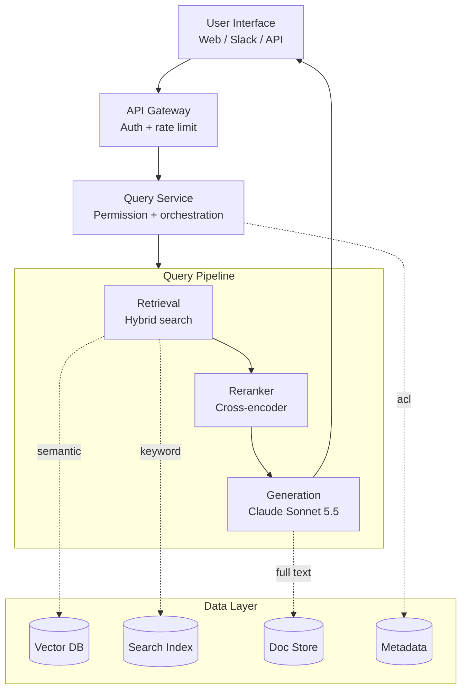
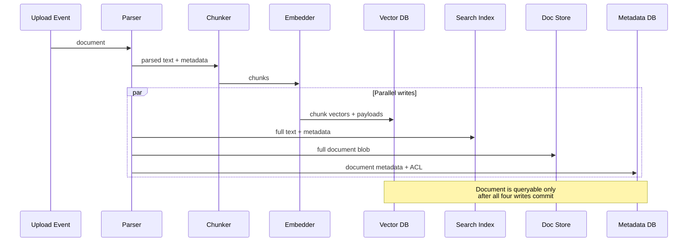
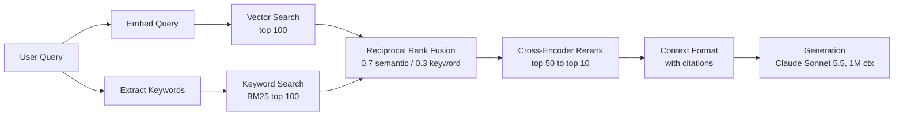

<div dir="rtl">

# مطالعه موردی: سیستم RAG سازمانی

این مطالعه موردی فرآیند طراحی یک سیستم RAG در مقیاس عملیاتی (Production) را برای جست‌وجو در اسناد سازمانی بررسی می‌کند و شامل جمع‌آوری نیازمندی‌ها، تصمیم‌های معماری و جزئیات پیاده‌سازی است.

## فهرست مطالب

- [بیان مسئله](#problem-statement)
- [تحلیل نیازمندی‌ها](#requirements-analysis)
- [معماری سیستم](#system-architecture)
- [بررسی عمیق اجزا](#component-deep-dives)
- [ملاحظات مقیاس‌پذیری](#scaling-considerations)
- [تحلیل هزینه](#cost-analysis)
- [درس‌های آموخته‌شده](#lessons-learned)
- [راهنمای ارائه در مصاحبه](#interview-walkthrough)

---

## بیان مسئله <a id="problem-statement"></a>

### سناریو

یک شرکت خدمات مالی قصد دارد یک سیستم جست‌وجوی مبتنی بر هوش مصنوعی برای مستندات داخلی خود بسازد:
- ۵۰۰٬۰۰۰ سند (سیاست‌ها، رویه‌ها و گزارش‌های پژوهشی)
- ۵٬۰۰۰ کارمند در بخش‌های مختلف سازمان
- به‌روزرسانی روزانه اسناد
- الزامات سخت‌گیرانه انطباق (Compliance) و ممیزی (Audit)
- نیاز به پاسخ‌گویی به پرسش‌ها همراه با ذکر منابع استنادی

### چالش‌ها و گلوگاه‌های فعلی

- کارمندان روزانه بیش از ۲ ساعت را صرف جست‌وجوی اطلاعات می‌کنند
- جست‌وجوی کلیدواژه‌ای نتایج نامرتبط بسیار زیادی برمی‌گرداند
- دانش در بخش‌های مختلف سازمان به‌صورت جزیره‌ای پراکنده است
- کارمندان جدید ماه‌ها زمان نیاز دارند تا به بهره‌وری کامل برسند

---

## تحلیل نیازمندی‌ها <a id="requirements-analysis"></a>

### نیازمندی‌های عملکردی

| نیازمندی | اولویت | توضیحات |
|----------|--------|---------|
| پرسش‌وپاسخ به زبان طبیعی | سطح P0 | قابلیت اصلی |
| ارجاع و استناد به منابع | سطح P0 | الزام انطباق (Compliance) |
| استدلال چندسندی | سطح P1 | اتصال اطلاعات در میان چند سند |
| پرسش‌های تکمیلی (Follow-up) | سطح P1 | حفظ کانتکست مکالمه |
| خلاصه‌سازی اسناد | سطح P2 | مرور سریع اسناد طولانی |

### نیازمندی‌های غیرعملکردی

| نیازمندی | هدف | دلیل |
|----------|-----|------|
| تاخیر (Latency P95) | کمتر از ۵ ثانیه | تجربه کاربری |
| دقت | بیش از ۹۰٪ | اعتماد و پذیرش کاربران |
| دسترس‌پذیری | ۹۹.۹٪ | حیاتی برای کسب‌وکار |
| کاربران هم‌زمان | ۵۰۰ کاربر | اوج مصرف (Peak usage) |
| تازگی اسناد | کمتر از ۱ ساعت | به‌روزرسانی سیاست‌ها |

### نیازمندی‌های امنیتی

- کنترل دسترسی مبتنی بر نقش (RBAC)
- ثبت گزارش ممیزی (Audit logging) برای تمام پرس‌وجوها
- خروج هیچ داده‌ای از مرزهای ابری شرکت مجاز نیست: فراخوانی مدل‌ها از طریق نقاط پایانی خصوصی (Bedrock، Google Cloud یا Foundry) تحت سیاست عدم نگهداری داده (Zero Data Retention) انجام می‌شود و در مواردی که الزامات انطباق ایجاب کند، پردازش منحصراً در ایالات متحده انجام می‌گیرد (با حدود ۱۰٪ هزینه اضافی؛ بخش [تحلیل هزینه](#cost-analysis) را ببینید)
- شناسایی و مدیریت داده‌های قابل شناسایی شخصی (PII)

---

## معماری سیستم <a id="system-architecture"></a>

### معماری سطح بالا

<div dir="ltr">

```
┌─────────────────────────────────────────────────────────────────────────┐
│                           User Interface                                │
│  (Web App, Slack Bot, API)                                             │
└─────────────────────────────┬───────────────────────────────────────────┘
                              │
                              ▼
┌─────────────────────────────────────────────────────────────────────────┐
│                          API Gateway                                    │
│  • Authentication    • Rate Limiting    • Request Routing              │
└─────────────────────────────┬───────────────────────────────────────────┘
                              │
                              ▼
┌─────────────────────────────────────────────────────────────────────────┐
│                        Query Service                                    │
│  • Query understanding   • Permission check   • Orchestration          │
└─────────────────────────────┬───────────────────────────────────────────┘
                              │
        ┌─────────────────────┼─────────────────────┐
        │                     │                     │
        ▼                     ▼                     ▼
┌───────────────┐   ┌───────────────┐   ┌───────────────┐
│   Retrieval   │   │   Reranking   │   │  Generation   │
│   Service     │   │   Service     │   │   Service     │
│               │   │               │   │               │
│ • Hybrid      │   │ • Cross-      │   │ • LLM         │
│   search      │   │   encoder     │   │ • Prompt      │
│ • Filtering   │   │ • Scoring     │   │   building    │
└───────┬───────┘   └───────────────┘   └───────────────┘
        │
        ▼
┌─────────────────────────────────────────────────────────────────────────┐
│                        Data Layer                                       │
│                                                                         │
│  ┌─────────────┐  ┌─────────────┐  ┌─────────────┐  ┌─────────────┐   │
│  │  Vector DB  │  │ Search Index│  │  Doc Store  │  │  Metadata   │   │
│  │  (Qdrant)   │  │ (Elastic)   │  │   (S3)      │  │  (Postgres) │   │
│  └─────────────┘  └─────────────┘  └─────────────┘  └─────────────┘   │
│                                                                         │
└─────────────────────────────────────────────────────────────────────────┘

┌─────────────────────────────────────────────────────────────────────────┐
│                      Ingestion Pipeline                                 │
│  Document Upload → Parse → Chunk → Embed → Index → Store Metadata      │
└─────────────────────────────────────────────────────────────────────────┘
```

</div>

نمای کلی در قالب نمودار جریان (این سیستم لایه‌بندی‌شده از طریق خط لوله پرس‌وجو منشعب می‌شود و در لایه داده همگرا می‌گردد):

<div dir="ltr">



</div>

### انتخاب فناوری‌ها (نوامبر ۲۰۲۶)

| جزء | انتخاب | دلیل |
|-----|--------|------|
| **مدل LLM اصلی** | مدل Claude Sonnet 5.5 (۲ دلار / ۱۰ دلار به ازای ۱ میلیون Token) | قیمت‌گذاری یکنواخت تا ۱ میلیون Token، بنابراین کانتکست‌های چندسندی هزینه اضافی کانتکست طولانی ندارند؛ امکان عدم نگهداری داده (Zero Data Retention) فراهم است؛ از طریق نقاط پایانی خصوصی Bedrock، Google Cloud و Foundry در دسترس است؛ زمان بازنشستگی پیش از ۲۸ سپتامبر ۲۰۲۷ نخواهد بود |
| **تحلیل دشوار میان‌سندی** | مدل Claude Opus 5.5 (۴ دلار / ۲۰ دلار) یا GPT-6.1 Sol (۲ دلار / ۱۰ دلار) | مسیر ارتقا برای چند درصد از پرس‌وجوهایی که به استدلال چندمرحله‌ای در میان اسناد متعدد نیاز دارند. طول Prompt در GPT-6.1 Sol را زیر ۲۷۲ هزار Token ورودی نگه دارید، زیرا بالاتر از آن OpenAI کل درخواست را با نرخ ۴ دلار / ۱۵ دلار محاسبه می‌کند |
| **لایه خلاصه‌سازی و پردازش انبوه** | مدل Gemini 3.8 Flash (۰.۷۵ دلار / ۳.۷۵ دلار در دوره معرفی؛ ۱.۵۰ دلار / ۷.۵۰ دلار از ۱ ژانویه ۲۰۲۷) | کانتکست ارزان‌قیمت ۱ میلیون Token برای خلاصه‌سازی اسناد و غنی‌سازی در زمان دریافت داده (Ingestion). بودجه‌بندی را بر اساس قیمت سال ۲۰۲۷ انجام دهید |
| **مدل‌های Embedding** | مدل text-embedding-3-large (۰.۱۳ دلار به ازای ۱ میلیون) | آزموده‌شده و بدون تغییر. اگر انتظار تغییر مدل دارید، خانواده Cohere Embed 5 (نسخه‌های Pro و Fast) و خانواده Voyage 4 هر یک فضای برداری مشترکی بین اندازه‌های مختلف دارند؛ بنابراین می‌توانید با مدل بزرگ ایندکس کنید و با مدل ارزان بدون ایندکس‌گذاری مجدد جست‌وجو نمایید |
| **پایگاه داده برداری (Vector Database)** | سرویس Qdrant 1.19 یا جدیدتر (میزبانی اختصاصی) | کارایی بالا، فیلتر کردن Payload و انطباق با استقرار درون‌سازمانی (On-prem). تنظیم `memory` (با مقادیر pinned، cached و cold) برای لایه‌بندی جایگزین `on_disk` و `always_ram` شده است |
| **موتور بازرتبه‌بندی (Reranker)** | مدل Qwen3-Reranker-8B (میزبانی اختصاصی، مجوز Apache 2.0) یا یک API بازرتبه‌بندی: Cohere Rerank 5 (نسخه Pro با ۰.۰۵ دلار و نسخه Fast با ۰.۰۲ دلار به ازای ۱ میلیون Token) یا Voyage rerank-3 | هر دو تا ۳۲ هزار Token به ازای هر سند را می‌پذیرند که مشکل قدیمی برش ۵۱۲ Token برای بخش‌های طولانی را برطرف می‌کند؛ پیش از جایگزینی با یک مدل جدیدتر، این محدودیت را بررسی کنید |

> [!NOTE]
> **تغییر رویکرد: واحدهای بازیابی بزرگ‌تر، با قیمت‌گذاری حساب‌شده.** با وجود پنجره‌های ۱ میلیون Token در مدل‌های پیشرو، تیم‌ها به‌جای جست‌وجو برای یافتن قطعه ۵۱۲ Token بی‌نقص، کل بخش‌های سند (۱۰ تا ۵۰ هزار Token) را برای پرسش‌های چندسندی بازیابی می‌کنند. صورت‌حساب نیز متناسب با آن رشد می‌کند: در ۱.۵ میلیون پرس‌وجو در ماه، هر ۱۰ هزار Token ورودی اضافه به ازای هر پرس‌وجو حدود ۳۰٬۰۰۰ دلار در ماه روی Sonnet 5.5 هزینه دارد. مسیریابی را بر اساس نوع پرس‌وجو انجام دهید: قطعات کوچک برای جست‌وجوهای نقطه‌ای (Lookups) و بخش‌های بزرگ فقط برای پرسش‌های ترکیبی (Synthesis). قوانین قیمت‌گذاری نه تنها بر اساس ارائه‌دهنده، بلکه بر اساس مدل نیز متفاوت است: Sonnet 5.5 و Opus 5.5 تا ۱ میلیون قیمت یکنواخت دارند، Claude Haiku 5.5 به محض عبور Prompt از ۱۰۰ هزار Token کل درخواست را با نرخ ۵ برابر محاسبه می‌کند و OpenAI بالای ۲۷۲ هزار Token ورودی کل درخواست را دوباره قیمت‌گذاری می‌کند.

---

## بررسی عمیق اجزا <a id="component-deep-dives"></a>

### خط لوله دریافت و پردازش اسناد (Ingestion Pipeline)

<div dir="ltr">

```python
class IngestionPipeline:
    def __init__(self):
        self.parser = DocumentParser()
        self.chunker = SemanticChunker(
            chunk_size=512,
            chunk_overlap=50
        )
        self.embedder = OpenAIEmbedder(model="text-embedding-3-large")
        self.vector_db = QdrantClient()
        self.metadata_db = PostgresClient()
    
    async def ingest(self, document: Document, user_context: UserContext):
        # 1. Parse document
        parsed = self.parser.parse(document)
        
        # 2. Extract metadata
        metadata = self.extract_metadata(parsed, document)
        
        # 3. Chunk
        chunks = self.chunker.chunk(parsed.text)
        
        # 4. Generate embeddings (batch)
        embeddings = await self.embedder.embed_batch([c.text for c in chunks])
        
        # 5. Store in vector DB with metadata
        points = [
            {
                "id": f"{document.id}_{i}",
                "vector": embedding,
                "payload": {
                    "document_id": document.id,
                    "chunk_index": i,
                    "text": chunk.text,
                    "department": metadata.department,
                    "access_level": metadata.access_level,
                    "created_at": metadata.created_at.isoformat()
                }
            }
            for i, (chunk, embedding) in enumerate(zip(chunks, embeddings))
        ]
        
        await self.vector_db.upsert(collection_name="documents", points=points)
        
        # 6. Store full document
        await self.doc_store.put(document.id, parsed.text)
        
        # 7. Store metadata
        await self.metadata_db.insert_document(document.id, metadata)
        
        # 8. Index in Elasticsearch for keyword search
        await self.es_client.index(
            index="documents",
            id=document.id,
            body={"text": parsed.text, **metadata.to_dict()}
        )
```

</div>

کد بالا مانند یک توالی خطی به نظر می‌رسد، اما چهار مورد از عملیات نوشتن به‌صورت موازی انجام می‌شوند. نمودار توالی (Sequence Diagram) این انشعاب موازی (Fanout) را به‌وضوح نشان می‌دهد که برای درک حالت‌های شکست جزئی (Partial-failure modes) اهمیت دارد:

<div dir="ltr">



</div>

### پردازش پرس‌وجو (Query Processing)

<div dir="ltr">

```python
class QueryService:
    def __init__(self):
        self.retriever = HybridRetriever()
        self.reranker = CrossEncoderReranker()  # self-hosted Qwen3-Reranker or an API reranker
        self.generator = LLMGenerator()
        self.guardrails = GuardrailPipeline()
    
    async def process_query(
        self,
        query: str,
        user_context: UserContext,
        conversation_history: list[Message] = None
    ) -> QueryResponse:
        
        # 1. Input guardrails
        guardrail_result = self.guardrails.check_input(query)
        if not guardrail_result.passed:
            return QueryResponse(
                answer="I cannot help with that request.",
                blocked=True,
                reason=guardrail_result.reason
            )
        
        # 2. Query understanding (optional: rewrite query)
        processed_query = await self.understand_query(query, conversation_history)
        
        # 3. Retrieve candidates with permission filtering
        candidates = await self.retriever.search(
            query=processed_query,
            filters=self.build_permission_filter(user_context),
            top_k=50
        )
        
        # 4. Rerank
        reranked = await self.reranker.rerank(
            query=processed_query,
            documents=candidates,
            top_k=10
        )
        
        # 5. Build context
        context = self.build_context(reranked)
        
        # 6. Generate answer
        answer = await self.generator.generate(
            query=query,
            context=context,
            conversation_history=conversation_history
        )
        
        # 7. Output guardrails
        guardrail_result = self.guardrails.check_output(answer, context)
        if not guardrail_result.passed:
            answer = self.fallback_response()
        
        # 8. Build response with citations
        return QueryResponse(
            answer=answer,
            sources=[self.format_source(doc) for doc in reranked[:5]],
            confidence=self.calculate_confidence(reranked)
        )
    
    def build_permission_filter(self, user_context: UserContext) -> dict:
        return {
            "should": [
                {"key": "access_level", "match": {"value": "public"}},
                {"key": "department", "match": {"value": user_context.department}},
                {"key": "access_list", "match": {"any": [user_context.user_id]}}
            ]
        }
```

</div>

### بازیابی ترکیبی (Hybrid Retrieval)

<div dir="ltr">

```python
class HybridRetriever:
    def __init__(self, vector_weight: float = 0.7, keyword_weight: float = 0.3):
        self.vector_db = QdrantClient()
        self.es_client = ElasticsearchClient()
        self.embedder = OpenAIEmbedder()
        self.vector_weight = vector_weight
        self.keyword_weight = keyword_weight
    
    async def search(
        self,
        query: str,
        filters: dict,
        top_k: int = 50
    ) -> list[Document]:
        
        # Parallel retrieval
        vector_results, keyword_results = await asyncio.gather(
            self.vector_search(query, filters, top_k * 2),
            self.keyword_search(query, filters, top_k * 2)
        )
        
        # Reciprocal Rank Fusion
        fused = self.rrf_fusion(
            [vector_results, keyword_results],
            weights=[self.vector_weight, self.keyword_weight],
            k=60
        )
        
        return fused[:top_k]
    
    async def vector_search(self, query: str, filters: dict, top_k: int):
        query_embedding = await self.embedder.embed(query)
        
        # Query API: Qdrant 1.19 removed the legacy /search endpoint from its REST schema
        response = await self.vector_db.query_points(
            collection_name="documents",
            query=query_embedding,
            query_filter=filters,
            limit=top_k
        )
        results = response.points
        
        return [
            Document(
                id=r.payload["document_id"],
                chunk_id=r.id,
                text=r.payload["text"],
                score=r.score,
                metadata=r.payload
            )
            for r in results
        ]
    
    def rrf_fusion(self, result_lists: list, weights: list, k: int = 60) -> list:
        scores = defaultdict(float)
        docs = {}
        
        for results, weight in zip(result_lists, weights):
            for rank, doc in enumerate(results):
                rrf_score = weight / (k + rank + 1)
                scores[doc.chunk_id] += rrf_score
                docs[doc.chunk_id] = doc
        
        sorted_ids = sorted(scores.keys(), key=lambda x: scores[x], reverse=True)
        return [docs[id] for id in sorted_ids]
```

</div>

نمای کلی جریان بازیابی ترکیبی: دو موتور بازیابی موازی اجرا می‌شوند، سپس الگوریتم RRF آن‌ها را با رتبه‌های وزن‌دار ترکیب می‌کند، و در نهایت یک Cross-encoder پیش از قالب‌بندی کانتکست، بهترین گزینه‌ها را بازرتبه‌بندی می‌نماید:

<div dir="ltr">



</div>

### تولید پاسخ با کانتکست طولانی (Long Context)

<div dir="ltr">

```python
import anthropic

class LongContextGenerator:
    """
    Claude Sonnet 5.5 over whole document sections. Documents sit in the
    system prompt, ahead of the conversation, so follow-up questions over the
    same documents hit the prompt cache (reads bill at $0.10 per 1M on
    Sonnet 5.5, 0.05x the input price).
    """
    def __init__(self):
        # Use AsyncAnthropicBedrockMantle, AsyncAnthropicVertex or AsyncAnthropicFoundry
        # instead to keep traffic on a private cloud endpoint
        self.client = anthropic.AsyncAnthropic()

    async def generate(
        self,
        query: str,
        context_docs: list[Document],
        conversation_history: list[dict] | None = None
    ) -> str:
        instructions = (
            "You are an enterprise knowledge assistant. "
            "Answer only from the provided documents. "
            "Cite every claim using [[DocName:PageNumber]] format."
        )
        doc_blocks = [
            {"type": "text", "text": f"<document name='{d.name}'>\n{d.text}\n</document>"}
            for d in context_docs
        ]
        doc_blocks[-1]["cache_control"] = {"type": "ephemeral"}  # cache through the last document

        # No temperature: API version 2026-10-21 (the default in Python
        # SDK 2.x) rejects any sampling parameter, even at its default value
        response = await self.client.messages.create(
            model="claude-sonnet-5-5",
            max_tokens=4096,
            system=[{"type": "text", "text": instructions}, *doc_blocks],
            output_config={"effort": "medium"},
            messages=[
                # History holds only prior questions and answers, never the documents,
                # so the cached system-plus-documents prefix stays byte-identical
                *(conversation_history or []),
                {"role": "user", "content": f"Question: {query}"},
            ],
        )
        # Adaptive thinking is on by default, so keep only the text blocks
        return "".join(b.text for b in response.content if b.type == "text")
```

</div>

> [!TIP]
> **انتخاب محیط تولید در برابر جدیدترین نسخه**
> مدل Sonnet 5.5 در ۲۸ سپتامبر ۲۰۲۶ منتشر شد. تیم‌هایی که الگوهای Prompt و سازوکارهای محافظتی (Guardrails) خود را روی Sonnet 5 یا Sonnet 4.6 تنظیم کرده‌اند، پیش از مهاجرت باید مجموعه ارزیابی (Eval set) خود را اجرا کنند، زیرا این ارتقا بدون نیاز به تغییر (Drop-in) نیست:
> - **ساختار درخواست (Request shape)**: مقدار اجباری `tool_choice` (`any` یا `tool`) خطای ۴۰۰ برمی‌گرداند، تنظیم `thinking: {type: "disabled"}` خطای ۴۰۰ می‌دهد (پایین‌ترین سطح مجاز `between_tools` است)، و مقدار غیرپیش‌فرض `temperature` خطای ۴۰۰ برمی‌گرداند (که در Sonnet 5 نیز برقرار بود)؛ تحت نسخه `2026-10-21` از API که نسخه‌های اصلی جدید SDK به‌صورت پیش‌فرض ارسال می‌کنند، هرگونه مقدار `temperature`، `top_p` یا `top_k` روی تمام مدل‌ها خطای ۴۰۰ برمی‌گرداند، حتی اگر مقدار پیش‌فرض باشد.
> - **رفتار مدل**: سطوح تلاش (Effort levels) بازتنظیم شده‌اند؛ بنابراین به‌جای انتقال مستقیم تنظیمات قبلی، ارزیابی سطوح تلاش (Effort sweep) را مجدداً اجرا کنید.
> - **مهلت‌های بازنشستگی**: هر سرویسی که هنوز روی Sonnet 4.5 قفل شده است به‌هرحال باید منتقل شود؛ این مدل در ۳۰ نوامبر ۲۰۲۶ در Claude API و Foundry بازنشسته می‌شود.
> - **به‌روزرسانی SDK**: نسخه ۱.۰ از Python SDK شرکت Anthropic (۲۰ اوت ۲۰۲۶) به `httpx2` مهاجرت کرد و ردیابی (Tracing) و تست‌های Mock مبتنی بر httpx ممکن است به‌صورت بی‌صدا فراخوانی‌ها را از دست بدهند؛ سپس نسخه ۲.۰.۰ از Python SDK نسخه پیش‌فرض API را به `2026-10-21` و مجوز را به Apache 2.0 تغییر داد. پس از ارتقا، تعداد Spanها و ساختار درخواست‌ها را بررسی کنید.

---

## ملاحظات مقیاس‌پذیری <a id="scaling-considerations"></a>

### مدیریت ۵۰۰ هزار سند

<div dir="ltr">

```python
# Sharding strategy for Qdrant
qdrant_config = {
    "collection": "documents",
    "vectors": {
        "size": 3072,  # text-embedding-3-large
        "distance": "Cosine"
    },
    "optimizers": {
        "indexing_threshold": 20000  # Build index after 20K points
    },
    "replication_factor": 2,  # High availability
    "shard_number": 4  # Distribute across nodes
}
```

</div>

### مدیریت ۵۰۰ کاربر هم‌زمان

<div dir="ltr">

```
Load Balancer
     │
     ├──► Query Service (replica 1)
     ├──► Query Service (replica 2)
     ├──► Query Service (replica 3)
     └──► Query Service (replica 4)
            │
            ├──► Vector DB (3-node cluster)
            ├──► LLM API (with retry/fallback)
            └──► Elasticsearch (3-node cluster)
```

</div>

### استراتژی کشینگ (Caching)

<div dir="ltr">

```python
class QueryCache:
    def __init__(self):
        self.exact_cache = Redis(ttl=3600)  # 1 hour
        self.semantic_cache = SemanticCache(threshold=0.95, ttl=1800)
    
    async def get_or_compute(self, query: str, user_context: UserContext) -> QueryResponse:
        # Check exact cache
        cache_key = self.make_key(query, user_context.permissions)
        cached = await self.exact_cache.get(cache_key)
        if cached:
            return cached
        
        # Check semantic cache
        similar = await self.semantic_cache.find_similar(query, user_context.permissions)
        if similar:
            return similar
        
        # Compute
        response = await self.query_service.process_query(query, user_context)
        
        # Cache result
        await self.exact_cache.set(cache_key, response)
        await self.semantic_cache.add(query, user_context.permissions, response)
        
        return response
```

</div>

---

## تحلیل هزینه <a id="cost-analysis"></a>

### برآورد هزینه ماهانه (۵۰۰ کاربر، ۱۰۰ پرس‌وجو به ازای هر کاربر در روز، تعرفه‌های نوامبر ۲۰۲۶)

| جزء | محاسبه | هزینه ماهانه |
|-----|--------|--------------|
| مدل LLM (مدل Claude Sonnet 5.5، پردازش صرفاً در آمریکا با ضریب ۱.۱ برابر) | حدود ۱.۵ میلیون پرس‌وجو × (۲ هزار Token ورودی × ۲.۲۰ دلار/۱ میلیون + ۵۰۰ Token خروجی × ۱۱ دلار/۱ میلیون) | حدود ۱۴٬۸۵۰ دلار |
| بردارسازی (Embeddings) | حدود ۷۵ میلیون Token پرس‌وجو به‌علاوه بردارسازی مجدد روزانه حدود ۲٪ از کل مجموعه اسناد (حدود ۵۰ میلیون Token در روز، حدود ۱.۵ میلیارد در ماه) با نرخ ۰.۱۳ دلار/۱ میلیون | حدود ۲۰۰ دلار |
| بازرتبه‌بندی (Voyage rerank-3) | حدود ۱.۵ میلیون پرس‌وجو × ۵۰ کاندیدا × حدود ۴۰۰ Token × ۰.۰۵ دلار/۱ میلیون | حدود ۱٬۵۰۰ دلار |
| پایگاه داده برداری (Qdrant) | کلاستر ۳ نودی | حدود ۱٬۵۰۰ دلار |
| موتور جست‌وجوی Elasticsearch | کلاستر ۳ نودی | حدود ۲٬۰۰۰ دلار |
| منابع پردازشی (سرویس Query) | تعداد ۴ نمونه (Instance) | حدود ۱٬۰۰۰ دلار |
| **مجموع** | | **حدود ۲۱٬۰۰۰ دلار/ماه** |

ردیف‌های مربوط به مدل‌ها بر اساس قیمت فهرست Claude API محاسبه شده‌اند؛ Bedrock و Google Cloud قیمت‌گذاری اختصاصی خود را برای Claude دارند، بنابراین تعرفه منطقه‌ای پلتفرمی را که روی آن استقرار می‌دهید، تأیید کنید. ردیف‌های بردارسازی و بازرتبه‌بندی نیز متن سند را برای یک ارائه‌دهنده ارسال می‌کنند و بنابراین مشمول الزام مرز ابری (Cloud-boundary) می‌شوند: آن‌ها را از طریق یک نقطه پایانی خصوصی در فضای ابری خود فراخوانی کنید یا به‌صورت اختصاصی میزبانی نمایید. دو فرض پایه پشت این جدول قرار دارد. نخست، کانتکست‌های ۲ هزار Token: اگر ۲۰٪ پرس‌وجوها برای ترکیب اطلاعات بخش‌هایی با طول ۲۰ هزار Token واکشی کنند، حدود ۱۲٬۰۰۰ دلار در ماه اضافه می‌شود (۳۰۰ هزار پرس‌وجو × ۱۸ هزار Token اضافه × ۲.۲۰ دلار/۱ میلیون). دوم، ۵۰۰ Token خروجی: مدل Sonnet 5.5 به‌صورت پیش‌فرض از استدلال تطبیقی (Adaptive thinking) استفاده می‌کند و Tokenهای تفکر به عنوان خروجی محاسبه می‌شوند، بنابراین پیش از اتکا به عدد ردیف LLM، خروجی واقعی به ازای هر پرس‌وجو را اندازه‌گیری کنید.

### فرصت‌های بهینه‌سازی هزینه

1. **کش کردن پاسخ‌ها (Response caching)**: نرخ اصابت کش ۳۰٪ ← صرفه‌جویی حدود ۴٬۵۰۰ دلار در هزینه LLM
2. **کش کردن Prompt**: کش کردن دستورالعمل‌ها و System Prompt ایستا؛ در Sonnet 5.5 از ۷ اکتبر ۲۰۲۶ به بعد، خواندن از کش با ضریب ۰.۰۵ برابر قیمت ورودی محاسبه می‌شود
3. **مسیریابی مدل (Model routing)**: هدایت جست‌وجوهای ساده به یک رده ارزان‌تر (مدل Claude Haiku 5.5 با نرخ ۰.۱۰ / ۰.۵۰ دلار، یا Gemini 3.8 Flash) ← تا ۴۰٪ صرفه‌جویی در هزینه LLM. مدل Haiku 5.5 را برای جست‌وجوهای کوتاه‌کانتکست نگه دارید: به محض اینکه یک Prompt از ۱۰۰ هزار Token عبور کند، کل درخواست با نرخ ۰.۵۰ / ۲.۵۰ دلار محاسبه می‌شود و همچنین پارامتر `temperature` و پیش‌پرکردن پاسخ دستیار (Assistant prefill) را رد می‌کند؛ بنابراین پیش از انتقال ترافیک، مجموعه ارزیابی را اجرا کنید
4. **اقامت داده صرفاً در موارد الزامی**: فعال‌سازی پردازش منحصراً در آمریکا فقط برای بخش‌هایی که نیاز دارند و اجرای بقیه روی نقاط پایانی سراسری ← بازگرداندن تا حدود ۱٬۳۵۰ دلار (همان ۱۰٪ هزینه اضافی)
5. **بردارسازی مجدد دسته‌ای (Batch re-embedding)**: اجرای بردارسازی مجدد شبانه از طریق Batch API شرکت OpenAI ← ۵۰٪ تخفیف روی آن ردیف هزینه
6. **موتور بازرتبه‌بندی با میزبانی اختصاصی**: جایگزینی API بازرتبه‌بندی با Qwen3-Reranker ← حذف حدود ۱٬۵۰۰ دلار هزینه API، اما یک کارت H100 اختصاصی بر اساس شاخص ۱ نوامبر Silicon Data (۲.۹۳ دلار به ازای هر ساعت GPU) ماهانه حدود ۲٬۱۰۰ دلار هزینه دارد؛ بنابراین این کار فقط روی ظرفیت GPU که از قبل در اختیار دارید صرفه اقتصادی دارد. همچنین اگر قوانین انطباق ارسال بخش‌های کاندیدا به یک API بازرتبه‌بندی را ممنوع کنند، این روش گزینه پیش‌فرض خواهد بود

---

## درس‌های آموخته‌شده <a id="lessons-learned"></a>

### مواردی که به‌خوبی کار کردند

1. **جست‌وجوی ترکیبی**: ترکیب جست‌وجوی معنایی و کلیدواژه‌ای به‌طور چشمگیری نرخ بازیابی (Recall) را بهبود داد
2. **بازرتبه‌بندی (Reranking)**: بهبود ۱۵ درصدی در دقت ۵ نتیجه برتر (Top-5 precision)
3. **استنادهای شفاف**: اعتماد کاربران را جلب کرد
4. **فیلتر کردن دسترسی در زمان بازیابی**: نیاز به فیلتر کردن پس از بازیابی (Post-hoc) را از بین برد

### چالش‌های پیش‌آمده

1. **استخراج جدول**: فایل‌های PDF دارای جدول‌های پیچیده نیازمند تجزیه (Parsing) سفارشی بودند
2. **سرواژه‌ها (Acronyms)**: سرواژه‌های تخصصی دامنه به بسط و توضیح نیاز داشتند
3. **تازگی داده‌ها**: دستیابی به تازگی زیر ۱ ساعت مستلزم دریافت جریانی (Streaming ingestion) بود
4. **اسناد طولانی**: اسناد بیش از ۱۰۰ صفحه به Chunking سلسله‌مراتبی نیاز داشتند

### کارهایی که در صورت تکرار متفاوت انجام می‌دادیم

1. شروع زودتر با تجزیه (Parsing) بهتر اسناد
2. ساخت خط لوله ارزیابی پیش از مقیاس‌دهی
3. پیاده‌سازی ثبت گزارش (Logging) پرس‌وجوها از روز نخست
4. ایجاد حلقه بازخورد با کاربران در مراحل زودتر

---

## راهنمای ارائه در مصاحبه <a id="interview-walkthrough"></a>

### نحوه ارائه این طراحی در مصاحبه

**شروع (۲ دقیقه):**
«قصد دارم یک سیستم RAG سازمانی برای جست‌وجوی اسناد داخلی طراحی کنم. اجازه دهید ابتدا چند نیازمندی را شفاف‌سازی کنم...»

**نیازمندی‌ها (۳ دقیقه):**
- درباره مقیاس، تاخیر (Latency) و اهداف دقت بپرسید
- نیازمندی‌های امنیتی را شفاف کنید
- انواع اسناد و بسامد به‌روزرسانی آن‌ها را مشخص کنید

**طراحی سطح بالا (۵ دقیقه):**
- نمودار معماری را رسم کنید
- اجزای کلیدی را توضیح دهید
- انتخاب فناوری‌ها را توجیه کنید

**بررسی عمیق (۱۰ دقیقه):**
- استراتژی بازیابی (جست‌وجوی ترکیبی و دلیل انتخاب آن)
- امنیت (فیلتر کردن مجوزها در زمان پرس‌وجو)
- تولید پاسخ (مهندسی Prompt و استنادها)
- مقیاس‌پذیری (Sharding، کشینگ و تکرارپذیری)

**موازنه‌ها (Tradeoffs) (۵ دقیقه):**
- هزینه در برابر تاخیر (انتخاب مدل)
- اندازه کانتکست در برابر هزینه (بخش‌های کامل به ترکیب اطلاعات کمک می‌کنند اما هزینه ورودی را چندبرابر می‌کنند)
- دقت در برابر تاخیر (بازرتبه‌بندی زمان می‌برد)
- تازگی داده‌ها در برابر هزینه (پردازش جریانی در برابر دسته‌ای)

**پایش و مانیتورینگ (۲ دقیقه):**
- معیارهای کلیدی (تاخیر، دقت، بازخورد کاربران)
- نحوه تشخیص مشکلات
- حلقه بهبود مستمر

---

*بخش بعدی: [مطالعه موردی: Agent مکالمه‌ای هوش مصنوعی](02-conversational-agent.md)*

</div>
