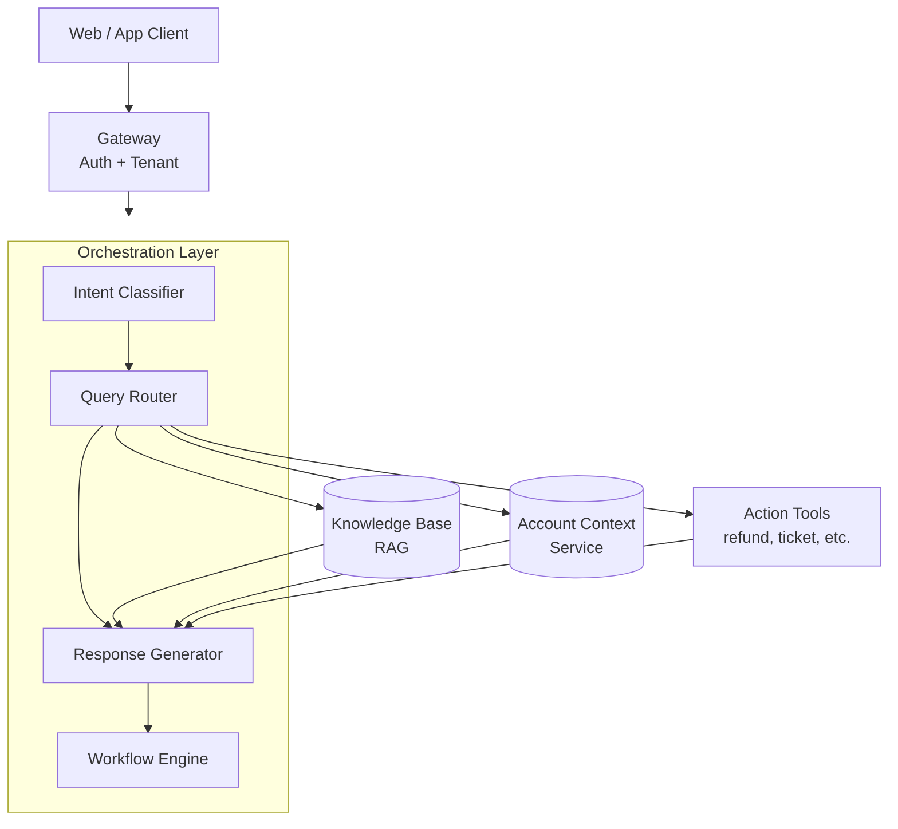
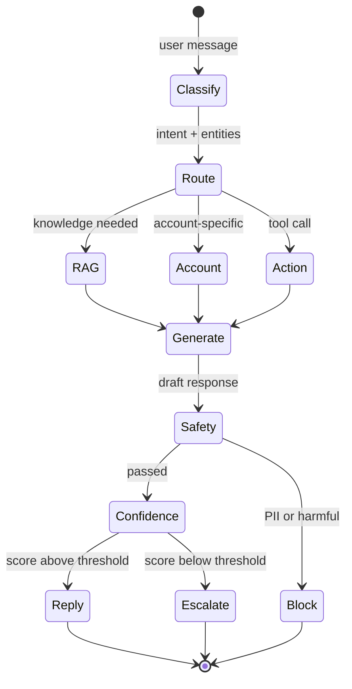
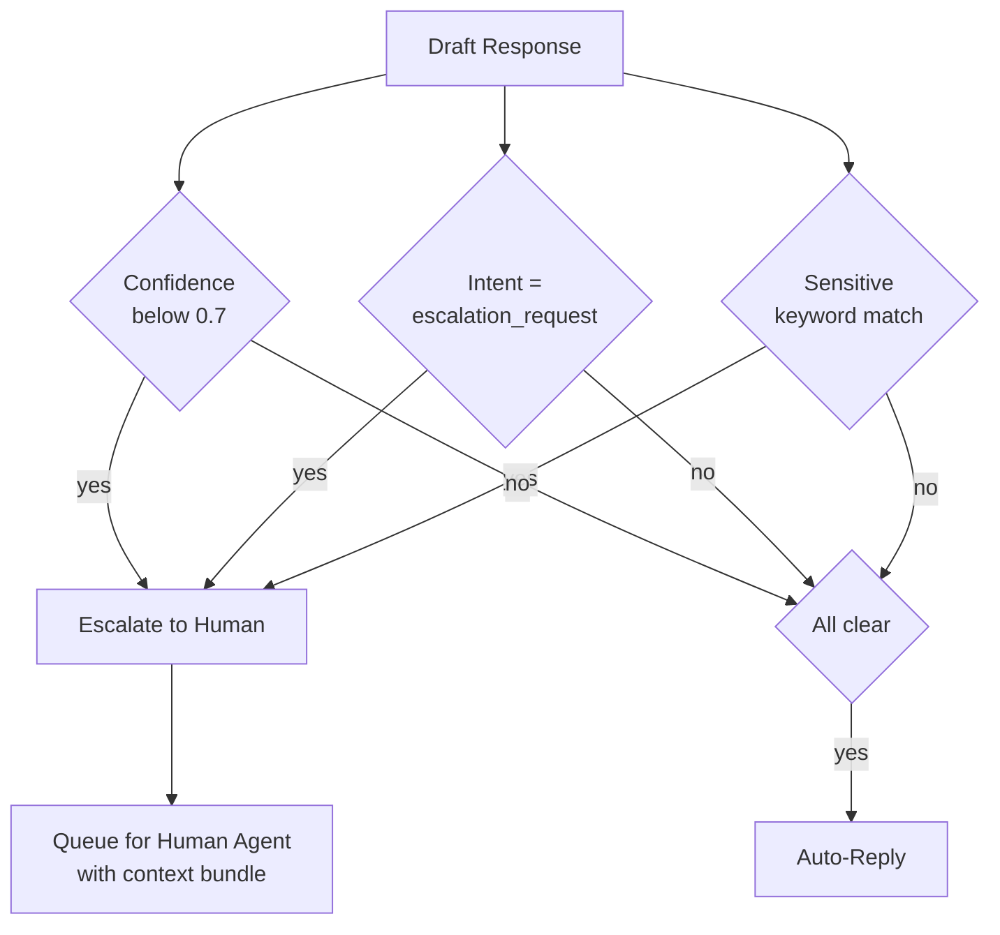

<div dir="rtl">

# مطالعه موردی: عامل گفت‌وگومحور پشتیبانی مشتریان (Customer Support Conversational Agent)

این مطالعه موردی مراحل طراحی یک عامل (Agent) پشتیبانی مشتریان در محیط تولید (Production) را برای یک شرکت B2B SaaS بررسی می‌کند.

## فهرست مطالب

- [بیان مسئله](#problem-statement)
- [تحلیل نیازمندی‌ها](#requirements-analysis)
- [طراحی معماری](#architecture-design)
- [بررسی عمیق اجزا](#component-deep-dives)
- [الگوهای قابلیت اطمینان](#reliability-patterns)
- [ارزیابی و پایش](#evaluation-and-monitoring)
- [تحلیل هزینه](#cost-analysis)
- [درس‌های آموخته‌شده](#lessons-learned)
- [مرور مصاحبه](#interview-walkthrough)

---

## بیان مسئله <a id="problem-statement"></a>

**شرکت:** پلتفرم B2B SaaS با ۵۰ هزار مشتری سازمانی

**وضعیت فعلی:**
- ۵۰۰ هزار تیکت پشتیبانی در ماه
- میانگین زمان پاسخ‌گویی: ۴ ساعت
- رضایت مشتری (CSAT): ۷۲٪
- تیم پشتیبانی: ۱۰۰ کارشناس

**هدف:**
- کاهش زمان پاسخ‌گویی به کمتر از ۵ دقیقه برای پرس‌وجوهای متداول
- بهبود CSAT به بیش از ۸۵٪
- رسیدگی به ۶۰٪ تیکت‌ها بدون دخالت انسان
- حفظ کیفیت برای تیکت‌های ارجاع‌داده‌شده به پشتیبان انسانی

---

## تحلیل نیازمندی‌ها <a id="requirements-analysis"></a>

### نیازمندی‌های عملکردی

| نیازمندی | توضیحات | اولویت |
|----------|---------|--------|
| درک پرس‌وجو | دسته‌بندی قصد کاربر (Intent)، استخراج موجودیت‌ها (Entities) | اولویت P0 |
| بازیابی دانش | جست‌وجو در مستندات محصول، سوالات متداول (FAQ) و تیکت‌های گذشته | اولویت P0 |
| زمینه حساب کاربری | دسترسی به وضعیت اشتراک و تاریخچه کاربر | اولویت P0 |
| تولید پاسخ | پاسخ‌های طبیعی، دقیق و کاربردی | اولویت P0 |
| حافظه مکالمه | حفظ زمینه در مکالمات چندنوبتی (Multi-turn) | اولویت P0 |
| اجرای عملیات | ایجاد تیکت، راه‌اندازی گردش‌کارها (Workflows) | اولویت P1 |
| ارجاع به پشتیبان انسانی | تحویل مکالمه با زمینه کامل در صورت نیاز | اولویت P0 |
| استعلام‌های مالی و صورتحساب | پردازش داده‌های حساس مالی | اولویت P1 |

### نیازمندی‌های غیرعملکردی

| نیازمندی | هدف | دلیل و منطق |
|----------|-----|-------------|
| تاخیر (TTFT) | کمتر از ۱ ثانیه (< 1s) | انتظار کاربر در گفت‌وگوی آنلاین |
| تاخیر (کامل) | کمتر از ۵ ثانیه (< 5s) | حفظ تعامل و درگیری کاربر |
| دسترس‌پذیری | ۹۹٫۹ درصد (99.9%) | حیاتی برای کسب‌وکار |
| دقت | بیش از ۹۵ درصد (> 95%) | حفظ اعتماد مشتری |
| نرخ ارجاع به انسان | کمتر از ۴۰ درصد (< 40%) | بهره‌وری هزینه |
| رضایت مشتری (CSAT) | بیش از ۸۵ درصد (> 85%) | هدف کسب‌وکار |

### نیازمندی‌های امنیتی

- نبود اطلاعات شناسایی شخصی (PII) در لاگ‌ها
- جداسازی داده‌های مستاجران (Tenant isolation؛ مشتریان فقط داده‌های خودشان را می‌بینند)
- ثبت ردپای ممیزی (Audit trail) برای تمامی عملیات‌ها
- انطباق با استاندارد SOC 2
- اطلاع‌رسانی به کاربران درباره اینکه با یک هوش مصنوعی صحبت می‌کنند: تکالیف شفافیت ماده ۵۰ قانون هوش مصنوعی اتحادیه اروپا (EU AI Act) از ۲ اوت ۲۰۲۶ لازم‌الاجرا شده است و رهنمودهای کمیسیون تصریح می‌کنند که آگاهی عمومی جامعه از هوش مصنوعی، ماهیت یک تعامل را به‌خودی‌خود بدیهی نمی‌سازد

---

## طراحی معماری <a id="architecture-design"></a>

### معماری سطح بالا

<div dir="ltr">

```
┌─────────────────────────────────────────────────────────────────┐
│                      CUSTOMER SUPPORT AGENT                      │
├─────────────────────────────────────────────────────────────────┤
│                                                                  │
│  ┌─────────────┐     ┌─────────────┐     ┌─────────────┐        │
│  │   Web/App   │────▶│   Gateway   │────▶│    Auth     │        │
│  │   Client    │     │             │     │  + Tenant   │        │
│  └─────────────┘     └──────┬──────┘     └─────────────┘        │
│                             │                                    │
│                             ▼                                    │
│  ┌──────────────────────────────────────────────────────────┐   │
│  │                   ORCHESTRATION LAYER                     │   │
│  │  ┌────────────────────────────────────────────────────┐  │   │
│  │  │  Intent        Query          Response    Workflow │  │   │
│  │  │  Classifier → Router →        Generator → Engine   │  │   │
│  │  └────────────────────────────────────────────────────┘  │   │
│  └──────────────────────────────────────────────────────────┘   │
│                             │                                    │
│         ┌───────────────────┼───────────────────┐               │
│         ▼                   ▼                   ▼               │
│  ┌─────────────┐     ┌─────────────┐     ┌─────────────┐        │
│  │  Knowledge  │     │   Account   │     │   Action    │        │
│  │    Base     │     │   Context   │     │   Tools     │        │
│  │   (RAG)     │     │   Service   │     │             │        │
│  └─────────────┘     └─────────────┘     └─────────────┘        │
│                                                                  │
└─────────────────────────────────────────────────────────────────┘
```

</div>

این معماری در قالب یک جریان لایه‌ای نمایش داده شده است. لایه ارکستراسیون (Orchestration Layer) درخواست را به سه منبع زمینه موازی ارسال می‌کند و سپس آن‌ها را در مولد پاسخ تجمیع می‌نماید:

<div dir="ltr">



</div>

### جریان مکالمه

<div dir="ltr">

```
User Message
    │
    ▼
┌─────────────────┐
│ Intent Classify │─── billing, technical, account, general, escalation
└────────┬────────┘
         │
         ▼
┌─────────────────┐
│ Query Routing   │─── Which knowledge sources? Which tools?
└────────┬────────┘
         │
    ┌────┴────┬────────────┐
    ▼         ▼            ▼
┌───────┐ ┌───────┐ ┌──────────┐
│  RAG  │ │Account│ │ Actions  │
│ Query │ │Context│ │ (if any) │
└───┬───┘ └───┬───┘ └────┬─────┘
    │         │          │
    └────┬────┴──────────┘
         │
         ▼
┌─────────────────┐
│    Generate     │
│    Response     │
└────────┬────────┘
         │
         ▼
┌─────────────────┐
│  Safety Check   │─── PII, harmful, off-topic
└────────┬────────┘
         │
         ▼
┌─────────────────┐
│  Confidence     │─── Low confidence? Escalate
│    Check        │
└────────┬────────┘
         │
         ▼
    Response / Escalation
```

</div>

هر نوبت مکالمه یک ماشین وضعیت (State Machine) است. دو دروازه‌ای که برای هزینه و اعتماد اهمیت دارند عبارت‌اند از *ایمنی* (پیش از خروج پاسخ از سیستم باید تایید شود) و *اطمینان* (تعیین می‌کند مکالمه به انسان ارجاع شود یا به‌صورت خودکار پاسخ داده شود):

<div dir="ltr">



</div>

---

## بررسی عمیق اجزا <a id="component-deep-dives"></a>

### دسته‌بندی قصد کاربر (Intent Classification)

<div dir="ltr">

```python
INTENT_SCHEMA = {
    "type": "object",
    "properties": {
        "intent": {"type": "string",
                   "enum": ["billing", "technical", "account", "general", "escalation_request"]},
        "entities": {"type": "array", "items": {
            "type": "object",
            "properties": {"type": {"type": "string"}, "value": {"type": "string"}},
            "required": ["type", "value"],
            "additionalProperties": False,
        }},
        "confidence": {"type": "number"},
    },
    "required": ["intent", "entities", "confidence"],
    "additionalProperties": False,
}

class IntentClassifier:
    async def classify(self, message: str, history: list[dict]) -> dict:
        # Smallest tier: GPT-6 Luna ($0.10 / $0.50 per 1M tokens). Track p95
        # latency and use the lowest reasoning effort that holds accuracy.
        result = await client.responses.create(
            model="gpt-6-luna",
            instructions="Classify the customer's latest message.",
            input=[*history[-4:], {"role": "user", "content": message}],
            text={"format": {"type": "json_schema", "name": "intent",
                             "schema": INTENT_SCHEMA, "strict": True}},
        )
        return json.loads(result.output_text)
```

</div>

### پایگاه دانش (بازیابی ترکیبی به همراه رتبه‌بندی مجدد)

<div dir="ltr">

```python
class SupportKnowledgeBase:
    async def retrieve(self, query: str, tenant_id: str, top_k: int = 8) -> list[dict]:
        # Long-context models tempt teams to skip reranking and pass 50 chunks.
        # At 500K conversations a month, a reranker (about $0.001 per turn) is
        # far cheaper than paying for 40 extra chunks of input on every turn.
        candidates = await self.sources.search(
            query, filters={"tenant_id": tenant_id}, limit=50
        )
        return await self.reranker.rerank(query, candidates, top_k=top_k)
```

</div>

### تولید پاسخ (لایه‌بندی‌شده: Claude Haiku 5.5 و Sonnet 5.5)

نسخه ۲۰۲۵ این طراحی، قابلیت استدلال گسترده (Extended Thinking) را به‌صورت درخواستی روی یک مدل فعال و غیرفعال می‌کرد. این تنظیم در جدیدترین مدل‌ها حذف شده است: مدل Sonnet 5.5 به‌صورت پیش‌فرض از استدلال تطبیقی (Adaptive Thinking) استفاده می‌کند و در صورت دریافت `thinking: {type: "disabled"}` خطای 400 برمی‌گرداند، و عمق استدلال از طریق `output_config.effort` تعیین می‌شود. مدل Haiku 5.5 نیز به‌صورت پیش‌فرض استدلال تطبیقی را در سطح تلاش `medium` اجرا می‌کند مگر آنکه خلاف آن مشخص شود؛ بنابراین مسیر عادی (Routine) به‌طور صریح مقدار `low` را تنظیم می‌کند تا به‌جای به ارث بردن مقدار پیش‌فرض، برای کارهای ساده‌ای مانند بازنشانی رمز عبور Token استدلال مصرف نشود. اکنون اهرم کنترل در سطح هر درخواست، **مسیریابی مدل (Model Routing) به همراه سطح تلاش (Effort)** است.

<div dir="ltr">

```python
class ResponseGenerator:
    ROUTINE_MODEL = "claude-haiku-5-5"   # $0.10 / $0.50 per 1M for prompts up to 100K tokens; adaptive thinking on
    COMPLEX_MODEL = "claude-sonnet-5-5"  # $2 / $10 per 1M; adaptive thinking on by default

    async def generate(self, query: str, context: list[dict]) -> dict:
        is_complex = self.detect_complexity(query)  # billing disputes, multi-account issues
        request = {
            "model": self.COMPLEX_MODEL if is_complex else self.ROUTINE_MODEL,
            "max_tokens": 4096,
            "system": SUPPORT_SYSTEM_PROMPT,
            "messages": [{"role": "user", "content": f"Context: {context}\nQuery: {query}"}],
        }
        request["output_config"] = {"effort": "medium" if is_complex else "low"}
        response = await self.anthropic.messages.create(**request)
        text = "".join(b.text for b in response.content if b.type == "text")
        return {"response": text, "model": request["model"]}
```

</div>

بودجه تاخیر (Latency) را برای هر مسیر به‌صورت جداگانه در نظر بگیرید، نه برای کل سیستم. واحدهای Token استدلال پیش از اولین Token قابل مشاهده تولید می‌شوند و حدود ۱ هزار Token از آن‌ها با سرعت‌های معمول خروجی چند ثانیه زمان می‌برد؛ بنابراین مسیر پیچیده نمی‌تواند به هدف TTFT یک‌ثانیه‌ای برسد. برای نوبت‌های پیچیده مالی و صورتحساب، هدف تاخیر اختصاصی تعریف کنید و هم‌زمان با کار مدل یک خط وضعیت (Status line) استریم کنید، یا در مسیرهایی که نیازی به استدلال پیشینی ندارند `thinking: {type: "between_tools"}` را ارسال کرده و حفظ کیفیت را اندازه‌گیری نمایید.

> [!NOTE]
> **تجربه عملیاتی در محیط تولید: برای مهاجرت‌های اجباری بودجه در نظر بگیرید.** تیم‌های پشتیبانی ماه‌ها صرف تنظیم گاردریل‌ها (Guardrails) پیرامون لحن و الگوهای امتناع یک مدل می‌کنند و این تنظیمات به‌صورت رایگان به مدل بعدی منتقل نمی‌شوند. مدل Sonnet 4.5 در تاریخ ۳۰ نوامبر ۲۰۲۶ در Claude API و Foundry بازنشسته می‌شود (سرویس Bedrock آن را در ۸ اکتبر به وضعیت Legacy منتقل کرده و پایان عمر آن ۸ آوریل ۲۰۲۷ است). مدل Haiku 4.5 همچنان فعال است و اطلاعیه منسوخ شدن (Deprecation) ندارد؛ بنابراین طبق حداقل دوره ۶۰ روزه Anthropic، پیش از حدود ژانویه ۲۰۲۷ در Claude API بازنشسته نخواهد شد. انتقال مسیر عادی این طراحی به مدل Haiku 5.5 (با قیمت رسمی حدود ۹۰٪ کمتر از Haiku 4.5) هزینه آن خط را از حدود $0.014 به کمتر از $0.002 به ازای هر مکالمه کاهش داد، اما این کار صرفاً یک جایگزینی ساده رشته نام مدل نیست: پارامترهای `temperature`، `top_p`، `top_k`، `budget_tokens` و پیش‌تکمیل دستیار (Assistant prefill) خطای 400 برمی‌گردانند، Token-شمار (Tokenizer) جدید برای متن یکسان حدود ۳۰٪ Token بیشتری شمارش می‌کند و لحن و رفتار امتناع مدل می‌تواند با تغییر نسل تغییر یابد. یک مجموعه رگرسیون از مکالمات واقعی همراه با لحن، ارجاع و رفتار امتناع مورد انتظار نگه دارید و با هر تغییر مدل آن را اجرا کنید.

---

## الگوهای قابلیت اطمینان <a id="reliability-patterns"></a>

### ارجاع به پشتیبان انسانی مبتنی بر اطمینان (Confidence-Based Escalation)

<div dir="ltr">

```python
class EscalationHandler:
    def __init__(self, confidence_threshold: float = 0.7):
        self.threshold = confidence_threshold
    
    async def check_escalation(
        self,
        response: dict,
        intent: str,
        user_request: str
    ) -> dict:
        should_escalate = False
        reason = None
        
        # Low confidence
        if response["confidence"] < self.threshold:
            should_escalate = True
            reason = "low_confidence"
        
        # Explicit escalation request
        if intent == "escalation_request":
            should_escalate = True
            reason = "user_requested"
        
        # Sensitive topics
        if await self.is_sensitive(user_request):
            should_escalate = True
            reason = "sensitive_topic"
        
        if should_escalate:
            return await self.create_escalation(response, reason)
        
        return {"escalate": False, "response": response}
    
    async def is_sensitive(self, message: str) -> bool:
        sensitive_keywords = [
            "legal", "lawsuit", "lawyer",
            "refund", "cancel subscription",
            "competitor", "data breach"
        ]
        return any(kw in message.lower() for kw in sensitive_keywords)
```

</div>

تصمیم ارجاع سه سیگنال مستقل را ترکیب می‌کند. هر یک از آن‌ها به‌تنهایی باعث تحویل به پشتیبان انسانی می‌شود. مصورسازی آن به‌عنوان یک درخت تصمیم، منطق «یا» (OR) را آشکار می‌سازد و افزودن سیگنال چهارم را ساده می‌کند:

<div dir="ltr">



</div>

### حافظه چندنوبتی (Multi-Turn Memory)

<div dir="ltr">

```python
class ConversationMemory:
    def __init__(self, max_turns: int = 10):
        self.max_turns = max_turns
        self.redis = Redis()
    
    async def get_history(self, session_id: str) -> list[dict]:
        key = f"conversation:{session_id}"
        history = await self.redis.get(key)
        if history:
            return json.loads(history)
        return []
    
    async def add_turn(
        self,
        session_id: str,
        user_message: str,
        assistant_message: str
    ):
        history = await self.get_history(session_id)
        
        history.append({"role": "user", "content": user_message})
        history.append({"role": "assistant", "content": assistant_message})
        
        # Trim to max turns
        if len(history) > self.max_turns * 2:
            history = history[-(self.max_turns * 2):]
        
        await self.redis.setex(
            f"conversation:{session_id}",
            3600,  # 1 hour TTL
            json.dumps(history)
        )
```

</div>

---

## ارزیابی و پایش <a id="evaluation-and-monitoring"></a>

### معیارهای کیفیت (Quality Metrics)

<div dir="ltr">

```python
class QualityMonitor:
    def __init__(self, sample_rate: float = 0.05):
        self.sample_rate = sample_rate
        self.judge = LLMJudge()
    
    async def evaluate(self, conversation: dict):
        if random.random() > self.sample_rate:
            return
        
        scores = await self.judge.evaluate(
            query=conversation["user_message"],
            response=conversation["assistant_message"],
            context=conversation["context"],
            criteria={
                "relevance": "Does the response address the user's question?",
                "accuracy": "Is the information correct based on the context?",
                "helpfulness": "Would this response help the user?",
                "tone": "Is the tone professional and empathetic?"
            }
        )
        
        # Record metrics
        for criterion, score in scores.items():
            metrics.record(f"quality_{criterion}", score)
```

</div>

> [!WARNING]
> **بررسی کنید که ردیابی‌های (Traces) شما همچنان فراخوانی‌های مدل را مشاهده کنند.** نسخه 3.0 پکیج Python SDK شرکت OpenAI (۱۲ اوت ۲۰۲۶) و نسخه 1.0 پکیج Python SDK شرکت Anthropic (۲۰ اوت ۲۰۲۶) هر دو به `httpx2` مهاجرت کرده‌اند. راهنمای مهاجرت Anthropic هشدار می‌دهد که ابزارسازی HTTPX در OpenTelemetry، یکپارچه‌سازی httpx در Sentry، و کتابخانه‌های respx، pytest-httpx و vcrpy ممکن است به‌صورت خاموش درخواست‌های SDK را از دست بدهند، مگر آنکه `httpx2.alias_httpx()` پیش از وارد کردن (Import) هر ماژولی که از httpx استفاده می‌کند اجرا شود. در غیر این صورت، یک پایشگر نمونه‌بردار مانند نمونه بالا روی نمونه‌ای رو به کاهش، اعداد سالم گزارش می‌دهد. بسته‌های SDK را به‌صورت یکجا ارتقا دهید و تعداد Spanها را با تعداد درخواست‌ها پیش و پس از ارتقا مقایسه کنید.

### معیارهای داشبورد

| معیار | هدف | مقدار واقعی |
|-------|-----|-------------|
| تاخیر (TTFT) | کمتر از ۱ ثانیه (< 1s) | ۰٫۸ ثانیه (0.8s) |
| تاخیر (کامل) | کمتر از ۵ ثانیه (< 5s) | ۳٫۲ ثانیه (3.2s) |
| دقت | بیش از ۹۵ درصد (> 95%) | ۹۴٫۳ درصد (94.3%) |
| نرخ ارجاع به انسان | کمتر از ۴۰ درصد (< 40%) | ۳۸ درصد (38%) |
| رضایت مشتری (CSAT) | بیش از ۸۵ درصد (> 85%) | ۸۷ درصد (87%) |
| نرخ حل مسئله | بیش از ۶۰ درصد (> 60%) | ۶۲ درصد (62%) |

---

## تحلیل هزینه <a id="cost-analysis"></a>

### تفکیک هزینه به ازای هر مکالمه (قیمت‌های رسمی نوامبر ۲۰۲۶)

فرض بر ۴ نوبت به ازای هر مکالمه و حدود ۳ هزار Token ورودی در هر نوبت است (شامل Prompt سیستمی، قطعات بازیابی‌شده (Chunks)، زمینه حساب کاربری و تاریخچه مکالمه).

| جزء | هزینه | یادداشت‌ها |
|-----|-------|------------|
| دسته‌بندی قصد کاربر | مبلغ $0.0003 | مدل GPT-6 Luna ($0.10 / $0.50): یک فراخوانی به ازای هر نوبت، حدود ۵۰۰ ورودی / ۵۰ خروجی |
| بازیابی و رتبه‌بندی مجدد | مبلغ $0.0040 | تولید Embedding پرس‌وجو به علاوه رتبه‌بندی مجدد ۵۰ نامزد × حدود ۴۰۰ Token در هر نوبت (مدل Voyage rerank-3، مبلغ $0.05 به ازای هر ۱ میلیون Token): حدود $0.001 به ازای هر نوبت |
| تولید پاسخ، مسیر عادی | مبلغ $0.0017 | مدل Claude Haiku 5.5 در سطح تلاش `low` روی ۸۰٪ مکالمات: ۴ × (۳ هزار ورودی / ۲۵۰ خروجی به علاوه حدود ۲۰۰ Token استدلال) = $0.0021، با وزن ۰٫۸ |
| تولید پاسخ، مسیر پیچیده | مبلغ $0.0148 | مدل Claude Sonnet 5.5 روی ۲۰٪ مکالمات: همان تعداد نوبت به علاوه حدود ۱ هزار Token استدلال در هر نوبت = $0.074، با وزن ۰٫۲ |
| نمونه‌برداری کیفیت | مبلغ $0.0013 | ارزیابی ۵٪ مکالمات توسط یک داور میان‌رده |
| **مجموع** | **حدود $0.022** | **به ازای هر مکالمه، پیش از کش کردن Prompt (Prompt Caching)** |

مسیر پیچیده ۲۰٪ ترافیک و حدود دو سوم هزینه مدل را تشکیل می‌دهد که عمدتاً ناشی از Tokenهای استدلال است که با نرخ خروجی محاسبه می‌شوند. کش کردن Prompt (Prompt Caching) برای Prompt سیستمی ایستا و تعریف ابزارها، سهم ورودی را کاهش می‌دهد (خواندن از کش در Haiku 5.5 با ضریب 0.1x و در Sonnet 5.5 با ضریب 0.05x محاسبه می‌شود). هر نوبت عادی بسیار پایین‌تر از آستانه قیمتی 100K Token در Haiku 5.5 باقی می‌ماند؛ طراحی‌ای که کل تاریخچه حساب کاربری را در Prompt بگنجاند از این آستانه عبور کرده و ۵ برابر هزینه بیشتر روی کل درخواست پرداخت خواهد کرد.

### برآورد هزینه ماهانه

| مورد | محاسبه | هزینه |
|------|--------|-------|
| مکالمات | ۵۰۰ هزار × $0.022 | مبلغ $11,000 |
| زیرساخت | ثابت | مبلغ $2,000 |
| ارجاع‌های انسانی | ۱۹۰ هزار × $5 (هزینه نیروی انسانی) | مبلغ $950,000 |
| **مجموع** | | مبلغ $963,000 |
| **صرفه‌جویی در مقایسه با پشتیبانی تمام‌انسانی** | محاسبه: ۵۰۰ هزار × $5 - $963K | حدود $1.54M در ماه |

هزینه مدل کمتر از ۲٪ کل هزینه است. اهرمی که بیشترین تاثیر را دارد نرخ ارجاع به انسان است: هر یک درصد ارجاعی که به حل خودکار و صحیح تبدیل شود، حدود $25,000 در ماه صرفه‌جویی ایجاد می‌کند (۵ هزار مکالمه × $5) که از کل صورتحساب مدل بیشتر است.

---

## درس‌های آموخته‌شده <a id="lessons-learned"></a>

### آنچه موفق بود

1. **مسیریابی مبتنی بر قصد کاربر (Intent-based routing)** با متمرکز کردن بازیابی روی منابع مرتبط، تاخیر را کاهش داد
2. **ارجاع مبتنی بر اطمینان (Confidence-based escalation)** ضمن حفظ کیفیت، بار کاری نیروی انسانی را کاهش داد
3. **زمینه حساب کاربری (Account context)** باعث شخصی‌سازی و افزایش دقت پاسخ‌ها شد
4. **خروجی‌های ساختاریافته و نسخه‌های تثبیت‌شده Prompt** بیش از تنظیمات نمونه‌برداری (Sampling) به بهبود ثبات کمک کردند. پارامتر Temperature دیگر یک اهرم قابل اتکا نیست: در نسخه API تاریخ `2026-10-21` هر مدل Claude روی هر مقدار `temperature` (حتی مقدار پیش‌فرض) خطای 400 برمی‌گرداند و مدل GPT-6 Astra اصلاً این پارامتر را نمی‌پذیرد

### آنچه در ابتدا جواب نداد

1. **استفاده از یک مدل واحد برای همه کارها** - مسیریابی به مدل‌های مختلف برای وظایف متفاوت، کیفیت را بهبود داد
2. **آستانه بیش‌ازحد بالای ارجاع** - شروع با اطمینان 0.9 باعث ارجاع‌های بیش‌ازحد به انسان شد
3. **ارسال تاریخچه کامل مکالمه** - از محدودیت‌های پنجره زمینه (Context) فراتر رفت و به خلاصه‌سازی تغییر یافت

### توصیه‌ها

1. با نرخ ارجاع بالا شروع کنید و هم‌زمان با افزایش اطمینان سیستم، آن را به‌تدریج کاهش دهید
2. رضایت مشتری (CSAT) را بر اساس دلیل ارجاع پایش کنید تا نقاط ضعف شناسایی شوند
3. مدل‌های Embedding را روی واژگان اختصاصی پشتیبانی بازآموزی (Retrain) کنید
4. حلقه بازخورد بسازید: کارشناسان پشتیبانی مکالمات ارجاع‌شده را برای تهیه داده آموزشی برچسب‌گذاری کنند

---

## مرور مصاحبه <a id="interview-walkthrough"></a>

**مصاحبه‌گر:** «یک سیستم پشتیبانی مشتریان مبتنی بر هوش مصنوعی برای یک شرکت SaaS طراحی کنید.»

**الگوی پاسخ قوی:**

1. **شفاف‌سازی نیازمندی‌ها** (۲ دقیقه)
   - «حجم تیکت‌ها چقدر است؟ چه کانال‌هایی وجود دارد؟ میزان CSAT فعلی چقدر است؟»

2. **بیان صریح محدودیت‌ها**
   - «محدودیت‌های کلیدی: اولویت دقت بر سرعت، ارجاع به پشتیبان بدون از دست رفتن زمینه مکالمه، جداسازی داده‌های مستاجران (Tenant isolation)»

3. **معماری سطح بالا** (۳ دقیقه)
   - ترسیم جریان: قصد کاربر ← مسیریابی ← RAG ← تولید پاسخ ← بررسی ایمنی ← پاسخ / ارجاع به پشتیبان

4. **بررسی عمیق جزء کلیدی** (۵ دقیقه)
   - «اجازه دهید جزئیات ارجاع مبتنی بر اطمینان را تشریح کنم...»

5. **پرداختن به قابلیت اطمینان** (۳ دقیقه)
   - «برای قابلیت اطمینان، از خودسازگاری (Self-consistency) برای پرس‌وجوهای مالی و یک مکانیزم جایگزین چندفراهم‌کننده‌ای (Multi-provider fallback) استفاده می‌کنم. این مکانیزم جایگزین باید میان شرکت‌های مختلف برقرار شود: فید وضعیت Anthropic دست‌کم ۱۲ حادثه عمده یا بحرانی را از اواسط اوت تا اواخر سپتامبر ۲۰۲۶ نشان می‌دهد و یک حادثه در OpenAI در ۲۹ سپتامبر، API آن را بیش از ۵ ساعت دچار افت کیفیت کرد؛ بنابراین هدف دسترس‌پذیری ۹۹٫۹٪ نمی‌تواند بر یک ارائه‌دهنده واحد متکی باشد.»

6. **معیارها و پایش** (۲ دقیقه)
   - «معیارهای کلیدی: CSAT، نرخ حل مسئله، نرخ ارجاع به پشتیبان، نمونه‌برداری دقت»

7. **ملاحظات هزینه** (۱ دقیقه)
   - «در مقیاس ۵۰۰ هزار مکالمه در ماه، هزینه به ازای هر مکالمه اهمیت حیاتی دارد. مسیریابی مدل‌ها (Model routing) به کنترل آن کمک می‌کند.»

---

## منابع و مراجع

- راهنمای عامل پشتیبانی مشتریان Anthropic: https://platform.claude.com/docs/en/about-claude/use-case-guides/customer-support-chat
- راهنمای ایجنت‌های LangChain: https://docs.langchain.com/oss/python/langchain/agents

---

*بعدی: [مطالعه موردی تحلیل مالی](03-financial-analysis.md)*

</div>