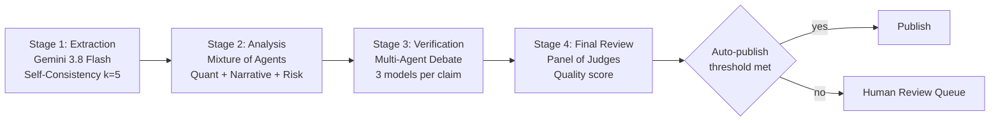
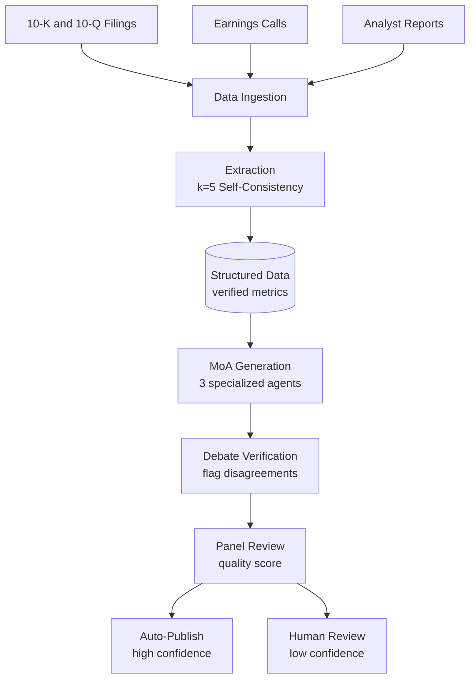
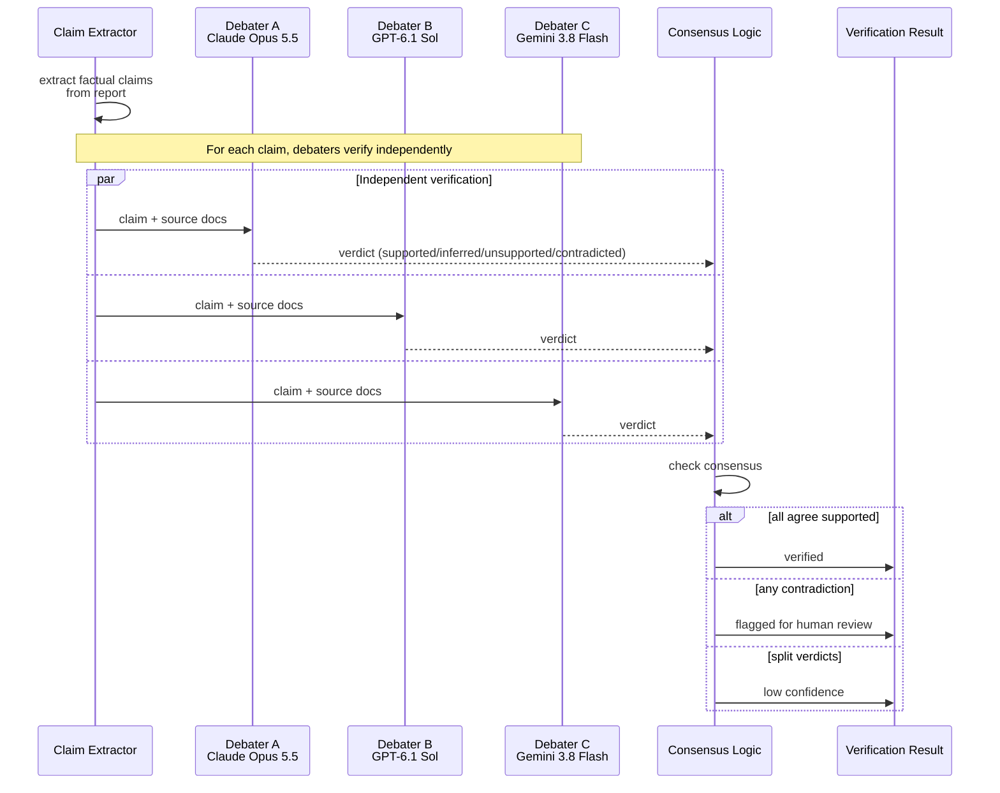

<div dir="rtl">

# مطالعه موردی: تحلیل مالی با راستی‌آزمایی تجمیعی (Ensemble Verification)

این مطالعه موردی طراحی یک سیستم هوش مصنوعی با قابلیت اطمینان بالا برای تولید گزارش‌های پژوهش سهام (equity research) را پوشش می‌دهد؛ جایی که دقت از اهمیت حیاتی برخوردار است.

## فهرست مطالب

- [صورت مسئله](#problem-statement)
- [تحلیل نیازمندی‌ها](#requirements-analysis)
- [طراحی معماری](#architecture-design)
- [خط لوله تجمیعی (Ensemble Pipeline)](#ensemble-pipeline)
- [راستی‌آزمایی حقایق](#stage-3b-fact-verification-with-multi-agent-debate)
- [دروازه‌های کیفیت](#quality-gates)
- [نتایج و معیارها](#results-and-metrics)
- [مرور سناریوی مصاحبه](#interview-walkthrough)

---

## صورت مسئله <a id="problem-statement"></a>

**شرکت:** یک موسسه سرمایه‌گذاری که گزارش‌های پژوهش سهام تولید می‌کند

**چالش:**
- گزارش‌ها بر تصمیم‌های سرمایه‌گذاری چند میلیون دلاری تاثیر می‌گذارند
- تحمل صفر برای داده‌های مالی توهم‌زده (hallucinated)
- نظارت و سخت‌گیری قانونی بر تحلیل‌های تولیدشده توسط هوش مصنوعی
- فرایند دستی فعلی: ۸ ساعت به ازای هر گزارش، ۵۰۰ دلار هزینه

**هدف:**
- کاهش زمان تولید گزارش به کمتر از ۳۰ دقیقه
- حفظ دقت در سطح ۹۹٫۵٪ به بالا
- مسیر ممیزی (audit trail) شفاف برای انطباق قانونی
- هدف هزینه: کمتر از ۵۰ دلار به ازای هر گزارش

---

## تحلیل نیازمندی‌ها <a id="requirements-analysis"></a>

### نیازمندی‌های دقت

| نوع داده | تلورانس مجاز | روش راستی‌آزمایی |
|----------|--------------|-------------------|
| معیارهای مالی (EPS، PE) | خطای ۰٪ | راستی‌آزمایی از منبع |
| تغییرات درصدی | بازه ۰٫۱٪± | اعتبارسنجی متقاطع (Cross-validation) |
| ارجاعات تاریخی | دقت ۱۰۰٪ | استخراج از منبع |
| نام شرکت‌ها | دقت ۱۰۰٪ | تطبیق موجودیت (Entity matching) |
| نقل‌قول تحلیلگران | عین متن یا علامت‌گذاری‌شده | استخراج نقل‌قول |

### نیازمندی‌های انطباق قانونی (Compliance)

- تمام ادعاها باید به اسناد منبع ارجاع داده شوند
- عدم درج اظهارات آینده‌نگرانه بدون سلب مسئولیت (disclaimer)
- افشای شفاف تولید محتوا توسط هوش مصنوعی
- ثبت کامل مسیر ممیزی (audit trail) فرایند تولید
- بازبینی انسانی پیش از انتشار

---

## طراحی معماری <a id="architecture-design"></a>

### خط لوله سطح بالا

<div dir="ltr">

```
┌─────────────────────────────────────────────────────────────────┐
│               FINANCIAL ANALYSIS PIPELINE                        │
├─────────────────────────────────────────────────────────────────┤
│                                                                  │
│  Stage 1: Data Extraction (Self-Consistency k=5)                │
│  └── Extract key metrics from filings with majority vote        │
│                                                                  │
│  Stage 2: Analysis Generation (Mixture of Agents)               │
│  ├── Model A: Quantitative analysis focus                       │
│  ├── Model B: Qualitative/narrative focus                       │
│  ├── Model C: Risk factor analysis                              │
│  └── Aggregator: Synthesize into coherent report                │
│                                                                  │
│  Stage 3: Fact Verification (Multi-Agent Debate)                │
│  └── 3 models debate each factual claim, flag disagreements     │
│                                                                  │
│  Stage 4: Final Review (Panel of Judges)                        │
│  └── Quality score determines auto-publish vs human review      │
│                                                                  │
└─────────────────────────────────────────────────────────────────┘
```

</div>

این خط لوله در قالب یک جریان پردازشی نشان داده شده است. هر مرحله به‌طور هدفمند از کلاس مدل متفاوتی استفاده می‌کند: مرحله استخراج به قابلیت چندوجهی (نمودارها و جدول‌ها) نیاز دارد، مرحله تولید کیفیت روایت‌پردازی می‌طلبد، مرحله ممیزی به عمق استدلال نیاز دارد و پنل داوری برای دستیابی به تنوع، از مدل‌های ارزان‌تر اما متعدد بهره می‌برد:

<div dir="ltr">



</div>

### جریان داده

<div dir="ltr">

```
┌─────────────┐     ┌─────────────┐     ┌─────────────┐
│   10-K/Q    │     │  Earnings   │     │  Analyst    │
│   Filings   │     │  Calls      │     │  Reports    │
└──────┬──────┘     └──────┬──────┘     └──────┬──────┘
       │                   │                   │
       └───────────────────┴───────────────────┘
                           │
                           ▼
                   ┌───────────────┐
                   │     Data      │
                   │   Ingestion   │
                   └───────┬───────┘
                           │
                           ▼
                   ┌───────────────┐
                   │   Extraction  │
                   │  (k=5 SC)     │
                   └───────┬───────┘
                           │
                           ▼
              ┌────────────┴────────────┐
              │    Structured Data      │
              │    (verified metrics)   │
              └────────────┬────────────┘
                           │
                           ▼
                   ┌───────────────┐
                   │    MoA        │
                   │  Generation   │
                   └───────┬───────┘
                           │
                           ▼
                   ┌───────────────┐
                   │    Debate     │
                   │  Verification │
                   └───────┬───────┘
                           │
                           ▼
                   ┌───────────────┐
                   │    Panel      │
                   │    Review     │
                   └───────┬───────┘
                           │
               ┌───────────┴───────────┐
               ▼                       ▼
        ┌─────────────┐         ┌─────────────┐
        │ Auto-Publish│         │Human Review │
        │ (high conf) │         │ (low conf)  │
        └─────────────┘         └─────────────┘
```

</div>

تبار داده (data lineage) در نمودار Mermaid زیر نشان می‌دهد که چگونه سه منبع ورودی در نهایت به یک خروجی راستی‌آزمایی‌شده همگرا می‌شوند:

<div dir="ltr">



</div>

---

## خط لوله تجمیعی (Ensemble Pipeline) <a id="ensemble-pipeline"></a>

### مرحله اول: استخراج چندوجهی داده (Gemini 3.8 Flash)

<div dir="ltr">

```python
from google import genai
from google.genai import types

class FinancialDataExtractor:
    """
    Gemini 3.8 Flash (GA) reads 10-K tables and charts as page images plus text.
    Gemini 3.1 Pro is still a preview model, and preview models carry weaker
    lifecycle guarantees than a compliance pipeline should depend on.
    """
    def __init__(self):
        self.client = genai.Client()

    async def extract_metrics(self, doc_pages: list[bytes]) -> dict:
        response = await self.client.aio.models.generate_content(
            model="gemini-3.8-flash",
            contents=[
                "Extract all balance sheet items into JSON.",
                *[types.Part.from_bytes(data=p, mime_type="image/png") for p in doc_pages],
            ],
            config=types.GenerateContentConfig(
                response_mime_type="application/json",
                response_schema=BalanceSheet,  # Pydantic model: fixed field names and types
            ),
        )
        return json.loads(response.text)
```

</div>

### مرحله دوم: تولید تحلیل (Claude Opus 5.5)

<div dir="ltr">

```python
class AnalysisEngine:
    """
    Claude Opus 5.5 for qualitative synthesis and narrative coherence.
    """
    async def generate_report(self, data: dict) -> str:
        response = await self.anthropic.messages.create(
            model="claude-opus-5-5",
            max_tokens=16000,
            output_config={"effort": "high"},  # Opus 5.5 defaults to medium; set it explicitly
            messages=[{"role": "user", "content": f"Analyze: {data}"}],
        )
        return "".join(b.text for b in response.content if b.type == "text")
```

</div>

### مرحله 3a: ممیزی استدلال (GPT-6.1 Sol)

<div dir="ltr">

```python
class AuditorAgent:
    """
    GPT-6.1 Sol at high reasoning effort audits claims for subtle accounting
    contradictions. A different model family from the generator is less
    likely to share the generator's blind spots.
    """
    async def audit_claim(self, claim: str, raw_data: str) -> dict:
        response = await self.openai.responses.create(
            model="gpt-6.1-sol",
            reasoning={"effort": "high"},
            input=f"Find any contradiction between the claim and the data.\n"
                  f"Claim: {claim}\nData: {raw_data}",
        )
        return self.parse_audit(response.output_text)
```

</div>

### مرحله 3b: راستی‌آزمایی حقایق با مناظره چندایجنتی <a id="stage-3b-fact-verification-with-multi-agent-debate"></a>

مرحله مناظره همان بخشی است که توهم‌های ظریفی را که یک مدل منفرد از دست می‌دهد، شکار می‌کند. سه مناظره‌کننده مستقل هر ادعا را به‌صورت موازی راستی‌آزمایی می‌کنند؛ اجماع برنده می‌شود و اختلاف‌نظر، ادعا را برای بازبینی انسانی علامت‌گذاری می‌کند:

<div dir="ltr">



</div>

<div dir="ltr">

```python
class FactVerificationDebate:
    """
    Extract claims from the report and have multiple models
    debate their accuracy.
    """
    
    def __init__(self, debaters: list, rounds: int = 2):
        self.debaters = debaters
        self.rounds = rounds
        self.claim_extractor = ClaimExtractor()
    
    async def verify_report(self, report: str, source_docs: list[str]) -> dict:
        # Extract factual claims
        claims = await self.claim_extractor.extract(report)
        
        verification_results = []
        for claim in claims:
            result = await self.debate_claim(claim, source_docs)
            verification_results.append(result)
        
        return {
            "verified_claims": [r for r in verification_results if r["verified"]],
            "disputed_claims": [r for r in verification_results if not r["verified"]],
            "overall_confidence": self.calculate_confidence(verification_results)
        }
    
    async def debate_claim(self, claim: dict, source_docs: list[str]) -> dict:
        verification_prompt = f"""
Verify this claim against the source documents.

Claim: {claim['text']}

Source documents:
{self.format_sources(source_docs)}

Is this claim:
1. Supported: Explicitly stated in sources
2. Inferred: Reasonably derived from sources
3. Unsupported: Not found in sources
4. Contradicted: Conflicts with sources

Provide your verdict with evidence.
"""
        
        # Each debater verifies independently
        verdicts = await asyncio.gather(*[
            debater.generate(verification_prompt)
            for debater in self.debaters
        ])
        
        # Check consensus
        parsed_verdicts = [self.parse_verdict(v) for v in verdicts]
        consensus = self.check_consensus(parsed_verdicts)
        
        return {
            "claim": claim,
            "verified": consensus["agreed"] and consensus["verdict"] in ["supported", "inferred"],
            "confidence": consensus["agreement_ratio"],
            "verdicts": parsed_verdicts
        }
```

</div>

---

## دروازه‌های کیفیت <a id="quality-gates"></a>

### بررسی‌های خودکار کیفیت

<div dir="ltr">

```python
class QualityGate:
    def __init__(self):
        self.thresholds = {
            "claim_verification_rate": 0.95,  # 95% claims verified
            "data_accuracy": 0.99,            # 99% metrics accurate
            "panel_score": 4.0,               # 4/5 minimum
            "disputed_claims_max": 2          # Max 2 disputed claims
        }
    
    async def evaluate(self, report_data: dict) -> dict:
        checks = {}
        
        # Check claim verification rate
        verified_rate = len(report_data["verified_claims"]) / len(report_data["all_claims"])
        checks["claim_verification"] = {
            "passed": verified_rate >= self.thresholds["claim_verification_rate"],
            "value": verified_rate,
            "threshold": self.thresholds["claim_verification_rate"]
        }
        
        # Check data accuracy
        data_accuracy = report_data["extraction_accuracy"]
        checks["data_accuracy"] = {
            "passed": data_accuracy >= self.thresholds["data_accuracy"],
            "value": data_accuracy,
            "threshold": self.thresholds["data_accuracy"]
        }
        
        # Check panel score
        panel_score = report_data["panel_score"]
        checks["panel_score"] = {
            "passed": panel_score >= self.thresholds["panel_score"],
            "value": panel_score,
            "threshold": self.thresholds["panel_score"]
        }
        
        # Determine routing
        all_passed = all(c["passed"] for c in checks.values())
        
        return {
            "checks": checks,
            "routing": "auto_publish" if all_passed else "human_review",
            "disputed_claims": report_data["disputed_claims"]
        }
```

</div>

### رابط بازبینی انسانی

<div dir="ltr">

```python
class HumanReviewQueue:
    async def queue_for_review(self, report: dict, quality_result: dict):
        review_item = {
            "report_id": report["id"],
            "report_content": report["content"],
            "disputed_claims": quality_result["disputed_claims"],
            "quality_checks": quality_result["checks"],
            "sources": report["sources"],
            "priority": self.calculate_priority(quality_result),
            "queued_at": datetime.now()
        }
        
        await self.review_queue.enqueue(review_item)
        
        # Notify reviewers
        await self.notify_reviewers(review_item)
```

</div>

---

## نتایج و معیارها <a id="results-and-metrics"></a>

### مقایسه عملکرد

| معیار | فرایند دستی | خط لوله هوش مصنوعی | بهبود |
|-------|-------------|---------------------|-------|
| زمان به ازای هر گزارش | ۸ ساعت | ۲۵ دقیقه | ۱۹ برابر سریع‌تر |
| هزینه به ازای هر گزارش | ۵۰۰ دلار | ۴۱ دلار | ۹۲٪ کاهش |
| نرخ خطای واقعی (Factual) | ۲٫۱٪ | ۰٫۴٪ | ۸۱٪ کاهش |
| بار کاری بازبینی انسانی | ۱۰۰٪ | ۲۸٪ | ۷۲٪ کاهش |

### معیارهای کیفیت

| بُعد کیفیت | هدف | دستاورد |
|------------|-----|---------|
| دقت استخراج داده | ۹۹٪ | ۹۹٫۳٪ |
| نرخ راستی‌آزمایی ادعاها | ۹۵٪ | ۹۶٫۸٪ |
| امتیاز کیفیت پنل | ۴٫۰ از ۵٫۰ | ۴٫۲ از ۵٫۰ |
| انطباق مقرراتی | ۱۰۰٪ | ۱۰۰٪ |

### تفکیک هزینه‌ها (تعرفه‌های رسمی نوامبر ۲۰۲۶)

این برآورد بر مبنای حدود ۲۰۰ هزار Token محتوای منبع به ازای هر گزارش (یک گزارش 10-K، دو گزارش 10-Q و متن پیاده‌شده یک نشست گزارش درآمد) و حدود ۱۵۰ ادعای استخراج‌شده انجام شده است. قیمت‌گذاری مدل Gemini 3.8 Flash بر اساس تعرفه رسمی ۱ ژانویه ۲۰۲۷ (۱٫۵۰ دلار / ۷٫۵۰ دلار) محاسبه شده است، نه تعرفه معرفی اولیه.

| جزء | فرضیه | هزینه | سهم |
|-----|-------|-------|-----|
| استخراج (Gemini 3.8 Flash، با k=5) | تعداد ۵ × ۲۰۰ هزار Token ورودی، در مجموع حدود ۷۵ هزار خروجی | ۲٫۰۶ دلار | ۵٪ |
| تحلیل (Claude Opus 5.5، معماری Mixture of Agents) | تعداد ۳ پیشنهاددهنده × ۲۲۰ هزار ورودی به علاوه یک تجمیع‌کننده؛ حدود ۴۸ هزار خروجی شامل فرایند تفکر | ۳٫۷۸ دلار | ۹٪ |
| ممیزی استدلال (GPT-6.1 Sol، با تلاش بالا) | حدود ۳۰۰ هزار ورودی در فراخوانی‌های به ازای هر ادعا (هر کدام بسیار کمتر از آستانه زمینه طولانی ۲۷۲ هزار Token)، حدود ۵۰ هزار خروجی | ۱٫۱۰ دلار | ۳٪ |
| راستی‌آزمایی مناظره (۳ خانواده مدل) | تعداد ۱۵۰ ادعا × ۳ مناظره‌کننده × ۲ دور × حدود ۸ هزار ورودی / ۱ هزار خروجی | ۲۹٫۲۵ دلار | ۷۰٪ |
| بازبینی پنل داوران | تعداد ۳ داور میان‌رده × حدود ۴۰ هزار ورودی / ۲ هزار خروجی | ۰٫۲۸ دلار | ۱٪ |
| زیرساخت و عملیات برداری | | ۵٫۰۰ دلار | ۱۲٪ |
| **مجموع** | | **حدود ۴۱ دلار** | ۱۰۰٪ |

*نکته: تولید متن ارزان است؛ هزینه اصلی مربوط به راستی‌آزمایی است. انشعاب مناظره (ادعاها × مناظره‌کنندگان × دورها) حدود ۷۰٪ از هزینه را تشکیل می‌دهد و مدل Opus 5.5 به‌تنهایی ۱۵٫۶۰ دلار از آن را به خود اختصاص می‌دهد. اهرم کنترل هزینه، تعداد ادعاهاست: ادعاهای تکراری را حذف کنید و برای اعدادی که دقیقاً با داده‌های ساختاریافته مرحله اول مطابقت دارند، از مناظره صرف‌نظر کنید. استفاده از کش کردن Prompt (Prompt caching) برای بخش‌های منبع بین دورهای مناظره، هزینه سمت ورودی را بیش از پیش کاهش می‌دهد (کش‌ها به‌صورت اختصاصی برای هر مدل نگهداری می‌شوند، بنابراین هر مناظره‌کننده کش خود را دارد).*

---

## مرور سناریوی مصاحبه <a id="interview-walkthrough"></a>

**مصاحبه‌گر:** «یک سیستم هوش مصنوعی برای تولید گزارش‌های پژوهش مالی با نیازمندی‌های دقت بسیار بالا طراحی کنید.»

**پاسخ قوی:**

1. **شفاف‌سازی نیازمندی‌های دقت** (۱ دقیقه)
   - «نرخ خطای قابل قبول برای داده‌های مالی چقدر است؟»
   - «الزامات انطباق قانونی و مقرراتی چیست؟»
   - «اولویت با تاخیر (Latency) است یا دقت؟»

2. **پذیرش چالش اصلی** (۱ دقیقه)
   - «چالش کلیدی این است که توهم (hallucination) در داده‌های مالی غیرقابل قبول است. تنها یک عدد اشتباه می‌تواند تصمیم‌های سرمایه‌گذاری را گمراه کند. برای دستیابی به قابلیت اطمینان، به روش‌های تجمیعی (ensemble) نیاز دارم.»

3. **معماری سطح بالا** (۳ دقیقه)
   - «من از یک خط لوله چندمرحله‌ای با تکنیک‌های تجمیعی متفاوت در هر مرحله استفاده می‌کنم:»
   - «استخراج داده: خودسازگاری (Self-consistency) با k=5 برای دستیابی به اجماع صددرصدی روی اعداد»
   - «تحلیل: ترکیب ایجنت‌ها (Mixture of Agents) برای دیدگاه‌های متنوع»
   - «راستی‌آزمایی: مناظره چندایجنتی (Multi-agent debate) برای شکار توهم‌ها»
   - «دروازه کیفیت: پنل داوران (Panel of judges) برای امتیازدهی پیش از انتشار»

4. **بررسی عمیق راستی‌آزمایی حقایق** (۳ دقیقه)
   - «برای راستی‌آزمایی حقایق، تمام ادعاهای واقعی (factual) را از گزارش استخراج می‌کنم»
   - «سه مدل متنوع درباره اینکه آیا هر ادعا توسط منابع پشتیبانی می‌شود یا خیر، مناظره می‌کنند»
   - «در صورت اختلاف‌نظر، ادعا برای بازبینی انسانی علامت‌گذاری می‌شود»
   - «این روش خطاهای ظریفی را که راستی‌آزمایی تک‌مدلی از دست می‌دهد، شناسایی می‌کند»

5. **موازنه هزینه و کیفیت** (۲ دقیقه)
   - «این خط لوله ۱۰ تا ۲۰ برابر گران‌تر از تولید با یک مدل منفرد است»
   - «اما برای گزارش‌های مالی، هزینه خطا (حقوقی و اعتباری) بسیار فراتر از هزینه راستی‌آزمایی است»
   - «من مسیریابی مبتنی بر اطمینان (confidence-based routing) را پیاده‌سازی می‌کنم: انتشار خودکار برای گزارش‌های با اطمینان بالا و بازبینی انسانی برای موارد با اطمینان پایین»

6. **پایش و نظارت** (۱ دقیقه)
   - «دقت استخراج، نرخ راستی‌آزمایی ادعاها و امتیازات پنل داوری را به‌صورت مستمر رصد می‌کنم»
   - «تشخیص انحراف (Drift detection) در صورت افت دقت هشدار می‌دهد»
   - «ثبت کامل مسیر ممیزی (audit trail) برای انطباق قانونی»

---

## نکات کلیدی آموخته‌شده

1. **خودسازگاری (Self-consistency) به‌تنهایی کافی نیست** برای استخراج داده‌های عددی. باید اجماع کامل (رای k از k) الزامی شود.

2. **مناظره چندایجنتی بیشترین کارایی را دارد** برای شناسایی خطاهای استدلالی ظریف و توهم‌ها.

3. **اسناد منبع و ارجاع‌دهی حیاتی است** هم برای دقت و هم برای انطباق قانونی. هر ادعا باید به اسناد منبع متصل باشد.

4. **مسیریابی مبتنی بر اطمینان** برای مدیریت هزینه ضروری است. هر گزارشی به راستی‌آزمایی کامل تجمیعی نیاز ندارد.

5. **حضور انسان در حلقه (Human-in-the-loop) همچنان ضروری است** برای ادعاهای مورد مناقشه و موارد مرزی. سیستم را برای ارجاع تدریجی و اصولی (graceful escalation) طراحی کنید.

---

## منابع

- مقاله ورگا و همکاران: «جایگزینی داوران با هیئت منصفه: ارزیابی خروجی‌های LLM با پنلی از مدل‌های متنوع» (Replacing Judges with Juries: Evaluating LLM Generations with a Panel of Diverse Models، سال ۲۰۲۴)
- مقاله دو و همکاران: «بهبود واقع‌گرایی و استدلال در مدل‌های زبانی از طریق مناظره چندایجنتی» (Improving Factuality and Reasoning in Language Models through Multiagent Debate، سال ۲۰۲۳)
- الزامات افشای هوش مصنوعی کمیسیون بورس و اوراق بهادار آمریکا (SEC): https://www.sec.gov/

---

*بعدی: [مطالعه موردی: دستیار کدنویسی هوش مصنوعی](04-code-assistant.md)*

</div>
