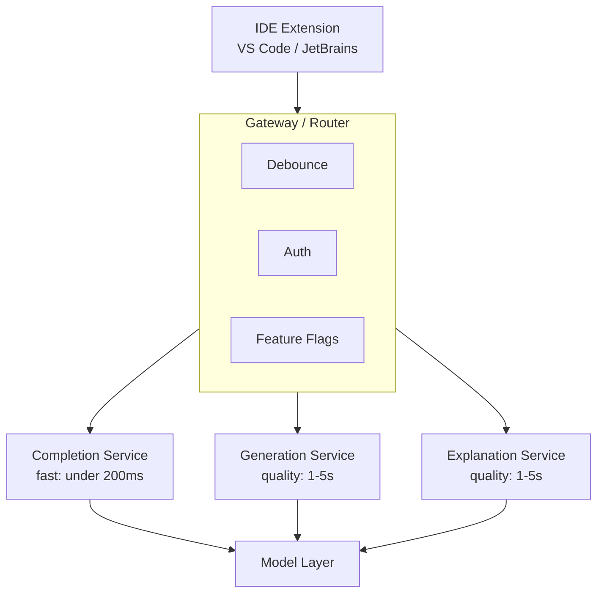
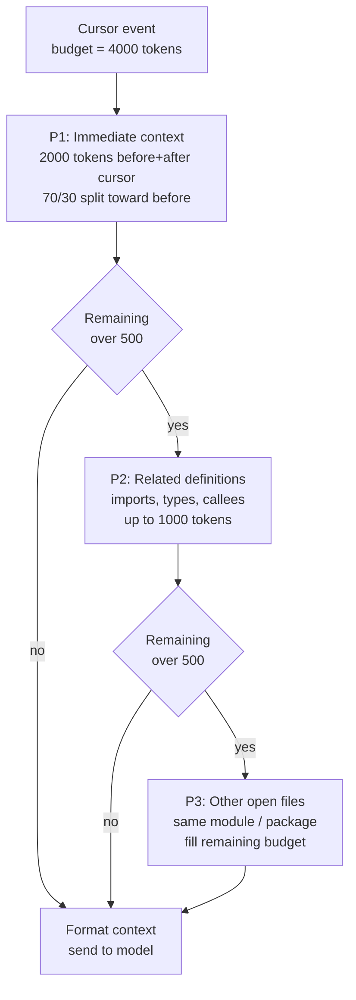
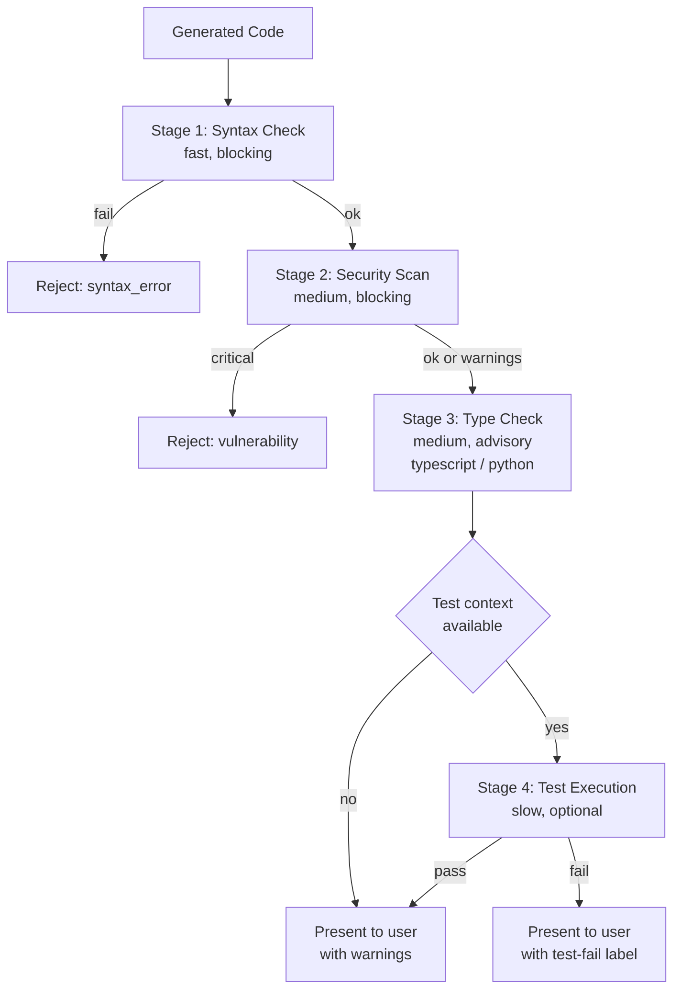

<div dir="rtl">

# مطالعه موردی: دستیار کد هوش مصنوعی

این مطالعه موردی به طراحی یک دستیار کد عملیاتی (Production) می‌پردازد که پیشنهادهای بلادرنگ، تولید کد و کمک به اشکال‌زدایی (Debugging) را ارائه می‌دهد.

## فهرست مطالب

- [بیان مسئله](#problem-statement)
- [تحلیل نیازمندی‌ها](#requirements-analysis)
- [طراحی معماری](#architecture-design)
- [خط لوله تولید کد](#code-generation-pipeline)
- [تضمین کیفیت](#quality-assurance)
- [بهینه‌سازی عملکرد](#performance-optimization)
- [نتایج و معیارها](#results-and-metrics)
- [مرور مصاحبه سیستم دیزاین](#interview-walkthrough)

---

## <a id="problem-statement"></a>بیان مسئله

**شرکت:** شرکت ابزارهای توسعه‌دهنده که افزونه IDE می‌سازد

**هدف:**
- تکمیل کد بلادرنگ هم‌زمان با تایپ توسعه‌دهندگان
- تولید کد چندخطی از زبان طبیعی
- توضیح کد و کمک به اشکال‌زدایی
- پشتیبانی از بیش از ۲۰ زبان برنامه‌نویسی

**محدودیت‌ها:**
- تاخیر (Latency) کمتر از ۲۰۰ میلی‌ثانیه برای تکمیل کد (حفظ جریان تایپ)
- تاخیر کمتر از ۳ ثانیه برای تولید کد (مکث قابل قبول)
- امنیت: هیچ کدی از زیرساخت مشتری خارج نشود (گزینه سازمانی / Enterprise)
- هزینه: پایدار در مقیاس بالا (میلیون‌ها توسعه‌دهنده)

---

## <a id="requirements-analysis"></a>تحلیل نیازمندی‌ها

### نیازمندی‌های عملکردی

| قابلیت | توضیحات | هدف تاخیر (Latency) |
|--------|---------|---------------------|
| تکمیل درون‌خطی | تکمیل خط یا بلوک فعلی | کمتر از ۲۰۰ میلی‌ثانیه |
| تولید چندخطی | تولید تابع یا کلاس از روی کامنت | کمتر از ۳ ثانیه |
| توضیح کد | توضیح دادن کد انتخاب‌شده | کمتر از ۵ ثانیه |
| رفع خطا | پیشنهاد راه‌حل برای خطاها | کمتر از ۲ ثانیه |
| بازآرایی (Refactoring) | پیشنهاد بهبودهای ساختاری کد | کمتر از ۵ ثانیه |
| مستندسازی | تولید رشته‌های مستندات (Docstring) | کمتر از ۲ ثانیه |

### نیازمندی‌های کیفی

| بُعد کیفی | هدف | نحوه اندازه‌گیری |
|-----------|-----|------------------|
| نرخ پذیرش (Acceptance rate) | بیش از ۳۰٪ | نسبت پیشنهادهای پذیرفته‌شده به نمایش‌داده‌شده |
| صحت نحوی (Syntax) | بیش از ۹۹٪ | کامپایل یا پارس موفق کد |
| امنیت | صفر آسیب‌پذیری | نرخ قبولی در اسکن امنیت ایستا (SAST) |
| مرتبط بودن | بیش از ۸۵٪ | امتیازدهی کاربران |

---

## <a id="architecture-design"></a>طراحی معماری

### معماری سطح بالا

<div dir="ltr">

```
┌─────────────────────────────────────────────────────────────────┐
│                    CODE ASSISTANT ARCHITECTURE                   │
├─────────────────────────────────────────────────────────────────┤
│                                                                  │
│  ┌─────────────┐                                                │
│  │     IDE     │                                                │
│  │  Extension  │                                                │
│  └──────┬──────┘                                                │
│         │                                                        │
│         ▼                                                        │
│  ┌─────────────────────────────────────────────────────────┐    │
│  │                    GATEWAY / ROUTER                      │    │
│  │  ┌──────────┐  ┌──────────┐  ┌──────────┐              │    │
│  │  │ Debounce │  │  Auth    │  │ Feature  │              │    │
│  │  │          │  │          │  │  Flags   │              │    │
│  │  └──────────┘  └──────────┘  └──────────┘              │    │
│  └─────────────────────────┬───────────────────────────────┘    │
│                            │                                     │
│         ┌──────────────────┼──────────────────┐                 │
│         ▼                  ▼                  ▼                 │
│  ┌─────────────┐    ┌─────────────┐    ┌─────────────┐         │
│  │  Completion │    │ Generation  │    │ Explanation │         │
│  │   Service   │    │  Service    │    │  Service    │         │
│  │  (fast)     │    │ (quality)   │    │ (quality)   │         │
│  └──────┬──────┘    └──────┬──────┘    └──────┬──────┘         │
│         │                  │                  │                  │
│         └──────────────────┼──────────────────┘                 │
│                            ▼                                     │
│                    ┌─────────────┐                              │
│                    │   Model     │                              │
│                    │   Layer     │                              │
│                    └─────────────┘                              │
│                                                                  │
└─────────────────────────────────────────────────────────────────┘
```

</div>

این معماری به‌صورت یک جریان کار عمل می‌کند. سه لایه سرویسی که بر اساس موازنه بین تاخیر و کیفیت تقسیم شده‌اند (تکمیل کد با تاخیر زیر ۲۰۰ میلی‌ثانیه، و تولید و توضیح کد با اولویت کیفیت)، همگی از یک لایه مدل مشترک استفاده می‌کنند:

<div dir="ltr">



</div>

### مونتاژ زمینه (Context Assembly)

<div dir="ltr">

```python
class CodeContextAssembler:
    """
    Assemble context for code completion.
    Challenge: Balance context richness with latency.
    """
    
    def __init__(self, max_tokens: int = 4000):
        self.max_tokens = max_tokens
    
    def assemble(
        self,
        cursor_position: dict,
        file_content: str,
        open_files: list[dict],
        project_context: dict
    ) -> str:
        context_parts = []
        remaining_tokens = self.max_tokens
        
        # Priority 1: Immediate context (before and after cursor)
        immediate = self.get_immediate_context(
            file_content, cursor_position, tokens=2000
        )
        context_parts.append(immediate)
        remaining_tokens -= count_tokens(immediate)
        
        # Priority 2: Related imports and definitions
        if remaining_tokens > 500:
            related = self.get_related_definitions(
                file_content, cursor_position, tokens=min(1000, remaining_tokens)
            )
            context_parts.append(related)
            remaining_tokens -= count_tokens(related)
        
        # Priority 3: Other open files (same module/package)
        if remaining_tokens > 500:
            other_files = self.get_relevant_open_files(
                open_files, cursor_position, tokens=remaining_tokens
            )
            context_parts.append(other_files)
        
        return self.format_context(context_parts)
    
    def get_immediate_context(
        self,
        content: str,
        cursor: dict,
        tokens: int
    ) -> str:
        lines = content.split("\n")
        cursor_line = cursor["line"]
        
        # Get lines before cursor (more important)
        before_ratio = 0.7
        before_tokens = int(tokens * before_ratio)
        after_tokens = tokens - before_tokens
        
        # Expand outward from cursor
        before_lines = lines[:cursor_line]
        after_lines = lines[cursor_line:]
        
        # Truncate to fit
        before_text = self.truncate_to_tokens(
            "\n".join(before_lines), before_tokens, from_end=True
        )
        after_text = self.truncate_to_tokens(
            "\n".join(after_lines), after_tokens, from_end=False
        )
        
        return f"{before_text}\n<CURSOR>\n{after_text}"
```

</div>

مونتاژ زمینه یک تخصیص بودجه اولویت‌محور است. مدل تنها چیزی را می‌بیند که از سقف ۴۰۰۰ واحد Token عبور کند؛ بنابراین ترتیب اهمیت دارد: ابتدا کد بلافصل در اطراف مکان‌نما (که همیشه جا می‌گیرد)، سپس تعاریف مرتبط، و در نهایت سایر فایل‌های باز تنها در صورت باقی ماندن بودجه:

<div dir="ltr">



</div>

---

## <a id="code-generation-pipeline"></a>خط لوله تولید کد

### سرویس تکمیل کد (Completion Service)

مدل‌های استدلالی (Reasoning models) ابزار مناسبی برای تکمیل کد در سطح فشردن کلیدها نیستند: واحدهای Token مربوط به تفکر به‌تنهایی بودجه ۲۰۰ میلی‌ثانیه‌ای را مصرف می‌کنند. تکمیل درون‌خطی بر روی یک مدل کوچک پرکردن میانه (Fill-in-the-middle یا FIM) اجرا می‌شود که خودتان میزبانی می‌کنید و همین موضوع گزینه «هیچ کدی از زیرساخت مشتری خارج نمی‌شود» را نیز محقق می‌کند.

<div dir="ltr">

```python
class InlineCompletion:
    """
    Sub-200ms FIM completions from a small self-hosted model inside the
    customer VPC. Served by vLLM (pin >= 0.32.0) with speculative decoding
    set at server start, e.g.
    vllm serve <checkpoint> --speculative-config '{"method": "eagle3", ...}'
    """
    def __init__(self, client):
        self.client = client   # OpenAI-compatible client for the in-VPC server
        self.model = "fim-8b"  # your FIM-tuned checkpoint of an Apache 2.0 base

    async def complete(self, prefix: str, suffix: str) -> str:
        resp = await self.client.completions.create(
            model=self.model,
            prompt=self.build_fim_prompt(prefix, suffix),  # sentinel tokens are model-specific
            max_tokens=64,
            temperature=0.0,
            stop=["\n\n"],
        )
        return resp.choices[0].text
```

</div>

**مدل پایه و مجوز (License).** گزینه‌های مناسب، مدل‌های کوچک با مجوز آزاد مانند IBM Granite 4.2 (مدل‌های متراکم 3B و 8B با مجوز Apache 2.0) یا در صورت اجازه بودجه تاخیر، Qwen3.8-27B (با مجوز Apache 2.0) هستند. پیش از بنچمارک کردن، حتماً مجوز مدل را بخوانید: مدل Qwen3.8-Flash-Next تحت مجوز Qwen Community License 1.0 عرضه می‌شود که برای هر کسب‌وکار دستیار کدنویسی، صرف‌نظر از میزان درآمد، نیازمند مجوز جداگانه است؛ و محصول ما دقیقاً همین است. در سمت سروینگ (Serving)، رمزگشایی حدسی (Speculative decoding) از روش Medusa عبور کرده است (فریم‌ورک vLLM پشتیبانی از Medusa و حدس‌زننده MLP را در نسخه v0.33.0 در نوامبر ۲۰۲۶ به‌طور کامل حذف کرد، بنابراین پیکربندی قدیمی `medusa` هنگام ارتقا با خطا مواجه می‌شود): موتور vLLM از روش‌های EAGLE-3، MTP، مدل پیش‌نویس (Draft-model) و DFlash پشتیبانی می‌کند و شرکت Inco AI افزایش سرعت ۲.۷ تا ۳.۴ برابری را برای DFlash 2 روی Qwen3.8-27B گزارش کرده است (گزارش ارائه‌دهنده).

### سرویس تولید کد (بازآرایی‌های عاملی یا Agentic Refactors)

<div dir="ltr">

```python
class AgenticGeneration:
    """
    Claude Sonnet 5.5 for multi-file refactors, run as a tool-using agent.
    """
    async def refactor_module(self, folder_path: str):
        agent = CodingAgent(
            model="claude-sonnet-5-5",
            effort="medium",  # start here and sweep; thinking: disabled returns 400
            tools=["ls", "read_file", "write_file", "test_runner"],
        )
        
        # Agent explores codebase, understands dependencies, and applies fix
        return await agent.run(f"Refactor {folder_path} to use async/await.")
```

</div>

> [!TIP]
> **انتخاب عملیاتی (نوامبر ۲۰۲۶).** مدل Claude Sonnet 5.5 (با تعرفه ۲ دلار / ۱۰ دلار) گزینه پیش‌فرض برای کارهای Agent درون محیط IDE است. در جدول رده‌بندی Terminal-Bench 4.0 در سایت tbench.ai (ورودی‌های اضافه‌شده در ۶ اکتبر ۲۰۲۶)، مدل Opus 5.5 با ۶۴.۸۵٪ پیشتاز است و Sonnet 5.5 با ۶۱.۸۲٪ در رتبه بعدی قرار دارد که هر دو در سطح تلاش حداکثری (max effort) هستند و جلوتر از GPT-6 Astra و GPT-6.1 Sol با امتیاز مساوی ۵۸.۱۸٪ قرار می‌گیرند. آزمایش‌های خود شرکت Anthropic امتیاز ۷۰.۶٪ را برای Sonnet 5.5 و ۶۶.۴٪ را برای Opus 5.5 در حالت xhigh گزارش کرده‌اند (گزارش ارائه‌دهنده) که ترتیب برعکس دارد؛ بنابراین هر دو را روی مخزن کد خودتان بسنجید. الگوی «تغییر وضعیت تفکر» (toggle thinking) در سال ۲۰۲۵ دیگر کاربرد ندارد: تنظیم `thinking: {type: "disabled"}` روی Sonnet 5.5 خطای 400 برمی‌گرداند، بنابراین پارامتر effort اهرم کنترل است و `between_tools` پایین‌ترین تنظیم تفکر محسوب می‌شود. قابلیت‌ها را بر اساس هزینه به ازای هر تسک قیمت‌گذاری کنید، نه به ازای هر Token: در بنچمارک DeepSWE v1.1، مدل‌های GPT-6 Astra (در حالت xhigh)، Gemini 3.8 Flash (در حالت high) و Claude Opus 5 (در حالت max) همگی به امتیاز مساوی ۷۴٪ در معیار pass@1 می‌رسند، با هزینه‌های ۴.۴۳ دلار، ۲.۳۶ دلار و ۱۱.۸۴ دلار به ازای هر تسک.

### استراتژی انتخاب ارائه‌دهنده مدل

خریداران سازمانی اکنون می‌پرسند چه کسی مالک مدل پشت دستیار است، و تامین‌کنندگان مدل نیز می‌پرسند چه کسی مالک خود دستیار است. شرکت Cursor در ۱۴ اوت ۲۰۲۶ اعلام کرد که بخشی از SpaceX شده است (معامله‌ای که حدود ۶۰ میلیارد دلار به‌صورت سهام گزارش شد)، و معرفی مدل‌های Grok اکنون در وبلاگ Cursor منتشر می‌شود. دو هفته بعد، در ۲۸ اوت، شرکت OpenAI به SpaceX اطلاع داد که قرارداد تامین مدل‌های OpenAI برای Cursor را با تاریخ قطع پیشنهادی ۱۲ نوامبر ۲۰۲۶ خاتمه می‌دهد و پیش از آن نیز مدل‌های آینده خود را در اختیار Cursor نخواهد گذاشت؛ موضوعی که مدل GPT-6 Astra (عرضه‌شده در ۳ سپتامبر؛ OpenAI در اطلاعیه خود نام Astra را ذکر کرده بود) را کنار می‌گذارد. تغییر مالکیت قرار است یک خانواده مدل پیشرو را تنها با حدود ۱۱ هفته اطلاع قبلی از یک محصول کدنویسی مطرح خارج کند. این موضوع **بی‌طرفی نسبت به مدل (Model Neutrality) را به یک نیازمندی محصول** در هر دو جهت تبدیل می‌کند:

- تمام فراخوانی‌های مدل را از طریق یک درگاه (Gateway) با فهرست مجاز مدل به ازای هر مستاجر (Per-tenant allowlist) مسیریابی کنید، تا یک سازمان بتواند بدون تغییر کد یک ارائه‌دهنده را حذف کند و از دست دادن یک ارائه‌دهنده به جای بازنویسی سیستم، تنها یک تغییر مسیریابی باشد. مجموعه ارزیابی (Eval suite) را طوری نگه دارید که روی حداقل دو خانواده مدل قابل اجرا باشد تا در صورت تعویض اجباری، کار از یک کیفیت اندازه‌گیری‌شده شروع شود. همین درگاه به مستاجران دارای سیاست ماندن کد در VPC نیز سرویس می‌دهد: ترافیک تولید و بازآرایی کد آن‌ها را به مدل‌های داخل حساب Bedrock، Google Cloud یا Foundry خود مستاجر، یا به یک مدل وزن-باز (Open-weight) خودمیزبان می‌فرستد و هرگز به نقطه پایانی عمومی ارائه‌دهنده ارسال نمی‌کند.
- شرایط استفاده و نگهداری داده هر ارائه‌دهنده را به تفکیک هر مستاجر ردیابی کنید. نقاط پایانی تخفیف‌دار که به ارائه‌دهنده اجازه می‌دهند از ترافیک شما استفاده کند (برای مثال، سطح مشارکت‌کننده Muse Spark 1.3 شرکت Meta با قیمت ۰.۱۰ دلار / ۰.۲۰ دلار) باید حتماً به‌صورت انتخابی و با تایید صریح کاربر (Opt-in) فعال شوند.
- انتظار سوالات اطمینان‌بخشی فراتر از استاندارد SOC 2 را داشته باشید. استاندارد AIUC-1 یکی از پاسخ‌های نوظهور است: یک گواهینامه امنیت، ایمنی و قابلیت اطمینان ویژه Agentها که با تست‌های خصمانه (Adversarial testing) ممیزی می‌شود و تنها از طریق تست‌های حداقل فصلی به همراه یک ممیزی سالانه حفظ می‌گردد (Cursor گواهینامه خود را در ۱۳ اوت ۲۰۲۶ اعلام کرد).

---

## <a id="quality-assurance"></a>تضمین کیفیت

### راستی‌آزمایی چندمرحله‌ای (Multi-Stage Verification)

بخش راستی‌آزمایی مانند یک فیلتر سریع در برابر خطا (Fail-fast gauntlet) عمل می‌کند. بررسی‌های ارزان (نحو یا Syntax) ابتدا اجرا می‌شوند و به‌صورت سخت‌گیرانه مسدود می‌کنند؛ بررسی‌های پرهزینه (اجرای تست‌ها) در آخر و تنها زمانی اجرا می‌شوند که زمینه اجازه دهد. هر شکست مسدودکننده‌ای اجرای بقیه مراحل را متوقف می‌کند:

<div dir="ltr">



</div>

<div dir="ltr">

```python
class CodeVerifier:
    """
    Verify generated code before presenting to user.
    """
    
    async def verify(self, code: str, language: str, context: str) -> VerificationResult:
        results = {}
        
        # Stage 1: Syntax check (fast, blocking)
        syntax_ok = self.check_syntax(code, language)
        if not syntax_ok:
            return VerificationResult(passed=False, reason="syntax_error")
        
        # Stage 2: Security scan (medium, blocking)
        security = await self.security_scan(code, language)
        if security.has_critical:
            return VerificationResult(passed=False, reason="security_vulnerability")
        results["security"] = security
        
        # Stage 3: Type check if applicable (medium)
        if language in ["typescript", "python"]:
            type_result = await self.type_check(code, context, language)
            results["types"] = type_result
        
        # Stage 4: Test execution if available (slow, optional)
        if self.has_test_context(context):
            test_result = await self.run_tests(code, context)
            results["tests"] = test_result
        
        return VerificationResult(
            passed=True,
            details=results,
            warnings=security.warnings if security else []
        )
    
    def check_syntax(self, code: str, language: str) -> bool:
        parsers = {
            "python": self.parse_python,
            "javascript": self.parse_javascript,
            "typescript": self.parse_typescript,
            # ... other languages
        }
        
        parser = parsers.get(language)
        if not parser:
            return True  # Cannot verify, assume OK
        
        try:
            parser(code)
            return True
        except SyntaxError:
            return False
    
    async def security_scan(self, code: str, language: str) -> SecurityResult:
        # Run static analysis
        if language == "python":
            result = await self.run_bandit(code)
        elif language in ["javascript", "typescript"]:
            result = await self.run_eslint_security(code)
        else:
            result = await self.run_semgrep(code, language)
        
        return result
```

</div>

### بهینه‌سازی نرخ پذیرش (Acceptance Optimization)

<div dir="ltr">

```python
class AcceptanceOptimizer:
    """
    Learn from user acceptance patterns to improve suggestions.
    """
    
    def __init__(self):
        self.feedback_store = FeedbackStore()
    
    async def record_feedback(
        self,
        suggestion_id: str,
        accepted: bool,
        edited: bool,
        context_hash: str
    ):
        await self.feedback_store.record({
            "suggestion_id": suggestion_id,
            "accepted": accepted,
            "edited": edited,
            "context_hash": context_hash,
            "timestamp": datetime.now()
        })
    
    async def should_show_suggestion(
        self,
        suggestion: str,
        confidence: float,
        user_context: dict
    ) -> bool:
        # Historical acceptance rate for similar suggestions
        historical_rate = await self.get_historical_rate(
            user_context["user_id"],
            user_context["language"],
            confidence
        )
        
        # Threshold based on user preferences
        threshold = user_context.get("suggestion_threshold", 0.3)
        
        # Only show if likely to be accepted
        return (confidence * historical_rate) > threshold
```

</div>

---

## <a id="performance-optimization"></a>بهینه‌سازی عملکرد

### بهینه‌سازی تاخیر (Latency Optimization)

| تکنیک | تاثیر | نحوه پیاده‌سازی |
|--------|-------|------------------|
| تاخیراندازی درخواست (Request debouncing) | کاهش ۵۰ میلی‌ثانیه | اعمال ۱۵۰ میلی‌ثانیه debounce در محیط IDE |
| تجمیع اتصال‌ها (Connection pooling) | کاهش ۳۰ میلی‌ثانیه | استفاده از اتصال پایدار HTTP/2 |
| گرم کردن مدل (Model warm-up) | کاهش ۱۰۰ میلی‌ثانیه | مدل‌های پیش‌بارگذاری‌شده (Pre-loaded) |
| رمزگشایی حدسی (Speculative decoding) | کاهش ۴۰٪ | مدل پیش‌نویس (Draft model) + راستی‌آزمایی |
| کش کردن در لبه (Edge caching) | کاهش ۸۰ میلی‌ثانیه | استفاده از CDN برای الگوهای پرتکرار |

### استراتژی کش‌کردن (Caching Strategy)

<div dir="ltr">

```python
class CompletionCache:
    """
    Multi-level cache for completions.
    """
    
    def __init__(self):
        self.local_cache = LRUCache(max_size=10000)  # In-memory
        self.redis_cache = Redis()  # Distributed
    
    def get_cache_key(self, context: str) -> str:
        # Hash context for cache key
        # Include language and cursor position
        return hashlib.sha256(context.encode()).hexdigest()[:16]
    
    async def get(self, context: str) -> str | None:
        key = self.get_cache_key(context)
        
        # Check local first
        local = self.local_cache.get(key)
        if local:
            return local
        
        # Check distributed
        remote = await self.redis_cache.get(f"completion:{key}")
        if remote:
            self.local_cache.set(key, remote)
            return remote
        
        return None
    
    async def set(self, context: str, completion: str):
        key = self.get_cache_key(context)
        
        # Set in both caches
        self.local_cache.set(key, completion)
        await self.redis_cache.setex(
            f"completion:{key}",
            3600,  # 1 hour TTL
            completion
        )
```

</div>

---

## <a id="results-and-metrics"></a>نتایج و معیارها

### نتایج عملکردی

| معیار | هدف | دستاورد |
|-------|-----|---------|
| تاخیر تکمیل کد (p50) | کمتر از ۲۰۰ میلی‌ثانیه | ۱۴۵ میلی‌ثانیه |
| تاخیر تکمیل کد (p99) | کمتر از ۵۰۰ میلی‌ثانیه | ۳۸۰ میلی‌ثانیه |
| تاخیر تولید کد (p50) | کمتر از ۳ ثانیه | ۲.۱ ثانیه |
| صحت نحوی (Syntax) | بیش از ۹۹٪ | ۹۹.۵٪ |
| امنیت (صفر آسیب‌پذیری بحرانی) | ۱۰۰٪ | ۹۹.۸٪ |
| نرخ پذیرش (Acceptance rate) | بیش از ۳۰٪ | ۳۴٪ |

### تحلیل هزینه (نوامبر ۲۰۲۶)

| نوع درخواست | فرض‌ها | هزینه به ازای هر 1M درخواست | توضیحات |
|-------------|--------|-----------------------------|---------|
| **تکمیل درون‌خطی، مدل خودمیزبان 8B** | حدود 2K ورودی / 30 خروجی؛ حدود ۱۵ تکمیل بر ثانیه به ازای هر H100 در محدوده SLO دویست میلی‌ثانیه‌ای | حدود ۵۵ دلار | پردازنده گرافیکی H100 با هزینه ۲.۹۳ دلار به ازای هر GPU-ساعت (شاخص Silicon Data، ۱ نوامبر ۲۰۲۶). توان عملیاتی (Throughput) خود را اندازه‌گیری کنید؛ استفاده از prefix caching در طول فشردن کلیدها این مقدار را افزایش می‌دهد |
| **تکمیل درون‌خطی از طریق API (مدل GPT-6 Luna)** | تعداد Token مشابه با تعرفه ۰.۱۰ / ۰.۵۰ دلار به ازای هر 1M | حدود ۲۱۵ دلار | مسیر سرریز (Overflow) هنگام اشباع شدن استخر خودمیزبان؛ برای مستاجران با سیاست ماندن کد در VPC در دسترس نیست |
| **تولید چندخطی (مدل Claude Sonnet 5.5)** | مقدار 8K ورودی / 500 خروجی، تفکر اولیه خاموش (`between_tools`) برای حفظ بودجه ۳ ثانیه‌ای | حدود ۲۱,۰۰۰ دلار | هزینه ۰.۰۲۱ دلار به ازای هر درخواست؛ اجازه دادن به تفکر حدود 1K واحد Token، حدود ۰.۰۱ دلار و چند ثانیه تاخیر اضافه می‌کند |
| **بازآرایی عاملی یا Agentic refactor (مدل Claude Sonnet 5.5)** | حدود 750K ورودی با نرخ اصابت کش ۹۰٪، حدود 6K خروجی | حدود ۳۳۰,۰۰۰ دلار | هزینه ۰.۳۳ دلار به ازای هر تسک؛ محاسبه جزئیات در [تحلیل هزینه ایجنت کدنویسی خودکار](07-autonomous-coding-agent.md#cost-breakdown) |

*حالت ترکیبی (۹۸٪ تکمیل کد، ۲٪ بازآرایی عاملی): حدود ۶,۶۵۰ دلار به ازای هر 1M درخواست، و بیش از ۹۹٪ آن مربوط به تسک‌های Agentic است. ناوگان تکمیل کد در برابر آن یک خطای گردکردن ناچیز است؛ نرخ اصابت کش Prompt در Agent تعیین‌کننده کل بودجه است. در نرخ اصابت کش ۵۰٪، همین بازآرایی حدود ۱.۰۵ دلار هزینه دارد که بیش از سه برابر بیشتر است.*

---

## <a id="interview-walkthrough"></a>مرور مصاحبه سیستم دیزاین

**مصاحبه‌گر:** «یک دستیار کد هوش مصنوعی برای محیط IDE طراحی کنید.»

**پاسخ قوی:**

1. **شفاف‌سازی نیازمندی‌ها** (۱ دقیقه)
   - «تاخیر هدف برای تکمیل کد در مقایسه با تولید کد چقدر است؟»
   - «آیا استقرار (Deployment) سازمانی با گزینه نصب درون‌سازمانی (On-prem) نیاز است؟»
   - «آیا مشتریان سازمانی ارائه‌دهندگان خاصی از مدل‌ها را مستثنی می‌کنند یا شرایط خاصی برای استفاده از داده دارند؟»
   - «از چه زبان‌هایی باید پشتیبانی شود؟»

2. **شناسایی چالش کلیدی** (۱ دقیقه)
   - «تنش اصلی بین تاخیر و کیفیت است. تکمیل کد برای حفظ جریان تایپ به تاخیر کمتر از ۲۰۰ میلی‌ثانیه نیاز دارد، اما تولید کد باکیفیت نیازمند زمینه غنی و راستی‌آزمایی است.»

3. **معماری دولایه (Two-tier architecture)** (۳ دقیقه)
   - «من بخش تکمیل کد (سریع) را از بخش تولید کد (باکیفیت) جدا می‌کنم:»
   - «تکمیل کد: مدل کوچک‌تر، زمینه حداقلی، رمزگشایی حدسی (Speculative decoding)»
   - «تولید کد: مدل پیشرو (Frontier)، روش best-of-N، راستی‌آزمایی نحوی و امنیتی»

4. **مونتاژ زمینه (Context assembly)** (۲ دقیقه)
   - «زمینه حیاتی است. اولویت‌بندی من به این شکل است: کد بلافصل > تعاریف و importها > فایل‌های باز»
   - «برای تکمیل کد، سقف را برای حفظ سرعت روی 2K واحد Token می‌گذارم»
   - «برای تولید کد، می‌توانم برای درک بهتر از 8K+ واحد Token استفاده کنم»

5. **تضمین کیفیت** (۲ دقیقه)
   - «هر پیشنهاد از این مراحل عبور می‌کند: بررسی نحوی، اسکن امنیتی، و در صورت امکان بررسی نوع (Type check)»
   - «برای تولید کد، از روش best-of-N با ۸ کاندیدا استفاده می‌کنم، موارد نامعتبر را فیلتر کرده، امتیازدهی می‌کنم و بهترین را برمی‌گزینم»
   - «این کار آسیب‌پذیری‌های امنیتی را پیش از رسیدن به دست توسعه‌دهنده شناسایی می‌کند»

6. **بهینه‌سازی تاخیر** (۲ دقیقه)
   - «تاخیراندازی درخواست (Debouncing) در IDE، تجمیع اتصال‌ها (Connection pooling)، گرم کردن مدل»
   - «رمزگشایی حدسی برای کاهش ۴۰ درصدی تاخیر»
   - «کش کردن الگوهای پرتکرار (importها و کدهای تکراری یا Boilerplate)»

---

## منابع

- معماری GitHub Copilot: https://github.blog/
- مدل Codestral: https://mistral.ai/news/codestral/
- مدل CodeLlama: https://ai.meta.com/blog/code-llama-large-language-model-coding/
- بیانیه OpenAI با عنوان «تصمیم ما درباره Cursor پس از خریداری آن توسط SpaceX» (۲۸ اوت ۲۰۲۶): https://openai.com/index/our-decision-on-cursor-following-its-acquisition-by-spacex
- پست وبلاگ Cursor با عنوان «Cursor اکنون بخشی از SpaceX است» (۱۴ اوت ۲۰۲۶): https://cursor.com/blog/joining-spacex

---

*بعدی: [مطالعه موردی مدیریت محتوا (Content Moderation)](05-content-moderation.md)*

</div>
