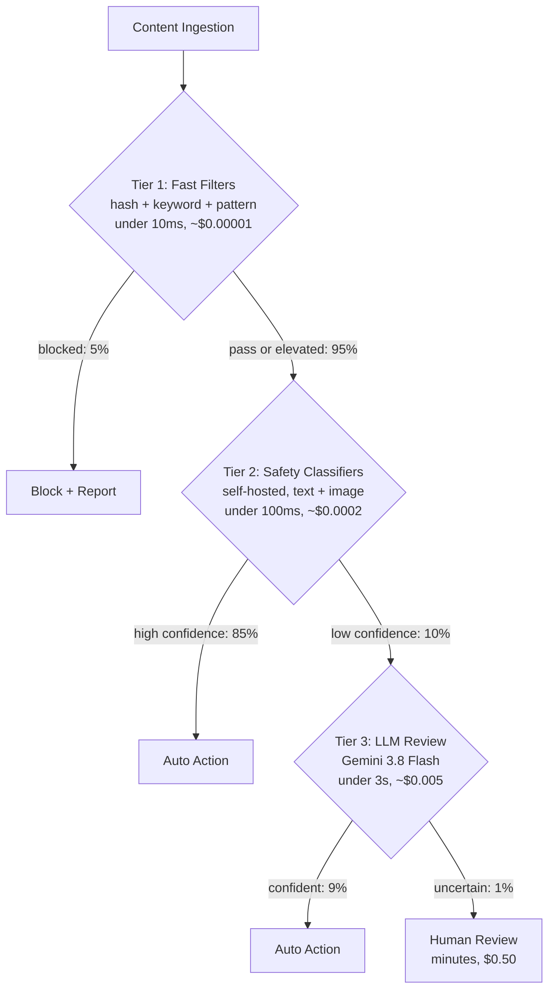
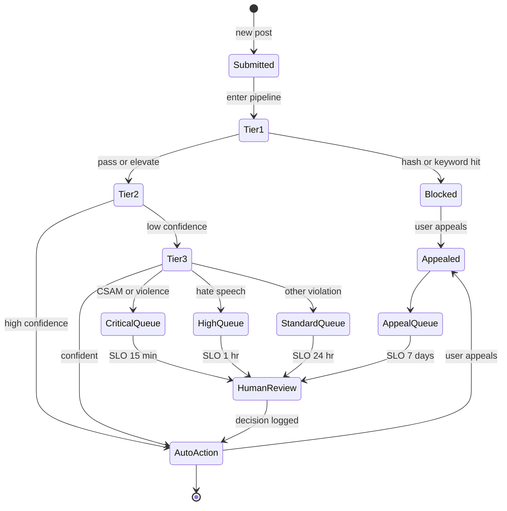

<div dir="rtl">

# مطالعه موردی: پایش محتوا در مقیاس بزرگ

این مطالعه موردی به طراحی یک سیستم پایش محتوای (Content Moderation) مبتنی بر هوش مصنوعی برای یک پلتفرم اجتماعی می‌پردازد که روزانه میلیون‌ها پست را پردازش می‌کند.

## فهرست مطالب

- [بیان مسئله](#problem-statement)
- [تحلیل نیازمندی‌ها](#requirements-analysis)
- [طراحی معماری](#architecture-design)
- [خط لوله طبقه‌بندی](#classification-pipeline)
- [انسان در چرخه (Human-in-the-Loop)](#human-in-the-loop)
- [مقاومت در برابر حملات خصمانه](#adversarial-robustness)
- [نتایج و معیارها](#results-and-metrics)
- [مرور مصاحبه سیستم دیزاین](#interview-walkthrough)

---

## بیان مسئله <a id="problem-statement"></a>

**شرکت:** پلتفرم شبکه اجتماعی با ۵۰ میلیون کاربر فعال روزانه

**وضعیت فعلی:**
- روزانه ۱۰ میلیون پست
- تعداد ۵۰۰ ناظر انسانی
- میانگین زمان بررسی: ۴ ساعت
- نرخ مثبت کاذب (False Positive): ۱۵٪
- میزان محتوای مضرِ رسیده به کاربران: ۲٪

**اهداف:**
- کاهش مواجهه با محتوای مضر به کمتر از ۰.۱٪
- بررسی محتوای دارای اولویت در کمتر از ۱۵ دقیقه
- کاهش نرخ مثبت کاذب به کمتر از ۵٪
- مقیاس‌پذیری بدون رشد خطی تعداد ناظران انسانی

---

## تحلیل نیازمندی‌ها <a id="requirements-analysis"></a>

### دسته‌بندی محتوا

| دسته‌بندی | شدت | اقدام | تاخیر (Latency) |
|----------|------|-------|-----------------|
| محتوای سوءاستفاده جنسی از کودکان (CSAM) | بحرانی | مسدودسازی + گزارش | فوری |
| خشونت و تصاویر دلخراش (Violence/Gore) | بالا | مسدودسازی + بررسی | کمتر از ۱ دقیقه |
| نفرت‌پراکنی (Hate speech) | بالا | مسدودسازی + بررسی | کمتر از ۵ دقیقه |
| آزار و اذیت (Harassment) | متوسط | بررسی + هشدار | کمتر از ۱۵ دقیقه |
| هرزنامه (Spam) | متوسط | کاهش اولویت | کمتر از ۱ ساعت |
| اطلاعات نادرست (Misinformation) | متوسط | برچسب‌گذاری + بررسی | کمتر از ۱ ساعت |
| محتوای بزرگسالان (Adult content) | کم | اعمال محدودیت سنی | کمتر از ۱ ساعت |

### نیازمندی‌های دقت

| معیار | هدف | دلیل و توجیه |
|-------|-----|--------------|
| نرخ بازخوانی (Recall) برای محتوای مضر | بیش از ۹۹٪ | به حداقل رساندن مواجهه کاربران با محتوای آسیب‌زا |
| نرخ دقت (Precision) | بیش از ۹۵٪ | به حداقل رساندن موارد مثبت کاذب |
| تاخیر (موارد بحرانی) | کمتر از ۱ دقیقه | جلوگیری از انتشار گسترده |
| تاخیر (موارد استاندارد) | کمتر از ۱۵ دقیقه | ایجاد تعادل میان منابع پردازشی و انسانی |

---

## طراحی معماری <a id="architecture-design"></a>

### معماری سطح بالا

<div dir="ltr">

```
┌─────────────────────────────────────────────────────────────────┐
│                  CONTENT MODERATION PIPELINE                     │
├─────────────────────────────────────────────────────────────────┤
│                                                                  │
│  ┌─────────────┐                                                │
│  │   Content   │                                                │
│  │   Ingestion │                                                │
│  └──────┬──────┘                                                │
│         │                                                        │
│         ▼                                                        │
│  ┌─────────────────────────────────────────────────────────┐    │
│  │                   TIER 1: FAST FILTERS                   │    │
│  │  ┌──────────┐  ┌──────────┐  ┌──────────┐              │    │
│  │  │  Hash    │  │ Keyword  │  │  Known   │              │    │
│  │  │ Matching │  │ Blocklist│  │ Patterns │              │    │
│  │  └──────────┘  └──────────┘  └──────────┘              │    │
│  └──────────────────────────┬──────────────────────────────┘    │
│                             │                                    │
│         ┌───────────────────┼───────────────────┐               │
│         │ Blocked           │ Pass              │ Elevated      │
│         ▼                   ▼                   ▼               │
│  ┌─────────────┐    ┌─────────────────────────────────────┐    │
│  │   Block +   │    │          TIER 2: ML MODELS          │    │
│  │   Report    │    │  ┌────────┐  ┌────────┐  ┌────────┐│    │
│  └─────────────┘    │  │ Vision │  │  Text  │  │ Multi- ││    │
│                     │  │ Model  │  │ Model  │  │ modal  ││    │
│                     │  └────────┘  └────────┘  └────────┘│    │
│                     └──────────────────┬──────────────────┘    │
│                                        │                        │
│         ┌──────────────────────────────┼──────────────────┐    │
│         │ High Confidence              │ Low Confidence   │    │
│         ▼                              ▼                   │    │
│  ┌─────────────┐              ┌─────────────────────────┐ │    │
│  │ Auto Action │              │    TIER 3: LLM REVIEW   │ │    │
│  └─────────────┘              │  (nuanced cases)        │ │    │
│                               └────────────┬────────────┘ │    │
│                                            │               │    │
│                        ┌───────────────────┼──────────────┐│    │
│                        │ Confident         │ Uncertain    ││    │
│                        ▼                   ▼              ││    │
│                 ┌─────────────┐    ┌─────────────┐       ││    │
│                 │ Auto Action │    │   Human     │       ││    │
│                 └─────────────┘    │   Review    │       ││    │
│                                    └─────────────┘       ││    │
│                                                          ││    │
└──────────────────────────────────────────────────────────┘│    │
```

</div>

این خط لوله چندلایه به شکل یک درخت تصمیم عمل می‌کند. هر لایه تنها مواردی را به لایه بالاتر ارجاع می‌دهد که نتواند با هزینه پایین درباره آن‌ها تصمیم بگیرد؛ درصدها نشان‌دهنده سهم از کل پست‌ها هستند. هزینه هر تصمیم از لایه ۱ تا لایه ۴ حدود ۱ به ۵۰٬۰۰۰ متغیر است، بنابراین مسیریابی (Routing) صحیح، اهرم اصلی بهینه‌سازی اقتصاد واحد (Unit Economics) به شمار می‌رود:

<div dir="ltr">



</div>

### لایه‌های پردازش

| لایه | روش پردازش | تاخیر | هزینه به‌ازای هر تصمیم | پوشش (سهم از کل پست‌ها) |
|------|------------|-------|------------------------|-------------------------|
| لایه ۱ | تطبیق هش، کلیدواژه و الگو | کمتر از ۱۰ میلی‌ثانیه | حدود ۰.۰۰۰۰۱ دلار | ۵٪ مسدودشده |
| لایه ۲ | طبقه‌بندی‌کننده‌های ایمنی خودمیزبان (Self-hosted) | کمتر از ۱۰۰ میلی‌ثانیه | حدود ۰.۰۰۰۲ دلار | ۸۵٪ تصمیم‌گیری خودکار |
| لایه ۳ | بررسی با مدل LLM (مدل Gemini 3.8 Flash) | کمتر از ۳ ثانیه | حدود ۰.۰۰۵ دلار | ۱۰٪ بررسی‌شده، ۹٪ تصمیم‌گیری‌شده |
| لایه ۴ | بررسی انسانی | چند دقیقه | ۰.۵۰ دلار | ۱٪ ارجاع‌شده به انسان |

---

## خط لوله طبقه‌بندی <a id="classification-pipeline"></a>

### لایه ۱: فیلترهای سریع

<div dir="ltr">

```python
class FastFilters:
    """
    Immediate blocking for known harmful content.
    No false positives for matches.
    """
    
    def __init__(self):
        self.hash_db = PhotoDNADatabase()  # CSAM detection
        self.keyword_filter = KeywordBlocklist()
        self.pattern_matcher = RegexPatterns()
    
    async def filter(self, content: Content) -> FilterResult:
        # CSAM hash matching (highest priority)
        if content.has_media:
            hash_match = await self.hash_db.check(content.media_hashes)
            if hash_match:
                return FilterResult(
                    action="block_report",
                    reason="csam_hash_match",
                    confidence=1.0,
                    tier=1
                )
        
        # Keyword blocklist
        if content.text:
            keyword_match = self.keyword_filter.check(content.text)
            if keyword_match and keyword_match.severity == "critical":
                return FilterResult(
                    action="block_review",
                    reason=f"keyword_{keyword_match.category}",
                    confidence=0.99,
                    tier=1
                )
        
        # Pattern matching (phone numbers in suspicious context, etc)
        pattern_match = self.pattern_matcher.check(content.text)
        if pattern_match:
            return FilterResult(
                action="elevate",
                reason=f"pattern_{pattern_match.type}",
                confidence=pattern_match.confidence,
                tier=1
            )
        
        return FilterResult(action="continue", tier=1)
```

</div>

### لایه ۲: طبقه‌بندی‌کننده‌های ایمنی خودمیزبان

<div dir="ltr">

```python
class SafetyClassifiers:
    """
    Cheap, fast, high volume: every post that clears Tier 1 lands here.
    An open multimodal safety model (for example Llama Guard 4 12B) plus
    in-house classifiers fine-tuned on your own policy labels, served on
    your GPUs. Escalate to Tier 3 only on low confidence.
    """
    async def classify(self, content: Content) -> dict:
        scores = await asyncio.gather(
            self.policy_model.score(text=content.text, images=content.images),
            self.spam_model.score(content),
            self.nsfw_vision_model.score(content.images),
        )
        verdict = self.combine(scores)  # per-category thresholds tuned on human labels
        return {"verdict": verdict.label, "confidence": verdict.confidence, "tier": 2}
```

</div>

### لایه ۳: بررسی ظریف با LLM (مدل Gemini 3.8 Flash)

<div dir="ltr">

```python
from google.genai import types

class NuanceReviewer:
    """
    Native multimodal review for the ~10% of posts the classifiers are unsure
    about: sarcasm, regional slang, text on a protest sign, meme context.
    Gemini 3.8 Flash reads text inside images, so no separate OCR call here.
    """
    async def review(self, content: Content, context: dict) -> dict:
        parts = [
            POLICY_PROMPT,
            content.text,
            *[types.Part.from_bytes(data=img, mime_type="image/jpeg") for img in content.images],
        ]
        response = await self.client.aio.models.generate_content(
            model="gemini-3.8-flash",
            contents=parts,
            config=types.GenerateContentConfig(
                response_mime_type="application/json",
                response_schema=ReviewResult,
                thinking_config=types.ThinkingConfig(thinking_level="low"),
            ),
        )
        return json.loads(response.text)
```

</div>

---

## انسان در چرخه (Human-in-the-Loop) <a id="human-in-the-loop"></a>

### مدیریت صف بررسی

هر محتوا چرخه حیاتی را از لحظه ارسال تا رسیدن به وضعیت نهایی طی می‌کند. نمایش این چرخه حیات به عنوان یک ماشین حالت (State Machine)، اهداف سطح خدمت (SLO) را ملموس می‌کند: هر صف اولویت، زمان هدف متفاوتی برای رسیدن به وضعیت نهایی دارد و درخواست تجدیدنظر می‌تواند محتوا را دوباره به وضعیت در انتظار بررسی بازگرداند:

<div dir="ltr">



</div>

<div dir="ltr">

```python
class ReviewQueueManager:
    """
    Prioritize and route content to human moderators.
    """
    
    def __init__(self):
        self.queues = {
            "critical": PriorityQueue(),  # CSAM, violence - human SLO 15 min
            "high": PriorityQueue(),      # Hate speech - human SLO 1 hour
            "standard": PriorityQueue(),  # Other violations - human SLO 24 hours
            "appeals": PriorityQueue()    # User appeals - SLO 7 days
        }
    
    async def enqueue(self, content: Content, result: ReviewResult):
        priority = self.calculate_priority(content, result)
        
        item = ReviewItem(
            content_id=content.id,
            content=content,
            ai_analysis=result,
            priority=priority,
            enqueued_at=datetime.now()
        )
        
        queue_name = self.get_queue(result.severity)
        await self.queues[queue_name].put(item)
        
        # Alert if critical
        if queue_name == "critical":
            await self.alert_moderators(item)
    
    def calculate_priority(self, content: Content, result: ReviewResult) -> float:
        priority = 0.0
        
        # Severity weight
        severity_weights = {"critical": 100, "high": 50, "medium": 20, "low": 5}
        priority += severity_weights.get(result.severity, 0)
        
        # Reach weight (viral content prioritized)
        priority += min(content.reach_score * 10, 50)
        
        # Confidence inverse (less confident = higher priority)
        priority += (1 - result.confidence) * 30
        
        return priority
```

</div>

### رابط کاربری ناظران

<div dir="ltr">

```python
class ModeratorDecision:
    async def submit(
        self,
        moderator_id: str,
        content_id: str,
        decision: str,
        reason: str,
        notes: str = None
    ):
        # Record decision
        await self.store_decision({
            "content_id": content_id,
            "moderator_id": moderator_id,
            "decision": decision,
            "reason": reason,
            "notes": notes,
            "ai_recommendation": await self.get_ai_result(content_id),
            "decided_at": datetime.now()
        })
        
        # Execute action
        await self.execute_action(content_id, decision)
        
        # Update ML models with feedback
        await self.feedback_loop.record(
            content_id=content_id,
            ai_prediction=await self.get_ai_result(content_id),
            human_decision=decision
        )
```

</div>

---

## مقاومت در برابر حملات خصمانه <a id="adversarial-robustness"></a>

### تکنیک‌های دور زدن سیستم و دفاع‌ها

| تکنیک دور زدن سیستم | راهکار دفاعی |
|----------------------|--------------|
| جایگزینی کاراکتر (مانند h@te) | نرمال‌سازی (Normalization) + نگاشت هموگلیف (Homoglyph) |
| قرار دادن متن درون تصویر | خط لوله تشخیص متن در تصویر (OCR) |
| استفاده از کاراکترهای نامرئی | نرمال‌سازی یونیکد (Unicode) |
| دستکاری بافت و زمینه (Context) | تحلیل چندنوبتی (Multi-turn) |
| محتوای رمزگذاری‌شده (Encoded) | خط لوله رمزگشایی (Decoding) |
| تصاویر خصمانه (Adversarial) | مدل‌های بینایی مقاوم (Robust) |
| جا زدن تصاویر تولیدشده با هوش مصنوعی به عنوان تصویر واقعی | خواندن فراداده اصالت (Provenance) و آشکارسازهای واترمارک؛ برچسب‌گذاری طبق خط‌مشی |

### خط لوله دفاعی

<div dir="ltr">

```python
class AdversarialDefense:
    def __init__(self):
        self.normalizer = TextNormalizer()
        self.ocr = OCRPipeline()
        self.decoder = ContentDecoder()
    
    def preprocess(self, content: Content) -> Content:
        processed = content.copy()
        
        # Normalize text
        if processed.text:
            processed.text = self.normalizer.normalize(processed.text)
            processed.text = self.decoder.decode_obfuscation(processed.text)
        
        # Extract text from images
        if processed.has_images:
            for image in processed.images:
                extracted_text = self.ocr.extract(image)
                if extracted_text:
                    processed.text = f"{processed.text}\n[IMAGE TEXT]: {extracted_text}"
        
        return processed
    
    def normalize(self, text: str) -> str:
        # Homoglyph normalization
        text = self.homoglyph_map(text)
        
        # Unicode normalization
        text = unicodedata.normalize("NFKC", text)
        
        # Remove zero-width characters
        text = re.sub(r"[\u200b-\u200f\u2028-\u202f]", "", text)
        
        # Leetspeak normalization
        text = self.leetspeak_decode(text)
        
        return text
```

</div>

### اصالت (Provenance) و محتوای تولیدشده با هوش مصنوعی

دو مجموعه مقررات در سال ۲۰۲۶، بررسی اصالت محتوا (Content Provenance) را برای پلتفرمی در این مقیاس به یک الزام در خط لوله پردازش تبدیل کرده‌اند:

| مقررات | زمان‌بندی | پیامد برای خط لوله پردازش |
|---------|-----------|----------------------------|
| قانون شفافیت هوش مصنوعی کالیفرنیا، اصلاح‌شده با AB 2713 (امضاشده در ۳۰ سپتامبر ۲۰۲۶) | الزامات پلتفرم‌های بزرگ از ۱ ژانویه ۲۰۲۷ اعمال می‌شود | شناسایی داده‌های اصالت و امضاهای دیجیتال، نمایش وجود آن‌ها و اینکه کدام سیستم هوش مصنوعی مولد یا دستگاه ضبط، محتوا را ساخته است به کاربران، امکان مشاهده یا دانلود این داده‌ها توسط کاربران و عدم حذف آگاهانه داده‌های اصالت منطبق با استاندارد هنگام بارگذاری، توزیع یا دانلود |
| ماده ۵۰ قانون هوش مصنوعی اتحادیه اروپا (EU AI Act) و آیین‌نامه علامت‌گذاری (Code of Practice) | لازم‌الاجرا از ۲ اوت ۲۰۲۶؛ سیستم‌های موجود در بازار تا ۲ دسامبر ۲۰۲۶ برای علامت‌گذاری خروجی فرصت دارند | تولیدکنندگان باید خروجی را به صورت ماشین‌خوان علامت‌گذاری کنند؛ آیین‌نامه از امضاکنندگان می‌خواهد فراداده امضاشده به همراه واترمارک نامحسوس (متن‌های زیر ۲۰۰ Token از واترمارک معاف هستند) و ابزار تشخیص رایگان ارائه دهند و سازگاری متقابل تشخیص واترمارک تا ۲ فوریه ۲۰۲۷ الزامی است. در نتیجه، بارگذاری‌های بیشتری با نشانگرهای قابل خواندن توسط خط لوله شما وارد سیستم می‌شوند |

نتیجه مهندسی این مقررات آن است که مبدل‌های تصویر و ویدیو (Transcoders) در مسیر دریافت محتوا—که معمولاً فراداده‌ها را دور می‌ریزند—باید داده‌های اصالت را حفظ و منتقل کنند، و رکورد پایش محتوا باید اصالت شناسایی‌شده را در کنار رای طبقه‌بندی‌کننده‌ها ذخیره کند. اصالت را به عنوان یک سیگنال در نظر بگیرید، نه یک حکم قطعی: نبود فراداده هیچ چیزی را اثبات نمی‌کند، زیرا بخش عمده‌ای از محتواها اساساً علامت‌گذاری نشده‌اند. اگر پلتفرم خود نیز تولیدکننده تصویر ارائه می‌دهد، ممنوعیت جدید ماده ۵ قانون هوش مصنوعی اتحادیه اروپا درباره تولید تصاویر خصوصی بدون رضایت و CSAM از ۲ دسامبر ۲۰۲۶ اعمال می‌شود و شامل تولیدکننده‌های همه‌منظوره فاقد حفاظ‌های کافی نیز خواهد شد.

---

## نتایج و معیارها <a id="results-and-metrics"></a>

### مقایسه عملکرد

| معیار | پیش از پیاده‌سازی | پس از پیاده‌سازی | میزان بهبود |
|-------|-------------------|------------------|-------------|
| نرخ مواجهه با محتوای مضر | ۲٪ | ۰.۰۸٪ | ۹۶٪ کاهش |
| تاخیر بررسی (موارد بحرانی) | ۴ ساعت | ۸ دقیقه | ۳۰ برابر سریع‌تر |
| نرخ مثبت کاذب | ۱۵٪ | ۴.۲٪ | ۷۲٪ کاهش |
| بهره‌وری ناظران | ۵۰ مورد در روز | ۲۰۰ مورد در روز | ۴ برابر افزایش |

### تحلیل هزینه (نوامبر ۲۰۲۶، به‌ازای هر روز با ۱۰ میلیون پست)

| بخش | محاسبه | هزینه روزانه | توضیحات |
|-----|--------|--------------|---------|
| فیلترهای لایه ۱ | ۱۰ میلیون × حدود ۰.۰۰۰۰۱ دلار | حدود ۱۰۰ دلار | تطبیق هش و الگو روی CPU |
| طبقه‌بندی‌کننده‌های لایه ۲ | ۹.۵ میلیون × حدود ۰.۰۰۰۲ دلار | حدود ۲٬۰۰۰ دلار | حدود ۲۸ پردازنده H100 خودمیزبان به صورت شبانه‌روزی با نرخ ۲.۹۳ دلار به‌ازای هر ساعت GPU (شاخص Silicon Data، اول نوامبر ۲۰۲۶)، ظرفیت‌سنجی‌شده برای اوج بار |
| بررسی با LLM در لایه ۳ | ۱ میلیون × حدود ۰.۰۰۵ دلار | حدود ۵٬۰۰۰ دلار | مدل Gemini 3.8 Flash، حدود ۲.۵ هزار Token ورودی (شامل Prompt خط‌مشی به‌علاوه تصویر) و حدود ۱۵۰ Token خروجی با قیمت فهرست ژانویه ۲۰۲۷ (۱.۵۰ دلار / ۷.۵۰ دلار)؛ در قیمت معرفی اولیه حدود نصف این مقدار است |
| بررسی انسانی | ۱۰۰ هزار × ۰.۵۰ دلار | حدود ۵۰٬۰۰۰ دلار | ۵۰۰ ناظر انسانی × ۲۰۰ تصمیم در روز |
| **مجموع** | | **حدود ۵۷٬۰۰۰ دلار در روز** | بررسی انسانی حدود ۸۸٪ کل هزینه است |

**چرا همه محتوا را به LLM نفرستیم؟** با هزینه حدود ۰.۰۰۵ دلار به‌ازای هر پست، بررسی تمام ۱۰ میلیون پست با LLM حدود ۵۰٬۰۰۰ دلار در روز هزینه دارد—هم‌اندازه کل بودجه بررسی انسانی—و چند ثانیه تاخیر به هر پست اضافه می‌کند. طبقه‌بندی‌کننده‌های لایه ۲ حدود ۲۵ برابر ارزان‌تر هستند و در چند میلی‌ثانیه پاسخ می‌دهند. قیمت‌های رده Flash به سرعت در هر دو جهت تغییر می‌کنند، بنابراین هنگام تغییر قیمت‌ها این مقایسه را دوباره انجام دهید؛ قیمت Gemini 3.8 Flash در ۱ ژانویه ۲۰۲۷ دو برابر می‌شود.

> [!TIP]
> **تجربه عملی در محیط تولید:** مدل‌های LLM چندوجهی بومی، نیاز به گام OCR جداگانه در لایه ۳ را برطرف می‌کنند، زیرا مدل مستقیماً متن داخل تصاویر را می‌خواند. با این حال، نرمال‌سازی و OCR را پیش از لایه‌های ۱ و ۲ نگه دارید: فهرست‌های هش، فیلترهای کلیدواژه و طبقه‌بندی‌کننده‌های کوچک قادر به خواندن تصویر نیستند و دور زدن سیستم با قرار دادن متن در تصویر دقیقاً همین لایه‌های ارزان را هدف می‌گیرد.

---

## مرور مصاحبه سیستم دیزاین <a id="interview-walkthrough"></a>

**مصاحبه‌کننده:** «یک سیستم پایش محتوا برای یک پلتفرم شبکه اجتماعی طراحی کنید.»

**پاسخ قوی:**

1. **شفاف‌سازی مقیاس و نیازمندی‌ها** (۱ دقیقه)
   - «حجم ورودی چقدر است؟ چه نوع محتواهایی داریم؟ نرخ مثبت کاذب قابل قبول چقدر است؟»
   - «آیا الزامات نظارتی وجود دارد (مانند گزارش‌دهی CSAM، قانون GDPR، یا نمایش داده‌های اصالت طبق قانون شفافیت هوش مصنوعی کالیفرنیا از ژانویه ۲۰۲۷)؟»

2. **معماری چندلایه** (۳ دقیقه)
   - «از یک آبشار (Cascade) با پیچیدگی افزایشی استفاده می‌کنم:»
   - «لایه ۱: تطبیق هش و فیلترهای کلیدواژه — آنی و قطعی»
   - «لایه ۲: طبقه‌بندی‌کننده‌های یادگیری ماشین — سریع و تخصصی»
   - «لایه ۳: بررسی با LLM — ظریف و آگاه از بافت و زمینه»
   - «لایه ۴: بررسی انسانی — داور نهایی»
   - «هر لایه مواردی را مدیریت می‌کند که لایه قبلی قادر به تصمیم‌گیری درباره آن‌ها نیست»

3. **اولویت‌بندی کلید موفقیت است** (۲ دقیقه)
   - «همه محتواهای مضر یکسان نیستند. محتوای CSAM و خشونت نیازمند اقدام فوری هستند. نفرت‌پراکنی اولویت دارد اما نه به شکل آنی. هرزنامه می‌تواند منتظر بماند.»
   - «صف اولویت بر اساس شدت تخلف، میزان گستردگی بازدید (Reach) و سطح اطمینان مدل تنظیم می‌شود»

4. **طراحی انسان در چرخه** (۲ دقیقه)
   - «حضور انسان برای تصمیمات با اطمینان پایین و درخواست‌های تجدیدنظر»
   - «هوش مصنوعی حدود ۹۹٪ موارد را به صورت خودکار تصمیم‌گیری می‌کند که این امر حجم بررسی انسانی را در حدی نگه می‌دارد که ۵۰۰ ناظر از عهده آن برآیند»
   - «حلقه بازخورد: تصمیمات انسانی مدل‌های یادگیری ماشین را بهبود می‌دهند»

5. **مقاومت در برابر حملات خصمانه** (۲ دقیقه)
   - «کاربران تلاش می‌کنند شناسایی را دور بزنند. راهکارهای دفاعی شامل موارد زیر است:»
   - «نرمال‌سازی متن برای مقابله با مبهم‌سازی (Obfuscation)»
   - «فناوری OCR برای استخراج متن درون تصاویر»
   - «به‌روزرسانی مستمر مدل‌ها همگام با تکامل روش‌های دور زدن سیستم»

6. **معیارهای ارزیابی** (۱ دقیقه)
   - «معیار اصلی: نرخ مواجهه با محتوای مضر (هدف کمتر از ۰.۱٪)»
   - «معیار ثانویه: نرخ مثبت کاذب (تجربه کاربری)»
   - «معیارهای عملیاتی: تاخیر بررسی، توان عملیاتی (Throughput) ناظران»

---

## منابع

- سیستم پایش محتوای متا (Meta Content Moderation): https://transparency.meta.com/
- سرویس Google Perspective API (در حال بازنشستگی؛ این سرویس در ۳۱ دسامبر ۲۰۲۶ متوقف می‌شود، بنابراین وابستگی جدیدی روی آن نسازید): https://perspectiveapi.com/
- مستندات OpenAI Moderation: https://developers.openai.com/api/docs/guides/moderation

---

*بعدی: [مطالعه موردی جستجوی بلادرنگ مبتنی بر هوش مصنوعی](06-real-time-search.md). برای اطلاع از قیمت‌های به‌روز مدل‌ها، به [مرجع قیمت‌گذاری LLM](../02-model-landscape/03-pricing-and-costs.md) مراجعه کنید.*

</div>
