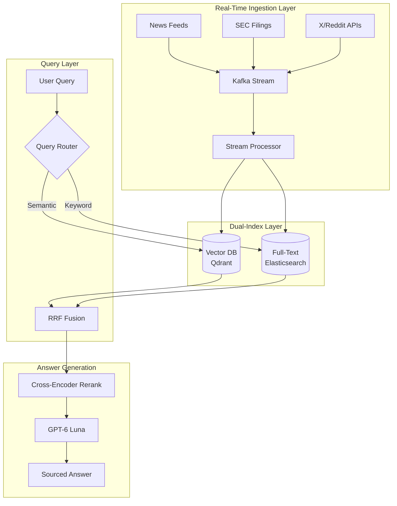

<div dir="rtl">

# مطالعه موردی: موتور جستجوی بلادرنگ مبتنی بر هوش مصنوعی

## مسئله <a id="the-problem"></a>

یک استارتاپ فین‌تک (Fintech) نیاز به ساخت یک **پلتفرم هوشمند تحلیل بازار به‌صورت بلادرنگ** دارد که به تحلیلگران اجازه دهد سوالات خود را به زبان طبیعی درباره داده‌های زنده بازار، اخبار و گزارش‌های رسمی شرکت‌ها (Company Filings) بپرسند.

**محدودیت‌های مطرح‌شده در مصاحبه:**
- تازگی داده‌ها (Data Freshness): پرس‌وجوها باید اطلاعات ۵ دقیقه اخیر را بازتاب دهند
- مقیاس (Scale): ۱۰٬۰۰۰ کاربر هم‌زمان، ۵۰٬۰۰۰ پرس‌وجو در ساعت
- دقت: داده‌های مالی نباید دچار توهم (Hallucination) شوند
- تاخیر (Latency): زمان پاسخ در صدک ۹۵ (p95) زیر ۳ ثانیه

---

## سوال مصاحبه <a id="the-interview-question"></a>

> «سیستمی طراحی کنید که به کاربران اجازه دهد بپرسند "احساسات (Sentiment) پیرامون تسلا در یک ساعت گذشته چگونه بوده است؟" و در کمتر از ۳ ثانیه یک پاسخ دقیق و مستند دریافت کنند.»

---

## معماری راه‌حل <a id="solution-architecture"></a>

<div dir="ltr">



</div>

---

## تصمیم‌های کلیدی طراحی <a id="key-design-decisions"></a>

### 1. چرا از Kafka برای دریافت داده (Ingestion) استفاده می‌کنیم؟ <a id="1-why-kafka-for-ingestion"></a>

مصاحبه‌کننده می‌خواهد ببیند که آیا تفاوت **پردازش جریانی در برابر پردازش دسته‌ای (Streaming vs. Batch)** را درک می‌کنید یا خیر.

**پاسخ:** ابزار Kafka جریان‌های داده پایدار (Durable) و قابل بازپخش (Replayable) را با گروه‌های مصرف‌کننده (Consumer Groups) مستقل فراهم می‌کند. ما یک مصرف‌کننده برای نوشتن در پایگاه داده برداری (Vector Database) و یک مصرف‌کننده دیگر برای Elasticsearch داریم. اگر نمایه‌سازی برداری عقب بیفتد، شاخص تمام‌متن (Full-Text Index) همچنان به پرس‌وجوها پاسخ می‌دهد. این الگو برای تاب‌آوری به عنوان **الگوی نوشتن دوگانه (Dual-Write Pattern)** شناخته می‌شود. تضمین‌های دقیقاً یک‌بار (Exactly-Once Semantics) در Kafka تنها پردازش‌های بین Kafka به Kafka را پوشش می‌دهند و شامل نوشتن در مخازن خارجی نمی‌شوند؛ بنابراین هر مصرف‌کننده نهایی (Sink Consumer) تحویل را به‌صورت حداقل یک‌بار (At-Least-Once) در نظر می‌گیرد و با استفاده از به‌روزرسانی‌های درج‌شونده هم‌توان (Idempotent Upserts) بر اساس شناسه سند، آن را عملاً به یک‌بار (Effectively-Once) تبدیل می‌کند.

### 2. چرا جستجوی ترکیبی (برداری + تمام‌متن)؟ <a id="2-why-hybrid-search-vector--full-text"></a>

**پاسخ:** پرس‌وجوهای مالی ترکیبی از جستجوی معنایی («احساسات پیرامون تسلا») و کلیدواژه‌ای («گزارش 10-K شرکت TSLA») هستند. جستجوی برداریِ خالص ممکن است تطابق‌های دقیق نمادهای بورسی (Ticker) را از دست بدهد. ما برای ترکیب نتایج از روش **Reciprocal Rank Fusion (RRF)** استفاده می‌کنیم.

### 3. چرا یک مدل کوچک به‌جای یک مدل پیشرفته (Frontier Model)؟ <a id="3-why-a-small-model-instead-of-a-frontier-model"></a>

**پاسخ:** برای دستیابی به هدف تاخیر (Latency) ۳ ثانیه در صدک ۹۵ (p95) با نرخ ۵۰ هزار پرس‌وجو در ساعت، به سنتز سریع و ارزان نیاز داریم. مدل GPT-6 Luna (با هزینه $0.10 / $0.50 به ازای هر ۱ میلیون Token) این نیاز را پوشش می‌دهد؛ مرتب‌کننده مجدد (Reranker) دقت را تضمین می‌کند و مدل LLM تنها محتوای از پیش تاییدشده را ترکیب می‌کند. مدل Gemini 3.8 Flash با سطح تفکر پایین (Low Thinking) به‌عنوان یک گزینه پشتیبان از تامین‌کننده دیگر عمل می‌کند، اما ابتدا هزینه آن را محاسبه کنید: با قیمت معرفی $0.75 / $3.75، خط هزینه تولید (Generation) در جدول زیر از حدود $6K به حدود $45K در ماه افزایش می‌یابد و با قیمت فهرست $1.50 / $7.50 از تاریخ ۱ ژانویه ۲۰۲۷ به حدود $91K می‌رسد، آن هم پیش از محاسبه واحدهای Token تفکر (Thinking Tokens) که به‌عنوان خروجی محاسبه می‌شوند. دو نکته احتیاطی وجود دارد: هر دو مدل ممکن است پیش از پاسخ دادن، واحدهای Token را صرف تفکر کنند؛ بنابراین تنظیمات پیش‌فرض را بررسی کرده و کمترین سطح تلاش استدلالی (Reasoning Effort) یا سطح تفکر را که کیفیت را حفظ می‌کند تنظیم کنید، وگرنه زمان تفکر بودجه تاخیر را می‌بلعد. همچنین به‌جای استناد به اعداد اعلام‌شده توسط فروشنده، زمان تا اولین توکن (Time to First Token) و تعداد توکن بر ثانیه را روی دستورهای Prompt خودتان اندازه‌گیری کنید. اگر تاخیر p95 در اوج مصرف همچنان از حد مجاز فراتر رفت، هزینه یک لایه سرعت پولی (Paid Speed Tier — مانند لایه Fast در OpenAI که در صورت ارائه برای مدل، ۲ برابر محاسبه می‌شود) را در برابر سایر گزینه‌ها بسنجید؛ این کار اغلب از انتقال تمام پرس‌وجوها به یک مدل بزرگ‌تر ارزان‌تر است.

---

## مدیریت نیازمندی تازگی داده (Freshness) <a id="handling-the-freshness-requirement"></a>

سخت‌ترین بخش این مسئله، اطمینان از این است که شاخص (Index) داده‌های ۵ دقیقه اخیر را بازتاب دهد.

**راه‌حل: نمایه‌سازی مبتنی بر TTL (TTL-Based Indexing)**

<div dir="ltr">

```python
# Each document gets a timestamp field
doc = {
    "content": "Tesla announces new factory...",
    "timestamp": datetime.now(UTC).isoformat(),
    "source": "Reuters",
    "ttl_hours": 24  # A sweeper job deletes points older than this
}

# Query filters to last N minutes (Qdrant Query API; the legacy search
# endpoint is gone from the REST schema as of Qdrant 1.19)
def search_recent(query: str, minutes: int = 60, limit: int = 50):
    cutoff = datetime.now(UTC) - timedelta(minutes=minutes)
    return qdrant.query_points(
        collection_name="market_docs",
        query=embed(query),
        query_filter=models.Filter(must=[
            models.FieldCondition(key="timestamp", range=models.DatetimeRange(gte=cutoff))
        ]),
        limit=limit,
    ).points
```

</div>

یک شاخص Payload از نوع datetime روی فیلد `timestamp` ایجاد کنید؛ بدون آن، سرویس Qdrant مجبور است برای ارزیابی فیلتر بازه‌ای، تمام Payloadها را بخواند و پرس‌وجوهای فیلترشده بر اساس زمان با بزرگ‌تر شدن مجموعه داده (Collection) کند می‌شوند.

---

## تحلیل هزینه <a id="cost-analysis"></a>

در این برآورد، نرخ ۵۰ هزار پرس‌وجو در ساعت طی ساعات کاری بازار (حدود ۱۰ ساعت در روز و ۲۲ روز معاملاتی) فرض شده است؛ یعنی حدود ۱۱ میلیون پرس‌وجو در ماه، که هر کدام به‌طور میانگین حدود ۴ هزار Token ورودی و ۳۰۰ Token خروجی دارند.

| مولفه | هزینه ماهانه (در نرخ ۵۰ هزار پرس‌وجو در ساعت) |
|-----------|-----------------------------------|
| سرویس Kafka (مدیریت‌شده MSK) | مبلغ $2,500 |
| پایگاه داده برداری Qdrant (مدیریت‌شده) | مبلغ $1,800 |
| موتور جستجوی Elasticsearch | مبلغ $2,000 |
| مدل GPT-6 Luna (تولید پاسخ): ۴۴ میلیارد ورودی × $0.10 به ازای ۱ میلیون + ۳٫۳ میلیارد خروجی × $0.50 به ازای ۱ میلیون | مبلغ $6,050 |
| رتبه‌بندی مجدد با Cross-encoder | مبلغ $800 |
| **مجموع** | **مبلغ $13,150 در ماه** |

ردیف هزینه تولید پاسخ بر اساس قیمت‌های فهرست (List Prices) و بدون کش کردن Prompt (Prompt Caching) محاسبه شده است. اگر همین پرس‌وجوها به‌صورت شبانه‌روزی اجرا شوند (۳۶ میلیون پرس‌وجو در ماه)، هزینه تولید پاسخ به‌تنهایی حدود $19,800 خواهد بود.

---

## سوالات پیگیری مصاحبه <a id="interview-follow-up-questions"></a>

**سوال: چگونه از توهم (Hallucination) در داده‌های مالی جلوگیری می‌کنید؟**

**پاسخ:** در سه لایه: (۱) مدل LLM تنها محتوای بازیابی‌شده را خلاصه می‌کند و هرگز واقعیت جدیدی تولید نمی‌کند. (۲) هر ادعا باید به یک سند منبع ارجاع دهد. (۳) یک اعتبارسنج پس از تولید (Post-generation Validator) بررسی می‌کند که هر عددی که در پاسخ آمده است، عیناً در یکی از منابع وجود داشته باشد.

**سوال: اگر سرویس Kafka در زمان اوج اخبار عقب بیفتد چه می‌شود؟**

**پاسخ:** مکانیزم کنترل فشار معکوس (Backpressure) را همراه با پایش تاخیر مصرف‌کننده (Consumer Lag Monitoring) پیاده‌سازی می‌کنیم. اگر تاخیر از ۲ دقیقه بیشتر شود، در سمت دریافت داده (Ingestion) با استفاده از نمونه‌برداری (Sampling) بار را کاهش می‌دهیم (Load Shedding). پرس‌وجوهای بلادرنگ به یک شاخص «اخیر» (Recent) متصل می‌شوند که تنها داده‌های یک ساعت گذشته را نگه می‌دارد؛ در حالی که کارهای دسته‌ای (Batch Jobs) شاخص کامل را به‌صورت پس‌زمینه تکمیل می‌کنند.

**سوال: اگر شخصی شبکه X و Reddit را با پست‌های جعلی پر کند تا پاسخ‌های تحلیل احساسات شما را تغییر دهد، چه چیزی جلوی آن را می‌گیرد؟**

**پاسخ:** لایه بازیابی (Retrieval) را به‌عنوان یک سطح حمله (Attack Surface) در نظر بگیرید، زیرا مسموم‌سازی پاسخ (Answer Poisoning) همین الان هم در حال رخ دادن است: در سپتامبر ۲۰۲۶ یک پژوهشگر امنیتی از یک کارزار فیشینگ گزارش داد که وب را با پست‌ها، فایل‌های PDF و صفحات پشتیبانی جعلی پر کرده بود تا ChatGPT، Gemini و Google AI Overviews شماره‌های تلفن جعلی را برای خطوط هوایی و بانک‌ها نمایش دهند. دفاع‌ها: (۱) در زمان دریافت داده، اعتبار منبع را امتیازدهی کنید (سن حساب کاربری، گراف دنبال‌کنندگان، تشخیص موج ناگهانی برای پست‌های شبه‌تکراری) و آن را به‌عنوان یک فیلد قابل فیلتر ذخیره کنید؛ (۲) سهم هر پاسخ را که می‌تواند از منابع اجتماعی کم‌اعتبار بیاید محدود کنید و ترکیب منابع را نمایش دهید؛ (۳) هرگز اجازه ندهید پست‌های شبکه‌های اجتماعی مرجع استناد برای یک عدد، تاریخ ثبت گزارش (Filing Date) یا اطلاعات تماس باشند؛ تنها منابع اولیه مانند گزارش‌های SEC و خبرگزاری‌های رسمی می‌توانند این موارد را تامین کنند.

---

## نکات کلیدی برای مصاحبه‌ها <a id="key-takeaways-for-interviews"></a>

1. **جستجوی بلادرنگ مبتنی بر هوش مصنوعی نیازمند زیرساخت جریانی (Streaming) است**، نه خط لوله‌های ETL دسته‌ای
2. **جستجوی ترکیبی (معنایی + کلیدواژه‌ای) برای دامنه‌های ساختاریافته عملکرد بهتری نسبت به جستجوی برداری خالص دارد**
3. **بودجه تاخیر (Latency) تعیین‌کننده انتخاب مدل است**: برای سنتز از مدل‌های سریع استفاده کنید و مدل‌های گران‌قیمت را برای استدلال نگه دارید
4. **تازگی داده یک فیلتر است، نه یک ویژگی**: آن را در سطح شاخص (Index) پیاده‌سازی کنید، نه در سطح Prompt
5. **مسموم‌سازی منابع تازه از همه ساده‌تر است**: بر اساس اعتبار منبع وزن‌دهی کنید و حقایق را به منابع اولیه گره بزنید

---

*فصل‌های مرتبط: [جستجوی ترکیبی (Hybrid Search)](../06-retrieval-systems/05-hybrid-search.md)، [زیرساخت سرویس‌دهی (Serving Infrastructure)](../04-inference-optimization/06-serving-infrastructure.md)*

</div>