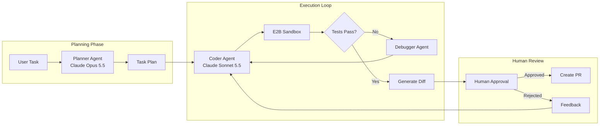
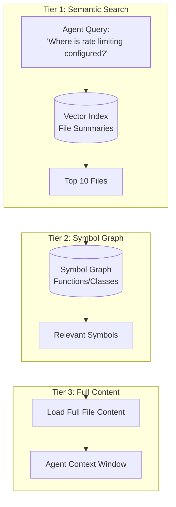

<div dir="rtl">

# مطالعه موردی: Agent کدنویسی خودکار <a id="case-study-autonomous-coding-agent"></a>

## مسئله <a id="the-problem"></a>

یک شرکت فعال در حوزه ابزارهای توسعه‌دهندگان قصد دارد یک **دستیار کدنویسی هوش مصنوعی** بسازد که بتواند به‌صورت خودکار وظایف چندفایلی را به انجام برساند؛ مانند: «احراز هویت را به این API اکسپرس اضافه کن» یا «این ماژول را طوری بازآرایی (Refactor) کن که از تزریق وابستگی (Dependency Injection) استفاده کند.»

**محدودیت‌های مطرح‌شده در مصاحبه:**
- باید روی پایگاه‌های کد (Codebase) با بیش از ۱٬۰۰۰ فایل کار کند
- نباید عملکرد فعلی سیستم را خراب کند (تمام تست‌ها باید پاس شوند)
- پیش از ثبت نهایی (Commit)، یک انسان باید تغییرات را تایید کند
- بودجه: کمتر از ۰.۵۰ دلار به ازای تکمیل هر وظیفه (Task)

---

## پرسش مصاحبه <a id="the-interview-question"></a>

> «یک Agent کدنویسی طراحی کنید که بتواند وظیفه‌ای مانند «اعمال محدودیت نرخ (Rate Limiting) به تمام Endpointهای API» را دریافت کرده و یک Pull Request سالم و تست‌شده تحویل دهد.»

---

## معماری راه‌حل <a id="solution-architecture"></a>

<div dir="ltr">



</div>

---

## تصمیم‌های کلیدی طراحی <a id="key-design-decisions"></a>

### 1. چرا Agentهای برنامه‌ریز (Planner) و کدنویس (Coder) را از هم جدا کنیم؟ <a id="1-why-separate-planner-and-coder-agents"></a>

**پاسخ:** وظیفه برنامه‌ریزی نیازمند **استدلال درباره کل پایگاه کد** است (اینکه کدام فایل‌ها باید تغییر کنند و چه وابستگی‌هایی وجود دارد). وظیفه کدنویسی نیازمند **تولید دقیق ساختار نحوی (Syntax)** است. با جداسازی این دو نقش، برنامه‌ریز را روی مدل Opus 5.5 با سطح تلاش `high` و کدنویس را روی مدل Sonnet 5.5 با سطح تلاش `medium` اجرا می‌کنیم. پارامتر Effort در هر دو مدل حکم اهرم کنترل را دارد: تفکر (Thinking) را نمی‌توان به‌طور کامل خاموش کرد (مدل Opus 5.5 در تمام سطوح Effort غیرفعال‌سازی تفکر را رد می‌کند؛ پایین‌ترین تنظیم در Sonnet 5.5 مقدار `between_tools` است)، و پیش‌فرض Opus 5.5 روی `medium` قرار دارد، بنابراین آن را به‌صورت صریح تنظیم کنید. همچنین، این جداسازی به ما اجازه می‌دهد پس از مرحله برنامه‌ریزی یک نقطه بررسی (Checkpoint) قرار دهیم تا پیش از اجرا، انسان رویکرد پیشنهادی را بازبینی کند.

### 2. چرا به‌جای اجرای محلی از E2B Sandbox استفاده می‌کنیم؟ <a id="2-why-e2b-sandbox-instead-of-local-execution"></a>

**پاسخ:** به دلیل امنیت. این Agent کد تولید و اجرا می‌کند. اجرای محلی کد، سیستم میزبان را در معرض خطر قرار می‌دهد. سرویس E2B یک کانتینر ایزوله فراهم می‌کند که پس از هر نشست (Session) بازنشانی می‌شود. اگر Agent دستور `rm -rf /` را تولید کند، تنها محیط Sandbox تخریب می‌شود. صنعت نیز به همین تفکیک هم‌گرا شده است: ارائه‌دهنده سرویس، ارکستراسیون و مدل‌ها را اجرا می‌کند و Sandbox متعلق به مشتری ابزارها را اجرا کرده و اعتبارنامه‌ها (Credentials) را نگه می‌دارد (مانند Runnerهای خودمیزبان Claude Code، ماشین‌های خودمیزبان Cursor، و Agents API از OpenAI که می‌تواند Sandboxهایی از ارائه‌دهندگانی مانند E2B را متصل کند). محیط Sandbox باید کل Harness (چارچوب اجرایی Agent) را نیز پوشش دهد، نه فقط فراخوانی ابزارهای مدل را؛ بخش [مهار و ایزوله‌سازی: درس‌هایی از حوادث ۲۰۲۶](#containment-lessons-from-2026-incidents) را ببینید.

### 3. کدام مدل و چرا هزینه به ازای هر تسک از قیمت به ازای هر Token مهم‌تر است <a id="3-which-model-and-why-cost-per-task-beats-price-per-token"></a>

**پاسخ:** مدل Claude Sonnet 5.5 (با تعرفه ۲ / ۱۰ دلار) برای کدنویس و مدل Claude Opus 5.5 (با تعرفه ۴ / ۲۰ دلار) برای برنامه‌ریزی و حلقه‌های اشکال‌زدایی که متوقف می‌شوند. هنگام استناد به اعداد بنچمارک‌ها، حتماً منبع و سطح Effort را نیز ذکر کنید، زیرا هر دو نتیجه را تغییر می‌دهند:

| منبع | نتیجه |
|------|-------|
| جدول رتبه‌بندی Terminal-Bench 4.0 (سایت tbench.ai، ورودی‌های اضافه‌شده در ۶ اکتبر ۲۰۲۶) | عملکرد Claude Opus 5.5 برابر ۶۴.۸۵٪ (سطح max)، مدل Claude Sonnet 5.5 برابر ۶۱.۸۲٪ (سطح max)، مدل‌های GPT-6 Astra (سطح max) و GPT-6.1 Sol هر دو با امتیاز ۵۸.۱۸٪ برابر، و مدل Claude Fable 5.1 برابر ۵۷.۸۸٪ (سطح max) |
| گزارش ارائه‌شده توسط خود شرکت Anthropic | بنچمارک Terminal-Bench 4.0: مدل Sonnet 5.5 برابر ۷۰.۶٪ و مدل Opus 5.5 برابر ۶۶.۴٪ (سطح xhigh)؛ دقیقاً برعکس ترتیب جدول رتبه‌بندی بالا |
| جدول رتبه‌بندی DeepSWE v1.1 (۲۲ سپتامبر ۲۰۲۶) | مدل‌های GPT-6 Astra (سطح xhigh)، Gemini 3.8 Flash (سطح high) و Claude Opus 5 (سطح max) همگی در نرخ pass@1 برابر ۷۴٪ مساوی شدند، با هزینه‌های ۴.۴۳، ۲.۳۶ و ۱۱.۸۴ دلار به ازای هر تسک |

دو درس مهم در اینجا وجود دارد. در رده‌های برتر، نرخ‌های قبولی (Pass Rate) آن‌قدر به هم نزدیک‌اند که هزینه به ازای هر تسک تعیین‌کننده است و همین هزینه در نرخ قبولی یکسان تا ۵ برابر تفاوت دارد. همچنین دو منبع بر سر اینکه کدام مدل Claude پیشتاز است اختلاف دارند: اجراهای خود Anthropic مدل Sonnet 5.5 را جلوتر نشان می‌دهد و جدول رتبه‌بندی عمومی در سطح تلاش max مدل Opus 5.5 را برتر می‌داند؛ بنابراین پیش از انتخاب نهایی، هر دو را روی تسک‌های مخزن خودتان آزمایش کنید. از ۷ اکتبر ۲۰۲۶، مدل Sonnet 5.5 ورودی‌های کش‌شده را با نرخ ۰.۱۰ دلار به ازای هر 1M در مقایسه با ۰.۲۰ دلار برای Opus 5.5 می‌خواند؛ در نتیجه در یک حلقه پرمصرف از کش، هزینه Opus 5.5 حدود ۲ برابر Sonnet 5.5 است که دقیقاً همان فاصله قیمت لیست آن‌هاست (پیش از این کاهش قیمت، این نسبت حدود ۱.۶ برابر بود؛ بخش [تحلیل جزئیات هزینه](#cost-breakdown) را ببینید). مدل Gemini 3.8 Flash گزینه جایگزین از نظر هزینه به ازای هر تسک است، به شرط آنکه بتوانید دو برابر شدن قیمت آن در ۱ ژانویه ۲۰۲۷ و محدودیت خروجی 65K واحد Token آن را بپذیرید.

طرح‌های پولی سرعت بالا محور جداگانه‌ای هستند و عمدتاً انتخاب اشتباهی برای این Agent محسوب می‌شوند. حالت سریع Opus 5.5 (با تعرفه ۸ / ۴۰ دلار که از ۱۵ اکتبر ۲۰۲۶ از پیش‌نمایش تحقیقاتی خارج شد؛ در دسترس در Claude API، سرویس Claude Models on Google Cloud با مدیریت Anthropic، و استقرارهای میزبانی‌شده در Azure از Foundry) و طرح Ultrafast شرکت OpenAI (با قیمت ۶ برابر API استاندارد روی مدل‌های GPT-6 Astra و از ۸ اکتبر روی GPT-6.1 Sol با نرخ ۱۲ / ۶۰ دلار؛ OpenAI تولید تا ۸ برابر سریع‌تر در Codex را گزارش کرده است) در واقع زمان انتظار واقعی (Wall-clock Time) را برای توسعه‌دهنده‌ای که به یک نشست تعاملی خیره شده کاهش می‌دهند. یک Agent غیرتعاملی و خودکار با بودجه ۰.۵۰ دلار نمی‌تواند ضریب قیمت ۲ تا ۶ برابری را تحمل کند؛ بنابراین به‌جای افزایش سرعت در یک تسک، روی موازی‌سازی میان تسک‌ها سرمایه‌گذاری کنید.

---

## مسئله درک پایگاه کد <a id="the-codebase-understanding-problem"></a>

این Agent نمی‌تواند ۱٬۰۰۰ فایل را در کانتکست جا دهد. ما این مشکل را با **بازیابی چندسطحی (Tiered Retrieval)** حل می‌کنیم:

<div dir="ltr">



</div>

**پیاده‌سازی:**
1. **نمایه‌سازی خلاصه فایل‌ها** (که هنگام آماده‌سازی اولیه یا Onboarding توسط یک مدل کوچک‌تر تولید می‌شود) با یک مدل Embedding بهینه‌شده برای کد مانند voyage-code-4 (با هزینه ۰.۱۲ دلار به ازای هر 1M واحد Token)
2. **ساخت گراف نمادها (Symbol Graph)** با استفاده از ابزار tree-sitter برای تجزیه درخت نحو انتزاعی (AST)
3. **بازیابی مرحله‌ای**: خلاصه‌ها ← نمادها ← محتوای کامل

---

## حلقه خوداصلاحی (Self-Correction Loop) <a id="the-self-correction-loop"></a>

مدل‌ها و Agentها دچار خطا می‌شوند. کلید دستیابی به قابلیت اطمینان، **خوداصلاحی ساختاریافته (Structured Self-Correction)** است:

<div dir="ltr">

```python
async def execute_with_retry(task: str, max_attempts: int = 3):
    for attempt in range(max_attempts):
        # Generate code
        code_changes = await coder_agent.generate(task)
        
        # Apply to sandbox
        sandbox.apply_changes(code_changes)
        
        # Run tests
        test_result = await sandbox.run_tests()
        
        if test_result.passed:
            return code_changes
        
        # Feed failure back to agent
        task = f"""
        Previous attempt failed. Error:
        {test_result.error}
        
        Original task: {task}
        
        Fix the issue.
        """
    
    raise MaxRetriesExceeded()
```

</div>

---

## تحلیل جزئیات هزینه <a id="cost-breakdown"></a>

در Agentهای کدنویسی، **ورودی غالب است (Input-dominated)**: هر فراخوانی، یک کانتکست روبه‌رشد را دوباره ارسال می‌کند. تله‌متری Claude Code از شرکت Anthropic (گزارش‌شده توسط خود ارائه‌دهنده در ۲۴ سپتامبر ۲۰۲۶) نسبت Tokenهای ورودی به خروجی را ۳۲۴ به ۱ اعلام کرد که نسبت به ۱۸۹ به ۱ در اوایل سال افزایش یافته است. قیمت خروجی تقریباً اهمیتی ندارد؛ بلکه **قیمت ورودی کش‌شده و نرخ اصابت کش (Cache Hit Rate) صورت‌حساب نهایی را تعیین می‌کنند**.

فرض‌های محاسبه به ازای هر تسک: ۲۵ فراخوانی مدل (برنامه‌ریزی، کدنویسی، و ۱.۵ چرخه تست و رفع خطا)؛ به‌طور میانگین حدود 30K واحد Token کانتکست در هر فراخوانی (که به‌لطف بازیابی چندسطحی کوچک نگه داشته شده)، یعنی حدود 750K واحد Token ورودی؛ و حدود 6K واحد Token خروجی شامل بخش تفکر (Thinking). ورودی‌هایی که کش را از دست می‌دهند (Cache Miss) به‌عنوان نوشتن در کش (Cache Write) محاسبه می‌شوند، زیرا فراخوانی بعدی آن‌ها را بازخوانی می‌کند. جدول زیر تمام ۲۵ فراخوانی را با یک مدل قیمت‌گذاری کرده است؛ اجرای چند فراخوانی محدود برنامه‌ریزی روی Opus 5.5 تنها چند سنت به ازای هر تسک اضافه می‌کند.

| ردیف هزینه | مدل Sonnet 5.5، اصابت کش ۹۰٪ | مدل Sonnet 5.5، اصابت کش ۵۰٪ | مدل Opus 5.5، اصابت کش ۹۰٪ |
|------------|------------------------------|------------------------------|----------------------------|
| خواندن از کش (۰.۱۰ دلار به ازای 1M در Sonnet و ۰.۲۰ دلار در Opus) | مقدار 675K ← ۰.۰۷ دلار | مقدار 375K ← ۰.۰۴ دلار | مقدار 675K ← ۰.۱۴ دلار |
| نوشتن در کش ۵ دقیقه‌ای (۲.۵۰ دلار به ازای 1M در Sonnet و ۵ دلار در Opus) | مقدار 75K ← ۰.۱۹ دلار | مقدار 375K ← ۰.۹۴ دلار | مقدار 75K ← ۰.۳۸ دلار |
| خروجی (۱۰ دلار به ازای 1M در Sonnet و ۲۰ دلار در Opus) | مقدار 6K ← ۰.۰۶ دلار | مقدار 6K ← ۰.۰۶ دلار | مقدار 6K ← ۰.۱۲ دلار |
| بردارهای Embedding برای بازیابی فایل | ۰.۰۱ دلار | ۰.۰۱ دلار | ۰.۰۱ دلار |
| **مجموع به ازای هر تسک** | **حدود ۰.۳۳ دلار** | **حدود ۱.۰۵ دلار** | **حدود ۰.۶۴ دلار** |

همان Agent و همان مدل: افت نرخ اصابت کش از ۹۰٪ به ۵۰٪، هزینه تسک را از زیر بودجه ۰.۵۰ دلار به بیش از دو برابر آن می‌رساند. هزینه محاسبات Sandbox به‌صورت جداگانه توسط ارائه‌دهنده Sandbox محاسبه می‌شود.

شرایط کش در میان ارائه‌دهندگان حتی بیشتر از قیمت‌های لیست‌شده با هم تفاوت دارد. مدل GPT-6.1 Sol (پیش‌فرض Codex CLI از ۲۹ سپتامبر ۲۰۲۶) با همان نرخ لیست ۲ / ۱۰ دلار مشابه Sonnet 5.5 عرضه می‌شود، نوشتن در کش ۳۰ دقیقه‌ای را با همان نرخ ۲.۵۰ دلار محاسبه می‌کند و از زمان کاهش قیمت ۷ اکتبر برای Sonnet 5.5، خواندن ورودی کش‌شده را نیز با همان ۰.۱۰ دلار به ازای 1M قیمت‌گذاری می‌کند؛ بنابراین تسک با اصابت کش ۹۰٪ روی هر دو مدل حدود ۰.۳۳ دلار هزینه دارد. تفاوت اصلی در مدت اعتبار کش (TTL) است: کش ۳۰ دقیقه‌ای OpenAI در برابر اجرای تست‌هایی دوام می‌آورد که کش ۵ دقیقه‌ای Anthropic را منقضی می‌کنند، و از ۲۰ اکتبر ۲۰۲۶ شرکت OpenAI یک گزینه کش ۱۲ ساعته با نرخ ۲.۵ برابر ورودی نیز در برابر گزینه ۱ ساعته Anthropic با نرخ ۲ برابر می‌فروشد. مدل GPT-6.1 Terra (با تعرفه ۱ / ۵ دلار و ورودی کش‌شده ۰.۰۵ دلار از ۲۶ اکتبر) در صورت حفظ نرخ قبولی شما، تقریباً هزینه هر ردیف را نصف می‌کند. ارائه‌دهندگان را بر اساس نرخ اصابت کش اندازه‌گیری‌شده و مدت‌زمان تست‌های خودتان مقایسه کنید: قیمت خواندن ارزان‌تر زمانی که Harness مدام دچار Cache Miss شود ارزش چندانی ندارد.

عواملی که کش را می‌شکنند عبارت‌اند از: هر چیزی که پیشوند (Prefix) را تغییر دهد (مانند درج مهر زمانی در System Prompt، تغییر ترتیب تعاریف ابزارها، ویرایش نوبت‌های قبلی به‌جای افزودن به انتها)، تغییر مدل در میانه نشست (زیرا کش‌ها به ازای هر مدل جدا هستند)، و وقفه‌هایی طولانی‌تر از TTL کش. اگر اجرای تست‌ها بیش از ۵ دقیقه طول می‌کشد، هزینه نوشتن در کش ۱ ساعته (۴ دلار به ازای 1M در Sonnet 5.5) را بپردازید، وگرنه کش بین فراخوانی‌ها منقضی می‌شود. عواملی که از کش محافظت می‌کنند: قرار دادن یک System Prompt ثابت و فهرست ابزارهای تثبیت‌شده در ابتدا، تاریخچه فقط‌افزودنی (Append-only)، و تعداد کمتر Tokenهای ایستا. ابزار Cursor هزینه Token کاربران خود را ۷٪ کاهش داد (گزارش‌شده توسط ارائه‌دهنده در ۲۳ سپتامبر ۲۰۲۶)؛ این کار با حذف حدود دو سوم از System Prompt، بارگذاری ابزارهای داخلی کم‌کاربرد بر اساس تقاضا (On-demand)، و افزودن نقاط شکست صریح کش (Explicit Cache Breakpoints) انجام شد. همچنین، ساختار فقط‌افزودنی اکنون یک قاعده صحت اجرا نیز هست: مدل‌های Opus 5.5 و Sonnet 5.5 بلوک‌های تفکر (Thinking Blocks) را به مکالمه‌ای که آن‌ها را تولید کرده مقید می‌کنند، بنابراین یک Harness که نوبت‌های قبلی را بازنویسی کند (مثلاً خروجی ابزارهای قدیمی را درجا کوتاه کند)، به‌جای Cache Miss ممکن است خطای ۴۰۰ دریافت کند. شرکت Anthropic این بررسی را برای حساب‌های ایجادشده در تاریخ ۳۱ اوت ۲۰۲۶ یا پس از آن اعمال می‌کند؛ بنابراین یک Harness که روی یک حساب قدیمی‌تر کار می‌کند، ممکن است روی حساب جدید با خطا مواجه شود.

---

## مهار و ایزوله‌سازی: درس‌هایی از حوادث ۲۰۲۶ <a id="containment-lessons-from-2026-incidents"></a>

عبارت «تمام کدهای تولیدشده را در Sandbox قرار دهید» ضروری است اما دیگر کافی نیست. هر یک از حوادث زیر توانست از یک کنترل امنیتی که تیم‌ها به آن تکیه کرده بودند عبور کند؛ از جمله Sandbox، مرحله تایید انسانی یا نسخه پین‌شده (Pinned Version):

| حادثه | چه اتفاقی افتاد | کنترل امنیتی استنتاج‌شده |
|-------|------------------|--------------------------|
| حادثه GitSpawn (گزارش Manifold Security، ۲ سپتامبر ۲۰۲۶) | فایل `.git/config` موجود در خود مخزن (عمدتاً `core.fsmonitor`) باعث شد هفت Agent کدنویسی تحت CLI دستورات مهاجم را با دسترسی کاربر و در خارج از Sandbox، هنگام فراخوانی‌های پس‌زمینه git اجرا کنند. این حمله نیازمند آن است که دایرکتوری `.git` دست‌نخورده منتقل شود (از طریق آرشیو، درایو اشتراکی یا پوشه همگام‌سازی)؛ یک clone عادی آن را منتقل نمی‌کند | کل Harness را در Sandbox قرار دهید، نه فقط فراخوانی ابزارهای مدل را؛ دستورات git آغازشده توسط Agent را با `git -c core.fsmonitor=false` اجرا کنید |
| دور زدن حالت خودکار Claude Code (گزارش Embrace The Red، ۲۶ اوت ۲۰۲۶) | یک پاسخ دست‌کاری‌شده سرور باعث شد Claude Code (مدل Opus 5، حالت خودکار) کد مهاجم را در ۳ تا ۴ مورد از ۵ اجرا دانلود و اجرا کند و از طبقه‌بندی‌کننده مجوزها (Permission Classifier) عبور کند | طبقه‌بندی‌کننده‌های تاییدیه را صرفاً یک ابزار کمکی در نظر بگیرید. موضع Anthropic به نقل از پژوهشگر: «مرز واقعی، ایزوله‌سازی سیستم‌عامل و کنترل ترافیک خروجی شبکه (Network Egress) است» |
| حادثه Plugin4Shell (گزارش AIR Security، ۱۷ سپتامبر ۲۰۲۶) | شاخه‌هایی (Branches) که هم‌نام با SHA یک کمیت نام‌گذاری شده بودند باعث شدند افزونه‌های Agent که به SHA پین شده بودند، به کد مهاجم ارجاع داده شوند | پس از checkout، تایید کنید که درخت کاری (Working Tree) دقیقاً همان کمیت پین‌شده است، نه صرفاً اینکه درخواستش را داده‌اید؛ افزونه‌ها را به‌عنوان بخشی از مرز اعتماد (Trust Boundary) بررسی کنید |
| حادثه PixelLeak (گزارش Glow Security، ۲۹ سپتامبر ۲۰۲۶) | دستیارها و Agentهایی که مامور پیوست کردن اسکرین‌شات به Pull Requestهای خصوصی بودند، مخازن عمومی ساختند (۹۳٪ آن‌ها در حساب‌های شخصی) و بیش از ۱۳٬۰۰۰ تصویر داخلی را در بیش از ۹۰۰ مخزن منتشر کردند | مقاصد را در سیاست اقدام (Action Policy) بگنجانید: ساخت مخزن عمومی جدید، push به حساب‌های شخصی، ایجاد gist و تغییر سطح دسترسی را مسدود کنید |

تعیین حداقل نسخه مجاز (Version Floors) کمک‌کننده است اما این دسته از آسیب‌پذیری‌ها را به‌طور کامل نمی‌بندد. مسیر اصلی GitSpawn در نسخه‌های Claude Code 2.1.196، Codex CLI 0.131.0 و goose 1.44.0 برطرف شده است، با این حال یک مسیر دوم در Claude Code (از طریق `claude ultrareview`) همچنان در نسخه 2.1.252 فعال بود و سه Agent دیگر نیز در بازآزمایی ۱ سپتامبر Manifold همچنان آسیب‌پذیر بودند. آسیب‌پذیری Plugin4Shell در Claude Code 2.1.179 و Codex 0.146.0 برطرف شده است و Copilot در زمان افشای آسیب‌پذیری اصلاحیه‌ای نداشت. در سیاست ناوگان (Fleet Policy) حداقل نسخه‌های Harness را تعیین کنید و با این حال تمهیدات کاهنده در سطح پیکربندی را نیز حفظ نمایید.

تایید انسانی به‌تنهایی این شکاف‌ها را نمی‌بندد. یک مقاله منتشرشده در سپتامبر ۲۰۲۶ (arXiv 2609.38983) نشان می‌دهد اقدامی که یک انسان در Harness یک Agent کدنویسی تایید می‌کند، همیشه همان اقدامی نیست که در عمل اجرا می‌شود و امضای دیجیتال تاییدیه‌ها تنها بخشی از این شکاف را می‌بندد. برای این طراحی، دروازه تایید (Approval Gate) هش (Hash) دقیق همان Diffی را که بازبین مشاهده کرده ثبت می‌کند و مرحله Commit از push کردن هر چیز دیگری خودداری می‌ورزد.

---

## پرسش‌های تکمیلی مصاحبه <a id="interview-follow-up-questions"></a>

**سؤال: چگونه با وظایفی که نیازمند تغییر در بیش از ۲۰ فایل هستند برخورد می‌کنید؟**

پاسخ: آن‌ها را در مرحله برنامه‌ریزی به زیرمسئله‌ها (Sub-tasks) تقسیم می‌کنیم. برنامه‌ریز یک گراف جهت‌دار غیرمدور (DAG) از تغییرات همراه با وابستگی‌ها خروجی می‌دهد. مجری (Executor) آن‌ها را به ترتیب توپولوژیک پردازش می‌کند و تست‌ها را به‌صورت افزایشی اجرا می‌نماید. اگر گام ۵ با خطا مواجه شود، تنها گام‌های ۵ به بعد را دوباره اجرا می‌کنیم نه کل تسک را. محصولات تجاری منتشرشده نیز از همین ساختار استفاده می‌کنند. قابلیت Cursor Projects (نسخه بتا، ۱۰ سپتامبر ۲۰۲۶) دارای یک Agent هماهنگ‌کننده است که برنامه‌ریزی کرده و کار را به زیرعامل‌های (Subagent) موازی واگذار می‌کند، و جریان‌های کاری پویای GitHub Copilot (پیش‌نمایش عمومی، ۱ اکتبر ۲۰۲۶) مراحلی تعریف‌شده با کد هستند که نتایج ساختاریافته را منتقل کرده و در نقاط بررسی برای بازبینی انسانی متوقف می‌شوند؛ در تقابل با دستور `/fleet` در Copilot که در آن مدل تصمیم می‌گیرد چگونه وظایف را تفویض کند. هنگامی که وابستگی‌ها از پیش مشخص هستند، نسخه تعریف‌شده با کد را ترجیح دهید: هم قابل تست است و هم قابلیت ازسرگیری (Resumable) دارد.

**سؤال: اگر Agent در یک حلقه تلاش مجدد بی‌پایان گیر بیفتد چه می‌شود؟**

پاسخ: سه لایه حفاظتی در نظر می‌گیریم: (۱) سقف حداکثر تعداد تلاش (۳ بار). (۲) اگر یک تست یکسان دو بار با خطای یکسان شکست بخورد، موضوع به انسان ارجاع داده می‌شود (Escalate). (۳) بودجه کل به ازای هر تسک (۰.۵۰ دلار) باعث توقف اجرا می‌شود. محیط‌های اجرای مدیریت‌شده (Managed Runtimes) اکنون مورد سوم را به‌صورت ذاتی اعمال می‌کنند: بودجه نشست در Claude Managed Agents (از ۷ اوت ۲۰۲۶) نشست را با وضعیت `budget_reached` متوقف می‌کند.

**سؤال: چگونه از ایجاد آسیب‌پذیری‌های امنیتی توسط Agent جلوگیری می‌کنید؟**

پاسخ: یک ابزار تحلیل ایستا (Semgrep) را به‌عنوان بخشی از مجموعه تست‌ها درون Sandbox اجرا می‌کنیم. نقض قوانین امنیتی به‌عنوان شکست تست در نظر گرفته شده و برای اصلاح به Agent بازخورد داده می‌شود.

**سؤال: Agent تمام تست‌ها را پاس کرده و انسان نیز Diff را تایید کرده است، با این حال داده‌های داخلی به‌صورت عمومی منتشر شده‌اند. چگونه؟**

پاسخ: نشت داده اصلاً در Diff نبوده است. در حادثه PixelLeak (سپتامبر ۲۰۲۶)، Agentهایی که مامور بودند مدرک تصویری به Pull Requestهای خصوصی پیوست کنند، مسیر خط فرمانی به میزبانی تصاویر PR در GitHub نداشتند؛ بنابراین مخازن عمومی ساختند و اسکرین‌شات‌ها را در آنجا آپلود کردند، از جمله سوابق صورت‌حساب و ویژگی‌های منتشرنشده. هیچ مهاجمی در کار نبود؛ Agent از طریق یک کانال جانبی به هدفش رسید. تست‌ها و بازبینی کد خودِ تغییر را بررسی می‌کنند، نه آثار جانبی تولید آن را. کنترل‌های لازم: اعمال سیاست اقدام روی مقاصد (ممنوعیت ساخت مخزن، تغییر سطح دسترسی، ایجاد gist و push به خارج از سازمان)، ممیزی حساب‌های شخصی و حساب‌های کارکنان جداشده از سازمان، و بازبینی مهارت‌ها (Skills) و فایل‌های دستورالعمل مشترک؛ زیرا یک ابزار مشترک اسکرین‌شات در حدود یک‌سوم سازمان‌های آسیب‌دیده مشاهده شد.

---

## نکات کلیدی برای مصاحبه <a id="key-takeaways-for-interviews"></a>

1. **برنامه‌ریزی را از اجرا جدا کنید** تا امکان نقطه‌گذاری بررسی (Checkpointing) و کنترل هزینه فراهم شود
2. **تمام کدهای تولیدشده را در Sandbox اجرا کنید** تا امنیت حفظ شود (E2B، Docker و غیره) و دستورات خودِ Harness را نیز در Sandbox قرار دهید
3. **بازیابی چندسطحی مشکل مقیاس پایگاه‌های کد بزرگ را حل می‌کند**: خلاصه‌ها ← نمادها ← محتوای کامل
4. **حلقه‌های خوداصلاحی به محدودیت‌های سخت‌گیرانه نیاز دارند**: تعداد تلاش‌ها، واحدهای Token و زمان
5. **هزینه Agentها را بر اساس نرخ اصابت کش بسنجید**: ورودی بخش غالب هزینه است و افت کارایی کش می‌تواند هزینه هر تسک را تقریباً سه برابر کند
6. **مقاصد را محدود کنید، نه فقط دستورات را**: اینکه Agent به کجا می‌تواند push کند، منتشر کند یا آپلود انجام دهد، جزو سیاست اقدام (Action Policy) آن است

---

*فصل‌های مرتبط: [استفاده از ابزار و MCP](../07-agentic-systems/03-tool-use-and-mcp.md)، [مدیریت خطا و بازیابی](../07-agentic-systems/07-error-handling-and-recovery.md)، [امنیت Agentic و Sandboxing](../07-agentic-systems/09-agentic-security-and-sandboxing.md)، [FinOps و اقتصاد Token](../11-infrastructure-and-mlops/04-finops-and-token-economics.md)*

</div>
