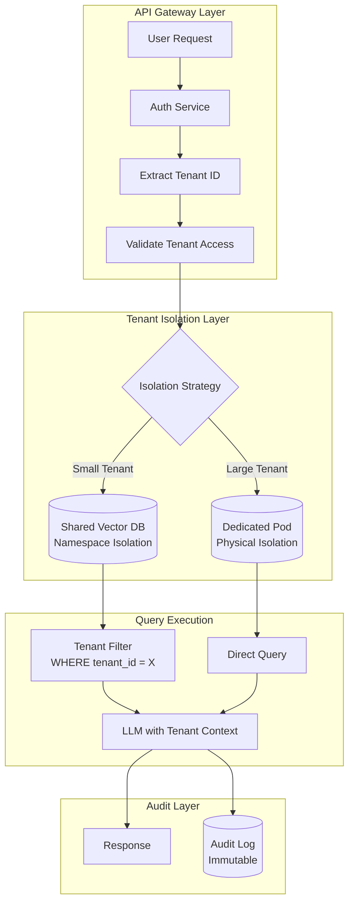
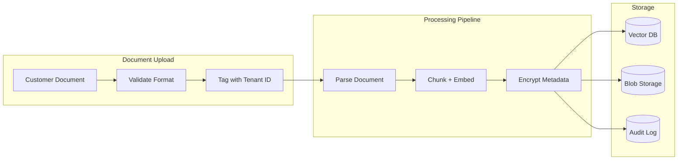

<div dir="rtl">

# مطالعه موردی: پلتفرم SaaS هوش مصنوعی چندمستاجری (Multi-Tenant) <a id="case-study-multi-tenant-ai-saas-platform"></a>

## مسئله <a id="the-problem"></a>

یک استارتاپ B2B در حال ساخت یک **پلتفرم تحلیل اسناد مبتنی بر هوش مصنوعی** است که در آن هر مشتری قراردادهای خود را بارگذاری می‌کند و هوش مصنوعی به پرسش‌های مربوط به آن‌ها پاسخ می‌دهد. مشتریان شامل رقبایی هستند که هرگز نباید داده‌های یکدیگر را ببینند.

**محدودیت‌های ارائه‌شده در مصاحبه:**
- ۵۰۰ مشتری سازمانی، هرکدام با ۱۰٬۰۰۰ تا ۱۰۰٬۰۰۰ سند
- ایزوله‌سازی مطلق داده: داده‌های مشتری A به هیچ وجه نباید به مشتری B نشت کند
- زیرساخت مشترک برای بهره‌وری هزینه
- انطباق مقرراتی: استانداردهای SOC 2 Type II و GDPR
- تاخیر (Latency) پرس‌وجو زیر ۲ ثانیه

---

## پرسش مصاحبه <a id="the-interview-question"></a>

> «یک سیستم RAG چندمستاجری (Multi-Tenant) طراحی کنید که در آن کوکاکولا و پپسی هر دو بتوانند مشتری باشند و ریسک نشت داده بین مستاجران صفر باشد.»

---

## معماری راه‌حل <a id="solution-architecture"></a>

<div dir="ltr">



</div>

---

## تصمیم‌های کلیدی طراحی <a id="key-design-decisions"></a>

### 1. ایزوله‌سازی ترکیبی: فضای نام (Namespace) در برابر فیزیکی <a id="1-hybrid-isolation-namespace-vs-physical"></a>

**پاسخ:** ایزوله‌سازی فیزیکی خالص (یک پایگاه داده به ازای هر مستاجر) پرهزینه است. ایزوله‌سازی فضای نام خالص (پایگاه داده مشترک با فیلتر tenant_id) در صورت بروز باگ در فیلتر، ریسک نشت داده دارد. ما از یک **رویکرد سطح‌بندی‌شده** استفاده می‌کنیم:

| سطح | اندازه مستاجر | روش ایزوله‌سازی | دلیل |
|------|-------------|------------------|------|
| استاندارد (Standard) | کمتر از ۵۰ هزار سند | فضای نام (Namespace) در Qdrant مشترک | مقرون‌به‌صرفه از نظر هزینه |
| پریمیوم (Premium) | ۵۰ هزار تا ۵۰۰ هزار سند | کالکشن اختصاصی Qdrant | ایزوله‌سازی عملکرد |
| سازمانی (Enterprise) | بیش از ۵۰۰ هزار سند | پاد (Pod) اختصاصی Qdrant یا یک صفحه داده (Data Plane) در ابر اختصاصی خود مشتری | فیزیکی + انطباق مقرراتی |

دو جزئیات در سطح مشترک اهمیت دارند. جست‌وجوی کلیدواژه‌ای امتیازدهی را با آمار کل پیکره (Corpus) انجام می‌دهد، بنابراین در یک کالکشن مشترک، اسناد یک مستاجر رتبه‌بندی BM25 مستاجر دیگر را جابه‌جا می‌کنند؛ نسخه 1.19 پایگاه داده Qdrant آمار IDF به ازای هر مستاجر را برای جست‌وجوی تنک (Sparse) و BM25 اضافه کرده است تا دقیقاً همین مشکل را برطرف کند. همچنین گزینه ابر اختصاصی مشتری اکنون یک محصول آماده است، نه یک پروژه سفارشی: سرویس BYOC شرکت Pinecone در ۲۳ سپتامبر ۲۰۲۶ روی AWS، Google Cloud و Azure به دسترس‌پذیری عمومی (GA) رسید که در آن بردارها، اسناد و محموله درخواست‌ها (Payloads) در حساب خود مشتری باقی می‌مانند.

ایزوله‌سازی فضای نام تنها به‌دلیل فیلترهای جاافتاده دچار شکست باز (Fail-open) نمی‌شود، بلکه در اثر باگ‌های کدگذاری (Encoding) نیز آسیب‌پذیر است: ذخیره‌سازهای Postgres و SQLite در LangGraph به یک برچسب نقطه‌دار اجازه می‌دادند به نام مستعار فضای نام مستاجر دیگری اشاره کند (CVE-2026-115883 در ۲۱ اکتبر ۲۰۲۶؛ برای مکانیزم و نسخه‌های اصلاح‌شده، بخش [ارکستراسیون LangGraph](../09-frameworks-and-tools/02-langgraph-orchestration.md#persistence-and-checkpointing) را ببینید). بخش مربوط به مستاجر را همیشه از هویت احرازشده استخراج کنید، هرگز از رشته‌ای که فراخواننده ارسال کرده استفاده نکنید، و امنیت در سطح سطر (RLS) را در لایه زیرین حفظ نمایید.

### 2. دفاع لایه‌به‌لایه (Defense in Depth) برای ایزوله‌سازی داده <a id="2-defense-in-depth-for-data-isolation"></a>

**پاسخ:** ما هرگز به یک لایه اعتماد نمی‌کنیم. پشته ایزوله‌سازی ما شامل موارد زیر است:

1. **درگاه API (API Gateway)**: مقدار tenant_id را از JWT اعتبارسنجی می‌کند و درخواست‌های بین‌مستاجری را رد می‌کند
2. **لایه پایگاه داده**: امنیت در سطح سطر (RLS) فیلتر tenant_id را در سطح پایگاه داده اعمال می‌کند
3. **لایه برنامه**: پوشش‌دهنده ORM به‌صورت خودکار فیلتر مستاجر را تزریق می‌کند
4. **لایه LLM**: در دستور سیستمی (System Prompt) به‌صراحت بیان می‌شود «شما فقط برای مستاجر X پاسخ می‌دهید». این کار پاسخ‌ها را چارچوب‌بندی می‌کند؛ یک کنترل امنیتی نیست و ایزوله‌سازی هرگز نباید به آن وابسته باشد
5. **لایه خروجی**: فیلتر پس از تولید، خروجی را برای یافتن هرگونه شناسه سندی که متعلق به مستاجر نیست پویش می‌کند
6. **لایه استنتاج (Inference)**: اگر مدل‌ها را به‌صورت خودمیزبان (Self-host) اجرا می‌کنید، کش پیشوند (Prefix Cache) یک وضعیت مشترک است. موتور vLLM مستاجران را با یک `cache_salt` اختصاصی به ازای هر درخواست ایزوله می‌کند و در سپتامبر ۲۰۲۶ یک مسیر کد که این مقدار salt را حذف کرده بود، تا نسخه 0.30.0 دوباره یک اوراکل عضویت کش پیشوند بین‌مستاجری را باز کرد (GHSA-935w-9g4m-p28p). نسخه vLLM >= 0.32.0 (کف امنیتی فعلی) را تثبیت (Pin) کنید و مقدار salt را روی تمام نقاط پایانی (Endpoint) که در دسترس قرار می‌دهید آزمایش کنید. برای جزئیات ایزوله‌سازی کش، بخش [کنترل دسترسی](../12-security-and-access/02-access-control.md) را ببینید
7. **لایه حساب ارائه‌دهنده**: ترافیک همه مستاجران تحت یک سازمان واحد به فروشنده مدل می‌رسد، بنابراین یک مستاجر متخلف می‌تواند باعث محدود شدن هر ۵۰۰ مستاجر شود. از ۲۰ اکتبر ۲۰۲۶، شرکت Anthropic به پلتفرم‌ها اجازه می‌دهد هر مشتری نهایی را ثبت کنند (`POST /v1/user_profiles`) و شناسه پروفایل را همراه با هر درخواست ارسال کنند (هدر `anthropic-user-profile-id` یا فیلد بدنه `user_profile_id` در Bedrock)، تا محدودیت یا مسدودیت ایمنی فقط متوجه آن مشتری شود و نه کل سازمان؛ مستندات Anthropic هشدار می‌دهد که بدون این شناسه، یک مشتری نهایی می‌تواند باعث اعمال جریمه روی کل سازمان شما شود. در درگاه، برای هر مستاجر یک پروفایل متصل کنید و روی وب‌هوک‌های سازمان (در نسخه بتا، در صورت درخواست) که باز یا بسته شدن یک محدودیت را گزارش می‌دهند، هشدار (Alert) تنظیم کنید. پروفایل‌ها فقط روی پلتفرم‌های تحت مدیریت Anthropic (شامل Claude API، Claude Platform on AWS، Anthropic-hosted Foundry و Anthropic-managed Claude on Google Cloud) ایجاد می‌شوند و روی Bedrock و Vertex تحت مدیریت گوگل فقط فرمت آن‌ها بررسی می‌شود

### 3. چرا برای هر مستاجر یک پایگاه داده برداری جداگانه نسازیم؟ <a id="3-why-not-one-vector-db-per-tenant"></a>

**پاسخ:** ۵۰۰ مستاجر × ۱۰۰ دلار در ماه برای هر نمونه مدیریت‌شده = ۵۰ هزار دلار در ماه فقط برای پایگاه‌های داده. با استفاده از ایزوله‌سازی فضای نام برای ۸۰٪ مستاجران، این هزینه را به ۸ هزار دلار در ماه کاهش می‌دهیم. ۲۰٪ باقی‌مانده روی زیرساخت اختصاصی، تعرفه سطح پریمیوم را پرداخت می‌کنند.

---

## خط لوله دریافت و پردازش داده (Data Ingestion Pipeline) <a id="the-data-ingestion-pipeline"></a>

<div dir="ltr">



</div>

**نکته حیاتی:** شناسه tenant_id در **زودترین نقطه ممکن** (اعتبارسنجی بارگذاری) متصل می‌شود و در تمام مراحل همراه سند حرکت می‌کند. این شناسه در مراحل بعدی استخراج یا جست‌وجو نمی‌شود.

---

## پیاده‌سازی الزامات انطباق (Compliance) <a id="handling-the-compliance-requirements"></a>

### استاندارد SOC 2 Type II <a id="soc-2-type-ii"></a>

| کنترل | پیاده‌سازی |
|-------|------------|
| ثبت وقایع دسترسی (Access Logging) | ثبت هر پرس‌وجو همراه با tenant_id، user_id و برچسب زمان |
| رمزنگاری داده‌های ذخیره‌شده (At Rest) | الگوریتم AES-256 برای ذخیره‌سازی آبجکت (Blob Storage) و رمزنگاری بومی پایگاه داده برای پایگاه داده برداری |
| رمزنگاری در حال انتقال (In Transit) | پروتکل TLS 1.3 در تمام ارتباطات |
| بازبینی‌های دسترسی | گزارش‌های فصلی خودکار از لاگ‌های ممیزی (Audit Logs) |

### حق حذف داده‌ها در GDPR <a id="gdpr-right-to-deletion"></a>

<div dir="ltr">

```python
async def delete_tenant_data(tenant_id: str):
    # 1. Delete from vector DB
    await vector_db.delete(filter={"tenant_id": tenant_id})
    
    # 2. Delete from blob storage
    await blob_storage.delete_prefix(f"tenants/{tenant_id}/")
    
    # 3. Anonymize audit logs (cannot delete for compliance)
    await audit_log.anonymize(tenant_id=tenant_id)
    
    # 4. Generate deletion certificate
    return generate_deletion_certificate(tenant_id)
```

</div>

### محل استقرار داده (Data Residency) <a id="data-residency"></a>

مستاجران اتحادیه اروپا (EU) اغلب در قراردادهای خود پردازش در همان منطقه را شرط می‌کنند و اکنون فروشندگان مدل این قابلیت را به‌عنوان یک ردیف هزینه‌ای با حدود ۱۰٪ افزایش قیمت به ازای هر Token قیمت‌گذاری می‌کنند: نقاط پایانی منطقه‌ای Claude روی Bedrock و Google Cloud، نقاط پایانی اقامت داده (Data-residency) شرکت OpenAI و استنتاج اتحادیه اروپا در Mistral همگی تقریباً چنین حق‌بیمه‌ای دارند و تنظیم `inference_geo` مختص ایالات متحده در Anthropic نیز با ضریب ۱.۱ برابر صورت‌حساب می‌شود. بررسی کنید منظور از «منطقه‌ای» برای هر مدل و پلتفرم چیست: در Vertex تحت مدیریت گوگل، نقاط پایانی منطقه‌ای تنها از Claude Sonnet 4.6 و نسخه‌های پیش از آن پشتیبانی می‌کنند، بنابراین مدل‌های Opus 5.5، Sonnet 5.5، Haiku 5.5 و Fable 5.1 به نقطه پایانی سراسری (Global) یا نقطه پایانی چندمنطقه‌ای `us` یا `eu` (اقامت داده در سطح جغرافیایی، نه یک منطقه واحد) نیاز دارند که همان ۱۰٪ افزایش قیمت نسبت به حالت سراسری را دارد، و توان عملیاتی تخصیص‌یافته (Provisioned Throughput) در آنجا نیازمند نقطه پایانی منطقه‌ای است. جغرافیای هر مستاجر را در درگاه تثبیت کنید و هزینه آن را از همان سطحی که به آن نیاز دارد دریافت کنید، به‌جای اینکه ۱۰٪ هزینه اضافه برای ترافیک تمام مستاجران بپردازید.

---

## تحلیل هزینه (۵۰۰ مستاجر) <a id="cost-analysis-500-tenants"></a>

| جزء | هزینه ماهانه |
|-----|--------------|
| پایگاه داده برداری مشترک (Qdrant Cloud) | مبلغ ۲٬۵۰۰ دلار |
| پادهای اختصاصی (۲۰ مستاجر سازمانی) | مبلغ ۴٬۰۰۰ دلار |
| هزینه‌های LLM (اشتراکی؛ مدل پیش‌فرض GPT-6 Luna، مدلی با تعرفه ۲ دلار / ۱۰ دلار برای پرسش‌های دشوار؛ وابسته به حجم) | مبلغ ۸٬۰۰۰ دلار |
| ذخیره‌سازی آبجکت (S3) | مبلغ ۱٬۵۰۰ دلار |
| ثبت وقایع ممیزی (CloudWatch) | مبلغ ۵۰۰ دلار |
| **مجموع** | **ماهانه ۱۶٬۵۰۰ دلار** |
| **میانگین به ازای هر مستاجر** | **ماهانه ۳۳ دلار** |

---

## پرسش‌های تکمیلی مصاحبه <a id="interview-follow-up-questions"></a>

**پرسش: اگر باگی در ORM شما فیلتر مستاجر را دور بزند چه اتفاقی می‌افتد؟**

**پاسخ:** دفاع لایه‌به‌لایه. حتی اگر ORM دچار خطا شود، پایگاه داده امنیت در سطح سطر (RLS) را اعمال می‌کند. پرس‌وجوی `SELECT * FROM documents` در باطن به `SELECT * FROM documents WHERE tenant_id = current_tenant()` تبدیل می‌شود. این موضوع در سطح Postgres اعمال می‌شود، نه در سطح برنامه.

**پرسش: با مستاجری که بخواهد تمام داده‌های خود را خروجی (Export) بگیرد چگونه برخورد می‌کنید؟**

**پاسخ:** ما یک API انتقال‌پذیری داده (Data Portability) ارائه می‌دهیم که تمام اسناد را همراه با بردارهای تعبیه‌شده (Embeddings) و فراداده‌هایشان به‌صورت جریانی (Stream) ارسال می‌کند. این خروجی‌گیری توسط یک مدیر (Admin) آغاز می‌شود، در مسیر ممیزی (Audit Trail) ثبت می‌گردد و به یک باکت S3 تحت کنترل مشتری (و نه زیرساخت ما) تحویل داده می‌شود.

**پرسش: اگر LLM اطلاعاتی را از داده‌های آموزشی خود توهم (Hallucinate) بزند که با اطلاعات محرمانه یک رقیب مطابقت داشته باشد چه؟**

**پاسخ:** این یک ریسک واقعی است. ما آن را با روش‌های زیر کاهش می‌دهیم: (1) استفاده صرف از تولید مبتنی بر بازیابی (Retrieval-Grounded Generation) که در آن LLM بدون اسناد بازیابی‌شده نمی‌تواند پاسخ دهد. (2) فیلتر کردن خروجی‌ها برای هر محتوایی که رد آن به اسناد بارگذاری‌شده خود مستاجر برنمی‌گردد. (3) ارائه یک سطح «مدل خصوصی» که در آن عملیات Fine-tuning را روی یک مدل اختصاصی مستاجر فقط با داده‌های خود او انجام می‌دهیم. آن سطح را روی مدل‌های با وزن باز (Open Weights، به‌صورت یک آداپتور LoRA به ازای هر مستاجر روی یک مدل پایه مشترک) یا سرویس تنظیم (Tuning) یک ارائه‌دهنده ابری بسازید، نه سرویس Fine-tuning سلف‌سرویس OpenAI که از ۶ ژانویه ۲۰۲۷ دیگر درخواست‌های جدید را نمی‌پذیرد.

**پرسش: یک مشتری می‌پرسد آیا کاربرانش می‌توانند هزینه استفاده از هوش مصنوعی را با اشتراک ChatGPT شخصی خود بپردازند. آیا از این قابلیت پشتیبانی می‌کنید؟**

**پاسخ:** شرکت OpenAI قابلیت Sign in with ChatGPT را در رویداد DevDay در ۲۹ سپتامبر ۲۰۲۶ به‌عنوان یک آزمایش محدود برای شرکای منتخب معرفی کرد: OAuth 2.0 با PKCE به همراه OpenID Connect و یک دامنه اختیاری (Scope) که به کاربران واجد شرایط ChatGPT Plus و Pro اجازه می‌دهد درخواست‌های واجد شرایط Responses API را روی اشتراک شخصی خود اجرا کنند. این دامنه برای برنامه‌های متن‌باز و کلاینت‌های خصوصی منتخب مستندسازی شده است، بنابراین یک SaaS میزبانی‌شده باید برای دریافت آن درخواست دهد. این روش هزینه استنتاج (Inference) را از دوش ما برمی‌دارد، اما برای این محصول آن را به‌عنوان پیش‌فرض انتخاب نمی‌کنم. داده‌های قرارداد مستاجر تحت رابطه شخصی کاربر با ChatGPT پردازش می‌شوند که مدیر مستاجر کنترلی بر آن ندارد، محدودیت‌های نرخ (Rate Limits) به‌جای سطح مستاجر به ازای اشتراک هر کاربر اعمال می‌شوند، و این درخواست‌ها به مدل‌های یک فروشنده خاص وابسته می‌شوند. اگر اصلاً چنین قابلیتی ارائه دهیم، در سطح هر مستاجر خواهد بود، به‌صورت پیش‌فرض خاموش است، توسط مدیر مستاجر فعال می‌شود و مانند هر مسیر مدل دیگری ثبت وقایع (Log) می‌گردد.

---

## نکات کلیدی برای مصاحبه‌ها <a id="key-takeaways-for-interviews"></a>

1. **چندمستاجری (Multi-tenancy) درباره لایه‌هاست**: هرگز به یک مکانیزم ایزوله‌سازی واحد تکیه نکنید
2. **ایزوله‌سازی سطح‌بندی‌شده بین هزینه و امنیت تعادل برقرار می‌کند**: همه مستاجران به زیرساخت اختصاصی نیاز ندارند
3. **شناسه مستاجر باید تغییرناپذیر و زودهنگام باشد**: برچسب‌گذاری را هنگام بارگذاری انجام دهید، نه در زمان پرس‌وجو
4. **انطباق (Compliance) یک دغدغه معماری است**: از روز اول برای ممیزی، حذف و انتقال‌پذیری طراحی کنید
5. **استنتاج مشترک یعنی وضعیت مشترک**: کش‌های پیشوند و آمارهای رتبه‌بندی بین مستاجران نشت می‌کنند مگر اینکه به ازای هر مستاجر پارتیشن‌بندی شوند

---

*فصل‌های مرتبط: [امنیت LLM](../12-security-and-access/01-llm-security.md)، [کنترل دسترسی و ایزوله‌سازی چندمستاجری](../12-security-and-access/02-access-control.md)*

</div>
