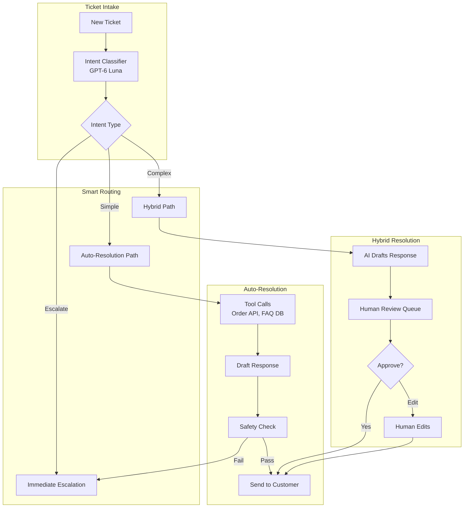
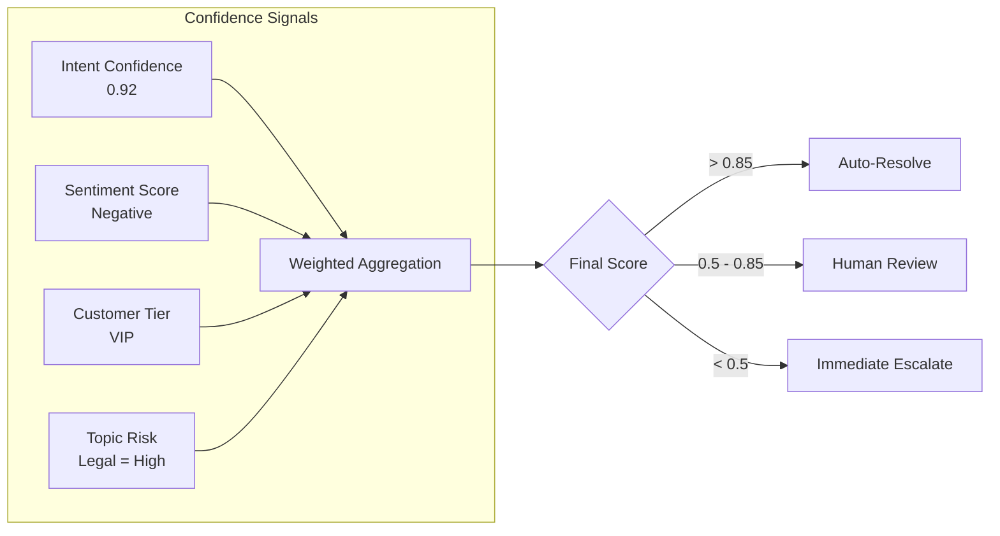
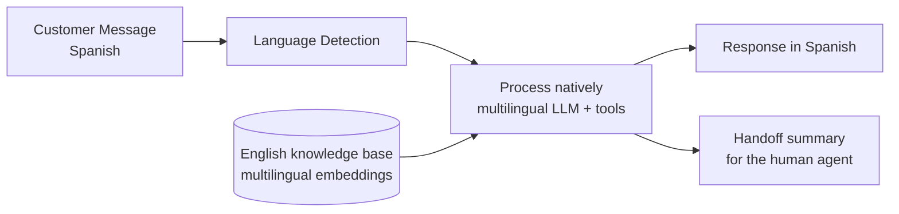

<div dir="rtl">

# مطالعه موردی: پشتیبانی مشتریان مبتنی بر هوش مصنوعی

## بیان مسئله

یک شرکت تجارت الکترونیک ماهانه **۲ میلیون تیکت پشتیبانی** را پردازش می‌کند. این شرکت به دنبال طراحی یک سیستم هوش مصنوعی است که بتواند ۶۰ درصد تیکت‌ها را به‌صورت خودکار و بدون دخالت انسان حل‌وفصل کند و در عین حال مسائل پیچیده را همراه با کانتکست کامل (Full Context) به اپراتورهای انسانی تحویل دهد.

**محدودیت‌های مطرح‌شده در مصاحبه:**
- فعالیت ۲۴/۷ (شبانه‌روزی) در ۱۲ زبان مختلف
- الزام به یکپارچه‌سازی با سیستم‌های موجود Zendesk و Salesforce
- عدم امکان دادن وعده‌های نادرست (در مورد بازپرداخت وجه یا تاریخ ارسال سفارش‌ها)
- امکان تحویل گرفتن مکالمه توسط پشتیبان‌های انسانی در میانه گفتگو
- هدف هزینه: ۰.۰۵ دلار به ازای هر تیکت حل‌شده
- مشتریان اتحادیه اروپا باید مطلع شوند که در حال گفتگو با هوش مصنوعی هستند (ماده ۵۰ قانون هوش مصنوعی اتحادیه اروپا [EU AI Act Article 50]، لازم‌الاجرا از ۲ اوت ۲۰۲۶)

---

## پرسش مصاحبه

> «یک سیستم هوش مصنوعی پشتیبانی مشتریان طراحی کنید که پرسش‌هایی مانند «سفارش من کجاست؟» را به‌صورت خودکار پاسخ دهد، اما بداند چه زمانی پیامی مانند «می‌خواهم به جرم کلاهبرداری از شما شکایت کنم» را باید به یک پشتیبان انسانی ارجاع دهد.»

---

## معماری راه‌حل

<div dir="ltr">



</div>

---

## تصمیم‌های کلیدی طراحی

### ۱. مسیریابی سه‌سطحی (خودکار / ترکیبی / ارجاع فوری)

**پاسخ:** همه تیکت‌ها یکسان نیستند. ما آن‌ها را در سه مسیر طبقه‌بندی می‌کنیم:

| مسیر | معیارها | نمونه | نقش پشتیبان انسانی |
|------|---------|-------|---------------------|
| **خودکار (Auto)** | اطمینان بالا، ریسک پایین | «سفارش من کجاست؟» | بدون دخالت |
| **ترکیبی (Hybrid)** | اطمینان متوسط یا ریسک متوسط | «درخواست بازپرداخت دارم» | بررسی پیش‌نویس هوش مصنوعی |
| **ارجاع فوری (Escalate)** | مسائل حقوقی، تهدید، مشتریان VIP، اطمینان پایین | «این کلاهبرداری است» | رسیدگی کامل توسط انسان |

### ۲. حل مسئله مبتنی بر ابزار (Tool-Based)، نه تولید متن محض

**پاسخ:** هوش مصنوعی به‌خودی‌خود «نمی‌داند» سفارش کجاست؛ بلکه ابزار Order API را فراخوانی می‌کند. این رویکرد برای حفظ دقت حیاتی است:

<div dir="ltr">

```python
@tool
def get_order_status(order_id: str) -> dict:
    """Retrieve real-time order status from OMS."""
    order = oms_client.get_order(order_id)
    return {
        "status": order.status,
        "shipped_date": order.shipped_at,
        "estimated_delivery": order.eta,
        "tracking_url": order.tracking_url
    }
```

</div>

مدل LLM وظیفه هماهنگ‌سازی (Orchestration) ابزارها را بر عهده دارد، اما هرگز داده‌ای را از خود نمی‌سازد.

### ۳. چرا بررسی ایمنی پیش از ارسال ضروری است؟

**پاسخ:** حتی تیکت‌هایی که به‌صورت خودکار حل می‌شوند نیز از یک فیلتر ایمنی عبور می‌کنند:

1. **تشخیص وعده‌های الزام‌آور (Promise Detection)**: عباراتی مانند «تضمین می‌کنم» یا «ما خسارت را پرداخت خواهیم کرد» را پرچم‌گذاری می‌کند
2. **ناهماهنگی لحن و احساسات (Sentiment Mismatch)**: مواردی را که لحن هوش مصنوعی در زمان عصبانیت مشتری بیش از حد شاد و خوش‌بینانه است، شناسایی می‌کند
3. **نشت اطلاعات هویتی (PII Leak)**: اطمینان حاصل می‌کند که هیچ یادداشت داخلی یا داده‌ای از سایر مشتریان در پاسخ ظاهر نشود
4. **ذکر نام رقبا (Competitor Mention)**: اگر هوش مصنوعی محصول یا خدمات رقیبی را پیشنهاد دهد، هشدار می‌دهد
5. **فهرست مجاز اطلاعات تماس (Contact Allowlist)**: هر شماره تلفن، نشانی اینترنتی (URL) یا لینک پرداختی که در پیش‌نویس پاسخ می‌آید، باید با یک فهرست مجاز تأییدشده مطابقت داشته باشد. در سپتامبر ۲۰۲۶، یک پژوهشگر امنیت سایبری از کارزار فیشینگی گزارش داد که با کاشت صفحات پشتیبانی و فایل‌های PDF جعلی، کاری کرده بود سیستم‌های ChatGPT، Gemini و Google AI Overviews شماره‌های پشتیبانی تقلبی را برای خطوط هوایی و بانک‌ها نمایش دهند؛ ربات پشتیبانی که اطلاعات را از وب باز یا از متن ارسالی مشتری بازیابی می‌کند، ممکن است دقیقاً در همین تله بیفتد و همان طعمه را تکرار کند

---

## هوشمندی ارجاع (Escalation Intelligence)

دشوارترین بخش کار، تشخیص این است که **چه زمانی** باید مکالمه را به انسان ارجاع داد. ما برای این کار از یک امتیاز اطمینان (Confidence Score) مبتنی بر سیگنال‌های متعدد استفاده می‌کنیم:

<div dir="ltr">



</div>

**نکته کلیدی:** اگر یک مشتری VIP حتی پرسش ساده‌ای بپرسد، باز هم به مسیر ترکیبی (Hybrid) هدایت می‌شود؛ زیرا هزینه بروز خطا برای این دسته از مشتریان بالاتر است.

---

## پشتیبانی چندزبانه

پشتیبانی از ۱۲ زبان بدون نیاز به ۱۲ مدل مجزا و بدون استفاده از زبان میانی ترجمه (Translation Pivot):

<div dir="ltr">



</div>

**چرا پیام را به انگلیسی ترجمه نکنیم و پاسخ را برنگردانیم؟**

نسخه‌های اولیه این معماری برای حفظ یک Prompt واحد و یک پایگاه دانش (Knowledge Base) واحد، همه چیز را از طریق زبان انگلیسی ترجمه و جابه‌جا می‌کردند. مدل‌های کوچک امروزی (مانند GPT-6 Luna، Gemini 3.8 Flash و Claude Haiku 5.5) زبان‌های اصلی را به‌طور مستقیم پردازش می‌کنند؛ بنابراین ترجمه رفت‌وبرگشتی دیگر به‌صرفه نیست و هزینه‌اش از فایده‌اش بیشتر است: دو فراخوانی اضافی مدل در هر نوبت گفتگو، تاخیر (Latency) بیشتر، و از دست رفتن لحن پیام که منطق ارجاع برای تشخیص سیگنال احساسات به آن نیاز دارد. پایگاه دانش را به زبان انگلیسی نگه دارید و بازیابی اطلاعات را در میان زبان‌ها با یک مدل بردارسازی چندزبانه (Multilingual Embedding) انجام دهید (مدل Cohere Embed 5 بیش از ۱۰۰ زبان را پوشش می‌دهد). ترجمه را تنها در جایی انجام دهید که انسان به آن نیاز دارد؛ مانند خلاصه تحویل مکالمه برای پشتیبان انسانی که زبان مشتری را نمی‌داند. همچنین زبان‌های کم‌کاربردتر (Long-tail) را حتماً روی مجموعه ارزیابی (Eval Set) خودتان اعتبارسنجی کنید؛ کیفیت خروجی در همه ۱۲ زبان یکسان نیست.

---

## تحویل گرفتن مکالمه توسط انسان (در میانه گفتگو)

هنگامی که یک پشتیبان انسانی مکالمه را تحویل می‌گیرد، به کانتکست (Context) کامل نیاز دارد:

<div dir="ltr">

```python
def handoff_to_human(conversation_id: str, agent_id: str):
    conversation = get_conversation(conversation_id)
    
    # Generate summary for human agent
    summary = llm.generate(f"""
    Summarize this conversation for a human agent:
    - Customer issue
    - What AI already tried
    - Why escalation happened
    
    Conversation:
    {conversation.messages}
    """)
    
    # Create handoff package
    return {
        "summary": summary,
        "customer_sentiment": conversation.sentiment,
        "attempted_solutions": conversation.tool_calls,
        "full_transcript": conversation.messages,
        "customer_tier": conversation.customer.tier
    }
```

</div>

با دلیل ارجاع (Escalation Reason) به‌عنوان داده‌ی محصول (Product Data) برخورد کنید، نه صرفاً داده‌ی مسیریابی. گزارش فنی Anthropic درباره ایجنت فروش ورودی (Inbound-sales Agent) خود (۳۰ سپتامبر ۲۰۲۶، گزارش ارائه‌دهنده) مرجع مفیدی در این زمینه است: هر مکالمه در یکی از سه حالت زیر پایان می‌یابد (تکمیل مستقیم خرید، تحویل مکالمه به نماینده فروش همراه با متن کامل گفتگو و توضیح علت ارجاع، یا ارائه یک پاسخ اطلاعاتی سریع) و طبق گزارش Anthropic، سهم مکالماتی که به دخالت انسان نیاز داشتند تقریباً به نصف کاهش یافت. ثبت دلیل ارجاع در لحظه تحویل، همان چیزی است که ارجاع‌ها را قابل تحلیل می‌کند. دو تجربه کلیدی از آن گزارش مستقیماً در اینجا نیز کاربرد دارند: دستورالعمل‌های هدف‌محور (Goal-oriented) عملکرد بهتری نسبت به فهرست‌های طولانی از قوانین جزئی داشتند، و هر تغییر در Agent به‌عنوان یک نسخه (Version) جدید ذخیره می‌شد تا نشست‌های تازه بتوانند در صورت نیاز به نسخه قبلی بازگردانده شوند.

---

## تحلیل هزینه

بر اساس تعرفه‌های فهرست‌شده در نوامبر ۲۰۲۶؛ با فرض حدود ۳ نوبت گفتگو به ازای هر تیکت و حدود ۴ هزار Token ورودی در هر نوبت.

| جزء | هزینه به ازای هر تیکت |
|-----|------------------------|
| طبقه‌بندی نیت کاربر (مدل GPT-6 Luna، نرخ ۰.۱۰ / ۰.۵۰ دلار به ازای هر ۱ میلیون Token) | ۰.۰۰۰۱ دلار |
| فراخوانی ابزارها (Order API و جست‌وجوی پرسش‌های متداول) | ۰.۰۰۱ دلار |
| تولید پاسخ (مدل GPT-6 Luna: ۳ × ۴ هزار Token ورودی، حدود ۷۵۰ Token خروجی در هر نوبت شامل استدلال) | ۰.۰۰۲۳ دلار |
| بررسی ایمنی (طبقه‌بندی‌کننده به‌همراه یک گذر از GPT-6 Luna) | ۰.۰۰۰۵ دلار |
| ترجمه خلاصه تحویل مکالمه (در صورت نیاز پشتیبان انسانی) | ۰.۰۰۰۵ دلار |
| **میانگین کل** | **حدود ۰.۰۰۴۴ دلار** |

با نرخ حل‌وفصل خودکار ۶۰ درصدی، هزینه به **حدود ۰.۰۰۷ دلار به ازای هر تیکت حل‌شده** می‌رسد که کاملاً پایین‌تر از هدف ۰.۰۵ دلاری است. در مقیاس ۲ میلیون تیکت در ماه، هزینه مدل دیگر گلوگاه اصلی نیست (کمتر از ۱۰٬۰۰۰ دلار بابت Tokenها). هزینه اصلی در ارجاع‌های انسانی و پاسخ‌های اشتباه نهفته است: حتی یک وعده بازپرداخت اشتباه می‌تواند بیش از هزینه یک ماه کامل طبقه‌بندی نیت (حدود ۲۰۰ دلار) خسارت بزند. بهتر است این حاشیه بودجه را صرف به‌کارگیری یک مدل قوی‌تر برای پیش‌نویس‌های مسیر ترکیبی (یک مدل با تعرفه ۲ / ۱۰ دلار مانند Claude Sonnet 5.5 یا GPT-6 Sol) کنید، به‌جای اینکه بیش از حد روی فشرده‌سازی هزینه مسیر خودکار تمرکز نمایید.

---

## پرسش‌های تکمیلی مصاحبه

**سوال: اگر هوش مصنوعی مدام عذرخواهی کند اما در عمل هیچ کمکی نکند چه می‌شود؟**

پاسخ: ما «اثربخشی حل مسئله» (Resolution Effectiveness) را ردیابی می‌کنیم، نه صرفاً «ارسال پاسخ» را. اگر مشتری ظرف ۲۴ ساعت دوباره درباره همان موضوع پیام بدهد، آن تیکت به‌عنوان «حل‌نشده» علامت‌گذاری و الگوی رفتاری هوش مصنوعی برای بررسی پرچم‌گذاری می‌شود. همچنین تحلیل هفتگی با این پرسش انجام می‌دهیم: «چه عباراتی با پیگیری مجدد مشتریان همبستگی دارند؟»

**سوال: با مشتری که اصرار دارد با یک انسان صحبت کند چگونه برخورد می‌کنید؟**

پاسخ: عبارات صریح درخواست ارجاع (مانند «صحبت با انسان» یا «گفتگو با مدیر») بدون توجه به امتیاز اطمینان، بلافاصله تحویل مکالمه به انسان را فعال می‌کنند. ما هرگز با درخواست ارجاع مشتری بحث نمی‌کنیم.

**سوال: درباره مشتریانی که تلاش می‌کنند هوش مصنوعی پشتیبانی را Jailbreak کنند چه تدبیری دارید؟**

پاسخ: پاک‌سازی ورودی (Input Sanitization) به‌همراه طراحی محدود و مقید به ابزار (Tool-scoped). فرض را بر این بگذارید که System Prompt بالاخره نشت خواهد کرد، زیرا خلاصه‌سازی خروجی ابزار همچنان یک تولید متن آزاد است؛ بنابراین هیچ اطلاعات محرمانه‌ای را در آن قرار ندهید. حفاظت واقعی از اینجا می‌آید که دسترسی ابزارها صرفاً به مشتری احراز هویت‌شده محدود است (ابزار سفارش فقط می‌تواند سفارش‌های همان مشتری را بخواند) و بازپرداخت‌ها یا تغییرات حساب از مسیر ترکیبی (Hybrid) عبور می‌کنند؛ در نتیجه حتی یک Jailbreak موفق صرفاً به تولید کلمات منجر می‌شود، نه انجام اقدام واقعی. متن System Prompt نیز برای حفظ کیفیت پاسخ‌ها محدود نگه داشته می‌شود: «شما در مسائل مربوط به سفارش‌های شرکت [Company] کمک می‌کنید و اجازه بحث درباره موضوعات دیگر را ندارید.»

---

## نکات کلیدی برای مصاحبه

1. **مسیریابی چندلایه تعادل میان اتوماسیون و ریسک را برقرار می‌کند**: قرار نیست هر تیکتی به‌صورت خودکار حل شود
2. **اتکا به ابزار (Tool-based Grounding) از توهم‌زایی جلوگیری می‌کند**: هوش مصنوعی واقعیت‌ها را بازیابی می‌کند، نه اینکه آن‌ها را بسازد
3. **امتیاز اطمینان چندبعدی است**: وضوح نیت کاربر + لحن و احساسات + سطح مشتری + ریسک موضوع
4. **تحویل مکالمه به انسان نیازمند کانتکست است**: مکالمه را خلاصه کنید، نه اینکه صرفاً متن کامل گفتگو را روی سر اپراتور بریزید
5. **دلایل ارجاع بازخورد محصول هستند**: علت هر تحویل مکالمه را ثبت کنید و به ترتیب پرتکرارترین دلایل را برطرف نمایید

---

*فصل‌های مرتبط: [الگوهای انسان در چرخه (Human-in-the-Loop)](../07-agentic-systems/08-human-in-the-loop-patterns.md)، [پیاده‌سازی گاردریل‌ها (Guardrails)](../13-reliability-and-safety/01-guardrails.md)*

</div>
