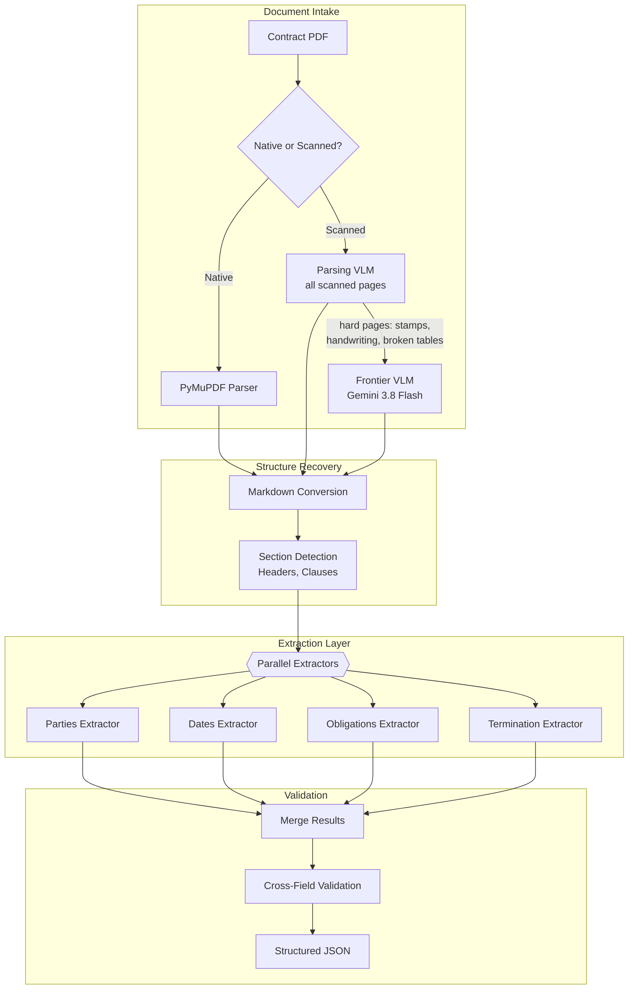
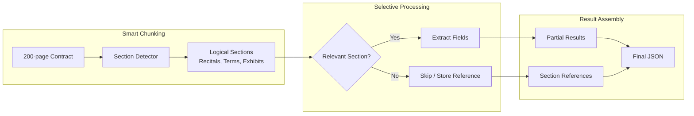

<div dir="rtl">

# مطالعه موردی: پایپ‌لاین هوش اسناد <a id="case-study-document-intelligence-pipeline"></a>

## مسئله <a id="the-problem"></a>

یک شرکت فناوری حقوقی (Legal Tech) نیاز دارد ماهانه **۵۰٬۰۰۰ قرارداد** را پردازش کرده، شروط کلیدی (طرفین قرارداد، تاریخ‌ها، تعهدات، بندهای فسخ) را استخراج کند و آن‌ها را در یک پایگاه داده قابل جست‌وجو بارگذاری نماید.

**محدودیت‌های ارائه‌شده در مصاحبه:**
- اسناد بین ۲ تا ۲۰۰ صفحه متغیر هستند
- ترکیبی از فایل‌های PDF اسکن‌شده و اسناد دیجیتال بومی (Native)
- چندزبانه (انگلیسی، آلمانی، فرانسوی، اسپانیایی)
- دقت استخراج: بالای ۹۵٪ در فیلدهای کلیدی
- هدف هزینه: کمتر از ۰.۵۰ دلار به ازای هر سند

---

## پرسش مصاحبه <a id="the-interview-question"></a>

> «یک پایپ‌لاین طراحی کنید که یک فایل PDF قرارداد ۱۰۰ صفحه‌ای را دریافت کند و داده‌های ساختاریافته مانند طرفین قرارداد، تاریخ اجرا، شرایط فسخ و شرایط پرداخت را در قالب JSON استخراج نماید.»

---

## معماری راه‌حل <a id="solution-architecture"></a>

<div dir="ltr">



</div>

---

## تصمیم‌های کلیدی طراحی <a id="key-design-decisions"></a>

### ۱. پارس لایه‌بندی‌شده: یک مدل VLM پارس اسناد برای هر صفحه و یک مدل VLM پیشرو برای صفحات دشوار <a id="1-tiered-parsing-a-parsing-vlm-for-every-page-a-frontier-vlm-for-hard-pages"></a>

**پاسخ:** قراردادهای اسکن‌شده اغلب دارای مهر، حاشیه‌نویسی‌های دست‌نویس و چیدمان‌های پیچیده (جداول، چندستونه) هستند. ابزارهای OCR سنتی (مانند Tesseract) خروجی به‌هم‌ریخته‌ای تولید می‌کنند. مدل‌های بینایی-زبانی (VLM) چیدمان صفحه را «می‌بینند» و خروجی Markdown تمیز با حفظ ساختار جداول تولید می‌کنند. در سال ۲۰۲۶، انتخاب دیگر صرفاً بین OCR و یک مدل پیشرو (Frontier) نیست: مدل‌های تخصصی VLM پارس اسناد در میانه این دو قرار می‌گیرند، ترتیب خوانش و کادرهای مرزی (Bounding Box) را برمی‌گردانند و کسری از هزینه فراخوانی یک مدل پیشرو را دارند.

| روش | قرارداد اسکن‌شده ۱۰۰ صفحه‌ای | هزینه به ازای ۱۰۰ صفحه | سیگنال بنچمارک |
|--------|---------------------------|--------------------|------------------|
| موتور Tesseract | پرنویز، جداول شکسته | حدود ۰.۰۲ دلار (روی CPU) | در چیدمان رقابت‌پذیر نیست |
| سرویس AWS Textract | متن بهتر، اما همچنان در تشخیص چیدمان مشکل دارد | حدود ۰.۱۵ دلار | امتیاز ۵۳.۳ در بنچمارک ParseBench (اجراشده توسط Cohere) |
| مدل VLM پارس اسناد از طریق API (مدل Cohere parse-v5.0) | خروجی Markdown با جداول HTML، یا بلوک‌ها همراه با کادرهای مرزی | ۰.۱۵ دلار (۱.۵۰ دلار به ازای ۱٬۰۰۰ صفحه) | امتیاز ۷۹.۲ در بنچمارک ParseBench (اجراشده توسط ارائه‌دهنده) |
| مدل VLM پارس اسناد به‌صورت سلف‌هاستد (MinerU 4.0، PaddleOCR-VL، NVIDIA Nemotron 3.5 Parse) | ترتیب خوانش، کلاس‌های چیدمان و کادرهای مرزی | فقط هزینه زمان GPU | مدل Nemotron 3.5 Parse (۱۷ اکتبر ۲۰۲۶، حدود ۰.۶۳B پارامتر، مجوز OpenMDW-1.1): امتیاز ۷۲.۷۴ تک‌گذری و ۷۵.۲۰ سه‌گذری در ParseBench، در مقایسه با ۶۳.۹۱ برای Nemotron Parse 2.0 (اجراشده توسط NVIDIA؛ اجراکننده متفاوت از Cohere است، بنابراین با ردیف‌های بالا قابل مقایسه نیست)؛ همچنین بنچمارک‌های OmniDocBench نسخه ۱.۶ و olmOCR-Bench؛ مجوز هر مدل را بررسی کنید (برای مثال، jina-ocr-v1 دارای مجوز CC BY-NC است) |
| مدل VLM پیشرو (Gemini 3.8 Flash) | خروجی Markdown تمیز؛ قوی‌ترین گزینه جایگزین (Fallback) برای مهرها و دست‌خط‌ها | حدود ۰.۴۳ دلار قیمت معرفی، حدود ۰.۸۶ دلار از ۱ ژانویه ۲۰۲۷ | امتیاز ParseBench برای مدل‌های VLM پیشرو: GPT-5.5 با ۸۴.۴، Gemini 3.5 Flash با ۸۱.۸ (اجراشده توسط Cohere؛ نسخه 3.8 Flash فهرست نشده است) |

ردیف مدل پیشرو از همان فرض به ازای هر صفحه در [فصل OCR و چیدمان](../10-document-processing/01-ocr-and-layout.md#cost-and-latency-tradeoffs) استفاده می‌کند: حدود ۱.۷ هزار Token ورودی (تصویر صفحه به‌علاوه Prompt) و حدود ۸۰۰ Token خروجی، پیش از محاسبه Tokenهای استدلال. حتی با قیمت معرفی، عبور دادن هر صفحه اسکن‌شده از یک اسکن ۱۰۰ صفحه‌ای از طریق Gemini 3.8 Flash تقریباً کل بودجه ۰.۵۰ دلاری را پیش از شروع استخراج مصرف می‌کند؛ و با قیمت مصوب ژانویه ۲۰۲۷ از این بودجه فراتر می‌رود. بنابراین پایپ‌لاین مسیربندی انجام می‌دهد: هر صفحه اسکن‌شده از مدل VLM پارس اسناد عبور می‌کند و تنها حدود ۱۵٪ صفحاتی که با اطمینان پایین برمی‌گردند یا در بررسی‌های چیدمان رد می‌شوند (مهرها، دست‌خط‌ها، جداول شکسته) به مدل VLM پیشرو ارجاع داده می‌شوند. ابزار MinerU 4.0 همین ایده را با چهار سطح کیفیت در پارسر خود تعبیه کرده است؛ از استخراج بدون مدل برای فایل‌های PDF دیجیتال تا سطح «پیشرفته» (Advanced) برای اسناد دشوار. به‌جز ارقام Nemotron اجراشده توسط NVIDIA در ردیف سلف‌هاستد، تمام اعداد ParseBench در اینجا از پست معرفی Cohere (اجراشده توسط ارائه‌دهنده) گرفته شده‌اند؛ بنابراین فاصله ۳ تا ۵ امتیازی میان مدل‌های VLM پیشرو و Cohere Parse را صرفاً به‌عنوان یک شاخص کلی در نظر بگیرید و روی قراردادهای خودتان دوباره اندازه‌گیری کنید. همچنین مدل Nemotron 3.5 Parse یک اهرم تنظیمی در اختیار مسیریاب (Router) قرار می‌دهد: اجرای تک‌گذری، دوگذری یا سه‌گذری که زمان GPU را با دقت معاوضه می‌کند، و Docling از نسخه v2.141.0 به بعد از آن پشتیبانی می‌کند.

ورکرهای پارسر یک سطح حمله (Attack Surface) محسوب می‌شوند، نه فقط یک ردیف هزینه. نسخه سلف‌هاستد v1.12.21 ابزار Reducto (۲۹ اکتبر ۲۰۲۶) شامل یک هشدار امنیتی بود: در گره‌هایی (Node) که پادها به سرویس فراداده نمونه ابری (Cloud Instance Metadata Service) دسترسی داشتند، پارس کردن یک فایل آفیس غیرقابل‌اعتماد توسط LibreOffice می‌توانست به نقش (Role) آن نمونه روی گره دست یابد. ورکرهای پارسر را بدون دسترسی به فراداده (محدودیت hop نسخه IMDSv2 برابر با ۱، یا مسدودسازی 169.254.169.254 از فضای نام) و بدون نقش گره اجرا کنید، زیرا هر قراردادی در این پایپ‌لاین ورودی غیرقابل‌اعتماد است.

### ۲. استخراج‌گرهای موازی در برابر پردازش تک‌مرحله‌ای (Single-Pass) <a id="2-parallel-extractors-vs-single-pass"></a>

**پاسخ:** یک Prompt منفرد که تمام فیلدها را درخواست کند، نتایج ضعیف‌تری نسبت به استخراج‌گرهای تخصصی تولید می‌کند. هر استخراج‌گر یک Prompt و اسکیما (Schema) متمرکز دارد:

<div dir="ltr">

```python
parties_schema = {
    "type": "object",
    "properties": {
        "party_a": {"type": "object", "properties": {
            "name": {"type": "string"},
            "role": {"type": "string"},
            "address": {"type": "string"}
        }},
        "party_b": {"type": "object", "properties": {...}}
    }
}

# Each extractor runs in parallel
async def extract_all(document: str):
    results = await asyncio.gather(
        extract_parties(document, parties_schema),
        extract_dates(document, dates_schema),
        extract_obligations(document, obligations_schema),
        extract_termination(document, termination_schema)
    )
    return merge_results(results)
```

</div>

### ۳. اعتبارسنجی متقابل بین فیلدها <a id="3-cross-field-validation"></a>

**پاسخ:** خطاهای استخراج اغلب خود را از طریق ناسازگاری‌ها نشان می‌دهند:
- اگر `effective_date` پس از `termination_date` باشد، ایرادی وجود دارد
- اگر نام `party_a` در `obligations` ظاهر شود اما با املای متفاوتی نوشته شده باشد، برای بازبینی علامت‌گذاری می‌شود
- اگر `payment_amount` استخراج شده باشد اما `payment_frequency` تهی (null) باشد، استخراج ناقص است

---

## مدیریت اسناد ۲۰۰ صفحه‌ای <a id="handling-200-page-documents"></a>

چالش پنجره کانتکست (Context Window):

<div dir="ltr">



</div>

**نکته کلیدی:** تمام ۲۰۰ صفحه شامل فیلدهای قابل استخراج نیستند. پیوست‌ها (Exhibits — اسناد اصلی ضمیمه‌شده) به‌عنوان ارجاع ذخیره می‌شوند و پردازش نمی‌شوند. بخش «شرایط و ضوابط» (Terms and Conditions) اغلب ۸۰٪ سند را تشکیل می‌دهد اما بیشتر فیلدهای کلیدی را در خود جای داده است.

---

## مدیریت چندزبانگی <a id="multilingual-handling"></a>

قراردادهای آلمانی از ساختارهای متفاوتی نسبت به قراردادهای انگلیسی استفاده می‌کنند. ما استخراج‌گرهای ویژه هر زبان را نگهداری می‌کنیم:

<div dir="ltr">

```python
EXTRACTORS = {
    "en": {
        "parties": EnglishPartiesExtractor(),
        "dates": StandardDatesExtractor(),
        "termination": EnglishTerminationExtractor()
    },
    "de": {
        "parties": GermanPartiesExtractor(),  # Handles "GmbH", "AG" patterns
        "dates": GermanDatesExtractor(),       # DD.MM.YYYY format
        "termination": GermanTerminationExtractor()  # "Kündigung" patterns
    }
}
```

</div>

---

## تفکیک هزینه‌ها <a id="cost-breakdown"></a>

قیمت‌های نوامبر ۲۰۲۶، با محاسبه Gemini 3.8 Flash بر اساس نرخ مصوب ۱ ژانویه ۲۰۲۷.

| مرحله | هزینه به ازای هر سند ۱۰۰ صفحه‌ای |
|-------|----------------------|
| پارس کردن، فقط اسناد اسکن‌شده: مدل VLM پارس اسناد روی همه صفحات (۰.۱۵ دلار) به‌علاوه مدل Gemini 3.8 Flash روی حدود ۱۵ صفحه دشوار (حدود ۰.۱۳ دلار) | ۰.۲۸ دلار |
| تشخیص بخش‌ها (مدل GPT-6 Luna، حدود ۵۰K Token ورودی) | ۰.۰۱ دلار |
| استخراج فیلدها (۴ مورد موازی روی مدل GPT-6 Luna؛ حدود ۱۰٪ اسناد فیلدهای با اطمینان پایین را به یک مدل ۲ / ۱۰ دلاری ارجاع می‌دهند) | ۰.۰۳ دلار |
| اعتبارسنجی | ۰.۰۱ دلار |
| **مجموع (اسکن‌شده)** | **۰.۳۳ دلار** |
| **مجموع (PDF بومی)** | **۰.۰۵ دلار** |

میانگین (۶۰٪ بومی، ۴۰٪ اسکن‌شده): **حدود ۰.۱۶ دلار به ازای هر سند** (کمتر از هدف ۰.۵۰ دلاری). مسیر اسکن‌شده حدود ۶.۵ برابر مسیر بومی هزینه دارد که تقریباً تمام آن مربوط به پارس کردن است؛ بنابراین ارزان‌ترین اهرم بهینه‌سازی، دریافت فایل‌های PDF بومی از سیستم مبدأ در هر زمان ممکن است.

---

## پرسش‌های تکمیلی مصاحبه <a id="interview-follow-up-questions"></a>

**پرسش: اگر اطمینان استخراج (Confidence) پایین باشد چه می‌شود؟**

پاسخ: ما برای هر فیلد یک امتیاز اطمینان خروجی می‌دهیم. فیلدهای زیر ۰.۸ برای بازبینی انسانی علامت‌گذاری می‌شوند. رابط کاربری یک «صف بازبینی» (Review Queue) نشان می‌دهد که در آن افراد تنها فیلدهای نامطمئن را تأیید می‌کنند، نه کل اسناد را. این کار تلاش انسانی را به میانگین ۳۰ ثانیه به ازای هر سند کاهش می‌دهد. همچنین هر فیلد استخراج‌شده مکان منبع خود (شماره صفحه به‌علاوه شناسه بلوک و کادر مرزی پارسر) را به همراه دارد، بنابراین بازبین به‌جای جست‌وجو برای بند مورد نظر، آن را به‌صورت برجسته‌شده (Highlighted) می‌بیند. پارسرها اکنون این مکان‌یاب‌ها را مستقیماً تولید می‌کنند؛ برای مثال، MinerU 4.0 ارجاعات پایدار صفحه و بلوک را برمی‌گرداند که برای استنادهای قابل راستی‌آزمایی طراحی شده‌اند.

**پرسش: با قراردادهایی که چیدمان غیراستاندارد دارند چگونه برخورد می‌کنید؟**

پاسخ: ما یک «کتابخانه چیدمان» (Layout Library) از الگوهای شناخته‌شده قراردادها نگهداری می‌کنیم. تشخیص‌دهنده بخش (Section Detector) ابتدا تلاش می‌کند با الگوهای شناخته‌شده تطبیق دهد. در صورت عدم تطابق، به تشخیص ابتکاری (Heuristic Detection) روی می‌آورد (جست‌وجوی بخش‌های شماره‌گذاری‌شده، سرتیترهای تماماً با حروف بزرگ و موارد مشابه). چیدمان‌های ناشناخته علامت‌گذاری شده و پس از بازبینی انسانی به کتابخانه اضافه می‌شوند.

**پرسش: در مورد قراردادهایی که شروط کلیدی آن‌ها در پیوست‌ها (Exhibits) تعریف شده‌اند چطور؟**

پاسخ: ما ارجاعات متقابل («مطابق تعریف در پیوست A») را تشخیص داده و آن‌ها را برطرف (Resolve) می‌کنیم. هنگامی که سند اصلی به پیوستی ارجاع می‌دهد، Prompt استخراج شامل محتوای پیوست مرتبط نیز می‌شود. این کار از خروجی‌های «تهی» (null) در مواردی که پاسخ در ضمیمه قرار دارد جلوگیری می‌کند.

---

## نکات کلیدی برای مصاحبه <a id="key-takeaways-for-interviews"></a>

1. **صفحات را بر اساس دشواری مسیریابی کنید**: مدل‌های VLM پارس اسناد در چیدمان بر OCR سنتی برتری دارند و تنها صفحات دشوار به یک مدل VLM پیشرو نیاز دارند
2. **استخراج‌گرهای تخصصی موازی برای استخراج ساختاریافته بهتر از پردازش تک‌مرحله‌ای عمل می‌کنند**
3. **اعتبارسنجی متقابل بین فیلدها خطاهای استخراج را پیش از رسیدن به پایگاه داده شکار می‌کند**
4. **همه صفحات به پردازش نیاز ندارند**: بخش‌های مرتبط را تشخیص دهید و پیوست‌ها را نادیده بگیرید

---

*فصل‌های مرتبط: [OCR و چیدمان](../10-document-processing/01-ocr-and-layout.md)، [تولید ساختاریافته](../05-prompting-and-context/06-structured-generation.md)*

</div>
