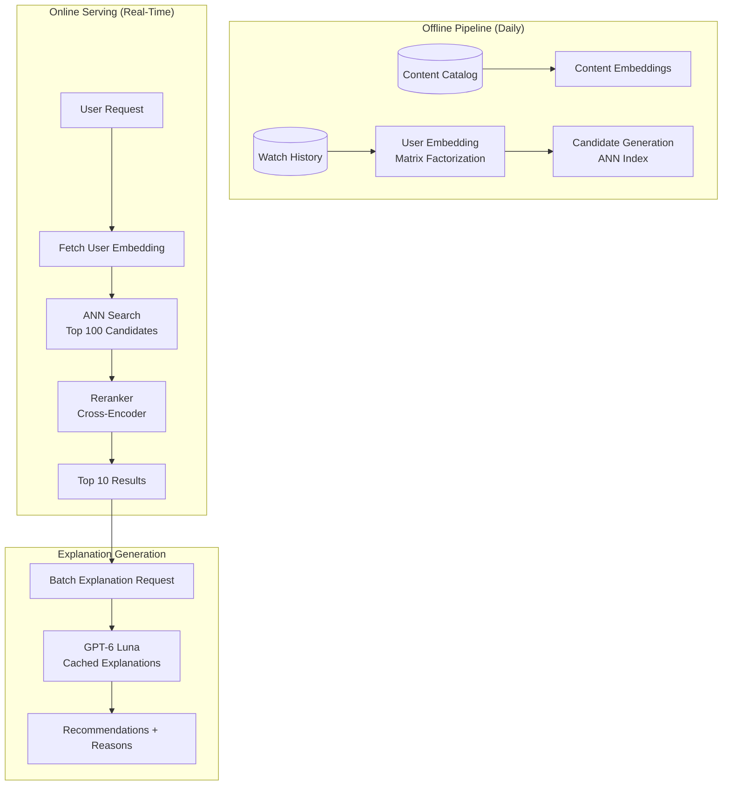
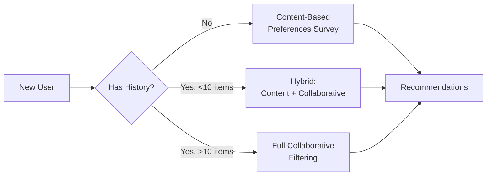

<div dir="rtl">

# مطالعه موردی: موتور توصیه‌گر مبتنی بر هوش مصنوعی <a id="case-study-ai-powered-recommendation-engine"></a>

## مسئله <a id="the-problem"></a>

یک پلتفرم استریم با **۵۰ میلیون کاربر** نیاز به ساخت یک سیستم توصیه‌گر دارد که فیلتر مشارکتی (Collaborative Filtering) را با توضیحات تولیدشده توسط LLM ترکیب کند: «از آنجا که از فیلم Inception لذت بردید، ممکن است فیلم Tenet را نیز به دلیل مکانیک‌های ذهنی و پیچیده زمانی آن بپسندید.»

**محدودیت‌های ارائه‌شده در مصاحبه:**
- توصیه‌های بلادرنگ (Real-time) با تاخیر زیر ۲۰۰ میلی‌ثانیه در صدک ۹۵ (p95)
- باید دلیل ارائه هر توصیه را توضیح دهد
- مدیریت شروع سرد (Cold-Start) برای کاربران جدید
- حریم خصوصی: عدم نشت تاریخچه تماشای کاربران به یکدیگر
- کاربران فعال روزانه: ۵ میلیون کاربر که هر یک بیش از ۱۰ مجموعه توصیه را مشاهده می‌کنند

---

## پرسش مصاحبه <a id="the-interview-question"></a>

> «سیستمی طراحی کنید که فیلم‌ها را توصیه کند و دلیل توصیه را در مقیاس بالا به زبان طبیعی توضیح دهد.»

---

## معماری راه‌حل <a id="solution-architecture"></a>

<div dir="ltr">



</div>

---

## تصمیم‌های کلیدی طراحی <a id="key-design-decisions"></a>

### ۱. چرا برای همه‌چیز فقط از LLM استفاده نکنیم؟ <a id="1-why-not-just-use-llm-for-everything"></a>

**پاسخ:** اقتصاد مقیاس و تاخیر (Latency). رتبه‌بندی با یک LLM یعنی یک فراخوانی به ازای هر مجموعه توصیه: ۵ میلیون کاربر فعال روزانه × ۱۰ مجموعه = ۵۰ میلیون فراخوانی در روز، که هر کدام تاریخچه کاربر به‌علاوه حدود ۱۰۰ توضیح گزینه کاندید را حمل می‌کند (تقریباً ۱۵K Token ورودی). حتی روی یک مدل کوچک مانند GPT-6 Luna (با هزینه ۰.۱۰ / ۰.۵۰ دلار به ازای هر ۱ میلیون Token)، این مقدار حدود ۰.۰۰۱۶ دلار به ازای هر فراخوانی یا تقریباً ۸۰ هزار دلار در روز می‌شود، و پیش‌پردازش (Prefill) ۱۵K Token در بودجه تاخیر ۲۰۰ میلی‌ثانیه در صدک ۹۵ (p95) جا نمی‌گیرد. در عوض:

| بخش | نقش | هزینه به ازای هر کاربر/روز |
|-----|-----|---------------------------|
| جست‌وجوی بردار (Embedding Lookup) | دریافت بردار ازپیش‌محاسبه‌شده | ۰.۰۰۰۰۱ دلار |
| جست‌وجوی ANN | یافتن گزینه‌های کاندید | ۰.۰۰۰۱ دلار |
| رتبه‌بندی مجدد Cross-Encoder | امتیازدهی به ۱۰۰ گزینه برتر | ۰.۰۰۱ دلار |
| توضیح با LLM | ۱۰۰ توضیح در روز، ۹۵٪ از کش، حدود ۵۰۰ Token ورودی + ۴۰ Token خروجی در هر عدم اصابت (Miss) روی GPT-6 Luna | ۰.۰۰۰۴ دلار |
| **مجموع** | | **حدود ۰.۰۰۱۵ دلار** |

از LLM فقط برای توضیح نهایی استفاده می‌شود، نه خود رتبه‌بندی. با نرخ اصابت کش (Cache Hit Rate) ۹۵٪ روی یک مدل کوچک، بخش توضیح دیگر بزرگ‌ترین قلم هزینه نیست؛ بلکه Cross-Encoder بیشترین سهم را دارد. این رقم در مجموع حدود ۷.۵ هزار دلار در روز برای ۵ میلیون کاربر فعال روزانه است.

### ۲. کش‌کردن توضیحات <a id="2-explanation-caching"></a>

**پاسخ:** بیشتر توضیحات قابل کش‌کردن هستند. جمله «چون فیلم Inception را تماشا کردید» برای هزاران کاربر صدق می‌کند. ما توضیحات را در سطح `(content_pair, reason_type)` کش می‌کنیم:

<div dir="ltr">

```python
cache_key = f"{source_movie}:{target_movie}:{reason_type}"
# Example: "inception:tenet:time_mechanics"

explanation = cache.get(cache_key)
if not explanation:
    explanation = generate_explanation(source_movie, target_movie, reason_type)
    cache.set(cache_key, explanation, ttl=86400)
```

</div>

نرخ اصابت کش (Cache Hit Rate): بیش از ۸۵٪ پس از گرم‌شدن کش (Warmup). پیش‌تولید توضیحات برای جفت‌های محتوای جدید به‌صورت آفلاین، از طریق سطح Batch یا Flex (با ۵۰٪ تخفیف نسبت به قیمت لیست در GPT-6 Luna)، همان چیزی است که این نرخ را به ۹۵٪ مورد نیاز بودجه تاخیر (Latency Budget) می‌رساند.

### ۳. مدیریت شروع سرد (Cold-Start) <a id="3-cold-start-handling"></a>

**پاسخ:** کاربران جدید هیچ تاریخچه‌ای برای فیلتر مشارکتی ندارند. ما از یک **رویکرد ترکیبی (Hybrid Approach)** استفاده می‌کنیم:

<div dir="ltr">



</div>

---

## چالش توضیح شخصی‌سازی‌شده <a id="the-personalized-explanation-challenge"></a>

توضیح باید حسی شخصی داشته باشد، نه کلیشه‌ای و عمومی:

**بد:** «فیلم Tenet یک تریلر محبوب است.»
**خوب:** «از آنجا که از داستان پیچیده و ذهن‌درگیرکن Inception لذت بردید، فیلم Tenet معماهای مشابهی در زمینه دست‌کاری زمان را از همان کارگردان ارائه می‌دهد.»

ما این هدف را با گنجاندن زمینه کاربر (User Context) در Prompt به دست می‌آوریم:

<div dir="ltr">

```python
prompt = f"""
Generate a 1-sentence explanation for why this user would enjoy {target_movie}.

User context:
- Recently watched: {recent_movies}
- Preferred genres: {genres}
- Dislikes: {dislikes}

Source movie that triggered this recommendation: {source_movie}
Reason category: {reason_type}

Explanation:
"""
```

</div>

به تعارض موجود با کش در سطح جفت‌محتوا (Pair-Level Cache) توجه کنید: متن کش‌شده نمی‌تواند به سایر فیلم‌های تماشاشده توسط این کاربر اشاره کند. شخصی‌سازی از انتخاب فیلم مبدأ از تاریخچه اخیر خود کاربر ناشی می‌شود (فیلم مبدأ بخشی از کلید کش است). عبارت‌پردازی اختصاصی به ازای هر کاربر مانند Prompt بالا فقط برای بخش‌های باارزش بالا تولید می‌شود و **هرگز در کش مشترک جفت‌محتوا نوشته نمی‌شود**: یک جمله کش‌شده که فیلم‌های اخیر یک کاربر را نام ببرد، به هر کسی که به آن کلید اصابت کند نمایش داده می‌شود و این موضوع محدودیت حریم خصوصی را نقض می‌کند. چنین متنی را یا به‌صورت اختصاصی برای هر کاربر کش کنید، یا اصلاً کش نکنید.

---

## بودجه تاخیر (Latency Budget) <a id="latency-budget"></a>

| مرحله | هدف | مقدار واقعی p95 |
|-------|-----|-----------------|
| جست‌وجوی بردار کاربر (User Embedding Lookup) | ۵ میلی‌ثانیه | ۳ میلی‌ثانیه |
| جست‌وجوی ANN (۱۰۰ گزینه برتر) | ۲۰ میلی‌ثانیه | ۱۵ میلی‌ثانیه |
| رتبه‌بندی مجدد Cross-Encoder | ۵۰ میلی‌ثانیه | ۴۵ میلی‌ثانیه |
| توضیح LLM (کش‌شده) | ۱۰ میلی‌ثانیه | ۸ میلی‌ثانیه |
| توضیح LLM (عدم اصابت / Miss) | ۵۰۰ میلی‌ثانیه | ۴۵۰ میلی‌ثانیه |
| **مجموع (اصابت کش / Cache Hit)** | **۸۵ میلی‌ثانیه** | **۷۱ میلی‌ثانیه** |
| **مجموع (عدم اصابت کش / Cache Miss)** | **۵۷۵ میلی‌ثانیه** | **۵۱۳ میلی‌ثانیه** |

برای دستیابی به تاخیر زیر ۲۰۰ میلی‌ثانیه در صدک ۹۵ (p95)، نرخ اصابت کش بالای ۹۵٪ را برای توضیحات تضمین می‌کنیم و توضیحات را برای جفت‌های محتوای جدید به‌صورت ناهمگام (Asynchronous) تولید می‌کنیم.

---

## پرسش‌های تکمیلی مصاحبه <a id="interview-follow-up-questions"></a>

**پرسش: چگونه از توهم (Hallucination) مدل LLM درباره حقایق فیلم‌ها جلوگیری می‌کنید؟**

پاسخ: مدل LLM یک برگه اطلاعات ساختاریافته (Fact Sheet) برای هر فیلم (کارگردان، بازیگران، مضامین، جوایز) به‌عنوان زمینه دریافت می‌کند و تنها مجاز به استفاده از اطلاعات این برگه است. همچنین یک اعتبارسنج پس از تولید (Post-Generation Validator) داریم که ادعاها را با فراداده (Metadata) کاتالوگ ما تطبیق داده و بررسی می‌کند.

**پرسش: اگر سلیقه کاربر به سرعت تغییر کند چه می‌شود؟**

پاسخ: ما از **به‌روزرسانی بردار با وزن‌دهی تازگی (Recency-Weighted Embedding Update)** استفاده می‌کنیم. تماشاهای اخیر ۳ برابر بیشتر از تماشاهای قدیمی‌تر وزن‌دهی می‌شوند. برای پاسخ‌گویی بلادرنگ، یک «بردار نشست» (Session Embedding) نگهداری می‌کنیم که رفتار نشست فعلی را ثبت کرده و آن را با بردار تاریخی ترکیب می‌کند.

**پرسش: الگوریتم‌های توصیه‌گر را چگونه تست A/B می‌کنید؟**

پاسخ: ما مقدار `user_id` را هش (Hash) می‌کنیم تا کاربران به‌صورت پایدار به باکت‌های آزمایش (Experiment Buckets) اختصاص یابند. هر باکت می‌تواند استراتژی‌های متفاوتی برای تولید کاندید، رتبه‌بندی یا تولید توضیح داشته باشد. معیارهای تعامل (نرخ کلیک، زمان تماشا، نرخ ردکردن) را برای هر باکت ردیابی می‌کنیم.

---

## نکات کلیدی برای مصاحبه <a id="key-takeaways-for-interviews"></a>

1. **مدل‌های LLM برای توضیح هستند، نه رتبه‌بندی**: از یادگیری ماشین سنتی برای مقیاس‌پذیری و از مدل‌های LLM برای شخصی‌سازی استفاده کنید
2. **به‌طور تهاجمی کش کنید**: توضیحات مربوط به جفت‌های محتوا در میان کاربران قابل استفاده مجدد هستند
3. **شروع سرد یک طیف است**: کاربران جدید ← مبتنی بر محتوا؛ تاریخچه محدود ← ترکیبی؛ تاریخچه کامل ← مشارکتی
4. **بودجه‌های تاخیر نیازمند اهداف نرخ اصابت کش هستند**: کش را بر اساس SLA تاخیر خود طراحی کنید

---

*فصل‌های مرتبط: [کش معنایی](../08-memory-and-state/05-semantic-caching.md)، [بهینه‌سازی هزینه](../04-inference-optimization/07-cost-optimization-playbook.md)*

</div>
