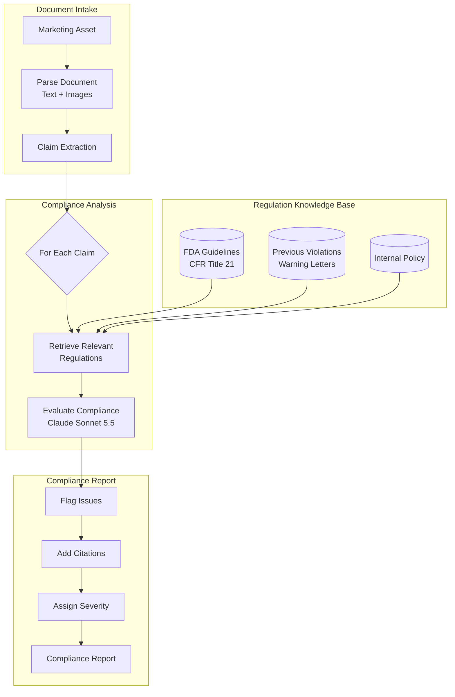
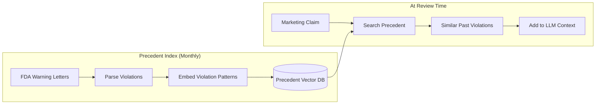
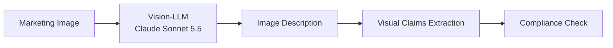

<div dir="rtl">

# مطالعه موردی: اتوماسیون انطباق با مقررات <a id="case-study-regulatory-compliance-automation"></a>

## مسئله <a id="the-problem"></a>

یک شرکت داروسازی باید اطمینان حاصل کند که تمام محتواهای بازاریابی با **مقررات سازمان غذا و داروی آمریکا (FDA)** مطابقت دارند. در حال حاضر، بازبینی حقوقی برای هر دارایی (Asset) بازاریابی ۲ هفته زمان می‌برد. آن‌ها می‌خواهند هوش مصنوعی محتواها را پیش‌غربال‌گری (Pre-screen) کرده و موارد مشکل‌دار را علامت‌گذاری کند تا زمان بازبینی حقوقی به ۲ روز کاهش یابد.

**محدودیت‌های ارائه‌شده در مصاحبه:**
- باید به بندهای مشخص مقررات استناد کند، نه اینکه صرفاً بگوید «این مورد نادرست به نظر می‌رسد»
- منفی کاذب (نادیده گرفتن تخلفات) غیرقابل‌پذیرش است
- مثبت کاذب (علامت‌گذاری بیش از حد) باید زیر ۲۰٪ باشد
- ۵۰۰ محتوای بازاریابی در ماه
- ثبت سوابق حسابرسی (Audit Trail) برای بازرسی نظارتی الزامی است

---

## پرسش مصاحبه <a id="the-interview-question"></a>

> «سیستمی طراحی کنید که محتواهای بازاریابی دارویی را بررسی کرده و تخلفات مقرراتی مشخص را همراه با استناد شناسایی کند.»

---

## معماری راه‌حل <a id="solution-architecture"></a>

<div dir="ltr">



</div>

---

## تصمیم‌های کلیدی طراحی <a id="key-design-decisions"></a>

### ۱. استخراج ادعا پیش از بررسی انطباق <a id="1-claim-extraction-before-compliance-check"></a>

**پاسخ:** محتواهای بازاریابی بسیار متراکم هستند. بررسی کل سند در برابر مقررات ناکارآمد است. ما ابتدا **ادعاهای** منفرد را استخراج می‌کنیم:

<div dir="ltr">

```python
claims = extract_claims(document)
# Example output:
# [
#   {"text": "Reduces symptoms by 80%", "type": "efficacy", "location": "page 2, para 3"},
#   {"text": "No side effects reported", "type": "safety", "location": "page 3, header"},
#   {"text": "Recommended by doctors", "type": "endorsement", "location": "page 1, image"}
# ]
```

</div>

سپس هر ادعا به‌طور مستقل در برابر مقررات مرتبط بررسی می‌شود.

فهرست ادعاها را با خروجی‌های ساختاریافته (یک طرح‌واره JSON) تولید کنید، نه با اجبار به فراخوانی ابزار (Tool Call): در مدل‌های Opus 5.5، Sonnet 5.5 و Fable/Mythos 5.1، تنظیم `tool_choice` روی `any` یا یک ابزار مشخص، خطای HTTP 400 برمی‌گرداند که کدهای استخراج نوشته‌شده برای مدل‌های قدیمی‌تر را از کار می‌اندازد (مدل Haiku 5.5 آن را می‌پذیرد اما مرحله تفکر را رد می‌کند).

### ۲. چرا RAG به‌جای Fine-tuning برای مقررات؟ <a id="2-why-rag-over-fine-tuning-for-regulations"></a>

**پاسخ:** مقررات تغییر می‌کنند. سازمان FDA اسناد راهنمای خود را به‌صورت ماهانه به‌روزرسانی می‌کند. استفاده از Fine-tuning نیازمند آموزش مجدد پس از هر به‌روزرسانی است. معماری RAG به ما اجازه می‌دهد:
- به‌محض انتشار راهنمای جدید، شاخص (Index) مقررات را فوراً به‌روزرسانی کنیم
- ردیابی کنیم که برای هر بازبینی از کدام نسخه از مقررات استفاده شده است (سوابق حسابرسی)
- متن دقیق منبع را به بازبین‌های حقوقی نمایش دهیم

### ۳. راهبرد علامت‌گذاری محافظه‌کارانه <a id="3-conservative-flagging-strategy"></a>

**پاسخ:** منفی کاذب (تخلفات نادیده‌گرفته‌شده) فاجعه‌بار است؛ مثبت کاذب (بازبینی اضافی) صرفاً هزینه زمانی دارد. ما از یک **سلسله‌مراتب آستانه (Threshold Hierarchy)** استفاده می‌کنیم:

| میزان اطمینان | اقدام |
|------------|--------|
| بیش از ۹۰٪ احتمال تخلف | علامت‌گذاری با شدت بالا (HIGH) |
| بین ۷۰ تا ۹۰٪ تخلف احتمالی | علامت‌گذاری با شدت متوسط (MEDIUM)، ذکر مورد نگرانی |
| بین ۵۰ تا ۷۰٪ نامشخص | علامت‌گذاری با شدت پایین (LOW)، ثبت ابهام |
| کمتر از ۵۰٪ احتمال انطباق | بدون علامت‌گذاری، اما ثبت در گزارش حسابرسی |

ما هرگز بدون ثبت استدلال، خروجی «منطبق» (Compliant) صادر نمی‌کنیم.

---

## پایگاه داده رویه‌های قبلی <a id="the-precedent-database"></a>

مقررات اغلب مبهم هستند. نامه‌های هشدار قبلی FDA روشن می‌کنند که قوانین در عمل چگونه اجرا می‌شوند:

<div dir="ltr">



</div>

**چرا این موضوع اهمیت دارد:** عبارتی مانند «از نظر بالینی اثبات‌شده» (Clinically proven) ممکن است بر اساس متن مقررات به تنهایی مشکلی نداشته باشد. اما اگر ۵ نامه هشدار پیدا کنیم که در آن‌ها FDA شرکت‌هایی را به دلیل استفاده از عبارت «از نظر بالینی اثبات‌شده» بدون ارائه داده‌های مشخص کارآزمایی بالینی مورد تذکر قرار داده است، این یک زنگ خطر جدی محسوب می‌شود.

---

## الزام ثبت سوابق حسابرسی <a id="the-audit-trail-requirement"></a>

هر تصمیم باید قابل ردیابی باشد:

<div dir="ltr">

```python
compliance_decision = {
    "claim_id": "claim_003",
    "claim_text": "No side effects reported",
    "decision": "VIOLATION",
    "severity": "HIGH",
    "regulation_cited": "21 CFR 202.1(e)(5)",
    "regulation_text": "Advertisements shall not contain claims that...",
    "precedent_cited": "Warning Letter 2023-FDA-04521",
    "reasoning": "Claim implies absolute safety, which contradicts...",
    "model_used": "claude-sonnet-5-5",
    "effort": "high",  # Record it: effort defaults change between model versions
    "timestamp": "2026-10-01T10:30:00Z",
    "reviewer_id": null,  # Filled when human reviews
    "final_decision": null  # Filled after legal review
}
```

</div>

---

## مدیریت تصاویر و ویدئو <a id="handling-images-and-video"></a>

بازاریابی دارویی شامل ادعاهای بصری نیز می‌شود (بیماران خوشحال، تصاویر قبل و بعد):

<div dir="ltr">



</div>

**مثال:** تصویری که بیماری را در حال دویدن نشان می‌دهد، به‌طور ضمنی بر اثربخشی دارو دلالت دارد. اگر دارو برای آرتروز باشد، بررسی می‌کنیم که آیا کارآزمایی‌های بالینی از ادعای «بهبود تحرک» پشتیبانی می‌کنند یا خیر.

---

## تحلیل هزینه <a id="cost-analysis"></a>

محاسبه‌شده بر اساس نرخ فهرست مدل Claude Sonnet 5.5 (۲ دلار ورودی / ۱۰ دلار خروجی به ازای هر ۱ میلیون Token)، شامل واحدهای Token تفکر در سطح تلاش `high` که به‌عنوان خروجی محاسبه می‌شوند:

| مرحله | هزینه به ازای هر دارایی |
|-------|----------------|
| پارس کردن سند | ۰.۰۵ دلار |
| استخراج ادعاها | ۰.۱۰ دلار |
| بازیابی مقررات | ۰.۰۲ دلار |
| ارزیابی انطباق (به ازای هر ادعا، میانگین ۱۲ ادعا) | ۱.۴۴ دلار |
| تحلیل تصویر (میانگین ۵ تصویر) | ۰.۵۰ دلار |
| تولید گزارش | ۰.۰۷ دلار |
| **مجموع** | **۲.۱۸ دلار** |

برای ۵۰۰ دارایی در ماه: **حدود ۱٬۰۹۰ دلار در ماه** (در مقایسه با بیش از ۵۰ هزار دلار در ماه برای ساعات کاری معادل تیم حقوقی). توافق‌نامه سطح خدمت (SLA) برای بازبینی دو روز است، بنابراین هیچ بخشی در اینجا نیازی به استنتاج (Inference) بلادرنگ ندارد: اجرای ارزیابی از طریق سرویس Batch API (با نرخ ۱ دلار ورودی / ۵ دلار خروجی در مدل Sonnet 5.5) هزینه ردیف‌های مدل را تقریباً نصف می‌کند. در این مقیاس، مدل را بر اساس نرخ بازیابی (Recall) روی مجموعه داده‌های برچسب‌گذاری‌شده تخلفات انتخاب کنید، نه بر اساس قیمت.

---

## پرسش‌های تکمیلی مصاحبه <a id="interview-follow-up-questions"></a>

**پرسش: با مقرراتی که نیازمند قضاوت انسانی هستند چگونه برخورد می‌کنید؟**

پاسخ: ما جایگزین انسان نمی‌شویم؛ اولویت‌بندی (Triage) می‌کنیم. سیستم موارد مشکل‌دار را همراه با امتیاز اطمینان علامت‌گذاری می‌کند. موارد علامت‌گذاری‌شده با اطمینان پایین به مشاور حقوقی ارشد ارجاع داده می‌شوند. موارد شفاف با اطمینان بالا از بازبینی دقیق صرف‌نظر می‌کنند. این روش با تمرکز توجه انسان بر موارد مرزی (Edge Cases)، بازبینی ۲ هفته‌ای را به ۲ روز کاهش می‌دهد.

**پرسش: اگر سازمان FDA مقرراتی را در میانه ماه به‌روزرسانی کند چه می‌شود؟**

پاسخ: ما یک سرویس «پایش مقررات» (Regulation Watch) داریم که فیدهای RSS سازمان FDA و به‌روزرسانی‌های دفتر ثبت فدرال (Federal Register) را رصد می‌کند. هنگامی که یک به‌روزرسانی مرتبط شناسایی شود، دوباره نمایه‌سازی (Re-index) انجام می‌دهیم و تمام بازبینی‌های اخیر را که ممکن است تحت تأثیر این تغییر قرار گرفته باشند علامت‌گذاری می‌کنیم.

**پرسش: در جریان یک حسابرسی، استدلال هوش مصنوعی را چگونه برای بازرسان نظارتی توضیح می‌دهید؟**

پاسخ: هر تصمیم شامل زنجیره کامل استدلال است: ادعای استخراج‌شده، مقررات بازیابی‌شده، رویه قبلی استنادشده و ارزیابی مدل. ما می‌توانیم دقیقاً به بازرسان نظارتی نشان دهیم که چرا یک تصمیم گرفته شده است، همراه با شماره نسخه تمامی اجزا.

---

## نکات کلیدی برای مصاحبه <a id="key-takeaways-for-interviews"></a>

1. **ابتدا استخراج ادعا**: اسناد پیچیده را به واحدهای قابل بررسی بشکنید
2. **پایگاه‌های داده رویه‌های قبلی از متن صرف مقررات برترند**: نحوه اجرای قوانین در عمل اهمیت دارد
3. **آستانه‌های محافظه‌کارانه برای حوزه‌های حساس**: برای نرخ بازیابی (Recall) بهینه‌سازی کنید، نه دقت (Precision)
4. **سوابق حسابرسی بخشی از معماری هستند**: از روز اول برای توضیح‌پذیری طراحی کنید

---

*فصل‌های مرتبط: [مبانی RAG](../06-retrieval-systems/01-rag-fundamentals.md)، [پیاده‌سازی Guardrails](../13-reliability-and-safety/01-guardrails.md)*

</div>
