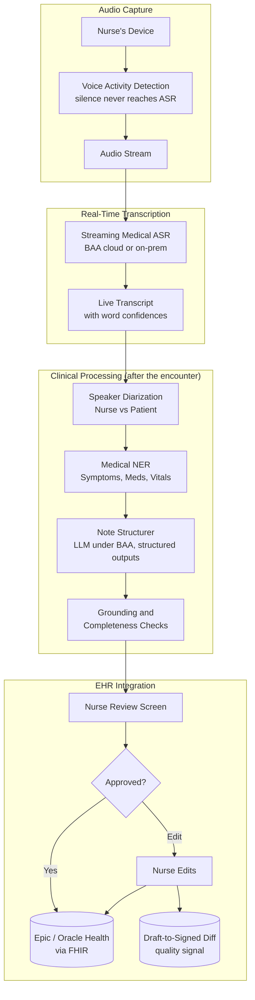
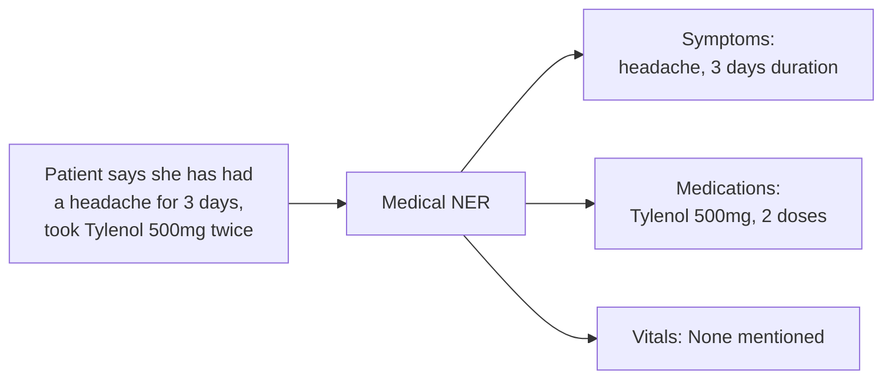

<div dir="rtl">

# مطالعه موردی: دستیار صوتی هوش مصنوعی برای حوزه سلامت <a id="case-study-voice-ai-assistant-for-healthcare"></a>

## بیان مسئله <a id="the-problem"></a>

یک شبکه بیمارستانی به دنبال یک **دستیار هوش مصنوعی مبتنی بر صدا** است که به پرستاران در مستندسازی ویزیت‌های بیماران کمک کند. پرستار به‌صورت طبیعی صحبت می‌کند؛ هوش مصنوعی متن زنده (Live Transcript) را نمایش می‌دهد و یک یادداشت بالینی ساختاریافته برای بازبینی تولید می‌کند.

**محدودیت‌های مطرح‌شده در مصاحبه:**
- انطباق با قانون HIPAA (مدیریت اطلاعات سلامت محافظت‌شده یا PHI)
- عملکرد صحیح در محیط‌های پرسر‌وصدای بیمارستان
- رونویسی بلادرنگ (با تاخیر (Latency) زیر ۵۰۰ میلی‌ثانیه)
- استفاده دقیق و صحیح از اصطلاحات پزشکی
- یکپارچه‌سازی با سیستم پرونده الکترونیک سلامت (EHR) موجود (سیستم Epic یا Oracle Health، که پیش‌تر Cerner نام داشت)
- اخذ رضایت بیمار برای ضبط صدا، و اعلام استفاده از هوش مصنوعی در مواردی که قانون ایالتی الزامی کرده است (ایالت تگزاس از ۱ ژانویه ۲۰۲۶ ارائه‌دهندگان خدمات درمانی را ملزم به افشای استفاده از هوش مصنوعی کرده است)

این همان الگوی **نویسنده محیطی (Ambient Scribe)** است که اکنون به یک رده محصول رایج تبدیل شده است: فروشندگان EHR آن را به‌صورت داخلی تعبیه می‌کنند (مانند قابلیت AI Charting در Epic)، و مطالعات منتشرشده درباره نتایج، انتظارات واقع‌بینانه‌ای را مشخص می‌کنند (بخش [سنجش موفقیت](#measuring-success) را ببینید).

---

## سوال مصاحبه <a id="the-interview-question"></a>

> «یک دستیار صوتی طراحی کنید که پرستار بتواند هنگام ویزیت بیمار با آن صحبت کند و این دستیار یک یادداشت بالینی ساختاریافته در سیستم EHR تولید کند.»

---

## معماری راه‌حل <a id="solution-architecture"></a>

<div dir="ltr">



</div>

---

## تصمیم‌های کلیدی طراحی <a id="key-design-decisions"></a>

### ۱. محل اجرای ASR: ابر تحت قرارداد BAA یا درون‌سازمانی (On-Prem) <a id="1-where-asr-runs-cloud-under-a-baa-or-on-prem"></a>

**پاسخ:** قانون HIPAA پردازش درون‌سازمانی (On-Premises) را الزامی نمی‌کند. این قانون وجود تدابیر حفاظتی و انعقاد یک **توافق‌نامه همکار تجاری (BAA)** با هر فروشنده‌ای که اطلاعات PHI را پردازش می‌کند الزامی می‌داند، و بیشتر محصولات تجاری نویسنده محیطی به‌صورت ابری ارائه می‌شوند. بنابراین، انتخاب میان این دو گزینه به سیاست بیمارستان، وضعیت اتصال بخش‌ها، هزینه و دقت بستگی دارد، نه الزام قانونی:

| گزینه | نمونه‌ها | وضعیت HIPAA | هزینه | نکات قابل توجه |
|--------|----------|---------------|------|-----------|
| سرویس STT جریانی (Streaming) ابری تحت قرارداد BAA | مدل `gpt-live-transcribe` از OpenAI ($0.017 در دقیقه)؛ سرویس AssemblyAI Universal-3.6 Pro Realtime ($0.45 در ساعت، سپتامبر ۲۰۲۶؛ جایگزین Universal-3.5 Pro Realtime شد)؛ سرویس ElevenLabs Scribe v2 Realtime ($0.39 در ساعت) | قرارداد BAA به همراه عدم نگهداری داده (Zero Retention). نقطه پایانی رونویسی فایل OpenAI هیچ داده‌ای نگه نمی‌دارد، اما پردازش جریانی روی یک Endpoint جداگانه به نام Realtime اجرا می‌شود، بنابراین وضعیت نگهداری داده آن را تایید کنید؛ شرکت ElevenLabs فقط در پلن Enterprise قرارداد BAA امضا می‌کند و نیازمند فعال‌سازی Zero Retention است | پرداخت دقیقه‌ای، بدون نیاز به GPU | حتماً مطمئن شوید که Endpoint دقیق در محدوده BAA قرار دارد؛ شکاف‌های حذف اطلاعات حساس (Redaction) در حالت جریانی (سرویس AssemblyAI فقط نوبت‌های نهایی را سانسور می‌کند و فایل صوتی را سانسور نمی‌کند) |
| سرویس STT ابری بهینه‌شده برای پزشکی | سرویس ElevenLabs Scribe v2 Medical (عرضه عمومی ۱۱ سپتامبر ۲۰۲۶)؛ مدل `nova-3-medical` از Deepgram (بالینی)، به همراه `nova-3-pharma` (۱۷ سپتامبر ۲۰۲۶) برای جریان‌های کاری سرشار از نام داروها؛ حالت پزشکی AssemblyAI (`"domain": "medical-v1"`، به علاوه $0.15 در ساعت روی Universal-3.6 Pro Realtime، حدود ۲۰٪ موارد از قلم‌افتاده کمتر در موجودیت‌های بالینی بنا بر گزارش فروشنده) | همان الزام قرارداد BAA | پرداخت دقیقه‌ای | واژگان بالینی بهتر؛ روی فایل‌های ضبط‌شده بخش خودتان اعتبارسنجی کنید |
| مدل جریانی (Streaming) درون‌سازمانی (On-Prem) | مدل `nemotron-3.5-asr-streaming-0.6b` از NVIDIA (مجوز OpenMDW، استفاده تجاری مجاز است؛ اندازه Chunk قابل انتخاب از ۸۰ تا ۱٬۱۲۰ میلی‌ثانیه) | هیچ فایل صوتی از شبکه خارج نمی‌شود | ناوگان GPU به همراه هزینه‌های عملیاتی؛ تنها در بهره‌برداری بالا به‌صرفه است | مسئولیت به‌روزرسانی‌ها، مقیاس‌پذیری، بازیابی از خطا (Failover) و ارزیابی دقت بر عهده خودتان است |

**انتخاب ما:** استفاده از سرویس STT ابری پزشکی تحت قرارداد BAA با عدم نگهداری داده به‌صورت پیش‌فرض، و مدل جریانی درون‌سازمانی برای مراکزی که سیاست امنیتی آن‌ها خروج صدا را ممنوع کرده یا اتصال شبکه در بخش‌هایشان ناپایدار است. هر دو پشت یک رابط (Interface) واحد قرار می‌گیرند تا هر مرکز بتواند بدون تغییر سایر بخش‌های پایپلاین بین آن‌ها جابه‌جا شود. اندازه Chunk در مدل درون‌سازمانی اهرم تنظیم تاخیر است: Chunkهای کوچک‌تر تاخیر را کاهش می‌دهند اما از دقت می‌کاهند.

**چرا از Whisper Large v3 روی GPUهای محلی استفاده نمی‌کنیم**، در حالی که چند سال پیش انتخاب پیش‌فرض برای این طراحی بود:

- این مدل به‌صورت ذاتی جریانی (Streaming) نیست؛ بنابراین دستیابی به بودجه ۵۰۰ میلی‌ثانیه‌ای رونویسی نیازمند ترفندهای Chunking است.
- اکنون از نظر دقت از مدل‌های متن‌باز عقب‌تر است: میانگین نرخ خطای کلمه (WER) معادل ۵.۷۸٪ در رتبه‌بندی Open ASR Leaderboard (آمار اکتبر ۲۰۲۶) در مقایسه با ۴.۳۱٪ برای Qwen3-ASR-1.7B و ۴.۷۰٪ برای parakeet-tdt-0.6b-v2.
- این مدل **در سکوت دچار توهم (Hallucination) می‌شود**. مطالعه Careless Whisper (کنفرانس FAccT 2024) نشان داد در حدود ۱٪ از رونویسی‌ها عبارات کاملاً ساختگی ظاهر می‌شود که ۳۸٪ آن‌ها آسیب‌زا هستند و این مشکل به‌طور نامتناسبی برای گویندگانی رخ می‌دهد که بخش‌های غیرگفتاری طولانی دارند. یک ویزیت بالینی پر از مکث‌هایی است که پرستار مشغول معاینه بیمار است.

نسخه میزبانی‌شده Whisper توسط OpenAI نیز در حال کنار گذاشته شدن است: مدل `whisper-1` به همراه مدل‌های `gpt-4o-*-transcribe` در تاریخ ۲۶ فوریه ۲۰۲۷ خاموش می‌شوند (جایگزین‌ها: `gpt-transcribe` و `gpt-live-transcribe`).

### ۲. تفکیک گوینده (Speaker Diarization): چه کسی چه گفت <a id="2-speaker-diarization-who-said-what"></a>

**پاسخ:** یادداشت باید میان «بیمار از سردرد شکایت دارد» و «پرستار چهره درهم‌کشیده بیمار را مشاهده می‌کند» تمایز قائل شود. ما از این روش استفاده می‌کنیم:

<div dir="ltr">

```python
# Pyannote for speaker diarization
diarization = pipeline("audio.wav")
# Output: [(0.0, 1.5, "SPEAKER_0"), (1.5, 4.2, "SPEAKER_1"), ...]

# Map speakers based on voice profile
roles = identify_roles(diarization, known_nurse_voiceprint)
# Output: {"SPEAKER_0": "nurse", "SPEAKER_1": "patient"}
```

</div>

دستگاه پرستار هنگام راه‌اندازی، اثر صدای (Voiceprint) او را برای تشخیص نقش ثبت می‌کند. اثر صدا طبق قانون BIPA ایلینوی و قوانین تگزاس یک **شناسه بیومتریک** محسوب می‌شود؛ بنابراین ثبت آن نیازمند رضایت کتبی، برنامه زمان‌بندی نگهداری داده و حذف آن هنگام ترک کار پرستار است. هرگز اثر صدای بیماران را ثبت نکنید. اگر به‌جای آن از قابلیت تفکیک گوینده داخلی یک فروشنده استفاده می‌کنید، چرخه عمر آن را بررسی کنید: مدل `gpt-4o-transcribe-diarize` از OpenAI در تاریخ ۲۶ فوریه ۲۰۲۷ متوقف می‌شود.

### ۳. شناسایی موجودیت‌های پزشکی (Medical NER) برای استخراج ساختاریافته <a id="3-medical-ner-for-structured-extraction"></a>

**پاسخ:** ما به داده‌های ساختاریافته نیاز داریم، نه صرفاً متن پیوسته. ماژول Medical NER موارد زیر را استخراج می‌کند:

<div dir="ltr">



</div>

ما برای NER از یک مدل BioBERT که Fine-tuning شده استفاده می‌کنیم و نه از LLM، زیرا NER باید سریع و قطعی (Deterministic) باشد.

---

## مدیریت محیط‌های پرسر‌وصدا <a id="handling-noisy-environments"></a>

بیمارستان‌ها شلوغ و پرسر‌وصدا هستند، و خطای خطرناک یک کلمه نامفهوم نیست، بلکه یک جمله با اطمینان بالاست که هیچ‌کس آن را نگفته است. ما از چندین راهبرد استفاده می‌کنیم:

1. **میکروفون‌های جهت‌دار (Directional Microphones)** روی دستگاه‌های پرستار، بر گفتار نزدیک تمرکز می‌کنند
2. **دروازه‌بندی تشخیص فعالیت گفتار (VAD Gating)**: سکوت و اصوات غیرگفتاری هرگز به ASR نمی‌رسند که این کار مکث‌های طولانی — یعنی جایی که عبارات توهمی متمرکز می‌شوند — را از مدل دور نگه می‌دارد
3. **جداسازی گوینده (Speaker Isolation)**: صداهای پس‌زمینه را سرکوب می‌کند تا مکالمه تخت کناری وارد یادداشت نشود (به‌عنوان مثال، قابلیت Voice Focus در AssemblyAI هزینه‌ای معادل $0.10 در ساعت اضافه می‌کند)
4. **آستانه‌های اطمینان (Confidence Thresholds)**: اگر اطمینان ASR کمتر از ۰.۷ باشد، به‌جای حدس زدن، آن بازه را برای بازبینی پرستار علامت‌گذاری می‌کنیم
5. **سوگیری واژگان (Vocabulary Biasing)**: اصطلاحات پزشکی و فهرست داروهای (Formulary) بخش به‌عنوان کلیدواژه به ASR ارسال می‌شوند (برای مثال، مدل Gemini 3.5 Transcribe تا ۱٬۰۰۰ عبارت سوگیری را می‌پذیرد)

---

## قالب یادداشت ساختاریافته <a id="the-structured-note-format"></a>

مدل LLM یادداشت‌هایی در قالب SOAP تولید می‌کند:

<div dir="ltr">

```python
note_prompt = f"""
Generate a clinical SOAP note from this encounter transcript.

Transcript:
{transcript_with_speakers}

Extracted entities:
- Symptoms: {symptoms}
- Medications: {medications}
- Vitals: {vitals}

Output format:
S (Subjective): Patient's reported symptoms
O (Objective): Nurse's observations and measurements
A (Assessment): Clinical impression
P (Plan): Next steps, orders
"""
```

</div>

به‌جای تجزیه متن پیوسته، خروجی را با استفاده از قابلیت Structured Outputs ارائه‌دهنده در یک اسکیمای JSON تولید کنید و پیش از بازبینی، یک **بررسی استناد (Grounding Check)** اجرا کنید: هر عبارت بالینی در پیش‌نویس باید به یک بخش از رونوشت اشاره کند و عبارات بدون پشتوانه در صفحه بازبینی برجسته می‌شوند. مدل تولید یادداشت تحت همان شرایط BAA و عدم نگهداری داده (Zero Retention) مدل ASR اجرا می‌شود؛ نام مدل را در فایل پیکربندی نگه دارید، زیرا نسل‌های مدل‌های میزبانی‌شده چندین بار در سال تغییر می‌کنند.

---

## یکپارچه‌سازی با سیستم EHR (استاندارد FHIR) <a id="ehr-integration-fhir"></a>

خروجی باید برای سیستم EHR قابل خواندن توسط ماشین باشد:

<div dir="ltr">

```json
{
  "resourceType": "DocumentReference",
  "status": "current",
  "type": {
    "coding": [{"system": "http://loinc.org", "code": "34746-8", "display": "Nurse note"}]
  },
  "subject": {"reference": "Patient/12345"},
  "author": [{"reference": "Practitioner/nurse789"}],
  "content": [{
    "attachment": {
      "contentType": "text/plain",
      "data": "base64-encoded-soap-note"
    }
  }],
  "context": {
    "encounter": {"reference": "Encounter/visit456"}
  }
}
```

</div>

---

## بودجه تاخیر (Latency Budget) <a id="latency-budget"></a>

محدودیت مسئله از عبارت «بلادرنگ» (Real-Time) نام می‌برد، اما تنها یک مسیر نیاز به بلادرنگ بودن دارد. تقسیم بودجه تاخیر همان تصمیم در سطح مهندس ارشد (Staff-Level) است:

| مسیر | بودجه تاخیر | عامل تعیین‌کننده |
|------|--------|--------------|
| متن زنده روی صفحه پرستار | نتایج جزئی (Partials) زیر ۵۰۰ میلی‌ثانیه | نتایج جزئی STT جریانی. معیار p95 را بسنجید، نه میانه (Median) را: برای Universal-3.6 Pro Realtime (سپتامبر ۲۰۲۶)، شرکت AssemblyAI تاخیر جریانی حدود ۱۵۰ میلی‌ثانیه در P50 و ۲۴۰ میلی‌ثانیه در P90 را پس از VAD گزارش می‌کند، اما میانه تاخیر پایان نوبت (End-of-Turn) در ۱۲٬۴۶۰ مکالمه صوتی انگلیسی ایجنت‌های صوتی ۵۳۷ میلی‌ثانیه بوده است (گزارش فروشنده)؛ بنابراین الزام ۵۰۰ میلی‌ثانیه‌ای باید روی رونوشت‌های جزئی اعمال شود، نه متن نهایی‌شده |
| آماده شدن پیش‌نویس یادداشت پس از پایان ویزیت | زیر ۶۰ ثانیه | تفکیک گوینده (Diarization)، استخراج موجودیت‌ها (NER)، ساختاردهی با LLM و بررسی‌های استناد (Grounding) یک بار روی کل رونوشت اجرا می‌شوند |
| بازبینی و امضای پرستار | زمان انسانی | گلوگاه واقعی صفحه بازبینی است، نه مدل |

تولید یادداشت به‌صورت **ناهمگام (Asynchronous)** پس از پایان ویزیت، به‌جای تولید جمله به جمله، کل مکالمه (اصلاحات و علائم حیاتی بعدی) را در اختیار ساختاردهنده قرار می‌دهد و LLM را به‌طور کامل از مسیر بحرانی تاخیر حذف می‌کند.

---

## سنجش موفقیت <a id="measuring-success"></a>

**کیفیت: تفاوت میان پیش‌نویس و نسخه امضاشده (Draft-to-Signed Diff).** هر ویرایش پرستار یک اصلاح برچسب‌گذاری‌شده محسوب می‌شود. فاصله ویرایشی (Edit Distance) را به تفکیک هر بخش SOAP، هر بخش بیمارستان و هر پرستار ردیابی کنید؛ جهش ناگهانی پس از تغییر فروشنده یا مدل، زنگ خطر افت کیفیت (Regression) است. این معیار را در کنار نرخ عبارات بدون پشتوانه در بررسی استناد قرار دهید.

**ارزش واقعی به پذیرش و استفاده کاربران وابسته است، نه تعداد لایسنس‌ها.** یک مطالعه در نشریه JAMA در پنج سیستم سلامت دانشگاهی (آوریل ۲۰۲۶، طبق خلاصه‌های رسانه‌های تخصصی) نشان داد که نویسنده‌های محیطی به‌طور میانگین ۱۶.۰ دقیقه در هر شیفت ۸ ساعته و ۲۷.۳ دقیقه برای کاربران پرمصرف (نیمی از ویزیت‌ها یا بیشتر) زمان مستندسازی را کاهش دادند، اما تنها ۳۲٪ از پذیرندگان کاربر پرمصرف بودند و زمان کار با EHR در خارج از ساعات کاری به‌طور معناداری کاهش نیافت. یک مطالعه پیشین در JAMA Network Open (اکتبر ۲۰۲۵، با تعداد نمونه ۲۶۳ یا n=263) نشان داد که فرسودگی شغلی پس از ۳۰ روز از ۵۱.۹٪ به ۳۸.۸٪ کاهش یافت. هر دو پژوهش روی پزشکان سرپایی و درمانگران پیشرفته انجام شده بودند، نه پرستاران بستری؛ بنابراین معیارهای خودتان را بسنجید: دقایق مستندسازی در هر شیفت، ثبت پرونده در خارج از ساعات کاری و میزان استفاده به ازای هر پرستار.

---

## سوالات تکمیلی مصاحبه <a id="interview-follow-up-questions"></a>

**سوال: با اختصارات و اصطلاحات تخصصی پزشکی چگونه برخورد می‌کنید؟**

پاسخ: ما یک فهرست واژگان سفارشی نگه می‌داریم که اختصارات (مانند PRN، BID، SOB) را به عبارات کامل نگاشت می‌کند. این فهرست هم به مدل ASR (برای تشخیص بهتر) و هم به Prompt مدل LLM (برای بسط صحیح در یادداشت‌ها) تزریق می‌شود.

**سوال: اگر پرستار در میانه جمله حرف خود را اصلاح کند چه می‌شود؟**

پاسخ: ما الگوهای اصلاح گفتار (مانند «در واقع منظورم این است...»، «نه صبر کن، مقدارش...») را شناسایی می‌کنیم و تنها از نسخه اصلاح‌شده استفاده می‌کنیم. به مدل LLM دستور داده می‌شود در صورت وجود تعارض، اظهارات بعدی را ترجیح دهد؛ که این خود دلیل دیگری برای ساختاردهی یادداشت پس از پایان ویزیت به‌جای انجام زنده آن است.

**سوال: چگونه اطمینان حاصل می‌کنید که هوش مصنوعی اطلاعات حیاتی را از قلم نمی‌اندازد؟**

پاسخ: ما یک «بررسی کامل بودن» (Completeness Check) داریم که بررسی می‌کند آیا یادداشت تمام موجودیت‌های استخراج‌شده را شامل می‌شود یا خیر. اگر NER عبارت «درد قفسه سینه» (chest pain) را پیدا کرده باشد اما در یادداشت SOAP ذکری از آن نباشد، مورد را برای بازبینی پرستار علامت‌گذاری می‌کنیم. همچنین یک آشکارساز «موارد بحرانی ایمنی» (Safety Critical) اجرا می‌کنیم که اشاره‌ها به افکار خودکشی، آزار و اذیت یا سایر محرک‌های گزارش‌دهی اجباری را بلافاصله ارجاع می‌دهد.

**سوال: شش ماه پس از راه‌اندازی، چگونه ثابت می‌کنید که سیستم ایمن است و ارزش پرداخت هزینه را دارد؟**

پاسخ: از نظر ایمنی: نرخ عبارات بدون پشتوانه در بررسی استناد، فاصله ویرایشی میان پیش‌نویس و نسخه امضاشده به تفکیک بخش‌ها، و ممیزی انسانی ماهانه روی نمونه‌ای از یادداشت‌های امضاشده در مقایسه با فایل صوتی، با دقت ویژه بر ویزیت‌هایی که سکوت‌های طولانی داشته‌اند (جایی که توهم ASR متمرکز می‌شود). از نظر ارزش: دقایق مستندسازی در هر شیفت و ثبت پرونده در خارج از ساعات کاری به ازای هر پرستار، که بر اساس دفعات استفاده واقعی هر پرستار از ابزار دسته‌بندی می‌شود، زیرا صرفه‌جویی‌های گزارش‌شده در کاربران پرمصرف متمرکز است. اگر پذیرش پایین باشد، راه‌حل در بهبود جریان کار و آموزش است، نه در یک مدل بهتر.

---

## نکات کلیدی برای مصاحبه <a id="key-takeaways-for-interviews"></a>

1. **قانون HIPAA به معنای قرارداد BAA است، نه اتاق سرور**: سرویس ASR ابری تحت قرارداد BAA با عدم نگهداری داده می‌تواند با HIPAA منطبق باشد؛ استقرار (Deployment) درون‌سازمانی یک انتخاب مبتنی بر سیاست یا وضعیت اتصال است
2. **سکوت یک خطر است**: ورودی ASR را با VAD محدود (Gate) کنید، زیرا مدل‌های گفتار در طول مکث‌ها دچار توهم می‌شوند
3. **تفکیک گوینده (Diarization) ضروری است**: از نظر بالینی مهم است که چه کسی چه چیزی گفته است، و اثر صدای پرستار نیازمند رضایت بیومتریک است
4. **استخراج ترکیبی (Hybrid Extraction)**: استفاده از NER سریع برای ساختار، و مدل LLM برای تولید متن پیوسته، با استناد دقیق به بخش‌های رونوشت
5. **همواره بازبینی انسانی داشته باشید**، و اختلاف میان پیش‌نویس و نسخه امضاشده را به‌عنوان معیار کیفیت ثبت کنید

---

*فصل‌های مرتبط: [ایجنت‌های صوتی بلادرنگ](../18-voice-and-audio-agents/01-realtime-voice-agents.md)، [طبقه‌بندی مدل‌ها](../02-model-landscape/01-model-taxonomy.md)، [الگوهای قابلیت اطمینان](../13-reliability-and-safety/03-reliability-patterns.md)*

</div>
