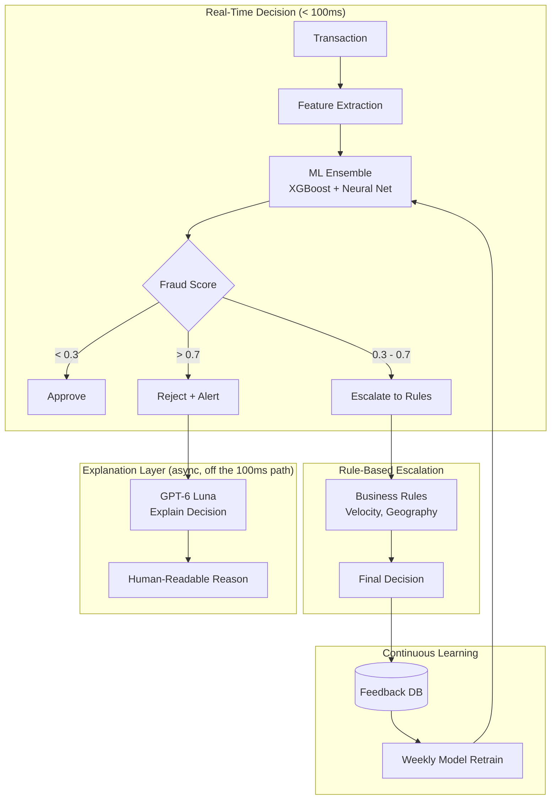
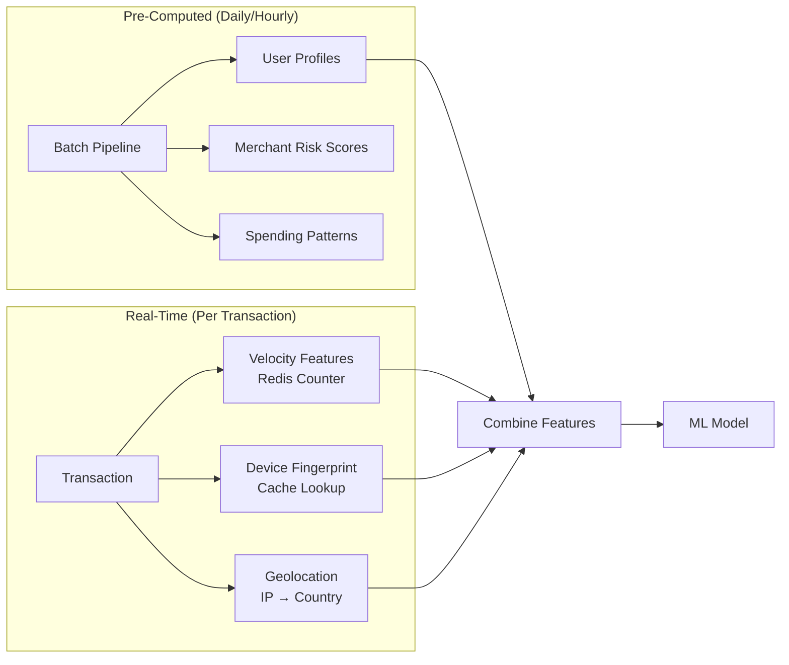
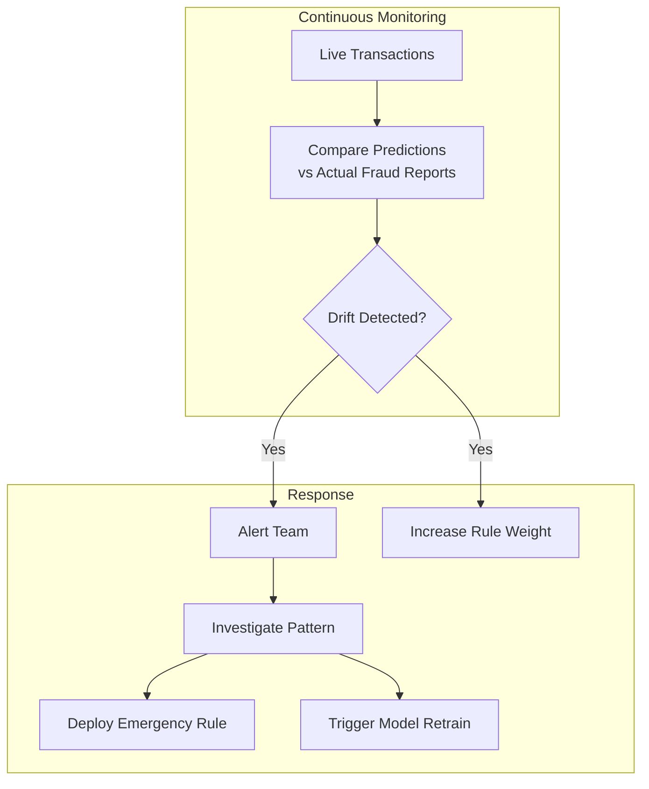

<div dir="rtl">

# مطالعه موردی: تشخیص بلادرنگ تقلب

## مسئله <a id="the-problem"></a>

یک پردازشگر پرداخت، روزانه **۱۰ میلیون تراکنش** را مدیریت می‌کند. این سیستم باید تراکنش‌های متقلبانه را به‌صورت بلادرنگ شناسایی کرده و پیش از تکمیل، آن‌ها را مسدود کند؛ در عین حال باید موارد مثبت کاذب (False Positives) را که باعث نارضایتی مشتریان قانونی می‌شود، به حداقل برساند.

**محدودیت‌های مطرح‌شده در مصاحبه:**
- تاخیر (Latency) تصمیم‌گیری: زیر ۱۰۰ میلی‌ثانیه
- نرخ مثبت کاذب: زیر ۰٫۱ درصد (۱ مورد از هر ۱٬۰۰۰ تراکنش)
- باید بتواند توضیح دهد چرا یک تراکنش مشکوک تشخیص داده شده است
- مقررات مستلزم نگهداری سوابق حسابرسی (Audit Trail) به مدت ۷ سال است
- الگوهای تقلب به‌طور مداوم تغییر می‌کنند

---

## سوال مصاحبه <a id="the-interview-question"></a>

> «سیستمی طراحی کنید که ظرف ۱۰۰ میلی‌ثانیه تصمیم بگیرد یک تراکنش کارت اعتباری را تایید، رد یا ارجاع (Escalate) دهد و بتواند آن تصمیم را توضیح دهد.»

---

## معماری راه‌حل <a id="solution-architecture"></a>

<div dir="ltr">



</div>

---

## تصمیم‌های کلیدی طراحی <a id="key-design-decisions"></a>

### 1. چرا ترکیب یادگیری ماشین (ML) و قواعد، نه فقط ML؟ <a id="1-why-ml--rules-not-just-ml"></a>

**پاسخ:** مدل‌های خالص یادگیری ماشین (ML) مانند جعبه سیاه (Black Box) هستند. نهادهای نظارتی برای رسیدگی به اختلافات مالی، نیازمند تصمیم‌های قابل توضیح هستند. ما از ML برای امتیازدهی استفاده می‌کنیم و سپس قواعد شفاف را برای تصمیم‌گیری نهایی اعمال می‌کنیم:

| لایه | نقش | سرعت | توضیح‌پذیری |
|------|-----|------|-------------|
| مجموعه مدل‌های ML (ML Ensemble) | کشف الگوهای پیچیده | ۱۰ میلی‌ثانیه | پایین |
| قواعد کسب‌وکار (Business Rules) | کدگذاری انواع تقلب شناخته‌شده | ۵ میلی‌ثانیه | بالا |
| ترکیب هر دو (Combined) | بهره‌مندی از مزایای هر دو | ۱۵ میلی‌ثانیه | متوسط تا بالا |

نمونه قواعد: قاعده «اگر ۵ تراکنش یا بیشتر در کشورهای مختلف طی ۱ ساعت انجام شد، مسدود شود» برای نهادهای نظارتی کاملاً قابل توضیح است.

### 2. تصمیم سه‌حالته: تایید / ارجاع / رد <a id="2-three-way-decision-approve--escalate--reject"></a>

**پاسخ:** تصمیم‌گیری دودویی (تایید/رد) بیش از حد انعطاف‌ناپذیر است. «ناحیه خاکستری» (امتیاز بین ۰٫۳ تا ۰٫۷) برای تراکنش‌های با مبلغ بالا به ارجاع مبتنی بر قواعد یا بررسی انسانی سپرده می‌شود:

<div dir="ltr">

```python
def decide(transaction, fraud_score):
    if fraud_score < 0.3:
        return "APPROVE", None
    elif fraud_score > 0.7:
        # Return the decision now; the narrative is generated off the hot path
        enqueue_explanation(transaction, fraud_score)
        return "REJECT", "Model score above threshold"
    else:
        # Gray zone: apply business rules
        if check_velocity_rules(transaction):
            return "REJECT", "Velocity limit exceeded"
        if check_geography_rules(transaction):
            return "ESCALATE", "Unusual location"
        return "APPROVE", None
```

</div>

### 3. چرا از LLM برای توضیح‌دهی استفاده می‌کنیم و نه SHAP/LIME؟ <a id="3-why-llm-for-explanation-not-shaplime"></a>

**پاسخ:** مقادیر SHAP به شما می‌گویند «ویژگی X به اندازه ۰٫۳ در امتیاز نقش داشته است». اما مشتریان و نهادهای نظارتی چنین توضیحی می‌خواهند: «این تراکنش مشکوک تشخیص داده شد زیرا از یک دستگاه جدید در کشوری که هرگز به آن سفر نکرده‌اید و برای مبلغی ۱۰ برابر خرید معمول شما انجام شده است.»

ما توضیحات به زبان طبیعی را با استفاده از اهمیت ویژگی‌ها (Feature Importance) به‌عنوان ورودی تولید می‌کنیم. فراخوانی مدل LLM هرگز در مسیر تصمیم‌گیری ۱۰۰ میلی‌ثانیه‌ای قرار نمی‌گیرد: تصمیم با یک کد دلیل (Reason Code) بازگردانده می‌شود و توضیح قابل نمایش به دارنده کارت، به‌صورت ناهمگام (Asynchronous) از روی ویژگی‌های ثبت‌شده تولید می‌شود (یک مدل کوچک مانند GPT-6 Luna با هزینه $0.10/$0.50 به ازای هر ۱ میلیون Token، به اندازه کافی سریع و ارزان است که برای هر تراکنش ردشده اجرا شود):

<div dir="ltr">

```python
prompt = f"""
Explain why this transaction was flagged as potentially fraudulent.

Transaction details:
- Amount: ${amount}
- Merchant: {merchant}
- Location: {location}
- Device: {device}

Top contributing factors:
1. {factors[0]['feature']}: {factors[0]['contribution']}
2. {factors[1]['feature']}: {factors[1]['contribution']}
3. {factors[2]['feature']}: {factors[2]['contribution']}

Write a 2-sentence explanation for the cardholder.
"""
```

</div>

یک بررسی نهایی (Post-check) هر توضیحی را که به عاملی خارج از فهرست ارسالی اشاره کند رد کرده و به یک دلیل قالبی (Templated Reason) برمی‌گردد، زیرا یک دلیل ساختگی در اختلافات مالی بدتر از یک دلیل کلی است.

---

## مهندسی ویژگی برای سرعت بالا <a id="feature-engineering-for-speed"></a>

بودجه ۱۰۰ میلی‌ثانیه‌ای به این معناست که ویژگی‌ها باید از پیش محاسبه شوند:

<div dir="ltr">



</div>

**نکته کلیدی:** پروفایل کاربر (میانگین هزینه، پذیرندگان معمول، موقعیت جغرافیایی محل سکونت) به‌صورت آفلاین محاسبه می‌شود. پردازش بلادرنگ تنها ویژگی‌های خاص همان تراکنش را اضافه می‌کند.

---

## مدیریت الگوهای در حال تغییر تقلب <a id="handling-evolving-fraud-patterns"></a>

کلاهبرداران خود را تطبیق می‌دهند. مدل ماه گذشته، حملات این ماه را از دست می‌دهد.

<div dir="ltr">



</div>

**قواعد اضطراری** را می‌توان در عرض چند دقیقه مستقر کرد (فقط یک به‌روزرسانی پیکربندی). بازآموزی مدل (Model Retraining) چند روز طول می‌کشد اما الگوهای ظریف‌تر را شکار می‌کند.

---

## سوالات پیگیری مصاحبه <a id="interview-follow-up-questions"></a>

**سوال: چگونه جهش‌های ناگهانی تاخیر (Latency) مدل را مدیریت می‌کنید؟**

**پاسخ:** ما یک **پشته پشتیبان (Fallback Stack)** داریم. اگر مدل ML ظرف ۵۰ میلی‌ثانیه پاسخ ندهد، تنها به امتیازدهی مبتنی بر قواعد برمی‌گردیم. این قواعد رایج‌ترین الگوهای تقلب را پوشش می‌دهند. همچنین اگر همه سیستم‌ها کند شوند، یک «تایید پیش‌فرض» برای تراکنش‌های زیر ۱۰ دلار داریم.

**سوال: در مورد حملات تقلب هماهنگ چطور؟**

**پاسخ:** ما شمارنده‌های سرعت سراسری (Global Velocity Counters) را نگه می‌داریم (نه فقط به ازای هر کاربر). اگر در ۱ دقیقه ۱۰۰ تراکنش از کارت‌های مختلف به سمت یک پذیرنده گمنام مشاهده کنیم، این وضعیت باعث مسدودسازی در سطح پذیرنده می‌شود؛ حتی اگر تک‌تک تراکنش‌ها عادی به نظر برسند.

**سوال: چگونه بین جلوگیری از تقلب و تجربه مشتری تعادل برقرار می‌کنید؟**

**پاسخ:** ما «نرخ خطای آزاردهنده» (Insult Rate) یعنی درصد مشتریان قانونی مسدودشده را ردیابی می‌کنیم. هر تیم محصول یک بودجه مجاز برای این نرخ دارد. اگر نرخ خطای مدل تقلب از بودجه فراتر رود، آستانه‌ها را به‌طور خودکار شل‌تر می‌کنیم و به تیم هشدار می‌دهیم. پذیرش مقدار کمی تقلب بیشتر، بهتر از عصبانی کردن مشتریان وفادار است.

---

## نکات کلیدی برای مصاحبه‌ها <a id="key-takeaways-for-interviews"></a>

1. **یادگیری ماشین (ML) برای امتیازدهی، قواعد برای توضیح‌پذیری**: در دامنه‌های تحت نظارت، هر دو را ترکیب کنید
2. **تصمیم‌گیری سه‌حالته موارد مثبت کاذب را کاهش می‌دهد**: ناحیه خاکستری تحت بررسی بیشتر قرار می‌گیرد
3. **هر چه را ممکن است از پیش محاسبه کنید**: بودجه بلادرنگ فقط برای ترکیب ویژگی‌هاست
4. **بازآموزی مستمر ضروری است**: الگوهای تقلب به‌صورت هفتگی تغییر می‌کنند

---

*فصل‌های مرتبط: [ارزیابی و مشاهده‌پذیری (Evaluation and Observability)](../14-evaluation-and-observability/)، [الگوهای پایداری (Reliability Patterns)](../13-reliability-and-safety/03-reliability-patterns.md)*

</div>
