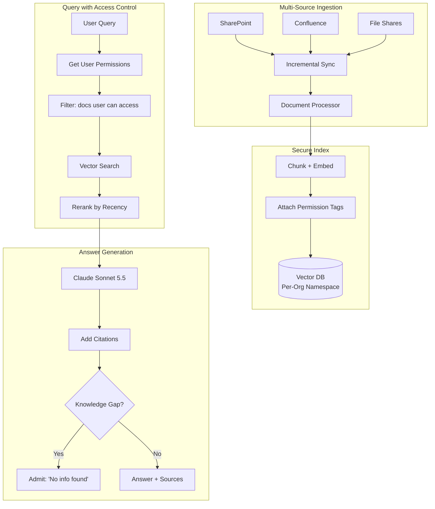
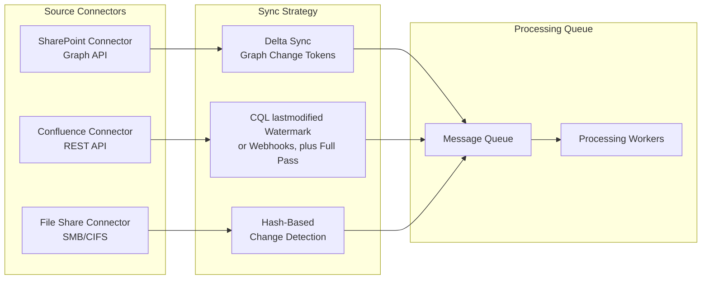

<div dir="rtl">

# مطالعه موردی: مدیریت دانش سازمانی <a id="case-study-enterprise-knowledge-management"></a>

## مسئله <a id="the-problem"></a>

یک شرکت مشاوره با **۱۰٬۰۰۰ کارمند** دهه‌ها گزارش پروژه، اسناد متدولوژی و دانش تخصصی دارد که در SharePoint، Confluence و اشتراک‌های فایل (File Shares) پراکنده شده‌اند. آن‌ها یک سیستم هوش مصنوعی می‌خواهند که در آن مشاوران بتوانند بپرسند «رویکرد ما برای بهینه‌سازی زنجیره تأمین در مشتریان خودروسازی چه بود؟» و پاسخ‌هایی ترکیبی از دانش داخلی دریافت کنند.

**محدودیت‌های ارائه‌شده در مصاحبه:**
- ۲ میلیون سند در ۱۵ منبع داده
- کنترل دسترسی: کارشناسان تازه‌کار (Associates) نباید محتوای سطح شرکا (Partner) را ببینند
- الزام به استناد به منابع برای هر ادعا
- مدیریت داده‌های قدیمی: متدولوژی‌های قدیمی نباید بر متدولوژی‌های جدید غلبه کنند
- شکاف‌های دانشی باید شناسایی شوند، نه اینکه با توهم (Hallucination) پاسخ داده شوند

---

## پرسش مصاحبه <a id="the-interview-question"></a>

> «یک دستیار دانش داخلی طراحی کنید که در آن یک مشاور تازه‌کار بتواند پرسش‌هایی مطرح کند و تنها بر اساس اسنادی که مجاز به مشاهده آن‌هاست پاسخ دریافت کند.»

---

## معماری راه‌حل <a id="solution-architecture"></a>

<div dir="ltr">



</div>

---

## تصمیم‌های کلیدی طراحی <a id="key-design-decisions"></a>

### ۱. بازیابی آگاه از سطح دسترسی (Permission-Aware Retrieval) <a id="1-permission-aware-retrieval"></a>

**پاسخ:** هر بخش (Chunk) فراداده سطح دسترسی خود را از سیستم مبدأ به همراه دارد:

<div dir="ltr">

```python
chunk = {
    "content": "Our approach to automotive supply chain...",
    "source": "sharepoint://projects/acme-motors/final-report.docx",
    "permissions": {
        "read_groups": ["partners", "managers", "automotive-team"],
        "classification": "confidential"
    },
    "last_modified": "2024-03-15",
    "author": "jane.doe@firm.com"
}
```

</div>

در زمان اجرای پرس‌وجو، پیش از بازیابی فیلتر اعمال می‌کنیم:

<div dir="ltr">

```python
def search(query: str, user: User):
    user_groups = get_user_groups(user.id)
    
    return vector_db.search(
        query=query,
        filter={
            "permissions.read_groups": {"$in": user_groups}
        }
    )
```

</div>

### ۲. رتبه‌بندی وزن‌دار بر اساس تازگی (Recency-Weighted Ranking) <a id="2-recency-weighted-ranking"></a>

**پاسخ:** یک سند متدولوژی مربوط به سال ۲۰۲۴ باید برای همان موضوع رتبه بالاتری نسبت به سند سال ۲۰۱۹ بگیرد. ما از یک **تابع زوال (Decay Function)** استفاده می‌کنیم:

<div dir="ltr">

```python
def recency_boost(doc_date):
    age_days = (today - doc_date).days
    # Half-life of 365 days
    return 0.5 ** (age_days / 365)

final_score = semantic_score * 0.7 + recency_boost(doc.date) * 0.3
```

</div>

این کار از غلبه شیوه‌های منسوخ بر راهنمایی‌های فعلی جلوگیری می‌کند.

### ۳. تشخیص شکاف دانشی (Knowledge Gap Detection) <a id="3-knowledge-gap-detection"></a>

**پاسخ:** باید میان «چیزی پیدا نکردم» و «در حال ساختن پاسخ از خودم هستم» تمایز قائل شویم:

<div dir="ltr">

```python
def generate_answer(query: str, retrieved_docs: list):
    if len(retrieved_docs) == 0 or max_relevance_score < 0.5:
        return {
            "answer": "I could not find relevant information in our knowledge base for this query.",
            "confidence": "low",
            "suggestion": "Try contacting the Automotive Practice lead directly."
        }
    
    # Generate from retrieved content
    answer = llm.generate(query, context=retrieved_docs)
    return {"answer": answer, "confidence": "high", "sources": [d.source for d in retrieved_docs]}
```

</div>

---

## همگام‌سازی چندمنبعی <a id="multi-source-synchronization"></a>

<div dir="ltr">



</div>

**نکته کلیدی:** سرویس SharePoint از Tokenهای تغییر (پرس‌وجوهای delta در Microsoft Graph) پشتیبانی می‌کند. سرویس Confluence این قابلیت را ندارد، بنابراین با CQL روی `lastmodified` از آخرین نشانگر (Watermark) ذخیره‌شده سرکشی (Poll) کنید (یا در Webhookها مشترک شوید) و یک پیمایش کامل دوره‌ای برای یافتن موارد حذف‌شده و تغییرات سطح دسترسی اجرا کنید. اشتراک‌های فایل (File Shares) به مقایسه هش (Hash) نیاز دارند. هر سه منبع به یک صف پردازش یکپارچه تغذیه می‌شوند.

---

## مدیریت اطلاعات متناقض <a id="handling-conflicting-information"></a>

اسناد مختلف ممکن است راهنمایی‌های متناقضی داشته باشند. ما این موضوع را آشکار می‌سازیم:

<div dir="ltr">

```python
def detect_conflicts(retrieved_docs):
    # Group by topic
    topics = cluster_by_topic(retrieved_docs)
    
    for topic, docs in topics.items():
        if has_contradictions(docs):
            return {
                "warning": "Found conflicting guidance",
                "perspectives": [
                    {"source": d.source, "date": d.date, "view": summarize(d)}
                    for d in docs
                ],
                "recommendation": "Defer to most recent document or consult practice lead."
            }
```

</div>

---

## تحلیل هزینه <a id="cost-analysis"></a>

| مؤلفه | هزینه ماهانه |
|-------|-------------|
| تولید Embedding (۲ میلیون سند × به‌روزرسانی‌ها) | ۵۰۰ دلار |
| پایگاه داده برداری (Pinecone Enterprise) | ۲٬۰۰۰ دلار |
| تولید پاسخ با LLM (۵۰ هزار پرس‌وجو) | ۳٬۰۰۰ دلار |
| زیرساخت همگام‌سازی (اتصال‌دهنده‌ها) | ۵۰۰ دلار |
| **مجموع** | **۶٬۰۰۰ دلار/ماه** |

بازگشت سرمایه (ROI): مشاوران به‌طور میانگین هفته‌ای ۲ ساعت در جست‌وجوی اطلاعات صرفه‌جویی می‌کنند. با نرخ ۱۰٬۰۰۰ مشاور × ۱۰۰ دلار/ساعت × ۲ ساعت × ۴ هفته = ۸ میلیون دلار/ماه بهره‌وری ایجاد می‌شود. این سیستم بیش از ۱٬۳۰۰ برابر هزینه خود بازدهی دارد.

---

## پرسش‌های تکمیلی مصاحبه <a id="interview-follow-up-questions"></a>

**پرسش: چگونه با اسنادی که سطوح دسترسی ترکیبی دارند برخورد می‌کنید؟**

پاسخ: ما Chunking را در سطح بخش (Section) انجام می‌دهیم و هر بخش محدودکننده‌ترین سطح دسترسی را از والدهای خود به ارث می‌برد. یک پاراگراف در بخش «محرمانه» (Confidential) درون سندی که در حالت کلی «داخلی» (Internal) است، با برچسب «محرمانه» نشانه‌گذاری می‌شود.

**پرسش: در مورد اسناد همکاری بلادرنگ (Google Docs، صفحات زنده Confluence) چطور؟**

پاسخ: ما یک پایپ‌لاین جداگانه برای «اسناد زنده» (Live Document) با همگام‌سازی مکررتر (هر ۵ دقیقه در مقایسه با روزانه برای فایل‌های ایستا) داریم. این اسناد تا زمانی که نهایی شوند، در نتایج جست‌وجو با برچسب «پیش‌نویس» (Draft) علامت‌گذاری می‌شوند.

**پرسش: چگونه از تبدیل شدن سیستم به یک انتزاع نشت‌کننده (Leaky Abstraction) برای داده‌های غیرمجاز جلوگیری می‌کنید؟**

پاسخ: ما هرگز محتوای غیرمجاز را وارد زمینه (Context) مدل LLM نمی‌کنیم، حتی برای اینکه بگوییم «نمی‌توانم این را به شما نشان دهم.» سیستم طوری رفتار می‌کند که گویی اسناد غیرمجاز اصلاً وجود ندارند. این کار از حملات استنتاجی (Inference Attacks) که در آن کاربران با پرسیدن «آیا اطلاعاتی درباره X دارید؟» وجود پروژه‌های محرمانه را کشف می‌کنند، جلوگیری می‌کند.

---

## نکات کلیدی برای مصاحبه <a id="key-takeaways-for-interviews"></a>

1. **سطوح دسترسی باید در مرحله بازیابی اعمال شوند، نه تولید**: پیش از آنکه مدل LLM محتوا را ببیند فیلتر کنید
2. **وزن‌دهی بر اساس تازگی از دانش منسوخ جلوگیری می‌کند**: اهمیت اسناد قدیمی با گذشت زمان کاهش می‌یابد
3. **به‌جای توهم، شکاف‌های دانشی را بپذیرید**: از آستانه‌های اطمینان و پیام‌های جایگزین استفاده کنید
4. **همگام‌سازی چندمنبعی پیچیده است**: APIهای مختلف به راهبردهای متفاوتی نیاز دارند

---

*فصل‌های مرتبط: [مبانی RAG](../06-retrieval-systems/01-rag-fundamentals.md)، [جداسازی چندمستأجری](../12-security-and-access/02-access-control.md)*

</div>
