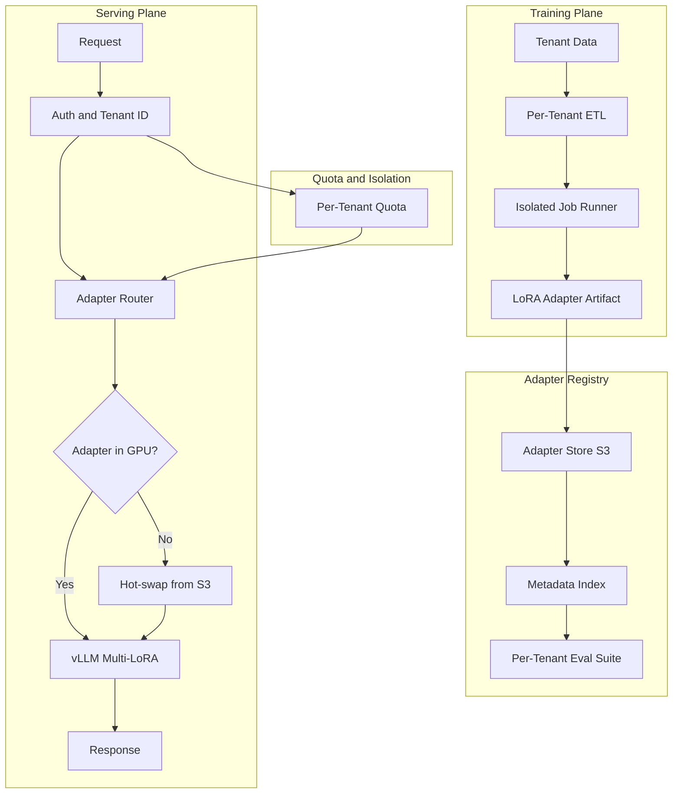
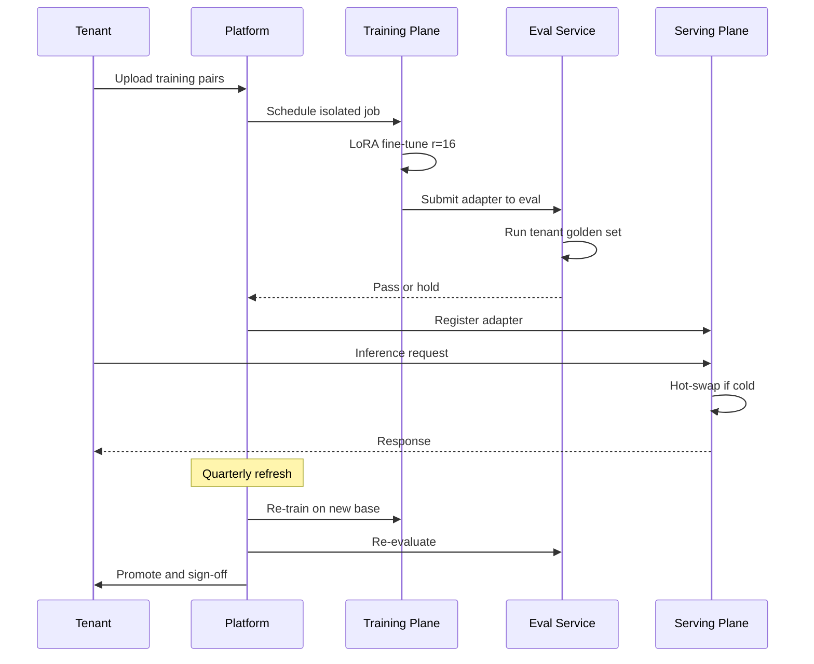

# مطالعه موردی: پلتفرم Fine-tuning چندمستأجره 

یک ارائه‌دهنده هوش مصنوعی عمودی (Vertical-AI)، به ۲۸۰ مشتری از طریق یک مدل پایه مشترک به همراه آداپتورهای LoRA اختصاصی به ازای هر مستأجر سرویس‌دهی می‌کند؛ با آموزش ایزوله، ارزیابی به‌عنوان سند نیازمندی‌های محصول (Eval-as-PRD) برای هر مستأجر و کاهش اثر همسایه پرسرصدا (Noisy-Neighbor) که تاخیر (Latency) در صدک p99 را زیر ۱.۲ ثانیه نگه می‌دارد.

## مسئله کسب‌وکار 

یک ارائه‌دهنده SaaS عمودی در حوزه فناوری حقوقی (Legal-Tech)، محصول تحلیل قرارداد را اجرا می‌کند. هر یک از ۲۸۰ مشتری سازمانی آن انتظار دارند مدل به قالب‌ها، پیکره سوابق (Precedent Corpus) و سبک نگارش ترجیحی آن‌ها احترام بگذارد. استفاده از دستورهای Prompt آماده کافی نیست: مشتریان آزمون‌های A/B کور را در برابر مدل‌های عمومی اجرا می‌کنند و زمانی که خروجی از سبک اختصاصی سازمان آن‌ها فاصله بگیرد، محصول را رد می‌کنند. داشتن یک مدل Fine-tuning‌شده جداگانه برای هر مستأجر نیز مقرون‌به‌صرفه نیست: در مقیاس ۷۰ میلیارد پارامتر (70B)، هر مدل در قالب BF16 برابر با ۱۴۰ گیگابایت است و تنها برای بارگذاری به حداقل دو عدد GPU از نوع H100 اختصاصی نیاز دارد که اقتصاد واحد (Unit Economics) را از بین می‌برد.

محدودیت‌ها:

- ۲۸۰ مستأجر دارای اشتراک پولی، با رشد دو برابری سالانه
- هر مستأجر بین ۱٬۰۰۰ تا ۲۵۰٬۰۰۰ جفت قرارداد تاریخی دارد (ورودی به همراه ویرایش ترجیحی)
- مستأجران گزارش‌های ارزیابی می‌خواهند که تناسب مدل را روی مجموعه‌آزمون‌های خودشان اثبات کند
- بودجه تاخیر به ازای هر پرس‌وجو: زیر ۱.۲ ثانیه در صدک p99
- مستأجران تحت رژیم‌های انطباق (Compliance) متفاوت: SOC 2، ISO 27001، HIPAA و FedRAMP Moderate

این تیم آداپتورهای LoRA به ازای هر مستأجر را روی یک مدل پایه مشترک انتخاب می‌کند. روش‌های LoRA ([Hu و همکاران، ۲۰۲۱](https://arxiv.org/abs/2106.09685)) و QLoRA ([Dettmers و همکاران، ۲۰۲۳](https://arxiv.org/abs/2305.14314)) به بلوغ رسیده‌اند؛ قابلیت سرویس‌دهی multi-LoRA در vLLM ([مستندات](https://docs.vllm.ai/en/latest/features/lora/)) و جابه‌جایی آداپتور (Adapter Swapping) در SGLang امکان اشتراک‌گذاری یک مدل پایه میان آداپتورهای متعدد را در حافظه GPU فراهم می‌کنند. شرکت Anyscale مقایسه‌ای میان LoRA و Fine-tuning کامل منتشر کرده است ([پست ۲۰۲۴ Anyscale](https://www.anyscale.com/blog/fine-tuning-llms-lora-or-full-parameter-an-in-depth-analysis)) و ارائه‌دهندگان مدیریت‌شده نیز این الگو را با سقف‌های محدود به فروش می‌رسانند: نقطه پایانی اختصاصی Together AI برای مدل Llama 3.3 70B حداکثر ۱۶ آداپتور بارگذاری‌شده در هر نقطه پایانی را نگه می‌دارد ([مستندات](https://docs.together.ai/docs/dedicated-endpoints/lora-adapter))، بنابراین ۲۸۰ مستأجر به ۱۸ نقطه پایانی نیاز خواهد داشت. سرویس Fine-tuning میزبانی‌شده نیز گزینه قابل اتکایی نیست: OpenAI در حال تعطیل کردن پلتفرم Fine-tuning خود است (سازمان‌هایی که هرگز Fine-tuning انجام نداده‌اند دیگر نمی‌توانند شروع کنند و مشتریان فعلی نیز از ۶ ژانویه ۲۰۲۷ امکان ایجاد کار جدید را از دست می‌دهند)، بنابراین سفارشی‌سازی به ازای هر مستأجر باید روی وزن‌هایی انجام شود که خود پلتفرم کنترل می‌کند.

## معماری 

### اجزا 

| لایه | فناوری | هدف |
|-------|------|---------|
| مدل پایه | مدل Llama 3.3 70B، ۴-بیتی (AWQ) | مشترک میان همه مستأجران |
| آداپتور | آداپتور LoRA با رتبه r=16 روی لایه‌های Attention، حدود ۱۲۰ مگابایت به ازای هر مستأجر | سازگاری اختصاصی هر مستأجر |
| آموزش | فریم‌ورک DeepSpeed ZeRO-3 روی نودهای 8x H100 | کارهای ایزوله به ازای هر مستأجر |
| سرویس‌دهی | موتور vLLM 0.33+ با PagedAttention و multi-LoRA | یک مدل پایه، آداپتورهای متعدد؛ نسخه 0.32.0 حداقل سطح امنیتی عمومی است (همچنین Python 3.11 را به‌عنوان حداقل نسخه تعیین کرده و CORS را به‌صورت پیش‌فرض بسته است)، و نسخه 0.33.0 (۲ نوامبر ۲۰۲۶) حداقل نسخه برای میزبان‌هایی است که مخازن نامطمئن را بارگذاری می‌کنند، به بهای ساخت‌های منحصراً CUDA 13.0 که به درایور ۵۸۰ یا جدیدتر نیاز دارند |
| مخزن آداپتور | سرویس S3 با کلیدهای KMS اختصاصی هر مستأجر | رمزنگاری‌شده در حالت سکون (At Rest) |
| مخزن ارزیابی | مجموعه طلایی اختصاصی هر مستأجر، اجرا در هر بازآموزش | ارزیابی به‌عنوان سند نیازمندی‌های محصول (Eval-as-PRD) برای هر مستأجر |

### جریان داده در زمان آموزش 

1. مشتری جفت‌های آموزشی را از طریق یک باکت S3 اختصاصی مستأجر با یک نقش IAM جداگانه بارگذاری می‌کند؛ کلیدهای KMS برای هر مستأجر اختصاصی هستند.
2. کار ETL در یک فضای نام (Namespace) در Kubernetes اجرا می‌شود که محدود به همان مستأجر است؛ انتخاب‌گر نود (Node Selector) تضمین می‌کند که این کار با کار مستأجر دیگری هم‌زمان روی یک نود زمان‌بندی نشود.
3. آموزش روی یک پاد 8x H100 معمولاً ۴ تا ۱۰ ساعت برای هر مستأجر طول می‌کشد؛ آداپتور LoRA با رتبه r=16 در ۸۰ گیگابایت حافظه هر H100 جا می‌گیرد و فضا برای حافظه فعال‌سازی (Activation Memory) باقی می‌گذارد.
4. ارزیابی به‌صورت خودکار روی مجموعه طلایی مستأجر اجرا می‌شود؛ اگر معیارها فراتر از یک آستانه افت کنند، مصنوع (Artifact) در محیط Staging نگه داشته می‌شود.
5. مصنوع آداپتور (حدود ۱۲۰ مگابایت برای مدل پایه 70B با آداپتورهای Attention در رتبه r=16) در رجیستری بارگذاری و شاخص فراداده به‌روزرسانی می‌شود.

### جریان داده در زمان سرویس‌دهی 

1. درخواست همراه با یک JWT مستأجر به درگاه (Gateway) می‌رسد.
2. مسیریاب (Router) نسخه آداپتور را برای آن مستأجر مشخص می‌کند.
3. اگر آداپتور در حافظه GPU گرم باشد (کش LRU با ۲۰۰ آداپتور در هر نود)، استنتاج (Inference) انجام می‌شود.
4. اگر سرد باشد، آداپتور طی ۲۰۰ تا ۶۰۰ میلی‌ثانیه به‌صورت گرم (Hot-swap) از S3 جایگزین می‌شود. ما این تاخیر را با پیش‌گرم‌سازی (Pre-warming) مبتنی بر الگوهای ترافیک مستأجر پنهان می‌کنیم.
5. موتور vLLM درخواست را با اعمال آداپتور اجرا می‌کند؛ مستأجران به‌صورت ایمن GPU را به اشتراک می‌گذارند زیرا PagedAttention بلوک‌های KV را محدود به درخواست نگه می‌دارد نه محدود به آداپتور، و یک نمک کش (Cache Salt) اختصاصی به ازای هر مستأجر از استفاده مجدد کش پیشوند (Prefix Cache) میان مستأجران جلوگیری می‌کند (تصمیم کلیدی طراحی ۵ را ببینید).

## تصمیم‌های کلیدی طراحی 

### 1. انتخاب LoRA با رتبه r=16 به جای Fine-tuning کامل 

یک Fine-tuning کامل مدل 70B به ازای هر مستأجر حدود ۴٬۵۰۰ دلار هزینه محاسباتی دارد، یک مصنوع ۱۴۰ گیگابایتی تولید می‌کند و واحدهای GPU اختصاصی را قفل می‌کند. روش LoRA با رتبه r=16 بین ۸۰ تا ۴۰۰ دلار برای هر مستأجر در هر بازآموزش هزینه دارد، یک مصنوع ۱۲۰ مگابایتی تولید می‌کند و GPU را به اشتراک می‌گذارد. شکاف دقت روی ارزیابی تحلیل قرارداد داخلی ما ۱.۶ امتیاز در یک معیار ترکیبی ۱۰۰ امتیازی است. ما این شکاف را می‌پذیریم زیرا اختلاف هزینه ۵۰ برابر است و وضعیت عملیاتی (جایگزینی گرم، مصنوعات موقت) به‌طور چشمگیری ساده‌تر است. پست Anyscale که در بالا پیوند داده شد مقایسه مشابهی انجام داده و به همین نتیجه رسیده است.

### 2. بودجه جایگزینی آداپتور و مشکل همسایه پرسرصدا 

پشتیبانی multi-LoRA در vLLM آداپتورهای مقیم را در حافظه GPU نگه می‌دارد و هر یک تقریباً به اندازه حجم مصنوع خود فضا اشغال می‌کند: حدود ۱۲۰ مگابایت برای r=16 روی Q، K، V و O در تمام ۸۰ لایه مدل پایه 70B. روی یک H100 با حافظه ۸۰ گیگابایتی که یک مدل پایه 70B را به‌صورت ۴-بیتی (حدود ۴۰ گیگابایت) اجرا می‌کند، تقریباً ۳۰ گیگابایت برای آداپتورها و کش KV داریم و کش KV به بیشتر آن نیاز دارد: ۲۰۰ آداپتور روی یک GPU حدود ۲۴ گیگابایت مصرف می‌کند. بنابراین ما هر GPU را به ۲۵ آداپتور مقیم (حدود ۳ گیگابایت) محدود می‌کنیم و مسیریابی را با پیوند آداپتور (Adapter Affinity) انجام می‌دهیم، یعنی مستأجر را فقط به GPUهایی می‌فرستیم که از قبل آداپتور او را در اختیار دارند؛ این کار به یک نود ۸-GPU امکان می‌دهد هم‌زمان حدود ۲۰۰ آداپتور متمایز را مقیم نگه دارد. ما از LRU همراه با پیش‌گرم‌سازی آگاه از ترافیک و سنجاق کردن مستأجران دم (Tail-Tenant Pinning) استفاده می‌کنیم: ۳۰ مستأجر دارای SLA سخت‌گیرانه تاخیر سنجاق می‌شوند و هرگز از کش اخراج نمی‌شوند؛ بقیه می‌چرخند. مستأجری که آداپتور او سرد باشد جریمه دمی بین ۲۰۰ تا ۶۰۰ میلی‌ثانیه می‌پردازد. ما این موضوع را به‌صراحت در SLA مستأجر به‌عنوان بودجه شروع سرد (Cold-start Budget) منعکس می‌کنیم. آداپتورها روی وزن‌های BF16 آموزش می‌بینند اما روی مدل پایه ۴-بیتی سرویس‌دهی می‌شوند، بنابراین دروازه ارزیابی (Eval Gate) روی پشته سرویس‌دهی ۴-بیتی اجرا می‌شود تا انحراف کوانتیزاسیون (Quantization Drift) را پیش از ارتقا شکار کند.

شکست همسایه پرسرصدا: یک مستأجر ناگهان جهش ترافیکی ۱۰ برابری نسبت به حالت عادی پیدا می‌کند و آداپتورهای دیگر را از کش بیرون می‌راند. راهکار مقابله: محدودسازی نرخ با سطل Token (Token-bucket Rate Limit) به ازای هر مستأجر در درگاه، به‌علاوه محافظت پویا از اخراج (Eviction Protection) برای هر آداپتوری که در ۶۰ ثانیه گذشته ترافیکی را سرویس‌دهی کرده است.

### 3. مجموعه ارزیابی اختصاصی هر مستأجر به‌عنوان دروازه کنترل 

ما مجموعه طلایی مستأجر را به‌عنوان سند نیازمندی‌های محصول (PRD) در نظر می‌گیریم. پایپ‌لاین آموزش پس از هر بازآموزش، آداپتور جدید را در برابر آن مجموعه اجرا می‌کند؛ اگر معیارها بیش از ۲ امتیاز در شاخص ترکیبی افت کنند، مصنوع متوقف می‌شود و یک اعلان Slack برای مدیر موفقیت مشتری (CSM) آن مستأجر ارسال می‌گردد. این همان الگوی «ارزیابی به‌عنوان سند نیازمندی‌های محصول» (Eval-as-PRD) است که همل حسین (Hamel Husain) درباره آن نوشته است ([نحوه ساخت ارزیابی‌های خاص دامنه](https://hamel.dev/blog/posts/evals/)) و ما آن را به سطح هر مستأجر تعمیم می‌دهیم. مجموعه طلایی هر مستأجر به‌طور مشترک با تیم حقوقی او در طول دوره پذیرش (یک کارگاه ۶۰ تا ۹۰ دقیقه‌ای) تدوین شده و به‌صورت فصلی به‌روزرسانی می‌شود.

### 4. ایزوله‌سازی زمان آموزش از طریق فضاهای نام Kubernetes و سیاست شبکه 

چندمستأجری (Multi-tenancy) یک مسئله دفاع لایه‌به‌لایه است. کارهای آموزش در فضاهای نام اختصاصی هر مستأجر اجرا می‌شوند؛ سیاست‌های شبکه (Network Policies) از خروج ترافیک به هر مقصدی غیر از پیشوند S3 آن مستأجر و سرویس مرکزی معیارها جلوگیری می‌کنند؛ انتخاب‌گرهای نود از زمان‌بندی هم‌زمان جلوگیری می‌کنند. همچنین از یک کلید KMS اختصاصی برای هر مستأجر هم برای رمزنگاری باکت و هم برای رمزنگاری مصنوع مدل استفاده می‌کنیم. افشای یک کلید رمزگشایی مصنوع تنها یک مستأجر را در معرض خطر قرار می‌دهد، نه همه را.

### 5. ایزوله‌سازی زمان سرویس‌دهی: GPU مشترک بلامانع است، اما کش KV نه 

مدل پایه مشترک است. آداپتور اختصاصی هر مستأجر است. کش KV اختصاصی هر درخواست است. سازوکار PagedAttention ([مقاله vLLM](https://arxiv.org/abs/2309.06180)) تضمین می‌کند که بلوک‌های KV به ازای هر درخواست ایزوله هستند، بنابراین حتی اگر مستأجر A و مستأجر B در یک دسته استنتاج (Inference Batch) واحد یک GPU را به اشتراک بگذارند، محاسبات Attention و وضعیت KV آن‌ها با هم مخلوط نمی‌شود. ما این موضوع را با دستورهای Prompt تیم قرمز (Red-team) ممیزی کردیم: هیچ نشت بین‌مستاجری در ۵۰ هزار جفت خصمانه رخ نداد.

یک قابلیت به‌عمد این تضمین را می‌شکند: **کش پیشوند خودکار (Automatic Prefix Caching)** بلوک‌های KV را میان درخواست‌هایی که پیشوند مشترکی دارند دوباره استفاده می‌کند و برخورد به کش (Cache Hit) به‌صورت تاخیر کمتر ظاهر می‌شود. این ویژگی کش پیشوند را به یک اوراکل عضویت (Membership Oracle) تبدیل می‌کند: یک مستأجر می‌تواند با زمان‌سنجی درخواست‌ها بفهمد که آیا شخص دیگری اخیراً بند قرارداد مشخصی را ارسال کرده است یا خیر. ما روی هر درخواست یک مقدار `cache_salt` اختصاصی به ازای هر مستأجر تنظیم می‌کنیم تا بلوک‌های پیشوند هرگز میان مستأجران به اشتراک گذاشته نشوند و نسخه vLLM را روی 0.33.0 یا جدیدتر قفل می‌کنیم، که حداقل نسخه برای میزبان‌هایی است که مخازن نامطمئن را بارگذاری می‌کنند (نسخه 0.32.0 حداقل سطح امنیتی عمومی است). درس نمک کش از یک اطلاعیه امنیتی در سپتامبر ۲۰۲۶ (GHSA-935w-9g4m-p28p، اصلاح‌شده در 0.30.0) آمد: دورهای ادامه ابزار (Tool-continuation) در مسیر `/v1/responses` مربوط به GPT-OSS در vLLM نمک را حذف می‌کردند و اوراکل را دوباره باز می‌کردند. ما آن مسیر را سرویس‌دهی نمی‌کنیم، اما درس آن پابرجاست: مدیریت نمک در هر مسیر کد زندگی می‌کند، بنابراین هر نقطه پایانی که فعال می‌کنیم آزمون زمان‌سنجی بین‌مستاجری مخصوص به خود را دریافت می‌کند. همین حداقل نسخه اصلاحات 0.28.0 را نیز در بر دارد، از جمله CVE-2026-90553 که در آن کد پردازشگر یک مخزن مدل مخرب حتی با غیرفعال بودن `trust_remote_code` اجرا می‌شد؛ در سروری که تمام روز مصنوعات جدید را بارگذاری می‌کند، با هر مصنوع مانند ورودی نامطمئن رفتار کنید. حداقل نسخه 0.33.0 از یک اطلاعیه نوامبر نشأت می‌گیرد: در GHSA-qrj2-j723-m6w8 (اصلاح‌شده در 0.33.0، مؤثر بر تمام نسخه‌های پیشین، بدون نیاز به `trust_remote_code`)، مقدار `speculators_config` در یک مخزن دست‌کاری‌شده می‌توانست vLLM را به هر دایرکتوری روی میزبان هدایت کند و پس از آن یک کلاینت احرازهویت‌نشده می‌توانست واژگان Tokenization آن دایرکتوری را از طریق `/detokenize` بخواند یا از یک چک‌پوینت خصوصی پرس‌وجو کند. روی یک میزبان سرویس‌دهی مشترک، این به معنای مدل مستأجر دیگری است، بنابراین ما دایرکتوری‌های مدل هر مستأجر را به‌جای اعتماد به اعتبارسنجی مسیر، در نمای فایل‌سیستم اختصاصی خودش Mount می‌کنیم. همچنین نسخه 0.33.0 نقطه پایانی `/v1/decisions` را به‌صورت پیش‌فرض فعال می‌کند که فهرست مجاز درگاه ما تا زمان نیاز، آن را مسدود می‌کند.

### 6. چرخه حیات مدل و نوسازی مدل پایه 

مدل پایه هر ۶ تا ۹ ماه یک‌بار ارتقا داده می‌شود. هنگام ارتقا، همه آداپتورها باید روی مدل پایه جدید بازآموزش ببینند. ما بازآموزش را به‌صورت خودکار با استفاده از داده‌های آموزشی ذخیره‌شده هر مستأجر اجرا می‌کنیم؛ مجموعه ارزیابی آن‌ها را اجرا می‌کنیم؛ و پیش از ارتقا از مستأجر تاییدیه (Sign-off) می‌گیریم. چرخه کامل نوسازی مدل پایه برای ۲۸۰ مستأجر روی ۴ نود آموزش اختصاصی حدود ۳ هفته زمان می‌برد؛ ما زمان‌بندی را به‌صورت عمومی به اشتراک می‌گذاریم. آداپتورهایی که در ارزیابی رد شوند برای بررسی دستی علامت‌گذاری می‌شوند و جفت مدل پایه و آداپتور قبلی تا زمان حل مشکل در سرویس باقی می‌ماند.

**مجوز (License) یک معیار انتخاب مدل پایه است، نه یک پاورقی.** ما یک محصول مبتنی بر مدل را به ۲۸۰ شرکت می‌فروشیم که چندین مجوز وزن باز در سال ۲۰۲۶ آن را به‌عنوان یک پرونده تجاری جداگانه در نظر می‌گیرند. مجوز Qwen Community License 1.0 (استفاده‌شده برای Qwen3.8-Flash-Next) برای هر کسب‌وکار Model-as-a-Service یا دستیار کدنویسی یا اداری بدون هیچ کف درآمدی نیاز به مجوز جداگانه دارد؛ مجوز Kimi K3 شرکت Moonshot برای کسب‌وکارهای Model-as-a-Service با درآمد بالای ۲۰ میلیون دلار در ۱۲ ماه نیاز به قرارداد دارد؛ مجوز MIT اصلاح‌شده Mistral Medium 3.5 بالای ۲۰ میلیون دلار درآمد ماهانه هیچ حقی اعطا نمی‌کند. مدل‌های Qwen3.8-27B و IBM Granite 4.2 (تحت Apache 2.0) و GLM-5.3 (تحت MIT، با بررسی امنیتی صرفاً برای کسب‌وکارهای Model-as-a-Service با درآمد بالای ۱۰ میلیارد دلار) در مقیاس ما هیچ مانعی ندارند. مدل پایه فعلی ما، Llama 3.3 70B، تحت مجوز Llama 3.3 Community License عرضه می‌شود که سقف آن (۷۰۰ میلیون کاربر فعال ماهانه) بسیار فراتر از مقیاس ماست، اما یک سیاست استفاده قابل قبول و شرایط استناد (Attribution) را اضافه می‌کند که ما به مستأجران منتقل می‌کنیم. تیم حقوقی پیش از رقابت ارزیابی (Eval Bake-off)، مجوز هر مدل پایه کاندید را بررسی می‌کند، نه پس از آن.

### 7. چرا مشخصاً رتبه r=16 

خواندن سطحی مقاله LoRA این تصور را ایجاد می‌کند که r=4 یا r=8 انتخاب استاندارد است. ما روی دامنه خودمان پیمایش (Sweep) انجام دادیم: r=4 روی مستأجران با بیش از ۵۰ هزار جفت آموزشی دچار کم‌برازش (Underfitting) می‌شود؛ r=8 قابل قبول است؛ r=16 حدود ۹۵ درصد از بهبود حاصل از رفتن به r=32 را به دست می‌آورد. رتبه r=32 حجم مصنوع و هزینه آموزش را برای کمتر از ۱ امتیاز معیار دو برابر می‌کند. ما روی r=16 در لایه‌های Attention (Q، K، V، O) استانداردسازی کردیم و از لایه‌های MLP صرف‌نظر کردیم. این دقیقاً همان پیکربندی است که [پست Anyscale](https://www.anyscale.com/blog/fine-tuning-llms-lora-or-full-parameter-an-in-depth-analysis) برای بارهای کاری مشابه توصیه می‌کند.

### 8. مهندسی شروع سرد 

جایگزینی گرم (Hot-swap) از S3 در حالت سرد ۲۰۰ تا ۶۰۰ میلی‌ثانیه طول می‌کشد. ما این زمان را با پیش‌گرم‌سازی آگاه از ترافیک پنهان می‌کنیم: یک فرایند جانبی (Sidecar) ترافیک ۶۰ دقیقه گذشته مستأجر را می‌خواند و ۵۰ آداپتور سرد برتر را در مرزهای دقیقه‌ای پیش‌بارگذاری می‌کند. نرخ برخورد پیش‌گرم‌سازی (Pre-warm Hit Rate) در برابر تاخیر دمی ۷۸ درصد اندازه‌گیری شده است؛ خطاهای سرد باقی‌مانده معمولاً مربوط به مستأجران جدید یا مستأجرانی است که از حالت بیکاری برمی‌گردند که جریمه شدن هر دو قابل قبول است.

## توالی چرخه حیات مستأجر 

## حالت‌های شکست و راهکارهای مقابله 

### حالت F1: افت کیفیت آداپتور پس از بازآموزش 

یک بازآموزش مدلی تولید می‌کند که روی مجموعه طلایی مستأجر عملکرد بدتری نسبت به نسخه قبلی دارد. راهکار مقابله: دروازه ارزیابی از ارتقا جلوگیری می‌کند؛ آداپتور قبلی در حال سرویس‌دهی باقی می‌ماند؛ هشداری به تیم و مستأجر ارسال می‌شود. ما ۳ نسخه آداپتور قبلی را به ازای هر مستأجر برای بازگشت به عقب (Rollback) نگه می‌داریم. میانه زمان بازگشت به عقب: ۶ دقیقه.

### حالت F2: نشت داده بین‌مستاجری در زمان آموزش 

یک باگ در پایپ‌لاین ETL از باکت S3 مستأجر اشتباهی می‌خواند. راهکار مقابله: نقش‌های IAM محدود به هر مستأجر؛ کار آموزش هنگام راه‌اندازی نقش آن مستأجر را می‌گیرد و هیچ مجوز دسترسی به باکت‌های دیگر ندارد. یک آزمون رگرسیون تأیید می‌کند که کاری که تحت نقش مستأجر A اجرا می‌شود نمی‌تواند فهرست باکت مستأجر B را بگیرد؛ این آزمون در هر بیلد CI اجرا می‌شود.

### حالت F3: فرسایش کش آداپتور در اوج ترافیک 

یک نمایشگاه تجاری باعث جهش هم‌زمان ترافیک ۳۰ مستأجر می‌شود و بیشتر آداپتورهای دیگر را از کش بیرون می‌راند. تاخیر p99 از ۱.۱ ثانیه به ۴.۸ ثانیه جهش می‌کند. راهکار مقابله: درگاه نرخ هر مستأجر را محدود می‌کند؛ کش از جایگاه‌های سنجاق‌شده (Pinned Slots) برای مستأجران سطح بالا استفاده می‌کند؛ ما ۲۰ درصد از ظرفیت کش را به‌عنوان ذخیره نگه می‌داریم. وقتی یک رویداد شناخته‌شده در تقویم باشد، در ساعات کم‌بار پیش‌گرم‌سازی انجام می‌دهیم.

### حالت F4: داده‌های آموزشی معیوب آداپتور را مسموم می‌کنند 

یک مستأجر به‌طور تصادفی قراردادهایی را بارگذاری می‌کند که حاوی اطلاعات هویتی شخصی (PII) مشتریان یا مربوط به حوزه قضایی اشتباهی است. آداپتور به الگوهای نادرست بیش‌برازش (Overfit) می‌شود. راهکار مقابله: یک تشخیص‌دهنده خودکار PII پیش از آموزش روی ورودی‌ها اجرا می‌شود؛ مجموعه ارزیابی انحراف روی موارد خاص حوزه قضایی را شکار می‌کند؛ مستأجران می‌توانند پیش از شروع بازآموزش، نمونه داده‌های آموزشی خود را در داشبورد بازبینی کنند.

### حالت F5: ارتقای مدل پایه آداپتورهای قدیمی را از کار می‌اندازد 

مدل پایه جدید Tokenizer یا نام‌گذاری لایه‌های متفاوتی دارد و ابعاد ماتریس‌های آداپتور دیگر اعمال نمی‌شوند. راهکار مقابله: هر ارتقای مدل پایه به‌عنوان یک بازآموزش اجباری تلقی می‌شود. ما هرگز آداپتوری را روی مدل پایه‌ای که روی آن آموزش ندیده سرویس‌دهی نمی‌کنیم. یک محافظ در صفحه سرویس‌دهی از بارگذاری آداپتور بدون نسخه مدل پایه منطبق جلوگیری می‌کند.

### حالت F6: رشد مهارگسیخته هزینه در صفحه آموزش 

یک کار با پیکربندی نادرست در یک گام آموزشی در حلقه می‌افتد و ۸۰ ساعت-H100 را بدون تولید چک‌پوینت مصرف می‌کند. راهکار مقابله: بودجه آموزش ماهانه به ازای هر مستأجر؛ محدودیت زمانی به ازای هر کار (سقف سخت ۲۴ ساعته)؛ یک نگهبان (Watchdog) که اگر صاف شدن نمودار خطا (Loss Plateau) برای بیش از ۲ ساعت تشخیص داده شود به SRE هشدار می‌دهد. ما در ۶ ماه گذشته ۱۴ مورد از این کارها را متوقف کرده‌ایم.

### حالت F7: خرابی نود GPU در میانه آموزش 

یک نقص سخت‌افزاری روی یکی از ۸ عدد H100 در میانه آموزش باعث سقوط کار می‌شود. راهکار مقابله: ذخیره‌سازی چک‌پوینت DeepSpeed هر ۳۰ دقیقه؛ ادامه خودکار روی یک نود تازه؛ ما یک استخر ذخیره کوچک از نودهای آماده (Warm Spare) نگه می‌داریم. میانگین زمان بازیابی: ۱۸ دقیقه. بودجه تلاش مجدد در سطح کار: ۳ تلاش پیش از هشدار به انسان‌ها.

### حالت F8: چرخش کلید امضای آداپتور کلاینت‌های قدیمی را مختل می‌کند 

ما مانیفست‌های آداپتور را برای تشخیص دست‌کاری امضا می‌کنیم. چرخش کلید امضا بدون هماهنگی، مرحله تأیید صفحه سرویس‌دهی را مختل می‌کند. راهکار مقابله: امضای دوگانه در پنجره چرخش؛ کلاینت‌ها به مدت ۷ روز کلید قدیمی یا جدید را می‌پذیرند؛ تنها پس از اینکه همه کلاینت‌ها روی کلید جدید تأیید شدند کلید قدیمی را بازنشسته می‌کنیم.

### حالت F9: آلودگی متقابل مستأجران از طریق زیرساخت ارزیابی مشترک 

اجراکننده ارزیابی به‌طور تصادفی نتایج ارزیابی را در باکت معیارهای مستأجر اشتباهی می‌نویسد. راهکار مقابله: گواهی‌نامه‌های (Credentials) اختصاصی هر مستأجر برای انتشار نتایج ارزیابی؛ یک بررسی شناسه مستأجر در زمان نوشتن تأیید می‌کند که مقصد با مستأجر کار در حال اجرا مطابقت دارد؛ عدم تطابق باعث رد نوشتن و ارسال هشدار می‌شود.

### حالت F10: گسترش بی‌رویه نسخه‌های آداپتور 

پس از ۳ سال و ۲۸۰ مستأجر، بیش از ۱۰٬۰۰۰ نسخه آداپتور در رجیستری داریم. ذخیره‌سازی ارزان است اما سرویس فراداده کند می‌شود. راهکار مقابله: ذخیره‌سازی سطح‌بندی‌شده با بایگانی خودکار نسخه‌های قدیمی به فضای ذخیره‌سازی سرد پس از ۹۰ روز؛ سرویس فراداده فقط نسخه فعلی به علاوه ۳ نسخه قبلی هر مستأجر را نمایه‌سازی می‌کند؛ بازیابی از بایگانی سرد برای سناریوهای بازگشت به عقب دارای SLA ۱ دقیقه‌ای است.

### حالت F11: عدم تطابق جمع کنترلی آداپتور هنگام بارگذاری سرویس‌دهی 

یک اختلال شبکه هنگام جایگزینی گرم از S3 بایت‌های آداپتور را خراب می‌کند؛ vLLM آن را بارگذاری می‌کند اما استنتاج خروجی بی‌معنی تولید می‌کند. راهکار مقابله: هر آداپتور یک جمع کنترلی (Checksum) SHA-256 در فراداده دارد؛ صفحه سرویس‌دهی هنگام بارگذاری جمع کنترلی را بررسی کرده و از سرویس‌دهی آداپتور نامنطبق خودداری می‌کند؛ یک هشدار به SRE ارسال می‌شود و بارگذاری دوباره تلاش می‌شود.

## ملاحظات عملیاتی 

### پایش و توافق‌نامه‌های سطح هدف (SLO) 

| هدف سطح سرویس (SLO) | مقدار هدف | آنچه اندازه‌گیری می‌کنیم |
|-----|--------|-----------------|
| تاخیر p99 سرویس‌دهی | زیر ۱.۲ ثانیه، حالت گرم | در هر لحظه ۹۵ درصد مستأجران در کش گرم هستند |
| تاخیر p99 شروع سرد | زیر ۱.۰ ثانیه اضافی | زمان بارگذاری آداپتور از S3 |
| نرخ موفقیت کارهای آموزش | بالای ۹۸ درصد | کارهایی که به ارتقای آداپتور می‌رسند |
| نرخ عبور از دروازه ارزیابی | بالای ۹۰ درصد | آداپتورهایی که مجموعه طلایی مستأجر را می‌گذرانند |
| یافته‌های ممیزی بین‌مستاجری | صفر | تست تیم قرمز خودکار فصلی |

### مدل هزینه 

اقتصاد به ازای هر مستأجر در ترافیک ترکیبی ما:

- آموزش: ۸۰ تا ۴۰۰ دلار به ازای هر بازآموزش؛ نوسازی فصلی
- سرویس‌دهی: GPUهای مشترک؛ هزینه به ازای هر Token برابر با ۰.۱۸ دلار به ازای یک میلیون Token ورودی و ۰.۳۶ دلار به ازای یک میلیون Token خروجی (نزدیک به معادل ارائه‌دهنده روی Llama 3.3 70B)
- ذخیره‌سازی آداپتور: ۰.۰۴ دلار به ازای هر مستأجر در ماه با حجم ۱۲۰ مگابایت
- ارزیابی: ۵ دلار به ازای هر بازآموزش
- مجموع به ازای هر مستأجر: ۸۰ تا ۸۰۰ دلار در هر فصل، بسته به ترافیک

در مقیاس ۲۸۰ مستأجر، هزینه محاسباتی ماهانه حدود ۱۸۰ هزار دلار در برابر درآمد ناخالص ۷۲۰ هزار دلار است که در مسیر حاشیه سود ناخالص ۷۵ درصد قرار دارد.

### دفترچه راهنمای کشیک (On-call) 

- جهش تاخیر p99 در بسیاری از مستأجران: نرخ برخورد کش آداپتور را بررسی کنید؛ اگر پایین است، ترافیک مستأجران پرجهش را محدود کنید و مجموعه داغ را پیش‌گرم نمایید.
- هشدار افت کیفیت تک‌مستأجر: اختلاف ارزیابی (Eval Delta) را بررسی کنید؛ اگر واقعی بود، به آداپتور قبلی برگردید و به CSM اطلاع دهید.
- انباشت صف آموزش: نودهای آموزش را افزایش دهید (۲ نود آماده به‌کار نگه می‌داریم)؛ اگر ماندگار بود، برای برنامه‌ریزی ظرفیت به تیم پلتفرم اطلاع دهید.
- گیر کردن کار آموزش: برچسب‌های زمانی چک‌پوینت را بررسی کنید؛ اگر در ۲ ساعت گذشته پیشرفتی نبود، کار را متوقف کرده و از آخرین چک‌پوینت ادامه دهید؛ ناهنجاری در نمودار خطا ممکن است نشانه داده معیوب باشد.
- گلوگاه پذیرش مستأجر جدید: کارگاه ارزیابی طولانی‌ترین مرحله است؛ ما با ۳ هفته زمان پیش‌نیاز برنامه‌ریزی می‌کنیم و یک ذخیره از قالب‌های آماده مجموعه طلایی نگه می‌داریم.

### آیین پذیرش مستأجر جدید (Onboarding) 

پذیرش مستأجر جدید ۴ تا ۶ هفته طول می‌کشد: ۱ هفته برای بررسی حقوقی و DPA، یک هفته برای کارگاه مجموعه ارزیابی، ۲ هفته برای اولین آموزش و ۱ هفته برای انتشار قناری (Canary Rollout). ما پذیرش هر مستأجر را در یک دفترچه راهنما (Runbook) مستند می‌کنیم و CSM مالک تقویم آن است. کارگاه ارزیابی پربازده‌ترین ساعت این فرایند است: جایی که متخصصان دامنه مشتری قضاوت‌های خود را در مجموعه‌آزمون ما کدگذاری می‌کنند.

### خروج مستأجر (Offboarding) 

خروج مستأجر یک عملیات پاک است: داده‌های آموزشی مستأجر را حذف می‌کنیم، همه نسخه‌های آداپتور را به یک بایگانی سرد ۹۰ روزه بازنشسته می‌کنیم (برای موارد اختلاف حقوقی)، کلیدهای KMS آن‌ها را پس از ۹۰ روز باطل می‌کنیم و گواهی حذف ارائه می‌دهیم. پایپ‌لاین خودکار است؛ CSM آن را تأیید نهایی می‌کند.

### وضعیت انطباق مقرراتی 

ما دارای گواهینامه SOC 2 Type II و ISO 27001 هستیم. بسته‌های ممیزی مشتری شامل موارد زیر است: گواهی اقامت داده به ازای هر مستأجر، شواهد رمزنگاری در حالت سکون همراه با شناسه‌های کلید KMS، گزارش‌های کارهای آموزش و گزارش‌های ارزیابی. ما این بسته را به‌صورت ماهانه و خودکار از پلتفرم تولید می‌کنیم.

## مواردی که داوطلبان قوی مصاحبه پوشش می‌دهند 

- نام بردن از قابلیت سرویس‌دهی multi-LoRA در vLLM و PagedAttention، توضیح اینکه چرا ایزوله‌سازی کش KV سنگ‌بنای چندمستأجری روی GPU مشترک است، و دانستن اینکه کش پیشوند برای ایزوله ماندن به یک نمک اختصاصی به ازای هر مستأجر نیاز دارد.
- تفکیک Eval-as-PRD به ازای هر مستأجر از یک ارزیابی سراسری واحد؛ مورد اول برای هوش مصنوعی عمودی الزامی است.
- اندازه‌گیری مبادله (Tradeoff) بین LoRA و Fine-tuning کامل با اعداد ملموس (نسبت هزینه، شکاف دقت، حجم مصنوع).
- نام بردن از مشکل همسایه پرسرصدا و دست‌کم سه راهکار مقابله (محدودیت نرخ، سنجاق کردن، محافظت در برابر اخراج).
- تشریح آیین نوسازی مدل پایه؛ این واقعیت عملیاتی غیرجذاب همان چیزی است که پلتفرم‌های عملیاتی‌شده را از نمونه‌های اولیه متمایز می‌کند.
- پاسخ‌گویی صریح به پرسش انتخاب رتبه (چرا r=16 و نه r=4 یا r=32) با اعداد تجربی، نه شنیده‌ها.

## مراجع 

- مقاله Hu و همکاران، [LoRA: سازگاری کم‌رتبه مدل‌های زبانی بزرگ](https://arxiv.org/abs/2106.09685)
- مقاله Dettmers و همکاران، [QLoRA: Fine-tuning بهینه مدل‌های LLM کوانتیزه‌شده](https://arxiv.org/abs/2305.14314)
- مستندات [آداپتورهای LoRA در vLLM](https://docs.vllm.ai/en/latest/features/lora/)
- مقاله Kwon و همکاران، [مدیریت بهینه حافظه برای سرویس‌دهی LLM با PagedAttention](https://arxiv.org/abs/2309.06180)
- پست Anyscale، [Fine-tuning مدل‌های LLM: روش LoRA یا تمام‌پارامتر](https://www.anyscale.com/blog/fine-tuning-llms-lora-or-full-parameter-an-in-depth-analysis)
- مستندات Together AI، [سرویس‌دهی چندین آداپتور LoRA روی یک نقطه پایانی](https://docs.together.ai/docs/dedicated-endpoints/lora-adapter)
- نوشته Hamel Husain، [نحوه ساخت ارزیابی‌های خاص دامنه](https://hamel.dev/blog/posts/evals/)
- نوشته Eugene Yan، [ارزیابی‌ها: ساخته‌شده برای برنامه‌های LLM](https://eugeneyan.com/writing/evals/)
- پروژه Microsoft، [فریم‌ورک DeepSpeed ZeRO-3](https://www.deepspeed.ai/training/)
- مخزن [جابه‌جایی آداپتور در SGLang](https://github.com/sgl-project/sglang)
- الگوهای [گروه کاری چندمستأجری Kubernetes](https://github.com/kubernetes-sigs/multi-tenancy)

فصل‌های مرتبط: [روش LoRA و Fine-tuning](../03-training-and-adaptation/03-lora-qlora-peft.md)، [جداسازی چندمستأجری](../12-security-and-access/02-access-control.md)، [بهینه‌سازی استنتاج](../04-inference-optimization/01-inference-fundamentals.md).

