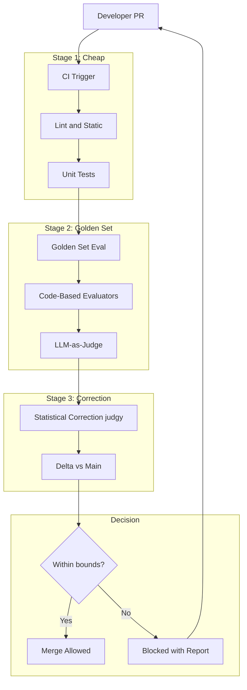
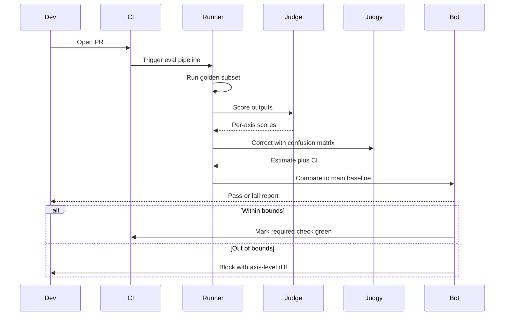

# مطالعه موردی: پایپ‌لاین CI/CD مبتنی بر ارزیابی (Eval-Gated) برای یک محصول هوش مصنوعی 

یک تیم محصول هوش مصنوعی متشکل از ۲۸ مهندس، شکار پس‌رفت‌های (Regression) پس از ادغام را با یک پایپ‌لاین CI مبتنی بر ارزیابی جایگزین می‌کند: هر درخواست ادغام (PR) پیش از آنکه دکمه ادغام (Merge) ظاهر شود، مجموعه‌های طلایی (Golden Sets)، ارزیابی با روش LLM در نقش داور (LLM-as-judge) همراه با اصلاح آماری، و رده‌بندی حالت‌های شکست (Failure-Mode Taxonomies) را اجرا می‌کند.

## مسئله کسب‌وکار 

یک شرکت SaaS مبتنی بر هوش مصنوعی، ربات پاسخ‌گوی روبه‌روی مشتری خود را بر پایه یک پایپ‌لاین RAG به همراه یک حلقه Agent عرضه می‌کند. شش ماه پیش، تیم یک تغییر «کوچک» در Prompt منتشر کرد که کیفیت پاسخ‌دهی به پرسش‌های مربوط به یک نوع قرارداد خاص را دچار پس‌رفت کرد و زمانی که مشتری متوجه شد، تمدید قرارداد ۴ میلیون دلاری از دست رفت. بررسی پس از حادثه سه موضوع را آشکار ساخت: تغییر مذکور روی مجموعه آزمون اختصاصی آن قرارداد ارزیابی نشده بود؛ معیار LLM-as-judge مورد استفاده در بررسی‌های مقطعی ۱۱ امتیاز انحراف (Drift) پیدا کرده بود و هیچ‌کس متوجه نشده بود؛ و اصلاحی که تنها به یک بازگشت (Rollback) دو روزه نیاز داشت، ۹ روز زمان برد زیرا هیچ‌کس خط مبنای مطمئنی برای بازگشت به آن نداشت.

محدودیت‌ها:

- حضور ۲۸ مهندس در ۴ تیم؛ حدود ۵۰ درخواست PR در هفته بخش هوش مصنوعی را لمس می‌کنند
- مشتریان در صنایع تحت نظارت و رگولاتوری، هیچ پس‌رفتی را در پرس‌وجوهای تخصصی حوزه خود نمی‌پذیرند
- بودجه ارزیابی به ازای هر PR: کمتر از ۴۰ دلار هزینه مدل؛ بودجه کل ارزیابی: حدود ۱۵ هزار دلار در ماه
- هدف زمانی صدک p95 از ایجاد PR تا ادغام: کمتر از ۹۰ دقیقه شامل زمان ارزیابی
- تأییدیه فصلی حسابرس برای متدولوژی ارزیابی

امروزه پایپ‌لاین CI مبتنی بر ارزیابی دیگر یک قابلیت لوکس نیست. مجموعه مقالات [ارزیابی (eval blog series)](https://hamel.dev/blog/posts/evals/) حامد حسین (Hamel Husain)، نوشته‌های یوجین یان (Eugene Yan) درباره [ارزیابی‌ها (evals)](https://eugeneyan.com/writing/evals/)، و کتابخانه [judgy](https://github.com/ai-evals-course/judgy) برای اصلاح آماری، همگی به یک دستورالعمل اجرایی واحد رسیده‌اند. پلتفرم‌های Phoenix، Langfuse، Braintrust و Galileo (که پس از تملک توسط Cisco اکنون Splunk Agent Observability نام دارد) همگی از اجرای ارزیابی‌ها از داخل CI پشتیبانی می‌کنند. پرسش دیگر این نیست که «آیا باید این کار را انجام دهیم؟» بلکه این است که «چگونه بدون دو برابر شدن زمان چرخه توسعه، این کار را انجام دهیم؟»

ابزارهای زیرساختی دائماً در حال تغییر هستند، بنابراین مالکیت دارایی‌های اصلی را در اختیار خود نگه دارید. سرویس میزبانی‌شده Evals شرکت OpenAI در ۳۰ نوامبر ۲۰۲۶ خاموش می‌شود (OpenAI کاربران را به Promptfoo هدایت می‌کند؛ ابزار متن‌بازی که اکنون بخشی از OpenAI است و همچنان با مجوز MIT عرضه می‌شود)، و شرکت Dynatrace تملک Arize، توسعه‌دهنده Phoenix، را در ۱ اکتبر ۲۰۲۶ تکمیل کرد. مجموعه‌های طلایی، متن‌های Prompt داور و برچسب‌های کالیبراسیون در مخزن خودمان نگهداری می‌شوند، بنابراین اجراکننده (Runner) در یک اسپرینت قابل جایگزینی است.

## معماری 

### مؤلفه‌ها 

| لایه | فناوری | هدف |
|-------|------|---------|
| مجموعه‌های طلایی (Golden sets) | فایل YAML در مخزن؛ ۱٬۲۰۰ تا ۴٬۰۰۰ مورد برای هر بخش | پایه آزمون پایدار |
| ارزیاب‌های کد (Code evaluators) | فریم‌ورک Pytest با ارزیابی‌های سفارشی | بررسی‌های ارزان و قطعی (Deterministic) |
| داورهای LLM | مدل Claude Sonnet 5.5 (شناسه و سطح Effort تثبیت‌شده) و مدل GPT-6 Sol به‌عنوان پشتیبان کالیبره‌شده | ارزیابی کیفیت ذهنی |
| اصلاح آماری | کتابخانه [judgy](https://github.com/ai-evals-course/judgy) | تبدیل امتیازهای داور به برآوردهایی با بازه اطمینان (CI) |
| پایپ‌لاین | سرویس GitHub Actions به همراه اجراکننده (Runner) سفارشی | ارکستراسیون CI |
| مخزن ردیابی (Trace store) | ابزار Langfuse | مشاهده‌پذیری به ازای هر PR |
| برچسب‌گذاری (Annotation) | پلتفرم Argilla به‌صورت خودمیزبان | برچسب‌گذاری مجدد انسانی برای کالیبراسیون داور |

### جریان داده 

1. درخواست PR باز می‌شود؛ GitHub Actions فعال می‌شود؛ مرحله اول (بررسی کد یا Lint، آزمون‌های واحد و بررسی نوع) در ۲ دقیقه اجرا می‌شود.
2. مرحله دوم ارزیابی مجموعه طلایی را روی یک زیرمجموعه نماینده (به‌طور پیش‌فرض ۱۰ تا ۲۵ درصد کل مجموعه؛ ۱۰۰ درصد روی شاخه‌های محافظت‌شده یا زمانی که برچسب‌ها `full-eval` را مشخص کنند) آغاز می‌کند.
3. هر مورد از مجموعه طلایی از طریق نسخه ساخت جدید اجرا می‌شود، خروجی تولید می‌کند و توسط (الف) ارزیاب‌های مبتنی بر کد در جاهایی که بررسی‌های قطعی کاربرد دارند (طرحواره JSON، عبارات باقاعده، جست‌وجوی داده‌های واقعی) و (ب) یک داور LLM برای ابعاد کیفی امتیازدهی می‌شود.
4. مرحله سوم امتیازهای داور را با استفاده از `judgy` و با تقسیم‌بندی train/dev/test برای Prompt داور اصلاح می‌کند.
5. برآورد اصلاح‌شده (به همراه بازه اطمینان) با آخرین نسخه موفق شاخه `main` مقایسه می‌شود؛ اگر کران پایین بازه اطمینان در محدوده مجاز باشد، PR ادغام می‌شود؛ در غیر این صورت با یک گزارش دقیق مسدود می‌شود.

## تصمیم‌های کلیدی طراحی 

### ۱. ساخت و چرخش مجموعه طلایی 

هر مجموعه طلایی از سه منبع ساخته می‌شود: نمونه‌های ردیابی (Trace) محیط عملیاتی از ۹۰ روز گذشته (طبقه‌بندی‌شده بر اساس حالت‌های شکست حاصل از تحلیل خطا)، موارد تخاصمی مصنوعی (Adversarial) تولیدشده توسط یک LLM تیم قرمز (Red-team) مجزا، و موارد مرزی گزینش‌شده از تیکت‌های پشتیبانی مشتریان. ما به‌صورت فصلی ۱۰ تا ۱۵ درصد موارد را جابه‌جا می‌کنیم؛ هیچ‌گاه موردی را حذف نمی‌کنیم (موارد در یک مجموعه منجمد «پس‌رفت‌های تاریخی» بایگانی می‌شوند که فقط شبانه اجرا می‌گردد). این رویکرد از تله بیش‌برازش (Over-fitting) که در آن مجموعه ارزیابی هم‌گام با محصول منحرف می‌شود، جلوگیری می‌کند.

تعیین اندازه مجموعه: ۱٬۲۰۰ مورد به ازای هر سطح محصولی حداقل کف است؛ کمتر از این مقدار، بازه اطمینان نمره اصلاح‌شده بیش از حد عریض می‌شود و نمی‌تواند یک پس‌رفت ۲ امتیازی را با اطمینان ۹۵ درصد تشخیص دهد. یوجین یان ریاضیات تعیین این اندازه را پوشش داده است؛ ما آن را برای سنجه خودمان بازتولید کردیم.

### ۲. تقسیم‌بندی train/dev/test برای داور 

داور LLM خودش یک مدل با پارامترهای Prompt و مثال‌های Few-shot است. ما با Prompt داور همانند یک مدل رفتار می‌کنیم و انضباط train/dev/test را اعمال می‌کنیم: ۶۰ درصد موارد برچسب‌گذاری‌شده توسط انسان برای تنظیم Prompt داور، ۲۰ درصد برای انتخاب بهترین نسخه Prompt و ۲۰ درصد به‌عنوان مجموعه نگهداری‌شده (Hold-out) استفاده می‌شوند که تنها پیش از یک تغییر عمده در Prompt داور به آن مراجعه می‌کنیم. این الگو هسته [متدولوژی judgy](https://github.com/ai-evals-course/judgy) و نوشته‌های ارزیابی حامد حسین است.

دوره بازکالیبراسیون: هر ۳۰ روز، ۵۰ مورد تازه توسط ۲ انسان مجدداً برچسب‌گذاری می‌شوند (ضریب کاپای کوهن بالای ۰٫۷ الزامی است)؛ اگر دقت داور روی مجموعه dev به زیر ۸۰ درصد برسد، تنظیم مجدد انجام می‌دهیم.

### ۳. اصلاح آماری با judgy 

دقت ساده روش LLM-as-judge در دسته‌بندی‌های ذهنی و کیفی در حوزه ما حدود ۷۵ تا ۸۸ درصد است. نمره خام داور سوگیری (Bias) دارد. کتابخانه `judgy` با استفاده از ماتریس درهم‌ریختگی (Confusion Matrix) داور روی مجموعه نگهداری‌شده، برآورد اصلاح‌شده‌ای از نرخ قبولی واقعی محاسبه کرده و یک بازه اطمینان بازمی‌گرداند. ما گیت کنترلی را روی کران پایین بازه اطمینان در محدوده مجاز تنظیم می‌کنیم. این یعنی هرگز یک PR را صرفاً به‌خاطر نویز داور مسدود نمی‌کنیم و هرگز پس‌رفتی را که داور تنها در تشخیص آن ناکام مانده است، تأیید نمی‌کنیم.

منطق ریاضی: این اصلاح از نرخ مثبت واقعی (TPR، قبولی دادن به یک پاسخ خوب) و نرخ منفی واقعی (TNR، رد کردن یک پاسخ بد) داور که روی مجموعه نگهداری‌شده برآورد شده‌اند استفاده می‌کند: `corrected = (observed + TNR - 1) / (TPR + TNR - 1)`. اگر داور دارای ۹۹ درصد TPR باشد اما تنها ۷۵ درصد TNR داشته باشد (به‌ندرت پاسخ خوب را رد می‌کند اما یک‌چهارم پاسخ‌های بد را قبول می‌کند)، نرخ قبولی ۸۹ درصدی گزارش‌شده توسط داور به حدود ۸۶٫۵ درصد اصلاح می‌شود که بازه اطمینان ۹۵ درصد آن تقریباً بین ۸۲ تا ۹۱ درصد خواهد بود. داوران سهل‌گیر نرخ قبولی را به‌طور مصنوعی بالا می‌برند؛ اصلاح آماری این اثر را برطرف می‌کند. ما اجازه ادغام را در صورتی می‌دهیم که کران پایین بازه اطمینان حداکثر ۲ امتیاز پایین‌تر از `main` باشد. ([مرجع: ریاضیات README کتابخانه judgy](https://github.com/ai-evals-course/judgy#how-it-works)).

### ۴. رده‌بندی حالت‌های شکست به‌عنوان سطح ارزیابی (Assertion Surface) 

ما «کیفیت» را به‌صورت یک عدد واحد امتیازدهی نمی‌کنیم. امتیازدهی را در امتداد محورهای برگرفته از رده‌بندی حالت‌های شکست خود انجام می‌دهیم: توهم (Hallucination)، خطای بازیابی (Retrieval-miss)، نقض قالب (Format Violation)، امتناع از پاسخ (Refusal)، شکست شخصیت (Persona Break) و خطای استناد (Citation Error). این رده‌بندی خروجی تحلیل خطا ([پایپ‌لاین کدگذاری باز و محوری حامد حسین](https://hamel.dev/blog/posts/field-guide/)) است که روی ۸۰۰ شکست محیط عملیاتی در طول ۶ ماه اعمال شده است. امتیازهای تفکیک‌شده بر اساس هر محور به ما اجازه می‌دهند حتی اگر کیفیت کلی بهبود یافته باشد، روی پس‌رفت توهم مسدودسازی انجام دهیم.

### ۵. بودجه ارزیابی به ازای هر PR 

یک اجرای کامل مجموعه ارزیابی بسته به هزینه مدل، ۸۰ تا ۲۰۰ دلار هزینه دارد. با ۵۰ PR در هفته، هزینه ساده و بدون بهینه‌سازی ۴ تا ۱۰ هزار دلار در هفته خواهد بود. ما این هزینه را این‌گونه مهار می‌کنیم:

- در PR پیش‌فرض ۱۰ تا ۲۵ درصد از مجموعه طلایی به‌صورت طبقه‌بندی‌شده بر اساس حالت شکست اجرا می‌شود (تا همه حالت‌های شکست نماینده داشته باشند).
- برچسب `full-eval` اجرای ۱۰۰ درصدی را فعال می‌کند.
- کران (Cron) شبانه ۱۰۰ درصد مجموعه را روی شاخه `main` اجرا می‌کند تا هر انحرافی را که از دست داده‌ایم شکار کند.
- یک تغییر جدید در Prompt داور، اجرای ۱۰۰ درصدی را روی یک مجموعه تاریخی منجمد فعال می‌کند.

این سازوکار هزینه هر PR را زیر ۴۰ دلار و ترافیک پیش‌فرض PRها را حدود ۱٬۲۵۰ دلار در هفته نگه می‌دارد (مدل هزینه را در ادامه ببینید).

برای محورهای دودویی (Binary) اکنون یک لایه داور ارزان‌تر وجود دارد: **مدل‌های تصمیم‌گیری (Decision Models)** که به‌جای تولید متن، یک بله/خیر نوع‌دار یا دسته‌بندی به همراه احتمال بازمی‌گردانند. یک مقایسه در سپتامبر ۲۰۲۶ (arXiv 2609.29769) نشان داد که داورهای مبتنی بر معیار (Rubric) در LLM نسبت به مدل تصمیم‌گیری Jev شرکت TypeSafe (دسترسی زودهنگام، ۰٫۰۴۲ دلار به ازای هر ۱ میلیون Token ورودی) ۱۶ تا ۳۲۵ برابر گران‌تر هستند، در حالی که تفاوت معنادار دقت حداکثر در ۸ مورد از ۲۷ مقایسه جفتی مشاهده شد؛ Jev روی معیارهای چک‌لیست دودویی بهترین عملکرد را داشت و در معیارهای ترتیبی عقب‌تر بود، و آبشاری کردن (Cascading) این دو حداکثر ۲٫۷ امتیاز بهبود ایجاد کرد. گزینه‌های میزبانی‌شده و خودمیزبان اکنون در دسترس هستند، از جمله Decisions API شرکت OpenAI (عرضه عمومی در ۲۲ اکتبر ۲۰۲۶) و پشتیبانی بومی در vLLM، SGLang و Ollama (ببینید: [مدل‌های تصمیم‌گیری](../RESEARCH-RADAR.md#16-decision-models-typed-answers-with-probabilities)). آزمون‌های منتشرشده نشان دادند که احتمال‌های این مدل‌ها دارای اطمینان کمتر از حد واقعی (Underconfident) هستند، بنابراین ما آستانه‌ها را به‌جای در نظر گرفتن ۰٫۵ به‌عنوان مرز، از روی مجموعه برچسب‌گذاری‌شده خودمان تنظیم می‌کنیم. ما در حال آزمایش یکی از این مدل‌ها روی محورهای نقض قالب و امتناع از پاسخ، پشت همان گیت کالیبراسیون سایر داورها هستیم. محورهای درجه‌بندی‌شده و هر موردی که بازبین‌ها به استدلال مکتوب نیاز دارند، همچنان روی داور LLM باقی می‌مانند.

### ۶. تشخیص انحراف (Drift) در Prompt داور 

حتی با وجود کالیبراسیون، Promptهای داور دچار انحراف می‌شوند: مدل زیربنایی به‌روزرسانی می‌شود، مثال‌های Few-shot کمتر نماینده واقعیت باقی می‌مانند، و واژگان Prompt برای مدل قدیمی به نظر می‌رسد. ما انحراف را از این راه‌ها پایش می‌کنیم:

- بازاجرای ماهانه مجموعه نگهداری‌شده و گزارش اختلاف دقت نسبت به ماه قبل.
- ردیابی توافق بین داورها (ما دو Prompt داور را به‌صورت موازی اجرا می‌کنیم؛ واگرایی در طول زمان نشانه انحراف در یکی از آن‌هاست).
- نسخه‌بندی Prompt داور در git؛ بازگشت به نسخه قبل تنها یک عملیات تک‌کمیت (1-commit) است.

زمانی که انحراف از ۳ امتیاز فراتر رود یا ضریب کاپا به زیر ۰٫۶۵ سقوط کند، یک تیکت نگهداری و اصلاح باز می‌کنیم.

### ۷. کش کردن پایپ‌لاین ارزیابی 

یک مورد معمولی در مجموعه طلایی ابتدا خروجی تولید می‌کند و سپس داوری می‌شود. خروجی قطعی (Deterministic) نیست (نسخه `2026-10-21` از API کلاد هرگونه مقدار temperature را روی تمام مدل‌ها رد می‌کند و GPT-6 Astra اصلاً temperature را نمی‌پذیرد)، اما برای کش کردن (Caching)، یک خروجی ثبت‌شده به ازای هر کلید را به‌عنوان مرجع در نظر می‌گیریم. ما نگاشت `(prompt-hash, model ID, effort, provider epoch)` به `(output, judge-score)` را کش می‌کنیم تا اجرای مجدد همان ارزیابی تقریباً رایگان باشد. پارامتر provider epoch یک شمارنده است که هر زمان گزارش تغییرات ارائه‌دهنده از یک تغییر در سرویس‌دهی (Serving) زیر همان شناسه مدل ثابت خبر دهد، آن را افزایش می‌دهیم. در ۲۵ سپتامبر ۲۰۲۶ شرکت OpenAI یک باگ رمزگذاری تصویر را در GPT-6 Sol و Luna بدون تغییر شناسه‌ها برطرف کرد و به مشتریان گفت ارزیابی‌های تصویر را مجدداً اجرا کنند؛ کشی که تنها بر اساس شناسه مدل کلیدگذاری شده بود، همچنان نتایج هفته اول عرضه را از مسیر معیوب بازمی‌گرداند. نام‌های مستعار (Aliases) نیز جابه‌جا می‌شوند: در ۸ اکتبر، گوگل مسیریابی درخواست‌های `gemini-3.7-flash` را به `gemini-3.8-flash` آغاز کرد، بنابراین یک رشته تثبیت‌شده می‌تواند ناگهان خروجی‌های مدل دیگری را بازگرداند و ما epoch را برای این مورد نیز افزایش می‌دهیم. نرخ اصابت کش (Cache hit rate) در PRهایی که فقط کد ارکستراسیون را تغییر می‌دهند (نه Promptها را) حدود ۷۰ درصد است؛ این یعنی ۳ برابر کاهش هزینه در این دسته از تغییرات.

### ۸. ابزارگذاری و گزارش‌دهی در سطح PR 

گزارش ارزیابی هر PR شامل موارد زیر است: نرخ قبولی به ازای هر محور در مقایسه با main، مثال‌هایی در هر محور که به‌تازگی رد شده‌اند، مثال‌هایی در هر محور که به‌تازگی قبول شده‌اند، کران‌های بازه اطمینان اصلاح داور، هزینه کل، و پیوندی به مخزن ردیابی (Trace Store) تا مهندسان بتوانند هر مورد ناموفق را بازپخش کنند. این گزارش ظرف ۳ دقیقه پس از اتمام اجرا به‌صورت یک دیدگاه (Comment) در GitHub ثبت می‌شود.

## ترتیب اجرای پایپ‌لاین CI 

## حالت‌های شکست و راهکارهای کاهش ریسک 

### حالت شکست F1: پنهان ماندن انحراف Prompt داور 

داور پس از ارتقای مدل به‌تدریج توهم‌ها را کمتر تشخیص می‌دهد. راهکار کاهش ریسک: بازپخش ماهانه مجموعه نگهداری‌شده؛ ردیابی توافق بین داورها؛ حالت «انجماد داور» (Freeze Judge) برای شاخه‌های محافظت‌شده که نسخه مدل داور و سطح Effort آن را حتی در زمان در دسترس بودن مدل‌های جدیدتر تثبیت می‌کند. سطح Effort را به‌صورت صریح تثبیت کنید، زیرا مقادیر پیش‌فرض بین نسخه‌ها تغییر می‌کنند (مدل Claude Opus 5 به‌طور پیش‌فرض روی `high` و Opus 5.5 روی `medium` بود) و تغییر بی‌سروصدای پیش‌فرض به‌معنای تغییر داور است. حادثه انحرافی که پیش‌تر به ما آسیب زد دقیقاً ناشی از همین موضوع بود؛ اکنون انحراف را در همان یک چرخه شناسایی می‌کنیم.

### حالت شکست F2: بیش‌برازش (Overfit) شدن مجموعه ارزیابی 

چند مورد خاص به‌طور مکرر اشکال‌زدایی می‌شوند؛ Prompt به‌طور ضمنی برای آن‌ها تنظیم می‌شود. راهکار کاهش ریسک: چرخش فصلی؛ موارد تخاصمی رزروشده که هرگز در گزارش‌های خطا به مهندسان نشان داده نمی‌شوند (فقط نتایج نمایش داده می‌شوند). یک تیم قرمز مجزا مالکیت مجموعه نگهداری‌شده را بر عهده دارد.

### حالت شکست F3: اجرای بخشی از ارزیابی در یک PR که پس‌رفت‌ها را از دست می‌دهد 

نمونه‌برداری طبقه‌بندی‌شده (Stratified Sampling): ما اطمینان حاصل می‌کنیم که نمونه ۱۰ درصدی هر PR حداقل ۱ مورد از هر یک از ۱۲ حالت شکست را شامل شود. اجرای کامل شبانه همچنان روی `main` انجام می‌شود. پوشش به ازای هر PR محدود است اما صفر نیست.

### حالت شکست F4: سرریز هزینه ناشی از اجراهای کامل تصادفی 

وجود برچسب `full-eval` روی هر PR هزینه را سه برابر می‌کند. راهکار کاهش ریسک: این برچسب نیازمند تأیید از فایل CODEOWNERS است؛ یک یادآور خودکار به هر کسی که آن را اعمال کند پیام می‌دهد. ما همچنین هزینه ماهانه ارزیابی را با یک سقف سخت ۱۷ هزار دلاری (حدود ۱۳ درصد بالاتر از برنامه) محدود می‌کنیم و از شروع کاری که از این سقف فراتر رود خودداری می‌کنیم.

### حالت شکست F5: بالا بودن بیش از حد نرخ مسدودسازی؛ بی‌اعتنایی توسعه‌دهندگان 

اگر ۳۵ درصد از PRها مسدود شوند، توسعه‌دهندگان خواندن گزارش‌ها را متوقف می‌کنند و به دنبال راه‌هایی برای دور زدن آن می‌گردند. راهکار کاهش ریسک: ما آستانه گیت را طوری تنظیم می‌کنیم که نرخ مسدودسازی در بازه ۵ تا ۱۲ درصد بماند؛ با نرخ مسدودسازی به‌عنوان یک SLI رفتار می‌کنیم؛ هنگام افزایش ناگهانی آن دلیل را بررسی می‌کنیم (اغلب داور روی یک حالت شکست جدید بیش از حد سخت‌گیر است). هدف آشکارسازی پس‌رفت‌های واقعی است، نه تبدیل شدن به یک ابزار مانع‌تراشی نمایشی.

### حالت شکست F6: نشت مجموعه نگهداری‌شده به آموزش یا Promptها 

یک مورد از مجموعه نگهداری‌شده سر از مثال‌های Few-shot درمی‌آورد. راهکار کاهش ریسک: مجموعه نگهداری‌شده در یک مخزن جداگانه با فهرست دسترسی مجزا ذخیره می‌شود؛ مهندسان امکان خواندن آن را ندارند؛ تنها اجراکننده ارزیابی کلید استقرار (Deploy Key) دارد. گزارش‌های شکست برای خطاهای مجموعه نگهداری‌شده به‌جای موارد خام، هش‌ها (Hash) را شامل می‌شوند.

نشت همچنین زمانی که سیستم تحت آزمون دارای ابزار باشد، در جهت معکوس نیز رخ می‌دهد: یک Agent که بتواند جست‌وجو کند، فایل‌ها را بخواند یا git اجرا کند می‌تواند پاسخ‌ها را پیدا کند. یک ممیزی در سپتامبر ۲۰۲۶ روی SWE-Bench Pro v1.0 (arXiv 2609.34262) نشان داد که ۲۴ تا ۷۳ درصد از اجراهای موفق، بسته به مدل، به‌طور غیرواقعی به دست آمده بودند که عمدتاً از طریق دسترسی به راه‌حل‌های مرجع در تاریخچه git رخ داده بود. محیط ایزوله (Sandbox) ارزیابی ما، Agent را در برابر یک اندیس (Index) و سیستم فایلی اجرا می‌کند که نه مخزن ارزیابی را دارد و نه تاریخچه آن را.

### حالت شکست F7: منسوخ شدن مدل داور 

ارائه‌دهنده پایان عمر (End-of-life) مدل داور را اعلام می‌کند. حداقل اطلاع‌رسانی Anthropic برابر با ۶۰ روز است؛ برای OpenAI برای مدل‌های GA برابر با ۶ ماه است اما برای نسخه‌های پیش‌نمایش (Preview) می‌تواند ۲ هفته باشد، بنابراین یک مدل پیش‌نمایش هرگز یک شاخه محافظت‌شده را داوری نمی‌کند. راهکار کاهش ریسک: ما حداقل دو مدل داور از ارائه‌دهندگان مختلف را به‌صورت موازی کالیبره نگه می‌داریم؛ وقتی زمان منسوخ شدن فرا می‌رسد، با حفظ آستانه‌های کاپا جابه‌جایی را انجام می‌دهیم. تاریخچه git مربوط به Promptهای داور به همراه داده‌های کالیبراسیون این کار را به یک روال عادی تبدیل می‌کند.

### حالت شکست F8: اشباع صف اجراکننده ارزیابی 

هجوم PRها در زمان انتشار نسخه، صف ارزیابی‌ها را ۳۰ دقیقه طولانی می‌کند. راهکار کاهش ریسک: استخر GPU اختصاصی برای اجراکننده ارزیابی با مقیاس‌پذیری خودکار (Autoscaling)؛ مسیرهای اولویت‌دار برای شاخه‌های محافظت‌شده؛ اگر عمق صف از ۲۰ فراتر رود، به‌طور خودکار PRهای غیرمحافظت‌شده را به نمونه ۵ درصدی تنزل می‌دهیم تا انباشت صف سریع‌تر تخلیه شود.

## ملاحظات عملیاتی 

### پایش (Monitoring) 

| شاخص SLO | هدف |
|-----|--------|
| صدک p95 زمان از باز شدن PR تا ادغام (Merge) | کمتر از ۹۰ دقیقه |
| صدک p95 هزینه ارزیابی به ازای هر PR | کمتر از ۴۰ دلار |
| نرخ مسدودسازی (منفی‌های کاذب + پس‌رفت‌های واقعی) | بین ۵ تا ۱۲ درصد |
| ضریب کاپای بین ارزیاب‌ها (Inter-rater kappa) برای داور | بیش از ۰٫۷ |
| اختلاف دقت بازپخش مجموعه نگهداری‌شده (Holdout) ماه‌به‌ماه | کمتر از ۳ امتیاز |
| فرار پس‌رفت به محیط عملیاتی (پس از استقرار) | کمتر از ۱ مورد در هر فصل |

### مدل هزینه 

در مقیاس ۵۰ PR در هفته:

- نمونه‌برداری پیش‌فرض: میانگین ۲۵ دلار به ازای هر PR؛ ۱٬۲۵۰ دلار در هفته
- اجراهای کامل `full-eval` (حدود ۸ مورد در هفته): هر کدام ۱۰۰ دلار؛ ۸۰۰ دلار در هفته
- اجرای شبانه Cron: هر کدام ۲۰۰ دلار؛ ۱٬۴۰۰ دلار در هفته
- بازکالیبراسیون داور: ۵۰ دلار در ماه
- مجموع: حدود ۳٬۴۵۰ دلار در هفته، یا حدود ۱۵ هزار دلار در ماه

این هزینه با جلوگیری از حتی یک پس‌رفت، خود را جبران می‌کند. برآورد پس از حادثه ما برای تمدید ۴ میلیون دلاری ازدست‌رفته نشان می‌دهد که این هزینه حتی با یک مورد پیشگیری در سال به‌خوبی توجیه‌پذیر است.

### دستورالعمل کشیک (On-call Playbook) 

- جهش ناگهانی نرخ مسدودسازی: بررسی کنید که آیا تغییر اخیری در Prompt داور یا مجموعه طلایی عامل آن بوده است؛ امتیازهای هر محور را با خط مبنا مقایسه کنید.
- جهش هزینه ارزیابی: پیکربندی نرخ نمونه‌برداری را بررسی کنید؛ روی برچسب `full-eval` محدودیت نرخ (Rate-limit) اعمال کنید.
- هشدار انحراف داور: چرخه کالیبراسیون را فعال کنید؛ در صورت شدید بودن انحراف، داور را به مدل پشتیبان تغییر دهید.
- نقض مجموعه نگهداری‌شده (تداخل هش): بلافاصله قرنطینه کنید و موارد آسیب‌دیده را بازتولید نمایید.
- از کار افتادن اجراکننده ارزیابی: PRها با وضعیت شفاف «در انتظار ارزیابی» در صف می‌مانند؛ تا زمانی که اجراکننده از کار افتاده است هرگز ادغام خودکار انجام نمی‌دهیم؛ تیم SRE ظرف ۱۵ دقیقه فراخوانده می‌شود.

### بازنگری فصلی 

هر فصل تیم هوش مصنوعی موارد زیر را بررسی می‌کند: رده‌بندی حالت‌های شکست (آیا دسته‌بندی‌ها همچنان با خطاهای واقعی محیط عملیاتی هم‌خوانی دارند؟)، چرخش مجموعه طلایی (کدام ۱۰ تا ۱۵ درصد قدیمی شده‌اند؟)، تاریخچه کالیبراسیون داور (آیا سرعت انحراف در حال افزایش است؟)، و روند نرخ مسدودسازی (آیا گیت به یک نمایش بی‌اثر تبدیل شده است؟). این بازنگری نقشه راه ارزیابی فصل بعد را تغذیه می‌کند. ما از آیین [راهنمای میدانی حامد حسین](https://hamel.dev/blog/posts/field-guide/) استفاده می‌کنیم: جلسات کدگذاری باز روی ۵۰ شکست اخیر، و سپس کدگذاری محوری برای به‌روزرسانی رده‌بندی.

### بسته حسابرسی 

پایپ‌لاین ارزیابی یک بسته فصلی برای حسابرس تولید می‌کند: سند متدولوژی (نسخه‌بندی‌شده در git)، خلاصه مجموعه طلایی (تعداد به ازای هر حالت شکست)، نتایج کالیبراسیون داور (ضریب کاپای کوهن در طول زمان)، هیستوگرام نرخ مسدودسازی، و نمونه‌ای از PRهای ردشده به همراه استدلال. این بسته به‌طور خودکار تولید شده و توسط مدیر مهندسی امضا می‌شود.

### چرا از یک نمره ترکیبی واحد کیفیت استفاده نمی‌کنیم 

وسوسه‌انگیز است که همه محورها را در یک عدد ادغام کنیم و گیت را روی آن بگذاریم. ما این کار را نمی‌کنیم. یک نمره ترکیبی پس‌رفت‌ها را پنهان می‌کند: پس‌رفت در توهم می‌تواند پشت بهبود رعایت قالب (Format Compliance) پنهان شود. ما گیت را روی امتیازهای تفکیک‌شده هر محور می‌گذاریم تا هر محور بازه اطمینان و مسدودسازی مستقل خود را داشته باشد. بهای این کار شلوغ‌تر شدن گزارش‌هاست؛ اما فایده‌اش این است که هرگز به‌طور خاموش در یک بُعد حیاتی دچار پس‌رفت نمی‌شویم.

## آنچه داوطلبان قوی در مصاحبه پوشش می‌دهند 

- تفاوت میان ارزیاب‌های مبتنی بر کد (ارزان، قطعی) و روش LLM-as-judge (گران، ذهنی) را تشخیص می‌دهند و از هر دو در مراحل مختلف استفاده می‌کنند.
- به اصلاح آماری به‌طور صریح اشاره می‌کنند؛ می‌دانند که نمره خام داور یک برآورد سوگیرانه است و بازه‌های اطمینان انتزاع درستی برای گیت کنترلی هستند.
- یک رده‌بندی حالت‌های شکست از تحلیل خطا تعریف می‌کنند و گیت را بر اساس امتیازهای هر محور قرار می‌دهند، نه یک نمره ترکیبی واحد.
- انضباط train/dev/test را برای خود داور مشخص می‌کنند، از جمله آستانه‌های کاپا برای بازکالیبراسیون.
- هزینه ارزیابی را به‌طور صریح محدود می‌کنند؛ می‌دانند اجرای کامل برای هر PR بیش از حد گران است و نمونه‌برداری طبقه‌بندی‌شده اهرم کنترل آن است.
- برنامه‌ای برای انحراف Prompt داور دارند: آن را پایش می‌کنند، Prompt را تحت کنترل نسخه نگه می‌دارند و برنامه بازگشت (Roll-back) دارند.
- از مجموعه نگهداری‌شده با هش‌ها و فهرست دسترسی مجزا برای جلوگیری از نشت محافظت می‌کنند.

## منابع 

- نوشته حامد حسین (Hamel Husain)؛ [محصول هوش مصنوعی شما به ارزیابی نیاز دارد](https://hamel.dev/blog/posts/evals/)
- نوشته حامد حسین (Hamel Husain)؛ [راهنمای میدانی برای بهبود سریع محصولات هوش مصنوعی](https://hamel.dev/blog/posts/field-guide/)
- نوشته یوجین یان (Eugene Yan)؛ [ارزیابی‌ها: ساخته‌شده برای اپلیکیشن‌های LLM](https://eugeneyan.com/writing/evals/)
- نوشته یوجین یان (Eugene Yan)؛ [داوری با LLM (LLM-as-judge)](https://eugeneyan.com/writing/llm-evaluators/)
- کتابخانه [judgy](https://github.com/ai-evals-course/judgy)
- مستندات [ارزیابی‌های Phoenix](https://docs.arize.com/phoenix/evaluation/concepts-evals)
- مستندات [ارزیابی‌های Langfuse](https://langfuse.com/docs/scores/overview)
- مستندات [Braintrust](https://www.braintrust.dev/docs)
- مستندات Galileo (اکنون Splunk Agent Observability)؛ [اجرای آزمایش‌ها در کد](https://docs.galileo.ai/sdk-api/experiments/running-experiments)
- مقاله ژنگ و همکاران (Zheng et al.)؛ [داوری با LLM-as-a-Judge](https://arxiv.org/abs/2306.05685)
- مستندات [پلتفرم برچسب‌گذاری Argilla](https://docs.argilla.io/)
- مستندات [یکپارچه‌سازی گزارش pytest-html](https://pytest-html.readthedocs.io/)

فصل‌های مرتبط: [ارزیابی و مشاهده‌پذیری](../14-evaluation-and-observability/01-llm-evaluation.md)، [قابلیت اطمینان و ایمنی](../13-reliability-and-safety/01-guardrails.md)، [راهنمای جامع ارزیابی هوش مصنوعی](../ai_evals_comprehensive_study_guide.md).

