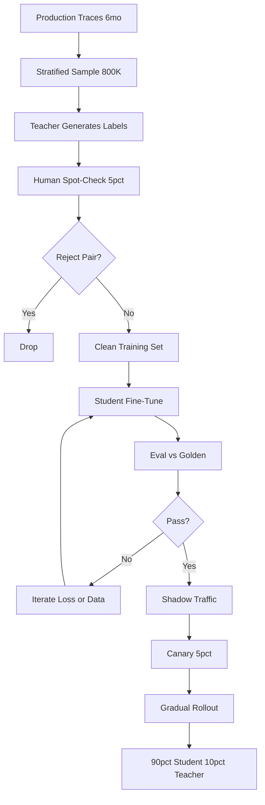

# مطالعه موردی: پایپ‌لاین تقطیر دانش اختصاصی مشتری 

یک محصول هوش مصنوعی در مرحله Series-B هزینه‌های مدل مرزی (Frontier Model) خود را با تقطیر (Distillation) یک مدل دانش‌آموز (Student) ۸ میلیاردی (8B) روی ۶ ماه از ردهای تولید (Production Traces)، از ۵۰ هزار دلار در ماه به ۴ تا ۶ هزار دلار کاهش می‌دهد؛ این پروژه با دوره بازگشت سرمایه کمتر از ۳ ماه و چرخه بازتقطیر ۴ تا ۶ ماهه اجرا می‌شود.

## مسئله کسب‌وکار 

یک محصول هوش مصنوعی مقیاس‌پذیر (با حدود ۸ میلیون درخواست کاربر در ماه) روی یک مدل مرزی (Frontier Model) اجرا می‌شود. خط هزینه این سرویس در اوایل سال ۲۰۲۶ از ۵۰ هزار دلار در ماه عبور کرد، رشد فصل‌به‌فصل آن ۱۸ درصد است و تیم مالی درخواست ارائه یک برنامه کرده است. تیم مهندسی به یک بینش شفاف رسید: تقریباً ۹۰ درصد از ترافیک محیط تولید در تعداد محدودی از الگوهای وظیفه تکراری جای می‌گیرد (طبقه‌بندی نیت کاربر، استخراج ساختاریافته، خلاصه‌سازی اسناد و سه دسته اولویت‌بندی و تریاژ). استفاده از یک مدل مرزی برای این وظایف بیش از حد نیاز (Overkill) است؛ یک مدل بسیار کوچک‌تر که روی خروجی‌های خود مدل مرزی Fine-tuning شده باشد، می‌تواند این درخواست‌ها را با کسری از هزینه سرویس‌دهی کند.

محدودیت‌ها:

- هزینه ۵۰ هزار دلار در ماه برای مدل مرزی که در حال رشد است
- بودجه تاخیر (Latency): زیر ۳۵۰ میلی‌ثانیه در صدک p95 برای وظایف پرترافیک
- معیار کیفیت: کمتر از ۲ درصد افت کیفیت روی مجموعه طلایی (Golden Set) مشتری
- انطباق (Compliance): داده‌های مشتری نمی‌توانند از یک منطقه ابری (Cloud Region) مشخص خارج شوند
- تعداد نیرو: ۱ مهندس یادگیری ماشین به همراه پشتیبانی پاره‌وقت پلتفرم

الگوی تقطیر دانش (Distillation) کاملاً بالغ شده است: مدل‌هایی مانند DistilBERT ([سانه و همکاران، ۲۰۱۹](https://arxiv.org/abs/1910.01108))، TinyBERT، تقطیر دستورالعملی به سبک Alpaca ([تائوری و همکاران، ۲۰۲۳](https://github.com/tatsu-lab/stanford_alpaca)) و پژوهش‌های جدیدتر درباره تقطیر زنجیره استدلال (Chain-of-Thought Distillation) ([هسیه و همکاران، ۲۰۲۳](https://arxiv.org/abs/2305.02301)) همگی نشان می‌دهند که یک مدل دانش‌آموز ۷ تا ۱۳ میلیاردی (7-13B) می‌تواند ۹۲ تا ۹۸ درصد از عملکرد مدل معلم (Teacher) را در وظایف متمرکز بازیابی کند. اعداد بودجه در ادامه جنبه نمایشی دارند؛ آن‌ها را بر اساس ترافیک و قیمت‌های روز خودتان دوباره محاسبه کنید، زیرا هر دو در سال ۲۰۲۶ تغییر شدیدی داشته‌اند (نگاه کنید به تصمیم کلیدی طراحی ۷).

```mermaid
flowchart LR
    subgraph Collect["Trace Collection"]
        PROD[Production Traffic] --> TRACES[Trace Store]
        TRACES --> SAMPLER[Stratified Sampler]
        SAMPLER --> CURATE[Curation Queue]
    end

    subgraph Label["Labeling"]
        CURATE --> TEACHER[Teacher Frontier Model]
        TEACHER --> LABELS[Distillation Pairs]
        LABELS --> HUMAN[Human Spot-Check]
        HUMAN --> CLEAN[Clean Pairs]
    end

    subgraph Train["Distillation"]
        CLEAN --> FT[Student Fine-Tune 8x H100]
        FT --> EVAL[Eval Suite]
        EVAL --> CANARY[Canary Cohort]
    end

    subgraph Serve["Serving"]
        CANARY --> SHADOW[Shadow Traffic]
        SHADOW --> ROLLOUT[Gradual Rollout]
        ROLLOUT --> STUDENT[Student Model Serving]
    end
```

## معماری 

### مؤلفه‌ها 

| لایه | فناوری | هدف |
|------|--------|-----|
| مدل معلم (Teacher) | مدل مرزی (Claude Opus 5.5 یا معادل)، برچسب‌گذاری‌شده از طریق Batch API با نصف قیمت | منبع برچسب‌ها |
| مدل دانش‌آموز (Student) | مدل IBM Granite 4.2 8B یا Llama 3.1 8B با کوانتیزاسیون int4 | سرویس‌دهی محیط تولید؛ مجوز Apache 2.0 یا Llama، بدون محدودیت تجاری در مقیاس ما |
| مخزن ردها (Trace Store) | سرویس S3 به همراه Langfuse | نمونه‌گیری و بازپخش (Replay) |
| آموزش‌دهنده (Trainer) | فریم‌ورک DeepSpeed به همراه FSDP روی 8x H100 | اجرای آموزش یک‌هفته‌ای |
| ارزیابی (Eval) | مجموعه طلایی (Golden Set) به ازای هر وظیفه، هشدار به مهندس کشیک (On-call) در صورت افت کیفیت | دروازه کنترل کیفیت (Quality Gate) |
| سرویس‌دهی (Serving) | موتور vLLM نسخه 0.32+ (کف امنیتی)، وزن‌های int4 و حافظه کش FP8 KV | تاخیر p95 معادل ۳۵۰ میلی‌ثانیه |

### جریان داده 

1. ردهای محیط تولید (Production Traces) به مدت شش ماه در Langfuse به همراه S3 انباشته می‌شوند.
2. نمونه‌گیر (Sampler) نمونه‌های طبقه‌بندی‌شده (Stratified) را بر اساس دسته وظیفه استخراج می‌کند و با بازتوزین (Rebalancing) اطمینان می‌دهد که دسته‌های نادر نیز پوشش داده شوند.
3. مدل معلم (مدل مرزی) خروجی‌های هدف را برای هر نمونه تولید می‌کند؛ در صورت بهره‌مندی وظیفه از تقطیر استدلال (Reasoning Distillation)، این خروجی‌ها اغلب همراه با ردهای استدلال زنجیره‌ای (Chain-of-Thought) هستند.
4. یک بازبینی نمونه‌ای انسانی (Human Spot-Check) به میزان ۵ درصد توسط متخصصان دامنه، خطاهای مدل معلم را شکار می‌کند؛ ما نمونه‌گیری ردی (Rejection Sampling) را اعمال کرده و تنها جفت‌هایی را نگه می‌داریم که بازبین‌های انسانی با خروجی معلم موافق باشند.
5. مدل دانش‌آموز حدود ۱ هفته روی 8x H100 (حدود ۳.۹ تا ۵.۴ هزار دلار هزینه محاسباتی: ۱٬۳۴۴ ساعت-H100 با نرخ ۲.۹۳ تا ۳.۹۹ دلار به ازای هر GPU-ساعت؛ تعرفه درخواستی 8x H100 در Lambda قرار است در ۱۶ نوامبر ۲۰۲۶ به ۴.۵۹ دلار افزایش یابد که سقف این بازه را به حدود ۶.۲ هزار دلار می‌رساند) Fine-tuning می‌شود و یک مدل ۸ میلیاردی (8B) تولید می‌کند.
6. مدل ارزیابی‌های هر وظیفه را پشت سر می‌گذارد، به مدت ۲ هفته به صورت سایه (Shadow) در برابر ترافیک تولید اجرا می‌شود و سپس با عرضه تدریجی (Gradual Rollout) به پیش می‌رود: ۵ درصد، ۲۰ درصد، ۵۰ درصد و ۹۰ درصد در طول ۳ هفته، همراه با بازگشت خودکار (Auto-rollback) متصل به معیارهای کیفیت زنده.

## تصمیم‌های کلیدی طراحی 

### 1. تقطیر روی ردهای واقعی محیط تولید، نه داده‌های مصنوعی 

وسوسه این است که از طریق یک LLM دستورهای Prompt مصنوعی تولید کرده و با مدل معلم برچسب‌گذاری کنیم. ما این کار را امتحان کردیم؛ نتیجه مدلی است که در Promptهای مصنوعی عالی عمل می‌کند اما روی ترافیک واقعی ۴ تا ۷ امتیاز افت دارد. ردهای محیط تولید، تغییر توزیع (Distribution Shift)، موارد عجیب و حالت‌های انتهایی (Tail Cases) مهم را ثبت می‌کنند. ما ۶ ماه از ردها را جمع‌آوری می‌کنیم، بر اساس دسته وظیفه به‌صورت طبقه‌بندی‌شده نمونه‌گیری می‌کنیم و از Promptهای واقعی به عنوان منبع تقطیر استفاده می‌کنیم.

پیش از شروع، شرایط استفاده مدل معلم را بخوانید. شرایط تجاری ارائه‌دهندگان مدل‌های مرزی استفاده از خروجی‌ها برای ساخت مدل‌های رقیب را محدود می‌کند؛ بنابراین تاییدیه کتبی بگیرید که یک مدل دانش‌آموز مختص وظیفه که محصول خودتان را سرویس‌دهی می‌کند مجاز است، و ثبت کنید که هر جفت داده توسط کدام مدل معلم و چه نسخه‌ای برچسب‌گذاری شده است.

### 2. نمونه‌گیری ردی همراه با بازبینی نمونه‌ای انسانی 

خطاهای مدل معلم به مدل دانش‌آموز منتقل می‌شوند. دقت ۹۲ درصدی معلم در صورت آموزش روی تمام خروجی‌های معلم، به دقت ۹۰ درصدی دانش‌آموز تبدیل می‌شود. ما یک بازبینی نمونه‌ای انسانی ۵ درصدی روی نمونه‌ای تصادفی از برچسب‌های معلم انجام می‌دهیم و جفت‌هایی را که انسان با آن‌ها مخالف است رد می‌کنیم. این کار حدود ۴ درصد از برچسب‌ها را شناسایی و حذف می‌کند و کیفیت نهایی مدل دانش‌آموز را ۲ تا ۴ امتیاز روی معیار ترکیبی ما افزایش می‌دهد. هزینه این کار حدود ۱٬۸۰۰ دلار برای برچسب‌گذاری انسانی در هر بار بازتقطیر، علاوه بر هزینه محاسباتی است.

### 3. تقطیر زنجیره استدلال در جایی که به‌صرفه باشد 

برای وظایف نیازمند استدلال سنگین (در مورد ما، دسته تریاژ)، از رویکرد هسیه و همکاران یعنی [تقطیر همراه با استدلال (Distillation with Rationales)](https://arxiv.org/abs/2305.02301) استفاده می‌کنیم: مدل معلم هم پاسخ و هم یک رد استدلالی تولید می‌کند؛ مدل دانش‌آموز نیز برای تولید هر دو آموزش داده می‌شود. این روش به دانش‌آموز تفکر ساختاریافته‌ای می‌دهد که تنها از طریق جفت‌های ورودی-خروجی به دست نمی‌آورد. ما از این روش برای وظایف طبقه‌بندی یا استخراج استفاده نمی‌کنیم (بدون بهبود کیفیت و با تاخیر اضافه).

### 4. ساخت مجموعه ارزیابی با برچسب‌گذاری انسانی 

مجموعه ارزیابی (Eval Set) ما به‌صورت جداگانه از مجموعه آموزش تدوین می‌شود. این مجموعه شامل ۱٬۸۰۰ نمونه در میان دسته‌های وظایف پرترافیک است که توسط ۳ متخصص دامنه با رای اکثریت برچسب‌گذاری شده‌اند. ما هر فصل ۲۰۰ نمونه را دوباره برچسب‌گذاری می‌کنیم تا انحراف توزیع (Distribution Drift) را ردیابی کنیم. مجموعه ارزیابی سیگنال دروازه‌بانی (Gating Signal) برای عرضه تدریجی (Canary Rollout) است؛ افت ۲ امتیازی روی معیار ترکیبی، استقرار (Deployment) در محیط تولید را مسدود می‌کند. ما هرگز هنگام نمونه‌گیری داده‌های آموزشی به نمونه‌های مجموعه ارزیابی نگاه نمی‌کنیم.

### 5. عرضه تدریجی (Canary) و ترافیک سایه (Shadow) 

حتی با عبور از ارزیابی، محیط تولید رفتارهای انتهایی (Tail Behavior) دارد که مجموعه ارزیابی آن‌ها را نمی‌بیند. برنامه عرضه ما به این شکل است:

- هفته ۱: تنها ترافیک سایه، بدون هیچ تاثیری بر کاربر. ما خروجی‌های دانش‌آموز را در برابر معلم روی ۱۰۰ درصد ترافیک مقایسه می‌کنیم و یک طبقه‌بند اختلاف (Delta Classifier) موارد واگرایی را برای بازبینی انسانی علامت‌گذاری می‌کند.
- هفته ۲: ۵ درصد ترافیک زنده. بازگشت خودکار (Auto-rollback) در صورت رخ دادن هر یک از موارد: (الف) تاخیر p95 از ۵۰۰ میلی‌ثانیه فراتر برود، (ب) نرخ پسند (Thumbs-up) کاربران زنده بیش از ۱ امتیاز افت کند، (ج) یک محافظ دامنه‌محور (Domain-specific Guardrail) با نرخ بالاتری فعال شود.
- هفته ۳: ۲۰ درصد ترافیک. با همان محافظ‌ها.
- هفته ۴: ۵۰ درصد ترافیک.
- هفته ۵: ۹۰ درصد ترافیک. ۱۰ درصد به‌طور دائمی برای جمع‌آوری مداوم ردها و بازتقطیر به سمت مدل معلم مسیریابی می‌شود.

این شیب ملایم و محتاطانه در سال گذشته دو افت کیفیت را شکار کرد که از چشم مجموعه ارزیابی پنهان مانده بودند.

### 6. چرخه زمانی بازتقطیر 

جهان تغییر می‌کند. ویژگی‌های جدید محصول توزیع وظایف را تغییر می‌دهند؛ کاربران رفتارهای جدیدی یاد می‌گیرند؛ و خود مدل معلم نیز با انتشار نسخه‌های جدید بهبود می‌یابد. ما هر ۴ تا ۶ ماه یک‌بار بازتقطیر انجام می‌دهیم که تنها در صورتی ممکن است که مسیر آموزش همچنان در دسترس بماند. ما مدل‌های وزن‌باز (Open Weights) را در حساب خودمان Fine-tuning می‌کنیم، نه از طریق سرویس Fine-tuning میزبانی‌شده یک ارائه‌دهنده: شرکت OpenAI در حال تعطیل کردن پلتفرم Fine-tuning خود است (سازمان‌هایی که هرگز Fine-tuning انجام نداده‌اند دیگر نمی‌توانند کار جدید بسازند و مشتریان فعلی نیز در ۶ ژانویه ۲۰۲۷ امکان ایجاد کار جدید را از دست می‌دهند) و مدل دانش‌آموزی که دیگر نتوانید بازآموزش دهید، در تغییر توزیع بعدی به یک بدهی فنی (Liability) تبدیل می‌شود. این پایپ‌لاین به‌صورت نیمه‌خودکار است: نمونه‌گیری ردها، برچسب‌گذاری معلم و آموزش به‌صورت اسکریپت‌نویسی‌شده انجام می‌شوند؛ اما بازبینی نمونه‌ای انسانی و بررسی ارزیابی همچنان به انسان نیاز دارند. هر بار بازتقطیر در مجموع حدود ۹ هزار دلار هزینه دارد (حدود ۵ هزار دلار محاسبات، ۱٬۸۰۰ دلار برچسب‌گذاری، به علاوه سربار) و ۴ تا ۶ هفته زمان می‌برد.

### 7. چه زمانی تقطیر دانش منطقی نیست 

تقطیر همیشه راه‌حل درستی نیست. نشانه‌های ضدتقطیر عبارت‌اند از:

- حجم ترافیک پایین است (زیر ۲۰۰ هزار درخواست در ماه). بازگشت سرمایه هرگز محقق نمی‌شود.
- وظایف بسیار متغیر هستند. اگر هر درخواست منحصربه‌فرد باشد، مدل دانش‌آموز نمی‌تواند توزیع مفیدی را یاد بگیرد.
- خود مدل معلم ناپایدار است یا به‌سرعت در حال تغییر است. بازتقطیر روی یک هدف متحرک، تلاش را هدر می‌دهد.
- معیار کیفیت بسیار سخت‌گیرانه است (نیاز به بیش از ۹۹ درصد وفاداری به معلم). شکاف تقطیر واقعی است؛ اگر نمی‌توانید آن را تحمل کنید، نزد مدل معلم بمانید.
- یک مدل کوچک میزبانی‌شده (Hosted) همین الان هم مجموعه طلایی شما را پاس می‌کند. قیمت مدل‌های میزبانی‌شده در سال ۲۰۲۶ به‌شدت سقوط کرد: مدل GPT-6 Luna با قیمت ۰.۱۰/۰.۵۰ دلار به ازای هر ۱ میلیون Token عرضه شد که ۴۰ برابر ارزان‌تر از قیمت ۴/۲۰ دلاری Claude Opus 5.5 است؛ مدل Claude Haiku 5.5 در ۷ اکتبر برای Promptهای تا ۱۰۰ هزار Token با همین قیمت هم‌تراز شد؛ مدل GPT-6.1 Terra رده قیمتی ۱/۵ دلاری را باز کرد و رده میانی روی ۲/۱۰ دلار تثبیت شد. برای طبقه‌بندی و استخراج پرترافیک، مسیریابی به یک مدل کوچک میزبانی‌شده با یک Prompt خوب می‌تواند با هزینه‌ای کمتر از نرخ اجرای ماهانه ۹ هزار دلاری مدل دانش‌آموز و بدون هیچ پایپ‌لاین آموزشی انجام شود. تنها زمانی تقطیر کنید که مدل‌های کوچک میزبانی‌شده در مجموعه طلایی شما رد شوند، یا محدودیت تاخیر و اقامت داده (Data Residency) آن‌ها را از گزینه خارج کند، یا حجم درخواست‌ها میزبانی اختصاصی (Self-hosting) را ارزان‌تر کند.

ما از یک قاعده سرانگشتی غربالگری سریع استفاده می‌کنیم: حداقل ۶۰ درصد ترافیک در ۵ الگوی وظیفه یا کمتر قرار بگیرد و هزینه ماهانه آن وظایف از ۲۰ هزار دلار بیشتر باشد. اگر هر دو شرط برقرار نباشند، از تقطیر صرف‌نظر می‌کنیم.

### 8. انتخاب کوانتیزاسیون (Quantization) 

ما مدل دانش‌آموز ۸ میلیاردی (8B) را با فرمت int4 سرویس‌دهی می‌کنیم (روش GPTQ از طریق vLLM با حافظه کش FP8 KV). فرمت int4 مصرف حافظه را تقریباً ۴ برابر کاهش می‌دهد و توان عملیاتی (Throughput) را روی H100 نسبت به FP16 حدود ۲.۳ برابر بهبود می‌بخشد. ما افت دقتی معادل ۰.۴ امتیاز روی معیار ترکیبی خود اندازه‌گیری کردیم که کاملاً در محدوده قابل قبول است. گزینه‌های int8 (افت کمتر، افزایش سرعت کمتر) و وزن‌های FP8 (تقریباً بدون افت و با پشتیبانی خوب روی H100، اما تنها با نصف صرفه‌جویی حافظه int4) را نیز بررسی کردیم؛ در نهایت int4 بر اساس هزینه به ازای هر درخواست برنده شد.

### 9. ملاحظات حریم خصوصی در داده‌های آموزشی 

ردهای محیط تولید به‌طور پیش‌فرض حاوی اطلاعات شناسایی شخصی (PII) کاربران هستند. پیش از آموزش، یک مرحله پالایش و سانسور (Redaction) اجرا می‌کنیم: یک مدل NER که Fine-tuning شده است بازه‌های PII را علامت‌گذاری می‌کند و ما آن‌ها را با Tokenهای دسته‌بندی‌شده (`[EMAIL]`، `[PERSON_NAME]`) جایگزین می‌کنیم. به این ترتیب مدل دانش‌آموز الگوهای ساختاری را یاد می‌گیرد بدون اینکه هویت‌های مشخص را حفظ کند. خود مدل پالایشگر نیز روی یک نمونه برچسب‌گذاری‌شده با دقت (Precision) بالای ۹۸ درصد و فراخوانی (Recall) بالای ۹۵ درصد ارزیابی می‌شود.

## هزینه و بازگشت سرمایه 

| ردیف هزینه | مبلغ |
|------------|------|
| جمع‌آوری ردها (۶ ماه) | از قبل به عنوان بخشی از هزینه مشاهده‌پذیری (Observability) پرداخت شده است |
| برچسب‌گذاری معلم (حدود ۸۰۰ هزار جفت) | ۴۲ هزار دلار (یک‌بار) |
| بازبینی نمونه‌ای انسانی | ۸ هزار دلار (یک‌بار) |
| محاسبات (8x H100 به مدت ۱ هفته، به همراه تکرارها) | حدود ۸ هزار دلار (یک‌بار) |
| تدوین مجموعه ارزیابی | ۱۴ هزار دلار (یک‌بار) |
| مهندسی پلتفرم (سربار) | ۲۴ هزار دلار (یک‌بار) |
| **مجموع هزینه اولیه** | **۹۶ هزار دلار** |

| نرخ هزینه ماهانه | پیش از تقطیر | پس از تقطیر |
|-------------------|-------------|-------------|
| مدل مرزی (۱۰ درصد ترافیک، به همراه بستر بازتقطیر) | ۵۰ هزار دلار | ۵ هزار دلار |
| سرویس‌دهی مدل دانش‌آموز (vLLM روی دو H100 اختصاصی، یکی برای افزونگی، حدود ۲٬۱۰۰ دلار برای هر کدام در ماه با شاخص ۲.۹۳ دلار به ازای هر GPU-ساعت در ۱ نوامبر Silicon Data) | ۰ دلار | حدود ۴.۳ هزار دلار |
| **مجموع ماهانه** | **۵۰ هزار دلار** | **حدود ۹.۳ هزار دلار** |

صرفه‌جویی ماهانه: تقریباً ۴۱ هزار دلار. بازگشت سرمایه: ۹۶ هزار تقسیم بر ۴۰.۷ هزار، حدود ۲.۴ ماه. ما به تیم مالی عبارت «بازگشت سرمایه زیر ۳ ماه» را گزارش می‌دهیم.

بازتقطیر به‌طور میانگین هر ۵ ماه حدود ۹ هزار دلار هزینه دارد که آن را در همین ردیف صرفه‌جویی مستهلک می‌کنیم. صرفه‌جویی خالص سالانه: حدود ۴۷۰ هزار دلار.

## پایپ‌لاین تقطیر دانش 

## حالت‌های شکست و راهکارهای کاهش ریسک 

### حالت شکست F1: ارتقای مدل معلم باعث قدیمی شدن مدل دانش‌آموز می‌شود 

ارائه‌دهنده مدل مرزی نسل جدیدی را منتشر می‌کند، کیفیت معلم جهش می‌یابد و اکنون مدل دانش‌آموز ما نسبت به آنچه بقیه بازار عرضه می‌کنند، پایین‌تر از انتظار کاربران عمل می‌کند. راهکار کاهش ریسک: ما به‌صورت ماهانه یک ارزیابی مقایسه‌ای بین معلم و دانش‌آموز اجرا می‌کنیم؛ هنگامی که شکاف از ۴ امتیاز فراتر برود، تقویم بازتقطیر را جلو می‌اندازیم. بازتقطیر در برابر یک معلم قوی‌تر سرراست است؛ پایپ‌لاین همان قبلی است.

### حالت شکست F2: تغییر توزیع بین آموزش و سرویس‌دهی 

یک ویژگی جدید محصول رفتار کاربران را یک‌شبه تغییر می‌دهد (یک کمپین اعلان‌ها پرس‌وجوهای غیرعادی ایجاد می‌کند، یا یک پلن قیمتی جدید نوع کاربران را تغییر می‌دهد). توزیع آموزشی مدل دانش‌آموز دیگر با محیط تولید همخوانی ندارد. راهکار کاهش ریسک: یک پایشگر آنلاین انحراف (Online Drift Monitor) هنگام عبور توزیع بردارهای ورودی (Input Embedding) از یک آستانه هشدار می‌دهد؛ اگر انحراف ساختاری باشد، یک بازتقطیر اضطراری را فعال می‌کنیم؛ و اگر موقتی باشد، بخش متاثر را به سمت مدل معلم هدایت می‌کنیم.

### حالت شکست F3: نهادینه شدن توهم‌های معلم در مدل دانش‌آموز 

مدل معلم گاهی دچار توهم (Hallucination) می‌شود؛ نمونه‌گیری ردی بیشتر موارد را می‌گیرد اما نه همه آن‌ها را. در نتیجه مدل دانش‌آموز با اعتمادبه‌نفس بیشتری توهم تولید می‌کند، زیرا این الگو در توزیع آموزشی آن قرار گرفته است. راهکار کاهش ریسک: اجرای بررسی وفاداری به واقعیت (Faithfulness Check) روی مجموعه ارزیابی؛ هرگونه افزایش نرخ توهم نسبت به خط پایه، پاک‌سازی مجدد داده‌های آموزشی را کلید می‌زند.

### حالت شکست F4: بازگشت هزینه‌ها به دلیل مسیریابی بیش از حد به مدل معلم 

سهم ۱۰ درصدی ارجاع به معلم (Fallback) به‌تدریج با اضافه کردن مسیرهای جایگزین توسط مهندسان برای حالت‌های خاص مختلف، افزایش می‌یابد. راهکار کاهش ریسک: تنظیم هشدار بودجه روی هزینه معلم؛ ممیزی فصلی مسیرهای ارجاع؛ هر قانون ارجاع باید توجیه مشخص و تاریخ انقضا داشته باشد.

### حالت شکست F5: عرضه تدریجی یک افت کیفیت انتهایی (Tail Regression) را از دست می‌دهد 

مجموعه ارزیابی و ترافیک سایه هر دو خوب به نظر می‌رسند، اما ۵ درصد ترافیک زنده افت کیفیتی را آشکار می‌کند که به یک بخش خاص از مشتریان آسیب می‌زند. راهکار کاهش ریسک: تعریف معیارهای کیفیت به ازای هر بخش (Per-segment) روی ترافیک زنده همراه با بازگشت خودکار به ازای هر بخش؛ ما بخش‌بندی را بر اساس سطح اشتراک مشتری، زبان و دسته وظیفه رصد می‌کنیم.

### حالت شکست F6: نقض انطباق: اقامت داده‌های آموزشی (Data Residency) 

قرارداد مشتری ایجاب می‌کند داده‌ها در یک منطقه جغرافیایی مشخص باقی بمانند؛ در حالی که زیرساخت پردازش آموزشی پیش‌فرض ما در منطقه دیگری است. راهکار کاهش ریسک: ما ظرفیت آموزشی محلی در همان منطقه را نگه می‌داریم؛ داده‌های آموزشی هر مشتری به منطقه خودش مقید می‌شود؛ ما هرگز ردهای خام را به خارج از منطقه کپی نمی‌کنیم. هماهنگ‌کننده (Orchestrator) از اجرای کاری که اقامت داده را نقض کند جلوگیری می‌کند.

### حالت شکست F7: فراموشی فاجعه‌بار در وظایف کم‌تکرار 

مدل دانش‌آموز دسته‌ای را که تنها دو بار در آموزش دیده است فراموش می‌کند. راهکار کاهش ریسک: نمونه‌گیری طبقه‌بندی‌شده حداقل پوشش دسته‌های نادر را تضمین می‌کند؛ مجموعه ارزیابی به‌طور صریح شامل نمونه‌های دسته‌های نادر است؛ و عرضه تدریجی، کیفیت هر دسته را به‌صورت جداگانه پایش می‌کند.

### حالت شکست F8: خطای ردیابی هزینه بین مدل معلم و دانش‌آموز 

برخی پرس‌وجوها هم‌زمان هم به مدل دانش‌آموز و هم به مدل معلم ارسال می‌شوند (در طول ترافیک سایه)؛ در این حالت حسابداری هزینه، مگر اینکه صراحتاً تفکیک شود، دو بار هزینه ثبت می‌کند. راهکار کاهش ریسک: درج برچسب هزینه روی هر فراخوانی (سایه، اصلی، جایگزین) همراه با یک گزارش تطبیق روزانه که ترافیک‌های بدبرچسب‌گذاری‌شده را شناسایی می‌کند.

## ملاحظات عملیاتی 

### پایش (Monitoring) 

| هدف سطح سرویس (SLO) | مقدار هدف |
|-----------------------|-----------|
| تاخیر p95 مدل دانش‌آموز | کمتر از ۳۵۰ میلی‌ثانیه |
| اختلاف کیفیت نسبت به معلم (اصلاح‌شده) | حداکثر ۲ امتیاز |
| نرخ ارجاع به معلم (Fallback) | هدف ۱۰ درصد، هشدار در بالای ۱۵ درصد |
| هزینه به ازای هر ۱ هزار درخواست | کمتر از ۳۰ درصد پیش از تقطیر |
| چرخه بازتقطیر | هر ۴ تا ۶ ماه |

### مدل هزینه 

نرخ پایدار ماهانه: ۹ هزار دلار هزینه جاری به علاوه بازتقطیر مستهلک‌شده (۱.۸ هزار دلار در ماه). در مقایسه با ۵۰ هزار دلار هزینه فقط-معلم، پس از استهلاک کامل حدود ۳۹ هزار دلار در ماه صرفه‌جویی می‌شود. در مقیاس سالانه: حدود ۴۷۰ هزار دلار صرفه‌جویی خالص.

### کتابچه راهنمای کشیک (On-call Playbook) 

- هشدار افت کیفیت: با بازپخش دستی مجموعه ارزیابی تایید کنید؛ اگر واقعی بود، بخش متاثر را تا چرخه آموزش بعدی به سمت معلم مسیریابی کنید؛ یک تیکت اولویت‌دار ثبت کنید.
- سرریز هزینه: مسیرهای ارجاع (Fallback) را بررسی کنید؛ اگر الگوهای ترافیک تغییر کرده‌اند، بازتقطیر را زمان‌بندی کنید؛ در صورت نیاز محدودیت نرخ (Throttle) اعمال کنید.
- جهش تاخیر (Latency Spike): میزان مصرف GPU را بررسی کنید؛ اگر همسایه پرمصرف مزاحم (Noisy Neighbor) وجود دارد، گره (Node) مدل دانش‌آموز را ایزوله کنید.
- هشدار انحراف (Drift Alarm): هیستوگرام‌های بردار ورودی (Input Embedding) را بررسی کنید؛ اگر انحراف بزرگ و پایدار است، بازتقطیر اضطراری را فعال کنید.
- نشت مجموعه ارزیابی (Eval-set Leak): اگر یک نمونه ارزیابی کنارگذاشته‌شده (Held-out) در داده‌های آموزشی پیدا شد، بلافاصله آن نمونه را بازنشسته کنید و یک مرحله حذف تکراری (Deduplication) اجرا کنید؛ مجموعه ارزیابی را در طول همان فصل تازه‌سازی کنید.

### چرخه ارزیابی مقایسه‌ای 

ماهی یک‌بار یک ارزیابی مقایسه‌ای اجرا می‌کنیم: یک نمونه ۵۰۰ تایی، دانش‌آموز در برابر معلم، که توسط مدل داور (LLM-as-judge) به همراه یک نمونه ۵۰ تایی انسانی امتیازدهی می‌شود. خروجی یک کاشی (Tile) داشبورد واحد است که تیم هوش مصنوعی مالک آن است. بزرگ شدن شکاف، هشدار زودهنگام برای نیاز به بازتقطیر است.

### آیین‌نامه بازتقطیر 

هنگامی که یک بازتقطیر زمان‌بندی می‌شود، ما یک آیین‌نامه ۴ هفته‌ای را دنبال می‌کنیم: هفته ۱، نمونه‌گیری ردهای تازه و برچسب‌گذاری با معلم فعلی؛ هفته ۲، آموزش و ارزیابی؛ هفته ۳، ترافیک سایه؛ هفته ۴، عرضه تدریجی. کل این آیین‌نامه دارای چک‌لیست است؛ مهندس یادگیری ماشین آن را به‌تنهایی و با پشتیبانی پلتفرم برای فاز عرضه تدریجی اجرا می‌کند.

### ارتباط با مشتری 

هنگامی که ترافیک یک مشتری را به مدل دانش‌آموز تقطیرشده منتقل می‌کنیم، به آن‌ها اطلاع می‌دهیم. متن پیام به مشتری این است: «پرس‌وجوهای پرترافیک شما اکنون توسط مدلی سرویس‌دهی می‌شوند که روی ترافیک خودتان Fine-tuning شده و برای تاخیر و هزینه بهینه‌سازی شده است. شواهد ارزیابی در گزارش فصلی شما نشان می‌دهد که کیفیت در محدوده ۲ امتیازی خط پایه مرزی قرار دارد.» بیشتر مشتریان تا زمانی که کیفیت حفظ شود اهمیتی نمی‌دهند؛ تعداد معدودی (خدمات مالی، سلامت) نیازمند تاییدیه صریح هستند و ما پرس‌وجوهای آن‌ها را از طریق مدل معلم مسیریابی می‌کنیم مگر اینکه خودشان انتخاب کنند (Opt in).

## داوطلبان قوی مصاحبه چه مواردی را پوشش می‌دهند 

- محاسبات بودجه را صریح انجام می‌دهند و گفتگو را با آن آغاز می‌کنند: هزینه اولیه، دوره بازگشت سرمایه و هزینه بازتقطیر مداوم.
- مقالات تقطیر دانش را با نام ذکر می‌کنند (DistilBERT، Alpaca، تقطیر همراه با استدلال) و از ادبیات «دانش‌آموز» (Student)، «معلم» (Teacher) و «نمونه‌گیری ردی» (Rejection Sampling) استفاده می‌کنند.
- توضیح می‌دهند که چرا ردهای محیط تولید بر داده‌های مصنوعی برتری دارند و چرا بازبینی نمونه‌ای انسانی روی برچسب‌های معلم اهمیت دارد.
- عرضه تدریجی (Canary Rollout) را با درصدهای مشخص و دروازه‌های بازگشت خودکار توضیح می‌دهند؛ و انواع افت کیفیتی را نام می‌برند که ترافیک صرفاً سایه قادر به کشف آن‌ها نیست.
- می‌گویند در چه جاهایی تقطیر کمکی نمی‌کند، که نشان می‌دهد این کار را در عمل انجام داده‌اند و صرفاً درباره آن نخوانده‌اند.
- سناریوی ارتقای معلم را مدیریت می‌کنند: وقتی مدل مرزی بهبود می‌یابد، شکاف با دانش‌آموز بیشتر می‌شود و راه‌حل، بازتقطیر است.
- اقدامات حریم خصوصی (پالایش PII در داده‌های آموزشی) را به عنوان بخشی از پایپ‌لاین در نظر می‌گیرند، نه به عنوان یک فکر بعدی.

## منابع 

- مقاله Sanh و همکاران، [DistilBERT، نسخه‌ای تقطیرشده از BERT](https://arxiv.org/abs/1910.01108)
- مقاله Hinton و همکاران، [تقطیر دانش در یک شبکه عصبی (Distilling the Knowledge in a Neural Network)](https://arxiv.org/abs/1503.02531)
- پروژه Taori و همکاران، [Stanford Alpaca: یک مدل LLaMA پیرو دستورالعمل](https://github.com/tatsu-lab/stanford_alpaca)
- مقاله Hsieh و همکاران، [تقطیر گام‌به‌گام (Distilling Step-by-Step)](https://arxiv.org/abs/2305.02301)
- مقاله Jiao و همکاران، [TinyBERT: تقطیر BERT برای درک زبان طبیعی](https://arxiv.org/abs/1909.10351)
- راهنمای OpenAI، [تقطیر از یک مدل بزرگ‌تر](https://developers.openai.com/api/docs/guides/supervised-fine-tuning#distilling-from-a-larger-model) (مبتنی بر Fine-tuning در OpenAI که در حال تعطیل شدن است)
- مستندات [کوانتیزاسیون FP8 W8A8 در vLLM](https://docs.vllm.ai/en/latest/features/quantization/llm_compressor/fp8/) و [حافظه کش KV کوانتیزه‌شده](https://docs.vllm.ai/en/latest/features/quantization/quantized_kvcache/)
- مستندات [نمونه‌گیری رد در Langfuse](https://langfuse.com/docs/observability/features/sampling)
- نوشته Hamel Husain، [راهنمای میدانی برای بهبود سریع محصولات هوش مصنوعی](https://hamel.dev/blog/posts/field-guide/)
- مستندات [فریم‌ورک DeepSpeed برای آموزش](https://www.deepspeed.ai/training/)

فصل‌های مرتبط: [Fine-Tuning و تقطیر دانش](../03-training-and-adaptation/05-knowledge-distillation.md)، [بهینه‌سازی استنتاج (Inference)](../04-inference-optimization/01-inference-fundamentals.md)، [مدیریت هزینه](../04-inference-optimization/07-cost-optimization-playbook.md).

