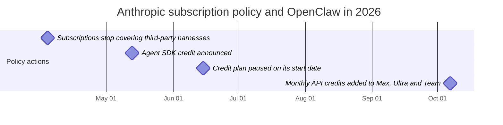

<div dir="rtl">

# بررسی عمیق OpenClaw: ایجنت هوش مصنوعی شخصی و متن‌باز

پلتفرم OpenClaw یک **ایجنت هوش مصنوعی شخصی، متن‌باز و خودمیزبان (Self-hosted)** است که وظایف را از طریق مدل‌های LLM و با استفاده از پلتفرم‌های پیام‌رسان به‌عنوان رابط اصلی خود اجرا می‌کند. شما از طریق WhatsApp، Telegram، Slack، Discord یا Signal با آن گفتگو می‌کنید و این سیستم با اجرای دستورات شل (Shell)، کنترل مرورگر، مدیریت تقویم‌ها، پردازش ایمیل‌ها و هماهنگ‌سازی گردش‌کارهای چندمرحله‌ای پاسخ می‌دهد.

## فهرست مطالب

- [معرفی OpenClaw: چیستی آن](#what-is-openclaw)
- [تاریخچه: از Clawdbot تا Moltbot و OpenClaw](#history)
- [بررسی عمیق معماری](#architecture)
- [سیستم مهارت‌های عامل (AgentSkills)](#the-agentskills-system)
- [پیکربندی ارائه‌دهنده LLM](#llm-provider-configuration)
- [یکپارچه‌سازی با پلتفرم‌های پیام‌رسان](#messaging-platform-integrations)
- [مدل امنیتی](#security-model)
- [الگوهای استقرار](#deployment-patterns)
- [بهینه‌سازی عملکرد و مقیاس‌پذیری](#performance-optimization-and-scaling)
- [موارد استفاده واقعی](#real-world-use-cases)
- [محدودیت‌ها و زمان‌هایی که نباید از OpenClaw استفاده کرد](#limitations-and-when-not-to-use-openclaw)
- [رویداد سیاست اشتراک Anthropic در سال 2026](#the-2026-anthropic-subscription-policy-incident)
- [مقایسه با جایگزین‌ها](#comparison-with-alternatives)
- [شروع کار: راهنمای راه‌اندازی سریع](#getting-started)
- [زاویه دید مصاحبه طراحی سیستم](#system-design-interview-angle)
- [منابع](#references)

---

## معرفی OpenClaw: چیستی آن <a id="what-is-openclaw"></a>

ویژگی‌های اصلی OpenClaw عبارت‌اند از:

- **یک ایجنت هوش مصنوعی شخصی**: نه یک چت‌بات ساده، بلکه یک ایجنت خودمختار که به نیابت از شما عمل می‌کند
- **خودمیزبان (Self-hosted)**: روی ماشین شخصی، سرور مجازی (VPS) یا Raspberry Pi شما اجرا می‌شود، بنابراین کنترل کامل داده‌های خود را در اختیار دارید
- **بومی پیام‌رسان‌ها (Messaging-native)**: درون اپلیکیشن‌های گفتگویی که از قبل استفاده می‌کنید زندگی می‌کند (WhatsApp، Telegram، Slack، Discord، Signal، iMessage، Teams و بیش از 20 پلتفرم دیگر)
- **مستقل از مدل LLM (LLM-agnostic)**: با مدل‌های Claude، GPT، Gemini، Muse Spark، DeepSeek یا مدل‌های محلی کار می‌کند (نسخه‌های اخیر مدل‌های GPT-6.1 Sol، GPT-6 Astra، Fable 5.1 و Muse Spark 1.3 را نیز اضافه کرده‌اند)
- **توسعه‌پذیر با مهارت‌ها (Skill-extensible)**: دارای حدود 50 مهارت ازپیش‌نصب‌شده (افزونه‌های همراه نیز موارد بیشتری ارائه می‌دهند)، یک رجیستری عمومی (ClawHub) و قالبی ساده برای نوشتن مهارت‌های سفارشی
- **متن‌باز**: با مجوز MIT، دارای حدود 394 هزار ستاره در گیت‌هاب و 83 هزار فورک در اوایل نوامبر 2026
- **دارای حاکمیت بنیادی (Foundation-governed)**: تحت سرپرستی بنیاد OpenClaw، یک نهاد غیرانتفاعی مستقل 501(c)(3) که تیم هسته را استخدام کرده و نسخه‌های رسمی را امضا می‌کند. هیچ سطح پولی، سرویس میزبانی‌شده یا توکنی وجود ندارد و فایل README بیان می‌کند که OpenAI «یک حامی مالی است، نه مالک» (شرکت‌های Amazon، Red Hat، NVIDIA و GitHub از دیگر حامیان مالی و زیرساختی هستند)
- **دو خط انتشار (Two release trains)**: نسخه‌های تقویمی (2026.9.7 در 30 سپتامبر 2026) و نسخه‌های پایدار توسعه‌یافته مخصوص دروازه (Gateway-only extended-stable) که پروژه آن‌ها را به‌عنوان شاخه LTS خود در نظر می‌گیرد (2026.8.35 در 2 اکتبر). دروازه‌های محیط عملیاتی را روی خط extended-stable قفل (Pin) کنید

<div dir="ltr">

```
# The simplest way to start (macOS / Linux / WSL2)
curl -fsSL https://openclaw.ai/install.sh | bash

# Or via npm (Node 24.16+ or 26.1+; Node 26 recommended)
# --allow-scripts needs npm 11.16+; drop it on older npm
npm install -g openclaw@latest --allow-scripts=openclaw
openclaw onboard --install-daemon
openclaw gateway status
```

</div>

**تفاوت کلیدی با چت‌بات‌ها:**
- یک دستیار گفتگوی ساده: شما تایپ می‌کنید و دستیار با متن پاسخ می‌دهد
- سیستم OpenClaw: شما تایپ می‌کنید و دستیار **کارها را انجام می‌دهد**: دستورات را اجرا می‌کند، فایل‌ها را ویرایش می‌کند، ایمیل می‌فرستد، دستگاه‌های خانه هوشمند را کنترل می‌کند و تقویم شما را مدیریت می‌کند

دستیارهای گفتگومحور از سمت مقابل در حال پر کردن این شکاف هستند. سرویس‌های OpenAI dots (معرفی‌شده در 29 سپتامبر 2026) و Meta Muse (8 سپتامبر) به دستیارهای میزبانی‌شده کامپیوترهای ابری اختصاصی می‌دهند و Anthropic در حال ادغام Cowork در اپلیکیشن Claude است، به‌طوری که Claude پیش از اقدام از کاربر تأیید می‌گیرد؛ سرویس Claude Duet از Anthropic (پیش‌نمایش پژوهشی، 21 اکتبر 2026) حتی فراتر می‌رود و یک ایجنت کنشگر با کامپیوتر ابری و مرورگر اختصاصی است که در میان اپلیکیشن‌های متصل کار می‌کند (جدول [چشم‌انداز ایجنت‌های ماندگار](01-tool-use-landscape.md) را ببینید). ویژگی‌های متمایزکننده OpenClaw اکنون خودمیزبانی، آزادی انتخاب مدل و گستره پیام‌رسان‌هاست، نه صرفاً توانایی انجام عمل.

---

## تاریخچه: از Clawdbot تا Moltbot و OpenClaw <a id="history"></a>

### خط زمانی نام‌گذاری

| تاریخ | نام | رویداد |
|------|------|--------|
| نوامبر 2025 | ربات **Clawdbot** | پیتر استاینبرگر اولین نمونه اولیه را منتشر می‌کند که تقریباً در یک ساعت ساخته شده بود |
| ژانویه 2026 | تعداد 2,000 ستاره | پذیرندگان اولیه این پروژه را کشف می‌کنند |
| 27 ژانویه 2026 | ربات **Moltbot** | پس از شکایات علامت تجاری Anthropic تغییر نام یافت (تم خرچنگ حفظ شد) |
| 30 ژانویه 2026 | پروژه **OpenClaw** | دوباره تغییر نام داد؛ استاینبرگر تلفظ «Moltbot» را دشوار می‌دانست |
| فوریه 2026 | بیش از 145,000 ستاره | رشد انفجاری و پیشی گرفتن از بسیاری از پروژه‌های متن‌باز شناخته‌شده |
| 14 فوریه 2026 | بدون تغییر نام | استاینبرگر با اشاره به دسترسی به منابع مورد نیاز برای مقیاس‌دهی به OpenAI پیوست |
| مارس 2026 | بیش از 250,000 ستاره | عبور از React در گیت‌هاب؛ یکی از سریع‌ترین پروژه‌های متن‌باز تاریخ از نظر رشد |
| 30 سپتامبر 2026 | حدود 391,000 ستاره | سرپرستی توسط بنیاد مستقل OpenClaw؛ ارائه نسخه‌های دروازه extended-stable (معادل LTS) در کنار نسخه‌های تقویمی |

### خالق پروژه

مهندس پیتر استاینبرگر (Peter Steinberger) یک مهندس نرم‌افزار اتریشی است که پیش از فروش شرکت خود در سال 2024، مدت 13 سال را صرف ساخت PSPDFKit (یک کیت ابزار PDF مورد استفاده توسعه‌دهندگان در سراسر جهان) کرد. او خود را یک «کدنویس حسی» (Vibe coder) توصیف می‌کند و با این جمله مشهور شناخته می‌شود که کدی را منتشر می‌کند که خودش نخوانده است؛ رویکردی که مظهر فلسفه جدید توسعه هوش‌مصنوعی‌محور است، جایی که انسان نیت را مشخص می‌کند و هوش مصنوعی پیاده‌سازی را بر عهده می‌گیرد.

### چرا فراگیر شد؟

پروژه OpenClaw به یک نیاز واقعی پاسخ داد: مدل‌های LLM قدرتمند هستند اما بدون وضعیت (Stateless) عمل می‌کنند. هر گفتگو از صفر آغاز می‌شود. پلتفرم OpenClaw به مدل‌های LLM **ماندگاری (Persistence)** (حافظه در میان نشست‌ها)، **عاملیت (Agency)** (توانایی اقدام به جای صرفاً گفتگو) و **دسترسی (Reach)** (یکپارچه‌سازی با اپلیکیشن‌هایی که از قبل استفاده می‌کنید) می‌بخشد. خودمیزبان و متن‌باز بودن آن نیز به این معناست که هر کسی می‌تواند بدون سپردن داده‌های خود به یک سرویس شخص ثالث، آن را اجرا کند.

---

## بررسی عمیق معماری <a id="architecture"></a>

### نمای کلی در سطح بالا

<div dir="ltr">

```
                         OPENCLAW ARCHITECTURE
 ============================================================

  Messaging Platforms              OpenClaw Gateway           LLM Providers
 ┌──────────────┐              ┌─────────────────────┐     ┌──────────────┐
 │  WhatsApp    │──┐           │                     │     │  Anthropic   │
 │  (Baileys)   │  │           │   GATEWAY            │     │  (Claude)    │
 ├──────────────┤  │  Channel  │   ┌──────────────┐  │     ├──────────────┤
 │  Telegram    │──┼──Adapters─┼──>│  Router      │  │     │  OpenAI      │
 │  (grammY)    │  │           │   │  (sessions,  │  │     │  (GPT-6)     │
 ├──────────────┤  │           │   │   bindings)  │  │     ├──────────────┤
 │  Slack       │──┤           │   └──────┬───────┘  │     │  Google      │
 │  (Bolt)      │  │           │          │          │     │  (Gemini)    │
 ├──────────────┤  │           │   ┌──────▼───────┐  │     ├──────────────┤
 │  Discord     │──┤           │   │ Agent Runtime│──┼────>│  DeepSeek    │
 │  (discord.js)│  │           │   │ (AI loop,    │  │     ├──────────────┤
 ├──────────────┤  │           │   │  tool calls, │  │     │  Local/      │
 │  Signal      │──┤           │   │  memory)     │  │     │  Ollama      │
 │  (signal-cli)│  │           │   └──────┬───────┘  │     └──────────────┘
 ├──────────────┤  │           │          │          │
 │  iMessage    │──┤           │   ┌──────▼───────┐  │     Tools & Skills
 │  (imsg)      │  │           │   │  Tool Layer  │  │     ┌──────────────┐
 ├──────────────┤  │           │   │  (skills,    │──┼────>│  Shell exec  │
 │  Teams       │──┘           │   │   browser,   │  │     │  Browser     │
 │  IRC, Matrix │              │   │   files,     │  │     │  File I/O    │
 │  20+ more... │              │   │   cron)      │  │     │  Calendar    │
 └──────────────┘              │   └──────────────┘  │     │  Email       │
                               │                     │     │  100+ more   │
                               │   ┌──────────────┐  │     └──────────────┘
                               │   │  Memory &    │  │
                               │   │  State       │  │     Storage
                               │   │  (sessions,  │──┼────>┌──────────────┐
                               │   │   workspace) │  │     │  ~/.openclaw/│
                               │   └──────────────┘  │     │  (state,     │
                               └─────────────────────┘     │   memory,    │
                                                           │   config)    │
                                localhost:18789             └──────────────┘
```

</div>

### اجزای اصلی

**1. دروازه (The Gateway)**

بخش Gateway یک سرور WebSocket بلندمدت (پیش‌فرض: `localhost:18789`) است که به‌عنوان تنها منبع حقیقت (Single Source of Truth) برای نشست‌ها، مسیریابی و اتصالات کانال‌ها عمل می‌کند. وظایف آن عبارت‌اند از:

- پذیرش اتصالات از تمامی پلتفرم‌های پیام‌رسان از طریق آداپتورهای کانال
- مسیریابی پیام‌ها به ایجنت صحیح
- مدیریت نشست (Session) و ذخیره‌سازی پایدار وضعیت
- احراز هویت و کنترل دسترسی
- بارگذاری مجدد آنی (Hot-reloading) تغییرات پیکربندی

**2. آداپتورهای کانال (Channel Adapters)**

هنگامی که پیامی از هر پلتفرمی دریافت می‌شود، آداپتور کانال آن را به یک قالب داخلی استاندارد تبدیل (Normalize) می‌کند. هر آداپتور یک کتابخانه مخصوص آن پلتفرم را در بر می‌گیرد:

| پلتفرم | کتابخانه آداپتور | پروتکل |
|----------|----------------|----------|
| پیام‌رسان WhatsApp | کتابخانه Baileys | پروتکل WebSocket (غیررسمی) |
| پیام‌رسان Telegram | کتابخانه grammY | رابط Bot API |
| پیام‌رسان Slack | کتابخانه Bolt | رابط Events API |
| پیام‌رسان Discord | کتابخانه discord.js | رابط Gateway API |
| پیام‌رسان Signal | ابزار signal-cli | سرویس signal-cli daemon (بومی یا کانتینری) |
| پیام‌رسان iMessage | افزونه imsg (افزونه رسمی؛ پشتیبانی از BlueBubbles حذف شد) | پروتکل JSON-RPC روی stdio |
| پیام‌رسان IRC | کتابخانه irc-framework | پروتکل IRC |
| پیام‌رسان Matrix | کتابخانه matrix-js-sdk | پروتکل Matrix |
| پلتفرم Microsoft Teams | فریم‌ورک Bot Framework | رابط REST API |

**3. محیط اجرای ایجنت (Agent Runtime)**

محیط اجرای ایجنت (Agent Runtime) حلقه اصلی هوش مصنوعی است. این بخش برای هر پیام ورودی مراحل زیر را انجام می‌دهد:

1. گردآوری زمینه (Context) از تاریخچه نشست، حافظه فضای کاری (Workspace) و مهارت‌های مرتبط
2. ارسال Prompt آماده شده به مدل LLM پیکربندی‌شده
3. دریافت فراخوانی ابزارها (Tool calls) از مدل
4. اجرای فراخوانی ابزارها روی قابلیت‌های سیستم
5. بازگرداندن نتایج به مدل برای تکرار بعدی حلقه
6. ذخیره‌سازی پایدار وضعیت به‌روزشده (حافظه، فایل‌ها، تاریخچه نشست)

**4. مسیریابی چندایجنتی (Multi-Agent Routing)**

پلتفرم OpenClaw از اجرای همزمان چندین ایجنت در یک فرآیند Gateway پشتیبانی می‌کند. هر ایجنت فضای کاری، پوشه agentDir، نشست‌ها و پیکربندی ابزار اختصاصی خود را دارد. ایجنت‌ها زیر کلید `agents.entries` تعریف می‌شوند و پیام‌های ورودی از طریق کلید سطح بالای `bindings` که روی کانال، حساب کاربری یا همتا (Peer) تطبیق داده می‌شوند، به آن‌ها هدایت می‌گردند:

<div dir="ltr">

```json5
{
  agents: {
    entries: {
      work: { workspace: "~/.openclaw/workspace-work" },
      home: { workspace: "~/.openclaw/workspace-home" },
      devops: { workspace: "~/.openclaw/workspace-devops" },
    },
  },
  bindings: [
    { agentId: "work", match: { channel: "slack", accountId: "*" } },
    { agentId: "home", match: { channel: "whatsapp", accountId: "personal" } },
    { agentId: "home", match: { channel: "telegram", accountId: "*" } },
    { agentId: "devops", match: { channel: "discord", accountId: "*" } },
  ],
}
```

</div>

برای مشاهده اینکه هر مسیر به کدام ایجنت متصل می‌شود، دستور `openclaw agents list --bindings` را اجرا کنید. پیکربندی‌های قدیمی‌تر که از آرایه `agents.list` استفاده می‌کردند توسط دستور `openclaw doctor --fix` مهاجرت داده می‌شوند.

این قابلیت بدین معناست که می‌توانید یک دستیار کاری روی Slack، یک دستیار شخصی روی WhatsApp و یک ربات DevOps روی Discord داشته باشید که همگی از یک Gateway اجرا می‌شوند و در عین حال حافظه و مجوزهای کاملاً ایزوله‌شده دارند.

---

## سیستم مهارت‌های عامل (AgentSkills) <a id="the-agentskills-system"></a>

### نحوه کار مهارت‌ها

مهارت‌ها (Skills) سازوکاری هستند که OpenClaw از طریق آن‌ها قابلیت‌هایی فراتر از گفتگوی ساده به دست می‌آورد. هر مهارت یک دایرکتوری شامل فایل `SKILL.md` با پیش‌گفتار YAML (فراداده) و دستورالعمل‌های Markdown (رفتار) است. تنها فیلدهای `name` و `description` الزامی هستند؛ یک بلوک اختیاری `metadata.openclaw` مهارت را بر اساس امکانات واقعی میزبان محدود (Gate) می‌کند.

<div dir="ltr">

```
~/.openclaw/skills/
  weather/
    SKILL.md           # Required: metadata + instructions
    scripts/
      fetch_weather.py # Optional: executable scripts
    references/
      api_docs.md      # Optional: supplementary docs

  email-manager/
    SKILL.md
    scripts/
      process_inbox.py
```

</div>

### قالب فایل SKILL.md

<div dir="ltr">

```yaml
---
name: weather-lookup
description: >
  Fetch current weather and forecasts for any location. Use when the user
  asks about temperature, rain, wind, or whether to bring an umbrella.
metadata: {"openclaw": {"requires": {"bins": ["curl"]}, "os": ["darwin", "linux"]}}
---

# Weather Lookup Skill

When the user asks about weather:

1. Use the web_search tool to find current conditions
2. Extract temperature, humidity, wind, and forecast
3. Present in a concise, readable format
4. Include both metric and imperial units

## Example Response Format

"Currently 72F (22C) and partly cloudy in San Francisco.
Forecast: Clear skies through Thursday, rain expected Friday."
```

</div>

هیچ فیلد کلمه کلیدی محرکی (Trigger-keyword) وجود ندارد. فیلد `description` همان چیزی است که مدل با آن تطبیق می‌دهد، بنابراین آن را به‌صورت «این مهارت چه کاری انجام می‌دهد و چه زمانی باید از آن استفاده کرد» بنویسید.

### ترتیب اولویت در بازیابی مهارت‌ها (Skill Resolution Order)

مهارت‌ها می‌توانند در مکان‌های متعددی قرار بگیرند. هنگامی که تداخل نام رخ می‌دهد، محلی‌ترین نسخه برنده می‌شود:

<div dir="ltr">

```
Priority (highest first):
  1. <workspace>/skills/             # Project-specific skills
  2. <workspace>/.agents/skills/     # Project agent skills
  3. ~/.agents/skills/               # Personal agent skills
  4. ~/.openclaw/skills/             # Managed/local skills (state directory)
  5. Per-agent workshop skills       # Under the agent's directory
  6. Bundled skills                  # Ship with OpenClaw
  7. skills.load.extraDirs, plugins  # Extra directories and plugin-provided skills
```

</div>

یک فهرست مجاز غیردخالی در سطح هر ایجنت (`agents.entries.<id>.skills`) مجموعه نهایی آن ایجنت را تعیین می‌کند؛ این فهرست به جای ادغام شدن با `agents.defaults.skills`، جایگزین آن می‌شود.

### تزریق انتخابی (Selective Injection)

سیستم OpenClaw دستورالعمل‌های هر مهارت را در هر Prompt تزریق **نمی‌کند**. ابتدا دو فیلتر اجرا می‌شوند: فیلتر زمان بارگذاری مهارت‌هایی را که پیش‌نیازهای `metadata.openclaw` آن‌ها برآورده نشده باشد (فایل‌های باینری مفقود، متغیرهای محیطی یا کلیدهای پیکربندی ناموجود، سیستم‌عامل اشتباه) حذف می‌کند، و فهرست مجاز مهارت‌های ایجنت بقیه موارد را کنار می‌گذارد. مهارت‌های واجد شرایط به‌صورت یک فهرست XML فشرده شامل نام، توضیحات و مکان به System Prompt اضافه می‌شوند که طبق مستندات حدود 24 Token به ازای هر مهارت به علاوه طول آن فیلدها هزینه دارد. بدنه کامل فایل `SKILL.md` بر اساس تقاضا (On demand) خوانده می‌شود و ابزار `skills_search` مهارت‌هایی را که در بودجه Prompt جا نگرفته‌اند پیدا می‌کند. این همان طراحی افشای تدریجی (Progressive-disclosure) در Agent Skills در جاهای دیگر است: هزینه هر مهارت اندک است اما در هر نوبت پرداخت می‌شود. یک برآورد تقریبی: 200 مهارت واجد شرایط با توضیحات یک یا دو جمله‌ای حدود 10K تا 15K Token سربار دائمی به Prompt اضافه می‌کنند و به همین دلیل فهرست مجاز (Allowlist) اهمیت دارد.

### ساخت یک مهارت سفارشی

<div dir="ltr">

```bash
# Create the skill directory
mkdir -p ~/.openclaw/skills/deploy-checker
cd ~/.openclaw/skills/deploy-checker

# Create the SKILL.md
cat > SKILL.md << 'EOF'
---
name: deploy-checker
description: >
  Monitor deployment status across staging and production: health endpoints,
  recent commits, and CI status. Use when asked whether staging or prod is up,
  or what was deployed last.
metadata: {"openclaw": {"requires": {"bins": ["curl", "git"]}}}
---

# Deploy Checker

When asked about deployment status:

1. Run `curl -s https://staging.myapp.com/health` to check staging
2. Run `curl -s https://myapp.com/health` to check production
3. Check recent git log: `git log --oneline -5`
4. Report status in a clear format

## Response Format

Staging: [UP/DOWN] - version X.Y.Z - deployed 2h ago
Production: [UP/DOWN] - version X.Y.Z - deployed 1d ago
Last 3 commits: ...
EOF
```

</div>

### اکوسیستم مهارت‌های جامعه کاربری

اکوسیستم مهارت‌های OpenClaw به سرعت رشد کرده و مجموعه‌های نگهداری‌شده توسط جامعه کاربری شامل هزاران مهارت در دسته‌بندی‌هایی مانند DevOps، اتوماسیون خانگی، تولید محتوا، تحلیل داده و غیره شکل گرفته است. رجیستری عمومی این اکوسیستم ClawHub نام دارد و دستور `openclaw skills install @owner/<slug>` مهارت‌ها را از آن نصب می‌کند. با این حال، این باز بودن خطراتی به همراه دارد: مستندات توصیه می‌کنند که با مهارت‌های شخص ثالث به‌عنوان کد نامطمئن رفتار کنید، پیش از فعال‌سازی آن‌ها را بخوانید و اجرای سندباکس‌شده را ترجیح دهید؛ چرا که کاتالوگ اولیه با حوادثی شامل اسکریپت‌های مخرب مواجه شده بود.

---

## پیکربندی ارائه‌دهنده LLM <a id="llm-provider-configuration"></a>

### فایل پیکربندی

پلتفرم OpenClaw پیکربندی خود را از فایل `~/.openclaw/openclaw.json` می‌خواند (قالب JSON5: کامنت‌ها و کامای پایانی مجاز هستند). سرور Gateway این فایل را زیر نظر دارد و تغییرات را به‌صورت خودکار از طریق بارگذاری مجدد آنی (Hot reload) اعمال می‌کند.

افزونه‌های رسمی ارائه‌دهندگان (Anthropic، OpenAI، Google، DeepSeek، Ollama و بسیاری دیگر) تنها به اعتبارنامه‌ها (Credentials) نیاز دارند که `openclaw onboard` آن‌ها را ذخیره می‌کند یا از متغیرهای محیطی مانند `ANTHROPIC_API_KEY`، `OPENAI_API_KEY` و `DEEPSEEK_API_KEY` خوانده می‌شوند؛ تعداد معدودی از جمله DeepSeek ابتدا به یک دستور تک‌خطی `openclaw plugins install` نیاز دارند. ارجاع به مدل‌ها از قالب `provider/model` پیروی می‌کند. بلوک `models.providers` برای آدرس‌های پایه سفارشی، پروکسی‌ها و سرورهای خودمیزبان سازگار با OpenAI کاربرد دارد:

<div dir="ltr">

```json5
{
  // Default model plus a cross-vendor fallback chain
  agents: {
    defaults: {
      model: {
        primary: "anthropic/claude-sonnet-5-5",
        fallbacks: ["openai/gpt-6-sol", "deepseek/deepseek-flash"],  // deepseek-flash = V4.1-Flash
      },
    },
  },

  // Custom provider: an internal OpenAI-compatible gateway
  models: {
    mode: "merge",
    providers: {
      "corp-gateway": {
        baseUrl: "https://llm-gateway.internal.example.com/v1",
        apiKey: "${CORP_GATEWAY_KEY}",  // env var substitution
        api: "openai-completions",
        models: [{ id: "qwen3.8-27b", name: "Qwen3.8 27B", maxTokens: 4096 }],
      },
    },
  },
}
```

</div>

دو نکته ظریف وجود دارد که باید مراقب آن‌ها بود. برای Ollama، از آدرس بومی (`http://localhost:11434`) استفاده کنید، نه مسیر `/v1` سازگار با OpenAI: مستندات هشدار می‌دهند که `/v1` فراخوانی ابزارها (Tool calling) را خراب می‌کند و مدل‌ها JSON خام فراخوانی ابزار را به‌صورت متن خروجی می‌دهند. همچنین مسیرهای جایگزین (Fallbacks) به پیش‌فرض پیکربندی‌شده متصل می‌شوند؛ یک مدل تعیین‌شده برای هر ایجنت به‌صورت سخت‌گیرانه عمل می‌کند (بدون جایگزین)، مگر اینکه ورودی آن ایجنت فهرست `fallbacks` مخصوص به خود را داشته باشد.

### استراتژی انتخاب ارائه‌دهنده

| ارائه‌دهنده | بهترین کاربرد | مصالحه‌ها (Trade-offs) |
|----------|----------|------------|
| شرکت Anthropic (مدل Claude) | استدلال پیچیده، وظایف کدنویسی، زمینه طولانی (مدل‌های Sonnet 5.5 و Opus 5.5 تا 1M با نرخ ثابت محاسبه می‌شوند)؛ مدل Haiku 5.5 (با هزینه $0.10/$0.50 به ازای 1M برای Promptهای تا 100K Token) برای فراخوانی‌های کم‌هزینه ابزاری و مسیریابی | هزینه بالاتر در رده‌های برتر: مدل Opus 5.5 با نرخ $4/$20 و Fable 5.1 با نرخ $10/$50 به ازای 1M Token قیمت‌گذاری شده‌اند. قابلیت Thinking روی Opus 5.5 قابل غیرفعال‌سازی نیست. مدل Haiku 5.5 به محض عبور Prompt از 100K Token کل درخواست را با نرخ $0.50/$2.50 محاسبه می‌کند و خواندن و نوشتن کش را نیز می‌شمارد، که یک ایجنت با تاریخچه طولانی بدون اینکه متوجه شوید از آن عبور می‌کند |
| شرکت OpenAI (خانواده GPT-6) | کاربردهای عمومی؛ مدل GPT-6 Luna (با هزینه $0.10/$0.50) برای مسیریابی ارزان، مدل GPT-6.1 Terra (با هزینه $1/$5، منتشرشده در 26 اکتبر) در رده میانی، و مدل‌های GPT-6 Sol یا GPT-6.1 Sol (با هزینه $2/$10) به‌عنوان مدل اصلی و پرکاربرد | درخواست‌های بالای 272K Token ورودی به‌طور کامل با نرخ‌های زمینه طولانی (Long-context) محاسبه می‌شوند |
| شرکت Google (مدل Gemini) | آزمایش‌های حساس به بودجه، سطح رایگان سخاوتمندانه؛ مدل Gemini 3.8 Flash با قیمت معرفی $0.75/$3.75 تا 31 دسامبر 2026؛ مدل Gemini 4 Argon (انتشار عمومی 13 اکتبر) برای کارهای دشوارتر با قیمت $2/$10 تا 30 نوامبر 2026 | قیمت مدل Flash در 1 ژانویه 2027 دو برابر شده و به $1.50/$7.50 می‌رسد و Argon در 1 دسامبر 2026 به $4/$20 افزایش می‌یابد؛ Argon تنها از کش ضمنی (Implicit caching) پشتیبانی می‌کند؛ امتیاز آن در شاخص Artificial Analysis Intelligence Index v5.0 برابر با 50 در مقایسه با 58 برای Opus 5.5 است |
| شرکت DeepSeek | ارزان‌ترین گزینه میزبانی‌شده: مدل V4.1-Flash (`deepseek-flash`) با نرخ $0.30/$1.20 به ازای 1M در ساعات اوج و نصف آن در ساعات غیراوج؛ مدل V4-Pro همچنان با نرخ $1.32/$3.96 در ساعات اوج ارائه می‌شود؛ زمینه 1M؛ بهترین گزینه برای بارهای کاری پرحجم و سازگار با کش | ساعات اوج (01:00-04:00 و 06:00-10:00 به وقت UTC در روزهای کاری هفته) قیمت را دو برابر می‌کنند؛ نام‌های مدل‌های قدیمی توسط مدل‌های جدیدتر سرویس‌دهی می‌شوند، بنابراین نسخه را پین و راستی‌آزمایی کنید؛ وزن‌های تحت مجوز MIT نیز به‌صورت خودمیزبان قابل اجرا هستند |
| اجرای محلی (Ollama) | کاربردهای حساس به حریم خصوصی و آفلاین | نیازمند سخت‌افزار قدرتمند است و کیفیت پایین‌تری دارد |

### مسیریابی مدل در داخل OpenClaw

می‌توانید مدل‌های متفاوتی را برای ایجنت‌های مختلف پیکربندی کنید و هزینه‌ها را بهینه سازید:

<div dir="ltr">

```json5
{
  agents: {
    defaults: {
      model: "openai/gpt-6-luna",  // Cheap default
    },
    entries: {
      coding: {
        workspace: "~/.openclaw/workspace-coding",
        // Premium for code, with its own fallback (per-agent models are strict otherwise)
        model: { primary: "anthropic/claude-sonnet-5-5", fallbacks: ["openai/gpt-6.1-sol"] },
      },
      reminders: {
        workspace: "~/.openclaw/workspace-reminders",
        model: "google/gemini-3.8-flash",  // Cheap for simple tasks
      },
    },
  },
  // Route channels or peers to these agents with top-level bindings (see Multi-Agent Routing)
}
```

</div>

تنظیم `agents.defaults.utilityModel` نشت هزینه دیگری را پوشش می‌دهد: فراخوانی‌های کوتاه داخلی مانند تولید عنوان نشست و روایت پیشرفت کار (Progress narration). در صورت تنظیم نشدن، OpenClaw از مدل کوچک اعلام‌شده توسط ارائه‌دهنده اصلی (در صورت وجود) استفاده می‌کند.

---

## یکپارچه‌سازی با پلتفرم‌های پیام‌رسان <a id="messaging-platform-integrations"></a>

پلتفرم OpenClaw از طریق معماری آداپتور کانال خود از بیش از 20 پلتفرم پیام‌رسان پشتیبانی می‌کند. پیام‌رسان Telegram همراه با نصب هسته ارائه می‌شود و کانال پیشنهادی اول در مستندات است (یک توکن ربات، بدون نیاز به افزونه). بیشتر کانال‌های دیگر افزونه‌های رسمی هستند که بر اساس تقاضا نصب می‌شوند (`openclaw plugins install @openclaw/<id>` یا در حین `openclaw onboard`)، و تعداد معدودی مانند WeChat خارج از مخزن اصلی نگهداری می‌شوند. هر افزونه کدی است که درون Gateway شما اجرا می‌شود، بنابراین آن را همانند یک مهارت بازبینی کنید.

### پلتفرم‌های پشتیبانی‌شده

| پلتفرم | کتابخانه | وضعیت | یادداشت‌ها |
|----------|---------|--------|-------|
| پیام‌رسان WhatsApp | کتابخانه Baileys | پایدار (Stable) | رابط API غیررسمی؛ نیازمند حساب شخصی است |
| پیام‌رسان Telegram | کتابخانه grammY | پایدار (Stable) | رابط رسمی Bot API؛ پایدارترین کانال |
| پیام‌رسان Slack | کتابخانه Bolt | پایدار (Stable) | نیازمند نصب اپلیکیشن در فضای کاری (Workspace) |
| پیام‌رسان Discord | کتابخانه discord.js | پایدار (Stable) | نیازمند توکن ربات |
| پیام‌رسان Signal | ابزار signal-cli | پایدار (Stable) | نیازمند دستگاه متصل (Linked device)؛ سرویس بومی یا کانتینر |
| پیام‌رسان iMessage | افزونه imsg | پایدار (Stable) | فقط macOS؛ افزونه رسمی روی JSON-RPC (پشتیبانی از BlueBubbles حذف شد) |
| سرویس Google Chat | رابط Chat API | پایدار (Stable) | نیازمند تأیید مدیر Workspace |
| پلتفرم Microsoft Teams | فریم‌ورک Bot Framework | پشتیبانی‌شده (Supported) | افزونه رسمی؛ در اوایل 2026 بتا بود و اکنون یکی از کانال‌های اصلی معرفی‌شده در README است |
| شبکه IRC | کتابخانه irc-framework | پایدار (Stable) | پشتیبانی از پروتکل کلاسیک |
| شبکه Matrix | کتابخانه matrix-js-sdk | پایدار (Stable) | فدره‌شده و سازگار با خودمیزبانی |
| پلتفرم Mattermost | رابط API | پایدار (Stable) | جایگزین خودمیزبان برای Slack |
| پیام‌رسان LINE | رابط Messaging API | پایدار (Stable) | محبوب در ژاپن و جنوب شرق آسیا |
| پیام‌رسان Feishu (Lark) | رابط Open API | پایدار (Stable) | محبوب در چین |
| پلتفرم Twitch | کتابخانه TMI.js | پایدار (Stable) | فقط متنی (Chat-only) |
| پیام‌رسان WeChat | افزونه openclaw-weixin (افزونه خارجی) | آزمایشی (Beta) | نگهداری‌شده در خارج از مخزن OpenClaw |
| شبکه Nostr | پروتکل NIP-04 | آزمایشی (Beta) | پیام‌های مستقیم رمزنگاری‌شده روی یک پروتکل غیرمتمرکز |
| رابط WebChat | داخلی (Built-in) | پایدار (Stable) | مسیر جایگزین مبتنی بر مرورگر |
| پروتکل A2A | پروتکل A2A 1.0 JSON-RPC (افزونه داخلی) | پشتیبانی‌شده (Supported) | یک اپلیکیشن چت نیست: به ایجنت‌های خارجی اجازه می‌دهد به ایجنت‌های OpenClaw شما پیام دهند، بنابراین همان فهرست‌های مجاز فرستنده انسانی را اعمال کنید |

### زمینه یکپارچه در میان کانال‌ها

یک تصمیم معماری بسیار مهم: سرور Gateway **یک سیستم حافظه یکپارچه** را در تمامی کانال‌ها حفظ می‌کند. اگر در WhatsApp نکته‌ای را به ایجنت خود بگویید، هنگام ارسال پیام از Slack آن را به یاد می‌آورد. این بدان معناست که ایجنت هوش مصنوعی شما فارغ از اینکه از کدام اپلیکیشن برای دسترسی به آن استفاده می‌کنید، زمینه (Context) ثابتی در اختیار دارد.

<div dir="ltr">

```
          WhatsApp ──┐
          Telegram ──┤     ┌─────────────────────┐
          Slack    ──┼────>│  Shared Memory Pool  │
          Discord  ──┤     │  (per-agent, cross-  │
          Signal   ──┘     │   channel sessions)  │
                           └─────────────────────┘
```

</div>

---

## مدل امنیتی <a id="security-model"></a>

### فلسفه امنیتی

مدل امنیتی OpenClaw یک مدل تهدید «دستیار شخصی» را فرض می‌گیرد: یک اپراتور مورد اعتماد و احتمالاً چندین ایجنت. اولویت‌ها به شرح زیر است:

1. **اول هویت**: چه کسی می‌تواند با ربات صحبت کند؟
2. **سپس محدوده (Scope)**: ربات در کجا اجازه اقدام دارد؟
3. **در آخر مدل**: فرض کنید مدل قابل فریب خوردن (Manipulation) است و شعاع انفجار (Blast radius) را محدود کنید

### لایه‌های مجوزدهی

<div dir="ltr">

```
 Layer 1: Channel Authentication
 ─────────────────────────────────
 Who can message the bot?
 Configured per-channel with allowlists.
 Unknown DM senders get a pairing code
 by default, not a response.

 Layer 2: Agent Tool Allow/Deny
 ─────────────────────────────────
 Which tools can this agent use?
 Configured per-agent in agents.entries.<id>.tools.

 Layer 3: Sandbox Tool Policy
 ─────────────────────────────────
 Separate from agent permissions.
 Even if agent allows a tool, sandbox may block it.

 Layer 4: Elevated Access
 ─────────────────────────────────
 Some tools require host-level access.
 Gated globally and per agent with allowFrom
 lists; the agent gate can only narrow the
 global one, and a sender must pass both.
```

</div>

### جداسازی با سندباکس (Sandbox Isolation)

اجرا در سندباکس (Sandboxing) **به‌طور پیش‌فرض خاموش است**: ابزارها برای نشست اصلی روی ماشین میزبان اجرا می‌شوند، مگر اینکه آن را پیکربندی کنید. حداقل برای نشست‌های غیراصلی (زیرایجنت‌ها، کارهای زمان‌بندی‌شده Cron و وظایف ایزوله) یا برای همه چیز آن را فعال کنید:

<div dir="ltr">

```json5
// ~/.openclaw/openclaw.json
{
  agents: {
    defaults: {
      sandbox: {
        mode: "non-main",          // "off" (default) | "non-main" | "all"
        backend: "docker",
        scope: "session",          // one container per session; "agent" shares one per agent
        workspaceAccess: "none",   // the agent workspace is not visible inside the sandbox
        docker: {
          image: "openclaw-sandbox:bookworm-slim",
          network: "none",         // no egress
          readOnlyRoot: true,
          capDrop: ["ALL"],
        },
      },
    },
  },
}
```

</div>

با تنظیم `network: "none"` (پیش‌فرض بک‌اند Docker)، یک زیرایجنت داخل سندباکس نمی‌تواند درخواست خروجی ارسال کند، داده نشت دهد یا به سرویس‌های خارجی متصل شود، حتی اگر کد مخرب اجرا کند. مصالحه این انتخاب آن است که حالت `non-main` گفتگوی اصلی شما — یعنی همان نشستی که بیشترین زمینه و بیشترین مجوزها را دارد — را همچنان روی میزبان باقی می‌گذارد.

### هشدارهای امنیتی حیاتی

**رابط Loopback نخستین خط دفاعی است**: نصب‌های روی میزبان، Gateway را روی رابط loopback متصل (Bind) می‌کنند، بنابراین دسترس‌پذیری شبکه بخش عمده‌ای از کار امنیتی را انجام می‌دهد. اگر Gateway پشت یک پروکسی معکوس (Reverse proxy) با پیکربندی نادرست قرار گیرد که تمام درخواست‌ها را به localhost فوروارد کند، هر تماس‌گیرنده خارجی از مسیر loopback وارد می‌شود و هر دسترسی‌ای که Gateway به اتصالات محلی می‌دهد به کل اینترنت اعطا خواهد شد. تصاویر کانتینر (Container images) روی یک رابط در معرض دید (Exposed) متصل می‌شوند و به جای آن به توکن تولیدشده Gateway تکیه می‌کنند. برای استقرارهای از راه دور همواره احراز هویت Gateway را روشن نگه دارید و به یاد داشته باشید که این پروژه از یک اپراتور مورد اعتماد به ازای هر Gateway پشتیبانی می‌کند، نه مستاجران متخاصم نسبت به یکدیگر.

**زنجیره تأمین مهارت‌ها (Skill supply chain)**: کاتالوگ مهارت‌های جامعه کاربری با حوادثی در زمینه بسته‌های مخرب مواجه بوده است. پیش از نصب، همواره مهارت‌های شخص ثالث را بازبینی کنید. نسخه مهارت‌ها را قفل (Pin) کنید و این کار را بر اساس محتوا انجام دهید، نه بر اساس ref: گزارش Plugin4Shell (شرکت AIR Security، سپتامبر 2026) نشان داد که ایجنت‌هایی که یک افزونه قفل‌شده با SHA را نصب می‌کنند ممکن است به کد مهاجم هدایت شوند: مالک مخزن می‌تواند شاخه‌ای هم‌نام با آن SHA بسازد و آن را شاخه پیش‌فرض کند و ایجنت‌ها هرگز کامیتی را که واقعاً checkout شده راستی‌آزمایی نمی‌کردند. افزونه مهارت‌های MCP (`io.modelcontextprotocol/skills`؛ نهایی‌شده در SEP در تاریخ 13 سپتامبر 2026، نسخه بتا تحت چرخه حیات جدید افزونه‌ها و عرضه‌شده در TypeScript SDK 2.4.0 در 23 اکتبر) همین دیدگاه را اتخاذ کرده است: یک مانیفست فایل SHA-256 که در آن تغییر، افزودن یا حذف هر فایلی تأییدیه را باطل می‌کند. برای مهارت‌های نامطمئن از سندباکس استفاده کنید.

### چک‌لیست سخت‌سازی (Hardening Checklist)

<div dir="ltr">

```
[x] Run `openclaw security audit` after every config change
[x] Set state directory permissions to 700
[x] Configure channel allowlists (do not leave open)
[x] Keep DM pairing on; approve senders explicitly
[x] Enable sandbox for sub-agents and cron jobs (mode: "non-main" or "all")
[x] Pin the gateway to the extended-stable release train
[x] Use environment variables for API keys, never hardcode
[x] Put Gateway behind authenticated reverse proxy for remote access
[x] Review all third-party skills before installation
[x] Set up monitoring for unusual tool invocations
[x] Restrict elevated tool access to specific users
[x] Run Gateway as non-root user
[x] Enable TLS for WebSocket connections
```

</div>

---

## الگوهای استقرار <a id="deployment-patterns"></a>

### گزینه 1: نصب محلی (سریع‌ترین شروع)

<div dir="ltr">

```bash
# Install the CLI, then let onboarding set up keys, channels and the background service
npm install -g openclaw@latest --allow-scripts=openclaw
openclaw onboard --install-daemon
openclaw gateway status
openclaw security audit
```

</div>

**پیش‌نیازها**: نسخه Node.js 24.16+ یا 26.1+ (نسخه Node 26 پیشنهاد می‌شود)، 512 مگابایت حافظه RAM، سیستم‌عامل macOS، Linux یا Windows (از طریق WSL2 یا نصب‌کننده PowerShell).

### گزینه 2: Docker (پیشنهادی برای محیط عملیاتی)

اسکریپت `./scripts/docker/setup.sh` موجود در مخزن، تصویر (Image) را می‌سازد یا دریافت می‌کند، مراحل onboarding را اجرا کرده و یک توکن Gateway در فایل `.env` می‌نویسد. اگر خودتان compose را مدیریت می‌کنید، یک سرویس حداقلی در همین راستا به‌شکل زیر است:

<div dir="ltr">

```yaml
# docker-compose.yml
services:
  openclaw-gateway:
    image: ghcr.io/openclaw/openclaw:extended-stable  # LTS-style train; :latest tracks stable
                                                      # releases; -browser variants bundle Chromium
    restart: unless-stopped
    ports:
      - "127.0.0.1:18789:18789"               # keep the port off public interfaces
    volumes:
      - ./openclaw-state:/home/node/.openclaw # Config, state and memory
    environment:
      - OPENCLAW_GATEWAY_TOKEN=${OPENCLAW_GATEWAY_TOKEN}  # the image binds to an exposed interface
      - ANTHROPIC_API_KEY=${ANTHROPIC_API_KEY}
      - OPENAI_API_KEY=${OPENAI_API_KEY}
    mem_limit: 2g
    logging:
      driver: json-file
      options:
        max-size: "10m"
        max-file: "3"
```

</div>

<div dir="ltr">

```bash
docker compose up -d
docker compose logs -f openclaw-gateway  # Watch logs
```

</div>

### گزینه 3: سرور مجازی ابری (همیشه‌روشن)

پلتفرم OpenClaw بسیار سبک است: هر ماشینی با 512 مگابایت RAM و 1 هسته CPU کافی است. یک سرور VPS با هزینه ماهانه 4 تا 6 دلار به‌خوبی کار می‌کند.

**گزینه‌های استقرار سریع:**
- **سرویس DigitalOcean**: اپلیکیشن تک‌کلیکی (1-Click App) با سخت‌سازی امنیتی داخلی
- **سرویس Railway**: دکمه استقرار تک‌کلیکی از فایل README گیت‌هاب (حدود 5 دقیقه)
- **سرویس Contabo**: افزونه رایگان تک‌کلیکی OpenClaw برای پلن‌های VPS
- **سرویس AWS Lightsail**: نمونه ماهانه 3.50 دلاری آن را به راحتی اجرا می‌کند
- **برد Raspberry Pi**: روی Pi 4 با 4 گیگابایت RAM به‌خوبی اجرا می‌شود

### معماری محیط عملیاتی

<div dir="ltr">

```
                    PRODUCTION DEPLOYMENT
 ====================================================

  Internet
     │
     ▼
 ┌───────────────┐
 │  Cloudflare   │     SSL termination
 │  (CDN/WAF)    │     DDoS protection
 └───────┬───────┘
         │
         ▼
 ┌───────────────┐
 │  Nginx        │     Reverse proxy
 │  (with auth)  │     Rate limiting
 └───────┬───────┘     WebSocket upgrade
         │
         ▼
 ┌───────────────────────────────────────┐
 │  Docker                              │
 │  ┌─────────────────────────────────┐ │
 │  │  openclaw-gateway               │ │
 │  │  (main process)                 │ │
 │  └────────────┬────────────────────┘ │
 │               │                      │
 │  ┌────────────▼────────────────────┐ │
 │  │  openclaw-sandbox               │ │
 │  │  (isolated sub-agents)          │ │
 │  │  network: none                  │ │
 │  └─────────────────────────────────┘ │
 │                                      │
 │  Volume: ./openclaw-state (700)      │
 └──────────────────────────────────────┘
         │
         ▼
    LLM APIs
    (Anthropic, OpenAI, etc.)
```

</div>

### پیکربندی Nginx برای دسترسی از راه دور

<div dir="ltr">

```nginx
# /etc/nginx/sites-available/openclaw
server {
    listen 443 ssl http2;
    server_name openclaw.yourdomain.com;

    ssl_certificate /etc/letsencrypt/live/openclaw.yourdomain.com/fullchain.pem;
    ssl_certificate_key /etc/letsencrypt/live/openclaw.yourdomain.com/privkey.pem;

    location / {
        proxy_pass http://127.0.0.1:18789;
        proxy_http_version 1.1;
        proxy_set_header Upgrade $http_upgrade;
        proxy_set_header Connection "upgrade";
        proxy_set_header Host $host;
        proxy_set_header X-Real-IP $remote_addr;

        # Basic auth for web interface
        auth_basic "OpenClaw";
        auth_basic_user_file /etc/nginx/.htpasswd;
    }
}
```

</div>

---

## بهینه‌سازی عملکرد و مقیاس‌پذیری <a id="performance-optimization-and-scaling"></a>

### راهنمای حافظه (RAM)

| نوع استقرار | حافظه RAM پیشنهادی | دلیل |
|------------|----------------|-----------|
| استفاده شخصی، سبک | 512MB تا 1GB | مهارت‌های کم، گفتگوهای کوتاه |
| استفاده شخصی، روزانه | 4GB | تعداد متوسط مهارت، اتوماسیون مرورگر |
| تیمی یا پرتکرار | 8GB | چند ایجنت، نشست‌های همزمان |
| استاندارد محیط عملیاتی | 16GB | مجموعه کامل مهارت‌ها، اتوماسیون سنگین |

### مدیریت پنجره زمینه (Context Window Management)

دو هزینه همراه با بزرگ شدن تاریخچه افزایش می‌یابند. محاسبات توجه (Attention) به‌صورت درجه‌دوم (Quadratically) با طول زمینه رشد می‌کنند که به‌صورت تاخیر (Latency) در Promptهای طولانی ظاهر می‌شود. هزینه مالی نیز بالا می‌رود: هر نوبت کل گفتگو را دوباره ارسال می‌کند، بنابراین تعداد Tokenهای ورودی به ازای هر گفتگو تقریباً با مربع تعداد نوبت‌ها رشد می‌کند، مگر اینکه پیشوند ثابت از کش Prompt سرویس‌دهی شود. بهینه‌سازی‌های عملی:

- **پنجره زمینه را محدود کنید**: 100K Token برای بیشتر وظایف کافی است
- **گفتگوهای جدید آغاز کنید**: تاریخچه طولانی صدها پیام را انباشته می‌کند؛ به‌صورت دوره‌ای نشست را از نو شروع کنید
- **مهارت‌های بلااستفاده را غیرفعال کنید**: هر مهارت بارگذاری‌شده به بودجه زمینه اضافه می‌کند
- **پیشوند (Prefix) را قابل کش نگه دارید**: فایل‌های SOUL.md، AGENTS.md و توضیحات مهارت‌ها را در ابتدا قرار دهید و آن‌ها را بین نوبت‌ها ثابت نگه دارید. خواندن از کش در بیشتر مدل‌های Claude برابر 0.1 برابر نرخ ورودی (0.05x در Opus 5.5 و Sonnet 5.5، و 0.025x در Fable 5.1) و در مدل‌های GPT-5.6 و GPT-6 شرکت OpenAI برابر 0.1x (و 0.05x در GPT-6.1 Sol و GPT-6.1 Terra) هزینه دارد؛ بنابراین یک پیشوند گرم تقریباً رایگان است اما پیشوند سرد با قیمت کامل ورودی محاسبه می‌شود

### بهینه‌سازی مهارت‌ها

<div dir="ltr">

```
 DO: Enable only skills you actively use
 DO: Write concise SKILL.md descriptions
 DO: Say in the description when to use the skill
 DO: Set a per-agent skill allowlist

 DON'T: Enable everything "just in case"
 DON'T: Write verbose skill instructions
 DON'T: Load 50+ skills simultaneously
```

</div>

هر مهارت فعال‌شده زمینه‌ای را اضافه می‌کند که ایجنت باید در هر نوبت ارزیابی کند. اگر در هفته گذشته از مهارتی استفاده نکرده‌اید، آن را غیرفعال کنید.

### کاهش تاخیر (Latency)

1. **کاهش تفکر (Thinking)**: تنظیم `thinkingDefault` استدلال داخلی را کنترل می‌کند. برای تعاملات بلادرنگ، حذف زنجیره افکار (Chain-of-thought) زمان پاسخگویی را به‌شدت کاهش می‌دهد. جدیدترین مدل‌های Claude دیگر اجازه خاموش کردن کامل آن را نمی‌دهند (Opus 5.5 همیشه فکر می‌کند؛ پایین‌ترین تنظیم Sonnet 5.5 مقدار `between_tools` است و مقدار `disabled` خطای HTTP 400 برمی‌گرداند)، بنابراین سطح تلاش (Effort level) را کاهش دهید یا ایجنت‌های حساس به تاخیر را به مدلی هدایت کنید که این امکان را دارد
2. **استفاده از مدل‌های سریع‌تر**: وظایف ساده (یادآورها، جستجوهای سریع) را به مدل‌های کوچک‌تر هدایت کنید
3. **هم‌مکانی با ارائه‌دهندگان (Co-locate providers)**: از ارائه‌دهنده LLM و منطقه‌ای نزدیک به سرور خود استفاده کنید
4. **پایش با Docker**: از دستور `docker stats` روی کانتینر دروازه برای بررسی مصرف بلادرنگ منابع استفاده کنید

---

## موارد استفاده واقعی <a id="real-world-use-cases"></a>

### 1. هماهنگ‌کننده گردش کار توسعه (Development Workflow Orchestrator)

یک ایجنت ناظر با نام «Patch» تعداد 5 تا 20 نمونه موازی Claude Code را از طریق Telegram هماهنگ می‌کند. توسعه‌دهنده دستورات سطح بالا را از تلفن همراه خود ارسال می‌کند و ناظر ایجنت‌های کدنویسی را راه‌اندازی کرده، وظایف را تخصیص می‌دهد، خروجی‌ها را بررسی می‌کند، تست‌ها را اجرا کرده و کد را ادغام (Merge) می‌کند.

<div dir="ltr">

```
Developer (phone)
     │
     ▼ Telegram message: "Fix auth bug and add rate limiting"
┌─────────────┐
│  Patch      │ (OpenClaw supervisor agent)
│  Agent      │
└──────┬──────┘
       │ Spawns parallel workers
       ├──> Claude Code instance 1: Fix auth bug
       ├──> Claude Code instance 2: Add rate limiting
       └──> Claude Code instance 3: Update tests
              │
              ▼
       Results merged, tests pass
       PR created automatically
```

</div>

### 2. دسته‌بندی ایمیل در مقیاس بالا

یکی از توسعه‌دهندگان با استفاده از یکپارچه‌سازی رابط خط فرمان himalaya به OpenClaw دسترسی به یک حساب ایمیل با 15,000 پیام داد. ایجنت انباشت ایمیل‌ها را پردازش کرد: لغو اشتراک از هرزنامه‌ها، دسته‌بندی بر اساس فوریت و پیش‌نویس پاسخ‌ها برای بازبینی.

### 3. هاب اتوماسیون خانگی

یک ایجنت با نام «Claudette» کل یک خانه را از طریق Home Assistant کنترل می‌کند و از مهارت ha-mcp برای دسترسی به تمام موجودیت‌های Home Assistant بهره می‌برد. این ایجنت چراغ‌های Philips Hue و دستگاه‌های Elgato را کنترل کرده و تنظیمات پکیج گرمایشی را بر اساس پیش‌بینی هوا تنظیم می‌کند؛ همه از طریق دستورات WhatsApp.

### 4. خط لوله تولید محتوا

گردش‌کارهای چندایجنتی محتوا با استفاده از کارگرهای موازی مبتنی بر Discord:
- ایجنت 1: پژوهش و تدوین سرفصل‌ها
- ایجنت 2: نگارش پیش‌نویس
- ایجنت 3: تولید تصویر بندانگشتی (Thumbnail) و دارایی‌های شبکه‌های اجتماعی
- ناظر: بازبینی، ویرایش و انتشار

### 5. پایش CI/CD

یک ایجنت همیشه‌روشن سرویس‌های GitHub Actions، GitLab CI یا Jenkins را زیر نظر دارد و هنگام شکست بیلدها، خطای تست‌ها یا اتمام استقرارها از طریق Telegram هشدار می‌دهد. همچنین می‌تواند خطاها را به‌صورت خودکار دسته‌بندی (Triage) کرده و Issue باز کند.

### 6. آنبوردینگ خودکار مشتریان

هنگامی که یک مشتری جدید قرارداد می‌بندد، ایجنت یک گردش کار کامل را آغاز می‌کند: پوشه پروژه را می‌سازد، ایمیل خوشامدگویی ارسال می‌کند، جلسه آغازین (Kickoff call) را زمان‌بندی می‌کند و یادآورهای پیگیری را به فهرست وظایف اضافه می‌نماید.

---

## محدودیت‌ها و زمان‌هایی که نباید از OpenClaw استفاده کرد <a id="limitations-and-when-not-to-use-openclaw"></a>

### محدودیت‌های شناخته‌شده

**خودمختاری بیش‌ازحد**: خودمختاری OpenClaw می‌تواند به یک نقطه ضعف تبدیل شود. از آن می‌خواهید کاری را انجام دهد، اما ممکن است در حلقه‌های استدلال سرگردان شود، ابزارها را مکرراً فراخوانی کند یا در میانه اجرا هدف شما را بازتفسیر نماید. خروجی‌ها نیازمند بازبینی دستی هستند.

**پیچیدگی پیکربندی**: اجرای صحیح OpenClaw نیازمند مدیریت محیط‌ها، مجوزها، متصل‌کننده‌های ابزار و سندباکس‌های اجرایی است. بسیاری از کاربران گزارش می‌دهند که زمان بیشتری را صرف پیکربندی می‌کنند تا استفاده از سیستم.

**شکنندگی حافظه**: تاریخچه نشست اکنون در یک مخزن SQLite به ازای هر ایجنت ذخیره می‌شود و در برابر راه‌اندازی مجدد Gateway دوام می‌آورد، اما مدل در میان نشست‌ها تنها مواردی را به یاد می‌آورد که در فایل‌های حافظه فضای کاری نوشته شده باشند. یک نشست جدید `/new` فایل `MEMORY.md` به علاوه یادداشت‌های روزانه امروز و دیروز را بارگذاری می‌کند؛ هر چیز دیگری باید با جستجوی حافظه پیدا شود و اگر `MEMORY.md` از بودجه راه‌اندازی (Bootstrap budget) بزرگ‌تر شود، روی دیسک دست‌نخورده می‌ماند اما در نسخه‌ای که به زمینه تزریق می‌شود بریده (Truncated) خواهد شد. جاروی پس‌زمینه پیش‌فرض با نام «رویاپردازی» (dreaming) که یادداشت‌های روزانه را در `MEMORY.md` تقطیر می‌کند کاربردی است، اما همزمان یک مسیر نوشتن به درون تمام Promptهای آینده محسوب می‌شود، بنابراین یک یادداشت مسموم می‌تواند ماندگار شود.

**مصرف منابع**: کانتینر می‌تواند با بارگذاری مهارت‌های زیاد بیش از 2 گیگابایت RAM مصرف کند. تاریخچه طولانی گفتگو این موضوع را تشدید می‌کند.

**رابط‌های API غیررسمی**: یکپارچه‌سازی WhatsApp از کتابخانه Baileys (غیررسمی) استفاده می‌کند. این اتصال ممکن است با به‌روزرسانی‌های WhatsApp از کار بیفتد و احتمالاً شرایط استفاده از خدمات (ToS) را نقض کند. خطرات مشابهی برای سایر آداپتورهای غیررسمی نیز وجود دارد.

### چه زمانی نباید از OpenClaw استفاده کرد

| سناریو | چرا نه | جایگزین بهتر |
|----------|---------|-------------------|
| سرویس‌های چندمستاجری (Multi-tenant SaaS) | برای ایزوله‌سازی چندکاربره متخاصم طراحی نشده است | فریم‌ورک ایجنت سفارشی با مرزهای صحیح مستاجر (Tenant) |
| اتوماسیون پرریسک | مسیرهای اجرایی غیرقابل‌پیش‌بینی، دشواری در ممیزی | موتورهای گردش کار قطعی (Temporal، Prefect) |
| سیستم‌های بلادرنگ | تاخیر LLM (1 تا 5 ثانیه به ازای هر نوبت) بیش‌ازحد کند است | معماری رویدادمحور (Event-driven) |
| صنایع قانون‌گذاری‌شده | بدون گواهینامه‌های انطباق، گزارش‌های ممیزی پایه‌ای هستند | پلتفرم‌های هوش مصنوعی سازمانی با SOC2/HIPAA |
| تیم‌های بزرگ‌تر از 10 نفر | مدل اعتماد تک‌اپراتوری مقیاس‌پذیر نیست | پلتفرم‌های ایجنت اشتراکی با RBAC مناسب |
| وظایف مبهم دنیای واقعی | در محیط‌های کاملاً محدودشده که هزینه خطا پایین است بهترین عملکرد را دارد | اپراتورهای انسانی |

---

## رویداد سیاست اشتراک Anthropic در سال 2026 <a id="the-2026-anthropic-subscription-policy-incident"></a>

وابستگی OpenClaw به اشتراک‌های Claude Pro و Claude Max برای تأمین توان کاری ایجنت تا آوریل 2026 به‌عنوان یک ویژگی کنترل هزینه تلقی می‌شد: کاربران می‌توانستند OpenClaw را به جای پرداخت تعرفه‌های API، روی اشتراک شخصی Claude خود اجرا کنند. از تاریخ 4 آوریل 2026، شرکت Anthropic اجازه نداد محدودیت‌های مصرف اشتراک، ابزارهای واسط شخص ثالث (Third-party harnesses) مانند OpenClaw را پوشش دهند. این مصرف تنها به‌صورت مصرف اضافه با پرداخت به ازای استفاده (Pay-as-you-go) و با نرخ‌های API قابل ادامه بود و Anthropic این تغییر را به ظرفیت مرتبط دانست و به ابزارهای شخص ثالثی اشاره کرد که کش Prompt را دور می‌زدند. برای بارهای کاری سنگین ایجنتی، قیمت مؤثر چندین برابر شد: برآوردهای رسانه‌ها تخفیف اشتراک برای این نوع مصرف را 5 برابر یا بیشتر نسبت به نرخ‌های API تخمین زدند.

بازگشت وعده‌داده‌شده هنوز در هاله‌ای از ابهام است. در 13 مه، شرکت Anthropic یک اعتبار ماهانه Agent SDK برای استفاده برنامه‌نویسی معرفی کرد که قرار بود از 15 ژوئن اجرایی شود: 20 دلار در پلن Pro، 100 دلار در Max 5x و 200 دلار در Max 20x، که شامل Agent SDK، ابزار `claude -p`، سرویس Claude Code GitHub Actions و اپلیکیشن‌های شخص ثالثی می‌شد که از طریق Agent SDK احراز هویت می‌کنند، و مصرف فراتر از اعتبار تنها در صورت فعال بودن مصرف اضافه با نرخ API محاسبه می‌شد. در 15 ژوئن، دقیقاً در روز موعد، Anthropic این طرح را متوقف کرد و مرکز راهنمای آن همچنان اعلام می‌کند که مصرف Agent SDK، `claude -p` و اپلیکیشن‌های شخص ثالث از محدودیت‌های مصرف اشتراک کسر می‌شود. یک اطلاعیه در 7 اکتبر در همان مقاله اهرم متفاوتی را اضافه کرد: پلن‌های Max، Ultra و Team اکنون شامل اعتبار ماهانه API هستند که هنگام اجرای آن ابزارها با یک کلید API از سازمان Claude Console متصل به پلن اعمال می‌شود؛ ورود مستقیم با خود اشتراک تغییری ایجاد نمی‌کند. مستندات ارائه‌دهنده Anthropic در خود OpenClaw نیز می‌گوید تا زمانی که Anthropic در حال بازنگری این طرح است، اعتبار در دسترس نیست. در عمل، OpenClaw از طریق اعتبارنامه‌های خود Claude Code (یا بک‌اند Claude CLI یا توکن `claude setup-token`) به پلن Pro یا Max متصل می‌شود و این مصرف از محدودیت‌های پلن کم می‌شود؛ برای اتوماسیون عملیاتی اشتراکی، مستندات OpenClaw کلید API شرکت Anthropic با صورتحساب پرداخت به ازای مصرف را توصیه می‌کند.

### خط زمانی رویداد

<div dir="ltr">



</div>

### معنای معماری این رویداد

این رویداد یک واقعه امنیتی نبود؛ بلکه یک رویداد سیاست محصول با پیامدهای امنیتی و قابلیت اطمینان بود. سه درس از آن گرفته می‌شود:

**سیاست ارائه‌دهنده بخشی از معماری شماست.** ظرف ده هفته، Anthropic مواردی را که اشتراک‌ها برای ابزارهای شخص ثالث پوشش می‌دهند تغییر داد، طرح جایگزینی اعلام کرد و آن طرح را در روز شروعش متوقف کرد. اگر اقتصاد پلتفرم ایجنت شما به یک پلن خاص از ارائه‌دهنده وابسته باشد، تغییر در پوشش آن پلن یک شوک قیمتی یک‌شبه ایجاد می‌کند و اگر صورتحساب جایگزین فعال نباشد درخواست‌ها به‌سادگی متوقف می‌شوند. تیم سیاست‌گذاری ارائه‌دهنده در مسیر بحرانی (Critical path) شما قرار دارد. شرایط استفاده از خدمات (Terms of Service) آن‌ها را به‌عنوان یک وابستگی زمان اجرا (Runtime dependency) در نظر بگیرید، نه یک سند حقوقی.

**انتزاع چندارائه‌دهنده‌ای (Multi-provider abstraction) بهداشت عملیاتی است، نه بهینه‌سازی.** کاربران OpenClaw که یک ارائه‌دهنده دوم برای هر ایجنت پیکربندی کرده بودند توانستند هنگام تغییر اقتصاد Claude مسیر را عوض کنند. کاربرانی که یک ارائه‌دهنده واحد را در تعریف تمام ایجنت‌ها هاردکد کرده بودند، چاره‌ای جز پرداخت نرخ جدید یا توقف نداشتند. ساخت این لایه انتزاعی کم‌هزینه است و حالت خطایی که پوشش می‌دهد واقعی است. قطعی‌های معمول نیز همین نکته را ثابت می‌کنند: Anthropic دست‌کم 12 حادثه بزرگ یا بحرانی بین 16 اوت تا 29 سپتامبر 2026 ثبت کرد و OpenAI در 29 سپتامبر دچار یک قطعی حدوداً 5 ساعت و 20 دقیقه‌ای در سراسر API، ChatGPT و Codex شد. مسیر جایگزینی که درون یک تأمین‌کننده واحد باقی بماند، هیچ‌یک از این دو مورد را پوشش نمی‌دهد.

**مسیرهای پشتیبان خودمیزبان برای ایجنت‌های داده‌های شخصی اهمیت دارند.** دست‌کم یک مسیر جایگزین نگه دارید که شرایط پلن هیچ تأمین‌کننده‌ای نتواند آن را خاموش کند، مانند یک مدل محلی که از طریق Ollama یا vLLM سرویس‌دهی می‌شود، و کیفیت پایین‌تر در آن مسیر را در ازای دسترس‌پذیری بپذیرید. درس این نیست که مدل‌های محلی با مدل‌های مرزی (Frontier) رقابت می‌کنند؛ بلکه این است که داشتن یک مسیر جایگزین فعال، حتی با کیفیت تنزل‌یافته، بخشی از یک استقرار جدی است.

### چک‌لیست ریسک تأمین‌کننده (Vendor-Risk Checklist)

- هر تعریف ایجنت از طریق یک لایه انتزاعی ارائه‌دهنده مسیریابی می‌شود؛ هیچ ایجنتی نام مدل یک ارائه‌دهنده واحد را هاردکد نمی‌کند.
- پیکربندی شامل یک ارائه‌دهنده جایگزین مستندشده به ازای هر ایجنت همراه با اسکریپت آزمایش‌شده جابه‌جایی (Switchover) است.
- برای ایجنت‌های داده‌های شخصی یا حساس به درآمد، دست‌کم یک مسیر جایگزین از یک مدل قابل خودمیزبانی (Ollama، vLLM یا یک ارائه‌دهنده ابری با ایزوله‌سازی مستاجر) استفاده می‌کند.
- دفترچه راهنمای عملیاتی (Runbook) استقرار، شرایط خدمات و استفاده قابل قبول ارائه‌دهنده را به‌عنوان اسناد پایش‌شده در نظر می‌گیرد و در فهرست‌های پستی اطلاعیه‌های امنیتی و به‌روزرسانی‌های سیاستی ارائه‌دهنده عضو است.
- بودجه‌های هزینه در پیکربندی ایجنت بر اساس بدبینانه‌ترین حالت واقعی (نرخ‌های مستقیم API) تنظیم می‌شوند، نه حالت خوش‌بینانه.
- یک تست قناری (Canary test) هفتگی هر ارائه‌دهنده را از طریق لایه انتزاعی فراخوانی می‌کند و روی تغییرات خطای 4xx هشدار می‌دهد تا تغییرات سیاستی پیش از اصابت به ترافیک محیط عملیاتی آشکار شوند.

**منابع:**
- [گزارش Axios: مسدودسازی ایجنت‌های شخص ثالث OpenClaw توسط Anthropic](https://www.axios.com/2026/04/06/anthropic-openclaw-subscription-openai)
- [مقاله VentureBeat: اعلامیه اعتبار Agent SDK (13 مه 2026)](https://venturebeat.com/technology/anthropic-reinstates-openclaw-and-third-party-agent-usage-on-claude-subscriptions-with-a-catch)
- [مرکز راهنمای Claude: استفاده از Claude Agent SDK با اشتراک Claude (اطلاعیه توقف، 15 ژوئن 2026؛ اطلاعیه اعتبار API، 7 اکتبر 2026)](https://support.claude.com/en/articles/15036540-use-the-claude-agent-sdk-with-your-claude-plan)
- [مستندات OpenClaw: ارائه‌دهنده Anthropic](https://docs.openclaw.ai/providers/anthropic)

---

## مقایسه با جایگزین‌ها <a id="comparison-with-alternatives"></a>

| ویژگی | پلتفرم OpenClaw | عامل Hermes Agent | ابزار Claude Code | ابزار Open Interpreter |
|---------|----------|-------------|-------------|-----------------|
| **رابط اصلی** | اپلیکیشن‌های پیام‌رسان | اپلیکیشن‌های پیام‌رسان | ترمینال/CLI | ترمینال/CLI |
| **معماری** | دروازه (Gateway) + آداپتورهای کانال | حلقه یادگیری + حافظه مهارتی | رابط CLI عاملی (Agentic CLI) | واسط مشتق از Codex (بازنویسی به Rust در ژوئیه 2026)؛ REPL پایتون اصلی به‌صورت یک فورک جامعه کاربری ادامه دارد |
| **پشتیبانی از LLM** | هر مدل (Claude، GPT، Gemini، محلی) | هر مدل | فقط Claude | هر مدل؛ تنظیم‌شده برای مدل‌های باز کم‌هزینه |
| **پلتفرم‌های پیام‌رسان** | بیش از 20 پلتفرم (WhatsApp، Telegram، Slack و غیره) | 6 پلتفرم (Telegram، Discord، Slack، WhatsApp، Signal، ایمیل) به علاوه CLI از یک فرآیند دروازه | اولویت با ترمینال؛ Telegram، Discord و iMessage از طریق کانال‌ها (پیش‌نمایش پژوهشی) و Slack از طریق Claude در Slack | ندارد (فقط ترمینال) |
| **حافظه** | بین‌نشستی به ازای هر دستیار | چندسطحی (نشست، ماندگار، مهارت) | فایل CLAUDE.md نوشته‌شده توسط شما به علاوه حافظه خودکار که Claude به ازای هر مخزن می‌نویسد (در نشست‌های محلی به‌طور پیش‌فرض روشن است) | فقط در سطح نشست |
| **مهارت‌ها/افزونه‌ها** | حدود 50 مهارت ازپیش‌نصب‌شده به علاوه مهارت‌های ارائه‌شده با افزونه‌ها؛ رجیستری ClawHub | سیستم مهارت خودآموز | ابزارهای MCP، مهارت‌ها، افزونه‌ها | مهارت‌ها (برای مثال یک مهارت QA برای تست مرورگر و اپلیکیشن) |
| **خودمیزبان (Self-hosted)** | بله (الزامی) | بله (الزامی) | اجرای محلی؛ مدل‌ها توسط Anthropic یا یک ارائه‌دهنده ابری میزبانی می‌شوند؛ اجراگرهای خودمیزبان برای Team و Enterprise | بله |
| **ستاره‌های گیت‌هاب (نوامبر 2026)** | حدود 394K | حدود 260K | حدود 154K (مخزن issues و افزونه‌ها؛ متن‌باز نیست) | حدود 69K |
| **بهترین کاربرد** | دستیار هوش مصنوعی شخصی چندکاناله | ایجنت شخصی که در طول زمان یاد می‌گیرد | توسعه نرم‌افزار | کدنویسی با مدل‌های کم‌هزینه |
| **ضعیف‌ترین بخش** | پیش‌بینی‌پذیری، کاربرد سازمانی | گستره پلتفرم‌ها | وظایف غیرکدنویسی | بلوغ (یک بازنویسی چندماهه) |

### انتخاب ابزار مناسب

<div dir="ltr">

```
Need multi-channel messaging?          --> OpenClaw
Need an agent that learns from usage?  --> Hermes Agent
Need autonomous coding specifically?   --> Claude Code
Need a coding agent on cheap models?   --> Open Interpreter (Rust rewrite)
Need always-on without running infra?  --> Managed persistent agents (OpenAI dots, Meta Muse)
Need enterprise-grade reliability?     --> Custom solution or managed harness (Claude Managed Agents,
                                           OpenAI Agents API, Bedrock Managed Agents)
```

</div>

---

## شروع کار: راهنمای راه‌اندازی سریع <a id="getting-started"></a>

### راه‌اندازی حداقلی (5 دقیقه)

<div dir="ltr">

```bash
# 1. Clone the repository
git clone https://github.com/openclaw/openclaw.git
cd openclaw

# 2. Use the prebuilt image (skip to build locally as openclaw:local)
export OPENCLAW_IMAGE="ghcr.io/openclaw/openclaw:latest"

# 3. Run setup: onboarding prompts for your LLM API key,
#    and a gateway token is generated and written to .env
./scripts/docker/setup.sh

# 4. Check logs
docker compose logs -f openclaw-gateway
```

</div>

### اتصال اولین کانال (Telegram)

پیام‌رسان Telegram ساده‌ترین کانال برای راه‌اندازی است:

<div dir="ltr">

```bash
# Fastest path: the CLI writes the token into your config
# (with the Docker setup, run CLI commands as: docker compose run --rm openclaw-cli <command>)
openclaw channels add --channel telegram --token <bot-token-from-BotFather>
```

</div>

یا به‌صورت دستی:

<div dir="ltr">

```json5
// ~/.openclaw/openclaw.json
{
  channels: {
    telegram: {
      enabled: true,
      botToken: "${TELEGRAM_BOT_TOKEN}",  // From @BotFather
      dmPolicy: "pairing",                // unknown senders get a pairing code, not a reply
    },
  },
  agents: {
    defaults: {
      model: "anthropic/claude-sonnet-5-5",  // key comes from ANTHROPIC_API_KEY or onboarding
    },
  },
}
```

</div>

سپس یک بار به ربات پیام دهید و خودتان را تأیید کنید: `openclaw pairing list telegram` و سپس `openclaw pairing approve telegram <CODE>` (کدها پس از یک ساعت منقضی می‌شوند). برای یک ربات قفل‌شده و محدود، به جای آن از `dmPolicy: "allowlist"` همراه با `allowFrom: ["tg:<your-user-id>"]` استفاده کنید.

### نصب اولین مهارت

<div dir="ltr">

```bash
# Install a community skill from ClawHub (read its SKILL.md and scripts first)
openclaw skills install @owner/weather
openclaw skills update --all

# Or create your own (see AgentSkills section above)
cd ~/.openclaw/skills
mkdir my-skill && cat > my-skill/SKILL.md << 'EOF'
---
name: my-first-skill
description: A simple greeting skill
---
When the user says hello, respond warmly and offer to help.
EOF
```

</div>

### اطمینان از کارکرد صحیح همه‌چیز

<div dir="ltr">

```bash
# Open the Control UI at http://127.0.0.1:18789/ and sign in with the token from .env
# (npm installs: `openclaw gateway status` and `openclaw dashboard`)

# Check logs for errors
docker compose logs openclaw-gateway --tail 50

# Confirm the channel is live
openclaw channels status --probe

# After pairing, send a test message via Telegram to your bot
# It should respond within 2-5 seconds
```

</div>

---

## زاویه دید مصاحبه طراحی سیستم <a id="system-design-interview-angle"></a>

### سناریوی پرسش: «طراحی یک پلتفرم دستیار هوش مصنوعی شخصی مانند OpenClaw»

این یک سؤال عالی برای طراحی سیستم است زیرا سیستم‌های پیام‌رسانی، هماهنگ‌سازی ایجنت، امنیت، چندمستاجری (Multi-tenancy) و ارتباطات بلادرنگ را پوشش می‌دهد.

### گردآوری نیازمندی‌ها

**نیازمندی‌های عملکردی (Functional):**
- کاربران از طریق پلتفرم‌های پیام‌رسان (WhatsApp، Slack، Telegram) تعامل می‌کنند
- ایجنت می‌تواند وظایفی را اجرا کند: اجرای دستورات، مدیریت فایل‌ها، ارسال ایمیل، کنترل دستگاه‌ها
- حافظه در طول نشست‌ها و در میان کانال‌ها ماندگار است
- پشتیبانی از چندین ایجنت ایزوله به ازای هر کاربر
- سیستم توسعه‌پذیر مهارت/افزونه

**نیازمندی‌های غیرعملکردی (Non-functional):**
- تاخیر (Latency) پایین (زمان پاسخ کمتر از 5 ثانیه شامل استنتاج LLM)
- قابلیت خودمیزبانی (کاربر داده‌های خود را کنترل می‌کند)
- امنیت بالا (اجرای سندباکس‌شده، کنترل‌های مجوزدهی)
- قابلیت اطمینان (آپتایم 24/7 برای دستیار همیشه‌روشن)

### طراحی سطح بالا

<div dir="ltr">

```
                     SYSTEM DESIGN

 ┌──────────────────────────────────────────────────────┐
 │                   API Gateway                         │
 │  ┌────────────┐  ┌────────────┐  ┌────────────┐     │
 │  │ WhatsApp   │  │ Telegram   │  │ Slack      │     │
 │  │ Webhook    │  │ Webhook    │  │ Events API │     │
 │  └─────┬──────┘  └─────┬──────┘  └─────┬──────┘     │
 │        └───────────────┼───────────────┘             │
 │                        ▼                              │
 │              ┌─────────────────┐                     │
 │              │ Message Router  │                     │
 │              │ (user lookup,   │                     │
 │              │  agent binding) │                     │
 │              └────────┬────────┘                     │
 └───────────────────────┼──────────────────────────────┘
                         │
          ┌──────────────▼──────────────┐
          │       Agent Orchestrator     │
          │  ┌───────────────────────┐  │
          │  │ Context Assembler     │  │
          │  │ (memory + skills +    │  │
          │  │  session history)     │  │
          │  └───────────┬───────────┘  │
          │              ▼              │
          │  ┌───────────────────────┐  │
          │  │ LLM Router           │  │
          │  │ (model selection,    │  │
          │  │  fallback, caching)  │  │
          │  └───────────┬───────────┘  │
          │              ▼              │
          │  ┌───────────────────────┐  │
          │  │ Tool Executor        │  │
          │  │ (sandboxed, gated,   │  │
          │  │  audited)            │  │
          │  └───────────────────────┘  │
          └─────────────────────────────┘
                         │
          ┌──────────────▼──────────────┐
          │       Storage Layer          │
          │  ┌──────┐ ┌──────┐ ┌─────┐ │
          │  │Memory│ │State │ │Audit│ │
          │  │Store │ │Store │ │ Log │ │
          │  └──────┘ └──────┘ └─────┘ │
          └─────────────────────────────┘
```

</div>

### تصمیمات کلیدی طراحی

**1. چرا یک فرآیند Gateway واحد (و نه میکروسرویس‌ها)؟**

پلتفرم OpenClaw به‌عنوان یک فرآیند واحد اجرا می‌شود زیرا مورد استفاده دستیار شخصی نیازی به مقیاس‌دهی افقی ندارد. یک کاربر به معنای یک Gateway است. این تصمیم پیچیدگی سیستم‌های توزیع‌شده (کشف سرویس، احراز هویت بین‌سرویسی، سازگاری نهایی) را حذف می‌کند و استقرار را آن‌قدر ساده نگه می‌دارد که روی یک Raspberry Pi نیز اجرا شود.

**2. چرا آداپتورهای کانال، نه یک API پیام‌رسانی یکپارچه؟**

هر پلتفرم پیام‌رسان محدودیت‌های منحصربه‌فردی دارد (محدودیت اندازه پیام، پشتیبانی از رسانه، نشانگر در حال تایپ، رسید خوانده شدن). یک آداپتور نازک به ازای هر پلتفرم، ویژگی‌های خاص آن پلتفرم را حفظ می‌کند و در عین حال قالب اصلی پیام را استاندارد می‌سازد. این همان الگوی آداپتور (Adapter Pattern) از مجموعه Gang of Four است.

**3. چگونه ایمنی اجرای ابزار را مدیریت کنیم؟**

رویکرد دفاع در عمق (Defense-in-depth): (الف) فهرست‌های مجاز ابزار در سطح ایجنت تعریف می‌کنند که یک ایجنت از نظر تئوری از چه ابزارهایی می‌تواند استفاده کند. (ب) سیاست سطح سندباکس به‌طور جداگانه ابزارهایی را که واقعاً اجازه اجرا دارند محدود می‌کند. (ج) دسترسی ارتقایافته (Elevated) نیازمند مجوزدهی به ازای هر کاربر و هر کانال است. (د) ایزوله‌سازی Docker برای زیرایجنت‌ها تضمین می‌کند که حتی اگر یک Prompt مخرب مدل را فریب دهد، شعاع انفجار مهار شود.

**4. چگونه حافظه را بدون سرویس پایگاه داده برداری مدیریت کنیم؟**

سیستم OpenClaw حافظه را به‌صورت فایل‌های Markdown ساده در فضای کاری ایجنت نگه می‌دارد (`MEMORY.md` برای حقایق گزینش‌شده و `memory/YYYY-MM-DD.md` برای یادداشت‌های روزانه) و این فایل‌ها منبع حقیقت (Source of truth) هستند. موتور حافظه پیش‌فرض آن‌ها را در یک مخزن SQLite توکار با جستجوی کلیدواژه‌ای، برداری و ترکیبی (Hybrid) نمایه‌سازی می‌کند، بنابراین نیازی به اجرای یک پایگاه داده برداری جداگانه نیست؛ بک‌اندهای LanceDB و Honcho افزونه‌های اختیاری هستند. برای یک ایجنت تک‌کاربره، چند صد فایل به‌راحتی در یک نمایه توکار جا می‌گیرند. نکته طراحی برای مصاحبه: انسان‌ها می‌توانند حافظه را بخوانند، تفاوت‌هایش (diff) را ببینند و آن را اصلاح کنند، و نمایه (Index) نیز از روی آن قابل بازسازی است.

**5. چگونه پیوستگی نشست چندکاناله را مدیریت کنیم؟**

تمامی کانال‌ها از طریق یک Router مشترک مسیریابی می‌شوند که شناسه‌های کاربری خاص هر پلتفرم را به یک هویت کاربری داخلی یکپارچه نگاشت می‌دهد. مخزن حافظه بر اساس ایجنت (و نه کانال) کلیدگذاری شده است، بنابراین جابه‌جایی از WhatsApp به Slack در میانه گفتگو زمینه را حفظ می‌کند. این از نظر مفهومی مشابه روشی است که یک سیستم CRM ایمیل، تلفن و چت را به یک رکورد مشتری متصل می‌کند.

### بحث مقیاس‌پذیری

| مقیاس | معماری | یادداشت‌ها |
|-------|-------------|-------|
| تعداد 1 کاربر | فرآیند واحد روی VPS | طراحی پیش‌فرض OpenClaw |
| تعداد 10 کاربر | چندین نمونه Gateway، یکی به ازای هر کاربر | هر کاربر نسخه خود را به‌صورت خودمیزبان اجرا می‌کند |
| تعداد 1,000 کاربر | پلتفرم چندمستاجری مدیریت‌شده | نیازمند بازطراحی کامل: ایزوله‌سازی صحیح، زیرساخت اشتراکی، صورتحساب |
| بیش از 100K کاربر | سیستم توزیع‌شده با استخرهای ایجنت (Agent pools) | نیازمند مقیاس‌دهی افقی، ارسال مبتنی بر صف، رجیستری مشترک مهارت‌ها |

جهش معماری از «دستیار شخصی» به «پلتفرم چندمستاجری» بسیار بزرگ است. سیستم OpenClaw عمداً از این مرز عبور نمی‌کند که هم یک نقطه قوت (سادگی) و هم یک محدودیت (عدم مقیاس‌پذیری به یک محصول SaaS بدون بازمعماری اساسی) به شمار می‌رود.

محصولات میزبانی‌شده‌ای که در سپتامبر 2026 عرضه شدند نشان می‌دهند انتهای دیگر آن جدول چگونه است. سرویس‌های OpenAI dots، Meta Muse و Microsoft Copilot Autopilot به هر ایجنت ماشین مجازی اختصاصی خود (یا یک کامپیوتر درون مستاجر مشتری) به علاوه هویت اختصاصی می‌دهند و تأییدیه به ازای هر پیام را با قوانین اعلانی (Declarative rules) جایگزین می‌کنند: برای نمونه، dots می‌تواند به ازای هر اقدام اجازه دهد، مسدود کند یا درخواست تأیید کند، هر چیزی را که با حساب‌ها تماس بگیرد یا اطلاعاتی را به اشتراک بگذارد به‌طور خودکار بازبینی می‌کند و زمانی که هیچ وظیفه‌ای فعال نیست به حالت پژوهش فقط‌خواندنی برمی‌گردد. اعتبارنامه‌ها در یک گاوصندوق (Vault) نگهداری می‌شوند که مدل هرگز آن را نمی‌خواند. در یک مصاحبه، این مدل را با طراحی تک‌فرآیندی و تک‌اپراتوری OpenClaw مقایسه کنید: جهش به 100 هزار کاربر یک تمرین مقیاس‌دهی روی Gateway نیست، بلکه تغییر در مدل اعتماد (Trust model) است.

### پرسش‌های تکمیلی که ممکن است مصاحبه‌گر بپرسد

**پرسش: چگونه یک پایگاه داده برداری برای حافظه بلندمدت اضافه می‌کنید؟**
برای یک کاربر، در بیشتر مواقع نیازی ندارید: یک نمایه توکار (موتور SQLite در OpenClaw جستجوی ترکیبی انجام می‌دهد) کافی است. در مقیاس پلتفرم، یک خط لوله RAG اضافه کنید: هنگامی که ایجنت یک حافظه را ذخیره می‌کند، آن را بردارسازی (Embed) کرده و در یک پایگاه داده برداری (Qdrant، Weaviate) که به ازای هر مستاجر پارتیشن‌بندی شده ذخیره کنید؛ در هر نوبت، K مورد مرتبط برتر را بازیابی کرده و به زمینه تزریق کنید. دو احتیاط لازم است. فایل‌های قابل خواندن توسط انسان را به‌عنوان منبع حقیقت نگه دارید تا پس از تغییر مدل Embedding بتوان نمایه را بازسازی کرد. و بسنجید که آیا بازیابی اصلاً کمکی می‌کند یا خیر: بنچمارک MemTrapBench (مقاله arXiv 2608.20202، اوت 2026، یک پیش‌چاپ در حال تکمیل) وظایفی را می‌سازد که در آن‌ها حافظه‌های مرتبط و به‌درستی ذخیره‌شده استدلال را منحرف می‌کنند، و روی آن‌ها تمام استراتژی‌های حافظه‌ای که آزمایش کرد (دو خانواده مدل، پنج فریم‌ورک) عملکردی ضعیف‌تر از عدم استفاده از حافظه داشتند. نوشتن حافظه را محدود (Gate) کنید و بازیابی را در برابر مبنای بدون حافظه ارزیابی نمایید.

**پرسش: چگونه این سیستم را چندمستاجری (Multi-tenant) می‌کنید؟**
ایزوله‌سازی در سطح کانتینر: هر مستاجر کانتینر Gateway اختصاصی خود را با حجم‌های ذخیره‌سازی (Storage volumes)، فضای نام شبکه (Network namespace) و پیکربندی کلید API جداگانه دریافت می‌کند. از Kubernetes با فضاهای نام به ازای هر مستاجر استفاده کنید. یک لایه مسیریابی در جلو اضافه کنید که دامنه‌های مستاجران را به کانتینرها نگاشت دهد.

**پرسش: چگونه محدودیت نرخ (Rate limiting) را برای کنترل هزینه‌های LLM مدیریت می‌کنید؟**
در سه سطح: (الف) محدودیت نرخ پیام به ازای هر کاربر در Gateway، (ب) بودجه Token به ازای هر ایجنت که در هماهنگ‌کننده (Orchestrator) ردیابی می‌شود، (ج) مسیریابی مدل که پرس‌وجوهای ساده را به مدل‌های ارزان‌تر می‌فرستد. هنگام نزدیک شدن کاربر به بودجه‌اش به او هشدار دهید و سقف‌های روزانه/ماهانه قابل پیکربندی فراهم کنید. کاری کنید که رسیدن به سقف، ایجنت را متوقف کند نه فقط هشدار دهد (بودجه‌های نشست در Claude Managed Agents با وضعیت `budget_reached` متوقف می‌شوند)، و بودجه را بر اساس قیمت‌های فهرست عدم تطابق کش (Cache-miss) محاسبه کنید، زیرا یک کش Prompt سرد می‌تواند صورتحساب یک ایجنت با تاریخچه طولانی را چند برابر کند.

---

## منابع <a id="references"></a>

- مستندات رسمی OpenClaw: https://docs.openclaw.ai
- مخزن گیت‌هاب و نسخه‌های OpenClaw: https://github.com/openclaw/openclaw
- صفحه ویکی‌پدیای OpenClaw: https://en.wikipedia.org/wiki/OpenClaw
- مستندات مهارت‌های OpenClaw: https://docs.openclaw.ai/tools/skills
- معماری امنیتی OpenClaw: https://docs.openclaw.ai/gateway/security
- مرجع پیکربندی OpenClaw: https://docs.openclaw.ai/gateway/configuration
- مسیریابی چندایجنتی OpenClaw: https://docs.openclaw.ai/concepts/multi-agent
- سندباکسینگ OpenClaw: https://docs.openclaw.ai/gateway/sandboxing
- نصب داکر OpenClaw: https://docs.openclaw.ai/install/docker
- وبلاگ Milvus (راهنمای جامع OpenClaw): https://milvus.io/blog/openclaw-formerly-clawdbot-moltbot-explained-a-complete-guide-to-the-autonomous-ai-agent.md
- مقاله DigitalOcean (چیستی OpenClaw): https://www.digitalocean.com/resources/articles/what-is-openclaw
- فهرست awesome-openclaw-agents (مهارت‌های جامعه کاربری): https://github.com/mergisi/awesome-openclaw-agents

---

*گام بعدی: [ایجنت‌های کار با کامپیوتر (Computer-Use Agents)](04-computer-use-agents.md). همچنین برای مقایسه با رویکرد ایجنت کدنویسی Anthropic، بخش [بررسی عمیق Claude Code](../09-frameworks-and-tools/09-claude-code.md) را ببینید.*

</div>
