# ایجنت‌های صوتی بلادرنگ (Real-Time Voice Agents)

یک Agent صوتی، یک سیستم رسانه‌ای شبه‌بلادرنگ (Soft-real-time) است که پیرامون یک مدل LLM پیچیده شده است. بخش استدلال کار آسان ماجراست؛ بخش دشوار **زمان‌بندی** است: دریافت صوت ورودی، تشخیص اینکه انسان واقعاً چه زمانی صحبت را متوقف کرده، فکر کردن، و بازگرداندن صوت خروجی با چنان سرعتی که مکالمه زنده به نظر برسد. اگر زمان‌بندی را از دست بدهید، کاربران روی صدای Agent صحبت می‌کنند، حرف خود را تکرار می‌کنند و تماس را قطع می‌نمایند. این فصل سه معماری اصلی، تشخیص نوبت و قطع صحبت (Turn-taking & Barge-in)، تاخیر (Latency) و هزینه به ازای هر دقیقه، تلفنی (Telephony)، محدودیت‌های نشست، ارزیابی و مقررات را پوشش می‌دهد.

یک یادداشت درباره دامنه فصل: اگر در حال ساخت محصولات تلفنی، پشتیبانی یا صوت‌محور (Voice-first) هستید، این فصل را بخوانید. در غیر این صورت، فصل‌های [مبانی Agentها](../07-agentic-systems/01-agent-fundamentals.md) و [استفاده از ابزار](../17-tool-use-and-computer-agents/01-tool-use-landscape.md) بخش‌های قابل انتقال به سیستم شما را پوشش می‌دهند. نام مدل‌ها، قیمت‌ها و ارقام تاخیر زیر مربوط به تصویر وضعیت اوایل نوامبر ۲۰۲۶ هستند و ماهانه تغییر می‌کنند. اعدادی که با **گزارش ارائه‌دهنده** علامت‌گذاری شده‌اند از خود فروشنده می‌آیند؛ ارقام به ازای هر دقیقه با برچسب **استنتاج‌شده** حاصل محاسبات ریاضی بر اساس قیمت‌های رسمی لیست هستند.

## فهرست مطالب

- [سه معماری اصلی](#the-three-architectures)
- [انتخاب معماری مناسب](#choosing-an-architecture)
- [پشته فناوری (The Stack)](#the-stack)
- [تشخیص نوبت و قطع صحبت (Turn Detection & Barge-In)](#turn-detection-and-barge-in)
- [بودجه‌های تاخیر (Latency Budgets)](#latency-budgets)
- [هزینه به ازای هر دقیقه](#cost-per-minute)
- [تلفنی (Telephony)](#telephony)
- [محدودیت‌های نشست و وضعیت](#session-limits-and-state)
- [فراخوانی ابزار در میانه مکالمه](#tools-mid-conversation)
- [نگرانی‌های محیط عملیاتی](#production-concerns)
- [ارزیابی (Evaluation)](#evaluation)
- [مقررات و افشا (Regulation & Disclosure)](#regulation-and-disclosure)
- [بلوغ واقعی فناوری در عمل](#honest-maturity)
- [پرسش‌های مصاحبه](#interview-questions)
- [منابع و مراجع](#references)

---

## سه معماری اصلی 

تا اواسط سال ۲۰۲۶، چارچوب استاندارد دو شکل داشت: یک خط لوله زنجیره‌ای یا یک مدل یکپارچه گفتار-به-گفتار (S2S). اکنون راهنمای Agentهای صوتی OpenAI سه شکل را فهرست می‌کند، و شرکت‌های Google، LiveKit و مجموعه‌ای از مقالات سپتامبر ۲۰۲۶ همگی به همان شکل سوم همگرا شده‌اند.

**۱. خط لوله زنجیره‌ای (Chained pipeline / Cascade):** زنجیره `mic -> VAD -> streaming STT -> turn detection -> LLM -> streaming TTS -> speaker`. صوت در هر مرز به **متن** تبدیل می‌شود و هر مرحله یک مولفه قابل تعویض است که اغلب از یک ارائه‌دهنده متفاوت می‌آید.

**۲. مدل یکپارچه گفتار-به-گفتار (Single speech-to-speech model یا S2S):** یک مدل واحد صوت را می‌شنود، استدلال می‌کند، ابزارها را فراخوانی می‌نماید و صوت تولید می‌کند، در حالی که متن فقط یک کانال جانبی رونویسی (Transcription) است. نمونه‌های فعلی: API بلادرنگ OpenAI (مدل‌های `gpt-realtime-2.1` و `-2.1-mini`، ۶ ژوئیه ۲۰۲۶)، مدل `gemini-3.8-live` گوگل (عرضه عمومی GA در ۱۵ سپتامبر ۲۰۲۶)، مدل Amazon Nova 2.5 Sonic (عرضه عمومی در Bedrock در ۵ اکتبر ۲۰۲۶ با قیمت Nova 2 Sonic، دارای کانتکست ۲۵۶ هزارتایی، هفت زبان، نوبت‌گیری قابل کنترل و فراخوانی غیرهمزمان ابزارها) و مدل `grok-voice-3.0` شرکت xAI که رویدادهای سازگار با Realtime API تولید می‌کند. شرکت xAI در ماه اکتبر نام مستعار `grok-voice-latest` خود را از `grok-voice-2.0` به نسخه 3.0 منتقل کرد و نسخه 2.0 را منسوخ نمود؛ بنابراین هر کس از این نام مستعار استفاده می‌کرد بدون تغییر کد ارتقا یافت: همیشه شناسه تاریخ‌دار را پین (Pin) کنید و پیش از مهاجرت ارزیابی‌های صوتی را مجدداً اجرا نمایید. شناسه‌های پیش‌نمایش گوگل نیز زمان‌بندی سخت‌گیرانه‌ای دارند: صفحه منسوخ‌سازی‌های Gemini API گوگل مدل‌های `gemini-3.1-flash-live-preview` و `gemini-2.5-flash-native-audio-preview-12-2025` را در ۱۷ نوامبر ۲۰۲۶ خاموش می‌کند (زمان‌بندی‌شده؛ گوگل آن را زودترین تاریخ ممکن می‌نامد) و `gemini-3.8-live` را بدون مسیریابی خودکار به عنوان جایگزین معرفی کرده است، و در Vertex AI نیز مدل `gemini-live-2.5-flash-native-audio` در ۱۳ دسامبر ۲۰۲۶ بازنشسته می‌شود. این مدل‌ها **نوبت‌محور (Turn-based)** هستند نه تمام‌دوپلکس (Full duplex): سرویس Realtime API نوبت‌ها را با `server_vad` یا `semantic_vad` تشخیص می‌دهد و سپس پاسخ می‌گوید.

**۳. بخش جلویی صوتی تمام‌دوپلکس با بک‌اند واگذارشده (Full-duplex voice front end with a delegated backend / Talker and Thinker):** یک مدل گفتاری دوپلکس همزمان که صحبت می‌کند به حرف کاربر نیز گوش می‌دهد و مالک زمان‌بندی است (چه زمانی پاسخ دهد، چه زمانی تایید صوتی کوتاه یا backchannel بدهد، مکث کند یا نوبت را واگذار کند)، و استدلال و فراخوانی ابزارها را به یک مدل متنی جداگانه می‌سپارد. مدل `gpt-live-1` شرکت OpenAI (عرضه عمومی API در ۱۰ سپتامبر ۲۰۲۶) مرجع این الگوست: **واگذاری پاسخ‌ها (Responses delegation)** یک مدل OpenAI را به عنوان بک‌اند اجرا می‌کند (راهنمای OpenAI شروع با `gpt-6-luna` و استفاده از `gpt-6-sol` برای کارهای دشوارتر را پیشنهاد می‌دهد) و **واگذاری سمت کلاینت (Client delegation)** وظایف را به هر Agentای که خودتان اجرا می‌کنید می‌فرستد. از اکتبر ۲۰۲۶، GPT-Live دارای یکپارچه‌سازی بومی با Decisions API (یک دسته‌بندی‌کننده نوع‌دار ارزان‌قیمت برای تشخیص انصراف یا ارجاع به انسان، با واگذاری یا فعال‌سازی از روی تغییرات رونوشت) و قابلیت Prompt-به-صدا (ساخت صداهای سفارشی از روی توصیف متنی، رایگان برای ساخت، و محاسبه صورتحساب گفتار با نرخ‌های استاندارد نشست) است؛ بنابراین یک پشته GPT-Live دیگر برای داشتن صدای اختصاصی برند نیازی به فروشنده مجزای TTS ندارد. قابلیت Gemini 3.8 Live Extended Thinking بین اشکال ۲ و ۳ قرار می‌گیرد: یک مدل واحد، اما در پس‌زمینه استدلال می‌کند در حالی که به صحبت کردن ادامه می‌دهد. کتابخانه LiveKit Agents نسخه 1.8.1 (۱۰ سپتامبر) رابط `DuplexModel` را اضافه کرد (و از نسخه 1.8.8 مدل GPT-Live را از طریق یک رشته نام مدل اجرا می‌کند)، فریم‌ورک Pipecat نسخه 1.13.0 (۱۹ اکتبر) قابلیت `LLMWithBackend` را در نسخه آلفا افزود که یک LLM مکالمه‌ای بخش جلویی (متنی یا S2S) را با یک LLM بک‌اند برای استدلال و ابزارها جفت می‌کند، و پیش‌چاپ‌هایی مانند مقاله arXiv 2609.19334 (یک بخش جلویی دوپلکس که یک Token واگذاری به بک‌اند متنی ارسال می‌کند) این تفکیک را صورت‌بندی کرده‌اند.

```mermaid
flowchart TB
    subgraph P["1. Chained pipeline"]
        direction LR
        P1[Caller audio] --> P2[VAD and audio<br/>turn detector]
        P2 --> P3[Streaming STT]
        P3 --> P4[Text LLM<br/>and tools]
        P4 --> P5[Streaming TTS]
        P5 --> P6[Agent audio]
    end
    subgraph S["2. Single speech-to-speech model"]
        direction LR
        S1[Caller audio] --> S2[S2S model: hears,<br/>reasons, calls tools, speaks]
        S2 --> S3[Agent audio]
        S2 -.-> S4[Transcript<br/>side channel]
    end
    subgraph D["3. Duplex front end plus delegated backend"]
        direction LR
        D1[Caller audio] --> D2[Duplex voice model:<br/>listens while speaking,<br/>backchannels, yields]
        D2 --> D3[Agent audio]
        D2 -->|task plus context revision| D4[Backend agent:<br/>reasoning and tools]
        D4 -->|result or progress update| D2
        D4 --> D5[(Authoritative<br/>app state)]
    end
```

| بُعد مقایسه | خط لوله زنجیره‌ای (Chained pipeline) | مدل یکپارچه S2S | بخش جلویی دوپلکس + بک‌اند |
|-------------|--------------------------------------|------------------|---------------------------|
| **نوبت‌گیری (Turn-taking)** | کنترل‌شده توسط زمان اجرا: VAD، مدل صوتی تشخیص نوبت، دسته‌بندی‌کننده قطع صحبت | نوبت‌محور (`server_vad` / `semantic_vad` در Realtime) | خود مدل صوتی تصمیم می‌گیرد چه زمانی صحبت کند، واکنش کوتاه بدهد یا نوبت را واگذار کند |
| **تاخیر مرجع** | تفکیک نمونه Pipecat: معادل ۱.۰۴۴ ثانیه | بازه ۰.۷۰ تا ۱.۲۱ ثانیه تا اولین صوت برای مدل‌های دارای توان استدلال (Artificial Analysis) | گزارش OpenAI: معادل ۰.۷۹۸ ثانیه نوبت‌گیری در برابر ۱.۴۱ ثانیه برای `gpt-realtime-2.1` (گزارش ارائه‌دهنده)؛ سنجش Artificial Analysis معادل ۱.۳۴ ثانیه با بک‌اند Astra |
| **استدلال و ابزارها** | هر مدل متنی و پشته ابزاری | استدلال داخلی خود مدل گفتاری؛ سطح تلاش (Effort) نقش پیچ تنظیم تاخیر را دارد | هر بک‌اندی از جمله Agent متنی فعلی شما؛ ابزارها همزمان با ادامه صحبت مدل صوتی اجرا می‌شوند |
| **کنترل‌پذیری** | متن در هر گام؛ قابلیت تعویض هر مولفه؛ خواندن متن دقیق اسکریپت‌ها از طریق TTS | یک مدل اختصاصی از یک فروشنده؛ صدا و منطق در یک Prompt مشترک هستند | سبک گفتار و قوانین کسب‌وکار دو Prompt جداگانه دارند؛ مدل دوپلکس نمی‌تواند یک متن را کلمه‌به‌کلمه بخواند (طبق مستندات `DuplexModel` در LiveKit) |
| **مدل هزینه** | مجموع هزینه مولفه‌های دقیقه‌ای (حدود ۰.۰۵ تا ۰.۱۴ دلار در دقیقه به صورت بسته‌ای) | بر حسب Token صوتی؛ در Realtime API کل مکالمه در هر پاسخ دوباره ارسال می‌شود | مبلغ ۰.۰۵ دلار به ازای هر دقیقه نشست (GPT-Live) با محاسبه ثانیه‌ای شامل سکوت، به علاوه Tokenهای بک‌اند |
| **آهنگ کلام و تغییر زبان (Code-switching)** | لحن در مرز STT از دست می‌رود و از روی متن بازسازی می‌شود؛ تغییر زبان محدود به هر مولفه است | لحن، خنده و تاکید را می‌شنود و تولید می‌کند؛ تغییر زبان میانه جمله را طبیعی‌تر مدیریت می‌نماید | آهنگ کلام بومی و واکنش‌های کوتاه در لایه صوتی؛ بک‌اند فقط متن را می‌بیند |
| **مشاهده‌پذیری (Observability)** | آثار متنی شفاف در هر مرز | نیازمند جریان رونویسی مجزا برای ثبت لاگ‌ها | فراخوانی‌های بک‌اند متنی و قابل لاگ‌گیری هستند؛ لایه صوتی نیازمند رونویسی است |
| **شکستی که باید برایش طراحی کرد** | هزینه تاخیر تشخیص پایان صحبت؛ تاخیرهای متوالی اولین قطعه | محدودیت‌های نشست؛ شکست‌های مات و غیرشفاف در استدلال | نتایج کهنه بک‌اند پس از تصحیح حرف توسط تماس‌گیرنده؛ کانتکست فشرده و پرافت در لایه صوتی |

**شرکت Anthropic هیچ API صوتی ندارد.** مدل‌های Claude متن و تصویر می‌گیرند و متن برمی‌گردانند، بنابراین در یک پشته صوتی نقش LLM درون خط لوله زنجیره‌ای یا بک‌اند پشت یک بخش جلویی دوپلکس (واگذاری سمت کلاینت GPT-Live، یا گزینه LLM در پلتفرم‌هایی چون ElevenLabs Agents و Retell) را ایفا می‌کنند.

---

## انتخاب معماری مناسب 

زمانی **خط لوله زنجیره‌ای (Chained pipeline)** را انتخاب کنید که به زبان دقیق و کلمه‌به‌کلمه (متن‌های رضایت‌نامه، افشاگری‌های قانونی، شرایط پرداخت)، ممیزی و سانسور داده‌های حساس به ازای هر مولفه، یک مدل STT تخصصی دامنه، یا یک پشته خودمیزبان (Self-hosted) در حجم بسیار بالا نیاز دارید (مدل‌های STT و TTS متن‌باز روی GPUهای خودتان می‌توانند از نرخ‌های دقیقه‌ای میزبانی‌شده ارزان‌تر باشند، اما ابتدا هزینه آن را با حدود ۰.۰۶ دلار مدل Gemini 3.8 Live برای مثال تماس ۵ دقیقه‌ای زیر مقایسه کنید). این الگو همچنان پیش‌فرض هر جایی است که یک ممیز قانونی قرار است رونوشت مکالمه را بخواند.

زمانی **مدل یکپارچه S2S** را برگزینید که وظیفه کم‌عمق باشد و طبیعی بودن مکالمه بیشترین اهمیت را داشته باشد: همدم‌ها (Companions)، مربی‌گری، ترجمه، و جست‌وجوهای ساده. قیمت دیگر مانع سابق نیست: با نرخ ۳ و ۱۲ دلار به ازای ۱ میلیون Token صوتی، مدل Gemini 3.8 Live حدود ۰.۰۰۵ دلار به ازای هر دقیقه صوت ورودی و ۰.۰۱۸ دلار به ازای هر دقیقه صوت خروجی هزینه دارد. در Realtime API، ارسال مجدد مکالمه تماس‌های طولانی‌تر را به ازای هر دقیقه گران‌تر می‌کند. در هر مدل S2S با صورتحساب توکنی، پیش از اتکا به تبدیل هزینه‌های دقیقه‌ای، متادیتای مصرف یک تماس آزمایشی طولانی را بررسی کنید.

زمانی **بخش جلویی دوپلکس همراه با بک‌اند** را انتخاب کنید که از قبل یک Agent متنی دارای ابزارها، گاردریل‌ها و قوانین کسب‌وکار در اختیار دارید، یا زمانی که وظیفه نیازمند استدلال واقعی است. در بنچمارک‌های سبک tau-Voice، موفقیت وظیفه همگام با توان استدلال متصل به لایه صوتی حرکت می‌کند: گوگل امتیاز Gemini 3.8 Live Extended Thinking را ۶۸.۶٪ در برابر ۳۰.۱٪ مدل پایه گزارش کرده است (گزارش ارائه‌دهنده). همچنین این تفکیک جایگاه شفافی برای اختیار و مرجعیت به شما می‌دهد: بک‌اند مالک وضعیت و مجوزهای ابزار است و لایه صوتی مالک زمان‌بندی.

**معماری‌های ترکیبی (Hybrids) کاملاً عادی هستند.** یک بخش جلویی دوپلکس به همراه یک مسیر TTS برای افشاگری‌های اجباری متنی، زیرا مدل دوپلکس متن را بازگویی می‌کند نه کلمه‌به‌کلمه، و فریم‌ورک تنها می‌تواند پخش صوت آن را متوقف کند نه تولیدش را. یا یک هسته S2S به همراه یک جریان STT موازی برای ثبت لاگ و ارزیابی.

**یک واقعیت مهم که درباره هر سه صدق می‌کند:** هیچ‌کدام به صورت پیش‌فرض برنده تاخیر نیستند. لایه انتقال (Transport)، پیکربندی تشخیص پایان جمله (Endpointing)، کدک (Codec)، نرخ نمونه‌برداری (Sample rate) و اکنون سطح تلاش استدلال تعیین‌کننده اصلی هستند، و یک خط لوله زنجیره‌ای خوب‌تنظیم‌شده در بسیاری از استقرارها با S2S برابری می‌کند.

---

## پشته فناوری (The Stack) 

| لایه | گزینه‌های فعلی (نوامبر ۲۰۲۶) | نکات قابل توجه |
|------|------------------------------|----------------|
| **ارکستراسیون (Orchestration)** | فریم‌ورک‌های متن‌باز LiveKit Agents 1.8.10 و Pipecat 1.15.0؛ سرویس‌های مدیریت‌شده Vapi، Retell، Bland، ElevenLabs Agents و Deepgram Voice Agent | ابزار LiveKit نه ارائه‌دهنده S2S را پشت یک رابط قرار می‌دهد، پس دیگر بحث «کمبود فروشنده S2S» مطرح نیست. نسخه فریم‌ورک‌ها را پین کنید: نسخه LiveKit 1.8.8 (۱۵ اکتبر) یک نسخه اصلاحی بود که بررسی‌های `isinstance` را شکست (`inference.RealtimeModel` دیگر از مدل افزونه OpenAI ارث‌بری نمی‌کند) و صدای `aster` در GPT-Live را با `cedar` جایگزین کرد. شرکت Mistral در ۲۰ اکتبر سرویس مدیریت‌شده Voice Agents (تلفنی، مرورگر و صوت سفارشی) را عرضه کرد |
| **مدل‌های S2S و دوپلکس** | مدل‌های `gpt-live-1`، `gpt-realtime-2.1` / `-2.1-mini`، `gemini-3.8-live` / `-extended-thinking`، Nova 2.5 Sonic، `grok-voice-3.0`؛ و Azure Voice Live (سازگار با Realtime، سرویس‌دهی `gpt-realtime-2.1`، بدون فهرست کردن `gpt-live-1`) | تمام‌دوپلکس متن‌باز: NVIDIA PersonaPlex (مدل 7B ساخته‌شده بر پایه Moshi؛ تاخیر نوبت‌گیری ۰.۱۷۰ ثانیه بنا بر گزارش ارائه‌دهنده). سازگار با Realtime API اما نه S2S: سرویس Eleven Realtime از ElevenLabs (شامل `eleven_realtime_v1_mini` و `_max`، عرضه‌شده به تمام فضاهای کاری ElevenAgents تا ۲ نوامبر) با رویدادها و انتقال WebSocket اوپن‌ای‌آی منطبق است اما تنظیمات LLM، STT و TTS را پشت یک پیکربندی واحد جمع می‌کند تا کلاینت‌ها بدون بازنویسی کد فروشندگان را عوض کنند |
| **تشخیص گفتار استریمینگ (Streaming STT)** | سرویس‌های Deepgram Flux و Nova-3، AssemblyAI Universal-3.6 Pro Realtime (`universal-3-6-pro`، سپتامبر ۲۰۲۶، پیش‌فرض افزونه LiveKit از 1.8.4)، ElevenLabs Scribe v2 Realtime، OpenAI `gpt-live-transcribe` و `gpt-transcribe` (نوبت‌های قطعی روی `v1/realtime/transcription_sessions`)، Gemini 3.5 Transcribe Live، Mistral Voxtral Mini Transcribe Realtime 3 (پیش‌نمایش)، Cartesia Ink-2؛ و مدل خودمیزبان NVIDIA `nemotron-3.5-asr-streaming-0.6b` | مدل‌های `whisper-1` و `gpt-4o-*-transcribe` در ۲۶ فوریه ۲۰۲۷ خاموش می‌شوند. مدل چندزبانه Nova-3 شرکت Deepgram در ۲۳ اکتبر به ۵۵ زبان گسترش یافت (اگر به رفتار قبلی نیاز دارید نسخه ۱۰زبانه را پین کنید؛ هنوز خودمیزبان نشده است)، و نسخه خودمیزبان 261020 مدل Flux را به یک زمان اجرای جدید برد که فقط فایل‌های مدل `.dgv2` را بارگذاری می‌کند، بنابراین ارتقای آن نیازمند مهاجرت فایل مدل است نه صرفاً ارتقای کانتینر |
| **تشخیص نوبت (Turn detection)** | آشکارساز صوتی `TurnDetector` در LiveKit، مدل Pipecat Smart Turn v3، پایان نوبت بومی درون STT (در Deepgram Flux و Cartesia Ink-2) | آشکارساز مبتنی بر رونوشت متنی LiveKit منسوخ شده است |
| **تبدیل متن به گفتار (TTS)** | سرویس‌های ElevenLabs Eleven v4 Turbo (میانه استنتاج حدود ۱۰۰ میلی‌ثانیه) و Flash v2.5 (حدود ۷۵ میلی‌ثانیه)، Deepgram Flux TTS (اولین صوت «در حد ۸۰ میلی‌ثانیه»)، AssemblyAI-TTS-1 (۲۷ اکتبر، شش زبان، حدود ۹۰ میلی‌ثانیه تا اولین صوت)، Cartesia Sonic 3.6، Gemini 3.8 Flash و Flash-Lite TTS (صداهای سفارشی با ترکیب صدا از ۴ نوامبر)، Mistral Voxtral TTS 3 (پیش‌نمایش)، `gpt-4o-mini-tts`؛ تمام تاخیرها به گزارش ارائه‌دهندگان است | اسنپ‌شات‌های `tts-1`، `tts-1-hd` و `gpt-4o-mini-tts` در ۶ ژانویه ۲۰۲۷ خاموش می‌شوند، و OpenAI مدل `gpt-realtime-2.1-mini` را جایگزین آن‌ها معرفی کرده است؛ بنابراین یک زنجیره تماماً OpenAI در مرحله TTS خود به یک مدل S2S ختم می‌شود. شرکت Cartesia پس از ۲۰ اکتبر مدل‌های Sonic-2، Sonic-turbo و اسنپ‌شات Sonic-3-2025-10-27 را بازنشسته کرد. گزینه‌های متن‌باز: Chatterbox Flash (لایسنس MIT)، Kokoro-82M (لایسنس Apache 2.0)، Voxtral-4B-TTS (لایسنس CC BY-NC، پس فاقد مجوز میزبانی تجاری) |
| **انتقال (Transport)** | پروتکل WebRTC (بر پایه UDP و Opus) برای سمت کلاینت؛ WebSocket برای ارتباط سرور به مدل؛ و SIP برای شبکه تلفنی | پروتکل WebRTC افت بسته‌ها را بهتر مدیریت می‌کند زیرا UDP از انسداد سر صف (Head-of-line blocking) پرهیز می‌نماید |

**دقت STT یک خط مبنای جدید دارد.** برش ۱ اکتبر در جدول رده‌بندی Open ASR Leaderboard از میانگین ۸ مجموعه‌داده جدید استفاده می‌کند که با ارقام ۲۰۲۵ قابل مقایسه نیست. پیشتازان تجاری در نرخ خطای واژه (WER) میانگین ۳.۵۹٪ تا ۴.۳۴٪ قرار دارند (Zoom، Azure، ElevenLabs Scribe v2، AssemblyAI Universal-3.5 Pro)؛ مدل Qwen3-ASR-1.7B با نرخ ۴.۳۱٪ (Apache 2.0) پیشتاز مدل‌های متن‌باز است، مدل parakeet-tdt-0.6b-v2 امتیاز ۴.۷۰٪ با سرعت حدود ۶٬۰۰۰ برابر زمان واقعی کسب می‌کند، و whisper-large-v3 امتیاز ۵.۷۸٪ می‌گیرد. دو اهرم ارزان برای افزایش دقت: وزن‌دهی به کلیدواژه‌های اختصاصی خودتان (نام‌ها، کدهای SKU)، و ارسال آخرین پرسش Agent به عنوان کانتکست برای STT (شرکت AssemblyAI کاهش ۸.۹ درصدی WER را گزارش کرده است؛ گزارش ارائه‌دهنده).

**رونویسی‌های استریمینگ (Streaming transcripts).** سیستم STT استریمینگ تقریباً هر ۵۰ میلی‌ثانیه در حین صحبت کاربر خروجی‌های جزئی (Partials) منتشر می‌کند، به‌طوری‌که رونویسی با گفتار هم‌پوشانی دارد. میان سه تاخیر STT تمایز قائل شوید: رونوشت جزئی، رونوشت نهایی و تشخیص پایان صحبت (Endpointing). Agentهای صوتی گزینه آخر را بهینه می‌کنند.

---

## تشخیص نوبت و قطع صحبت (Turn Detection and Barge-In) 

**تشخیص فعالیت گفتار (VAD)** هر فریم را به عنوان گفتار یا سکوت دسته‌بندی می‌کند و حدود ۱۰ تا ۵۰ میلی‌ثانیه تاخیر اضافه می‌نماید. مدل Silero VAD همچنان پیش‌فرض متن‌باز است (نسخه v6.2.3، ۲۳ سپتامبر ۲۰۲۶). روش VAD به تنهایی نمی‌تواند مکث میانه جمله را از پایان نوبت تشخیص دهد.

**تشخیص پایان صحبت (Endpointing) از متن به صوت منتقل شد.** یک مهلت سکوت ثابت بر هر نوبت مالیات تاخیر می‌بندد: ۸۰۰ میلی‌ثانیه سکوت اجباری نزدیک به یک ثانیه پیش از شروع خط لوله تلف می‌کند. راهکار سال ۲۰۲۵ یک ترنسفورمر کوچک بود که رونوشت جزئی را می‌خواند؛ راهکار سال ۲۰۲۶ خودِ صوت را می‌خواند که لحن صدا و افت انرژی پایان جمله را که در متن از بین می‌رود می‌شنود:

| آشکارساز (Detector) | نحوه عملکرد | حقایق کلیدی |
|---------------------|-------------|-------------|
| آشکارساز LiveKit `TurnDetector` (`v1` در LiveKit Inference، `v1-mini` روی CPU) | مدل صوتی پایان نوبت، ۱۴ زبان | با فعال کردن آن، تاخیرهای پیش‌فرض به `min_delay` معادل ۰.۳ ثانیه و `max_delay` معادل ۲.۵ ثانیه کاهش می‌یابند (از ۰.۵ و ۳.۰). آشکارساز متنی منسوخ شده و در Agents 2.0 حذف می‌شود |
| مدل Pipecat Smart Turn v3 | دارای ۸ میلیون پارامتر بر پایه انکودر Whisper Tiny | حدود ۱۲ میلی‌ثانیه روی CPU (گزارش ارائه‌دهنده)؛ لایسنس BSD-2. نسخه Pipecat 1.15.0 (۲۹ اکتبر) قابلیت اختیاری `ClassifierUserTurnStopStrategy` را افزود که در آن یک دسته‌بندی‌کننده مانند مدل تصمیم‌گیر تشخیص می‌دهد نوبت کامل شده است و با Smart Turn ترکیب می‌شود تا پس از توافق هر دو، نوبت پایان یابد |
| سیستم Deepgram Flux | سامانه STT با تشخیص پایان نوبت داخلی | مقدار `eot_threshold` به طور پیش‌فرض ۰.۷ است؛ گزینه `eager_eot_threshold` (۰.۳ تا ۰.۹) به طور پیش‌فرض خاموش است؛ تشخیص حدود ۲۶۰ میلی‌ثانیه (گزارش ارائه‌دهنده) |
| سیستم Cartesia Ink-2 | سامانه STT همراه با رویدادهای نوبت | رویدادهای `turn.eager_end` و `turn.resume` را صادر می‌کند |
| سیستم AssemblyAI Universal-3.6 Pro Realtime | سامانه STT با تشخیص پایان نوبت | میانه تاخیر پایان نوبت ۵۳۷ میلی‌ثانیه در ۱۲٬۴۶۰ مکالمه صوتی انگلیسی، در برابر حدود ۱۵۰ میلی‌ثانیه تاخیر استریمینگ P50 پس از VAD (گزارش ارائه‌دهنده) |

**پیشنهاد دادن را از تصمیم‌گیری جدا کنید.** زمانی که VAD، یک مدل صوتی نوبت و STT هر سه می‌توانند پایان نوبت را اعلام کنند، یک داور واحد باید تصمیم نهایی را بگیرد. نسخه Pipecat 1.8.0 (۲۶ اوت) دقیقاً همین داوری را معرفی کرد و در ضمن آن یک تاخیر ثابت پنهان ~۰.۵ ثانیه‌ای در هر نوبت را برطرف ساخت: یادآوری مهمی برای ابزاردقیق کردن خودِ فریم‌ورک، نه فقط مدل‌ها.

**تولید گمانه‌زنانه (Speculative generation) هزینه LLM را با تاخیر معامله می‌کند.** بر اساس یک سیگنال زودهنگام پایان نوبت، LLM را استارت بزنید و اگر تماس‌گیرنده به صحبت ادامه داد نتیجه را دور بریزید. شرکت Deepgram می‌گوید پایان نوبت زودهنگام فراخوانی‌های LLM را ۵۰٪ تا ۷۰٪ افزایش می‌دهد (گزارش ارائه‌دهنده). فریم‌ورک LiveKit تولید پیش‌دستانه را به‌صورت پیش‌فرض اجرا می‌کند و Pipecat 1.9.0 پاسخ‌های گمانه‌زنانه را تا تایید نوبت نگه می‌دارد. قاعده طلایی: تولید Tokenهای گمانه‌زنانه مشکلی ندارد، اما آثار جانبی (Side effects) گمانه‌زنانه مجاز نیستند. هر فراخوانی ابزاری که وضعیت سیستم را تغییر می‌دهد تا تایید قطعی نوبت به تعویق بیندازید (گزینه `defer_until_eot` در Deepgram برای Agent API همین کار را انجام می‌دهد).

**قطع صحبت (Barge-in) یک پروتکل است، نه یک رویداد VAD.** زمانی که تماس‌گیرنده وسط صحبت Agent شروع به حرف زدن می‌کند:

1. **هم‌پوشانی را دسته‌بندی کنید.** عبارت «آها» یا «بله» یک تایید کوتاه (Backchannel) است، نه قطع صحبت. مدل تطبیقی قطع صحبت LiveKit (فعال به صورت پیش‌فرض از نسخه 1.5.0) در ۵۰۰ میلی‌ثانیه هم‌پوشانی، دقت ۸۶٪ و بازیابی ۱۰۰٪ گزارش کرده، ۵۱٪ از قطع‌صحبت‌های تحریک‌شده توسط VAD را رد می‌کند و پس از یک تشخیص کاذب، پخش صوت را از سر می‌گیرد (گزارش ارائه‌دهنده). قطع صحبت ساده مبتنی بر VAD اکنون صرفاً خط مبنایی است که باید از آن پیشی گرفت.
2. **پخش صوت را همه‌جا متوقف کنید.** جریان TTS خود را لغو کرده و بافر مخابراتی (Carrier) را نیز تخلیه کنید: در Twilio Media Streams دستور `clear` بفرستید، وگرنه تماس‌گیرنده پس از توقف شما همچنان صدای داخل بافر را می‌شنود.
3. **تاریخچه را به آنچه شنیده شده کوتاه کنید.** اگر صحبت Agent در میانه جمله قطع شد، کانتکست LLM باید تنها شامل کلماتی باشد که تماس‌گیرنده شنیده است. سرویس Deepgram Flux TTS هنگام قطع شدن، دقیقا برای همین کار `text_spoken` را برمی‌گرداند.
4. **درباره سرنوشت کارهای در حال اجرا تصمیم بگیرید.** در GPT-Live، کارهای بک‌اند پس از قطع صحبت به اجرا ادامه می‌دهند و اپلیکیشن شما تصمیم می‌گیرد که آن‌ها را تکمیل یا لغو کند. در Gemini Live، ارسال محتوای کلاینت با `turn_complete=true` تولید را به‌طور بی‌قیدوشرط متوقف می‌سازد.

در یک مدل دوپلکس، خودِ مدل قطع صحبت را مدیریت می‌کند. فریم‌ورک LiveKit می‌تواند پخش صوت (Playout) را متوقف کند، اما نمی‌تواند مدل را مجبور سازد تولید را زودتر متوقف نماید.

---

## بودجه‌های تاخیر (Latency Budgets) 

در مکالمه طبیعی انسانی، فاصله میان دو گوینده به‌طور میانگین **حدود ۲۰۰ میلی‌ثانیه** است. Agentهای عملیاتی هنوز فاصله زیادی تا آن دارند و شناخت ارقام صادقانه سال ۲۰۲۶ ارزشمند است:

| سنجه | مقدار | منبع |
|------|-------|------|
| نوبت نمونه در خط لوله زنجیره‌ای | مجموع ۱.۰۴۴ ثانیه: تشخیص پایان صحبت ۰.۲۰۰ + STT معادل ۰.۱۲۵ + LLM معادل ۰.۳۳۶ + تکمیل نوبت ۰.۰۲۴ + TTS معادل ۰.۳۵۹ | یادداشت انتشار Pipecat 1.9.0 (یک مثال است، نه بنچمارک) |
| زمان تا اولین صوت، S2S با توان استدلال | مدل Grok Voice Think Fast 2.0 برابر با ۰.۷۰ ثانیه (سنجیده‌شده پیش از منسوخ شدن 2.0 به نفع 3.0)؛ Gemini 3.8 Live برابر با ۱.۱۸ ثانیه؛ `gpt-realtime-2.1` (سطح high) برابر با ۱.۲۱ ثانیه؛ GPT-Live-1 با بک‌اند Astra در سطح medium برابر با ۱.۳۴ ثانیه | مؤسسه Artificial Analysis (مستقل) |
| نوبت‌گیری GPT-Live | مقدار ۰.۷۹۸ ثانیه در برابر ۱.۴۱ ثانیه برای `gpt-realtime-2.1` | شرکت OpenAI (گزارش ارائه‌دهنده) |
| مدل LLM تنظیم‌شده برای صدا، زمان تا اولین Token پاسخ | مدل Mercury Voice (یک مدل استدلالی انتشاری، عرضه عمومی سازمانی در ۲۹ سپتامبر ۲۰۲۶): میانه ۳۲۰ میلی‌ثانیه و P95 معادل ۷۵۰ میلی‌ثانیه روی Promptهای صوتی عملیاتی | شرکت Inception (گزارش ارائه‌دهنده) |

یک بودجه به ازای هر نوبت برای یک خط لوله زنجیره‌ای تمام‌استریمینگ و تنظیم‌شده:

| مرحله | بودجه متداول | نکات |
|-------|--------------|------|
| انتقال شبکه (یک‌طرفه) | ۳۰ تا ۸۰ میلی‌ثانیه | پروتکل WebRTC/UDP؛ هر گام SIP یا مخابراتی تاخیر بیشتری اضافه می‌کند |
| تصمیم فریم VAD | ۱۰ تا ۵۰ میلی‌ثانیه | به‌طور پیوسته اجرا می‌شود |
| تشخیص پایان صحبت / تصمیم نوبت | ۲۰۰ تا ۳۰۰ میلی‌ثانیه | توسط آشکارساز نوبت و تاخیرهای تنظیمی شما تعیین می‌شود |
| رونوشت نهایی STT | ۵۰ تا ۱۵۰ میلی‌ثانیه پس از پایان گفتار | خروجی‌های جزئی از قبل در حین گفتار استریم شده‌اند |
| **زمان تا اولین Token مدل LLM** | **۱۵۰ تا ۴۰۰ میلی‌ثانیه، و بیشتر در صورت استفاده از استدلال** | معمولاً طولانی‌ترین گلوگاه؛ سطح تلاش استدلال اکنون پیچ تنظیم آن است |
| زمان تا اولین صوت TTS | ۷۵ تا ۳۶۰ میلی‌ثانیه | فقط اولین قطعه صوتی؛ ارقام فروشندگان برای تک‌جریان است |
| **سرتاسری (زمان تا اولین صوت)** | **حدود ۰.۸ تا ۱.۱ ثانیه** | رسیدن به زیر ۷۰۰ میلی‌ثانیه نیازمند مسیر سریع بدون استدلال است |

**استریمینگ جملات تمام‌مدت را حذف می‌کند، نه جملات اولین قطعه را.** بدون استریمینگ باید منتظر کل رونوشت، کل پاسخ LLM و کل فایل صوتی بمانید. با استریمینگ آن‌ها محو می‌شوند، اما تشخیص پایان صحبت، رونوشت نهایی، اولین Token مدل LLM و اولین صوت TTS همچنان پس از توقف کاربر به صورت سری اجرا می‌شوند، به همین دلیل مثال Pipecat حاصل جمع آن‌هاست.

اهرم‌های بهبود به ترتیب بیشترین تاثیر:

- **همه‌چیز را استریم کنید.** رونوشت‌های جزئی، استریمینگ Tokenها و TTS قطعه‌ای که از همان بند اول جمله شروع به خواندن می‌کند.
- **تشخیص پایان صحبت را تنظیم کنید.** یک آشکارساز صوتی نوبت به جای مهلت سکوت طولانی، به علاوه تشخیص زودهنگام پایان نوبت همراه با تولید گمانه‌زنانه در صورتی که هزینه فراخوانی‌های اضافی LLM برایتان قابل پذیرش است. در مثال Pipecat، حدود ۱۹٪ زمان نوبت سهم endpointing و حدود ۳۴٪ سهم TTS است.
- **استدلال را از مسیر مستقیم صحبت دور نگه دارید.** ابتدا بلافاصله تایید کلامی بدهید، سپس کار را واگذار کنید. سطح تلاش استدلال اکنون یک پیچ تنظیم تاخیر است: `gpt-realtime-2.1` آن را در دسترس می‌گذارد و Pipecat تماس‌های صوتی GPT-5.x را به صورت پیش‌فرض روی تلاش `none` می‌گذارد. بررسی کنید بک‌اند شما واقعاً از سطوح پایین پشتیبانی می‌کند یا خیر: مدل GPT-6 Astra سطح تلاش `none` ندارد، Claude Opus 5.5 نمی‌تواند تفکر (Thinking) را غیرفعال کند و کف سطح Sonnet 5.5 گزینه `between_tools` است.
- **سرویس TTS را بر اساس زمان تا اولین صوت در همزمانی واقعی خود انتخاب کنید.** مدل Voxtral-4B-TTS در همزمانی ۱ معادل ۷۰ میلی‌ثانیه و در همزمانی ۳۲ روی کارت H200 معادل ۵۵۲ میلی‌ثانیه تاخیر دارد (گزارش ارائه‌دهنده)، پس عدد تک‌جریان برای برنامه‌ریزی ظرفیت کافی نیست.
- **برقراری اتصال اولیه (Connection setup) را بشمارید.** این هزینه روی نوبت اول می‌نشیند. فریم‌ورک LiveKit 1.8.2 زمان راه‌اندازی Agent را تا ۸۰۰ میلی‌ثانیه کاهش داد و Realtime API شرکت OpenAI از WARP (یک بسته پیش‌نویس IETF برای کاهش رفت‌وبرگشت‌های WebRTC، عمدتاً در کلاینت‌های بومی زیرا مرورگرها فعلاً پشتیبانی ناقصی دارند) پشتیبانی می‌کند.

آنچه را تماس‌گیرنده تجربه می‌کند اندازه‌گیری کنید: راهنمای صوتی OpenAI توصیه می‌کند میانه و P95 زمان تا یک **پاسخ گفتاری مفید** را جدا از جملات تایید اولیه‌ای مانند «بگذارید بررسی کنم» ردیابی کنید.

---

## هزینه به ازای هر دقیقه 

صوت بر اساس سه کنتور متفاوت قیمت‌گذاری می‌شود و اشتباه گرفتن آن‌ها رایج‌ترین خطای برآورد هزینه است:

| گزینه | قیمت لیست | هزینه به ازای هر دقیقه | عامل تعیین‌کننده صورتحساب |
|-------|-----------|------------------------|--------------------------|
| **مدل `gpt-live-1`** | مبلغ ۰.۰۵ دلار به ازای هر دقیقه نشست، با محاسبه ثانیه‌ای | مبلغ ۰.۰۵ دلار به علاوه Tokenهای بک‌اند | زمان نشست، شامل سکوت و انتظار بک‌اند؛ نشست‌های بیکار را ببندید |
| **مدل `gpt-realtime-2.1`** | صوت ۳۲ دلار ورودی / ۰.۴۰ دلار کش‌شده / ۶۴ دلار خروجی به ازای ۱ میلیون | حدود ۰.۰۱۹ دلار بر دقیقه صوت کاربر و ۰.۰۷۷ دلار بر دقیقه صوت Agent (استنتاج‌شده) | کل مکالمه در هر پاسخ دوباره ارسال می‌شود، بنابراین هزینه دقیقه‌ای با طول تماس بالا می‌رود مگر اینکه نرخ کش اعمال شود |
| **مدل `gpt-realtime-2.1-mini`** | صوت ۱۰ / ۰.۳۰ / ۲۰ دلار به ازای ۱ میلیون | حدود ۰.۰۰۶ / ۰.۰۲۴ دلار (استنتاج‌شده) | همان رفتار ارسال مجدد |
| **مدل Gemini 3.8 Live** (و Extended Thinking) | صوت ۳ دلار ورودی / ۱۲ دلار خروجی به ازای ۱ میلیون؛ متن ۰.۷۵ / ۴.۵۰ دلار | حدود ۰.۰۰۵ ورودی / ۰.۰۱۸ دلار خروجی | محاسبه Tokenهای تفکر به عنوان خروجی |
| **صدای xAI Grok** | مبلغ ۰.۰۸ دلار در دقیقه (`grok-voice-3.0`، هم‌قیمت نسخه 2.0) | مبلغ ۰.۰۸ دلار | نرخ ثابت دقیقه‌ای؛ ورودی‌های متنی جداگانه محاسبه می‌شوند |
| **سرویس‌های Streaming STT** | مدل `gpt-live-transcribe` برابر ۰.۰۱۷ دلار/دقیقه؛ `gpt-transcribe` برابر ۰.۰۰۴۵ دلار/دقیقه (نوبت‌های قطعی، نه جزئی)؛ Deepgram Flux برابر ۰.۰۰۷۷ دلار/دقیقه (۰.۰۰۶۵ در طرح پیش‌پرداخت Growth)؛ AssemblyAI Universal-3.6 Pro Realtime برابر ۰.۴۵ دلار/ساعت؛ ElevenLabs Scribe v2 Realtime برابر ۰.۳۹ دلار/ساعت؛ Voxtral Mini Transcribe Realtime 3 برابر ۰.۰۰۸ دلار/دقیقه (پیش‌نمایش)؛ Gemini 3.5 Transcribe Live حدود ۰.۰۰۹ دلار/دقیقه | بازه ۰.۰۰۴۵ تا ۰.۰۱۷ دلار | سرویس AssemblyAI زمان بیکاری سوکت را هم حساب می‌کند. جایی که خروجی نهایی هر نوبت کافی است، `gpt-transcribe` هزینه STT در OpenAI را حدود ۷۴٪ کاهش می‌دهد |
| **سرویس‌های TTS** | مدل Gemini 3.8 Flash TTS برابر ۰.۵۰ ورودی / ۹ دلار خروجی به ازای ۱ میلیون (تعرفه تشویقی تا ۳۱ دسامبر، سپس ۱ / ۱۸ دلار)؛ Flash-Lite TTS برابر ۶ دلار به ازای ۱ میلیون Token صوت خروجی (سپس ۱۲ دلار)؛ `gpt-4o-mini-tts` برابر ۱۲ دلار به ازای ۱ میلیون Token صوتی (اسنپ‌شات‌ها در ۶ ژانویه ۲۰۲۷ خاموش می‌شوند)؛ Voxtral TTS 3 برابر ۱۳ دلار و AssemblyAI-TTS-1 برابر ۱۵ دلار به ازای ۱ میلیون کاراکتر | متغیر | برای دو برابر شدن قیمت جمینای در ۱ ژانویه ۲۰۲۷ بودجه‌بندی کنید |
| **پلتفرم‌های یکپارچه (Bundled)** | سرویس Vapi معادل ۰.۰۵ دلار/دقیقه + هزینه واقعی ارائه‌دهندگان (حدود ۰.۰۸ تا ۰.۱۳ دلار پیش از تلفنی)؛ Retell حدود ۰.۱۳ دلار در یک مثال عملی؛ Bland معادل ۰.۱۲ تا ۰.۱۴ دلار؛ ElevenLabs Agents معادل ۰.۰۸ دلار (۰.۱۶ در اوج بار) + Tokenها در Eleven Realtime (۰.۲۰ ورودی / ۶.۰۰ دلار خروجی به ازای ۱ میلیون برای Mini، و ۱.۸۰ / ۹.۰۰ دلار برای Max)؛ Mistral Voice Agents معادل ۰.۰۴ دلار با Mistral Small 4 و ۰.۰۸ دلار با مدل‌های بزرگ‌تر (پیش‌نمایش)؛ Deepgram Voice Agent معادل ۰.۰۷۵ دلار (۰.۰۵۰ با LLM و TTS خودتان)؛ Cartesia معادل ۰.۰۶ دلار، هرچند میزبانی Agentهای Line SDK را در ۱ دسامبر ۲۰۲۶ متوقف می‌کند (زمان‌بندی‌شده) | بازه ۰.۰۴ تا ۰.۱۴ دلار | کارمزد پلتفرم به علاوه انتخاب مدل؛ در Eleven Realtime نرخ دقیقه‌ای تنها بخشی از صورتحساب است |
| **ترجمه استریمینگ** | سرویس `gpt-realtime-translate` برابر ۰.۰۳۴ دلار/دقیقه؛ Gemini 3.5 Live Translate (پیش‌نمایش) حدود ۰.۰۳۷ دلار/دقیقه | معادل ۰.۰۳۴ تا ۰.۰۳۷ دلار به ازای هر دقیقه نشست | یک نشست به ازای هر زبان مقصد، بنابراین نشست‌ها بر اساس ضرب گویندگان در زبان‌ها افزایش می‌یابند |
| **میزبانی و تلفنی** | سرویس‌های LiveKit Cloud و Pipecat Cloud حدود ۰.۰۱ دلار/دقیقه؛ Twilio Media Streams برابر ۰.۰۰۴۴ دلار/دقیقه در برابر ConversationRelay با ۰.۰۷ دلار/دقیقه | | |

حساب و کتاب Realtime: صوت تماس‌گیرنده ۱ Token به ازای هر ۱۰۰ میلی‌ثانیه (۶۰۰ عدد در دقیقه) و صوت Agent معادل ۱ Token به ازای هر ۵۰ میلی‌ثانیه (۱٬۲۰۰ عدد در دقیقه) است. ورودی صوتی ۸ برابر ورودی متنی هزینه دارد (۳۲ دلار در برابر ۴ دلار) و خروجی صوتی حدود ۲.۷ برابر خروجی متنی است (۶۴ دلار در برابر ۲۴ دلار). ورودی صوتی کش‌شده ۰.۴۰ دلار است که ۹۸.۷۵٪ ارزان‌تر از نرخ تازه است؛ بنابراین کشینگ پیشوند (Prefix caching) تعیین می‌کند که آیا یک تماس طولانی Realtime ارزان باقی می‌ماند یا خیر.

**یک تماس ۵ دقیقه‌ای** با ۲.۵ دقیقه صحبت تماس‌گیرنده و ۲ دقیقه صحبت Agent (محاسبه استنتاج‌شده، صرفاً هزینه مدل): با GPT-Live معادل ۰.۲۵ دلار به علاوه Tokenهای بک‌اند؛ با `gpt-realtime-2.1` حدود ۰.۲۰ دلار صوت تازه به علاوه مکالمه ارسال‌شده مجدد؛ با Gemini 3.8 Live حدود ۰.۰۶ دلار صوت تازه در صورت استریم مداوم صوت تماس‌گیرنده در کل تماس، به علاوه هر مقدار کانتکست انباشته‌ای که متادیتای مصرف نشان دهد در هر نوبت حساب می‌شود؛ با Grok معادل ۰.۴۰ دلار. روی یک پلتفرم یکپارچه همین تماس پیش از هزینه تلفنی بین ۰.۴۰ تا ۰.۶۵ دلار تمام می‌شود. هزینه خام صوت مدل دیگر عامل غالب نیست؛ کارمزد پلتفرم، Tokenهای استدلال بک‌اند و زمان نشست بیکار هزینه‌ها را تعیین می‌کنند. بخش [FinOps و اقتصاد توکن](../11-infrastructure-and-mlops/04-finops-and-token-economics.md) را ببینید.

---

## تلفنی (Telephony) 

**شبکه تلفنی پهنای باند باریک (Narrowband) دارد.** صوت در Twilio Media Streams روی ۸ کیلوهرتز با کدینگ mu-law ثابت شده است. مدل‌هایی که روی صوت ۱۶ کیلوهرتزی آموزش دیده‌اند ممکن است روی آن بد عمل کنند: مدل Pipecat Smart Turn v3 روی صوت ۸ کیلوهرتزی Twilio پیش‌بینی‌های غلطی می‌داد تا زمانی که خط لوله ابتدا نرخ نمونه‌برداری را به ۱۶ کیلوهرتز تبدیل (Resample) کرد. نرخ نمونه‌برداری را در هر گام بررسی کنید. رابط WebSocket شرکت Vonage از فرمت L16 با نرخ‌های ۸، ۱۶ یا ۲۴ کیلوهرتز پشتیبانی می‌کند.

**اکنون می‌توانید SIP را مستقیماً نزد ارائه‌دهنده مدل خاتمه دهید.** شرکت OpenAI ترانک‌های SIP را مستقیماً روی `sip.api.openai.com` (همراه با نقطه پایانی اتحادیه اروپا) با سیگنالینگ TLS و رسانه SRTP می‌پذیرد؛ ترانک‌های GPT-Live نیازمند کدک Opus با SDES-SRTP هستند. تماس‌ها از طریق API پذیرفته، رد، منتقل (`refer`) و قطع می‌شوند، و فشردن کلیدهای DTMF روی یک اتصال مجزای سمت سرور دریافت می‌گردد. تماس‌های خروجی حداکثر ۳ دقیقه زنگ می‌خورند و حداکثر ۲ ساعت متصل می‌مانند. همچنین GPT-Live فرمت خام G.711 mu-law یا A-law را با نرخ ۸ کیلوهرتز روی WebSocket می‌پذیرد و API صوتی xAI نیز از SIP پشتیبانی می‌کند. بده‌بستان: حذف رله رسانه خودتان یک گام شبکه را حذف می‌کند، اما همزمان جایی را که در آن تماس را ضبط، سانسور (Redact) و رضایت‌نامه را اعمال می‌کردید نیز برمی‌دارد؛ پس پیش از حذف آن، تصمیم بگیرید این وظایف کجا قرار بگیرند.

**تشخیص منشی تلفنی (Answering-machine detection) یک مسیر صوتی جداگانه است.** واگذاری در GPT-Live صوت را به بک‌اند ارسال نمی‌کند، بنابراین تشخیص صندوق صوتی نیازمند آشکارساز صوتی اختصاصی خود در کنار تماس است (OpenAI یک نشست Realtime موازی را پیشنهاد می‌دهد). فریم‌ورک‌ها اکنون این قابلیت را به عنوان یک مولفه آماده عرضه می‌کنند: Pipecat 1.12.0 آشکارساز صندوق صوتی خود را به صورت یک دسته‌بندی‌کننده با مهلت تصمیم‌گیری ۱ ثانیه‌ای بازسازی کرد و ElevenLabs Agents تشخیص منشی تلفنی Twilio را اضافه نمود.

**قطع صحبت روی تلفن** نیازمند تخلیه بافر مخابراتی است (مورد بالا را ببینید)، و تنظیم `interruptSensitivity` در Twilio ConversationRelay به‌طور پیش‌فرض روی `high` قرار دارد که در خطوط پرنویز ارزش تنظیم مجدد دارد. در ۲۸ اکتبر ۲۰۲۶، Twilio قابلیت‌های پیکربندی پویا در میانه تماس، اتصال مجدد WebSocket اپلیکیشن، و فیلترینگ پژواک صدای خود Agent در ConversationRelay را به صورت عمومی عرضه کرد که دو حالت شکست رایج (قطع شدن تماس در اثر افت سوکت اپلیکیشن و شنیده شدن صدای خود Agent توسط خودش) را هنگام مقایسه نرخ ۰.۰۷ دلار/دقیقه آن با Media Streams خام برطرف می‌سازد. **کلیدهای DTMF جایگزین مطمئنی برای ارقام هستند:** اجازه دهید تماس‌گیرندگان به جای گفتن شماره حساب و تاریخ‌ها، آن‌ها را با صفحه‌کلید وارد کنند.

---

## محدودیت‌های نشست و وضعیت 

هر فروشنده سقفی می‌گذارد و یک تماس طولانی به آن برخورد خواهد کرد:

| پلتفرم | محدودیت | چه چیزی باید ساخت |
|---------|---------|-------------------|
| **سرویس OpenAI Realtime API** | نشست ۶۰ دقیقه‌ای؛ کل مکالمه در هر پاسخ دوباره ارسال می‌شود | خلاصه‌سازی و کوتاه کردن تاریخچه؛ اتصال مجدد با وضعیت مقداردهی‌شده برای تماس‌های طولانی‌تر |
| **سرویس OpenAI GPT-Live** | کانتکست ۱۲۸ هزارتایی. پس از ۹۰٪ پر شدن، یک موتور صوتی جایگزین با دستورالعمل‌های شما و حداکثر ۸٬۱۹۲ Token تاریخچه شامل خلاصه‌ای از نوبت‌های قدیمی‌تر راه‌اندازی می‌کند. دستورالعمل‌ها تا ۱۶٬۳۸۴ Token. حداکثر مدت زمان منتشرشده‌ای ندارد اما دلیل بسته شدن `expired` وجود دارد. تماس‌های SIP خروجی حداکثر ۲ ساعت است | اسلات‌ها، رزروها و هویت تاییدشده را در وضعیت اپلیکیشن نگه دارید؛ کانتکست را نسخه‌بندی کنید |
| **سرویس Gemini Live (نسخه 3.8)** | بدون فشرده‌سازی کانتکست، ۱۵ دقیقه فقط صوت و ۲ دقیقه صوت به همراه تصویر؛ یک اتصال واحد حدود ۱۰ دقیقه با هشدار GoAway دوام می‌آورد؛ Tokenهای ازسرگیری (Resumption) تا ۲ ساعت معتبرند | فشرده‌سازی پنجره لغزان (Sliding-window) را برای تماس‌های طولانی فعال کنید؛ قابلیت اتصال مجدد و ازسرگیری بسازید |
| **مدل Amazon Nova Sonic** | در Nova 2 Sonic: محدودیت اتصال ۸ دقیقه‌ای (AWS الگوی تمدید را مستند کرده است). مستندات معرفی Nova 2.5 Sonic هیچ محدودیتی ذکر نکرده‌اند، پس به جای فرض برداشته شدن آن، اندازه بگیرید | تمدید اتصال همراه با تحویل وضعیت (State handoff) |

**با کانتکست مدل صوتی به عنوان کش برخورد کنید، نه سیستم مرجع ثبت رکورد (System of record).** مستندات GPT-Live شرکت OpenAI صراحتاً همین را می‌گویند: تاریخچه فشرده‌شده مکالمه، سند رزرو شما نیست. هر چیزی که کسب‌وکار به آن وابسته است (آنچه تماس‌گیرنده تایید کرده، آنچه رزرو شده، هویتی که ثابت کرده) باید در وضعیت اپلیکیشن (Application state) ذخیره شود تا از فشرده‌سازی، اتصال مجدد و تعویض مدل جان سالم به در ببرد. دو دام سمت کلاینت از ماه سپتامبر: در Gemini 3.8 Live Extended Thinking، رویداد `turnComplete` دیگر به معنای بیکار شدن مدل نیست (باید `interaction_status` را چک کرد)، و GPT-Live هیچ رویداد «پایان پاسخ گفتاری» ندارد. ماشین‌های وضعیت نوشته‌شده برای APIهای قدیمی‌تر روی هر دو می‌شکنند.

حافظه پایدار میان تماس‌ها به لایه متنی تعلق دارد؛ بخش [حافظه و وضعیت Agent](../07-agentic-systems/05-agent-memory-and-state.md) را ببینید.

---

## فراخوانی ابزار در میانه مکالمه 

**ابزارهای غیرهمزمان (Asynchronous tools) اکنون پیش‌فرض پلتفرم‌ها هستند، نه یک ترفند.** مدل Gemini 3.8 Live فراخوانی ابزارها را به طور پیش‌فرض غیرمسدودکننده انجام می‌دهد (حالت‌های زمان‌بندی `SILENT`، `WHEN_IDLE` و `INTERRUPTED`؛ حالت Extended Thinking فقط نوع غیرهمزمان را مجاز می‌داند). مدل `gpt-realtime-2` هنگام کار جملات مقدماتی بیان می‌کند. LiveKit 1.6.0 ابزارهای غیرهمزمان را همراه با عبارات پرکننده سکوت و پرچم قابلیت لغو اضافه کرد، Pipecat از فراخوانی غیرهمزمان توابع پشتیبانی می‌کند، و ElevenLabs Agents فراخوانی موازی ابزارها را به صورت پیش‌فرض فعال نمود (۲۱ سپتامبر). مسئله «در حین اجرای ابزار چیزی بگو» دیگر حل شده است. پرسش‌های طراحی به سمت موارد زیر حرکت کرده‌اند:

- **لغو کردن (Cancellation).** تماس‌گیرنده در حالی که یک استعلام یا رزرو در حال اجراست نظرش را عوض می‌کند. هر ابزار نیازمند یک مسیر لغو است و لایه صوتی باید بداند چه چیزی لغو شده است.
- **تکراری شدن (Duplicates).** یک نوبت گمانه‌زنانه و نوبت تاییدشده هر دو ابزار یکسانی را فراخوانی می‌کنند. از کلیدهای تکرارپذیری بی‌اثر (Idempotency keys) به ازای هر اقدام منطقی استفاده کنید (LiveKit گزینه `on_duplicate="confirm"` را ارائه می‌دهد).
- **نتایج کهنه (Stale results).** تماس‌گیرنده تاریخی را اصلاح می‌کند در حالی که بک‌اند مشغول جست‌وجو با تاریخ قبلی است. هر واگذاری کار را با یک شماره نسخه کانتکست (Context revision) مُهر بزنید و نتایجی را که شماره نسخه آن‌ها کهنه شده دور بریزید؛ راهنمای مهاجرت GPT-Live شرکت OpenAI دقیقاً همین کار را توصیه می‌کند.
- **ادعاهای گفتاری در برابر اقدامات تکمیل‌شده.** شرکت OpenAI توصیه می‌کند هنگام مهاجرت به GPT-Live فراخوانی موازی ابزارها را خاموش کنید و راستی‌آزمایی نمایید که تاییدیه‌های گفتاری با اقدامات واقعاً تکمیل‌شده تطابق داشته باشند. جمله «نوبت شما رزرو شد» باید از روی نتیجه واقعی رزرو تولید شود، نه از روی قصد مدل.

هنگام مهاجرت از یک Prompt واحد S2S به GPT-Live، Prompt را بشکنید: سبک گفتار در دستورالعمل‌های نشست صوتی قرار می‌گیرد؛ قوانین کسب‌وکار، ابزارها و اختیارات در بک‌اند می‌روند.

---

## نگرانی‌های محیط عملیاتی 

**استخراج موجودیت‌ها (Entity capture) شکست غالب است.** به محض اینکه Agent یک نام، ایمیل یا کد تایید را اشتباه بشنود، تمام مراحل پایین‌دستی شکست می‌خورند. پیش‌چاپ سپتامبر ۲۰۲۶ به نام tau-Elicitation (مقاله arXiv 2609.13602) چهار راه‌اندازی صوتی را سنجید و میزان موفقیت دقیق و مقاوم را در استخراج نام‌ها، شناسه‌ها و تاریخ‌ها بین ۰.۱۴ تا ۰.۴۱ به دست آورد، روی تسک‌هایی که یک Agent متنی به‌طور کامل پاس می‌کند؛ تنها ۲۴٪ تا ۳۷٪ خطاهای تاییدشده استخراج اصلاح شدند. یک اسکفولد هجی کردن، بازخوانی، اصلاح و تایید (Spell, read-back, correct, confirm) معیار مقاوم Pass^3 را ۱۴ تا ۳۱ واحد افزایش داد به بهای ۲۱ تا ۲۸ ثانیه وقت بیشتر در هر تماس. تدابیر دفاعی: اسکفولدهای تایید برای اسلات‌های حیاتی، صفحه‌کلید DTMF برای ارقام، وزن‌دهی به کلیدواژه‌ها، هدایت بخش‌های با اطمینان پایین به پرسش روشن‌کننده، و پذیرش ثانیه‌های اضافی در جاهایی که خطا پرهزینه است.

**حریم خصوصی و نگهداری داده بر اساس نقطه پایانی و فروشنده متفاوت است:**

| فروشنده | نکاتی که باید بدانید |
|---------|----------------------|
| شرکت OpenAI | مسیر `/v1/realtime` داده‌ها را ۳۰ روز برای پایش سوءاستفاده نگه می‌دارد و واجد شرایط عدم نگهداری داده (ZDR) است؛ مسیر `/v1/live/sessions` با محدودیت‌هایی واجد شرایط است؛ رونویسی فایل (`/v1/audio/transcriptions`) چیزی نگه نمی‌دارد، اما رونویسی استریمینگ روی یک نقطه پایانی مجزای Realtime اجرا می‌شود، پس مسیر فراخوانی خود را چک کنید |
| پلتفرم Vapi | حالت HIPAA و عدم نگهداری داده نمی‌توانند همزمان روشن باشند؛ حالت HIPAA ماهانه ۲٬۰۰۰ دلار هزینه دارد |
| پلتفرم ElevenLabs | قرارداد BAA فقط در طرح سازمانی (Enterprise) ارائه می‌شود و نیازمند نگهداری صفر داده است |
| سرویس Deepgram | مدل Flux درخواست‌های سانسور موجودیت (Redaction) را رد می‌کند؛ استریمینگ Nova از آن‌ها پشتیبانی می‌نماید |
| سرویس AssemblyAI | استریمینگ فقط نوبت‌های نهایی را سانسور می‌کند نه رونوشت‌های جزئی را، و فایل صوتی را سانسور نمی‌نماید |
| فریم‌ورک LiveKit | نسخه 1.7.0 سانسور اطلاعات هویتی (PII) را به ضبط‌های صوتی گسترش داد |

انتخاب STT و پلتفرم، وضعیت انطباق قانونی شما را مقید می‌کند؛ بنابراین سانسور داده‌ها را روی رونوشت‌های جزئی و صوت‌های ضبط‌شده بررسی کنید، نه فقط متن نهایی.

**امنیت.** صوت یک کانال تزریق (Injection) است. پیش‌چاپ‌ها نرخ موفقیت ۷۹٪ تا ۹۶٪ را برای تزریق صوتی نامحسوس در ۱۳ مدل صوتی-زبانی گزارش کرده‌اند، از جمله اقدامات غیرمجاز توسط Agentهای صوتی تجاری (AudioHijack، مقاله arXiv 2604.14604)، نرخ ۶۹.۱٪ برای تزریق سوارشده روی گفتار همزمان علیه Gemini 3 Pro (مقاله arXiv 2607.28165)، و ۴۸.۷٪ برای جیل‌بریک‌های ارائه‌شده از طریق قطع صحبت‌های گفتاری (DuplexJail). صدور مجوز ابزارها را در خط‌مشی قطعی بک‌اند قرار دهید، هرگز در Prompt مدل صوتی. و صدا هرگز ابزار احراز هویت نیست: شبیه‌سازی صدا ارزان است (ElevenLabs Eleven v4 از روی ۱۰ ثانیه صدا شبیه‌سازی می‌کند)، پلیس فدرال آمریکا در مه ۲۰۲۵ درباره پیام‌های صوتی هوش مصنوعی در نقش مقامات ارشد هشدار داد، و Pindrop خسارت ۱۲.۵ میلیارد دلاری کلاهبرداری در مراکز تماس را برای سال ۲۰۲۴ گزارش کرده است (گزارش ارائه‌دهنده). هویت را خارج از کانال صوتی (Out of band) تایید کنید.

**مشاهده‌پذیری (Observability).** ابزار LiveKit 1.8.0 به قراردادهای معنایی OpenTelemetry GenAI مهاجرت کرد (تغییر نام ناسازگار ویژگی‌ها) همراه با یک Span به نام `realtime_inference` و حذف PII درون فرآیند پیش از خروجی. نسخه Pipecat 1.9.0 تفکیک تاخیر به ازای هر مرحله را افزود و LiveKit 1.8.7 (۱۴ اکتبر) یک متریک تاخیر سرتاسری برای Agentهای بلادرنگ اضافه کرد؛ همان عددی که بخش تاخیر توصیه به ردیابی آن داشت. رویدادهای مصرف GPT-Live اسنپ‌شات‌های تجمعی هستند، بنابراین جمع زدن آن‌ها بیش‌شماری ایجاد می‌کند و مصرف بک‌اند جداگانه گزارش می‌شود. کوئری‌های داشبورد را به نسخه‌های فریم‌ورک پین کنید، چون نام ویژگی‌ها تغییر می‌کنند.

---

## ارزیابی (Evaluation) 

**از روند پیشرفت خزیدن، راه رفتن، دویدن (Crawl, walk, run) شرکت OpenAI پیروی کنید:** ابتدا گفتار مصنوعی، سپس پخش مجدد ضبط‌های انسانی، و سپس یک تماس‌گیرنده شبیه‌سازی‌شده مستقل. نتایج تسک را در برابر وضعیت بک‌اند راستی‌آزمایی کنید (آیا رزرو با تاریخ درست ثبت شد؟)، نه در برابر رونوشت متن. فشار آکوستیکی (نویز، لهجه‌ها، صوت ۸ کیلوهرتزی) و بسته‌های چندزبانه را اضافه کنید.

**متریک‌هایی که شکست‌های واقعی را شکار می‌کنند:** میانه و P95 زمان تا یک پاسخ گفتاری مفید؛ نرخ قطع صحبت کاذب؛ تاخیر P95 تشخیص پایان صحبت؛ نرخ دقیق استخراج موجودیت؛ موفقیت تسک تاییدشده در بک‌اند؛ نرخ تحویل به انسان (Handoff). چک‌لیست آمادگی Sierra مواردی چون تاخیر، نوبت‌گیری، شنوایی، کانتکست، اقدام، گاردریل‌ها و تحویل را پوشش می‌دهد.

| بنچمارک | چه چیزی را می‌سنجد | ارقام فعلی |
|---------|----------------------|------------|
| **بنچمارک tau-Voice** (مؤسسه Sierra، مقاله arXiv 2603.13686، مارس ۲۰۲۶) | تسک‌های مبتنی بر ابزار روی صوت تمام‌دوپلکس با نویز، لهجه و قطع صحبت | عملکرد Agent متنی ۸۵٪؛ صوت روی صوت تمیز ۳۱ تا ۵۱٪ و در شرایط واقعی ۲۶ تا ۳۸٪؛ حدود ۷۹ تا ۹۰٪ شکست‌ها ناشی از رفتار Agent بوده است |
| **جدول رده‌بندی صوتی tau-bench** (مؤسسه Sierra، نسخه 1.x) | خرده‌فروشی، هواپیمایی، مخابرات، بانکداری | مدل `gpt-live-1` با ۸۱.۷٪ در pass@1 (جفت‌شده با GPT-6 Astra در تلاش متوسط بنا بر پوشش خبری عرضه)، Pine Voice Preview با ۷۵.۴٪، `grok-voice-think-fast-1.0` با ۶۷.۳٪. نسخه tau-bench 2.0.0 (۱۹ اکتبر) بسته‌های شش‌زبانه، بنچمارک‌های صوتی منجمد و یک دامنه ۲۰۰تسکی استخراج موجودیت افزود و یادداشت انتشار آن می‌گوید «امتیازها با 1.x قابل مقایسه نیستند» |
| **گزارش ارائه‌دهندگان** | همان خانواده تسک‌ها | شرکت Google: مدل Gemini 3.8 Live Extended Thinking معادل ۶۸.۶٪ در برابر ۳۰.۱٪ پایه، و GPT-Live-1 با Astra معادل ۶۷.۹٪ در جدول گوگل. شرکت OpenAI: مدل GPT-Live معادل ۸۳.۶٪ در تلاش اول در برابر ۴۵.۷٪ برای `gpt-realtime-2.1` با بک‌اند Astra. این اعداد نه با جدول رده‌بندی و نه با یکدیگر قابل مقایسه نیستند |
| **بنچمارک tau-Elicitation** (مقاله arXiv 2609.13602، پیش‌چاپ) | استخراج دقیق نام‌ها، شناسه‌ها و تاریخ‌ها | موفقیت دقیق و مقاوم ۰.۱۴ تا ۰.۴۱ |
| **بنچمارک tau-Multilingual** (مقاله arXiv 2609.35820، پیش‌چاپ) | تسک‌های غیرانگلیسی | زبان‌های اسپانیایی، پرتغالی و هندی با اختلاف کمتر از ۳.۲ واحد از انگلیسی؛ کره‌ای ۱۴.۷- واحد، ماندارین ۸.۴- واحد |
| **بنچمارک APEX-Voice** (مقاله arXiv 2609.34973، پیش‌چاپ) | گردش‌کارهای حرفه‌ای چندمرحله‌ای | هیچ سیستم صوتی مرزی بالای ۲۵٪ در Pass@1 نیست؛ بهترین Reliable@3 برابر ۱۰.۸٪؛ هماهنگی با وضعیت (Stateful) عامل شکست اصلی است |
| **بنچمارک Artificial Analysis S2S** | استدلال، پویایی مکالمه، تاخیر | بنچمارک Big Bench Audio اشباع شده (امتیازهای برتر ۹۷.۶٪ تا ۹۹.۷٪)؛ پویایی مکالمه: StepAudio 3 برابر ۹۸.۹٪، GPT-Live-1 برابر ۹۷.۳٪، Gemini 3.8 Live برابر ۹۶.۱٪ |

دقت کنید کدام بک‌اند امتیاز دوپلکس را تولید کرده است: همان لایه صوتی بسته به مدلی که پشت آن قرار دارد امتیاز بسیار متفاوتی می‌گیرد. ابزارسازی تا حدی خود را رسانده است: SDK عامل‌های OpenAI در نسخه v0.21.0 ماژول‌های تست صوتی اضافه کرد و در 0.23.0 مدل `gpt-transcribe` را به پیش‌فرض STT صوتی خود تبدیل نمود (یک تغییر بی‌سروصدا برای کسی که مدل را پین نکرده بود)، و Pipecat یک CLI ارزیابی اسکریپتی همراه با داورهای LLM عرضه می‌کند. بخش [ارزیابی سیستم‌های Agentمحور](../07-agentic-systems/10-evaluating-agentic-systems.md) را ببینید.

---

## مقررات و افشا (Regulation and Disclosure) 

| قانون / مقررات | وضعیت | معنای آن برای یک Agent صوتی چیست |
|---------------|-------|----------------------------------|
| **ماده ۵۰ قانون هوش مصنوعی اتحادیه اروپا** | از ۲ اوت ۲۰۲۶ اعمال می‌شود. علامت‌گذاری ماشین‌خوان صوت سنتتیک فقط برای سیستم‌های عرضه‌شده پیش از ۲ اوت تا ۲ دسامبر ۲۰۲۶ دوره تنفس دارد | در نخستین تعامل افشا کنید که تماس‌گیرنده با یک هوش مصنوعی صحبت می‌کند. دستورالعمل ۲۰ ژوئیه کمیسیون می‌گوید Agentها باید همچنین افشا کنند به نمایندگی از چه کسی عمل می‌کنند و آگاهی عمومی جامعه از هوش مصنوعی تعامل را بدیهی نمی‌کند |
| **منشور رفتار علامت‌گذاری اتحادیه اروپا** (نهایی در ۱۰ ژوئن ۲۰۲۶) | مسیر داوطلبانه برای انطباق | حداقل دو لایه علامت‌گذاری (متادیتای امضاشده به علاوه واترمارک نامحسوس)؛ اعلامیه‌های صوتی برای محتوای تماماً صوتی مجاز هستند |
| **حکم FCC 24-17 آمریکا** (فوریه ۲۰۲۴) | لازم‌الاجرا | صداهای تولیدشده با هوش مصنوعی ذیل قانون TCPA مصداق «صدای مصنوعی یا از پیش ضبط‌شده» هستند، بنابراین تماس‌های خروجی هوش مصنوعی نیازمند رضایت صریح قبلی هستند (رضایت کتبی برای بازاریابی تلفنی)؛ دفتر ثبت رضایت به ازای هر تماس نگه دارید |
| **پیشنهاد FCC 24-84** (اوت ۲۰۲۴) | قاعده پیشنهادی؛ هنوز قانون نهایی یافت نشده | افشای هوش مصنوعی را هنگام گرفتن رضایت و در ابتدای هر تماس الزامی می‌کند؛ در هر حال افشا کنید |
| **قاعده لغو رضایت FCC** (سند FCC 26-67، تصویب در ۳۰ سپتامبر ۲۰۲۶) | قاعده نهایی در ۲۶ اکتبر ۲۰۲۶ در ثبت فدرال منتشر شد؛ **لازم‌الاجرا از ۲۵ نوامبر ۲۰۲۶**. یک پیشنهاد همراه (مهلت نظرات ۲۵ نوامبر، پاسخ‌ها ۲۸ دسامبر) درباره کوتاه‌تر شدن مهلت اعمال لغو، روش لغو همگانی، پیامک دوطرفه و زیرمجموعه‌ها می‌پرسد | از طریق حکم FCC 24-17 که صدای هوش مصنوعی را صدای مصنوعی می‌داند، تماس‌های صوتی هوش مصنوعی را شامل می‌شود. جایگزین قاعده «لغو همگانی» ۲۰۲۴ می‌شود: تماس‌گیرنده می‌تواند انصراف را به دسته تماس اطلاعاتی هدف محدود کند، اما انصراف از بازاریابی تلفنی همچنان تمام بازاریابی‌های تلفنی را متوقف می‌کند. تماس‌گیرنده فقط زمانی می‌تواند یک روش را انحصاری کند (برای Agent صوتی، انصراف خودکار گفتاری یا فشردن کلید) که تماس آن را به وضوح و آشکارا اعلام کند. در غیر این صورت هر درخواست معقولی پذیرفته است، بنابراین Agent باید انصراف‌های گفتاری را تشخیص دهد و دامنه آن را لاگ کند |
| **قانون AB 2905 کالیفرنیا** | عملیاتی از ۱ ژانویه ۲۰۲۵ | یک صدای طبیعی زنده باید پیش از پخش پیام شماره‌گیری خودکار افشا کند که صدا تولیدشده با هوش مصنوعی است |
| **قانون TRAIGA تگزاس** | لازم‌الاجرا از ۱ ژانویه ۲۰۲۶ | وظایف افشا برای نهادهای دولتی و ارائه‌دهندگان خدمات درمانی؛ اثر صدا (Voiceprints) شناسه بیومتریک محسوب می‌شود |
| **قوانین چت‌بات‌های همدم** | تصویب‌شده در کالیفرنیا (SB 243)، نیویورک، نیوهمپشایر و هاوایی؛ قوانین در هشت ایالت دیگر در طول ۲۰۲۷ اجرایی می‌شوند (کنتیکت، اورگان و واشنگتن در ۱ ژانویه) | افشای هوش مصنوعی و محافظت از افراد زیر سن قانونی در صورتی که محصول صوتی شما نقش همدم دارد |

**پیامد طراحی:** یک افشای گفتاری در خوشامدگویی که نام هوش مصنوعی و کسب‌وکاری را که به نمایندگی از آن عمل می‌کند بگوید، تولیدشده از روی یک متن ثابت (از طریق TTS در صورتی که مدل دوپلکس شما نتواند کلمه‌به‌کلمه بخواند)، به علاوه یک واترمارک روی تمام صوت‌های سنتتیک. مدل Gemini Live از قبل فناوری SynthID را در صوت خود تعبیه می‌کند. با واترمارک به عنوان یک سیگنال انطباق قانونی برخورد کنید نه کنترل ضدتقلب: حملات منتشرشده واترمارک‌های صوتی رایج (AudioSeal، WavMark، SilentCipher، Perth) را حذف می‌کنند و آشکارسازها فقط خروجی فروشنده خودشان را پوشش می‌دهند.

**شبیه‌سازی صدا و آواتارها.** برای هر صدای شبیه‌سازی‌شده سابقه رضایت‌نامه نگه دارید (تکثیر صدا در Gemini Flash-Lite TTS نیازمند تایید رضایت است؛ قانون ELVIS در تنسی از شباهت صدا محافظت می‌کند). صداهای سفارشی اکنون در هر دو API بزرگ به عنوان قابلیت اصلی عرضه شده‌اند (Prompt-به-صدای OpenAI برای GPT-Live با عرضه عمومی در ۱۶ اکتبر، و ترکیب صدای Gemini 3.8 TTS در ۴ نوامبر که یک شناسه `voice_` قابل استفاده مجدد برمی‌گرداند)، بنابراین حاکمیت هویت صوتی برای TTSهای ابرهای بزرگ نیز صادق است، نه فقط فروشندگان تخصصی شبیه‌سازی صدا. Agentهای صوتی چهره هم پیدا کرده‌اند: گزارش‌ها حاکی است Live Avatar گوگل در ۲۵ سپتامبر در Gemini Enterprise به صورت عمومی عرضه شد، و Tavus گزارش می‌دهد ۴۸٪ شرکت‌کنندگان در مطالعه خودش پس از یک تماس یک‌دقیقه‌ای باور کردند آواتار Griffin آن یک انسان واقعی است (گزارش ارائه‌دهنده). تمامی وظایف افشای بالا برای یک Agent آواتاردار نیز اعمال می‌شود. بخش‌های [تولید چندوجهی](../19-multimodal-generation/01-multimodal-generation.md#provenance-and-safety) و [حاکمیت هوش مصنوعی و انطباق](../13-reliability-and-safety/04-ai-governance-and-compliance.md) را ببینید.

---

## بلوغ واقعی فناوری در عمل 

آنچه در نوامبر ۲۰۲۶ به خوبی کار می‌کند: نوبت‌گیری دوپلکس که تاییدهای کوتاه (Backchannels) و قطع صحبت را مدیریت می‌کند؛ تشخیص نوبت صوتی که آستانه‌های سکوت را شکست می‌دهد؛ ابزارهای غیرهمزمان همراه با اعلام پیشرفت گفتاری؛ اتصال مستقیم SIP به فروشندگان مدل؛ و قیمت‌های خام صوتی که آن‌قدر پایین آمده‌اند که کارمزد پلتفرم بر بسیاری از صورتحساب‌ها مسلط است نه خود مدل.

آنچه همچنان دشوار است: استخراج دقیق نام‌ها، شناسه‌ها و تاریخ‌ها؛ گردش‌کارهای چندمرحله‌ای دارای وضعیت (هیچ سیستمی بالای ۲۵٪ در Pass@1 روی APEX-Voice قرار ندارد)؛ کیفیت غیرانگلیسی در خارج از زبان‌های اصلی اروپایی؛ محدودیت‌های نشست و اتصال در تماس‌های طولانی؛ بیان متن‌های دقیق انطباق قانونی روی مدل‌های دوپلکس؛ و تزریق Prompt صوتی.

استقرارهای واقعی بازتاب‌دهنده همین واقعیت هستند. رستوران‌های Taco Bell سفارش‌گیری صوتی Omilia را در حدود ۸۹۰ شعبه اجرا می‌کنند (ژوئیه ۲۰۲۶) و اکنون پس از آنکه سفارش ویروسی «۱۸٬۰۰۰ لیوان آب» در سال ۲۰۲۵ عرضه اولیه را کند کرد، شعبه‌ها را گزینشی انتخاب می‌نمایند؛ یک نظرسنجی Metrigy که در ژوئیه گزارش شد نشان داد ۸۰٪ مصرف‌کنندگان سفارش‌گیرنده انسانی را ترجیح می‌دهند. الگوی عملیاتی استاندارد شامل محدودیت‌های منطقی سفارش، سوئیچ بازگشت به انسان به تفکیک شعبه و بخش‌های مختلف روز، و متریک نرخ مداخله (Intervention rate) به عنوان گیت کنترلی است.

**شکاف توانمندی باریک شده است، اما تنها با اتصال استدلال.** مقاله tau-Voice در مارس ۲۰۲۶ نشان داد Agentهای صوتی در شرایط واقعی حدود ۳۰٪ تا ۴۵٪ از توان انجام تسک همتای متنی خود را حفظ می‌کنند. تا ماه مه، Sierra مرز توانمندی را ۶۷٪ گزارش کرد (`grok-voice-think-fast-1.0`) یعنی حدود ۷۹٪ توان متن، که نسبت به ۳۰٪ برای `gpt-realtime-1.0` در اوت ۲۰۲۵ جهش داشت. پیشتازان ماه سپتامبر یک لایه صوتی را با یک بک‌اند استدلالی یا حالت تفکر جفت می‌کنند؛ مدل گفتار-به-گفتار ساده بدون استدلال همچنان نزدیک محدوده قدیمی باقی مانده است (مدل پایه Gemini 3.8 Live برابر ۳۰.۱٪، گزارش گوگل). **صوت هنوز «یک Agent متنی به علاوه یک میکروفون» نیست.** شکاف باقی‌مانده عمدتاً در شنیدن دقیق موجودیت‌ها و حفظ وضعیت در طول یک تماس طولانی است؛ پس برای آن طراحی کنید: اسلات‌های بحرانی را صراحتاً تایید بگیرید، وضعیت مرجع را در بک‌اند نگه دارید، مسیر تحویل به انسان (Human-handoff) داشته باشید، و سیستم را زیر نویز، قطع صحبت و صوت ۸ کیلوهرتزی ارزیابی کنید.

---

## پرسش‌های مصاحبه 

### پرسش: بودجه تاخیر (Latency budget) یک Agent صوتی را برایم تشریح کنید. میلی‌ثانیه‌ها کجا صرف می‌شوند و بزرگ‌ترین اهرم بهبود چیست؟

**پاسخ قوی:**
انسان‌ها حدود ۲۰۰ میلی‌ثانیه فاصله بین نوبت‌ها می‌گذارند؛ Agentهای عملیاتی در بازه ۰.۸ تا ۱.۳ ثانیه فرود می‌آیند. خط لوله نمونه Pipecat یک مرجع خوب در ۱.۰۴۴ ثانیه است: تشخیص پایان صحبت ۲۰۰ میلی‌ثانیه، رونوشت نهایی ۱۲۵ میلی‌ثانیه، اولین Token مدل LLM معادل ۳۳۶ میلی‌ثانیه، تکمیل نوبت ۲۴ میلی‌ثانیه، اولین صوت TTS معادل ۳۵۹ میلی‌ثانیه. سنجش‌های مستقل مدل‌های گفتار-به-گفتار دارای توان استدلال از ۰.۷۰ تا ۱.۳۴ ثانیه تا اولین صوت متغیرند، پس S2S به صورت خودکار سریع‌تر نیست. استریمینگ الزامی است، اما جملات تمام‌مدت را حذف می‌کند نه جملات اولین قطعه را: پس از توقف تماس‌گیرنده، تشخیص پایان صحبت، رونوشت نهایی، اولین Token و اولین صوت همچنان به صورت سری اجرا می‌شوند. بنابراین بزرگ‌ترین اهرم پس از استریمینگ، تشخیص پایان صحبت (Endpointing) است: یک آشکارساز صوتی نوبت به جای مهلت سکوت، به علاوه پایان نوبت زودهنگام با تولید گمانه‌زنانه در صورتی که بتوانم ۵۰٪ تا ۷۰٪ فراخوانی LLM بیشتر را بپردازم، همراه با نگه داشتن ابزارهای دارای اثر جانبی تا تایید قطعی نوبت. سپس استدلال را از مسیر صحبت خارج نگه می‌دارم (ابتدا تایید کلامی، سپس واگذاری، و انتخاب بک‌اندی که واقعاً از سطح تلاش پایین پشتیبانی کند) و TTS را بر اساس تاخیر اولین صوت در همزمانی واقعی خودم انتخاب می‌کنم. من میانه و P95 زمان تا یک پاسخ مفید را جدا از جملات تایید اولیه می‌سنجم.

### پرسش: خط لوله زنجیره‌ای، مدل واحد گفتار-به-گفتار، یا بخش جلویی دوپلکس با بک‌اند: چگونه انتخاب می‌کنید؟

**پاسخ قوی:**
من از آنچه تماس باید تضمین کند شروع می‌کنم. اگر به افشاگری‌های متنی کلمه‌به‌کلمه، ممیزی و سانسور در هر مرحله، یا یک مدل STT تخصصی دامنه نیاز داشته باشم، از خط لوله زنجیره‌ای استفاده می‌کنم، زیرا متن در هر مرز به من لاگ‌ها، اجزای قابل تعویض و قلاب‌های خط‌مشی می‌دهد. اگر وظیفه کم‌عمق باشد و طبیعی بودن بیشترین اهمیت را داشته باشد، یک مدل واحد S2S ساده‌ترین گزینه است و Gemini 3.8 Live با حدود ۰.۰۰۵ دلار در دقیقه صوت کاربر و ۰.۰۱۸ دلار در دقیقه صوت Agent آن را ارزان می‌کند؛ روی Realtime API مراقب رشد هزینه با طول تماس و سقف ۶۰ دقیقه‌ای نشست هستم. اگر از قبل یک Agent متنی دارای ابزارها و قوانین دارم، یا وظیفه نیازمند استدلال واقعی است، یک بخش جلویی دوپلکس مانند GPT-Live را جلوی آن می‌گذارم: ۰.۰۵ دلار به ازای هر دقیقه نشست به علاوه Tokenهای بک‌اند، نوبت‌گیری طبیعی، و یک تفکیک تمیز که در آن بک‌اند مالک وضعیت و اختیار ابزار است. بهای این تفکیک، کار مهندسی است: کانتکست فشرده صوتی، نتایج کهنه هنگام تصحیح حرف توسط تماس‌گیرنده، و نبود امکان خواندن متن دقیق از روی اسکریپت؛ بنابراین وضعیت مرجع را در اپلیکیشن نگه می‌دارم، هر واگذاری را نسخه‌بندی می‌کنم و افشاگری‌های الزامی را از مسیر TTS می‌گذرانم. در همه موارد، مجوزدهی ابزار را بیرون از مدل صوتی قرار می‌دهم، چون تزریق Prompt صوتی در عمل کار می‌کند.

---

## منابع و مراجع 

- مستندات شرکت OpenAI: [راهنمای Agentهای صوتی](https://developers.openai.com/api/docs/guides/voice-agents)، [مکالمات GPT-Live](https://developers.openai.com/api/docs/guides/live-conversations)، [مهاجرت GPT-Live](https://developers.openai.com/api/docs/guides/live-migration)، [تاخیر و هزینه صوت](https://developers.openai.com/api/docs/guides/voice-latency-cost) و [اتصال SIP](https://developers.openai.com/api/docs/guides/voice-sip)
- مستندات شرکت Google: [صفحه مدل Gemini 3.8 Live](https://ai.google.dev/gemini-api/docs/models/gemini-3.8-live) و [مدیریت نشست Live API](https://ai.google.dev/gemini-api/docs/live-api/session-management)
- پژوهش شرکت Sierra: مقاله «tau-Voice: Benchmarking Full-Duplex Voice Agents on Real-World Domains» (arXiv:2603.13686)، [پست محک‌زنی tau-Voice](https://sierra.ai/blog/tau-voice-benchmarking-real-time-voice-agents-on-real-world-tasks) و [جدول رده‌بندی tau-bench](https://taubench.com/)
- مستندات LiveKit: [مستندات آشکارساز نوبت](https://docs.livekit.io/agents/build/turns/turn-detector/)، [مدیریت تطبیقی قطع صحبت](https://livekit.com/blog/adaptive-interruption-handling) و [انتشارهای Agents](https://github.com/livekit/agents/releases)
- مخزن Pipecat: [انتشارها](https://github.com/pipecat-ai/pipecat/releases) و [مدل Smart Turn v3](https://huggingface.co/pipecat-ai/smart-turn-v3)
- مستندات Deepgram: [مرور کلی Flux TTS](https://developers.deepgram.com/docs/flux-tts/overview) و [گزارش تغییرات](https://developers.deepgram.com/changelog)
- صفحه Hugging Face: [جدول رده‌بندی Open ASR Leaderboard](https://huggingface.co/spaces/hf-audio/open_asr_leaderboard)
- رتبه‌بندی Artificial Analysis: [جدول رده‌بندی گفتار-به-گفتار](https://artificialanalysis.ai/speech-to-speech)
- مستندات Twilio: [پیام‌های WebSocket در Media Streams](https://www.twilio.com/docs/voice/media-streams/websocket-messages)
- حکم اعلامی FCC: [سند FCC 24-17 پیرامون صداهای تولیدشده با هوش مصنوعی](https://docs.fcc.gov/public/attachments/FCC-24-17A1.pdf)
- ثبت فدرال ایالات متحده: [قاعده نهایی FCC 26-67 پیرامون لغو رضایت تماس‌های خودکار](https://www.federalregister.gov/documents/2026/10/26/2026-21821/enhancing-the-ability-of-consumers-to-control-the-robocalls) (۲۶ اکتبر ۲۰۲۶) و [قاعده پیشنهادی همراه](https://www.federalregister.gov/documents/2026/10/26/2026-21820/modernizing-the-ability-of-consumers-to-control-robocalls)
- اخبار AWS و xAI: [عرضه عمومی Amazon Nova 2.5 Sonic](https://aws.amazon.com/about-aws/whats-new/2026/10/amazon-nova-2.5-Sonic/) (۵ اکتبر ۲۰۲۶)؛ و [یادداشت‌های انتشار xAI](https://docs.x.ai/docs/release-notes)
- اسناد کمیسیون اروپا: [دستورالعمل‌های شفافیت ماده ۵۰](https://digital-strategy.ec.europa.eu/en/library/guidelines-transparency-obligations-providers-and-deployers-ai-systems) و [منشور رفتار پیرامون محتوای تولیدشده با هوش مصنوعی](https://digital-strategy.ec.europa.eu/en/policies/code-practice-ai-generated-content)
- وبلاگ Cekura: [متریک‌های ارزیابی هوش مصنوعی صوتی](https://www.cekura.ai/blogs/voice-ai-evaluation-metrics)

---

*قبلی: [ایمنی و حاکمیت](../17-tool-use-and-computer-agents/07-safety-and-governance.md) · بعدی: [تولید چندوجهی](../19-multimodal-generation/01-multimodal-generation.md)*

