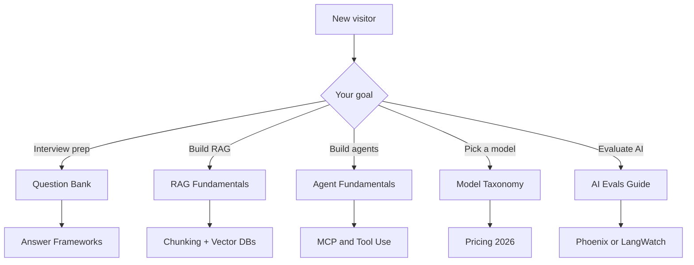
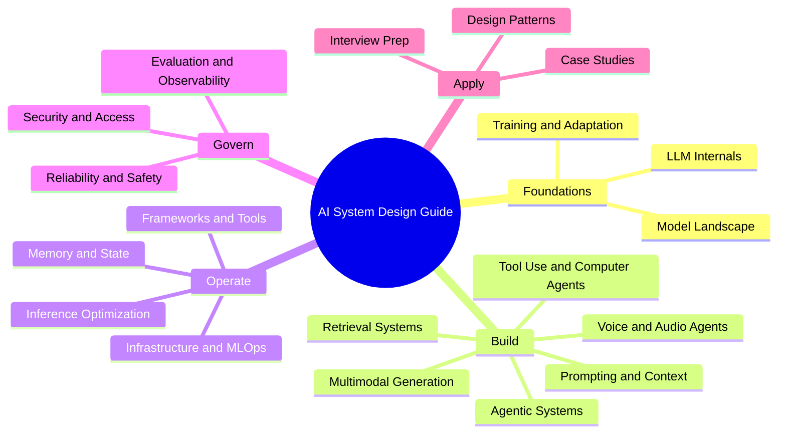

# 🧠 راهنمای طراحی سیستم‌های هوش مصنوعی
### مرجع کامل مصاحبه و محیط تولید — نسخه‌ی فارسی

<p align="center">
  <a href="https://github.com/saeidmhd/ai-system-design-guide"></a>
  <a href="https://github.com/saeidmhd/ai-system-design-guide/stargazers"></a>
  <a href="https://github.com/ombharatiya/ai-system-design-guide"></a>
</p>
<p align="center">
  <sub>🇮🇷 ترجمه و نگهداری نسخه‌ی فارسی: <b><a href="https://github.com/saeidmhd">@saeidmhd</a></b> · 📦 محتوای اصلی: <b><a href="https://github.com/ombharatiya">Om Bharatiya</a></b> (مجوز MIT)</sub>
</p>

<p align="center">
  <a href="https://github.com/saeidmhd/ai-system-design-guide/commits/main"></a>
  <a href="LICENSE"></a>
  <a href="#-مشارکت"></a>
  <a href="https://github.com/saeidmhd/ai-system-design-guide/stargazers"></a>
  <a href="https://github.com/saeidmhd/ai-system-design-guide/issues"></a>
</p>

> **این نسخه‌ی فارسی راهنمای [AI System Design Guide](https://github.com/ombharatiya/ai-system-design-guide) است.** ترجمه و نگهداری آن را من ([@saeidmhd](https://github.com/saeidmhd)) انجام می‌دهم تا مهندسان فارسی‌زبان بتوانند این مرجع را به زبان خودشان بخوانند. محتوا، ساختار و ایده‌های اصلی متعلق به نویسنده‌ی اصلی است؛ برای آخرین نسخه‌ی انگلیسی به [مخزن اصلی](https://github.com/ombharatiya/ai-system-design-guide) سر بزنید.


> **مرجع زنده برای سیستم‌های هوش مصنوعی در محیط تولید.** به‌طور مداوم به‌روز می‌شود. با عمقی مناسب مصاحبه.

راهنمایی عملی و به‌طور مداوم به‌روزشونده درباره‌ی طراحی سیستم‌های هوش مصنوعی، معماری‌های RAG، مهندسی LLM، هوش مصنوعی عاملی (Agentic AI)، پروتکل‌های MCP و A2A و آمادگی برای مصاحبه‌های مهندسی هوش مصنوعی. این راهنما الگوهای محیط تولید، انتخاب مدل، ارزیابی و مطالعه‌ی موردی‌های واقعی از مصاحبه‌های سطح Staff را پوشش می‌دهد.

**تازه‌وارد هستید؟** به [بانک ۱۹۳ سؤالی مصاحبه](00-interview-prep/01-question-bank.md)، [فصل مبانی RAG](06-retrieval-systems/01-rag-fundamentals.md) بروید، یا [LLM مناسب محیط تولید را انتخاب کنید](02-model-landscape/01-model-taxonomy.md).

---

## 📚 ناوبری سریع

| می‌خواهم... | از اینجا شروع کنید |
|--------------|------------|
| **برای مصاحبه آماده شوم** | [بانک سؤالات](00-interview-prep/01-question-bank.md) → [چارچوب‌های پاسخ‌دهی](00-interview-prep/02-answer-frameworks.md) |
| **سریع سیستم‌های هوش مصنوعی را یاد بگیرم** | [سازوکار داخلی LLM](01-foundations/01-llm-internals.md) → [مبانی RAG](06-retrieval-systems/01-rag-fundamentals.md) |
| **معماری RAG مناسب محیط تولید بسازم** | [Chunking](06-retrieval-systems/02-chunking-strategies.md) → [پایگاه‌های داده‌ی برداری (Vector Databases)](06-retrieval-systems/04-vector-databases.md) → [Reranking](06-retrieval-systems/06-reranking-strategies.md) → [RAG در محیط تولید](06-retrieval-systems/14-production-rag-at-scale.md) |
| **بازیابی پیشرفته** | [بازیابی زمینه‌ای](06-retrieval-systems/10-contextual-retrieval.md) → [ColBERT](06-retrieval-systems/11-late-interaction-colbert.md) → [RAG چندوجهی](06-retrieval-systems/12-multimodal-rag.md) |
| **هوش مصنوعی چندمستأجره (multi-tenant) طراحی کنم** | [کنترل دسترسی](12-security-and-access/02-access-control.md) → [مطالعه‌ی موردی](16-case-studies/08-multi-tenant-saas.md) |
| **ایجنت (Agent) بسازم** | [مبانی Agent](07-agentic-systems/01-agent-fundamentals.md) → [MCP و A2A](07-agentic-systems/03-tool-use-and-mcp.md) → [LangGraph](09-frameworks-and-tools/02-langgraph-orchestration.md) |
| **حلقه‌های Agent خودران اجرا کنم** | [مهندسی حلقه](07-agentic-systems/12-loop-engineering.md) (چهار سطح حلقه، شرط خاتمه، بودجه‌بندی، راستی‌آزمایی، loopmaxxing) |
| **ایجنت‌های (Agentهای) استفاده از ابزار و کنترل کامپیوتر** | [چشم‌انداز](17-tool-use-and-computer-agents/01-tool-use-landscape.md) → [OpenClaw](17-tool-use-and-computer-agents/03-openclaw-deep-dive.md) → [ایمنی](17-tool-use-and-computer-agents/07-safety-and-governance.md) |
| **ایجنت‌های (Agentهای) کدنویسی خودکار** | [Claude Code](09-frameworks-and-tools/09-claude-code.md) → [چشم‌انداز OpenCoder](09-frameworks-and-tools/10-opencoderguide.md) |
| **از آشفتگی نسخه‌های فریم‌ورک (Framework) جان سالم به در ببرم** | [پیمایش آشفتگی فریم‌ورک‌ها](09-frameworks-and-tools/12-navigating-framework-churn.md) (آموزش‌های منسوخ، قفل کردن نسخه، آنچه واقعاً باید یاد گرفت) |
| **مدل مناسب را انتخاب کنم (۲۰۲۶)** | [طبقه‌بندی مدل‌ها](02-model-landscape/01-model-taxonomy.md) → [قیمت‌گذاری](02-model-landscape/03-pricing-and-costs.md) |
| **هوش مصنوعی را در محیط تولید ارزیابی کنم** | [راهنمای ارزیابی هوش مصنوعی (Phoenix/Langfuse)](ai_evals_comprehensive_study_guide.md) → [راهنمای ارزیابی هوش مصنوعی (LangWatch/Langfuse)](ai_evals_complete_guide_langwatch_langfuse.md) |
| **بنچمارک‌ها را درست بخوانم** | [بنچمارک‌ها و جدول‌های رتبه‌بندی](14-evaluation-and-observability/03-benchmarks-and-leaderboards.md) (اشباع، آلودگی، تفاوت harness) |
| **پژوهش‌های پیشرو را دنبال کنم (۲۰۲۶)** | [رادار پژوهش](RESEARCH-RADAR.md) (مقاله‌های پرطرفدار و آنچه باید بعد یاد گرفت) |
| **یک Agent صوتی بسازم** | [Agentهای صوتی بلادرنگ](18-voice-and-audio-agents/01-realtime-voice-agents.md) (pipeline در برابر speech-to-speech در برابر front end دوطرفه‌ی همزمان، تاخیر (Latency)، هزینه به ازای هر دقیقه) → [سؤالات هوش مصنوعی صوتی](00-interview-prep/01-question-bank.md#voice-ai-questions) |
| **بین مدل‌ها مسیریابی کنم / یک Gateway اضافه کنم** | [Gatewayهای هوش مصنوعی و مسیریابی مدل](11-infrastructure-and-mlops/03-ai-gateways-and-model-routing.md) (fallback، محدودیت نرخ، LiteLLM) |
| **هزینه‌ی هوش مصنوعی را کنترل کنم** | [FinOps و اقتصاد Token](11-infrastructure-and-mlops/04-finops-and-token-economics.md) (caching، batch، انتساب هزینه، اقتصاد واحد) |
| **با مقررات هوش مصنوعی سازگار شوم** | [حاکمیت و انطباق هوش مصنوعی](13-reliability-and-safety/04-ai-governance-and-compliance.md) (EU AI Act، NIST RMF، آنچه باید پیاده‌سازی کرد) |
| **تصویر، ویدیو و صدا تولید کنم** | [تولید چندوجهی](19-multimodal-generation/01-multimodal-generation.md) (pipelineها، منشأ‌یابی، ارزیابی) |
| **یک مدل استدلالگر آموزش دهم** | [RLVR و GRPO](03-training-and-adaptation/08-rlvr-and-reasoning-models.md) (نحوه‌ی آموزش مدل‌های o-series و R1) |
| **مدل‌ها را به‌صورت محلی اجرا کنم** | [استقرار (Deployment) روی دستگاه و لبه](04-inference-optimization/09-on-device-and-edge-deployment.md) (Ollama در برابر vLLM، کوانتیزاسیون، سخت‌افزار) |
| **ایجنت‌ها (Agentها) را در برابر کرش مقاوم کنم** | [اجرای پایدار](07-agentic-systems/11-durable-execution.md) (replay، exactly-once، Temporal) |
| **لایه‌ی داده را مهندسی کنم** | [مهندسی داده برای هوش مصنوعی](06-retrieval-systems/15-data-engineering-for-ai.md) (ingestion، حذف تکرار، PII، decontamination) |
| **بهترین دوره‌های یادگیری هوش مصنوعی را پیدا کنم** | [دوره‌ها و مسیرهای یادگیری پیشنهادی](COURSES.md) |
| **از نقش فعلی‌ام به هوش مصنوعی گذار کنم** | [راهنمای گذار نقش](TRANSITION_GUIDE.md) |
| **بازار کار هوش مصنوعی در ۲۰۲۶ را بفهمم** | [روندهای بازار کار](00-interview-prep/06-job-market-trends-2026.md) |
| **پاسخ سریع یک سؤال رایج را بگیرم** | [پرسش‌های متداول](00-interview-prep/07-faq.md) (RAG، Agentها، مدل‌ها، ارزیابی، استنتاج (Inference)، حافظه، امنیت) |
| **یک اصطلاح را جست‌وجو کنم** | [واژه‌نامه](GLOSSARY.md) (همه‌ی اصطلاحات تعریف شده‌اند) |

### یک مسیر انتخاب کنید



---

## 🎯 چرا این راهنما

**کتاب‌های چاپی پیش از انتشار منسوخ می‌شوند.** این یک سند زنده است: وقتی مدل‌های جدید منتشر می‌شوند یا الگوها تکامل می‌یابند، این راهنما هم به‌روز می‌شود.

| این راهنما | کتاب‌های چاپی |
|------------|---------------|
| مدل‌های نوامبر ۲۰۲۶ (Claude Opus 5.5, Sonnet 5.5, Haiku 5.5, Fable 5.1, GPT-6 Astra/Sol/Luna, GPT-6.1 Sol/Terra, Gemini 4 Argon, Gemini 3.8 Flash, Grok 4.7, Muse Wonder, Muse Spark 1.3, DeepSeek V4.1-Flash, Mistral Large 4, MiMo-V2.6, GLM-5.3, Kimi K3.1 Pro, Qwen3.8) | گیر کرده روی GPT-4 |
| پروتکل MCP spec 2026-07-28، A2A v1.0.1، OpenClaw، Computer Use، Agentهای صوتی دوطرفه‌ی همزمان، RAG عاملی (Agentic RAG)، ColBERT، استدلال نهفته، سرو MoE | وجود ندارد |
| قیمت‌های واقعی با تاریخ راستی‌آزمایی نوامبر ۲۰۲۶ | همین حالا هم اشتباه است |
| پرسش و پاسخ مصاحبه‌ی سطح Staff (۱۹۳ سؤال تا نوامبر ۲۰۲۶، شامل هوش مصنوعی صوتی و دورهایی از گزارش‌های اخیر داوطلبان) + روندهای بازار کار | سؤالات عمومی |

**انتخاب‌گر سریع مدل (نوامبر ۲۰۲۶):**

- **کدنویسی عاملی و کارهای سخت محیط تولید:** Claude Opus 5.5 (به ازای هر ۱ میلیون Token برابر $4/$20)، مدلی که Anthropic به مشتریان توصیه می‌کند با آن شروع کنند و با امتیاز ۵۹ (بیشینه‌ی effort) بالاترین امتیاز عمومی‌دردسترس در Artificial Analysis Intelligence Index v5.0.1 است (۳ نوامبر ۲۰۲۶؛ Gemini 4 Carbon امتیاز ۶۰ دارد اما محدود به گروهی از مدافعان سایبری است و GPT-6 Astra امتیاز ۵۷ دارد).
- **پیش‌فرض محیط تولید:** رده‌ی $2/$10 با Claude Sonnet 5.5، GPT-6 Sol و GPT-6.1 Sol. هزینه‌ی cache read در Sonnet 5.5 از ۷ اکتبر به $0.10 به ازای هر ۱ میلیون کاهش یافت، برابر با GPT-6.1 Sol؛ بنابراین حلقه‌های Agent که به‌شدت از cache استفاده می‌کنند اکنون روی هر دو تقریباً یک‌قدر هزینه دارند. ناوگان‌های Agent، چت و بارهای کاری عمومی را به اینجا مسیریابی کنید. Gemini 4 Argon (GA از ۱۳ اکتبر) فقط تا ۳۰ نوامبر $2/$10 و از ۱ دسامبر $4/$20 است و فقط implicit caching دارد، پس آن را با $4/$20 قیمت‌گذاری کنید.
- **رده‌ی میانی، جدید:** GPT-6.1 Terra ($1/$5، ۲۶ اکتبر) رده‌ی $2/$10 را نصف می‌کند و در شاخص امتیاز ۵۱ می‌گیرد، در مقابل ۵۴ برای Sonnet 5.5 و ۵۵ برای GPT-6.1 Sol. پیش از پرداخت هزینه‌ی مدل‌های بزرگ‌تر، آن را روی ترافیک پایدار خودتان مقایسه کنید.
- **سقف توانایی:** Claude Fable 5.1 یا GPT-6 Astra ($10/$50)، فقط وقتی ارزیابی‌های شما نشان می‌دهد Opus 5.5 با effort بالا کم می‌آورد.
- **حجم بالا:** Claude Haiku 5.5 و GPT-6 Luna، هر دو $0.10/$0.50؛ اما Haiku 5.5 وقتی Prompt از ۱۰۰ هزار Token بگذرد (cache readها و writeها هم شمرده می‌شوند) کل درخواست را با $0.50/$2.50 محاسبه می‌کند، پس Promptهایش را کوتاه نگه دارید. Gemini 3.8 Flash تا ۳۱ دسامبر با نیم‌بها یعنی $0.75/$3.75 ارائه می‌شود و پس از آن $1.50/$7.50 است، پس بودجه را بر اساس قیمت لیست ببندید؛ DeepSeek V4.1-Flash برای کارهای batch مناسب است که می‌توانید خارج از اوج زمان‌بندی کنید، چون آن موقع نصف قیمت اوج‌اش یعنی $0.30/$1.20 هزینه دارد.
- **وزن‌های باز:** Moonshot وزن‌های Kimi K3.1 Pro را در ۴ نوامبر ۲۰۲۶ منتشر کرد (۲.۸ تریلیون پارامتر کل، ۱۰۴ میلیارد فعال، مجوز سفارشی) و در شاخص v5.0.1 امتیاز ۴۶ می‌گیرد، یعنی ۱۳ امتیاز کمتر از Opus 5.5؛ امتیاز بعدیِ مدل با وزن منتشرشده DeepSeek V4.1-Flash با ۳۳ (بیشینه‌ی effort) است. Artificial Analysis هنوز در ۶ نوامبر K3.1 Pro را انحصاری (proprietary) برچسب زده بود، پس بسته به قاعده‌ی طبقه‌بندی، فاصله‌ی گزارش‌شده‌ی باز-در-برابر-بسته ۱۳ یا ۲۶ امتیاز است؛ قاعده را نام ببرید. گزینه‌های جاافتاده MiMo-V2.6-Pro و DeepSeek V4.1-Flash (هر دو MIT)، GLM-5.3 و Kimi K3 هستند و در اکتبر Muse Spark Open از Meta و Mistral Large 4 هم اضافه شدند. ابتدا مجوز را بخوانید: GLM-5.3 فقط برای اپراتورهای MaaS با درآمد سالانه‌ی بالای ۱۰ میلیارد دلار آمریکا یک بازبینی امنیتی اضافه می‌کند، Kimi K3، Kimi K3.1 Pro و Muse Spark Open برای کسب‌وکارهای MaaS با درآمد بالای ۲۰ میلیون دلار آمریکا قرارداد جداگانه می‌خواهند (K3.1 Pro همچنین بالای ۱۰۰ میلیون کاربر ماهانه یا ۲۰ میلیون دلار درآمد ماهانه یک اعتبارنویسی قابل‌مشاهده‌ی "Kimi K3.1-Pro" می‌خواهد) و Mistral Large 4 برای هر کسب‌وکار MaaS مجوز تجاری لازم دارد.
- **پیش از جابه‌جایی:** OpenAI بالای ۲۷۲ هزار Token ورودی کل درخواست را با نرخ Context طولانی و Haiku 5.5 بالای ۱۰۰ هزار محاسبه می‌کند؛ نسخه‌ی API شرکت Anthropic یعنی `2026-10-21` که SDKهای نسخه‌ی major جدید به‌طور پیش‌فرض ارسال می‌کنند، برای هر `temperature`، `top_p` یا `top_k` روی هر مدل، حتی با مقدار پیش‌فرض، خطای ۴۰۰ برمی‌گرداند؛ Opus 5.5، Sonnet 5.5 و Fable/Mythos 5.1 روی `tool_choice` اجباری خطای ۴۰۰ می‌دهند، در حالی که Haiku 5.5 آن را می‌پذیرد اما thinking را رد می‌کند؛ و Opus 5.5 پیش‌فرض effort را `medium` قرار می‌دهد، در حالی که Opus 5 از `high` استفاده می‌کرد.

تفکیک کامل در [طبقه‌بندی مدل‌ها](02-model-landscape/01-model-taxonomy.md) و [راهنمای انتخاب مدل](02-model-landscape/04-model-selection-guide.md) آمده است.

---

## 🎯 این راهنما چیست (و چه چیزی نیست)

**این راهنما:**
- یک مرجع سطح Staff برای طراحی سیستم‌های هوش مصنوعی در محیط تولید است (RAG، Agentها، MCP، pipelineهای ارزیابی، ایزوله‌سازی چندمستأجره (multi-tenant)).
- همراه مصاحبه است با ۱۹۳ سؤال واقعی (شامل مجموعه‌ی هوش مصنوعی صوتی و مجموعه‌ای برگرفته از گزارش‌های اخیر مصاحبه‌ی داوطلبان)، چارچوب‌های پاسخ‌دهی همراه با یک رونوشت آزمایشی نمونه، و ده تمرین تخته‌سفید تا نوامبر ۲۰۲۶.
- یک سند زنده است که انتشار مدل‌های جدید، تغییرات پروتکل‌ها و الگوهای نوظهور را هم‌زمان با عرضه دنبال می‌کند.
- در مورد مصالحه‌ها (tradeoffها) نظر دارد: تاخیر (Latency) در برابر هزینه، دقت در برابر وفاداری به منبع، Agent تکی در برابر چند-Agent.
- رایگان، با مجوز MIT است و PRهای فعالان این حوزه را می‌پذیرد.

**این راهنما نیست:**
- آموزش Python، PyTorch یا مبانی یادگیری ماشین (با یک دوره شروع کنید؛ [COURSES.md](COURSES.md) را ببینید).
- یک راهنمای بی‌طرف نسبت به فروشندگان؛ مدل‌ها، قیمت‌ها و فریم‌ورک‌های مشخص را نام می‌برد، چون سیستم‌های واقعی به انتخاب‌های واقعی نیاز دارند.
- جایگزینی برای ساختن عملی؛ آن را کنار یک پروژه بخوانید، نه به‌جای آن.
- خلاصه‌ی مقالات پژوهشی؛ مقاله‌ها را وقتی ارجاع می‌دهد که عملکرد را تغییر دهند، نه برای کامل بودن.

---

## 📖 ساختار راهنما

```
├── 00-interview-prep/           # Questions (193), frameworks, exercises, job-market trends (November 2026)
├── 01-foundations/              # Transformers, attention, embeddings
├── 02-model-landscape/          # Claude Opus 5.5, Sonnet 5.5, Haiku 5.5, Fable 5.1, GPT-6 and 6.1, Gemini 4 Argon and 3.8, Grok 4.7, DeepSeek V4.1, open weights, pricing
├── 03-training-and-adaptation/  # Fine-tuning, LoRA, DPO, distillation, RLVR/GRPO
├── 04-inference-optimization/   # KV cache, PagedAttention, vLLM, diffusion LLMs, on-device
├── 05-prompting-and-context/    # Prompt engineering, CoT, Extended Thinking, DSPy, prompt injection
├── 06-retrieval-systems/        # RAG, chunking, GraphRAG, Agentic RAG, ColBERT, Contextual Retrieval, data engineering
├── 07-agentic-systems/          # MCP (spec 2026-07-28), A2A v1.0.1, multi-agent, computer-use, durable execution, loop engineering
├── 08-memory-and-state/         # L1-L3 memory tiers, Mem0, caching
├── 09-frameworks-and-tools/     # LangGraph, DSPy, LlamaIndex, Claude Code, OpenCoder, framework churn
├── 10-document-processing/      # Vision-LLM OCR, multimodal parsing
├── 11-infrastructure-and-mlops/ # GPU clusters, LLMOps, AI gateways, FinOps and cost
├── 12-security-and-access/      # RBAC, ABAC, multi-tenant isolation
├── 13-reliability-and-safety/   # Guardrails, red-teaming, AI governance and compliance
├── 14-evaluation-and-observability/ # RAGAS, LangSmith, benchmarks & leaderboards, drift detection
├── 15-ai-design-patterns/       # Pattern catalog, anti-patterns
├── 16-case-studies/             # Real-world architectures with diagrams
├── 17-tool-use-and-computer-agents/ # OpenClaw, Computer Use, tool agents, safety
├── 18-voice-and-audio-agents/   # Voice agents: pipeline, speech-to-speech, duplex front ends, turn-taking, cost per minute
├── 19-multimodal-generation/    # Image/video/audio generation: pipelines, provenance, evaluation
├── GLOSSARY.md                  # Every term defined
│
├── ai_evals_comprehensive_study_guide.md      # 🔬 Deep-dive: AI Evals (Phoenix + Langfuse)
├── ai_evals_complete_guide_langwatch_langfuse.md  # 🔬 Deep-dive: AI Evals (LangWatch + Langfuse)
├── COURSES.md                   # 🎓 Recommended courses & learning paths
├── TRANSITION_GUIDE.md          # 🔄 Transition from Backend/QA/PM/EM to AI roles
└── RESEARCH-RADAR.md            # 🛰️ Frontier research radar: trending papers and what to learn next
```

### فصل‌ها بر اساس مرحله‌ی چرخه‌ی عمر سیستم هوش مصنوعی



---

## 🔥 مطالعه‌ی موردی‌های برجسته

مسائل واقعی مصاحبه با راه‌حل کامل و نمودار:

| مطالعه‌ی موردی | مسئله | الگوهای کلیدی |
|------------|---------|--------------|
| [جست‌وجوی بلادرنگ](16-case-studies/06-real-time-search.md) | تازگی داده در ۵ دقیقه در مقیاس بالا | قابلیت Streaming + جست‌وجوی ترکیبی |
| [Agent کدنویسی](16-case-studies/07-autonomous-coding-agent.md) | تغییرات خودکار چندفایلی | محیط Sandboxing + اصلاح خودکار |
| [SaaS چندمستأجره (multi-tenant)](16-case-studies/08-multi-tenant-saas.md) | سناریوی Coca-Cola و Pepsi روی یک زیرساخت | ایزوله‌سازی دفاع در عمق |
| [پشتیبانی مشتری](16-case-studies/09-customer-support-automation.md) | نرخ حل خودکار ۶۰٪ | مسیریابی لایه‌ای + ارجاع (Escalation) |
| [هوش اسناد](16-case-studies/10-document-intelligence.md) | استخراج از ۵۰ هزار قرارداد در ماه | مدل Vision-LLM + استخراج‌گرهای موازی |
| [موتور توصیه‌گر](16-case-studies/11-recommendation-engine.md) | توضیحات شخصی‌سازی‌شده برای ۵۰ میلیون کاربر | رتبه‌بندی ML + توضیحات LLM |
| [اتوماسیون انطباق](16-case-studies/12-compliance-automation.md) | پیش‌غربال‌گری مقررات FDA | استخراج ادعا + پایگاه داده‌ی رویه‌های قبلی |
| [هوش مصنوعی صوتی در سلامت](16-case-studies/13-voice-ai-healthcare.md) | تولید بلادرنگ یادداشت بالینی | سامانه ASR تحت BAA + یادداشت‌های مبتنی بر منبع + بازبینی پرستار |
| [تشخیص تقلب](16-case-studies/14-fraud-detection.md) | تصمیم در ۱۰۰ms با توضیح‌پذیری | ترکیب ML + قواعد |
| [مدیریت دانش](16-case-studies/15-knowledge-management.md) | ۲ میلیون سند با کنترل دسترسی | معماری RAG آگاه از دسترسی |
| [Agent کنترل کامپیوتر](16-case-studies/16-computer-use-agent-production.md) | خودکارسازی گزارش هزینه در ۳ رابط قدیمی | فناوری Firecracker VMs + Action Gate + دفاع در برابر IPI |
| [Fine-tuning چندمستأجره (multi-tenant)](16-case-studies/17-multi-tenant-fine-tuning-platform.md) | ۲۸۰ مستأجر روی یک مدل پایه‌ی مشترک + LoRA مخصوص هر مستأجر | روش LoRA Hot-Swap + Eval-as-PRD برای هر مستأجر |
| [CI/CD مبتنی بر ارزیابی](16-case-studies/18-eval-gated-cicd.md) | مسدود کردن PRهایی که کیفیت هوش مصنوعی را پس‌رفت می‌دهند | مجموعه‌های طلایی + داورهای LLM + اصلاح آماری |
| [تقطیر برای مشتری](16-case-studies/19-customer-distillation-pipeline.md) | کاهش صورت‌حساب ۵۰ هزار دلاری ماهانه‌ی مدل پیشرو به حدود ۹ هزار دلار در ماه با بازگشت سرمایه‌ی کمتر از ۳ ماه | تقطیر مبتنی بر Trace + عرضه‌ی Canary |
| [Agent دانش MCP](16-case-studies/20-mcp-knowledge-agent.md) | پاسخ‌های میان‌سیستمی از Snowflake/Confluence/Jira/Slack | پروتکل MCP + OAuth Resource Server + دروازه‌بندی قابلیت‌ها |

---

## 🔬 راهنماهای عمیق جانبی

دو راهنمای همراه (هر کدام بیش از ۳٬۰۰۰ خط) ارزیابی هوش مصنوعی را از ابتدا تا انتها برای مهندسان، PMها و QAها پوشش می‌دهند:

| راهنما | پلتفرم‌های پوشش‌داده‌شده | محتوا |
|-------|------------------|---------------|
| [ارزیابی هوش مصنوعی: راهنمای مطالعه‌ی جامع](ai_evals_comprehensive_study_guide.md) | Arize Phoenix + Langfuse | مدل LLM-as-a-Judge، ارزیابی RAG، ارزیابی چندنوبتی، ایمنی محیط تولید، اصلاح آماری با `judgy`، مسیر یادگیری ۳۰ روزه |
| [ارزیابی هوش مصنوعی: راهنمای LangWatch + Langfuse](ai_evals_complete_guide_langwatch_langfuse.md) | LangWatch + Langfuse | همان سرفصل‌ها با بیش از ۳۰ ارزیاب آماده‌ی LangWatch، مقایسه‌ی پلتفرم‌ها کنار هم، راهنمای انتخاب پلتفرم |

**موضوعات پوشش‌داده‌شده در هر دو راهنما:**
- راه‌اندازی tracing و observability (Phoenix، LangWatch، Langfuse)
- تحلیل خطا: کدگذاری باز ← کدگذاری محوری ← طبقه‌بندی حالت‌های شکست
- ساخت داورهای LLM با تقسیم Train/Dev/Test و کالیبراسیون با ground truth
- ارزیابی‌های مبتنی بر کد (regex، JSON schema، اعتبارسنج‌های قالب)
- ارزیابی‌های ویژه‌ی RAG: faithfulness، context recall، answer relevance
- ارزیابی pipelineهای چندمرحله‌ای و ارزیابی مکالمه‌ی چندنوبتی
- سپرهای امنیتی (Guardrailهای) محیط تولید، پایش ایمنی، تشخیص drift بلادرنگ
- اصلاح آماری با کتابخانه‌ی `judgy`
- بهترین شیوه‌های حاشیه‌نویسی انسانی و توافق بین ارزیاب‌ها
- بهینه‌سازی هزینه و تاخیر (Latency) برای pipelineهای ارزیابی در مقیاس بالا

---

## 🎓 برای آمادگی مصاحبه

مصاحبه‌های مهندسی هوش مصنوعی و طراحی سیستم چنین سؤال‌هایی می‌پرسند:

> «یک سیستم RAG چندمستأجره (multi-tenant) طراحی کنید که رقبا نتوانند داده‌های یکدیگر را ببینند.»

> «Agent شما برای یک کار ۳ مرحله‌ای ۱۵ مرحله برمی‌دارد. چطور اشکال‌زدایی می‌کنید؟»

این راهنما **الگوهای مشخص**، **مصالحه‌های واقعی** و **حالت‌های شکست در محیط تولید** را در اختیارتان می‌گذارد: عمقی که مصاحبه‌کنندگان در سطوح ارشد انتظار دارند.

➡️ از [آمادگی مصاحبه](00-interview-prep/) شروع کنید

**پیش از مصاحبه‌ی اصلی یک تمرین عملی می‌خواهید؟** خواندن پاسخ‌های قوی دانش می‌سازد، اما مصاحبه چیز دیگری را می‌سنجد: توضیح یک طراحی با صدای بلند، زیر فشار زمان، در حالی که کسی روی مصالحه‌هایتان فشار می‌آورد. پاسخ‌هایتان را با یک دوست یا همکار تمرین کنید، از او بخواهید حرفتان را قطع کند و مصالحه‌ها را زیر سؤال ببرد، و [تمرین‌های تخته‌سفید](00-interview-prep/04-whiteboard-exercises.md) را زمان‌دار حل کنید.

---

## ❓ پرسش‌های متداول

### طراحی سیستم هوش مصنوعی چیست؟
طراحی سیستم هوش مصنوعی شاخه‌ای است که به معماری سیستم‌های مناسب محیط تولید می‌پردازد که حول LLMها، بازیابی، Agentها و ارزیابی ساخته می‌شوند. این شاخه انتخاب مدل، pipelineهای RAG، ارکستراسیون Agent، حافظه، observability و ایمنی را پوشش می‌دهد. برای آشنایی اولیه، [سازوکار داخلی LLM](01-foundations/01-llm-internals.md) و [الگوهای طراحی هوش مصنوعی](15-ai-design-patterns/) را ببینید.

### چگونه برای مصاحبه‌ی مهندسی هوش مصنوعی آماده شوم؟
از [بانک سؤالات](00-interview-prep/01-question-bank.md) (۱۹۳ سؤال تا نوامبر ۲۰۲۶) شروع کنید، سپس با [چارچوب‌های پاسخ‌دهی](00-interview-prep/02-answer-frameworks.md) و [تمرین‌های تخته‌سفید](00-interview-prep/04-whiteboard-exercises.md) تمرین کنید. بیشتر مصاحبه‌های ارشد، طراحی RAG، اشکال‌زدایی Agent، ایزوله‌سازی چندمستأجره (multi-tenant) و مصالحه‌های هزینه/تاخیر (Latency) را می‌سنجند که همگی در [مطالعه‌ی موردی‌ها](16-case-studies/) پوشش داده شده‌اند. پیش از مصاحبه‌ی واقعی، دست‌کم یک مصاحبه‌ی آزمایشی زمان‌دار با کسی انجام دهید که حرفتان را قطع کند و زیر سؤال ببرد.

### معماری RAG (Retrieval-Augmented Generation) چیست؟
معماری RAG الگویی است که در آن یک LLM پیش از تولید پاسخ، زمینه‌ی مرتبط را از یک منبع دانش خارجی (پایگاه داده‌ی برداری (Vector Database)، شاخص جست‌وجو، گراف) بازیابی می‌کند؛ این کار توهم را کاهش می‌دهد و پاسخ‌ها را به داده‌های شما متکی می‌سازد. pipeline کامل در [مبانی RAG](06-retrieval-systems/01-rag-fundamentals.md) و مقیاس‌پذیر کردن آن در [RAG در محیط تولید](06-retrieval-systems/14-production-rag-at-scale.md) آمده است.

### ایجنت‌های (Agentهای) هوش مصنوعی چیستند و چه تفاوتی با چت‌بات‌ها دارند؟
ایجنت‌های (Agentهای) هوش مصنوعی سیستم‌های مبتنی بر LLM هستند که برای رسیدن به اهداف، طی چند مرحله برنامه‌ریزی می‌کنند، ابزار فرا می‌خوانند و عمل می‌کنند؛ در حالی که چت‌بات‌ها معمولاً در یک نوبت پاسخ می‌دهند. Agentها حلقه، حافظه، بازیابی از خطا و استفاده از ابزار از طریق پروتکل‌هایی مانند MCP را وارد کار می‌کنند. از [مبانی Agent](07-agentic-systems/01-agent-fundamentals.md) شروع کنید.

### پروتکل MCP (Model Context Protocol) چیست و چه تفاوتی با A2A دارد؟
پروتکل MCP یک پروتکل باز است که به برنامه‌های LLM امکان می‌دهد ابزارها و منابع داده‌ی خارجی را به شیوه‌ای استاندارد کشف و فراخوانی کنند. A2A (Agent2Agent) پروتکل مکمل برای سپردن کار به Agentی است که کنترلش را ندارید: Agent راه دور یک Agent Card را در `/.well-known/agent-card.json` منتشر می‌کند، کلاینت برایش پیام می‌فرستد و Agent راه دور تصمیم می‌گیرد یک task طولانی‌مدت باز کند یا نه. این دو لایه‌های متفاوتی را حل می‌کنند: MCP مرز ابزار است و A2A مرز Agent، و بیشتر سیستم‌ها مدت‌ها پیش از نیاز به A2A به MCP نیاز دارند. هر دو اکنون زیر نظر Agentic AI Foundation متعلق به Linux Foundation هستند (A2A در اوت ۲۰۲۶ پیوست). نسخه‌ها را در مصاحبه دقیق ذکر کنید: spec پروتکل MCP به‌صورت بازنگری‌های تاریخ‌دار منتشر می‌شود، نسخه‌ی فعلی (2026-07-28) هسته‌ی پروتکل را stateless کرد، نسخه‌ی بعدی برای ۳۰ مارس ۲۰۲۷ برنامه‌ریزی شده است و چیزی به نام «MCP 2.0» وجود ندارد؛ آخرین انتشار spec برای A2A نسخه‌ی v1.0.1 است. [استفاده از ابزار و MCP](07-agentic-systems/03-tool-use-and-mcp.md) را ببینید.

### در محیط تولید از کدام LLM استفاده کنم: Claude، GPT، Gemini یا متن‌باز؟
بستگی به بودجه‌ی تاخیر (Latency)، طول زمینه (Context length)، هزینه به ازای هر کار (تعداد Token در هر کار ضربدر قیمت، نه قیمت به ازای هر Token)، کیفیت استفاده از ابزار و محل نگهداری داده دارد. یک نقطه‌ی شروع معقول برای نوامبر ۲۰۲۶: Claude Opus 5.5 (به ازای هر ۱ میلیون $4/$20) برای کدنویسی عاملی و کارهای سخت، رده‌ی $2/$10 (Claude Sonnet 5.5، GPT-6 Sol، GPT-6.1 Sol) برای بیشتر ترافیک محیط تولید، GPT-6.1 Terra ($1/$5) هر جا که معیار کیفیت شما را برآورده کند، Claude Haiku 5.5، GPT-6 Luna یا Gemini 3.8 Flash برای حجم بالا (Haiku 5.5 فقط روی Promptهای زیر ۱۰۰ هزار Token که قیمت $0.10/$0.50 اعمال می‌شود) و Claude Fable 5.1 یا GPT-6 Astra ($10/$50) فقط وقتی ارزیابی‌های شما نشان می‌دهد رده‌های ارزان‌تر کم می‌آورند. فصل‌های [طبقه‌بندی مدل‌ها](02-model-landscape/01-model-taxonomy.md) و [قیمت‌گذاری](02-model-landscape/03-pricing-and-costs.md) اینها را به‌علاوه‌ی Gemini 4 Argon، Grok 4.7، Muse Spark 1.3، DeepSeek V4.1-Flash و مدل‌های با وزن باز مانند MiMo-V2.6، GLM-5.3، Kimi K3.1 Pro (وزن‌ها از ۴ نوامبر ۲۰۲۶) و Mistral Large 4 مقایسه می‌کنند و [راهنمای انتخاب مدل](02-model-landscape/04-model-selection-guide.md) آن‌ها را به یک درخت تصمیم تبدیل می‌کند. پیش از جابه‌جایی، ارزیابی‌های خودتان را اجرا کنید: امتیازهای فروشندگان بین harnessها و تنظیمات effort قابل انتقال نیستند.

### چگونه یک LLM یا سیستم RAG را در محیط تولید ارزیابی کنم؟
ارزیابی‌های آفلاین (LLM-as-a-judge با کالیبراسیون ground-truth)، معیارهای آنلاین (faithfulness، context recall، answer relevance) و tracing پیوسته را ترکیب کنید. راهنماهای عمیق همراه، یعنی [ارزیابی هوش مصنوعی: Phoenix + Langfuse](ai_evals_comprehensive_study_guide.md) و [ارزیابی هوش مصنوعی: LangWatch + Langfuse](ai_evals_complete_guide_langwatch_langfuse.md)، این فرایند را از ابتدا تا انتها شرح می‌دهند.

### چگونه یک سیستم RAG چندمستأجره (multi-tenant) ایمن بسازم؟
از دفاع در عمق استفاده کنید: شاخص‌ها یا namespaceهای جداگانه برای هر مستأجر، بررسی دسترسی در زمان کوئری و guardهای لایه‌ی Prompt. فصل [کنترل دسترسی](12-security-and-access/02-access-control.md) و [مطالعه‌ی موردی SaaS چندمستأجره (multi-tenant)](16-case-studies/08-multi-tenant-saas.md) الگوهایی را پوشش می‌دهند که هم در مصاحبه و هم در محیط تولید پابرجا می‌مانند.

### معماری RAG عاملی (Agentic RAG) چیست؟
معماری RAG عاملی، بازیابی را با یک حلقه‌ی Agent ترکیب می‌کند که می‌تواند تصمیم بگیرد چه چیزی را جست‌وجو کند، چه زمانی دوباره کوئری بزند و چه زمانی ارجاع دهد، به‌جای اجرای یک گذر ثابت بازیابی-سپس-تولید. برای معماری‌ها و مصالحه‌ها [RAG عاملی](06-retrieval-systems/08-agentic-rag.md) را ببینید.

### آیا این راهنما رایگان است؟ می‌توانم مشارکت کنم؟
بله، با مجوز MIT و رایگان است. PRها پذیرفته می‌شوند؛ [راهنمای مشارکت](CONTRIBUTING.md) را ببینید. اگر حالت‌های شکست محیط تولید، بنچمارک‌های مدل جدید یا سؤالات مصاحبه برای افزودن دارید، یک PR باز کنید.

### این راهنما هر چند وقت به‌روز می‌شود؟
به‌طور مداوم. انتشار مدل‌های جدید، تغییرات پروتکل‌ها (MCP، A2A) و الگوهای نوظهور هم‌زمان با عرضه اضافه می‌شوند. به‌روزرسانی نوامبر ۲۰۲۶، مدل‌ها، قیمت‌ها، پروتکل‌ها و نسخه‌های فریم‌ورک را به وضعیت ۶ نوامبر ۲۰۲۶ رساند. از افزوده‌های اخیر: دوازده [سؤال دیگر از گزارش‌های اخیر مصاحبه](00-interview-prep/01-question-bank.md#questions-from-recent-interview-reports) (Q174-Q185: Agentهای تله‌متری امنیتی، یک کاوشگر کد منطبق با دسترسی، devboxها، دریافت بازبینی در شرایط prompt injection، جست‌وجوی خرده‌فروشی عاملی، یک دور طراحی با هوش مصنوعی اجباری)، هشت [سؤال نوامبر ۲۰۲۶](00-interview-prep/01-question-bank.md#advanced-questions---november-2026) (Q186-Q193: ایزوله‌سازی اعمال قواعد به ازای هر مشتری نهایی، رشته‌های پیام سمت سرور، برنامه‌ی انقضای چندفروشنده‌ای، برنامه‌های دسترسی سایبری، بازبینی مجوز وزن باز، جدول‌های رتبه‌بندی بازنمره‌دهی‌شده، ایزوله‌سازی چندمستأجره (multi-tenant) با شکست باز، کنترل‌های تأیید Agent)، هجده [سؤال از گزارش‌های اخیر مصاحبه](00-interview-prep/01-question-bank.md#questions-from-recent-interview-reports) (Q156-Q173: بازبینی سند طراحی، توزیع مدل، زمان‌بندی GPU، KV cache و tokenizer از صفر، Agent بدون فریم‌ورک، دورهای کدنویسی با کمک هوش مصنوعی، آمادگی عرضه، غربال‌های ایمنی)، هشت [سؤال اکتبر ۲۰۲۶](00-interview-prep/01-question-bank.md#advanced-questions---october-2026) (Q148-Q155: پایش Agent، طبقه‌بندی حادثه، زنجیره‌ی تأمین Gateway، مهاجرت fine-tune، پرتگاه‌های قیمت، مدل‌های تصمیم، عرضه‌ی نسخه‌ی API، SLAهای وصله)، یک [بخش هوش مصنوعی صوتی](00-interview-prep/01-question-bank.md#voice-ai-questions) دوازده‌سؤالی، هفت سؤال سپتامبر ۲۰۲۶، یک تمرین تخته‌سفید دهم، یک فصل بازنویسی‌شده‌ی [Agentهای صوتی بلادرنگ](18-voice-and-audio-agents/01-realtime-voice-agents.md) و [روندهای بازار کار نوامبر ۲۰۲۶](00-interview-prep/06-job-market-trends-2026.md).

### اگر از بک‌اند، QA، PM یا EM به هوش مصنوعی گذار می‌کنم، می‌توانم از این راهنما استفاده کنم؟
بله. [راهنمای گذار نقش](TRANSITION_GUIDE.md) مهارت‌های فعلی را به مسیرهای مهندس هوش مصنوعی، MLE و معمار هوش مصنوعی نگاشت می‌کند، با مسیرهای مطالعه برای هر نقش. آن را با [COURSES.md](COURSES.md) برای منابع یادگیری منتخب همراه کنید.

---

## 🔄 کتاب زنده

این راهنما موارد زیر را دنبال می‌کند:
- انتشار مدل‌های جدید و عملکرد واقعی آن‌ها
- الگوهای نوظهور (MCP، Agentic RAG، Flow Engineering)
- قیمت‌ها و محدودیت‌های نرخ به‌روز
- منسوخ‌شدن‌ها و تغییر بهترین شیوه‌ها

**⭐ ستاره بدهید و Watch کنید** تا هنگام ارسال به‌روزرسانی‌ها مطلع شوید.

---

## 🤝 مشارکت

اطلاعات منسوخ پیدا کردید؟ تجربه‌ی محیط تولید برای به‌اشتراک‌گذاری دارید؟ PRها خوش‌آمدند.
[راهنمای مشارکت](CONTRIBUTING.md) را ببینید.

---

## 👋 در ارتباط بمانید

اگر این نسخه‌ی فارسی برایتان مفید است، ساده‌ترین راه حمایت این است که به مخزن ستاره بدهید و آن را Watch کنید تا از به‌روزرسانی‌ها باخبر شوید:

- **گیت‌هاب (GitHub):** [@saeidmhd](https://github.com/saeidmhd) - نسخه‌ی فارسی و به‌روزرسانی‌های ترجمه.
- **مخزن اصلی (انگلیسی):** [ombharatiya/ai-system-design-guide](https://github.com/ombharatiya/ai-system-design-guide) - منبع اصلی محتوا.
- **وب‌سایت نسخه‌ی اصلی:** [aidaddy.tech](https://www.aidaddy.tech) - خواندن نسخه‌ی انگلیسی با جست‌وجو و ناوبری تمیز.
- **گزارش اشکال ترجمه:** از طریق [Issues](https://github.com/saeidmhd/ai-system-design-guide/issues).

<p align="center">
  <a href="https://github.com/saeidmhd"></a>
</p>

---

## 📄 مجوز

مجوز MIT. [LICENSE](LICENSE) را ببینید. اعلان حق نشر و مجوز نویسنده‌ی اصلی در این مخزن حفظ شده است.

---

<p align="center">
  <b>نسخه‌ی فارسی: <a href="https://github.com/saeidmhd">@saeidmhd</a> · نویسنده‌ی اصلی: <a href="https://github.com/ombharatiya">Om Bharatiya</a></b>
</p>
