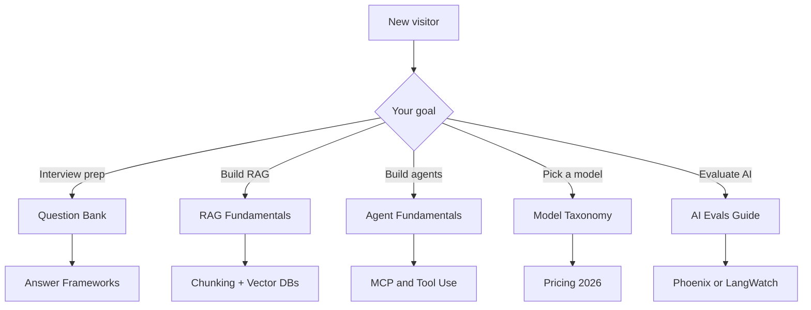
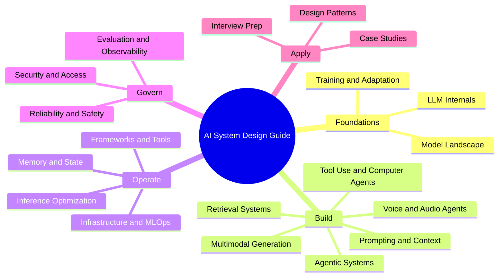

# 🧠 راهنمای جامع طراحی سیستم‌های هوش مصنوعی (AI System Design Guide)
### مرجع کامل مصاحبه و پروداکشن (Production)

<p align="center">
  <a href="https://www.aidaddy.tech"></a>
  <a href="https://enginebogie.com/u/ombharatiya"></a>
  <a href="https://topmate.io/ombharatiya"></a>
</p>
<p align="center">
  <sub>🌐 جستجوی آنی در <b><a href="https://www.aidaddy.tech">aidaddy.tech</a></b>. 🎯 مصاحبه‌های آزمایشی ۱ به ۱ و منتورشیپ با Om. ⭐ برای حمایت از این پروژه به ریپازیتوری ستاره بدهید.</sub>
</p>

<p align="center">
  <a href="https://github.com/ombharatiya"></a>
  <a href="https://x.com/ombharatiya"></a>
  <a href="https://linkedin.com/in/ombharatiya"></a>
</p>

<p align="center">
  <b>اگر این راهنما برای شما مفید است، <a href="https://github.com/ombharatiya">@ombharatiya</a> را در GitHub، <a href="https://x.com/ombharatiya">X</a> و <a href="https://linkedin.com/in/ombharatiya">LinkedIn</a> دنبال کنید تا از انتشار فصول جدید، به‌روزرسانی مدل‌ها و پرامپت‌های مصاحبه مطلع شوید.</b>
</p>

<p align="center">
  <a href="https://github.com/ombharatiya/ai-system-design-guide/commits/main"></a>
  <a href="LICENSE"></a>
  <a href="#-contributing"></a>
  <a href="https://github.com/ombharatiya/ai-system-design-guide/stargazers"></a>
  <a href="https://github.com/ombharatiya/ai-system-design-guide/graphs/contributors"></a>
  <a href="https://github.com/ombharatiya/ai-system-design-guide/issues"></a>
</p>

> **مرجع زنده برای سیستم‌های AI در محیط پروداکشن.** پیوسته به‌روزرسانی‌شده. با عمق مناسب برای مصاحبه.

یک راهنمای کاربردی و پیوسته به‌روزرسانی‌شده برای طراحی سیستم‌های AI، معماری‌های RAG، مهندسی LLM، هوش مصنوعی عامل‌محور (Agentic AI)، پروتکل‌های MCP و A2A، و آمادگی برای مصاحبه‌های مهندسی AI. شامل الگوهای پروداکشن، انتخاب مدل، ارزیابی و مطالعه‌های موردی واقعی برگرفته از مصاحبه‌های سطح Staff.

**تازه‌وارد هستید؟** مستقیماً به [بانک سوالات مصاحبه ۱۹۳ تایی](00-interview-prep/01-question-bank.md)، [فصل مبانی RAG](06-retrieval-systems/01-rag-fundamentals.md) بروید، یا [LLM مناسب برای پروداکشن](02-model-landscape/01-model-taxonomy.md) را انتخاب کنید.

---

## 📚 ناوبری سریع

| می‌خواهم... | از اینجا شروع کنید |
|--------------|------------|
| **برای مصاحبه‌ها آماده شوم** | [بانک سوالات](00-interview-prep/01-question-bank.md) → [چارچوب‌های پاسخ‌دهی](00-interview-prep/02-answer-frameworks.md) |
| **با یک مصاحبه‌کننده واقعی تمرین کنم** | [رزرو مصاحبه آزمایشی ۱ به ۱ یا منتورشیپ](https://enginebogie.com/u/ombharatiya) (همچنین در [Topmate](https://topmate.io/ombharatiya)) |
| **سیستم‌های AI را سریع یاد بگیرم** | [سازوکار داخلی LLM](01-foundations/01-llm-internals.md) → [مبانی RAG](06-retrieval-systems/01-rag-fundamentals.md) |
| **یک RAG پروداکشن بسازم** | [Chunking](06-retrieval-systems/02-chunking-strategies.md) → [پایگاه‌های داده برداری (Vector DBs)](06-retrieval-systems/04-vector-databases.md) → [بازرتبه‌بندی (Reranking)](06-retrieval-systems/06-reranking-strategies.md) → [RAG پروداکشن](06-retrieval-systems/14-production-rag-at-scale.md) |
| **بازیابی پیشرفته** | [بازیابی زمینه‌ای (Contextual Retrieval)](06-retrieval-systems/10-contextual-retrieval.md) → [ColBERT](06-retrieval-systems/11-late-interaction-colbert.md) → [RAG چندوجهی (Multi-modal RAG)](06-retrieval-systems/12-multimodal-rag.md) |
| **یک AI چندمستاجره طراحی کنم** | [کنترل دسترسی](12-security-and-access/02-access-control.md) → [مطالعه موردی](16-case-studies/08-multi-tenant-saas.md) |
| **ایجنت بسازم** | [مبانی Agent](07-agentic-systems/01-agent-fundamentals.md) → [MCP و A2A](07-agentic-systems/03-tool-use-and-mcp.md) → [LangGraph](09-frameworks-and-tools/02-langgraph-orchestration.md) |
| **حلقه‌های ایجنت خودران را اجرا کنم** | [مهندسی حلقه (Loop Engineering)](07-agentic-systems/12-loop-engineering.md) (چهار سطح حلقه، خاتمه، بودجه‌ها، اعتبارسنجی، loopmaxxing) |
| **ایجنت‌های ابزارمحور و تعامل با کامپیوتر** | [چشم‌انداز](17-tool-use-and-computer-agents/01-tool-use-landscape.md) → [بررسی عمیق OpenClaw](17-tool-use-and-computer-agents/03-openclaw-deep-dive.md) → [امنیت](17-tool-use-and-computer-agents/07-safety-and-governance.md) |
| **ایجنت‌های کدنویسی خودمختار** | [Claude Code](09-frameworks-and-tools/09-claude-code.md) → [چشم‌انداز OpenCoder](09-frameworks-and-tools/10-opencoderguide.md) |
| **از تغییرات مداوم نسخه‌های فریم‌ورک در امان بمانم** | [مدیریت تغییرات فریم‌ورک (Framework Churn)](09-frameworks-and-tools/12-navigating-framework-churn.md) (آموزش‌های قدیمی، قفل کردن نسخه، آنچه واقعاً باید آموخت) |
| **مدل مناسب را انتخاب کنم (۲۰۲۶)** | [طبقه‌بندی مدل‌ها](02-model-landscape/01-model-taxonomy.md) → [قیمت‌گذاری](02-model-landscape/03-pricing-and-costs.md) |
| **ارزیابی AI در پروداکشن** | [راهنمای ارزیابی AI (Phoenix/Langfuse)](ai_evals_comprehensive_study_guide.md) → [راهنمای ارزیابی AI (LangWatch/Langfuse)](ai_evals_complete_guide_langwatch_langfuse.md) |
| **بنچمارک‌ها را درست بخوانم** | [بنچمارک‌ها و لیدربوردها](14-evaluation-and-observability/03-benchmarks-and-leaderboards.md) (اشباع، آلودگی داده، واریانس محیط ارزیابی) |
| **پژوهش‌های پیشرو را دنبال کنم (۲۰۲۶)** | [رادار پژوهش](RESEARCH-RADAR.md) (مقاله‌های ترند و آنچه بعداً باید آموخت) |
| **یک ایجنت صوتی بسازم** | [ایجنت‌های صوتی بلادرنگ](18-voice-and-audio-agents/01-realtime-voice-agents.md) (پایپ‌لاین در برابر گفتار-به-گفتار در برابر فرانت‌اند دوطرفه، تاخیر (Latency)، هزینه بر دقیقه) → [سوالات Voice AI](00-interview-prep/01-question-bank.md#voice-ai-questions) |
| **بین مدل‌ها مسیریابی کنم / یک Gateway اضافه کنم** | [AI Gatewayها و مسیریابی مدل](11-infrastructure-and-mlops/03-ai-gateways-and-model-routing.md) (پشتیبان/fallback، محدودیت نرخ، LiteLLM) |
| **هزینه AI را کنترل کنم** | [FinOps و اقتصاد Token](11-infrastructure-and-mlops/04-finops-and-token-economics.md) (کشینگ، پردازش دسته‌ای، انتساب هزینه، اقتصاد واحد) |
| **با قوانین و مقررات AI هماهنگ شوم** | [حاکمیت و انطباق قوانین هوش مصنوعی](13-reliability-and-safety/04-ai-governance-and-compliance.md) (قانون هوش مصنوعی اتحادیه اروپا، NIST RMF، الزامات پیاده‌سازی) |
| **تصویر، ویدیو و صدا تولید کنم** | [تولید چندوجهی](19-multimodal-generation/01-multimodal-generation.md) (پایپ‌لاین‌ها، اصالت منبع، ارزیابی) |
| **یک مدل استدلال آموزش دهم** | [RLVR و GRPO](03-training-and-adaptation/08-rlvr-and-reasoning-models.md) (نحوه آموزش سری o و R1) |
| **مدل‌ها را به صورت محلی اجرا کنم** | [استقرار On-Device و Edge](04-inference-optimization/09-on-device-and-edge-deployment.md) (Ollama در برابر vLLM، کوانتیزاسیون، سخت‌افزار) |
| **ایجنت‌ها را در برابر کرش مقاوم کنم** | [اجرای پایدار (Durable Execution)](07-agentic-systems/11-durable-execution.md) (بازتکرار، پردازش دقیقاً یک‌بار، Temporal) |
| **لایه داده را مهندسی کنم** | [مهندسی داده برای AI](06-retrieval-systems/15-data-engineering-for-ai.md) (دریافت داده، حذف داده‌های تکراری، PII، پاکسازی آلودگی داده) |
| **بهترین دوره‌ها را برای یادگیری AI پیدا کنم** | [دوره‌های پیشنهادی و مسیرهای یادگیری](COURSES.md) |
| **از نقش فعلی‌ام به AI منتقل شوم** | [راهنمای تغییر نقش](TRANSITION_GUIDE.md) |
| **بازار کار AI در سال ۲۰۲۶ را بشناسم** | [روندهای بازار کار](00-interview-prep/06-job-market-trends-2026.md) |
| **پاسخی سریع به یک سوال متداول دریافت کنم** | [پرسش‌های متداول (FAQ)](00-interview-prep/07-faq.md) (RAG، ایجنت‌ها، مدل‌ها، ارزیابی، استنتاج (Inference)، حافظه، امنیت) |
| **یک اصطلاح را جستجو کنم** | [واژه‌نامه](GLOSSARY.md) (تعریف تمام اصطلاحات) |

### مسیر خود را انتخاب کنید



---

## 🎯 چرا این راهنما؟

**کتاب‌های سنتی حتی پیش از انتشار قدیمی می‌شوند.** این یک سند زنده است: با عرضه مدل‌های جدید و تکامل الگوها، این راهنما به‌روزرسانی می‌شود.

| این راهنما | کتاب‌های چاپی |
|------------|---------------|
| مدل‌های نوامبر ۲۰۲۶ (Claude Opus 5.5، Sonnet 5.5، Haiku 5.5، Fable 5.1، GPT-6 Astra/Sol/Luna، GPT-6.1 Sol/Terra، Gemini 4 Argon، Gemini 3.8 Flash، Grok 4.7، Muse Wonder، Muse Spark 1.3، DeepSeek V4.1-Flash، Mistral Large 4، MiMo-V2.6، GLM-5.3، Kimi K3.1 Pro، Qwen3.8) | گیر افتاده در GPT-4 |
| مشخصات MCP نسخه 2026-07-28، A2A نسخه v1.0.1، OpenClaw، کار با کامپیوتر (Computer Use)، ایجنت‌های صوتی دوطرفه هم‌زمان (full-duplex)، RAG عامل‌محور (Agentic RAG)، ColBERT، استدلال نهفته (latent reasoning)، سرویس‌دهی MoE | وجود ندارند |
| قیمت‌گذاری واقعی همراه با تاریخ‌های اعتبارسنجی نوامبر ۲۰۲۶ | از قبل اشتباه |
| پرسش و پاسخ مصاحبه در سطح Staff (۱۹۳ سوال تا نوامبر ۲۰۲۶، شامل Voice AI و مراحلی بر اساس گزارش‌های اخیر متقاضیان) + روندهای بازار کار | سوالات عمومی |

**انتخاب سریع مدل (نوامبر ۲۰۲۶):**

- **کدنویسی با ایجنت و وظایف سنگین پروداکشن:** Claude Opus 5.5 (۴ دلار / ۲۰ دلار به ازای هر ۱ میلیون Token)، مدلی که Anthropic به مشتریان توصیه می‌کند از آن شروع کنند و با امتیاز ۵۹ (در بالاترین سطح تلاش/max effort)، برترین امتیاز عمومی موجود را در Artificial Analysis Intelligence Index v5.0.1 کسب کرده است (۳ نوامبر ۲۰۲۶؛ مدل Gemini 4 Carbon امتیاز ۶۰ دارد اما دسترسی آن به گروهی از مدافعان سایبری محدود است و GPT-6 Astra امتیاز ۵۷ را به دست آورده است).
- **گزینه پیش‌فرض پروداکشن:** رده ۲ دلار / ۱۰ دلار شامل Claude Sonnet 5.5، GPT-6 Sol و GPT-6.1 Sol. هزینه خواندن از کش در Sonnet 5.5 در تاریخ ۷ اکتبر به ۰.۱۰ دلار به ازای هر ۱ میلیون Token کاهش یافت؛ دقیقاً مشابه GPT-6.1 Sol، بنابراین حلقه‌های ایجنت با وابستگی بالا به کش اکنون روی هر دو مدل هزینه یکسانی دارند. ناوگان ایجنت‌ها، چت و بارهای کاری عمومی را به این دسته هدایت کنید. مدل Gemini 4 Argon (انتشار عمومی/GA در ۱۳ اکتبر) تنها تا ۳۰ نوامبر با نرخ ۲ دلار / ۱۰ دلار ارائه می‌شود و از ۱ دسامبر به ۴ دلار / ۲۰ دلار می‌رسد و صرفاً از کشینگ ضمنی پشتیبانی می‌کند، بنابراین آن را با نرخ ۴ دلار / ۲۰ دلار در بودجه لحاظ کنید.
- **رده میانی جدید:** مدل GPT-6.1 Terra (۱ دلار / ۵ دلار، ۲۶ اکتبر) هزینه‌های رده ۲ دلار / ۱۰ دلار را نصف می‌کند و در شاخص امتیاز ۵۱ را به دست می‌آورد (در مقایسه با ۵۴ برای Sonnet 5.5 و ۵۵ برای GPT-6.1 Sol). پیش از پرداخت هزینه برای مدل‌های بزرگ‌تر، عملکرد آن را روی ترافیک پایدار خود بسنجید.
- **بالاترین سقف توانمندی:** مدل‌های Claude Fable 5.1 یا GPT-6 Astra (۱۰ دلار / ۵۰ دلار)، تنها زمانی که ارزیابی‌های شما نشان دهند Opus 5.5 در بالاترین تلاش (high effort) پاسخگوی نیاز نیست.
- **حجم بالا:** مدل‌های Claude Haiku 5.5 و GPT-6 Luna که هر دو ۰.۱۰ دلار / ۰.۵۰ دلار هستند؛ اما در Haiku 5.5 به محض اینکه Prompt از ۱۰۰ هزار Token فراتر رود، کل درخواست با نرخ ۰.۵۰ دلار / ۲.۵۰ دلار محاسبه می‌شود (خواندن و نوشتن کش نیز محاسبه می‌گردد)، بنابراین Promptهای آن را کوتاه نگه دارید. Gemini 3.8 Flash تا ۳۱ دسامبر با نصف قیمت یعنی ۰.۷۵ دلار / ۳.۷۵ دلار کار می‌کند و پس از آن ۱.۵۰ دلار / ۷.۵۰ دلار خواهد بود، بنابراین بودجه‌بندی را بر اساس قیمت اصلی انجام دهید؛ DeepSeek V4.1-Flash برای کارهای دسته‌ای (Batch) مناسب است که می‌توانید آن‌ها را در ساعات غیر اوج اجرا کنید، چرا که در این ساعات هزینه‌اش نصف قیمت ساعات اوج (۰.۳۰ دلار / ۱.۲۰ دلار) خواهد بود.
- **مدل‌های وزن‌باز (Open Weights):** شرکت Moonshot در تاریخ ۴ نوامبر ۲۰۲۶ وزن‌های Kimi K3.1 Pro را منتشر کرد (۲.۸ تریلیون کل پارامترها، ۱۰۴ میلیارد پارامتر فعال، با لایسنس سفارشی) و این مدل در شاخص v5.0.1 امتیاز ۴۶ را ثبت کرده که ۱۳ امتیاز پشت سر Opus 5.5 قرار دارد؛ دومین امتیاز برتر در مدل‌های با وزن‌های منتشرشده متعلق به DeepSeek V4.1-Flash با امتیاز ۳۳ (در حالت max effort) است. پلتفرم Artificial Analysis تا ۶ نوامبر همچنان K3.1 Pro را اختصاصی (Proprietary) دسته‌بندی کرده بود، بنابراین بسته به شیوه دسته‌بندی، شکاف بین مدل‌های باز و بسته ۱۳ یا ۲۶ امتیاز ذکر می‌شود؛ در هنگام ارجاع این نکته را مشخص کنید. انتخاب‌های تثبیت‌شده عبارتند از MiMo-V2.6-Pro و DeepSeek V4.1-Flash (هر دو با لایسنس MIT)، GLM-5.3 و Kimi K3؛ در ماه اکتبر نیز مدل‌های Muse Spark Open از متا و Mistral Large 4 به این فهرست اضافه شدند. پیش از استفاده حتماً لایسنس را بررسی کنید: GLM-5.3 یک بازبینی امنیتی را تنها برای ارائه‌دهندگان MaaS با درآمد سالانه بیش از ۱۰ میلیارد دلار اعمال می‌کند؛ Kimi K3، Kimi K3.1 Pro و Muse Spark Open نیازمند توافق‌نامه‌ای جداگانه برای کسب‌وکارهای MaaS با درآمد بالای ۲۰ میلیون دلار هستند (K3.1 Pro همچنین نیازمند درج عنوان نمایان "Kimi K3.1-Pro" برای کاربران فعال ماهانه بالای ۱۰۰ میلیون نفر یا درآمد ماهانه بالای ۲۰ میلیون دلار است)، و Mistral Large 4 برای هرگونه کسب‌وکار MaaS نیازمند لایسنس تجاری است.
- **پیش از آنکه مهاجرت کنید:** شرکت OpenAI برای پرامپت‌های ورودی بیش از ۲۷۲ هزار Token، کل درخواست را با نرخ Context طولانی محاسبه می‌کند و این سقف در Haiku 5.5 برابر با ۱۰۰ هزار Token است؛ در نسخه API تاریخ `2026-10-21` انتروپیک که SDKهای اصلی جدید به صورت پیش‌فرض ارسال می‌کنند، برای هر پارامتر `temperature`، `top_p` یا `top_k` در تمام مدل‌ها خطای 400 بازگردانده می‌شود، حتی اگر این مقادیر پیش‌فرض باشند؛ مدل‌های Opus 5.5، Sonnet 5.5 و Fable/Mythos 5.1 در صورت اجباری کردن `tool_choice` خطای 400 برمی‌گردانند، در حالی که Haiku 5.5 آن را می‌پذیرد اما بخش تفکر (thinking) را رد می‌کند؛ و سطح تلاش پیش‌فرض Opus 5.5 روی `medium` قرار دارد، در حالی که Opus 5 از `high` استفاده می‌کرد.

بررسی کامل در [طبقه‌بندی مدل‌ها](02-model-landscape/01-model-taxonomy.md) و [راهنمای انتخاب مدل](02-model-landscape/04-model-selection-guide.md).

---

## 🎯 این راهنما چه چیزی هست (و چه چیزی نیست)

**این راهنما هست:**
- یک مرجع در سطح Staff برای طراحی سیستم‌های هوش مصنوعی پروداکشن (RAG، ایجنت‌ها، MCP، پایپ‌لاین‌های ارزیابی، ایزولاسیون چندمستاجره).
- یک همراه آمادگی برای مصاحبه با ۱۹۳ سوال واقعی (شامل مجموعه‌ای برای Voice AI و مجموعه‌ای برگرفته از گزارش‌های اخیر مصاحبه داوطلبان)، چارچوب‌های پاسخ‌دهی همراه با متن پیاده‌شده یک مصاحبه آزمایشی، و ده تمرین پای تخته (Whiteboard) تا نوامبر ۲۰۲۶.
- یک سند زنده که انتشار مدل‌های جدید، تغییرات پروتکل‌ها و الگوهای نوظهور را به محض عرضه دنبال می‌کند.
- دارای دیدگاه مشخص درباره موازنه‌ها (Tradeoffs): تاخیر (Latency) در برابر هزینه، دقت (Accuracy) در برابر وفاداری (Faithfulness)، تک‌ایجنتی در برابر چندایجنت.
- رایگان، با لایسنس MIT، و پذیرای PR از سوی متخصصان و فعالان حوزه.

**این راهنما نیست:**
- یک آموزش برای پایتون، PyTorch یا مبانی اولیه یادگیری ماشین (با یک دوره آموزشی شروع کنید؛ به [COURSES.md](COURSES.md) مراجعه نمایید).
- یک موضع بی‌طرفانه و محتاطانه نسبت به ابزارها؛ این راهنما مدل‌ها، قیمت‌ها و فریم‌ورک‌های مشخصی را نام می‌برد زیرا سیستم‌های واقعی نیازمند انتخاب‌های واقعی هستند.
- جایگزینی برای ساخت عملی سیستم‌ها؛ آن را در کنار یک پروژه واقعی بخوانید، نه به عنوان جایگزین آن.
- خلاصه‌ای از مقالات پژوهشی؛ این راهنما مقالات را تنها زمانی نقل می‌کند که نحوه پیاده‌سازی عملی را تغییر دهند، نه صرفاً برای کامل بودن فهرست.

---

## 📖 ساختار راهنما

```
├── 00-interview-prep/           # Questions (193), frameworks, exercises, job-market trends (November 2026)
├── 01-foundations/              # Transformers, attention, embeddings
├── 02-model-landscape/          # Claude Opus 5.5, Sonnet 5.5, Haiku 5.5, Fable 5.1, GPT-6 and 6.1, Gemini 4 Argon and 3.8, Grok 4.7, DeepSeek V4.1, open weights, pricing
├── 03-training-and-adaptation/  # Fine-tuning, LoRA, DPO, distillation, RLVR/GRPO
├── 04-inference-optimization/   # KV cache, PagedAttention, vLLM, diffusion LLMs, on-device
├── 05-prompting-and-context/    # Prompt engineering, CoT, Extended Thinking, DSPy, prompt injection
├── 06-retrieval-systems/        # RAG, chunking, GraphRAG, Agentic RAG, ColBERT, Contextual Retrieval, data engineering
├── 07-agentic-systems/          # MCP (spec 2026-07-28), A2A v1.0.1, multi-agent, computer-use, durable execution, loop engineering
├── 08-memory-and-state/         # L1-L3 memory tiers, Mem0, caching
├── 09-frameworks-and-tools/     # LangGraph, DSPy, LlamaIndex, Claude Code, OpenCoder, framework churn
├── 10-document-processing/      # Vision-LLM OCR, multimodal parsing
├── 11-infrastructure-and-mlops/ # GPU clusters, LLMOps, AI gateways, FinOps and cost
├── 12-security-and-access/      # RBAC, ABAC, multi-tenant isolation
├── 13-reliability-and-safety/   # Guardrails, red-teaming, AI governance and compliance
├── 14-evaluation-and-observability/ # RAGAS, LangSmith, benchmarks & leaderboards, drift detection
├── 15-ai-design-patterns/       # Pattern catalog, anti-patterns
├── 16-case-studies/             # Real-world architectures with diagrams
├── 17-tool-use-and-computer-agents/ # OpenClaw, Computer Use, tool agents, safety
├── 18-voice-and-audio-agents/   # Voice agents: pipeline, speech-to-speech, duplex front ends, turn-taking, cost per minute
├── 19-multimodal-generation/    # Image/video/audio generation: pipelines, provenance, evaluation
├── GLOSSARY.md                  # Every term defined
│
├── ai_evals_comprehensive_study_guide.md      # 🔬 Deep-dive: AI Evals (Phoenix + Langfuse)
├── ai_evals_complete_guide_langwatch_langfuse.md  # 🔬 Deep-dive: AI Evals (LangWatch + Langfuse)
├── COURSES.md                   # 🎓 Recommended courses & learning paths
├── TRANSITION_GUIDE.md          # 🔄 Transition from Backend/QA/PM/EM to AI roles
└── RESEARCH-RADAR.md            # 🛰️ Frontier research radar: trending papers and what to learn next
```

### فصول بر اساس مراحل چرخه حیات سیستم AI



---

## 🔥 مطالعه‌های موردی منتخب

مسائل واقعی مصاحبه همراه با راه‌حل‌های کامل و نمودارها:

| مطالعه موردی | مسئله | الگوهای کلیدی |
|------------|---------|--------------|
| [جستجوی بلادرنگ](16-case-studies/06-real-time-search.md) | تازگی ۵ دقیقه‌ای داده‌ها در مقیاس بالا | استریمینگ + جستجوی ترکیبی (Hybrid Search) |
| [ایجنت کدنویسی](16-case-studies/07-autonomous-coding-agent.md) | تغییرات خودمختار روی چند فایل | سندباکسینگ (Sandboxing) + خوداصلاحی (Self-Correction) |
| [SaaS چندمستاجره](16-case-studies/08-multi-tenant-saas.md) | کوکاکولا و پپسی روی یک زیرساخت مشترک | ایزولاسیون با دفاع لایه‌ای (Defense-in-Depth) |
| [پشتیبانی مشتریان](16-case-studies/09-customer-support-automation.md) | نرخ حل خودکار ۶۰ درصدی | مسیریابی لایه‌ای (Tiered Routing) + ارجاع به اپراتور (Escalation) |
| [هوشمندی اسناد](16-case-studies/10-document-intelligence.md) | استخراج ۵۰ هزار قرارداد در ماه | Vision-LLM + استخراج‌کننده‌های موازی |
| [موتور پیشنهاددهنده](16-case-studies/11-recommendation-engine.md) | توضیحات شخصی‌سازی‌شده برای ۵۰ میلیون کاربر | رتبه‌بندی ML + توضیحات LLM |
| [اتوماسیون انطباق و مقررات](16-case-studies/12-compliance-automation.md) | غربالگری اولیه مقررات FDA | استخراج ادعاها (Claim Extraction) + پایگاه داده سوابق |
| [هوش مصنوعی صوتی سلامت](16-case-studies/13-voice-ai-healthcare.md) | تولید بلادرنگ یادداشت‌های بالینی | ASR تحت قرارداد BAA + یادداشت‌های مستند (Grounded) + بازبینی پرستار |
| [تشخیص تقلب](16-case-studies/14-fraud-detection.md) | تصمیم‌گیری در ۱۰۰ میلی‌ثانیه با قابلیت تفسیرپذیری | ترکیب ML + قوانین |
| [مدیریت دانش](16-case-studies/15-knowledge-management.md) | ۲ میلیون سند همراه با کنترل دسترسی | RAG آگاه از سطح دسترسی (Permission-Aware RAG) |
| [ایجنت تعامل با کامپیوتر](16-case-studies/16-computer-use-agent-production.md) | اتوماسیون گزارش هزینه‌ها روی ۳ رابط کاربری قدیمی | ماشین‌های مجازی Firecracker + گیت اعتبارسنجی اقدام (Action Gate) + دفاع در برابر تزریق پرامپت غیرمستقیم (IPI) |
| [Fine-tuning چندمستاجره](16-case-studies/17-multi-tenant-fine-tuning-platform.md) | ۲۸۰ مستاجر روی پایه مشترک + LoRA اختصاصی هر مستاجر | تعویض آنی LoRA (Hot-Swap) + ارزیابی به مثابه PRD برای هر مستاجر |
| [CI/CD مشروط به ارزیابی](16-case-studies/18-eval-gated-cicd.md) | مسدودسازی PRهایی که کیفیت AI را کاهش می‌دهند | مجموعه‌های مرجع طلایی (Golden Sets) + داورهای LLM + تصحیح آماری |
| [تقطیر برای مشتری (Distillation)](16-case-studies/19-customer-distillation-pipeline.md) | کاهش صورت‌حساب ماهانه ۵۰ هزار دلاری مدل پیشرو به حدود ۹ هزار دلار با دوره بازگشت سرمایه زیر ۳ ماه | تقطیر مبتنی بر Trace + انتشار تدریجی قناری (Canary Rollout) |
| [ایجنت مدیریت دانش MCP](16-case-studies/20-mcp-knowledge-agent.md) | پاسخ‌دهی فراسیستمی از داده‌های Snowflake/Confluence/Jira/Slack | پروتکل MCP + سرور منبع OAuth + کنترل دسترسی مبتنی بر قابلیت‌ها |

---

## 🔬 راهنماهای عمیق تکمیلی

دو راهنمای همراه (هر کدام بیش از ۳۰۰۰ خط) ارزیابی AI را به صورت سرتاسری برای مهندسان، مدیران محصول (PMs) و مهندسان تضمین کیفیت (QAs) پوشش می‌دهند:

| راهنما | پلتفرم‌های پوشش‌داده‌شده | محتوای داخلی |
|-------|------------------|---------------|
| [ارزیابی هوش مصنوعی: راهنمای جامع مطالعه](ai_evals_comprehensive_study_guide.md) | Arize Phoenix + Langfuse | داوری با مدل (LLM-as-a-Judge)، ارزیابی RAG، ارزیابی چندنوبتی (Multi-turn)، ایمنی در پروداکشن، تصحیح آماری با `judgy`، مسیر یادگیری ۳۰ روزه |
| [ارزیابی هوش مصنوعی: راهنمای LangWatch + Langfuse](ai_evals_complete_guide_langwatch_langfuse.md) | LangWatch + Langfuse | سرفصل یکسان همراه با بیش از ۳۰ ارزیاب آماده LangWatch، مقایسه شانه‌به‌شانه پلتفرم‌ها، راهنمای انتخاب پلتفرم |

**مباحث پوشش‌داده‌شده در هر دو راهنما:**
- راه‌اندازی ردیابی (Tracing) و مشاهده‌پذیری (Observability) (در Phoenix، LangWatch، Langfuse)
- تحلیل خطا: کدگذاری باز (Open Coding) ← کدگذاری محوری (Axial Coding) ← طبقه‌بندی حالت‌های خرابی (Failure Mode Taxonomy)
- ساخت داورهای LLM با تفکیک Train/Dev/Test و کالیبراسیون داده‌های واقعیت زمینی (Ground Truth)
- ارزیاب‌های مبتنی بر کد (Regex، اسکیمای JSON، اعتبارسنج‌های فرمت)
- ارزیابی‌های اختصاصی RAG: وفاداری (Faithfulness)، یادآوری زمینه (Context Recall)، ارتباط پاسخ (Answer Relevance)
- ارزیابی پایپ‌لاین‌های چندمرحله‌ای و ارزیابی مکالمات چندنوبتی
- گاردریل‌های پروداکشن، پایش ایمنی، تشخیص جابجایی داده‌ها (Drift Detection) به صورت بلادرنگ
- تصحیح آماری با کتابخانه `judgy`
- بهترین روش‌های برچسب‌گذاری انسانی و پایایی بین‌ارزیاب‌ها (Inter-rater Reliability)
- بهینه‌سازی هزینه/تاخیر (Latency) برای پایپ‌لاین‌های ارزیابی در مقیاس بالا

---

## 🎓 برای آمادگی مصاحبه

مصاحبه‌های مهندسی AI و طراحی سیستم سوالاتی از این قبیل می‌پرسند:

> "Design a multi-tenant RAG system where competitors cannot see each other's data."

> "Your agent takes 15 steps for a 3-step task. How do you debug it?"

این راهنما **الگوهای ملموس**، **موازنه‌های واقعی (Tradeoffs)**، و **حالت‌های شکست در پروداکشن** را در اختیار شما قرار می‌دهد: همان عمقی که مصاحبه‌کنندگان در سطوح Senior انتظار دارند.

➡️ با [آمادگی مصاحبه](00-interview-prep/) شروع کنید

**می‌خواهید قبل از مصاحبه واقعی تمرین کنید؟** خواندن پاسخ‌های قوی به شما دانش می‌دهد، اما جلسه مصاحبه مهارت متفاوتی را می‌سنجد: توضیح شفاهی یک طرح معماری، زیر فشار زمان، در حالی که کسی تصمیمات و موازنه‌های شما را به چالش می‌کشد. Om مصاحبه‌های آزمایشی ۱ به ۱ طراحی سیستم AI، بررسی پاسخ‌ها و رزومه، و منتورشیپ بلندمدت را برای افرادی که به دنبال ورود به نقش‌های ارشد AI هستند ارائه می‌دهد. برای رزرو به [EngineBogie](https://enginebogie.com/u/ombharatiya) یا [Topmate](https://topmate.io/ombharatiya) مراجعه کنید.

<p align="center">
  <a href="https://enginebogie.com/u/ombharatiya"></a>
  <a href="https://topmate.io/ombharatiya"></a>
</p>

---

## ❓ پرسش‌های متداول

### طراحی سیستم هوش مصنوعی (AI System Design) چیست؟
طراحی سیستم AI شاخه‌ای تخصصی از مهندسی است که به معماری سیستم‌های سطح پروداکشن ساخته‌شده بر پایه LLMها، بازیابی اطلاعات (Retrieval)، ایجنت‌ها و ارزیابی (Evaluation) می‌پردازد. این حوزه شامل انتخاب مدل، پایپ‌لاین‌های RAG، ارکستراسیون ایجنت‌ها، حافظه، مشاهده‌پذیری و ایمنی است. برای آشنایی اولیه، به [سازوکار داخلی LLM](01-foundations/01-llm-internals.md) و [الگوهای طراحی AI](15-ai-design-patterns/) مراجعه کنید.

### چگونه برای مصاحبه مهندسی AI آماده شوم؟
با [بانک سوالات](00-interview-prep/01-question-bank.md) (۱۹۳ سوال تا نوامبر ۲۰۲۶) شروع کنید، سپس با [چارچوب‌های پاسخ‌دهی](00-interview-prep/02-answer-frameworks.md) و [تمرین‌های پای تخته](00-interview-prep/04-whiteboard-exercises.md) تمرین نمایید. بیشتر مصاحبه‌های سطح ارشد، طراحی RAG، دیباگ کردن ایجنت‌ها، ایزولاسیون چندمستاجره، و موازنه‌های هزینه/تاخیر (Latency) را می‌سنجند که همگی در [مطالعه‌های موردی](16-case-studies/) پوشش داده شده‌اند. قبل از جلسه مصاحبه واقعی، حداقل یک مصاحبه آزمایشی زمان‌بندی‌شده با فردی داشته باشید که میان کلامتان بیاید و تصمیمات و موازنه‌های شما را به چالش بکشد؛ می‌توانید چنین جلسه‌ای را با Om در [EngineBogie](https://enginebogie.com/u/ombharatiya) یا [Topmate](https://topmate.io/ombharatiya) رزرو کنید.

### سیستم RAG (Retrieval-Augmented Generation) چیست؟
سیستم RAG الگویی است که در آن، یک LLM پیش از تولید پاسخ، زمینه (Context) مرتبط را از یک منبع دانش خارجی (پایگاه داده برداری (Vector Database)، شاخص جستجو یا گراف) بازیابی می‌کند؛ این کار توهمات مدل (Hallucinations) را کاهش داده و پاسخ‌ها را بر داده‌های واقعی شما مستند می‌سازد. پایپ‌لاین کامل در [مبانی RAG](06-retrieval-systems/01-rag-fundamentals.md) پوشش داده شده و نحوه مقیاس‌پذیری آن در [RAG در مقیاس پروداکشن](06-retrieval-systems/14-production-rag-at-scale.md) بررسی شده است.

### ایجنت‌های هوش مصنوعی (AI Agents) چه هستند و چه تفاوتی با چت‌بات‌ها دارند؟
ایجنت‌های AI سیستم‌های هدایت‌شده با LLM هستند که برای دستیابی به اهداف، برنامه‌ریزی می‌کنند، ابزارها را فرامی‌خوانند و اقداماتی را در چندین مرحله به انجام می‌رسانند؛ در حالی که چت‌بات‌ها معمولاً در یک نوبت (Single turn) پاسخ می‌دهند. ایجنت‌ها مفاهیمی چون حلقه‌ها، حافظه، بازیابی از خطا و استفاده از ابزار از طریق پروتکل‌هایی مانند MCP را معرفی می‌کنند. برای شروع، [مبانی Agent](07-agentic-systems/01-agent-fundamentals.md) را مطالعه کنید.

### پروتکل MCP (Model Context Protocol) چیست و چه مقایسه‌ای با A2A دارد؟
پروتکل MCP یک پروتکل استاندارد باز است که به برنامه‌های مبتنی بر LLM اجازه می‌دهد تا ابزارهای خارجی و منابع داده را به روشی استاندارد شناسایی و فراخوانی کنند. پروتکل A2A (یا Agent2Agent) پروتکلی مکمل برای واگذاری کار به ایجنتی است که تحت کنترل شما نیست: ایجنت راه دور یک Agent Card را در مسیر `/.well-known/agent-card.json` منتشر می‌کند، کلاینت به آن پیامی می‌فرستد و ایجنت راه دور تصمیم می‌گیرد که آیا یک وظیفه طولانی‌مدت (Long-running task) باز کند یا خیر. این دو پروتکل لایه‌های متفاوتی را حل می‌کنند: MCP مرز ابزارها است و A2A مرز بین ایجنت‌ها، و اغلب سیستم‌ها بسیار پیش از نیاز به A2A، به MCP نیاز پیدا می‌کنند. هر دو پروتکل اکنون تحت نظارت بنیاد Agentic AI وابسته به Linux Foundation قرار دارند (A2A در اوت ۲۰۲۶ به آن پیوست). در مصاحبه‌ها به نسخه‌ها دقیقاً اشاره کنید: مشخصات MCP به صورت بازبینی‌های تاریخ‌دار عرضه می‌شود، نسخه فعلی (2026-07-28) هسته پروتکل را بدون حالت (Stateless) کرد، نسخه بعدی برای ۳۰ مارس ۲۰۲۷ برنامه‌ریزی شده است و چیزی به نام "MCP 2.0" وجود ندارد؛ آخرین نسخه رسمی A2A نیز v1.0.1 است. به [استفاده از ابزار و MCP](07-agentic-systems/03-tool-use-and-mcp.md) مراجعه کنید.

### کدام LLM را در پروداکشن استفاده کنم: Claude، GPT، Gemini یا متن‌باز؟
این انتخاب به بودجه تاخیر (Latency)، طول Context، هزینه به ازای هر تسک (تعداد Token به ازای تسک ضرب‌در قیمت، نه صرفاً قیمت هر Token)، کیفیت استفاده از ابزار و محل ذخیره‌سازی داده‌ها (Data Residency) بستگی دارد. یک نقطه شروع منطقی در نوامبر ۲۰۲۶ عبارت است از: مدل Claude Opus 5.5 (۴ دلار / ۲۰ دلار به ازای هر ۱ میلیون Token) برای کدنویسی با ایجنت و کارهای پیچیده، رده ۲ دلار / ۱۰ دلار (Claude Sonnet 5.5، GPT-6 Sol و GPT-6.1 Sol) برای اکثر ترافیک پروداکشن، مدل GPT-6.1 Terra (۱ دلار / ۵ دلار) در هر جایی که کیفیت مطلوب شما را تامین کند، مدل‌های Claude Haiku 5.5، GPT-6 Luna یا Gemini 3.8 Flash برای حجم‌های بالا (Haiku 5.5 تنها برای Promptهای زیر ۱۰۰ هزار Token که قیمت ۰.۱۰ دلار / ۰.۵۰ دلار شامل آن می‌شود)، و Claude Fable 5.1 یا GPT-6 Astra (۱۰ دلار / ۵۰ دلار) تنها زمانی که ارزیابی‌های شما نشان دهند رده‌های ارزان‌تر کیفیت لازم را ندارند. فصول [طبقه‌بندی مدل‌ها](02-model-landscape/01-model-taxonomy.md) و [قیمت‌گذاری](02-model-landscape/03-pricing-and-costs.md) این گزینه‌ها را به همراه Gemini 4 Argon، Grok 4.7، Muse Spark 1.3، DeepSeek V4.1-Flash و مدل‌های وزن‌باز مانند MiMo-V2.6، GLM-5.3، Kimi K3.1 Pro (انتشار وزن‌ها از ۴ نوامبر ۲۰۲۶) و Mistral Large 4 مقایسه می‌کنند و [راهنمای انتخاب مدل](02-model-landscape/04-model-selection-guide.md) آن‌ها را در قالب یک درخت تصمیم‌گیری ارائه می‌دهد. پیش از مهاجرت، ارزیابی‌های خود را اجرا کنید: امتیازهای ارائه‌دهندگان در محیط‌های آزمون یا سطوح تلاش مختلف لزوماً قابل تعمیم نیستند.

### چگونه یک سیستم LLM یا RAG را در پروداکشن ارزیابی کنم؟
ارزیابی‌های آفلاین (داوری مدل با کالیبراسیون واقعیت زمینی/Ground Truth)، معیارهای آنلاین (وفاداری، یادآوری زمینه، ارتباط پاسخ) و ردیابی مداوم را با هم ترکیب کنید. راهنماهای عمیق و همراه [ارزیابی هوش مصنوعی: Phoenix + Langfuse](ai_evals_comprehensive_study_guide.md) و [ارزیابی هوش مصنوعی: LangWatch + Langfuse](ai_evals_complete_guide_langwatch_langfuse.md) این مسیر را به طور سرتاسری تشریح می‌کنند.

### چگونه یک سیستم RAG چندمستاجره را به صورت امن بسازم؟
از راهبرد دفاع لایه‌ای (Defense-in-depth) استفاده کنید: شاخص‌ها یا فضاهای نام (Namespaces) مجزا به ازای هر مستاجر، بررسی دسترسی در زمان کوئری (Query-time access checks)، و محافظ‌های لایه پرامپت. فصل [کنترل دسترسی](12-security-and-access/02-access-control.md) و [مطالعه موردی SaaS چندمستاجره](16-case-studies/08-multi-tenant-saas.md) الگوهایی را پوشش می‌دهند که در مصاحبه‌ها و پروداکشن کاربرد عملی دارند.

### سیستم RAG عامل‌محور (Agentic RAG) چیست؟
سیستم Agentic RAG بازیابی اطلاعات را با یک حلقه ایجنت ترکیب می‌کند که می‌تواند تصمیم بگیرد چه چیزی را جستجو کند، چه زمانی دوباره کوئری بزند، و چه زمانی موضوع را ارجاع دهد، به جای اینکه صرفاً یک مرحله ثابت «بازیابی و سپس تولید» را اجرا کند. برای معماری‌ها و موازنه‌ها به [Agentic RAG](06-retrieval-systems/08-agentic-rag.md) مراجعه کنید.

### آیا این راهنما رایگان است؟ آیا می‌توانم مشارکت کنم؟
بله، دارای مجوز MIT و کاملاً رایگان است. از Pull Requestها استقبال می‌شود؛ [راهنمای مشارکت](CONTRIBUTING.md) را ببینید. اگر تجربیاتی از شکست در پروداکشن، بنچمارک‌های جدید مدل‌ها یا سوالات مصاحبه دارید، یک PR باز کنید.

### این راهنما هر چند وقت یک‌بار به‌روزرسانی می‌شود؟
به‌طور مداوم. با انتشار مدل‌های جدید، تغییرات پروتکل‌ها (MCP، A2A) و ظهور الگوهای جدید، این موارد به راهنما اضافه می‌شوند. به‌روزرسانی نوامبر ۲۰۲۶ مدل‌ها، قیمت‌ها، پروتکل‌ها و نسخه‌های فریم‌ورک‌ها را تا وضعیت آن‌ها در ۶ نوامبر ۲۰۲۶ ارتقا داد. موارد افزوده‌شده اخیر عبارتند از دوازده [سوال برگرفته از گزارش‌های اخیر مصاحبه‌ها](00-interview-prep/01-question-bank.md#questions-from-recent-interview-reports) (سوالات Q174 تا Q185: ایجنت‌های تله‌متری امنیتی، کاوشگر کد هماهنگ با مجوزها، devboxها، پردازش بررسی‌ها در شرایط تزریق پرامپت، جستجوی عامل‌محور فروشگاهی، دور مصاحبه الزامی طراحی AI)، هشت [سوال نوامبر ۲۰۲۶](00-interview-prep/01-question-bank.md#advanced-questions---november-2026) (سوالات Q186 تا Q193: ایزولاسیون اعمال مقررات به ازای مشتری نهایی، رشته پیام‌های سمت سرور، برنامه منسوخ‌سازی چند ارائه‌دهنده، برنامه‌های دسترسی سایبری، بررسی مجوزهای مدل‌های وزن‌باز، لیدربوردهای بازامتیازدهی‌شده، ایزولاسیون مستاجران در حالت fail-open، کنترل‌های تایید ایجنت)، هجده [سوال برگرفته از گزارش‌های اخیر مصاحبه‌ها](00-interview-prep/01-question-bank.md#questions-from-recent-interview-reports) (سوالات Q156 تا Q173: بررسی اسناد طراحی، توزیع مدل، زمان‌بندی GPU، حافظه موقت KV و Tokenizerها از صفر، ایجنت‌های بدون فریم‌ورک، مراحل کدنویسی با کمک AI، آمادگی برای لانچ، غربالگری ایمنی)، هشت [سوال اکتبر ۲۰۲۶](00-interview-prep/01-question-bank.md#advanced-questions---october-2026) (سوالات Q148 تا Q155: مانیتورینگ ایجنت، طبقه‌بندی رخدادها، زنجیره تامین گیت‌وی، مهاجرت Fine-tuning، جهش‌های قیمتی، مدل‌های تصمیم‌گیری، استقرار نسخه‌های API، توافق‌نامه‌های SLA پچ‌ها)، یک بخش دوازده‌سوالی [Voice AI](00-interview-prep/01-question-bank.md#voice-ai-questions)، هفت سوال سپتامبر ۲۰۲۶، تمرین پای تخته دهم، بازنویسی فصل [ایجنت‌های صوتی بلادرنگ](18-voice-and-audio-agents/01-realtime-voice-agents.md) و [روندهای بازار کار در نوامبر ۲۰۲۶](00-interview-prep/06-job-market-trends-2026.md).

### آیا اگر در حال انتقال از نقش‌های بک‌اند، QA، PM یا EM به AI باشم می‌توانم از این راهنما استفاده کنم؟
بله. [راهنمای تغییر نقش](TRANSITION_GUIDE.md) مهارت‌های موجود را به مسیرهای شغلی مهندسی AI، MLE و معمار AI نگاشت می‌دهد و مسیرهای مطالعه اختصاصی برای هر نقش ارائه می‌کند. می‌توانید آن را همراه با [COURSES.md](COURSES.md) برای دسترسی به منابع آموزشی منتخب مطالعه کنید.

---

## 🔄 کتاب زنده

این راهنما موارد زیر را دنبال می‌کند:
- انتشار مدل‌های جدید و عملکرد آن‌ها در دنیای واقعی
- الگوهای نوظهور (MCP، Agentic RAG، مهندسی جریان / Flow Engineering)
- قیمت‌گذاری‌ها و محدودیت‌های نرخ (Rate Limits) به‌روزرسانی‌شده
- موارد منسوخ‌شده و تغییرات بهترین شیوه‌های کاری

با **⭐ Star و Watch** کردن ریپازیتوری، از انتشار به‌روزرسانی‌ها مطلع شوید.

---

## 🤝 مشارکت

اطلاعات قدیمی دیده‌اید؟ تجربه پروداکشن برای به اشتراک گذاشتن دارید؟ از PRها استقبال می‌شود.
به [راهنمای مشارکت](CONTRIBUTING.md) مراجعه کنید.

---

## 👋 در ارتباط باشید

اگر این راهنما برای شما مفید است، ساده‌ترین راه برای حمایت از آن، دنبال کردن مجاری است که فصول جدید و به‌روزرسانی‌ها ابتدا در آنجا اعلام می‌شوند:

- **وب‌سایت:** [aidaddy.tech](https://www.aidaddy.tech) - مطالعه راهنمای کامل همراه با جستجو، ناوبری روان، و طراحی مناسب برای موبایل.
- **گیت‌هاب:** [@ombharatiya](https://github.com/ombharatiya) - دنبال کردن ریپازیتوری، ستاره دادن به پروژه، و پیگیری نسخه‌های جدید.
- **ایکس / توییتر:** [@ombharatiya](https://x.com/ombharatiya) - یادداشت‌های کوتاه درباره انتشار مدل‌ها، MCP، ایجنت‌ها، و مصاحبه‌ها.
- **لینکدین:** [ombharatiya](https://linkedin.com/in/ombharatiya) - تحلیل‌های عمیق‌تر و نکات آمادگی مصاحبه برای نقش‌های ارشد AI.
- **مصاحبه‌های آزمایشی و منتورشیپ:** [EngineBogie](https://enginebogie.com/u/ombharatiya) یا [Topmate](https://topmate.io/ombharatiya) - رزرو جلسه آزمایشی ۱ به ۱ طراحی سیستم AI، بررسی پاسخ‌ها یا منتورشیپ مستمر برای ورود به نقش‌های AI.

<p align="center">
  <a href="https://github.com/ombharatiya"></a>
  <a href="https://x.com/ombharatiya"></a>
  <a href="https://linkedin.com/in/ombharatiya"></a>
</p>

---

## 📄 مجوز (License)

مجوز MIT. به [LICENSE](LICENSE) مراجعه کنید.

---

<p align="center">
  <b>ساخته‌شده و نگهداری‌شده توسط <a href="https://github.com/ombharatiya">Om Bharatiya</a> · <a href="https://github.com/ombharatiya">GitHub</a> · <a href="https://x.com/ombharatiya">Twitter</a> · <a href="https://linkedin.com/in/ombharatiya">LinkedIn</a></b>
</p>
